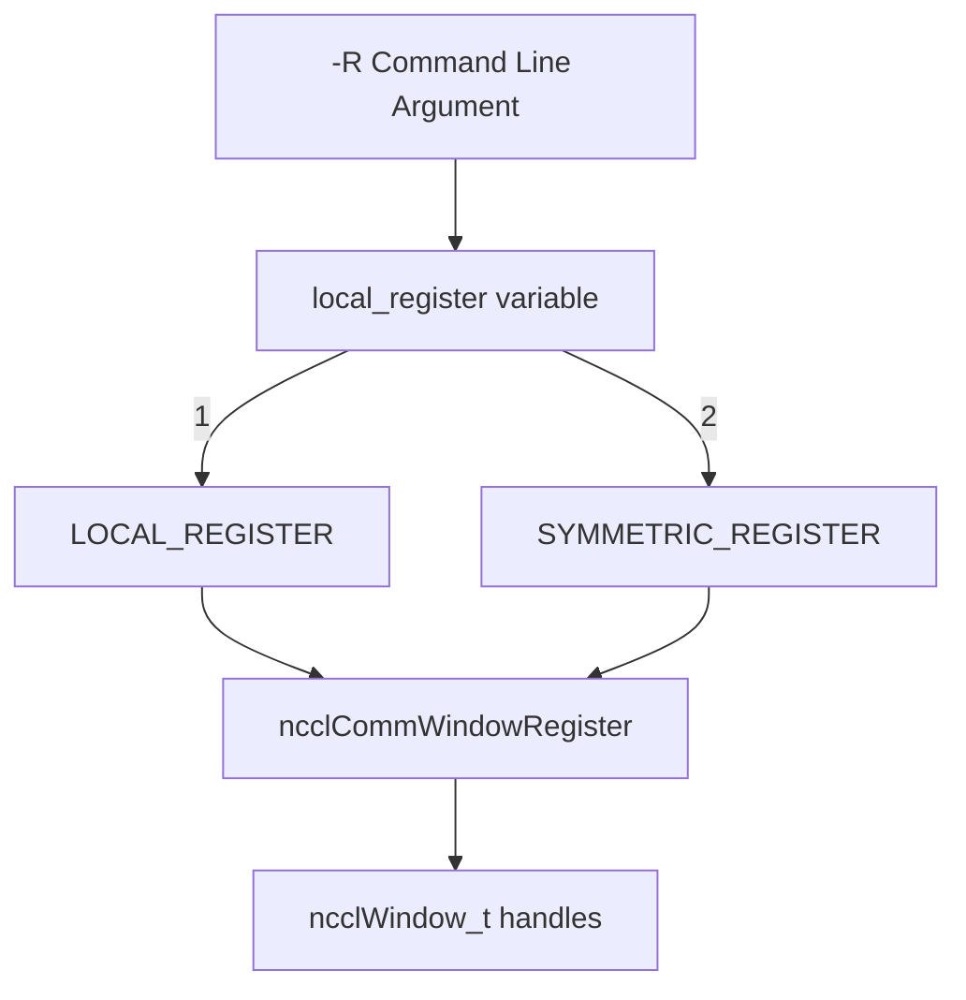
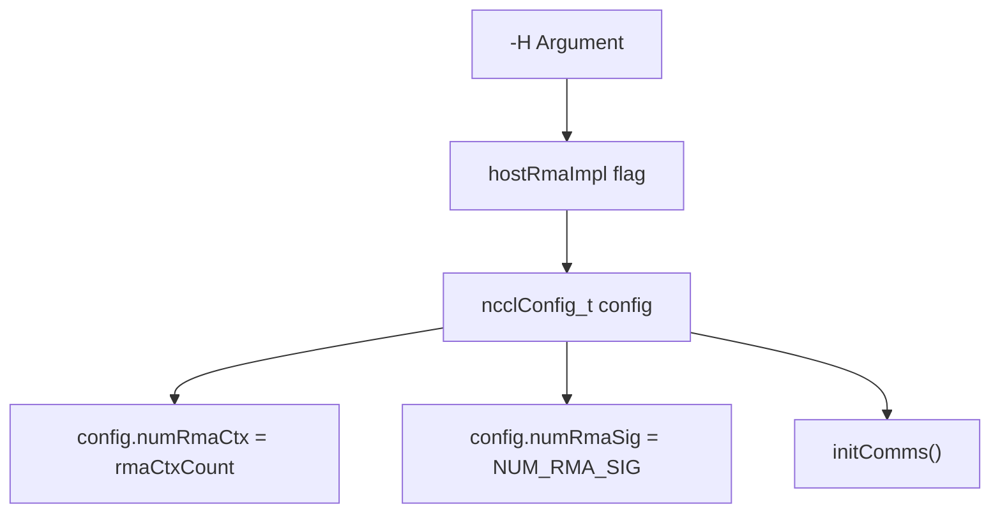

<!-- source: DeepWiki mcp.deepwiki.com · repo NVIDIA/nccl-tests · page 4.4 Memory Registration and Host RMA · fetched 2026-11-11 -->

# Memory Registration and Host RMA

<details>
<summary>Relevant source files</summary>

The following files were used as context for generating this wiki page:

- [src/alltoall.cu](src/alltoall.cu)
- [src/common.cu](src/common.cu)

</details>


## Purpose and Scope
This page details the advanced memory handling and one-sided execution paths in `nccl-tests`, focusing on local vs. symmetric window registration governed by the `-R` command-line argument, weak symbol resolution for `ncclCommWindowRegister`, and host one-sided RMA execution paths enabled via the `-H` flag.

---

## 1. Memory Registration Modes (`-R`)

The test suite provides memory registration options to optimize communication buffers through NCCL's window registration API. This is controlled internally by the `local_register` static variable, which is parsed from command-line options (`src/common.cu:125`):

- **No Registration (`0`)**: Standard unregistered buffer allocations.
- **Local Registration (`LOCAL_REGISTER = 1`)**: Buffers are registered locally using NCCL window registration functions.
- **Symmetric Registration (`SYMMETRIC_REGISTER = 2`)**: Buffers are registered across ranks in a symmetric memory window configuration.

NCCL window registration functions are imported as weak symbols under Linux builds to maintain compatibility across different NCCL library versions (`src/common.cu:23-28`):

```cpp
#if defined(NCCL_OS_LINUX)
#pragma weak ncclCommWindowRegister
#pragma weak ncclCommWindowDeregister
#pragma weak ncclDevCommCreate
#pragma weak ncclDevCommDestroy
#endif
```


*Sources: `src/common.cu:23-28`, `src/common.cu:123-125`*

---

## 2. Host One-Sided RMA Execution Paths (`-H`)

When host one-sided RMA execution paths are enabled via the `-H` command-line switch (`hostRmaImpl`), `nccl-tests` provisions specific RMA contexts and signaling resources during communicator creation [src/common.cu:113]().

Inside `initComms()`, if `hostRmaImpl` is non-zero and the NCCL version supports it (`NCCL_VERSION_CODE >= NCCL_VERSION(2,31,0)`), the `ncclConfig_t` structure is populated with RMA configuration parameters before calling communicator initialization [src/common.cu:216-221]():


*Sources: `src/common.cu:113`, `src/common.cu:216-221`*

---

## 3. Window Management and Device Pointers

Operations utilizing registered windows pass `ncclWindow_t` handles down to device kernels [src/alltoall.cu:143](). Inside device implementations (such as AllToAll scalar and kernel routines), pointers are resolved from the registered windows using `ncclGetLsaPointer`:

- `sendwin`: Source memory window handle [src/alltoall.cu:143]().
- `recvwin`: Destination memory window handle [src/alltoall.cu:143]().
- `ncclGetLsaPointer()`: Resolves local/remote addresses within the registered window space [src/alltoall.cu:144]().

*Sources: `src/alltoall.cu:140-153`*

---

