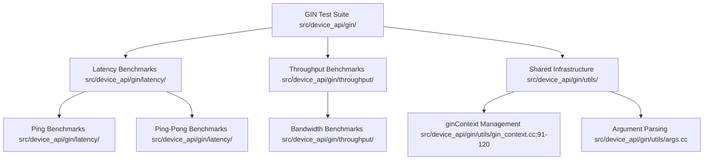
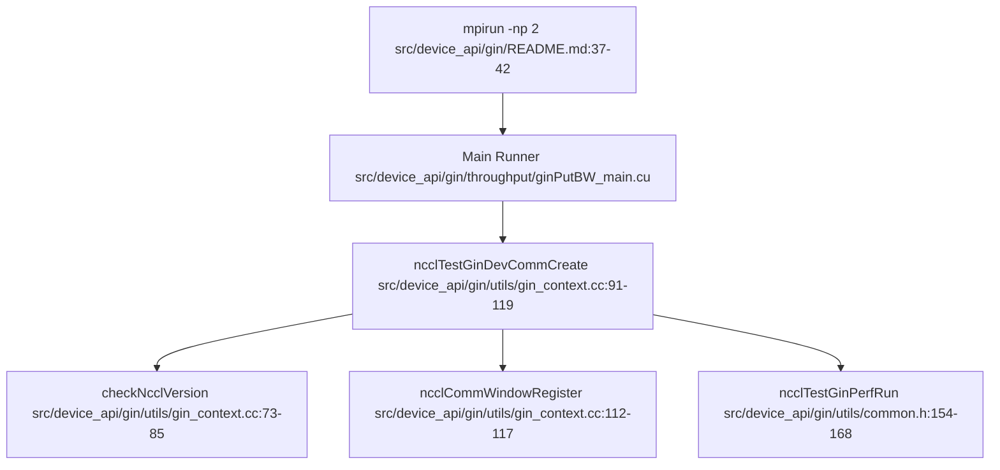

<!-- source: DeepWiki mcp.deepwiki.com · repo NVIDIA/nccl-tests · page 5 GIN Device API Benchmarks · fetched 2026-11-11 -->

# GIN Device API Benchmarks

Relevant source files

The following files were used as context for generating this wiki page:

- [src/device_api/gin/CMakeLists.txt](src/device_api/gin/CMakeLists.txt)
- [src/device_api/gin/README.md](src/device_api/gin/README.md)
- [src/device_api/gin/utils/common.h](src/device_api/gin/utils/common.h)
- [src/device_api/gin/utils/gin_context.cc](src/device_api/gin/utils/gin_context.cc)

The GPU-Initiated Networking (GIN) device API microbenchmark suite located under `src/device_api/gin` [src/device_api/gin/README.md:1-8]() measures the latency, bandwidth, and message rate of NCCL point-to-point GIN operations (`put`, `get`, `signal`, and combined variants). These benchmarks require NCCL 2.30.7+, MPI, and run across exactly two ranks (one GPU per rank) [src/device_api/gin/README.md:7-8]().

Sources: [src/device_api/gin/README.md:1-8](), [src/device_api/gin/CMakeLists.txt:36-99](), [src/device_api/gin/utils/gin_context.cc:91-120]()

## Architecture and Test Categories

The benchmark suite is partitioned into two main functional directories under `src/device_api/gin/`: `latency` and `throughput` [src/device_api/gin/CMakeLists.txt:98-99](). Shared utilities including argument parsing, host/device memory allocation, and NCCL device communicator initialization reside in `src/device_api/gin/utils/` [src/device_api/gin/CMakeLists.txt:20-25]().

Sources: [src/device_api/gin/README.md:37-42](), [src/device_api/gin/utils/gin_context.cc:73-119]()

---

## 5.1 GIN Harness and Context Management

The shared harness infrastructure handles command-line argument parsing, device communicator creation via `ncclDevCommCreate()`, NUMA-aware host memory allocation (`ncclTestGinHostAlloc()`), device memory allocation, window registration (`ncclCommWindowRegister()`), and the main performance loop execution framework.

For deep technical details on argument parsing, resource configuration, memory allocation types, and window registration flags, see [GIN Harness and Context Management](#5.1).

Sources: [src/device_api/gin/utils/gin_context.cc:6-120](), [src/device_api/gin/README.md:92-137]()

---

## 5.2 Latency Benchmarks

The latency benchmark suite measures one-way and round-trip execution times for point-to-point GIN primitives. It includes ping and ping-pong tests covering `put`, `get`, `signal`, combined `put+signal`, and `put+counter` operations. These tests operate with single CTA and single thread configurations (`-c 1 -t 1`) to isolate raw operation latency.

For detailed breakdowns of ping vs. ping-pong test mechanics, timing collection, and operation-specific latency characteristics, see [Latency Benchmarks](#5.2).

Sources: [src/device_api/gin/README.md:66-81](), [src/device_api/gin/CMakeLists.txt:98]()

---

## 5.3 Throughput Benchmarks

The throughput benchmark suite measures aggregate bandwidth (MiB/s) and message rate (MPPS) for GIN operations (`put`, `get`, `signal`, `put+signal`, `put+counter`). It utilizes configurable CTA and thread topologies (`-c`, `-t`), buffer slot partitioning, resource sharing modes (`--gin_rsm`), request aggregation (`--gin_ag`), and credit check controls.

For comprehensive coverage of thread block launch geometries, buffer slot division, bidirectional testing, and performance reporting, see [Throughput Benchmarks](#5.3).

Sources: [src/device_api/gin/README.md:66-87](), [src/device_api/gin/CMakeLists.txt:99]()

---

This concludes the high-level overview of the GIN Device API benchmark suite. Refer to the linked child pages for implementation specifics, code structures, and execution tunables.

---

