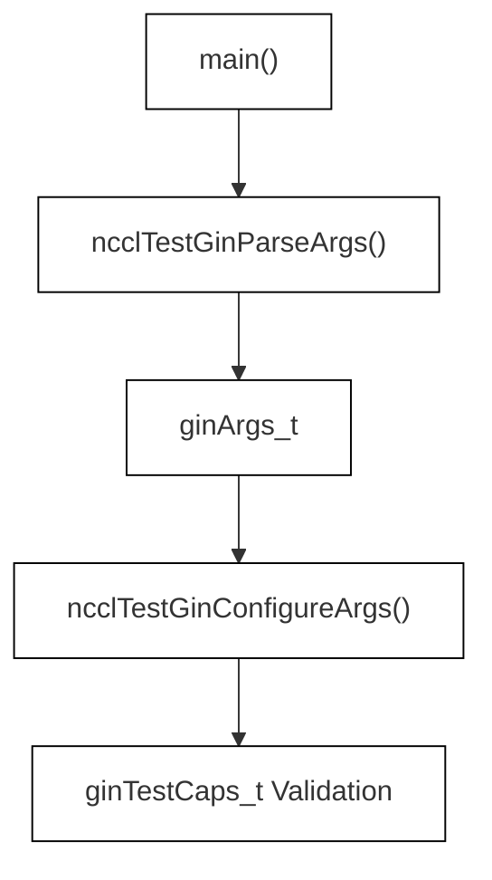
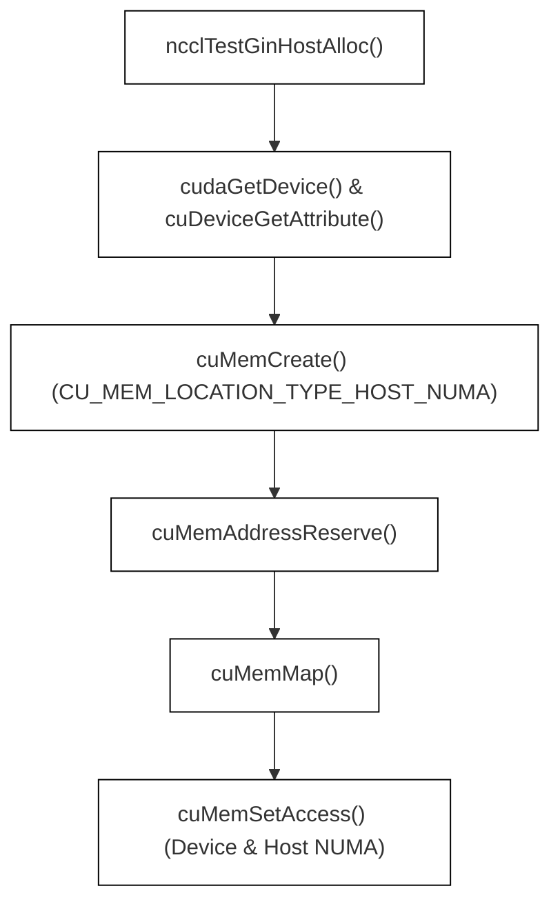
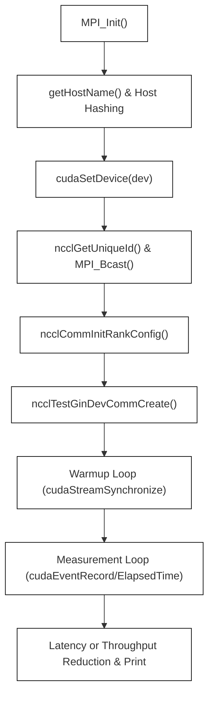

<!-- source: DeepWiki mcp.deepwiki.com · repo NVIDIA/nccl-tests · page 5.1 GIN Harness and Context Management · fetched 2026-11-11 -->

# GIN Harness and Context Management

Relevant source files

The following files were used as context for generating this wiki page:

- [src/device_api/gin/CMakeLists.txt](src/device_api/gin/CMakeLists.txt)
- [src/device_api/gin/utils/args.cc](src/device_api/gin/utils/args.cc)
- [src/device_api/gin/utils/args.h](src/device_api/gin/utils/args.h)
- [src/device_api/gin/utils/common.cc](src/device_api/gin/utils/common.cc)
- [src/device_api/gin/utils/common.h](src/device_api/gin/utils/common.h)
- [src/device_api/gin/utils/gin_context.cc](src/device_api/gin/utils/gin_context.cc)
- [src/device_api/gin/utils/gin_context.h](src/device_api/gin/utils/gin_context.h)

## Purpose and Scope
This page documents the shared infrastructure supporting the GPU-Initiated Networking (GIN) device API microbenchmark suite under `src/device_api/gin/`. The harness manages command-line argument parsing and capability validation (`args.cc`), device communicator initialization and window registration (`gin_context.cc`), NUMA-aware host versus device memory allocation (`gin_context.cc`), and the core execution orchestration loop (`common.cc`).

---

## 1. Argument Parsing and Configuration Management

The GIN microbenchmarks utilize a dedicated argument parsing and validation infrastructure defined in `src/device_api/gin/utils/args.h` and implemented in `src/device_api/gin/utils/args.cc`. The parsing layer processes size ranges, operational modes, resource sharing modes (RSM), and memory types via long and short command-line options.

The parser populates the `ginArgs_t` data structure, which holds runtime settings such as message size bounds (`minBytes`, `maxBytes`), step configurations, iteration counts, CTA and thread counts, and memory placement flags [src/device_api/gin/utils/args.h:31-49]().

*Figure 1: Argument Parsing and Configuration Pipeline*

Supported operational parameters include:
- **Message Sizes & Steps**: `-b`/`--minbytes` and `-e`/`--maxbytes` support unit suffixes (`K`, `M`, `G`), translated by `parseSize()` [src/device_api/gin/utils/args.cc:35-61](). Step size is controlled via multiplicative factors (`-f`) or additive step bytes (`-i`) [src/device_api/gin/utils/args.cc:163-166]().
- **Execution Topology**: `-c`/`--num_ctas` and `-t`/`--num_threads` configure CTA and thread concurrency for throughput workloads [src/device_api/gin/utils/args.cc:20-21]().
- **GIN Specific Flags**: `--gin_op` selects operations (`put`, `put_signal`, `put_counter`) [src/device_api/gin/utils/args.cc:23-24](); `--gin_rsm` sets the resource sharing mode (`thread`, `cta`, `gpu`) [src/device_api/gin/utils/args.cc:30](); and `--gin_strong_signal` toggles strong versus weak signaling [src/device_api/gin/utils/args.cc:25]().
- **Memory Types**: `--local_mem_type` and `--remote_mem_type` configure whether endpoints utilize device memory or host-allocated NUMA memory (`device` or `host`) [src/device_api/gin/utils/args.cc:28-29]().

Binary capabilities are verified against `ginTestCaps_t`, which dictates whether thread-level RSM, aggregation (`--gin_ag`), bidirectional measurement (`--gin_bd`), multi-CTA execution, and host memory are permissible for a specific benchmark [src/device_api/gin/utils/args.h:71-81]().

Sources: [src/device_api/gin/utils/args.h:31-81](), [src/device_api/gin/utils/args.cc:35-166]()

---

## 2. Device Communicator Creation and Version Checking

To execute GIN operations, benchmarks require a valid `ncclComm_t` initialized with specific device communication requirements. This is managed in `src/device_api/gin/utils/gin_context.cc`.

Before device communicator creation, `checkNcclVersion()` verifies that the runtime NCCL library version is at least `2.30.7`, aborting via `MPI_Abort()` if an incompatible older version is detected [src/device_api/gin/utils/gin_context.cc:73-85]().

The core initialization routine `ncclTestGinDevCommCreate()` constructs the device communicator context (`ginContext_t`) using `ncclDevCommCreate()` [src/device_api/gin/utils/gin_context.cc:91-119]():
1. **Requirements Setup**: Populates a `ncclDevCommRequirements_t` structure with `ginContextCount` (derived from `args->numCtas`), `ginQueueDepth`, full connection types, and single signal/counter counts [src/device_api/gin/utils/gin_context.cc:100-108]().
2. **Window Flags**: Determines appropriate window flags, applying `NCCL_WIN_GIN_ONLY` for NCCL versions `>= 2.32.3` [src/device_api/gin/utils/gin_context.cc:93-98]().
3. **Memory Registration**: Automatically allocates and registers local and remote memory buffers if host or device memory types are selected [src/device_api/gin/utils/gin_context.cc:110-118]().

Cleanup is handled by `ncclTestGinDevCommDestroy()`, which tears down the device communicator and unregisters or frees all associated memory windows and buffers [src/device_api/gin/utils/gin_context.cc:121-129]().

Sources: [src/device_api/gin/utils/gin_context.cc:73-129](), [src/device_api/gin/utils/gin_context.h:7-13]()

---

## 3. NUMA Host vs. Device Memory Allocation

GIN benchmarks support both GPU device memory and CPU host-allocated NUMA memory (`ncclGinMemoryHost`) [src/device_api/gin/utils/args.h:24-27](). When host memory is requested, the harness invokes `ncclTestGinHostAlloc()` to allocate pinned, NUMA-local host memory mapped to the GPU [src/device_api/gin/utils/gin_context.cc:6-46]().

*Figure 2: Host NUMA Memory Allocation Pipeline (`ncclTestGinHostAlloc`)*

The host memory allocation sequence utilizes CUDA driver virtual memory management APIs:
1. Queries the current CUDA device and its associated host NUMA node identifier via `CU_DEVICE_ATTRIBUTE_HOST_NUMA_ID` [src/device_api/gin/utils/gin_context.cc:15-17]().
2. Retrieves allocation granularity using `cuMemGetAllocationGranularity()` and aligns the requested buffer size [src/device_api/gin/utils/gin_context.cc:24-26]().
3. Creates a memory allocation handle (`CUmemGenericAllocationHandle`) with `CU_MEM_LOCATION_TYPE_HOST_NUMA` [src/device_api/gin/utils/gin_context.cc:27]().
4. Reserves an address range (`cuMemAddressReserve`), maps the allocation (`cuMemMap`), and configures access permissions for both the device and the host NUMA node using `cuMemSetAccess()` [src/device_api/gin/utils/gin_context.cc:28-38]().

Correspondingly, `ncclTestGinHostFree()` unmaps, releases handles, and frees the reserved address range [src/device_api/gin/utils/gin_context.cc:48-66]().

Sources: [src/device_api/gin/utils/gin_context.cc:6-66]()

---

## 4. Performance Run Harness (`ncclTestGinPerfRun`)

The main execution harness `ncclTestGinPerfRun()` inside `src/device_api/gin/utils/common.cc` drives the benchmarking loop across MPI ranks [src/device_api/gin/utils/common.cc:77-181]().

*Figure 3: Benchmark Execution Flow (`ncclTestGinPerfRun`)*

### Harness Initialization Workflow
1. **MPI & Device Association**: Initializes MPI, enforces a strict requirement of exactly 2 ranks, computes host hashes via string folding, and assigns local GPU devices based on shared host topologies [src/device_api/gin/utils/common.cc:80-102]().
2. **Communicator Bootstrap**: Broadcasts a unique NCCL ID from rank 0 and initializes a blocking `ncclComm_t` via `ncclCommInitRankConfig()` [src/device_api/gin/utils/common.cc:104-115]().
3. **Context Construction**: Invokes `ncclTestGinDevCommCreate()` to establish device communication structures and window registrations [src/device_api/gin/utils/common.cc:117]().

### Measurement Pipeline
For each size point in the sweep:
- **Warmup Phase**: Executes a configurable number of warmup iterations (`warmupIters`) followed by stream synchronization [src/device_api/gin/utils/common.cc:137-141]().
- **Timed Benchmark Phase**: Synchronizes via `MPI_Barrier()`, records start CUDA events, invokes the benchmark kernel callback (`bench->run()`), records stop events, and synchronizes the stream [src/device_api/gin/utils/common.cc:143-149]().
- **Metric Computation**: 
  - *Latency Tests*: Calculates round-trip time (RTT) from elapsed milliseconds, dividing by 2 to yield one-way latency (`latencyUs`) reported by rank 0 [src/device_api/gin/utils/common.cc:151-159]().
  - *Throughput Tests*: Computes aggregate message counts, payload byte sizes, bandwidth (`bandwidthMiBps`), and message rates (`messageRateMpps`). If bidirectional mode (`--gin_bd`) is active, metrics across ranks are aggregated using `MPI_Reduce()` [src/device_api/gin/utils/common.cc:160-180]().

Sources: [src/device_api/gin/utils/common.cc:77-181](), [src/device_api/gin/utils/common.h:162-168]()

---

