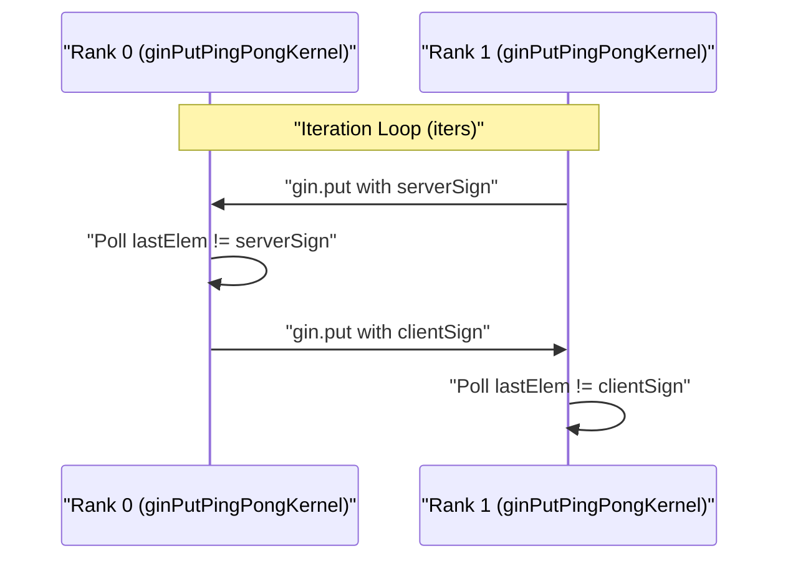

<!-- source: DeepWiki mcp.deepwiki.com · repo NVIDIA/nccl-tests · page 5.2 Latency Benchmarks · fetched 2026-11-11 -->

# Latency Benchmarks

Relevant source files

The following files were used as context for generating this wiki page:

- [src/device_api/gin/latency/ginGetLatency_ping.cu](src/device_api/gin/latency/ginGetLatency_ping.cu)
- [src/device_api/gin/latency/ginLatencyTests.h](src/device_api/gin/latency/ginLatencyTests.h)
- [src/device_api/gin/latency/ginPutCounterLatency_ping.cu](src/device_api/gin/latency/ginPutCounterLatency_ping.cu)
- [src/device_api/gin/latency/ginPutLatency_ping.cu](src/device_api/gin/latency/ginPutLatency_ping.cu)
- [src/device_api/gin/latency/ginPutLatency_pingPong.cu](src/device_api/gin/latency/ginPutLatency_pingPong.cu)
- [src/device_api/gin/latency/ginPutSignalLatency_ping.cu](src/device_api/gin/latency/ginPutSignalLatency_ping.cu)
- [src/device_api/gin/latency/ginSignalLatency_ping.cu](src/device_api/gin/latency/ginSignalLatency_ping.cu)

## Purpose and Scope

The Latency Benchmarks module implements ping and ping-pong latency microbenchmarks for GPU-Initiated Networking (GIN) operations using the NCCL device API. Located under `src/device_api/gin/latency/`, these benchmarks evaluate the execution latency of remote memory access (`put`, `get`), synchronization (`signal`), and compound operations (`put+signal`, `put+counter`) across different resource sharing modes and credit check configurations.

Sources: `src/device_api/gin/latency/ginLatencyTests.h:1-27`

---

## Latency Test Entry Points and Architecture

The benchmark suite defines standardized launch entry points matching `ginRunFn_t` for each latency test variant [src/device_api/gin/latency/ginLatencyTests.h:5-13](). The runner infrastructure selects the appropriate launch function based on command-line arguments, invoking the matching CUDA kernel.

```mermaid
graph TD
    A["ginBenchmark_t::run"] --> B["ncclTestGinPutLatencyPingLaunch"]
    A --> C["ncclTestGinGetLatencyPingLaunch"]
    A --> D["ncclTestGinSignalLatencyPingLaunch"]
    A --> E["ncclTestGinPutSignalLatencyPingLaunch"]
    A --> F["ncclTestGinPutCounterLatencyPingLaunch"]
    A --> G["ncclTestGinPutLatencyPingPongLaunch"]
    
    B --> H["ginPutPingKernel"]
    C --> I["ginGetPingKernel"]
    D --> J["ginSignalPingKernel"]
    E --> K["ginPutSignalPingKernel"]
    F --> L["ginPutCounterPingKernel"]
    G --> M["ginPutPingPongKernel"]

    style A fill:#ffffff,stroke:#000000,stroke-width:1px
    style B fill:#ffffff,stroke:#000000,stroke-width:1px
    style C fill:#ffffff,stroke:#000000,stroke-width:1px
    style D fill:#ffffff,stroke:#000000,stroke-width:1px
    style E fill:#ffffff,stroke:#000000,stroke-width:1px
    style F fill:#ffffff,stroke:#000000,stroke-width:1px
    style G fill:#ffffff,stroke:#000000,stroke-width:1px
    style H fill:#ffffff,stroke:#000000,stroke-width:1px
    style I fill:#ffffff,stroke:#000000,stroke-width:1px
    style J fill:#ffffff,stroke:#000000,stroke-width:1px
    style K fill:#ffffff,stroke:#000000,stroke-width:1px
    style L fill:#ffffff,stroke:#000000,stroke-width:1px
    style M fill:#ffffff,stroke:#000000,stroke-width:1px
```

Sources: `src/device_api/gin/latency/ginLatencyTests.h:15-27`

---

## Operation Implementations

### Put and Get Latency
*   **Put Ping**: `ginPutPingKernel` executes a loop performing a GIN `put` operation followed by a flush using cooperative threads [src/device_api/gin/latency/ginPutLatency_ping.cu:8-27](). It is launched via `ncclTestGinPutLatencyPingLaunch` [src/device_api/gin/latency/ginPutLatency_ping.cu:46-54]().
*   **Get Ping**: `ginGetPingKernel` executes a GIN `get` operation in a loop, fetching data from remote or local windows and flushing the context [src/device_api/gin/latency/ginGetLatency_ping.cu:9-27](). It is launched via `ncclTestGinGetLatencyPingLaunch` [src/device_api/gin/latency/ginGetLatency_ping.cu:46-54]().

Sources: `src/device_api/gin/latency/ginPutLatency_ping.cu:8-54`, `src/device_api/gin/latency/ginGetLatency_ping.cu:9-54`

### Signal and Compound Operations
*   **Signal Ping**: `ginSignalPingKernel` benchmarks signaling latency by repeatedly issuing `ncclGin_StrongSignalInc` or `ncclGin_WeakSignalInc` signals [src/device_api/gin/latency/ginSignalLatency_ping.cu:8-30]().
*   **Put + Signal Ping**: `ginPutSignalPingKernel` combines data movement with signal increments (`ncclGin_StrongSignalInc` or `ncclGin_WeakSignalInc`) in a single `gin.put` invocation [src/device_api/gin/latency/ginPutSignalLatency_ping.cu:8-33]().
*   **Put + Counter Ping**: `ginPutCounterLatency_ping.cu` implements `ginPutCounterPingKernel`, updating a counter shadow variable and waiting for completion via `gin.waitCounter` [src/device_api/gin/latency/ginPutCounterLatency_ping.cu:8-38]().

Sources: `src/device_api/gin/latency/ginSignalLatency_ping.cu:8-58`, `src/device_api/gin/latency/ginPutSignalLatency_ping.cu:8-61`, `src/device_api/gin/latency/ginPutCounterLatency_ping.cu:8-62`

### Ping-Pong Latency
The ping-pong test (`ginPutPingPongKernel`) synchronizes execution between rank 0 and rank 1 using memory polling and acquire memory fences [src/device_api/gin/latency/ginPutLatency_pingPong.cu:9-52]().

Sources: `src/device_api/gin/latency/ginPutLatency_pingPong.cu:9-52`

---

## Configuration Options

All latency kernels support parameterization via `ginArgs_t` and template arguments:

1.  **Resource Sharing Mode (`rsm`)**: Configured via `--gin_rsm` to select between `ncclGinRsmThread`, `ncclGinRsmCta`, and `ncclGinRsmGPU` [src/device_api/gin/latency/ginPutLatency_ping.cu:47-53]().
2.  **Credit Check Bypass**: Controlled by `args->ginSkipCreditCheck`, setting optimization flags to `ncclGinOptFlagsMaySkipCreditCheck` [src/device_api/gin/latency/ginPutLatency_ping.cu:18-19]().
3.  **Signal Strength**: Determined by `args->ginStrongSignal`, selecting between strong and weak signal increments [src/device_api/gin/latency/ginPutSignalLatency_ping.cu:23-29]().

Sources: `src/device_api/gin/latency/ginPutLatency_ping.cu:8-54`, `src/device_api/gin/latency/ginPutSignalLatency_ping.cu:8-61`

---

