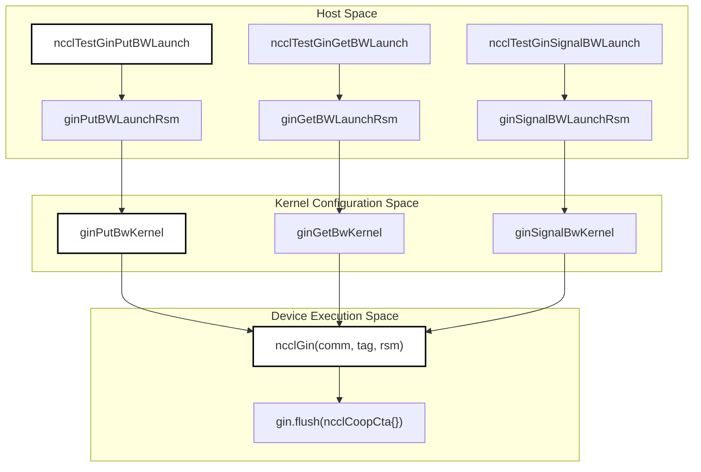

<!-- source: DeepWiki mcp.deepwiki.com · repo NVIDIA/nccl-tests · page 5.3 Throughput Benchmarks · fetched 2026-11-11 -->

# Throughput Benchmarks

Relevant source files

The following files were used as context for generating this wiki page:

- [src/device_api/gin/throughput/ginGetBW.cu](src/device_api/gin/throughput/ginGetBW.cu)
- [src/device_api/gin/throughput/ginPutBW.cu](src/device_api/gin/throughput/ginPutBW.cu)
- [src/device_api/gin/throughput/ginPutCounterBW.cu](src/device_api/gin/throughput/ginPutCounterBW.cu)
- [src/device_api/gin/throughput/ginPutSignalBW.cu](src/device_api/gin/throughput/ginPutSignalBW.cu)
- [src/device_api/gin/throughput/ginSignalBW.cu](src/device_api/gin/throughput/ginSignalBW.cu)
- [src/device_api/gin/throughput/ginThroughputTests.h](src/device_api/gin/throughput/ginThroughputTests.h)

## Overview and Scope

Section 5.3 covers the GPU-Initiated Networking (GIN) throughput and bandwidth microbenchmark suite located under `src/device_api/gin/throughput/`. These tests measure the maximum achievable data bandwidth (GB/s) and message rate (Mops/s) for point-to-point GIN operations executed directly from GPU kernels. The suite supports five primary operations: `put`, `get`, `signal`, `put+signal`, and `put+counter`.

Sources: `src/device_api/gin/throughput/ginThroughputTests.h:1-23`

---

## Benchmark Operations and Kernel Implementations

Each benchmark operation is encapsulated in a dedicated CUDA source file containing specialized CUDA global kernels and host-side launch wrappers. The test parameters, including credit checks, request aggregation, and resource sharing modes, are configured via template parameters to minimize branching overhead within the inner benchmarking loop.

### 1. Put Throughput (`ginPutBW.cu`)
The `ginPutBwKernel` writes blocks of data from a local window (`sWindow`) to a remote peer window (`dWindow`) using `ncclGin` primitives [src/device_api/gin/throughput/ginPutBW.cu:9-55]().
* **Key Entities**: `ginPutBwKernel`, `ncclTestGinPutBWLaunch`, `ncclSymPtr`
* **Implementation Details**: Threads calculate slot offsets based on `maxElems / numElems` and invoke the selected `GinPutFn` function pointer [src/device_api/gin/throughput/ginPutBW.cu:17-23]().

Sources: `src/device_api/gin/throughput/ginPutBW.cu:1-92`

### 2. Get Throughput (`ginGetBW.cu`)
The `ginGetBwKernel` reads blocks of data from a remote peer window (`rWindow`) into a local window (`lWindow`) [src/device_api/gin/throughput/ginGetBW.cu:9-55]().
* **Key Entities**: `ginGetBwKernel`, `ncclTestGinGetBWLaunch`, `ginGetFns`
* **Implementation Details**: Uses `ncclSymPtr` to resolve symmetric addresses across the team before issuing remote read requests via `ginGetFn` [src/device_api/gin/throughput/ginGetBW.cu:21-23]().

Sources: `src/device_api/gin/throughput/ginGetBW.cu:1-89`

### 3. Signal Throughput (`ginSignalBW.cu`)
The `ginSignalBwKernel` focuses strictly on signaling message-rate performance by issuing lightweight or strong signal increments to a remote peer without payload transfers [src/device_api/gin/throughput/ginSignalBW.cu:10-66]().
* **Key Entities**: `ginSignalBwKernel`, `ncclTestGinSignalBWLaunch`, `ncclGinSignal_t`
* **Implementation Details**: Iteratively invokes `gin.signal()` with either `ncclGin_StrongSignalInc` or `ncclGin_WeakSignalInc` [src/device_api/gin/throughput/ginSignalBW.cu:29-37]().

Sources: `src/device_api/gin/throughput/ginSignalBW.cu:1-104`

### 4. Put with Signal Throughput (`ginPutSignalBW.cu`)
The `ginPutSignalBwKernel` combines data movement (`put`) with a concurrent remote signal operation in a single work request [src/device_api/gin/throughput/ginPutSignalBW.cu:10-74]().
* **Key Entities**: `ginPutSignalBwKernel`, `ncclTestGinPutSignalBWLaunch`, `ncclGin_StrongSignalInc`
* **Implementation Details**: Issues composite work queue entries (WQEs) where `wqesPerOp` equals 2, updating remote memory buffers and triggering signal increments simultaneously [src/device_api/gin/throughput/ginPutSignalBW.cu:28-38]().

Sources: `src/device_api/gin/throughput/ginPutSignalBW.cu:1-113`

### 5. Put with Counter Throughput (`ginPutCounterBW.cu`)
The `ginPutCounterBwKernel` pairs data writes with atomic counter increments on the remote peer [src/device_api/gin/throughput/ginPutCounterBW.cu:9-59]().
* **Key Entities**: `ginPutCounterBwKernel`, `ncclTestGinPutCounterBWLaunch`, `ncclGin_WeakCounterInc`
* **Implementation Details**: Executes composite `gin.put()` operations with `ncclGin_WeakCounterInc{counterId}` followed by periodic credit flushing and counter resets [src/device_api/gin/throughput/ginPutCounterBW.cu:34-57]().

Sources: `src/device_api/gin/throughput/ginPutCounterBW.cu:1-88`

---

## Execution Flow and CTA Architecture

The following diagram illustrates the relationship between the host launch functions, templated kernel execution configurations, and device-side `ncclGin` operations.

Sources: `src/device_api/gin/throughput/ginGetBW.cu:57-88`, `src/device_api/gin/throughput/ginPutBW.cu:60-91`, `src/device_api/gin/throughput/ginSignalBW.cu:68-103`

---

## Configuration Flags and Optimizations

The GIN throughput kernels expose several template parameters and runtime flags to tune performance under different hardware constraints:

| Parameter / Flag | Type | Description | Code Reference |
| :--- | :--- | :--- | :--- |
| `skipCreditCheck` | Template (`bool`) | When `true`, uses `ncclGinOptFlagsMaySkipCreditCheck` to bypass per-request credit validation rounds. | [src/device_api/gin/throughput/ginPutBW.cu:25-27]() |
| `aggregateRequests` | Template (`bool`) | Cooperatively aggregates requests across threads before submitting the final batch via the last active thread (`lastActive`). | [src/device_api/gin/throughput/ginPutBW.cu:33-44]() |
| `rsm` | Template (`ncclGinResourceSharingMode`) | Controls resource sharing granularity (`NCCL_GIN_RESOURCE_SHARING_CTA` vs `NCCL_GIN_RESOURCE_SHARING_GPU`). | [src/device_api/gin/throughput/ginPutBW.cu:83-89]() |
| `queueDepth` | Runtime (`int`) | Determines the pacing of queue flushes (`flushEvery`) to prevent work queue overflow during high iteration runs. | [src/device_api/gin/throughput/ginPutBW.cu:29-31]() |

Sources: `src/device_api/gin/throughput/ginGetBW.cu:8-55`, `src/device_api/gin/throughput/ginPutBW.cu:8-58`, `src/device_api/gin/throughput/ginSignalBW.cu:8-66`

---

