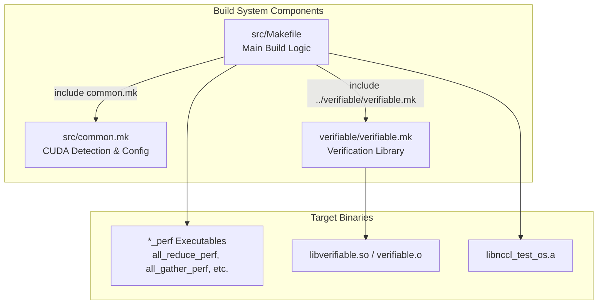

<!-- source: DeepWiki mcp.deepwiki.com · repo NVIDIA/nccl-tests · page 6 Build System · fetched 2026-11-11 -->

# Build System

Relevant source files

The following files were used as context for generating this wiki page:

- [src/Makefile](src/Makefile)
- [src/alltoallv.cu](src/alltoallv.cu)
- [src/common.mk](src/common.mk)
- [verifiable/Makefile](verifiable/Makefile)
- [verifiable/main.cu](verifiable/main.cu)
- [verifiable/verifiable.mk](verifiable/verifiable.mk)

The NCCL-tests build infrastructure generates per-collective binaries with version-aware compilation, supporting both GNU Make and CMake build systems. This section provides a high-level overview of the build framework.

## Overview and Child Pages

The build system handles platform detection, automatic CUDA version discovery, target architecture code generation (`NVCC_GENCODE`), optional MPI integration, dynamic shared object (DSO) packaging, and the verifiable test framework integration [src/Makefile:1-172](), [src/common.mk:1-99]().

For detailed information on specific components of the build system, refer to the following child pages:
- **Build Configuration** (#6.1) — Details on build variables, CUDA version detection, architecture targeting, compiler flags, OS detection, and configuration options (MPI, DSO linking).
- **Binary Generation and Linking** (#6.2) — Explanation of how individual `*_perf` binaries are generated, shared object files are linked, and the verifiable subsystem is integrated.
- **CMake Build** (#6.3) — The alternative CMake build: top-level CMakeLists, per-directory configs, git version generation, and GIN target discovery.

## Build Infrastructure Architecture

Sources: [src/Makefile:6](), [src/Makefile:74](), [src/Makefile:94](), [src/common.mk:1-99]()

---

