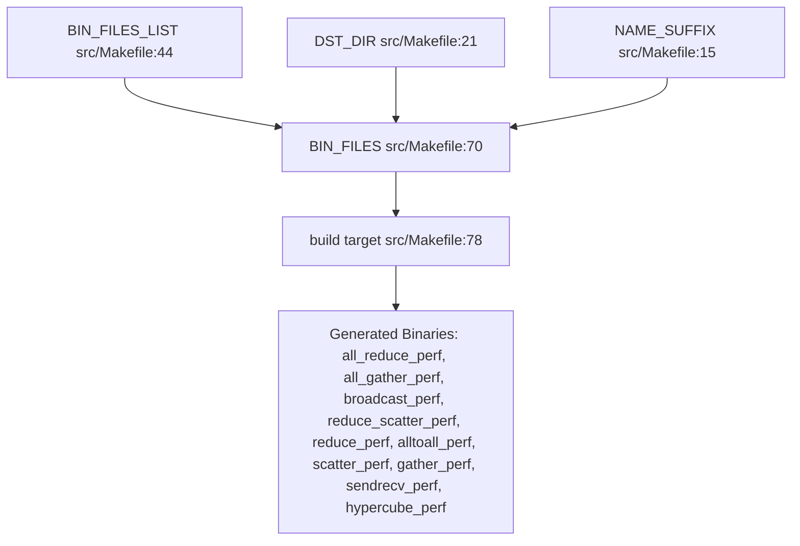
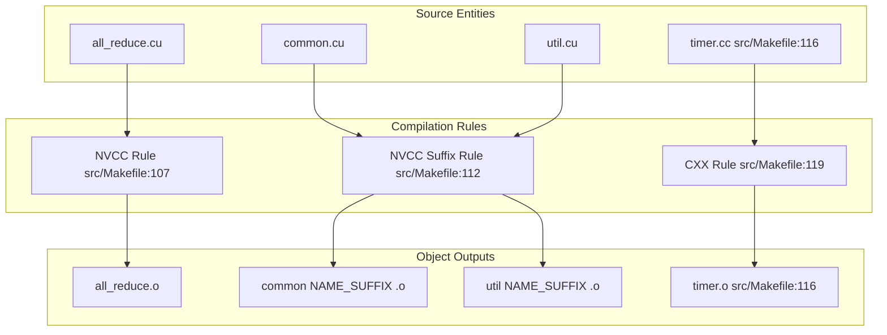
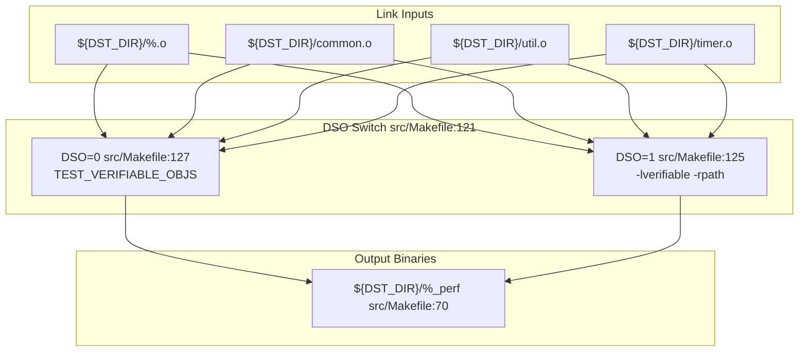

<!-- source: DeepWiki mcp.deepwiki.com · repo NVIDIA/nccl-tests · page 6.2 Binary Generation and Linking · fetched 2026-11-11 -->

# Binary Generation and Linking

<details>
<summary>Relevant source files</summary>

The following files were used as context for generating this wiki page:

- [src/Makefile](src/Makefile)
- [src/alltoallv.cu](src/alltoallv.cu)
- [verifiable/verifiable.cu](verifiable/verifiable.cu)
- [verifiable/verifiable.h](verifiable/verifiable.h)

</details>


## Purpose and Scope

This document explains how the NCCL Tests build system generates individual performance test binaries, links shared object files, and integrates the verifiable subsystem. Each collective operation produces a standalone executable that shares common infrastructure through linked object files. For information about build configuration and compiler flags, see page 5.1 (`[src/common.mk:1-88]()`). For details about the verification library implementation, see page 2.6 (`[verifiable/verifiable.h:1-64]()`).

Sources: [src/Makefile:1-10](), [src/common.mk:1-88](), [verifiable/verifiable.h:1-64]()

---

## Binary Target List

The build system defines performance test binaries in the `BIN_FILES_LIST` variable (`[src/Makefile:44]`). Each binary follows the pattern `${DST_DIR}/%_perf${NAME_SUFFIX}` (`[src/Makefile:70]`).

### Binary Targets and Source Files

| Binary Target | Source File | Makefile Variable |
|--------------|-------------|-------------------|
| `all_reduce_perf` | `all_reduce.cu` | `BIN_FILES_LIST` (`[src/Makefile:44]()`) |
| `all_gather_perf` | `all_gather.cu` | `BIN_FILES_LIST` (`[src/Makefile:44]()`) |
| `broadcast_perf` | `broadcast.cu` | `BIN_FILES_LIST` (`[src/Makefile:44]()`) |
| `reduce_scatter_perf` | `reduce_scatter.cu` | `BIN_FILES_LIST` (`[src/Makefile:44]()`) |
| `reduce_perf` | `reduce.cu` | `BIN_FILES_LIST` (`[src/Makefile:44]()`) |
| `alltoall_perf` | `alltoall.cu` | `BIN_FILES_LIST` (`[src/Makefile:44]()`) |
| `scatter_perf` | `scatter.cu` | `BIN_FILES_LIST` (`[src/Makefile:44]()`) |
| `gather_perf` | `gather.cu` | `BIN_FILES_LIST` (`[src/Makefile:44]()`) |
| `sendrecv_perf` | `sendrecv.cu` | `BIN_FILES_LIST` (`[src/Makefile:44]()`) |
| `hypercube_perf` | `hypercube.cu` | `BIN_FILES_LIST` (`[src/Makefile:44]()`) |

The `NAME_SUFFIX` variable (`[src/Makefile:15]`) allows customization of binary names, commonly set to `_mpi` when building with MPI support (`MPI=1`).

**Binary Target Generation Flow (Code-Entity Bridge)**



Sources: [src/Makefile:15](), [src/Makefile:21](), [src/Makefile:44](), [src/Makefile:70](), [src/Makefile:78]()

---

## Object File Compilation

The build system compiles source files into object files using type-specific compilation rules (`[src/Makefile:104-119]()`). Three object file types are generated: collective-specific objects, shared framework objects, and the timer object.

### Compilation Rules

Individual collective sources compile using the pattern rule (`[src/Makefile:104-107]()`):
```make
${DST_DIR}/%.o: %.cu common.h util.h $(TEST_VERIFIABLE_HDRS)
	@printf "Compiling  %-35s > %s\n" $< $@
	@mkdir -p ${DST_DIR}
	$(NVCC) -o $@ $(NVCUFLAGS) -c $<
```

Shared framework objects (`common.o`, `util.o`) compile using a specialized rule supporting `NAME_SUFFIX` (`[src/Makefile:109-112]()`). The C++ timer module (`timer.cc`) compiles using `CXX` (`[src/Makefile:116-119]()`).

**Object File Compilation Dependency Flow**



Sources: [src/Makefile:104-119]()

---

## Linking Process and Shared Object Integration

The linking stage combines object files and external libraries to produce executable binaries [src/Makefile:121-131](). The build system supports two linking modes controlled by the `DSO` variable [src/Makefile:17]().

### Static Linking Mode (DSO=0)

When `DSO=0`, all verification object files (`TEST_VERIFIABLE_OBJS`) are linked directly into each performance binary [src/Makefile:127-130]().

### Dynamic Linking Mode (DSO=1)

When `DSO=1`, binaries link against `libverifiable.so` using `TEST_VERIFIABLE_LIBS` and set the runtime dynamic library search path [src/Makefile:121-125]():
```make
${DST_DIR}/%_perf$(NAME_SUFFIX): ${DST_DIR}/%.o ${DST_DIR}/common$(NAME_SUFFIX).o ${DST_DIR}/util$(NAME_SUFFIX).o ${DST_DIR}/timer.o $(TEST_VERIFIABLE_LIBS) $(TEST_OS_LIB)
	@printf "Linking  %-35s > %s\n" $< $@
	@mkdir -p ${DST_DIR}
	$(NVCC) -o $@ $(NVCUFLAGS) $^ -L$(TEST_VERIFIABLE_BUILDDIR) -lverifiable ${NVLDFLAGS} -Xlinker "--enable-new-dtags" -Xlinker "-rpath,\$$ORIGIN:\$$ORIGIN/verifiable" -Xlinker --export-dynamic
```

**Linking Architecture and DSO Modes**



Sources: [src/Makefile:17](), [src/Makefile:70](), [src/Makefile:121-131]()

---

## Verifiable Subsystem Integration

The verifiable subsystem provides correctness validation for collective operations via routines like `ncclVerifiablePrepareInput` and `ncclVerifiableVerify` defined in `verifiable/verifiable.h` (`[verifiable/verifiable.h:37-58]()`). It integrates into the build via `../verifiable/verifiable.mk` (`[src/Makefile:92-94]()`).

### Build Variables for Verifiable Subsystem

* `TEST_VERIFIABLE_HDRS`: Verification header dependencies (`[src/Makefile:104]()`).
* `TEST_VERIFIABLE_OBJS`: Static object files used when `DSO=0` (`[src/Makefile:127]()`).
* `TEST_VERIFIABLE_LIBS`: Shared library reference used when `DSO=1` (`[src/Makefile:122]()`).
* `TEST_VERIFIABLE_BUILDDIR`: Output directory (`[src/Makefile:93]`).

Sources: [src/Makefile:92-94](), [src/Makefile:104](), [src/Makefile:122](), [src/Makefile:127](), [verifiable/verifiable.h:37-58]()

---

## Build Configuration Variables

Binary generation is controlled by several key variables:

| Variable | Default | Description | Source Reference |
|----------|---------|-------------|------------------|
| `MPI` | `0` | Enables multi-process/MPI support | [src/Makefile:13]() |
| `DSO` | `0` | Enables dynamic linking of `libverifiable.so` | [src/Makefile:17]() |
| `NAME_SUFFIX` | *(empty)* | Appends suffix to binaries and objects (e.g., `_mpi`) | [src/Makefile:15]() |
| `BUILDDIR` | `../build` | Root build output directory | [src/Makefile:21]() |

Sources: [src/Makefile:13](), [src/Makefile:15](), [src/Makefile:17](), [src/Makefile:21]()

---

