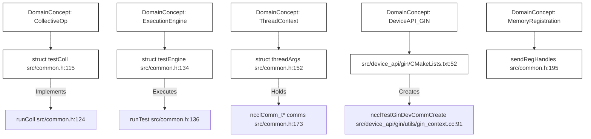

<!-- source: DeepWiki mcp.deepwiki.com · repo NVIDIA/nccl-tests · page 7 Glossary · fetched 2026-11-11 -->

# Glossary

Relevant source files

The following files were used as context for generating this wiki page:

- [README.md](README.md)
- [src/common.h](src/common.h)
- [src/device_api/gin/CMakeLists.txt](src/device_api/gin/CMakeLists.txt)
- [src/device_api/gin/utils/common.h](src/device_api/gin/utils/common.h)
- [src/device_api/gin/utils/gin_context.cc](src/device_api/gin/utils/gin_context.cc)
- [src/util.cu](src/util.cu)

## Purpose and Scope
This page provides definitions for codebase-specific terms, domain concepts, jargon, and abbreviations used throughout `nccl-tests`. Each term includes a detailed explanation of its role in the testing framework or NCCL runtime, accompanied by direct code pointers to relevant source files and structures.

---

## Term Definitions

### Algorithmic Bandwidth vs. Bus Bandwidth
- **Algorithmic Bandwidth (`algBw`)**: The effective data rate calculated purely from the logical message size transferred divided by the elapsed time: $\frac{\text{bytes}}{\text{seconds}}$.
- **Bus Bandwidth (`busBw`)**: A normalized metric that accounts for the interconnect topology and data replication/reduction overhead of a specific collective operation. It reflects the actual traffic volume placed on the underlying NVLink or PCIe/Network bus. Calculated via collective-specific formulas implemented in hooks like `getBw` (`[src/common.h:123]()`).

### CTA (Cooperative Thread Array)
- A CUDA thread block. In custom device-side implementations and GIN microbenchmarks, the number of CTAs participating in a kernel launch can be explicitly configured via command-line arguments (e.g., `-V,--device_cta_count`, `[README.md:100]`).

### DSO (Dynamic Shared Object)
- Shared libraries (`.so` or DLLs) loaded dynamically at runtime. In `nccl-tests`, dynamic linking is used to bind against `libnccl.so` and optionally load profiling hooks or alternative NCCL versions.

### GIN (GPU-Initiated Networking)
- A suite of point-to-point device API microbenchmarks located under `[src/device_api/gin/CMakeLists.txt:1-99]()`. GIN allows GPU threads to directly initiate network operations (such as `put`, `get`, and `signal`) using hardware queue structures and window registrations managed by `ncclDevCommCreate` (`[src/device_api/gin/utils/gin_context.cc:91-119]()`).

### In-Place Operation
- An execution mode where the source buffer and receive buffer share overlapping or identical memory locations (`[src/common.h:119]`). Handled during buffer initialization and byte count calculations via `initData` and `getCollByteCount` (`[src/common.h:117-122]()`).

### Multimem
- Hardware-accelerated multi-cast/multi-load instructions supported on NVIDIA architectures. Used in advanced custom kernels to optimize data distribution across multiple peers simultaneously.

### RMA (Remote Memory Access)
- One-sided communication primitives where an origin GPU reads from or writes to a target GPU's memory window without explicit synchronization or thread participation on the target. Host-driven RMA (`-H`) utilizes functions like `ncclPutSignal` and `ncclWaitSignal` (`[src/common.h:29-30]`, `[README.md:99]()`).

### Split Mask (`NCCL_TESTS_SPLIT`)
- An execution environment mechanism that partitions the available set of CUDA devices into smaller, independent sub-communicator groups, enabling multiple distinct collective operations to execute concurrently within a single job (`[README.md:108-110]()`).

### Symmetric Registration (`local_register`, `-R`)
- A memory registration mode where send and/or receive buffers are registered with identical virtual address mappings across all ranks participating in the communicator (`[README.md:97]()`). Required by advanced device-side implementations (`-D`) and host RMA (`-H`). Registration handles are tracked in `sendRegHandles` and `recvRegHandles` (`[src/common.h:195-198]()`).

### `testColl`
- A core C-style plugin structure defining the interface for a collective operation, including name, byte-counting helpers, data initialization routines, bandwidth calculators, and execution hooks (`[src/common.h:115-126]`). Instances include `allReduceTest` and `allGatherTest` (`[src/common.h:127-133]()`).

### `testEngine`
- A structure providing the engine harness for running tests, managing buffer size calculations, execution dispatch, and optional configuration hooks such as `initCommConfig` and `getDevCommRequirements` (`[src/common.h:134-148]`).

### `threadArgs`
- The central context data structure passed to test worker threads (`[src/common.h:152-199]()`). It encapsulates configuration parameters (`nbytes`, `minbytes`, `maxbytes`), process/thread/GPU indices (`nProcs`, `proc`, `nThreads`, `thread`), buffer allocations (`sendbuffs`, `recvbuffs`), CUDA streams (`streams`), and NCCL communicators (`comms`, `devComms`).

---

## Architectural Mapping: Concepts to Code Entities

The following diagram illustrates how high-level domain concepts and arguments map directly to core data structures and functions within the codebase.

Sources: `[src/common.h:115-199]()`, `[src/device_api/gin/CMakeLists.txt:52-62]()`, `[src/device_api/gin/utils/gin_context.cc:91-119]()`