# Page: Overview

# Overview

<details>
<summary>Relevant source files</summary>

The following files were used as context for generating this wiki page:

- [README.md](README.md)
- [src/common.cu](src/common.cu)

</details>


NCCL Tests is a performance benchmarking and correctness validation suite for the NVIDIA Collective Communications Library (NCCL). It provides standalone test binaries for measuring bandwidth, latency, and data correctness of NCCL collective communication operations across multiple GPUs, processes, and nodes.

For comprehensive build instructions and dependencies, see [Installation and Build](#1.1). For a full reference of command-line parameters, see [Command Line Arguments](#1.2). For detailed architectural patterns, see [System Architecture](#1.3).

## Purpose and Scope

NCCL Tests serves three primary functions:

1. **Performance Measurement**: Quantifies algorithmic and bus bandwidth as well as latency for collective operations across varying message sizes [README.md:55-57]().
2. **Correctness Validation**: Verifies that collective operations produce mathematically correct results using deterministic data generation and GPU-based verification [README.md:3-3,89]().
3. **Scalability Testing**: Supports multi-GPU, multi-thread, and multi-node execution configurations using MPI [README.md:35-38]().

The test suite is designed for system administrators, NCCL developers, and performance engineers who need to validate NCCL functionality and measure communication performance on GPU clusters.

Sources: [README.md:1-5](), [src/common.cu:1-30]()

## Core Components

The NCCL Tests architecture consists of four primary layers that orchestrate user commands, execution engines, collective plugins, and underlying libraries.

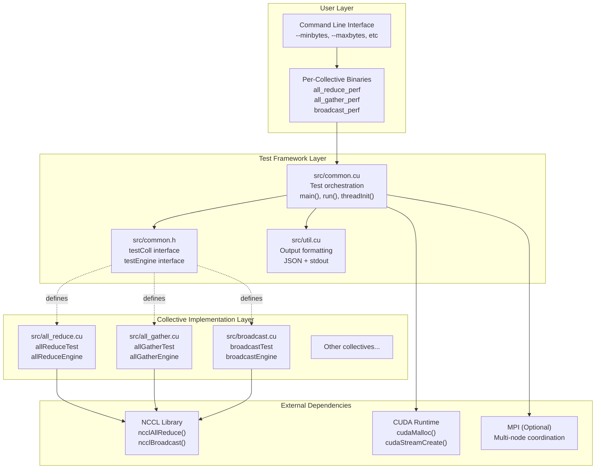

**Figure 1: High-Level System Architecture**

For details on system design, component interaction, and binary layout, see [System Architecture](#1.3).

Sources: [src/common.cu:1-30](), [src/common.h](), [README.md:1-20]()

### Framework Core and Plugin Architecture

The framework core implemented in `src/common.cu` provides centralized initialization, multi-threaded worker management, timing measurement, and result reporting. Each collective operation implements standardized interfaces (`testColl` and `testEngine`) defined in `src/common.h` [src/common.h]().

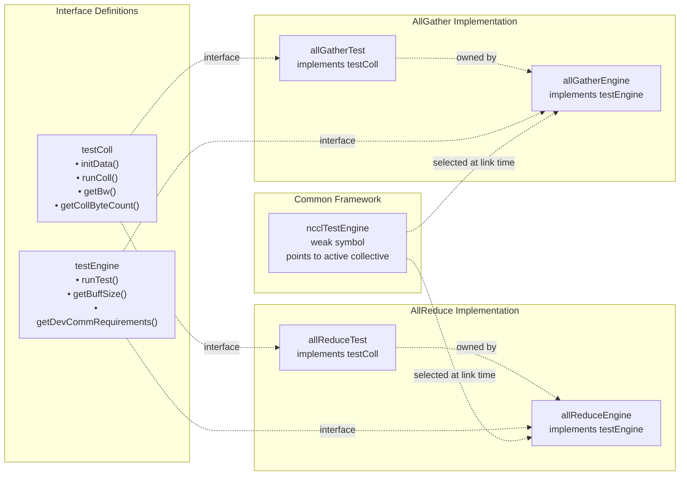

**Figure 2: Collective Operation Plugin System**

For details on building the suite and target binaries, see [Installation and Build](#1.1).

Sources: [src/common.cu:713-791](), [src/common.h]()

## Execution Model and Parameters

Test execution follows a hierarchical pattern spanning MPI processes, worker threads, and CUDA devices. Each participating GPU is assigned a unique rank based on process, thread, and device indices [README.md:35-38]().

Command-line parameters control message size scaling, iteration counts, data verification, and advanced features such as CUDA graphs and buffer registration [README.md:60-107](). For a comprehensive description of all available flags, defaults, and usage examples, see [Command Line Arguments](#1.2).

Sources: [README.md:35-107](), [src/common.cu:818-1438]()

---

# Page: Installation and Build

# Installation and Build

<details>
<summary>Relevant source files</summary>

The following files were used as context for generating this wiki page:

- [CMakeLists.txt](CMakeLists.txt)
- [LICENSE.txt](LICENSE.txt)
- [Makefile](Makefile)
- [src/common.mk](src/common.mk)
- [src/nccl1_compat.h](src/nccl1_compat.h)
- [tools/generate_git_version.cmake](tools/generate_git_version.cmake)
- [verifiable/Makefile](verifiable/Makefile)
- [verifiable/main.cu](verifiable/main.cu)
- [verifiable/verifiable.mk](verifiable/verifiable.mk)

</details>


This page provides comprehensive instructions for building the NCCL Tests benchmarking and correctness validation suite from source, covering dependency requirements, build variables, architecture targeting, and compilation procedures using both GNU Make and CMake build systems.

Sources: [src/common.mk:1-99](), [CMakeLists.txt:1-147]()

## Prerequisites

Before building NCCL Tests, ensure the following dependencies are installed and accessible in your environment:
- **CUDA Toolkit** (version 9.0 or higher; CUDA 12.8+ or 13.0 recommended for Blackwell/newer architectures) [src/common.mk:21-67](), [CMakeLists.txt:48-56]()
- **NCCL Library** (header files and runtime/static libraries) [CMakeLists.txt:61-94]()
- **C++ Compiler** with C++14 support (or C++17 when using CUDA 13.0 or newer) [src/common.mk:20-25](), [CMakeLists.txt:36-42]()
- **GNU Make** (for the traditional Makefile build) [Makefile:1-23]()
- **CMake** (version 3.25 or higher, for the CMake build system) [CMakeLists.txt:7]()
- **MPI Library** (Optional, e.g., OpenMPI or MPICH for multi-node testing) [CMakeLists.txt:24]()

Sources: [src/common.mk:20-67](), [CMakeLists.txt:7-25]()

## Compilation via Make

The traditional build system is orchestrated via GNU `make` at the root and within `src/` [Makefile:12-20]().

### Basic Build
To compile all performance test binaries with default settings, run:
```bash
make
```
For parallel compilation, use:
```bash
make -j
```
Binaries are output into the `build` directory (`BUILDDIR`) [Makefile:7-8]().

### Build Configuration Options and Variables
The Make build system respects several environment variables and configuration parameters:

| Variable | Default | Description |
|----------|---------|-------------|
| `CUDA_HOME` | `/usr/local/cuda` | Path to the CUDA Toolkit root directory [src/common.mk:6]() |
| `PREFIX` | `/usr/local` | Installation prefix [src/common.mk:7]() |
| `DEBUG` | `0` | Set to `1` to enable debug flags (`-O0 -G -g`) [src/common.mk:9,87-93]() |
| `VERBOSE` | `0` | Set to `1` to enable verbose compiler warnings and output [src/common.mk:8,95-99]() |
| `BUILDDIR` | `build` | Output directory for built binaries and objects [Makefile:7]() |
| `MPI` | `0` | Set to `1` to enable MPI multi-node support |
| `MPI_HOME` | `/usr/local/mpi` | Path to MPI installation when `MPI=1` |
| `DSO` | `0` | Compile the verification library as a dynamic shared object (`libverifiable.so`) [verifiable/verifiable.mk:7]() |
| `NAME_SUFFIX` | (empty) | Optional suffix appended to generated test binary names |

Examples:
```bash
# Build with MPI support and custom CUDA path
make MPI=1 CUDA_HOME=/usr/local/cuda-12.8

# Build with debug symbols enabled
make DEBUG=1
```

Sources: [src/common.mk:6-15](), [Makefile:7-20](), [verifiable/verifiable.mk:1-18]()

## Compilation via CMake

As an alternative to GNU Make, NCCL Tests supports building via CMake (`CMakeLists.txt`) [CMakeLists.txt:1-147](). CMake automatically discovers the CUDA toolkit, detects CUDA architecture defaults, handles Git version generation, and configures targets for Linux and Windows.

### CMake Build Steps
```bash
mkdir build && cd build
cmake -DCMAKE_BUILD_TYPE=Release -DNCCL_HOME=/path/to/nccl ..
cmake --build . -j
```

### Key CMake Options
- `-DNCCL_HOME=/path/to/nccl`: Specifies the root directory of the NCCL installation or build tree [CMakeLists.txt:59]()
- `-DCMAKE_CUDA_ARCHITECTURES="75;80;90;100;120"`: Overrides default target GPU architectures [CMakeLists.txt:47-57]()
- `-DCMAKE_BUILD_TYPE=Release`: Selects build optimization level (Release or Debug) [CMakeLists.txt:11-13]()

Sources: [CMakeLists.txt:1-147](), [tools/generate_git_version.cmake:1-27]()

## CUDA Architecture Targeting and Version Handling

The build systems automatically detect the installed CUDA version via `nvcc` and configure appropriate C++ standards and GPU code generation flags (`--gencode`) [src/common.mk:16-67](), [CMakeLists.txt:36-57]().

- **CUDA 13.0+**: Automatically selects C++17 standard (`-std=c++17`) and targets architectures including sm_75, sm_80, sm_90, sm_100, and sm_120 [src/common.mk:20-36](), [CMakeLists.txt:36-49]().
- **CUDA 12.8+**: Targets architectures including sm_60, sm_70, sm_80, sm_90, sm_100, and sm_120 [src/common.mk:37-46](), [CMakeLists.txt:50-51]().
- **Older CUDA Versions**: Targets earlier compute capabilities (sm_35, sm_50, sm_60, etc.) with C++14 [src/common.mk:47-67](), [CMakeLists.txt:52-56]().

Sources: [src/common.mk:16-67](), [CMakeLists.txt:36-57]()

## Build System Architecture

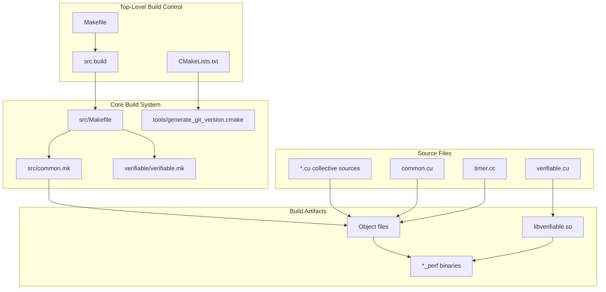

Sources: [Makefile:1-23](), [src/common.mk:1-99](), [CMakeLists.txt:1-147](), [verifiable/verifiable.mk:1-18]()

## Dependency Relationships

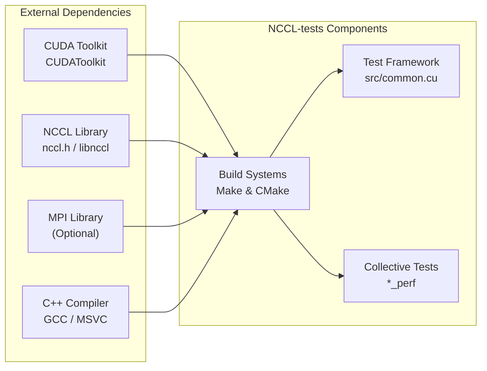

Sources: [src/common.mk:1-99](), [CMakeLists.txt:1-147]()

## Build Artifacts

Upon successful compilation, the build process produces:
- **Performance Test Executables**: `all_reduce_perf`, `all_gather_perf`, `broadcast_perf`, `reduce_scatter_perf`, `reduce_perf`, `alltoall_perf`, `scatter_perf`, `gather_perf`, `sendrecv_perf`, `hypercube_perf`, and `comm_ops_perf`.
- **Verification Components**: Static integration or shared object library (`libverifiable.so`) for data verification [verifiable/verifiable.mk:7](), along with `self_test` binaries [verifiable/Makefile:24-29]().
- **Git Version Header**: Automatically generated header `nccl_tests_git_version.h` tracking repository state [tools/generate_git_version.cmake:1-27]().

Sources: [verifiable/verifiable.mk:1-18](), [verifiable/Makefile:24-29](), [tools/generate_git_version.cmake:1-27]()

## Verification

Verify the build by executing a basic performance test binary:
```bash
./build/all_reduce_perf -b 8 -e 128M -f 2 -g 1
```
This runs an AllReduce benchmark on a single GPU across buffer sizes from 8 bytes to 128 MB.

Sources: [verifiable/main.cu:1-14]()

---

# Page: Command Line Arguments

# Command Line Arguments

<details>
<summary>Relevant source files</summary>

The following files were used as context for generating this wiki page:

- [README.md](README.md)
- [src/common.cu](src/common.cu)

</details>


This page provides a comprehensive reference for all command-line arguments supported by NCCL Tests performance binaries. These arguments control test execution parameters, data sizes, NCCL operation settings, performance measurement options, and output formatting.

For information about building the test binaries, see [Installation and Build](#1.1). For details about the test execution framework that processes these arguments, see [Test Orchestration and Execution](#2.2).

## Overview and Categorization

All NCCL Tests performance binaries (`all_reduce_perf`, `broadcast_perf`, etc.) parse their parameters into global configuration variables defined in [src/common.cu:88-125](). These parameters are organized into six main categories:

- **GPU Configuration**: Number of threads and GPUs per test (`-t`, `-g`)
- **Data Size Control**: Size ranges and increment patterns (`-b`, `-e`, `-i`, `-f`, `-u`)
- **NCCL Operation Parameters**: Operation type, data type, and root rank settings (`-o`, `-d`, `-r`)
- **Performance Measurement**: Iteration counts, timing options, and aggregation settings (`-n`, `-w`, `-m`, `-N`, `-a`, `-I`, `-K`, `-C`)
- **Test Execution Control**: Initialization modes, correctness checking, blocking, and graphs (`-p`, `-c`, `-z`, `-G`, `-R`, `-D`, `-H`, `-V`, `-T`, `-M`)
- **Reporting and Output**: Timestamps, tuning information, and JSON file logging (`-S`, `-J`, `-U`)

## Argument Parsing and Initialization Flow

The following diagram bridges the natural language command-line options to the underlying code entities and functions in `src/common.cu` responsible for parsing and configuring the test environment.

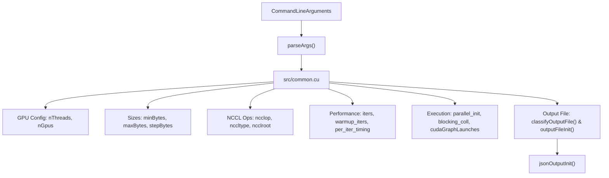

Sources: [src/common.cu:88-198](), [README.md:60-106]()

## GPU Configuration Arguments

These arguments control the distribution of GPUs across processes and threads for multi-GPU testing.

| Argument | Default | Description |
|----------|---------|-------------|
| `-t, --nthreads <num>` | `1` | Number of threads per process. Controlled by `nThreads` in [src/common.cu:89]() |
| `-g, --ngpus <num>` | `1` | Number of GPUs per thread. Controlled by `nGpus` in [src/common.cu:90]() |

The total number of NCCL ranks equals: `(MPI processes) × (threads per process) × (GPUs per thread)`

Sources: [src/common.cu:89-90](), [README.md:63-65]()

## Data Size Control Arguments

These arguments define the range of data sizes to test, increment patterns, and buffer misalignment options.

| Argument | Default | Description |
|----------|---------|-------------|
| `-b, --minbytes <size>` | `32M` | Minimum size to start with (`minBytes` in [src/common.cu:91]()) |
| `-e, --maxbytes <size>` | `32M` | Maximum size to end at (`maxBytes` in [src/common.cu:92]()) |
| `-i, --stepbytes <size>` | `1M` | Fixed increment between sizes (`stepBytes` in [src/common.cu:93]()) |
| `-f, --stepfactor <factor>` | `1` | Multiplication factor between sizes (`stepFactor` in [src/common.cu:94]()) |
| `-u, --unalign <index>` | `0` | Misalign source and destination buffers by element index (`unalign` in [src/common.cu:114]()) |

Sources: [src/common.cu:91-94](), [src/common.cu:114](), [README.md:66-71](), [README.md:105]()

## NCCL Operation Arguments

These arguments configure the specific NCCL operation parameters, reduction types, data types, and root designations.

| Argument | Default | Values | Description |
|----------|---------|--------|-------------|
| `-o, --op <op>` | `sum` | `sum/prod/min/max/avg/mulsum` | Reduction operation for reduction collectives (`ncclop` in [src/common.cu:100]()) |
| `-d, --datatype <type>` | `float` | `nccltype/all` | NCCL data type (`nccltype` in [src/common.cu:101]()) |
| `-r, --root <rank>` | `0` | `rank/all` | Root rank for Broadcast, Reduce, etc. (`ncclroot` in [src/common.cu:102]()) |

Sources: [src/common.cu:100-102](), [README.md:72-75]()

## Performance Measurement Arguments

These arguments control timing loops, warmup iterations, aggregation counts, and per-iteration profiling metrics.

| Argument | Default | Description |
|----------|---------|-------------|
| `-n, --iters <count>` | `20` | Number of timed iterations (`iters` in [src/common.cu:97]()) |
| `-w, --warmup_iters <count>` | `1` | Number of warmup iterations, untimed (`warmup_iters` in [src/common.cu:96]()) |
| `-m, --agg_iters <count>` | `1` | Operations to aggregate together per iteration (`agg_iters` in [src/common.cu:98]()) |
| `-N, --run_cycles <count>` | `1` | Run and print each cycle; `0` for infinite (`run_cycles` in [src/common.cu:99]()) |
| `-a, --average <mode>` | `1` | Performance averaging mode across ranks: `0`=Rank0, `1`=Avg, `2`=Min, `3`=Max (`average` in [src/common.cu:122]()) |
| `-I, --per_iter_timing <0/1>` | `0` | Collect per-iteration CUDA event timings and summary statistics (`per_iter_timing` in [src/common.cu:105]()) |
| `-K, --per_iter_skip <count>` | `0` | Exclude leading samples from `-I` summary statistics (`per_iter_skip` in [src/common.cu:106]()) |
| `-C, --report_cputime <0/1>` | `0` | Report CPU time instead of GPU latency (`report_cputime` in [src/common.cu:110]()) |

Sources: [src/common.cu:96-110](), [src/common.cu:122](), [README.md:76-86]()

## Test Execution Control Arguments

These arguments manage parallel initialization, correctness validation, execution blocking, CUDA graphs, buffer registration, and custom device/RMA implementations.

| Argument | Default | Description |
|----------|---------|-------------|
| `-p, --parallel_init <0/1>` | `0` | Use threads to initialize NCCL in parallel (`parallel_init` in [src/common.cu:103]()) |
| `-c, --check <count>` | `1` | Perform correctness validation checks every `count` iterations (`datacheck` in [src/common.cu:95]()) |
| `-z, --blocking <0-3>` | `0` | Collective synchronization blocking mode: `0`=none, `1`=wait+barrier per inner iter, `2`=wait per inner iter, `3`=wait+barrier per outer iter (`blocking_coll` in [src/common.cu:104]()) |
| `-G, --cudagraph <count>` | `0` | Capture iterations as a CUDA graph and replay `count` times (`cudaGraphLaunches` in [src/common.cu:109]()) |
| `-R, --local_register <0-2>` | `0` | Buffer registration mode: `0`=none, `1`=local, `2`=symmetric (`local_register` in [src/common.cu:125]()) |
| `-D, --device_implementation <num>` | `0` | Use custom device API implementation (e.g. for AllReduce or AllToAll; requires `-R 2`) (`deviceImpl` in [src/common.cu:112]()) |
| `-H, --host_rma_implementation <num>` | `0` | Use host one-sided RMA contexts instead of built-in collectives (`hostRmaImpl` in [src/common.cu:113]()) |
| `-V, --device_cta_count <num>` | `16` | Number of CTAs for device API implementations (`deviceCtaCount` in [src/common.cu:118]()) |
| `-T, --timeout <seconds>` | `0` | Timeout each test after specified number of seconds (`timeout` in [src/common.cu:108]()) |
| `-M, --memory <0/1>` | `0` | Enable memory usage reporting (`memory_report` in [src/common.cu:115]()) |

Sources: [src/common.cu:95](), [src/common.cu:103-109](), [src/common.cu:112-115](), [src/common.cu:118](), [src/common.cu:125](), [README.md:87-104]()

## Reporting and Output Formatting Arguments

These arguments control logging options, timestamp generation, tuning reporting, and structured JSON output generation.

| Argument | Default | Description |
|----------|---------|-------------|
| `-S, --report_timestamps <0/1>` | `0` | Add timestamp (`"%Y-%m-%d %H:%M:%S"`) to each report line (`report_timestamps` in [src/common.cu:111]()) |
| `-J, --output_file <file>` | none | Write JSON output to file path. Inferred via `classifyOutputFile()` in [src/common.cu:168]() |
| `-U, --tuning <0/1>` | `0` | Report NCCL tuning information (`tuning` in [src/common.cu:116](); requires NCCL >= 2.28) |

Sources: [src/common.cu:111](), [src/common.cu:116](), [src/common.cu:168-175](), [README.md:101-106]()

## Output File Classification Workflow

When an output file is supplied via `-J`, the test binary evaluates the file extension to pick the correct output writer, routing through `classifyOutputFile()` and `outputFileInit()` in [src/common.cu:168]().

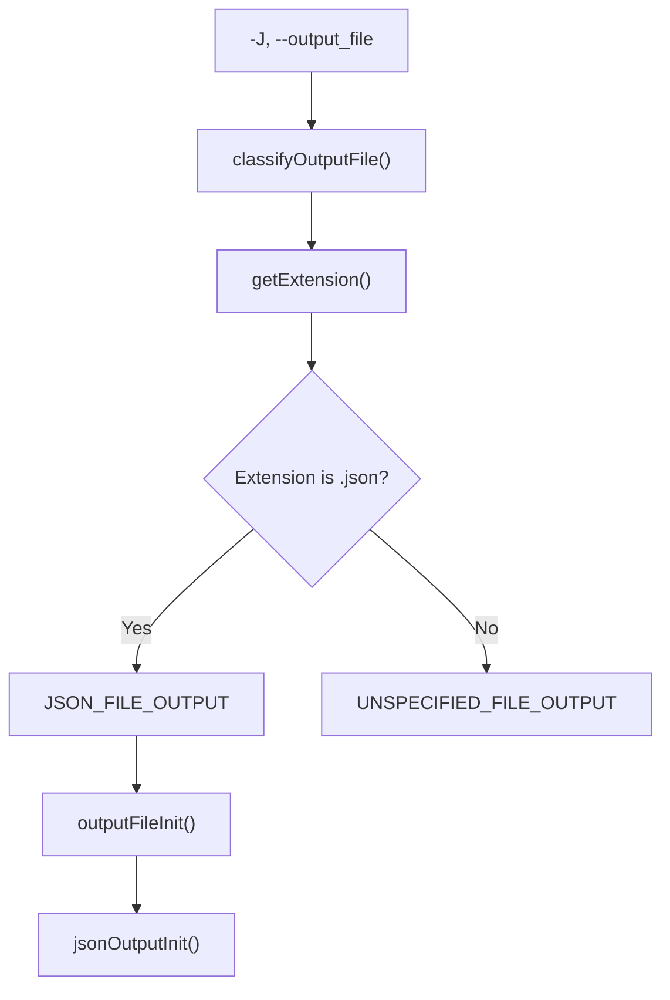

Sources: [src/common.cu:136-187]()

## Environment Variables

In addition to command-line arguments, environment variables control runtime configurations such as rank partitioning.

### GPU Partitioning with NCCL_TESTS_SPLIT

The `NCCL_TESTS_SPLIT` environment variable partitions GPUs into smaller groups running distinct operations in parallel.

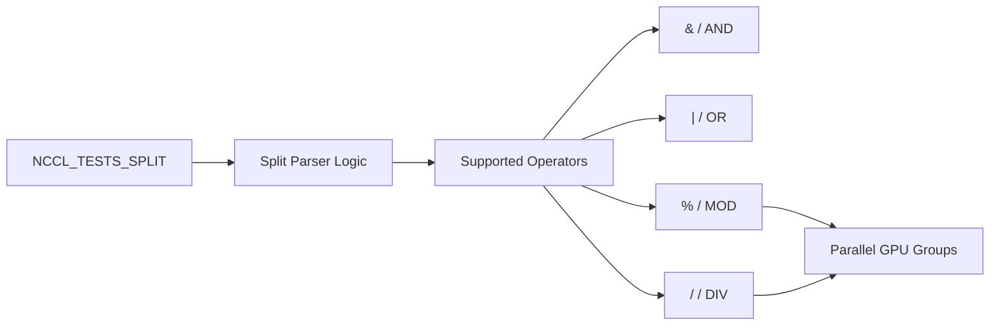

**Syntax**: `<operation><value>` where operation is `AND`, `OR`, `MOD`, `DIV` (or symbols `&`, `|`, `%`, `/`). Values may be decimal, hexadecimal (`0x`), or binary (`0b`).

Sources: [README.md:111-148]()

---

# Page: System Architecture

# System Architecture

<details>
<summary>Relevant source files</summary>

The following files were used as context for generating this wiki page:

- [src/Makefile](src/Makefile)
- [src/alltoallv.cu](src/alltoallv.cu)
- [src/common.h](src/common.h)

</details>


## Purpose and Scope

This page provides a high-level architectural overview of the NCCL Tests system, documenting how major components interact to enable performance benchmarking and correctness validation of NCCL collective operations, communicator operations, and GPU-Initiated Networking (GIN) device API microbenchmarks. It maps the conceptual architecture to specific code entities (files, classes, interfaces) to bridge understanding between system design and implementation.

For detailed information about specific subsystems, see:
- Build infrastructure: [Build System](#6)
- Test execution details: [Core Testing Framework](#2)
- Individual collectives: [Collective Operations](#3)
- GIN Device API Benchmarks: [GIN Device API Benchmarks](#5)

Sources: [src/common.h:115-148](), [src/common.cu:1-1103]()

---

## Architectural Overview

The NCCL Tests system is organized into major layers that work together to execute performance benchmarks and correctness validation:

| Layer | Primary Components | Responsibility |
|-------|-------------------|----------------|
| **User Interface** | CLI parsing, `main()` | Command-line argument processing, execution flow control [src/common.cu:889-1072]() |
| **Build System** | `Makefile`, `src/Makefile`, `CMakeLists.txt` | Per-collective binary generation, GIN target discovery, dependency management [src/Makefile:44-70]() |
| **Core Framework** | `src/common.cu`, `src/common.h`, `src/util.cu` | Test orchestration, multi-threaded timing, verification, output reporting [src/common.h:121-199]() |
| **Collective Operations** | `all_reduce.cu`, `all_gather.cu`, etc. | NCCL collective implementations, buffer sizing, and test logic [src/common.h:115-126]() |
| **GIN Device API Benchmarks** | `src/device_api/gin/` | GPU-Initiated Networking point-to-point latency and throughput microbenchmarks |

The architecture uses a **plugin pattern** where each collective operation implements standard interfaces defined by the core framework. This allows the framework to orchestrate tests uniformly across all collective types while generating separate binaries for each operation.

Sources: [src/common.cu:1-1103](), [src/common.h:1-201](), [src/Makefile:44-172]()

---

## System Component Diagram

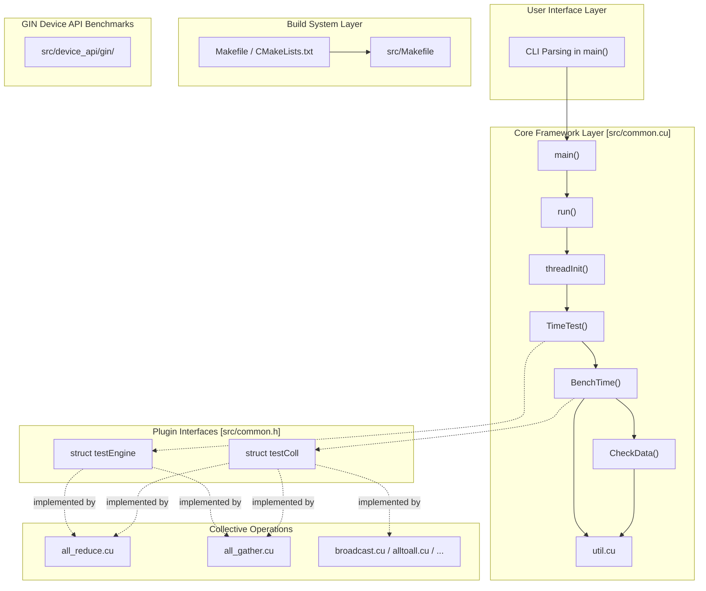

**Key architectural features:**

1. **Core Framework** ([src/common.cu:427-711]()) contains the main execution pipeline (`main()` → `run()` → `threadInit()` → `threadRunTests()`)
2. **Plugin Interfaces** ([src/common.h:115-148]()) define contracts that collectives must implement: `testColl` for operation-specific logic and `testEngine` for buffer management and device requirements.
3. **Weak Symbol Resolution** - A global `ncclTestEngine` symbol ([src/common.h:150]()) is weakly linked to point to the active collective's engine at link time.
4. **GIN Device API Benchmarks** - Independent test binaries under `src/device_api/gin/` that evaluate GPU-initiated networking primitives.

Sources: [src/common.cu:818-1103](), [src/common.h:115-150]()

---

## Plugin Interface Architecture

The test framework uses a dual-interface plugin pattern to achieve uniformity across different collective operations:

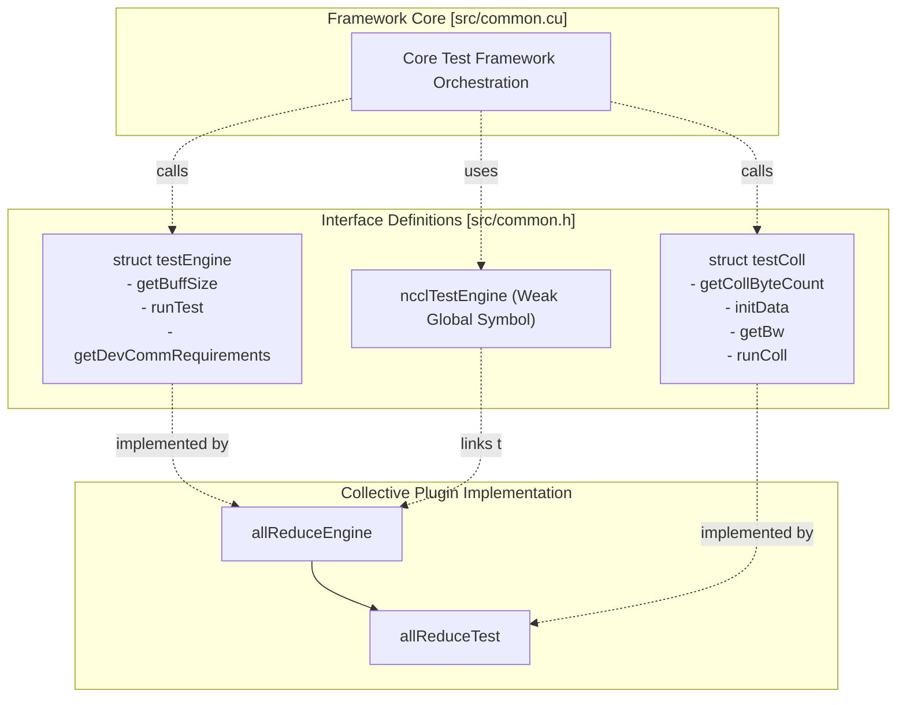

### Interface Responsibilities

**`testColl` struct** ([src/common.h:115-126]()):
- `getCollByteCount` - Calculate send/recv buffer sizes and in-place offsets.
- `initData` - Initialize test input patterns and expected output.
- `getBw` - Compute algorithm and bus bandwidth from measured execution time.
- `runColl` - Execute the underlying NCCL collective API (`ncclAllReduce`, `ncclBroadcast`, etc.).

**`testEngine` struct** ([src/common.h:134-148]()):
- `getBuffSize` - Determine total buffer allocation requirements.
- `runTest` - Execute full test suite across data types and sizes.
- `initCommConfig` - Optional configuration of `ncclConfig_t` (NCCL ≥2.14).
- `getDevCommRequirements` - Specify device communicator needs (NCCL ≥2.28/2.29).

Sources: [src/common.h:115-148]()

---

## Test Execution Pipeline

The execution flow from program launch to result output follows a structured pipeline managed by `run()` and worker threads:

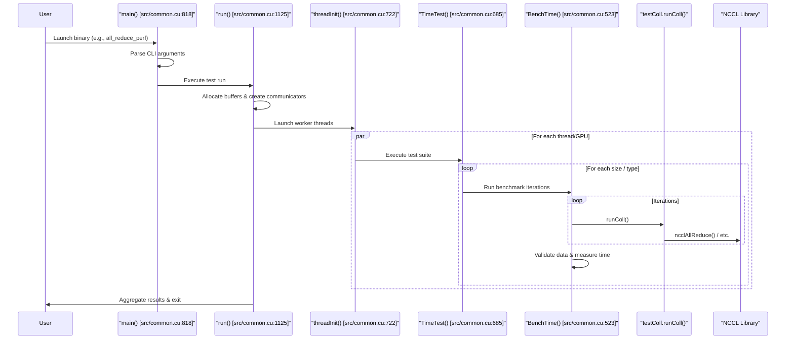

**Execution Phases:**
1. **Initialization** ([src/common.cu:818-1086]()): Argument parsing, MPI initialization if enabled.
2. **Resource Allocation** ([src/common.cu:1125-1227]()): GPU memory allocation (`ncclMemAlloc` / `cudaMalloc`), unique ID distribution.
3. **Thread Spawn** ([src/common.cu:1335-1337]()): Multi-threaded execution across local GPUs using `pthread_create`.
4. **Benchmarking & Validation** ([src/common.cu:523-669]()): Warmup, timed execution loops, buffer offset shifting, and `CheckData()` correctness verification.

Sources: [src/common.cu:427-711](), [src/common.cu:818-1103]()

---

## Binary Generation Strategy

The build system compiles separate binaries for each collective operation and GIN benchmark category rather than a single monolithic executable.

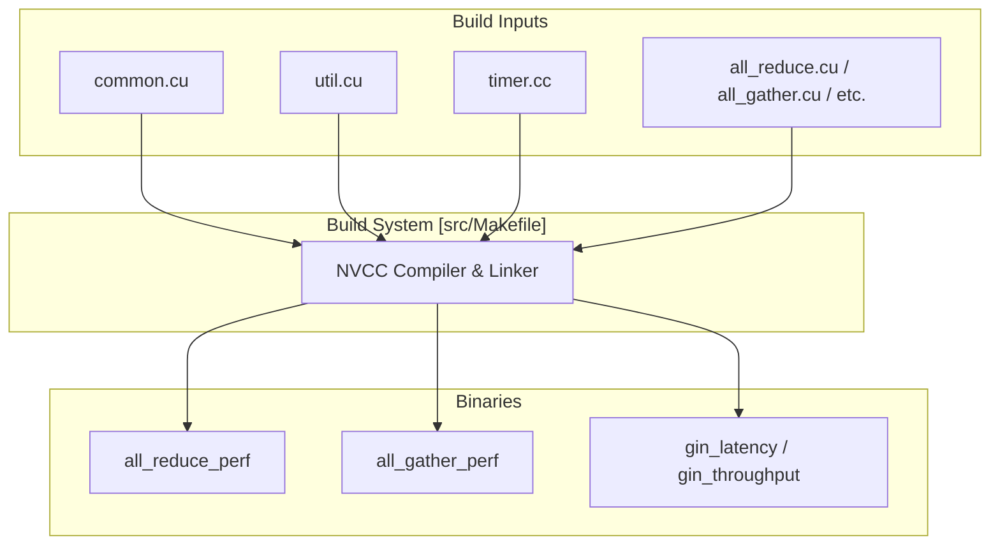

**Rationale:**
- **Reduced Binary Size**: Keeps individual executables compact (~10 MB).
- **Parallel Compilation**: Speeds up build times.
- **Weak Symbol Binding**: Resolves `ncclTestEngine` at link time to bind the specific collective engine.

Sources: [src/Makefile:42-70](), [src/Makefile:149-172]()

---

## Key Data Structures

### `struct threadArgs`
[src/common.h:152-199]() defines the primary shared context passed to worker threads, containing:
- Size sweep parameters (`minbytes`, `maxbytes`, `stepbytes`, `nbytes`).
- Parallelism topologies (`totalProcs`, `nProcs`, `proc`, `nThreads`, `thread`, `nGpus`, `gpus`).
- Buffers and streams (`sendbuffs`, `recvbuffs`, `expected`, `comms`, `streams`, `events`).
- Registration handles and device communicators (`sendRegHandles`, `recvRegHandles`, `devComms`).

Sources: [src/common.h:152-199]()

---

# Page: Core Testing Framework

# Core Testing Framework

<details>
<summary>Relevant source files</summary>

The following files were used as context for generating this wiki page:

- [src/common.cu](src/common.cu)
- [src/common.h](src/common.h)

</details>


The Core Testing Framework is the central test orchestration system implemented primarily in [src/common.cu]() and [src/common.h](). It provides infrastructure for executing NCCL collective operation tests across distributed processes, multiple threads per process, and multiple GPUs per thread. The framework implements a plugin architecture where collective operations register themselves via the `testEngine` and `testColl` interfaces, enabling uniform testing across all collective types.

The framework's main responsibilities include:
- Multi-level parallelism management (MPI processes, pthreads, CUDA streams)
- NCCL communicator lifecycle (initialization, registration, destruction)
- Test execution orchestration (warmup, benchmark, validation)
- Performance measurement (timing, bandwidth calculation, result aggregation)
- Distributed synchronization (barriers, allreduce for result collection)

For details on specific collective implementations, see [Collective Operations](#3). For build infrastructure, see [Build System](#6).

Sources: [src/common.cu:1-1959](), [src/common.h:1-363]()

## Architecture Overview

The framework is built around a plugin-style architecture that separates the generic testing infrastructure from specific collective operation implementations.

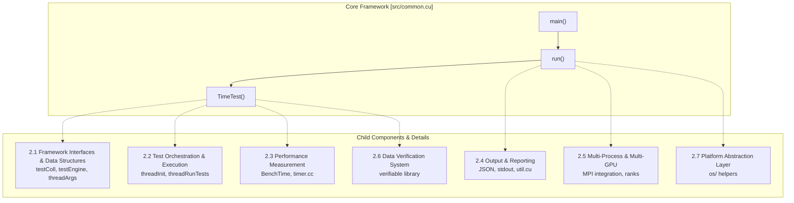

Sources: [src/common.cu:818-1103](), [src/common.cu:1125-1438]()

---

## 2.1. Framework Interfaces and Data Structures

The framework defines core interfaces like `testColl` and `testEngine` in [src/common.h:91-148]() which define the plugin architecture for collective operations. Data structures such as `threadArgs` ([src/common.h:152-199]()) maintain per-thread state including process topology, buffer pointers, GPU assignments, and NCCL communicators.

For details, see [Framework Interfaces and Data Structures](#2.1).

Sources: [src/common.h:91-199]()

---

## 2.2. Test Orchestration and Execution

The execution pipeline flows from `main()` through `run()`, spawning worker threads via `threadLauncher()` ([src/common.cu:793-797]()), initializing communicators via `threadInit()` ([src/common.cu:722-791]()), and executing tests via `threadRunTests()` ([src/common.cu:713-720]()). Synchronization is handled via custom barrier and allreduce primitives ([src/common.cu:236-320]()).

For details, see [Test Orchestration and Execution](#2.2).

Sources: [src/common.cu:236-320](), [src/common.cu:713-814](), [src/common.cu:1125-1438]()

---

## 2.3. Performance Measurement

Performance timing relies on high-resolution timer utilities (`timer.cc`) wrapped inside `BenchTime()` and `TimeTest()`. The framework computes both algorithmic and bus bandwidth, supports per-iteration timing, and integrates CUDA graph capture and replay (`cudaGraphLaunches`) to eliminate CPU launch overhead [src/common.cu:455-613]().

For details, see [Performance Measurement](#2.3).

Sources: [src/common.cu:455-613]()

---

## 2.4. Output and Reporting

Test results are reported via a dual-output system supporting both standard formatted console output and machine-readable JSON logs. Formatting and reporting functions reside in `util.cu` and `util.h`, accompanied by embedded profiler telemetry integration and analysis tools.

For details, see [Output and Reporting](#2.4).

Sources: [src/common.cu:168-198]()

---

## 2.5. Multi-Process and Multi-GPU Support

Distributed execution relies on MPI integration for multi-node coordination. Global rank calculation handles hierarchical topologies across processes, pthreads, and GPUs, while environment variables like `NCCL_TESTS_SPLIT` control GPU partitioning.

For details, see [Multi-Process and Multi-GPU Support](#2.5).

Sources: [src/common.h:152-199](), [src/common.cu:1125-1438]()

---

## 2.6. Data Verification System

To validate correctness of collective operations, the framework integrates a deterministic data generation and verification engine (using the `verifiable` library) that runs parallel checks against expected bit patterns after test iterations [src/common.cu:322]().

For details, see [Data Verification System](#2.6).

Sources: [src/common.cu:322](), [src/common.cu:685-711]()

---

## 2.7. Platform Abstraction Layer

Cross-platform compilation across Linux and Windows is facilitated by helper shims in the `os/` directory, which normalize host name hashing, process identification (`ncclTestGetPid()`), dynamic string formatting (`asprintf`), and command-line parsing (`getopt`) [src/common.h:24]().

For details, see [Platform Abstraction Layer](#2.7).

Sources: [src/common.h:24](), [src/common.cu:109]()

---

# Page: Framework Interfaces and Data Structures

# Framework Interfaces and Data Structures

<details>
<summary>Relevant source files</summary>

The following files were used as context for generating this wiki page:

- [src/common.h](src/common.h)

</details>


This document details the core interfaces and data structures that define the NCCL Tests plugin architecture. The framework achieves extensibility through two primary interfaces (`struct testColl` and `struct testEngine`) and key data structures (`struct threadArgs`) that enable uniform testing of different collective operations while accommodating their specific requirements.

## testColl Interface

The `struct testColl` interface defines the operations that all collective benchmarks must implement (`[src/common.h:115-126]()`). It serves as the primary extension point for integrating new collective communication patterns into the benchmarking suite.

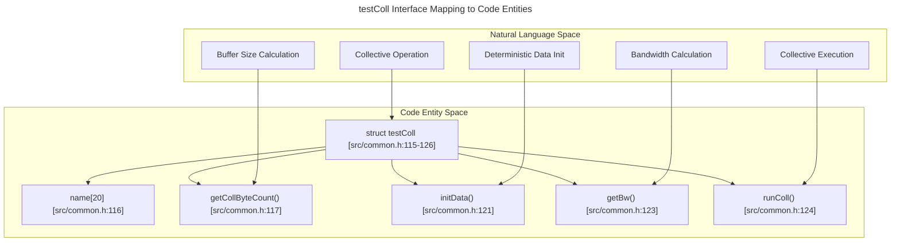
Sources: `[src/common.h:115-126]()`

**Function Pointer Details in `struct testColl`**
- `getCollByteCount`: Computes buffer send/receive counts, parameter counts, and in-place offsets based on element size and rank count (`[src/common.h:117-120]()`).
- `initData`: Initializes send and expected receive buffers with predictable patterns for validation (`[src/common.h:121-122]()`).
- `getBw`: Computes algorithmic and bus bandwidth metrics given elapsed time and message counts (`[src/common.h:123]()`).
- `runColl`: Dispatches the actual collective invocation using either NCCL APIs or device-side custom kernels (`[src/common.h:124-125]()`).

Sources: `[src/common.h:115-126]()`

### Concrete Collective Implementations

Each individual collective benchmark instantiates and exports a concrete implementation of `struct testColl` (`[src/common.h:127-132]()`).

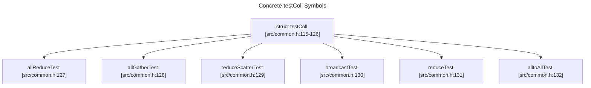
Sources: `[src/common.h:115-132]()`

---

## testEngine Interface

The `struct testEngine` interface handles high-level test lifecycle management, execution orchestration, and optional configuration hooks (`[src/common.h:134-148]()`).

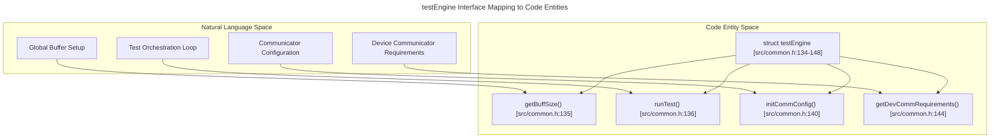
Sources: `[src/common.h:134-148]()`

The global instance `ncclTestEngine` is declared extern and defined by the active binary build (`[src/common.h:150]()`).

Sources: `[src/common.h:134-150]()`

---

## threadArgs Data Structure

The `struct threadArgs` data structure encapsulates all configuration parameters, memory pointers, communicator states, and performance accumulators required by an individual execution thread (`[src/common.h:152-199]()`).

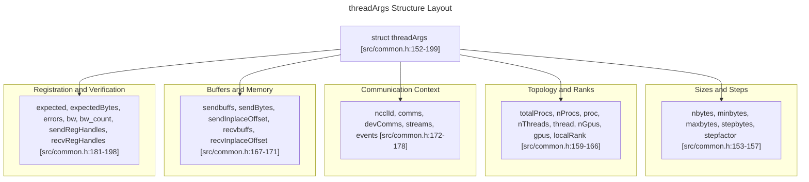
Sources: `[src/common.h:152-199]()`

---

## Error Handling and Result Codes

The framework defines standard status codes via `testResult_t` (`[src/common.h:91-100]()`) and error-checking wrapper macros (`[src/common.h:51-113]()`) to safely bubble up CUDA and NCCL errors across processes and threads.

- `testSuccess` (`[src/common.h:92]()`): Operation completed successfully.
- `testInternalError` (`[src/common.h:93]()`): Internal framework fault.
- `testCudaError` (`[src/common.h:94]()`): CUDA runtime failure.
- `testNcclError` (`[src/common.h:95]()`): NCCL failure.
- `testTimeout` (`[src/common.h:96]()`): Operation timed out.
- `testNotImplemented` (`[src/common.h:97]()`): Feature not implemented for configuration.
- `testInvalidUsage` (`[src/common.h:98]()`): Invalid command-line argument or usage.

Sources: `[src/common.h:51-113]`, `[src/common.h:91-100]()`

---

# Page: Test Orchestration and Execution

# Test Orchestration and Execution

<details>
<summary>Relevant source files</summary>

The following files were used as context for generating this wiki page:

- [src/common.cu](src/common.cu)

</details>


## Overview

This page documents the test orchestration pipeline that coordinates the execution of NCCL collective operation benchmarks. The orchestration system manages the complete lifecycle from program entry through multi-threaded test execution to result aggregation.

The orchestration pipeline consists of four primary stages:

1. **Entry and Setup** - `main()` function parses arguments and invokes `run()` [src/common.cu:818-1103]()
2. **Resource Allocation** - `run()` function allocates buffers, creates streams, and optionally initializes NCCL communicators [src/common.cu:1125-1438]()
3. **Thread Initialization** - `threadInit()` or direct execution based on `parallel_init` mode [src/common.cu:722-791]()
4. **Test Execution** - `threadRunTests()` invokes the test engine and collective operations [src/common.cu:713-720]()

The system supports both sequential and parallel NCCL initialization modes, multi-threaded execution with per-thread GPU assignments, and provides synchronization primitives for coordinating across threads and MPI processes.

Sources: [src/common.cu:818-1103](), [src/common.cu:1125-1438](), [src/common.cu:722-791](), [src/common.cu:713-720]()

## Orchestration Pipeline Overview

**Diagram: Complete Test Orchestration Flow**

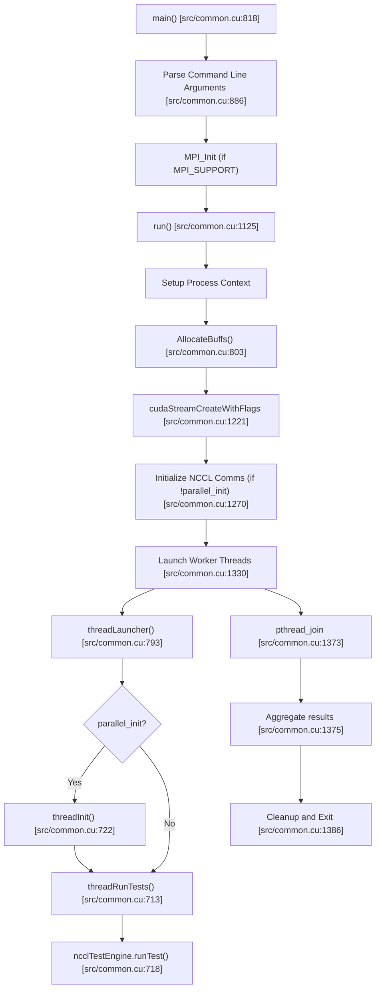

Sources: [src/common.cu:818-1103](), [src/common.cu:1125-1438](), [src/common.cu:713-720](), [src/common.cu:722-791](), [src/common.cu:793-801]()

## Main Entry Point

The `main()` function at [src/common.cu:818-1103]() serves as the program entry point. It parses command line arguments, initializes MPI if enabled, invokes the `run()` function for test execution, and handles final cleanup.

**Diagram: main() Function Structure**

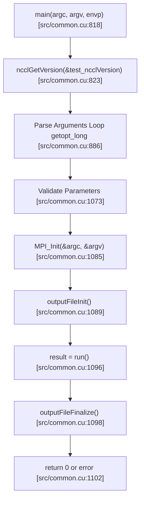

### Command Line Configuration

The argument parsing loop at [src/common.cu:886-1072]() configures global test parameters stored in static variables:

| Global Variable | CLI Argument | Default | Description |
|-----------------|--------------|---------|-------------|
| `nThreads` | `-t, --nthreads` | 1 | Number of worker threads per process |
| `nGpus` | `-g, --ngpus` | 1 | Number of GPUs managed by each thread |
| `minBytes` | `-b, --minbytes` | 32M | Starting message size for benchmark sweep |
| `maxBytes` | `-e, --maxbytes` | 32M | Ending message size for benchmark sweep |
| `parallel_init` | `-p, --parallel_init` | 0 | Enable parallel NCCL communicator initialization |
| `blocking_coll` | `-z, --blocking` | 0 | Enable blocking collective operations |
| `cudaGraphLaunches` | `-G, --cudagraph` | 0 | Number of CUDA graph launches per iteration |
| `deviceImpl` | `-D, --device_implementation` | 0 | Device implementation index (0=NCCL host) |

Sources: [src/common.cu:818-1103](), [src/common.cu:79-102](), [src/common.cu:854-884]()

## Setup and Resource Allocation

The `run()` function at [src/common.cu:1125-1438]() orchestrates the complete test execution lifecycle, from resource allocation through thread management to result reporting.

**Diagram: run() Function Orchestration**

```mermaid
graph TD
    runEntry["run() [src/common.cu:1125]"]
    
    mpiSetup["MPI Setup MPI_Comm_size/rank [src/common.cu:1132]"]
    splitComm["MPI_Comm_split for NCCL_TESTS_SPLIT [src/common.cu:1142]"]
    deviceReport["writeDeviceReport() [src/common.cu:1178]"]
    
    memCalc["Calculate Memory Limits reserveMem, memMaxBytes [src/common.cu:1183]"]
    ncclId["ncclGetUniqueId(&ncclId) [src/common.cu:1194]"]
    
    bufferAlloc["AllocateBuffs() for each GPU [src/common.cu:1202]"]
    streamCreate["cudaStreamCreateWithFlags for each GPU [src/common.cu:1217]"]
    
    seqInit{"!parallel_init?"}
    ncclInit["Sequential NCCL Init ncclCommInitRankConfig [src/common.cu:1270]"]
    regMem["Memory Registration ncclCommRegister [src/common.cu:1280]"]
    devComm["Device Communicator Creation ncclDevCommCreate [src/common.cu:1296]"]
    
    threadSetup["Thread Structure Setup threadArgs [src/common.cu:1327]"]
    threadLaunch["Launch Threads threadLaunch [src/common.cu:1364]"]
    
    threadJoin["Join Threads pthread_join [src/common.cu:1372]"]
    mpiAllreduce["MPI_Allreduce errors [src/common.cu:1383]"]
    cleanup["Cleanup Resources ncclCommDestroy, cudaFree [src/common.cu:1386]"]
    writeFooter["writeResultFooter() [src/common.cu:1422]"]
    
    runEntry --> mpiSetup
    mpiSetup --> splitComm
    splitComm --> deviceReport
    deviceReport --> memCalc
    memCalc --> ncclId
    ncclId --> bufferAlloc
    bufferAlloc --> streamCreate
    streamCreate --> seqInit
    
    seqInit -->|"Yes"| ncclInit
    ncclInit --> regMem
    regMem --> devComm
    devComm --> threadSetup
    seqInit -->|"No"| threadSetup
    
    threadSetup --> threadLaunch
    threadLaunch --> threadJoin
    threadJoin --> mpiAllreduce
    mpiAllreduce --> cleanup
    cleanup --> writeFooter
```

### Buffer Allocation Strategy

The `AllocateBuffs()` function at [src/common.cu:803-814]() allocates GPU memory for send, receive, and expected data buffers using `ncclMemAlloc()` or `cudaMalloc()`.

Sources: [src/common.cu:1125-1438](), [src/common.cu:803-814](), [src/common.cu:1183-1192]()

## Thread Management

The orchestration system launches worker threads to parallelize test execution across multiple GPUs. Each thread manages a subset of GPUs and coordinates through synchronization primitives.

**Diagram: Thread Launch and Management**

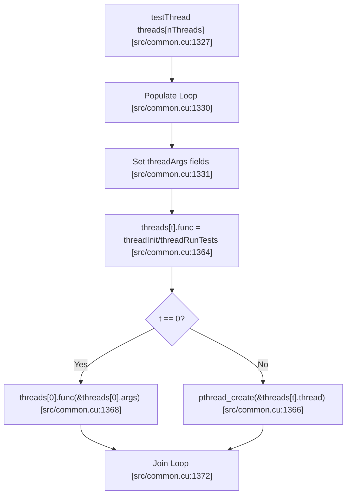

### Thread Data Structures

The thread system uses `testThread` and `threadArgs` structures defined in [src/common.h:121-170]().

### Thread Launcher Function

The `threadLauncher()` function at [src/common.cu:793-797]() serves as the pthread entry point.

Sources: [src/common.cu:1327-1380](), [src/common.cu:793-801](), [src/common.h:121-170]()

## Thread Synchronization Mechanisms

The orchestration system provides synchronization primitives (`Barrier` and `Allreduce`) implemented via condition variables, mutexes, and MPI primitives [src/common.cu:236-320]().

Sources: [src/common.cu:236-261](), [src/common.cu:266-320]()

## Thread Initialization

The `threadInit()` function at [src/common.cu:722-791]() handles parallel communicator initialization when `parallel_init=1`.

Sources: [src/common.cu:722-791]()

## Test Execution

The `threadRunTests()` function at [src/common.cu:713-720]() sets the GPU context and invokes `ncclTestEngine.runTest()`.

Sources: [src/common.cu:713-720]()

## Collective Operation Pipeline

Collective operations are initiated via `startColl()` [src/common.cu:427-521]() and synchronized using `testStreamSynchronize()` [src/common.cu:369-425]().

Sources: [src/common.cu:427-521](), [src/common.cu:369-425]()

## Result Aggregation and Cleanup

Post-execution processing aggregates error counts and bandwidth metrics across threads and MPI processes before releasing resources [src/common.cu:1372-1437]().

Sources: [src/common.cu:1372-1437]()

## In-place vs. Out-of-place Operations

The framework benchmarks both in-place and out-of-place buffer configurations using appropriate offset calculations [src/common.cu:342-417]().

Sources: [src/common.cu:342-417](), [src/common.cu:247-248](), [src/common.cu:398-401]()

## Performance Considerations

Optimizations include buffer offset rotation, non-blocking streams, synchronization control, and CUDA graph capture [src/common.cu:345-348](), [src/common.cu:1062-1063](), [src/common.cu:419-425](), [src/common.cu:439-500]().

Sources: [src/common.cu:345-348](), [src/common.cu:1062-1063](), [src/common.cu:419-425](), [src/common.cu:439-500]()

## Data Type Support

The framework supports multiple integer, floating-point, and half/bfloat16/FP8 data types [src/common.h:230-263](), [src/common.cu:22-39](), [verifiable/verifiable.cu:1019-1037]().

Sources: [src/common.h:230-263](), [src/common.cu:22-39](), [verifiable/verifiable.cu:1019-1037]()

---

# Page: Performance Measurement

# Performance Measurement

<details>
<summary>Relevant source files</summary>

The following files were used as context for generating this wiki page:

- [doc/PERFORMANCE.md](doc/PERFORMANCE.md)
- [src/common.cu](src/common.cu)
- [src/timer.cc](src/timer.cc)
- [src/timer.h](src/timer.h)

</details>


## Purpose and Scope

This document details the performance measurement infrastructure in NCCL tests, covering high-resolution timing mechanisms (`src/timer.cc` / `src/timer.h`), test orchestration (`TimeTest()`, `BenchTime()` in `src/common.cu`), bandwidth formulas (algorithmic vs. bus bandwidth), per-iteration timing configurations, and CUDA graph capture/replay integration.

---

## Timing Mechanisms and Infrastructure

High-resolution timing relies on the `timer` class implemented in `src/timer.cc` and declared in `src/timer.h`. It wraps `std::chrono::steady_clock` to measure elapsed wall-clock or steady time in nanoseconds, converting the result to floating-point seconds.

### The `timer` Class (`src/timer.cc`)

```mermaid
graph TD
    subgraph Code Entity Space [src/timer.cc]
        TimerCtor["timer::timer()<br/>Captures t0 via std::chrono::steady_clock::now()"]
        TimerElapsed["timer::elapsed()<br/>Calculates (now() - t0) * 1e-9"]
        TimerReset["timer::reset()<br/>Returns elapsed time and updates t0"]
    end

    TimerCtor --> TimerElapsed
    TimerElapsed --> TimerReset
```

- **`timer()`**: Initializes `t0` with the current steady clock epoch count [src/timer.cc:14-16]().
- **`elapsed()`**: Computes the difference between the current steady clock timestamp and `t0`, returning the duration in seconds [src/timer.cc:18-21]().
- **`reset()`**: Evaluates the elapsed time since the last reset or construction, updates `t0` to the current timestamp, and returns the elapsed duration [src/timer.cc:23-28]().

Sources: [src/timer.cc:1-28](), [src/timer.h:1-15]()

---

### Test Orchestration (`TimeTest`) and Execution (`BenchTime`)

The core execution loops are orchestrated by `TimeTest()` and executed by `BenchTime()`, both defined in `src/common.cu`.

```mermaid
flowchart TD
    subgraph Natural Language Space
        A["Warmup Phase"] --> B["Benchmark Phase"]
        B --> C["Per-Iteration Timing & CUDA Graph Execution"]
    end

    subgraph Code Entity Space [src/common.cu]
        TimeTestFunc["TimeTest()"] --> WarmupLoop["Warmup iterations loop"]
        TimeTestFunc --> BenchTimeFunc["BenchTime(args, in_place)"]
        BenchTimeFunc --> TimerInst["timer tim"]
        BenchTimeFunc --> StreamCapture["cudaStreamBeginCapture()"]
        BenchTimeFunc --> GraphLaunch["cudaGraphLaunch()"]
        BenchTimeFunc --> AllreduceCall["Allreduce(&deltaSec, average)"]
    end

    A --> TimeTestFunc
    B --> BenchTimeFunc
    C --> GraphLaunch
```

Sources: [src/common.cu:523-711]()

---

## Bandwidth Calculations

NCCL tests compute and report two distinct bandwidth metrics: **Algorithmic Bandwidth** and **Bus Bandwidth**.

### Algorithmic Bandwidth (`algbw`)
Algorithmic bandwidth represents the effective data rate achieved by dividing the total transferred payload size $S$ by the elapsed time $t$ [doc/PERFORMANCE.md:16-20]():

$$\text{algbw} = \frac{S}{t}$$

### Bus Bandwidth (`busbw`)
Because collective operations distribute data across $n$ ranks with different communication patterns, raw algorithmic bandwidth does not directly scale with hardware link bandwidth. NCCL tests apply a collective-specific correction factor to compute **bus bandwidth**, representing the underlying hardware bus utilization [doc/PERFORMANCE.md:22-30]():

| Collective Operation | Correction Factor | Bus Bandwidth Formula (`busbw`) |
|----------------------|-------------------|--------------------------------|
| **AllReduce** | $\frac{2(n-1)}{n}$ | $\text{algbw} \times \frac{2(n-1)}{n}$ [doc/PERFORMANCE.md:63]() |
| **ReduceScatter** | $\frac{n-1}{n}$ | $\text{algbw} \times \frac{n-1}{n}$ [doc/PERFORMANCE.md:79]() |
| **AllGather** | $\frac{n-1}{n}$ | $\text{algbw} \times \frac{n-1}{n}$ [doc/PERFORMANCE.md:97]() |
| **AllToAll** | $\frac{n-1}{n}$ | $\text{algbw} \times \frac{n-1}{n}$ [doc/PERFORMANCE.md:143]() |
| **Broadcast** | $1$ | $\text{algbw} \times 1$ [doc/PERFORMANCE.md:141]() |
| **Reduce** | $1$ | $\text{algbw} \times 1$ [doc/PERFORMANCE.md:142]() |

Sources: [doc/PERFORMANCE.md:1-145]()

---

## Per-Iteration Timing and Iteration Control

Performance measurement relies on several loop control variables to filter out initialization overhead and stabilize measurements:

- **Warmup Iterations (`warmup_iters`)**: Unmeasured initial executions (`-w`) to prime caches, connection state, and routing tables [src/common.cu:96]().
- **Benchmark Iterations (`iters`)**: Number of timed collective operations (`-n`) [src/common.cu:97]().
- **Aggregated Iterations (`agg_iters`)**: Grouping multiple collective operations inside a single `ncclGroupStart()` / `ncclGroupEnd()` block (`-m`) [src/common.cu:98](), [src/common.cu:554-559]().
- **Run Cycles (`run_cycles`)**: Repetitions of the entire message-size sweep (`-N`) [src/common.cu:99]().

```mermaid
graph TD
    subgraph Code Entity Space [src/common.cu]
        TimeTest["TimeTest()"] --> Warmup["warmup_iters loop"]
        Warmup --> StartWarmup["startColl() / completeColl()"]
        StartWarmup --> Bench["BenchTime()"]
        Bench --> IterLoop["iters loop"]
        IterLoop --> AggGroup{agg_iters > 1?}
        AggGroup -->|Yes| GroupBlock["ncclGroupStart() / ncclGroupEnd()"]
        AggGroup -->|No| SingleOp["Single startColl()"]
    end
```

Sources: [src/common.cu:96-98](), [src/common.cu:523-560](), [src/common.cu:685-711]()

---

## CUDA Graph Integration

To minimize host-side CPU launch overhead, NCCL tests support capturing collective execution streams into CUDA graphs and replaying them via `cudaGraphLaunch()` [src/common.cu:109](), [src/common.cu:536-598]().

### CUDA Graph Capture and Replay Pipeline

```mermaid
sequenceDiagram
    participant BenchTime as BenchTime() [src/common.cu]
    participant CUDAAPI as CUDA Driver/Runtime API
    participant GPU as Device Streams

    Note over BenchTime: If cudaGraphLaunches >= 1
    BenchTime->>CUDAAPI: cudaStreamBeginCapture(streams[i], cudaStreamCaptureModeThreadLocal)
    
    loop iters * agg_iters
        BenchTime->>GPU: startColl() [Recorded into graph]
    end

    BenchTime->>CUDAAPI: cudaStreamEndCapture(streams[i], &graphs[i])
    BenchTime->>CUDAAPI: cudaGraphInstantiate(&graphExec[i], graphs[i])
    
    BenchTime->>BenchTime: timer tim.reset()
    
    loop cudaGraphLaunches times
        BenchTime->>CUDAAPI: cudaGraphLaunch(graphExec[i], streams[i])
    end

    BenchTime->>BenchTime: deltaSec = tim.elapsed() / cudaGraphLaunches
```

Sources: [src/common.cu:109](), [src/common.cu:536-598]()

---

# Page: Output and Reporting

# Output and Reporting

<details>
<summary>Relevant source files</summary>

The following files were used as context for generating this wiki page:

- [src/util.cu](src/util.cu)
- [src/util.h](src/util.h)
- [tools/analyze_perf_json.py](tools/analyze_perf_json.py)

</details>


## Purpose and Scope

This page documents the output and reporting system in NCCL Tests, which provides a dual-output mechanism: human-readable tabular data to `stdout` and machine-readable JSON reports. The system handles formatting performance metrics, hardware device information, configuration parameters, and error reporting across single-node and distributed MPI environments.

For detailed information on related topics, see the following child pages:
- [NCCL Profiler Integration](#2.4.1) — Telemetry capture and tuning info via embedded profiler versions.
- [Performance JSON Analysis Tools](#2.4.2) — Usage of `tools/analyze_perf_json.py` for performance analysis.

For information about the performance measurement mechanisms that generate the reported data, see [Performance Measurement](#2.3). For details on data validation and error detection, see [Data Verification System](#2.6).

---

## System Overview

The output system maintains two parallel output streams during test execution:
1. **`stdout` Stream**: Formatted, fixed-width tables designed for human operators via `PRINT` macros in `src/util.cu` [src/util.cu:33-36]().
2. **JSON Stream**: Structured JSON documents initialized via `jsonOutputInit()` in `src/util.h` [src/util.h:25]() for automated ingestion and archival.

### Output System Architecture

```mermaid
graph TB
    subgraph "Execution Layer"
        TimeTest["TimeTest()<br/>src/common.cu"]
        RunTests["threadRunTests()<br/>src/common.cu"]
    end
    
    subgraph "Formatting Layer [src/util.cu]"
        Preamble["writeBenchmarkLinePreamble()"]
        Body["writeBenchmarkLineBody()"]
        Terminator["writeBenchmarkLineTerminator()"]
        DevReport["writeDeviceReport()"]
    end
    
    subgraph "State & Serialization"
        JsonInit["jsonOutputInit()<br/>src/util.h"]
        JsonState["json_state_t stack<br/>src/util.cu"]
        JsonFile["json_report_fp<br/>FILE*"]
    end
    
    subgraph "Outputs"
        Stdout["stdout<br/>PRINT macro"]
        Json["JSON Output File"]
    end
    
    TimeTest --> Preamble
    TimeTest --> Body
    TimeTest --> Terminator
    RunTests --> DevReport
    
    Preamble --> Stdout
    Preamble --> JsonState
    Body --> Stdout
    Body --> JsonState
    Terminator --> Stdout
    Terminator --> JsonState
    
    JsonInit --> JsonFile
    JsonState --> JsonFile
    
    style JsonState fill:none,stroke:#333,stroke-width:2px
    style JsonFile fill:none,stroke:#333,stroke-width:2px
```

**Sources**: [src/util.cu:33-58](), [src/util.h:25-45](), [src/common.cu:523-711]()

---

## JSON Output System

The JSON reporting system relies on a lightweight, libc-based serialization approach implemented in `src/util.cu` to avoid external library dependencies [src/util.cu:9-16](). 

### File Initialization and State Management

When `-J` or `--output_file` is specified, `jsonOutputInit()` attempts to open the target file with exclusive creation (`"wx"` mode). If the file already exists, it auto-increments a numeric suffix (e.g., `file.json.0`, `file.json.1`) to prevent accidental overwrites [src/util.h:25](). A stack-based state machine (`json_state_t`, `jsonPushState`, `jsonPopState`) tracks object nesting, list scopes, and comma separators [src/util.cu:103-202]().

Strings written to JSON are sanitized via `sanitizeJson()` to escape control characters, quotes, and backslashes while rejecting non-printable or non-ASCII characters [src/util.cu:125-166]().

```mermaid
graph LR
    subgraph "JSON Lifecycle [src/util.cu]"
        Init["jsonOutputInit()"] --> StartObj["jsonStartObject()"]
        StartObj --> Push["jsonPushState()"]
        Push --> Write["jsonKey() / jsonValHelper()"]
        Write --> Fin["jsonOutputFinalize()"]
    end
    
    subgraph "State Machine"
        State["json_state_t stack"] --> Top["jsonCurrState()"]
    end
    
    Write -.-> State
```

**Sources**: [src/util.cu:103-254](), [src/util.h:25-31]()

---

## Benchmark Output Formatting

Benchmark execution writes results in a structured, three-phase sequence managed by functions declared in `src/util.h` [src/util.h:39-42]():

1. **Preamble**: `writeBenchmarkLinePreamble()` records message size in bytes, element count, data type, reduction operation, and root rank [src/util.h:39]().
2. **Body**: `writeBenchmarkLineBody()` is invoked twice per line—first for out-of-place and second for in-place configurations—logging execution time in microseconds, algorithm bandwidth (`algBw`), bus bandwidth (`busBw`), and error counts [src/util.h:42]().
3. **Terminator**: `writeBenchmarkLineTerminator()` finalizes the iteration count and experiment name [src/util.h:40]().

Adaptive floating-point formatting ensures numerical readability across scales from bytes to terabytes [src/util.cu:454-464]().

**Sources**: [src/util.h:39-43](), [src/util.cu:421-500]()

---

## Device Information Reporting

In distributed MPI runs, hardware configuration details (including CUDA device IDs, PCI bus addresses, GPU names, process IDs, and hostnames) are gathered from all participating ranks using `writeDeviceReport()` and summarized on rank 0 [src/util.h:45]().

```mermaid
sequenceDiagram
    participant MPI as MPI Ranks (0..N)
    participant Rep as writeDeviceReport()<br/>src/util.cu
    participant Out as stdout & JSON
    
    MPI->>Rep: Gather local rank hardware info
    Rep->>Rep: Parse device properties & PCI hex
    Rep->>Out: Print tabular device layout to stdout
    Rep->>Out: Serialize to devices array in JSON
```

**Sources**: [src/util.h:45](), [src/util.cu:380-417](), [src/util.cu:512-614]()

---

## NCCL Profiler Integration

NCCL Tests embeds profiler hooks (`ncclProfiler_v5`, `ncclProfiler_v6`, `ncclProfiler_v7`) to capture rich runtime telemetry during collective and point-to-point operations.

For detailed documentation on telemetry collection, proxy event tracking, and tuning parameter output, see [NCCL Profiler Integration](#2.4.1).

**Sources**: [src/util.cu:19-97](), [src/nccl_profiler.h:1-86]()

---

## Performance JSON Analysis Tools

To assist with large-scale performance evaluations, the test suite provides analysis scripts located in the `tools/` directory. 

For detailed usage instructions on analyzing per-iteration variance, slow processes (stragglers), timing spikes, and iteration-0 overheads using `tools/analyze_perf_json.py`, see [Performance JSON Analysis Tools](#2.4.2).

**Sources**: [tools/analyze_perf_json.py:1-359]()

---

# Page: NCCL Profiler Integration

# NCCL Profiler Integration

<details>
<summary>Relevant source files</summary>

The following files were used as context for generating this wiki page:

- [src/nccl_profiler.h](src/nccl_profiler.h)
- [src/profiler_v5.h](src/profiler_v5.h)
- [src/profiler_v6.h](src/profiler_v6.h)
- [src/profiler_v7.h](src/profiler_v7.h)
- [src/util.cu](src/util.cu)

</details>


## Purpose and Scope
This page details the integration of the NCCL Profiler API (`ncclProfiler_v5`, `ncclProfiler_v6`, and `ncclProfiler_v7`) within `nccl-tests`. It explains how the suite captures telemetry for collective operations, point-to-point (P2P) communications, proxy operations, and Communication Engine (CE) tasks, and how this runtime telemetry is structured and surfaced in JSON reporting and execution output.

---

## 1. Profiler Version Evolution: v5, v6, and v7 Interfaces
The NCCL profiler interface has evolved through multiple versions to support richer hardware acceleration, Communication Engine (CE) tasks, per-call user tagging, and finer-grained kernel phase tracking. `nccl-tests` incorporates structures supporting these interfaces via `src/nccl_profiler.h`.

### `ncclProfiler_v5_t`
Introduced the core plugin lifecycle and event set architecture, including hooks for initialization, event start/stop, state transitions, and finalization `[src/profiler_v5.h:111-151]`. It defines descriptors for host-side APIs (`collApi`, `p2pApi`, `groupApi`), kernel launches, collective/P2P executions (`coll`, `p2p`), proxy operations (`proxyOp`, `proxyStep`), and network plugins `[src/profiler_v5.h:12-91]`.

### `ncclProfiler_v6_t`
Extends `ncclProfiler_v5_t` by adding support for Communication Engine (CE) asynchronous operations. It introduces `ceColl`, `ceCollSync`, and `ceCollBatch` descriptors into `ncclProfilerEventDescr_v6_t` to monitor CE-driven memory copies and synchronization strategies `[src/profiler_v6.h:14-122]`.

### `ncclProfiler_v7_t`
Extends `ncclProfiler_v6_t` by introducing per-call user profiler tags (`userTag`) across collective and P2P descriptors, as well as a dedicated `kernelPhase` event descriptor for tracking sub-phases (initial synchronization, compute, and final synchronization) in custom device kernels `[src/profiler_v7.h:14-135]`.

```mermaid
graph TD
    subcode["Code Entity Space"]
    A["ncclProfiler_v5_t"] --> B["ncclProfiler_v6_t"]
    B --> C["ncclProfiler_v7_t"]
    C --> D["ncclProfilerEventDescr_v7_t"]
    D --> E["kernelPhase"]
    D --> F["ceColl"]
    D --> G["collApi"]

    style A fill:#none,stroke:#333
    style B fill:#none,stroke:#333
    style C fill:#none,stroke:#333
    style D fill:#none,stroke:#333
    style E fill:#none,stroke:#333
    style F fill:#none,stroke:#333
    style G fill:#none,stroke:#333
```
*Sources: [src/profiler_v5.h:111-151](), [src/profiler_v6.h:14-145](), [src/profiler_v7.h:14-157]() *

---

## 2. Telemetry Event Types and States
Profiler event activation and state tracking are governed by bitmasks and state enumerations defined in `src/nccl_profiler.h`. 

### Event Activation Masks
Events are filtered and enabled via `ncclProfilerEventState_t` bit flags:
* `ncclProfileGroup` / `ncclProfileGroupApi`: Group and API boundary events `[src/nccl_profiler.h:23-32]()`.
* `ncclProfileColl` / `ncclProfileCollApi`: Host and device collective executions `[src/nccl_profiler.h:25-33]()`.
* `ncclProfileP2p` / `ncclProfileP2pApi`: Point-to-point communication flows `[src/nccl_profiler.h:26-34]()`.
* `ncclProfileProxyOp`, `ncclProfileProxyStep`, `ncclProfileProxyCtrl`: Low-level proxy thread operations, step updates, and control loops `[src/nccl_profiler.h:27-29]()`.
* `ncclProfileCeColl`, `ncclProfileCeSync`, `ncclProfileCeBatch`: Communication Engine collective operations and batch sync tracking `[src/nccl_profiler.h:36-38]()`.
* `ncclProfileKernelPhase`: Kernel barrier and phase sub-events `[src/nccl_profiler.h:39]()`.

### Event States
State transitions track the lifecycle of network and proxy operations, including send/receive posting, FIFO waits, transmissions, and proxy control idle/active transitions `[src/nccl_profiler.h:42-75]()`.

Sources: `[src/nccl_profiler.h:23-75]()`

---

## 3. Telemetry Capture and Internal Data Structures
In `nccl-tests`, output formatting and telemetry structures in `src/util.cu` maintain internal aggregate states for grouping, task profiling, and proxy monitoring.

```mermaid
graph TD
    subcode["Code Entity Space"]
    H["src/util.cu"] --> I["groupEvent"]
    H --> J["taskEvent"]
    H --> K["proxyEvent"]
    J --> L["coll: implementation, algo, proto, kernelVariant, nChannels, nWarps"]
    J --> M["p2p: nChannels"]
    J --> N["ce: syncStrategy"]
    K --> O["chunkSize"]

    style H fill:#none,stroke:#333
    style I fill:#none,stroke:#333
    style J fill:#none,stroke:#333
    style K fill:#none,stroke:#333
    style L fill:#none,stroke:#333
    style M fill:#none,stroke:#333
    style N fill:#none,stroke:#333
    style O fill:#none,stroke:#333
```
*Sources: [src/util.cu:59-97]()*

The `taskEvent` structure captures attributes such as:
* Collective implementation, algorithm (`algo`), and protocol (`proto`) `[src/util.cu:70-72]()`.
* Kernel variants, channel counts (`nChannels`), and warp allocations (`nWarps`) `[src/util.cu:73-75]()`.
* Communication Engine (CE) synchronization strategies `[src/util.cu:83-84]()`.

Sources: `[src/util.cu:59-97]()`

---

## 4. Surfacing Tuning Information in Reports
The profiler integration enables `nccl-tests` to embed detailed tuning information into output structures. When reporting performance metrics to stdout or structured JSON reports (`JSON_FILE_VERSION 4` [src/util.cu:99]()), the test framework queries underlying profiler states to output parameters like algorithm selection, protocol type, chunk sizes, and channel concurrency. This allows straggler analysis and spike detection tools (`tools/analyze_perf_json.py`) to correlate hardware performance anomalies directly with specific NCCL kernel variants and proxy step latencies.

Sources: `[src/util.cu:19-100]()`

---

# Page: Performance JSON Analysis Tools

# Performance JSON Analysis Tools

<details>
<summary>Relevant source files</summary>

The following files were used as context for generating this wiki page:

- [src/util.h](src/util.h)
- [tools/analyze_perf_json.py](tools/analyze_perf_json.py)

</details>


## Purpose and Scope
This section covers the post-processing and telemetry analysis capabilities provided by `tools/analyze_perf_json.py` in conjunction with the JSON output generation engine defined in `src/util.h`. When running `nccl-tests` with JSON logging enabled (`-J`), the benchmark suite writes structured per-iteration and per-process timing metrics. The `tools/analyze_perf_json.py` script consumes these output files to diagnose performance anomalies, including process stragglers, execution spikes, iteration-0 initialization penalties, and node-level performance disparities.

Sources: `src/util.h`, `tools/analyze_perf_json.py`

---

## JSON Output Generation Infrastructure (`src/util.h`)

The core benchmarking framework coordinates JSON performance output through logging hooks declared in `src/util.h`. These routines record benchmark configurations, environment variables, aggregated performance data, and detailed per-iteration/per-process distributions.

*   `jsonOutputInit(const char *path, int argc, char **argv, char **envp)`: Initializes the JSON output file (handling rank-0 isolation and duplicate file avoidance) [src/util.h:16-25]().
*   `jsonIdentifyWriter(bool is_writer)`: Marks the designated process/thread responsible for writing output [src/util.h:27-28]().
*   `jsonOutputFinalize()`: Closes the top-level JSON object and finalizes the output file stream [src/util.h:30-31]().
*   `computeIterStats(const double* times, int n, struct IterStats* stats)`: Computes statistical metrics (`min`, `max`, `avg`, `p50`, `p95`, `p99`, `stdev`) over an array of execution times [src/util.h:33-38]().
*   `writePerIterReport(...)`: Outputs per-iteration timing structures and multi-process breakdown data into the JSON hierarchy [src/util.h:43]().

Sources: `src/util.h`

---

## Architecture of `tools/analyze_perf_json.py`

The script `tools/analyze_perf_json.py` is designed to parse multi-process and multi-iteration JSON logs [tools/analyze_perf_json.py:7-19](). It extracts raw timing arrays, most notably via the constant `PROCESS_TIMES_KEY = "per_process_max_times_us"`, which stores the maximum execution time per process across local threads and GPUs [tools/analyze_perf_json.py:25-44]().

### Data Flow and Script Architecture

```mermaid
graph TD
    A["jsonInputFile"] --> B["load_json"]
    B --> C["load_results_array"]
    C --> D["get_process_times"]
    D --> E["process_max_times"]
    E --> F["print_stats_table"]
    E --> G["print_straggler"]
    E --> H["print_spikes"]
    
    subD["Analysis Scope"]
    D -.-> subD
```
*Sources: `tools/analyze_perf_json.py`*

Sources: `tools/analyze_perf_json.py`

---

## Key Analysis Modes and Functions

`tools/analyze_perf_json.py` provides several targeted analysis flags to inspect execution characteristics across different dimensions:

### 1. Per-Iteration Statistics (`print_stats_table`)
The `print_stats_table` function iterates through benchmark payload sizes, parsing the selected placement category (`in_place_per_iter` or `out_of_place_per_iter`) [tools/analyze_perf_json.py:82-99](). It computes the spike ratio (`max_us / avg_us`) and flags iterations where the coefficient of variation (`cv_pct`) exceeds 5% or the spike ratio exceeds `1.5x` [tools/analyze_perf_json.py:95-96]().

### 2. Straggler Analysis (`print_straggler`)
The `print_straggler` function analyzes process-level execution times (`per_process_max_times_us`) to detect synchronization imbalances or hardware degradation [tools/analyze_perf_json.py:101-139](). For each payload size:
* It computes the average, minimum, maximum, and coefficient of variation (`cv`) for every process index [tools/analyze_perf_json.py:120-124]().
* It identifies the `fastest` and `slowest` processes, reporting the absolute spread and percentage overhead [tools/analyze_perf_json.py:126-134]().
* It highlights the `noisiest` process (highest standard deviation relative to its mean) [tools/analyze_perf_json.py:129]().

### 3. Spike Detection (`print_spikes`)
The `print_spikes` function scans individual iterations against a user-configurable multiplier threshold (default `1.5x`) [tools/analyze_perf_json.py:141-176](). Any iteration where a process execution time exceeds `avg * threshold` is logged with its specific process ID and latency anomaly [tools/analyze_perf_json.py:165-170]().

### Code Entity Execution Flow

```mermaid
graph TD
    Main["main_execution_block"] --> Load["load_json"]
    Load --> Overview["print_overview"]
    Load --> Stats["print_stats_table"]
    Load --> Strag["print_straggler"]
    Load --> Spike["print_spikes"]
    
    Strag --> ProcStats["process_stats_aggregation"]
    Spike --> ThresholdCheck["threshold_comparison"]
```
*Sources: `tools/analyze_perf_json.py`*

Sources: `tools/analyze_perf_json.py`

---

## Usage Examples

The analysis tool supports command-line arguments to isolate specific diagnostic workflows:

```bash
# Basic inspection of all metrics
python3 tools/analyze_perf_json.py results.json

# Filter analysis to specific payload sizes (in bytes)
python3 tools/analyze_perf_json.py results.json --sizes 8,1048576,34359738368

# Run dedicated straggler detection across processes
python3 tools/analyze_perf_json.py results.json --straggler

# Detect execution spikes with custom sensitivity threshold
python3 tools/analyze_perf_json.py results.json --spikes --threshold 1.8

# Analyze in-place memory placement metrics
python3 tools/analyze_perf_json.py results.json --in-place --spikes

# Execute all available diagnostic analyzers
python3 tools/analyze_perf_json.py results.json --all
```

Sources: `tools/analyze_perf_json.py`

---

# Page: Multi-Process and Multi-GPU Support

# Multi-Process and Multi-GPU Support

<details>
<summary>Relevant source files</summary>

The following files were used as context for generating this wiki page:

- [src/common.cu](src/common.cu)

</details>


## Purpose and Scope

This document explains how NCCL Tests scales to large-scale distributed systems using a three-level parallelism hierarchy: **processes** (coordinated via MPI), **threads** (managed via pthreads within each process), and **GPUs** (assigned to each thread). This architecture enables performance benchmarking and correctness validation at massive scale across multi-node environments while maintaining precise control over communication channels, communicator configuration, and device assignment.

For details on the test orchestration pipeline running on each thread, see [Test Orchestration and Execution](#2.2). For performance measurement across distributed ranks, see [Performance Measurement](#2.3).

Sources: [src/common.cu:1-1959](), [README.md:31-46]()

---

## Hierarchical Parallelism Model

NCCL Tests implements a three-tier parallelism hierarchy where each level multiplies the total number of participating GPUs. The framework computes a unique global rank for each GPU using process, thread, and device identifiers.

### Rank Calculation Formula

```
rank = (proc × nThreads + thread) × nGpus + gpu_index
```

The total number of ranks across the global execution environment is defined as:

```
total_ranks = nProcs × nThreads × nGpus
```

**Parallelism Hierarchy and Code Entities**

```mermaid
graph TB
    subgraph "Process Level (MPI)"
        P0["Process proc=0"]
        P1["Process proc=1"]
        PN["Process proc=nProcs-1"]
    end
    
    subgraph "Thread Level (pthreads)"
        T0["struct testThread thread=0"]
        TM["struct testThread thread=nThreads-1"]
    end
    
    subgraph "GPU Level (CUDA)"
        G0["GPU gpus[i] (gpu_index=0)"]
        GK["GPU gpus[i] (gpu_index=nGpus-1)"]
    end
    
    P0 --> T0
    P0 --> TM
    T0 --> G0
    T0 --> GK
    
    Formula["rank = (proc × nThreads + thread) × nGpus + gpu_index"]
    
    Formula -.computed in.-> G0
    Formula -.computed in.-> GK
```

Sources: [src/common.cu:440](), [src/common.cu:745](), [src/common.cu:1274](), [src/common.h:85-131]()

---

## MPI Integration

When compiled with `MPI=1`, NCCL Tests uses MPI for multi-node coordination, rank determination, and unique identifier dissemination.

### MPI Process Management and Initialization Flow

```mermaid
graph TB
    subgraph "Initialization [src/common.cu]"
        MPIInit["MPI_Init()"]
        MPISize["MPI_Comm_size(MPI_COMM_WORLD, &nProcs)"]
        MPIRank["MPI_Comm_rank(MPI_COMM_WORLD, &proc)"]
    end
    
    subgraph "Host Identification"
        HostHash["getHostHash(hostname)"]
        HashGather["MPI_Allgather() host hashes"]
        LocalRank["Calculate localRank"]
    end
    
    subgraph "Communicator Splitting"
        ParseSplit["Parse NCCL_TESTS_SPLIT"]
        CommSplit["MPI_Comm_split(MPI_COMM_WORLD, color, proc, &mpi_comm)"]
        SubCommSize["MPI_Comm_size(mpi_comm, &ncclProcs)"]
    end
    
    subgraph "NCCL ID Distribution"
        GenID["ncclGetUniqueId(&ncclId)"]
        BcastID["MPI_Bcast(&ncclId, ..., 0, mpi_comm)"]
        Barrier["MPI_Barrier(MPI_COMM_WORLD)"]
    end
    
    MPIInit --> MPISize
    MPISize --> MPIRank
    MPIRank --> HostHash
    HostHash --> HashGather
    HashGather --> LocalRank
    LocalRank --> ParseSplit
    ParseSplit --> CommSplit
    CommSplit --> SubCommSize
    SubCommSize --> GenID
    GenID --> BcastID
    BcastID --> Barrier
```

Sources: [src/common.cu:1084-1201]()

### MPI Synchronization Primitives

The framework wraps MPI synchronization within utility functions:
- `Barrier()` invokes `MPI_Barrier(MPI_COMM_WORLD)` after process-local pthread synchronization [src/common.cu:236-261]().
- `Allreduce<T>()` invokes `MPI_Allreduce(MPI_IN_PLACE, ...)` to aggregate metrics across processes [src/common.cu:266-320]().

Sources: [src/common.cu:236-320]()

---

## Multi-Threading Support

Processes spawn multiple threads via pthreads to drive separate CUDA streams and device contexts concurrently.

### Thread Management Structures

The framework defines `struct testThread` and `struct threadArgs` to encapsulate execution state per thread:

```mermaid
graph TB
    subgraph "Thread Infrastructure [src/common.h]"
        TestThread["struct testThread<br/>- pthread_t thread<br/>- threadResult_t ret<br/>- threadArgs args"]
        ThreadArgs["struct threadArgs<br/>- int proc, nProcs<br/>- int thread, nThreads<br/>- int nGpus, *gpus<br/>- ncclComm_t *comms<br/>- cudaStream_t *streams"]
    end
    
    subgraph "Execution Pipeline [src/common.cu]"
        Run["run()"]
        Launch["threadLaunch() -> pthread_create()"]
        Launcher["threadLauncher() wrapper"]
        Entry["threadInit() / threadRunTests()"]
    end
    
    TestThread --> ThreadArgs
    Run --> Launch
    Launch --> Launcher
    Launcher --> Entry
```

Sources: [src/common.h:85-131](), [src/common.cu:793-801](), [src/common.cu:1327-1369]()

### Thread-Local Variables

- `is_main_thread` is a `thread_local int` variable that identifies the primary thread responsible for logging output and initialization [src/common.cu:85]().
- `epoch` tracks alternating phases in the thread barrier implementation [src/common.cu:237]().

Sources: [src/common.cu:77](), [src/common.cu:237](), [src/common.cu:268]()

---

## Multi-GPU Management

Each thread manages a subset of GPUs (`nGpus`), initializing distinct CUDA streams, memory buffers, and NCCL communicators for each device.

### GPU Allocation and Assignment Flow

By default, GPUs are assigned sequentially. The `NCCL_TESTS_DEVICE` environment variable can override the starting GPU index.

```mermaid
sequenceDiagram
    participant run as "run()"
    participant env as "Environment"
    participant cuda as "CUDA Runtime"
    participant nccl as "NCCL"
    
    run->>env: getenv("NCCL_TESTS_DEVICE")
    env-->>run: gpu0 offset or NULL
    
    loop For each GPU index i
        run->>cuda: cudaSetDevice(gpus[i])
        run->>cuda: cudaStreamCreateWithFlags(&streams[i], cudaStreamNonBlocking)
        run->>cuda: cudaDeviceGetAttribute(&archMajor, cudaDevAttrComputeCapabilityMajor)
    end
    
    run->>cuda: MPI_Allreduce(minCudaArch)
```

Sources: [src/common.cu:803-814](), [src/common.cu:1211-1227]()

---

## NCCL Communicator Initialization

Communicators can be initialized via **sequential** (default) or **parallel** (`-p 1`) modes [src/common.cu:103]().

### Initialization Code Flow

```mermaid
graph TB
    subgraph "Communicator Initialization [src/common.cu]"
        CheckMode{"parallel_init ?"}
        
        Seq["Sequential Init (run())<br/>initComms() called by main thread"]
        Par["Parallel Init (threadInit())<br/>called concurrently per thread"]
        
        Config["ncclConfig_t config<br/>(CTAPolicy, graphUsageMode, etc.)"]
        GroupStart["ncclGroupStart()"]
        InitComm["ncclCommInitRankConfig(...)"]
        GroupEnd["ncclGroupEnd()"]
        
        Reg["ncclCommRegister() / ncclCommWindowRegister()"]
    end
    
    CheckMode -->|0| Seq
    CheckMode -->|1| Par
    Seq --> Config
    Par --> Config
    Config --> GroupStart
    GroupStart --> InitComm
    InitComm --> GroupEnd
    GroupEnd --> Reg
```

Sources: [src/common.cu:200-230](), [src/common.cu:722-791](), [src/common.cu:1259-1312]()

---

## GPU Partitioning with NCCL_TESTS_SPLIT

The `NCCL_TESTS_SPLIT` environment variable splits `MPI_COMM_WORLD` into sub-communicators using bitwise or arithmetic mask operations (`AND`, `OR`, `MOD`, `DIV`) [src/common.cu:1142-1166]().

- **Inter-node splitting**: `NCCL_TESTS_SPLIT="MOD 8"` isolates processes across distinct node ranks into separate groups [README.md:86-104]().
- **Intra-node splitting**: `NCCL_TESTS_SPLIT="DIV 8"` creates independent groups local to each node [README.md:86-104]().

Sources: [src/common.cu:1142-1166](), [README.md:86-104]()

---

## Synchronization Mechanisms

### Barrier Implementation

The `Barrier()` function implements a two-level coordination scheme:
1. **Thread-local phase**: Threads within a process increment an atomic counter under a mutex and wait on a condition variable (`pthread_cond_wait`) [src/common.cu:236-261]().
2. **MPI phase**: The last arriving thread executes `MPI_Barrier(MPI_COMM_WORLD)` before broadcasting release to sibling threads [src/common.cu:236-261]().

Sources: [src/common.cu:236-261]()

### Allreduce Template

The `Allreduce<T>()` template aggregates statistics (sum, min, max, average) across all participating threads and processes by combining pthread reduction loops with `MPI_Allreduce` [src/common.cu:266-320]().

Sources: [src/common.cu:266-320]()

---

## Command-Line Arguments and Usage Examples

| Argument | Short | Description | Default |
|----------|-------|-------------|---------|
| `--nthreads` | `-t` | Number of threads per process | `1` [src/common.cu:89]() |
| `--ngpus` | `-g` | Number of GPUs per thread | `1` [src/common.cu:90]() |
| `--parallel_init` | `-p` | Use parallel communicator initialization | `0` [src/common.cu:103]() |
| `--average` | `-a` | Report average across ranks (0=rank0, 1=avg, 2=min, 3=max) | `1` [src/common.cu:122]() |

### Usage Examples

- **Single Node, 8 GPUs**:
  ```bash
  ./build/all_reduce_perf -g 8
  ```
- **Multi-Node MPI Execution**:
  ```bash
  mpirun -np 8 -N 8 ./build/all_reduce_perf -g 1
  ```
- **Partitioned Distributed Execution**:
  ```bash
  NCCL_TESTS_SPLIT="MOD 8" mpirun -np 64 ./build/all_reduce_perf -g 1
  ```

Sources: [src/common.cu:89-122](), [README.md:33-46](), [README.md:86-104]()

---

# Page: Data Verification System

# Data Verification System

<details>
<summary>Relevant source files</summary>

The following files were used as context for generating this wiki page:

- [src/common.mk](src/common.mk)
- [verifiable/Makefile](verifiable/Makefile)
- [verifiable/inexact_regress.cu](verifiable/inexact_regress.cu)
- [verifiable/main.cu](verifiable/main.cu)
- [verifiable/verifiable.cu](verifiable/verifiable.cu)
- [verifiable/verifiable.h](verifiable/verifiable.h)
- [verifiable/verifiable.mk](verifiable/verifiable.mk)

</details>


## Purpose and Scope

The Data Verification System ensures the correctness of NCCL collective operations by generating deterministic test data and validating that actual results match mathematically expected outcomes. This system detects data corruption, race conditions, and logical errors in collective communication patterns across GPUs and nodes.

For performance measurement details, see [Performance Measurement](#2.3). For error reporting and output formatting, see [Output and Reporting](#2.4).

Sources: `[verifiable/verifiable.h:8-10](), [src/common.cu:86]()`

---

## Overview

The verification system operates through three primary phases:
1. **Data Generation**: Deterministic initialization of send buffers using rank-specific patterns and seeds via `ncclVerifiablePrepareInput` `[verifiable/verifiable.h:37-40]()`.
2. **Execution**: Running the target collective operation under test `[src/common.cu:553-598]()`.
3. **Validation**: Comparing actual output buffers against expected results computed independently via `ncclVerifiableVerify` `[verifiable/verifiable.h:54-58]()`.

This workflow is controlled globally by the `datacheck` configuration variable and adjusted via the `-c,--check` command-line flag.

Sources: `[verifiable/verifiable.h:37-58](), [src/common.cu:86]()`

---

## System Architecture

```mermaid
graph TB
    subgraph "Test Control"
        CheckArg["CLI: -c,--check"]
        DatacheckFlag["datacheck global variable"]
    end
    
    subgraph "verifiable/verifiable.h"
        PrepareInput["ncclVerifiablePrepareInput()"]
        PrepareExpected["ncclVerifiablePrepareExpected()"]
        Verify["ncclVerifiableVerify()"]
    end
    
    subgraph "Test Framework src/common.cu"
        InitData["InitData()"]
        InitDataReduce["InitDataReduce()"]
        CheckDelta["CheckDelta()"]
        CheckData["CheckData()"]
    end
    
    CheckArg --> DatacheckFlag
    DatacheckFlag --> InitData
    InitData --> PrepareInput
    InitDataReduce --> PrepareExpected
    CheckData --> CheckDelta
    CheckDelta --> Verify
```

Sources: `[verifiable/verifiable.h:37-58](), [src/common.cu:220-234]()`

---

## Deterministic Data Generation and the Verifiable Subsystem

The verification logic resides in an external subsystem located in `verifiable/` and exposed through `verifiable/verifiable.h`. It carefully crafts floating-point and integer inputs to produce predictable outputs during reduction and communication operations `[verifiable/verifiable.h:8-10]()`.

### Core API Functions

* `ncclVerifiablePrepareInput`: Enqueues a CUDA kernel to generate rank-specific input data in a GPU buffer based on a seed, rank ID, offset, data type (`elt_ty`), and operation (`red_op`) `[verifiable/verifiable.h:37-40]()`.
* `ncclVerifiablePrepareExpected`: Enqueues a kernel to compute the expected mathematical result of a reduction operation across all ranks `[verifiable/verifiable.h:43-46]()`.
* `ncclVerifiableVerify`: Performs element-wise verification between the actual results and expected buffers, writing the number of failed elements to host memory (`bad_elt_n`) `[verifiable/verifiable.h:54-58]()`.
* `ncclVerifiableLaunchSelfTest`: Executes internal self-tests when compiled with `NCCL_VERIFIABLE_SELF_TEST` `[verifiable/verifiable.h:60-62]()`.

Sources: `[verifiable/verifiable.h:31-62]()`

---

## Data Initialization and Validation Functions

The test orchestration layer bridges framework data structures with the verifiable subsystem through wrapper functions defined in `src/common.cu`.

### `InitData` and `InitDataReduce`

`InitData()` wraps `ncclVerifiablePrepareInput()` to populate send buffers prior to test execution `[src/common.cu:231-234]()`. `InitDataReduce()` invokes `ncclVerifiablePrepareExpected()` to precompute expected results for validation `[src/common.cu:226-229]()`.

```mermaid
graph LR
    InitData["InitData()"] --> PrepInput["ncclVerifiablePrepareInput()"]
    InitDataReduce["InitDataReduce()"] --> PrepExp["ncclVerifiablePrepareExpected()"]
```

Sources: `[src/common.cu:220-234]()`

### `CheckDelta` and `CheckData`

`CheckDelta()` serves as an inline wrapper around `ncclVerifiableVerify()` followed by a device synchronization call `[src/common.cu:220-224]`. `CheckData()` iterates across all active GPUs, handles in-place buffer offset calculations, invokes `CheckDelta()`, and aggregates error counts using pinned host memory (`cudaHostAlloc`) `[src/common.cu:322-367]()`.

Sources: `[src/common.cu:220-224](), [src/common.cu:322-367]()`

---

## Error Reporting and Aggregation

```mermaid
graph TB
    subgraph "Per-GPU Verification"
        CheckData["CheckData()"]
        CheckDelta["CheckDelta()"]
        WrongPerGpu["wrongPerGpu array<br/>cudaHostAlloc"]
    end
    
    subgraph "Thread and Process Reduction"
        ThreadErrors["args->errors[0]"]
        MPISum["MPI_Allreduce(errors[0])"]
        Footer["writeResultFooter()"]
    end
    
    CheckData --> CheckDelta
    CheckDelta --> WrongPerGpu
    WrongPerGpu --> ThreadErrors
    ThreadErrors --> MPISum
    MPISum --> Footer
```

1. **Detection**: `CheckData()` evaluates results per GPU and flags mismatches into `wrongPerGpu` `[src/common.cu:326-365]()`.
2. **Thread Accumulation**: Mismatches increment the thread's error counter (`args->errors[0]`) `[src/common.cu:365]()`.
3. **Process Reduction**: MPI collectives aggregate error metrics across distributed nodes via `MPI_Allreduce` `[src/common.cu:1382-1384]()`.
4. **Final Reporting**: `writeResultFooter()` checks the final error count and exits with a non-zero status if verification fails `[src/common.cu:1422]()`.

Sources: `[src/common.cu:322-367](), [src/common.cu:1382-1384](), [src/common.cu:1422]()`

---

## Integration with Test Execution

Data verification runs optionally after performance benchmarking iterations complete inside `BenchTime()` `[src/common.cu:523-669]()`.

```mermaid
sequenceDiagram
    participant BenchTime as "BenchTime()"
    participant Init as "InitData() / InitDataReduce()"
    participant Run as "startColl() / completeColl()"
    participant Check as "CheckData()"

    BenchTime->>Init: Initialize send and expected buffers
    BenchTime->>Run: Execute performance iterations
    Note over BenchTime: Validation Phase
    loop datacheck iterations
        BenchTime->>Init: Re-initialize with iteration seed offset
        BenchTime->>Run: Launch verification collective
        BenchTime->>Check: Validate actual vs expected buffers
    end
```

Sources: `[src/common.cu:523-669]()`

---

## Configuration Options and Supported Types

The verification system supports all standard NCCL data types (`int8`, `uint8`, `int32`, `uint32`, `int64`, `uint64`, `half`, `float`, `double`, `bfloat16`, and `float8` types) and reduction operators (`sum`, `prod`, `max`, `min`, `avg`, and `mulsum`) [src/common.cu:32-69](). Pre-multiplied sum operations (`PreMulSum`) automatically utilize rank-specific scaling via `ncclVerifiablePremulScalar` `[verifiable/verifiable.h:30-34](), [src/common.cu:448-481]()`.

Sources: `[verifiable/verifiable.h:30-34](), [src/common.cu:32-69](), [src/common.cu:448-481]()`

---

# Page: Platform Abstraction Layer

# Platform Abstraction Layer

<details>
<summary>Relevant source files</summary>

The following files were used as context for generating this wiki page:

- [os/CMakeLists.txt](os/CMakeLists.txt)
- [os/Makefile](os/Makefile)
- [os/linux.cc](os/linux.cc)
- [os/os.h](os/os.h)
- [os/windows.cc](os/windows.cc)

</details>


The Platform Abstraction Layer (`os/`) provides a unified, cross-platform interface that isolates operating system-dependent system calls, string operations, environment helpers, and command-line parsing routines. This design enables the `nccl-tests` suite to build and execute natively on both Linux and Windows environments without polluting core benchmarking logic with platform-specific conditional compilation.

---

## 1. Interface Definitions

The public contract of the Platform Abstraction Layer is declared in `[os/os.h:1-30]()`. It exposes a standard set of `C`-compatible functions wrapped in `extern "C"` linkage blocks to support mixed C/C++ compilation units across the test framework.

The primary abstraction targets include:
- **Host Identification**: Hashing hostnames combined with unique machine identifiers.
- **Process and Hostname Queries**: Retrieving standard OS hostnames and process IDs.
- **String Manipulations**: Case-insensitive comparisons and safe dynamic string formatting (`asprintf` equivalents).
- **Stream Buffering**: Configuring line buffering on standard I/O streams.
- **Command-Line Parsing Shims**: Providing `getopt_long` support on platforms (such as Windows) where it is natively absent.

Sources: `[os/os.h:1-30]()`

---

## 2. Linux Implementation Details

On Linux targets (`NCCL_OS_LINUX`), the abstraction layer leverages standard POSIX and Linux-specific system files [[os/linux.cc:1-71]()]:

- **Host Hashing (`ncclTestGetHostHash`)**: Combines the input hostname with the unique system boot identifier read from `[os/linux.cc:14-14]()` (`/proc/sys/kernel/random/boot_id`), passing the concatenated string through a DJB2-variant hash function `getHash()` [[os/linux.cc:16-43]()].
- **Process & Host Utilities**: Implemented directly using POSIX primitives `gethostname()` [[os/linux.cc:45-47]()], `getpid()` [[os/linux.cc:49-51]()], case-insensitive string comparisons `strcasecmp`/`strncasecmp` [[os/linux.cc:53-59]()], and GNU extension `vasprintf()` for `ncclTestAsprintf` [[os/linux.cc:61-67]()].
- **Buffering**: Maps `ncclTestSetlinebuf` directly to the standard `setlinebuf()` call [[os/linux.cc:69-71]()].

```mermaid
graph TD
  A["ncclTestGetHostHash"] --> B["gethostname / hostname arg"]
  A --> C["fopen /proc/sys/kernel/random/boot_id"]
  C --> D["getHash() DJB2 Implementation"]
  E["ncclTestAsprintf"] --> F["vasprintf()"]
  G["ncclTestSetlinebuf"] --> H["setlinebuf()"]

  subgraph "Linux OS Source [os/linux.cc]"
    B
    C
    D
    F
    H
  end
```
Sources: `[os/linux.cc:1-71]()`

---

## 3. Windows Implementation and Compatibility Shims

On Windows targets (`NCCL_OS_WINDOWS`), the abstraction layer bridges POSIX semantics to Win32 API equivalents [[os/windows.cc:1-225]()]:

- **Host Hashing (`ncclTestGetHostHash`)**: Concatenates the hostname with the Windows Machine GUID retrieved from the Windows Registry key `SOFTWARE\Microsoft\Cryptography` under `MachineGuid` [[os/windows.cc:22-61]()].
- **Win32 Mappings**: Maps hostname retrieval to `GetComputerNameA()` [[os/windows.cc:63-69]()], process ID to `GetCurrentProcessId()` [[os/windows.cc:71-73]()], string comparisons to `_stricmp` and `_strnicmp` [[os/windows.cc:75-81]()], and dynamic formatting using `_vscprintf` and `sprintf_s` [[os/windows.cc:83-101]()].
- **`getopt_long` Implementation**: Because Windows lacks native `getopt_long`, `[os/windows.cc:116-223]()` provides a complete stateful implementation parsing both short options and long options (with `--opt=val` or `--opt val` syntax).

```mermaid
graph TD
  A["ncclTestGetHostHash"] --> B["GetComputerNameA"]
  A --> C["getWindowsMachineGuid() [Registry Read]"]
  C --> D["RegOpenKeyExA SOFTWARE\Microsoft\Cryptography"]
  D --> E["RegQueryValueExA MachineGuid"]
  F["ncclTestAsprintf"] --> G["_vscprintf() size calculation"]
  G --> H["malloc() & sprintf_s()"]
  I["getopt_long() Shim"] --> J["Parse --long-options"]
  I --> K["Parse -short-options"]

  subgraph "Windows OS Source [os/windows.cc]"
    B
    C
    D
    E
    G
    H
    J
    K
  end
```
Sources: `[os/windows.cc:1-225]()`

---

## 4. Architecture and Code Entity Mapping

The following diagram illustrates how build configurations select between `linux.cc` and `windows.cc`, mapping abstract API requests to the corresponding concrete execution path.

```mermaid
graph TB
  subgraph "Caller Space"
    T["Test Framework / Application"]
  end

  subgraph "Interface Header"
        H["os.h ncclTestGetHostHash / ncclTestAsprintf / getopt_long"]
  end

  subgraph "Build Selection"
    L{"NCCL_OS_LINUX ?"}
    W{"NCCL_OS_WINDOWS ?"}
  end

  subgraph "Implementation Entity Space"
    LC["os/linux.cc"]
    WC["os/windows.cc"]
  end

  T --> H
  H --> L
  H --> W
  L -- "Yes" --> LC
  W -- "Yes" --> WC

  LC --> P1["gethostname() / vasprintf() / /proc boot_id"]
  WC --> P2["GetComputerNameA() / Registry MachineGuid / getopt_long()"]
```
Sources: `[os/os.h:1-71]()`, `[os/linux.cc:1-71]()`, `[os/windows.cc:1-225]()`

---

## 5. Build Integration

The OS abstraction layer is compiled into a standalone static archive (`libnccl_test_os.a` or `nccl_test_os`) which is linked by the primary test binaries. Both Make and CMake build systems handle OS detection to select the appropriate compilation source:

- **Make Integration**: Checks if `$(OS)` equals `Windows_NT` to select `windows.cc`, otherwise defaulting to `linux.cc` [[os/Makefile:14-18]()]. Compiles into `${BUILDDIR}/libnccl_test_os.a` [[os/Makefile:22-35]()].
- **CMake Integration**: Evaluates `NCCL_OS_LINUX` and `NCCL_OS_WINDOWS` flags to configure `nccl_test_os` as a static library target [[os/CMakeLists.txt:9-17]()].

Sources: `[os/Makefile:1-35]()`, `[os/CMakeLists.txt:1-24]()`

---

# Page: Collective Operations

# Collective Operations

<details>
<summary>Relevant source files</summary>

The following files were used as context for generating this wiki page:

- [src/common.h](src/common.h)

</details>


This page provides an overview of the collective communication operations tested by the NCCL Tests suite and how they integrate with the core testing framework. Each collective operation is encapsulated as a standardized interface entity that allows the framework to execute performance benchmarks, initialize input data, compute algorithmic and bus bandwidths, and validate correctness across distributed ranks.

For detailed documentation, implementation mechanics, and performance characteristics of individual operations, follow the links to each child page below.

## 3.1 Plugin Architecture

The NCCL Tests framework employs a plugin-based architecture centered around the `struct testColl` interface defined in [src/common.h:115-126](). This structure defines function pointers for byte count calculations (`getCollByteCount`), data initialization (`initData`), bandwidth computation (`getBw`), and collective execution (`runColl`). Individual collective binaries bind to these interfaces at compile time using weak symbols via `struct testEngine` [src/common.h:134-150]().

**Diagram: Collective Interface Bridge to Code Entities**
```mermaid
graph TB
    subgraph "Natural Language Space"
        Framework["Test Framework Orchestrator"]
        Collective["Collective Plugin Module"]
    end
    
    subgraph "Code Entity Space"
        TC["struct testColl<br/>src/common.h:115-126"]
        TE["struct testEngine<br/>src/common.h:134-150"]
        AR["allReduceTest<br/>src/common.h:127"]
        AG["allGatherTest<br/>src/common.h:128"]
        RS["reduceScatterTest<br/>src/common.h:129"]
        BC["broadcastTest<br/>src/common.h:130"]
        RC["reduceTest<br/>src/common.h:131"]
        AT["alltoAllTest<br/>src/common.h:132"]
    end
    
    Framework --> TE
    TE --> TC
    TC -.-> AR
    TC -.-> AG
    TC -.-> RS
    TC -.-> BC
    TC -.-> RC
    TC -.-> AT
```

For details, see [Plugin Architecture](#3.1).

Sources: [src/common.h:115-150]()

---

## 3.2 AllReduce

The AllReduce collective operation computes a reduction across data provided by all ranks and distributes the final result back to every rank. It is represented in the framework by `allReduceTest` [src/common.h:127](). The implementation supports multiple kernel variants including LSA, vectorized loads/stores, and multimem operations.

For details, see [AllReduce](#3.2).

Sources: [src/common.h:127-127]()

---

## 3.3 AllGather

The AllGather operation gathers data chunks from every rank and distributes the concatenated result to all participating ranks. Managed via `allGatherTest` [src/common.h:128](), the test harness handles buffer allocation offsets, multi-GPU synchronization, and precise bus bandwidth calculations.

For details, see [AllGather](#3.3).

Sources: [src/common.h:128-128]()

---

## 3.4 AllToAll

The AllToAll collective allows each rank to send distinct data segments to every other rank in the communicator. The benchmark is implemented through `alltoAllTest` [src/common.h:132](), supporting multiple kernel variants such as NVL, GIN, and hybrid execution paths, alongside irregular AllToAllv patterns.

For details, see [AllToAll](#3.4).

Sources: [src/common.h:132-132]()

---

## 3.5 ReduceScatter

The ReduceScatter operation performs a reduction across all rank inputs and scatters different segments of the reduced result to respective ranks. It is exposed through `reduceScatterTest` [src/common.h:129](), which manages buffer offset arithmetic and reduction operation types.

For details, see [ReduceScatter](#3.5).

Sources: [src/common.h:129-129]()

---

## 3.6 Broadcast

The Broadcast operation transmits data from a designated root rank to all other ranks within the communicator. Configured via `broadcastTest` [src/common.h:130](), the framework validates root rank handling, in-place buffer overlays, and API compatibility across NCCL versions.

For details, see [Broadcast](#3.6).

Sources: [src/common.h:130-130]()

---

## 3.7 Reduce

The Reduce collective aggregates data from all participating ranks using a specified reduction operator and stores the accumulated outcome on a single root rank. The benchmark is driven by `reduceTest` [src/common.h:131](), handling non-root receive buffer management and bandwidth derivation.

For details, see [Reduce](#3.7).

Sources: [src/common.h:131-131]()

---

## 3.8 Gather

The Gather collective collects data chunks from each rank and assembles them sequentially on a root rank. The implementation integrates version compatibility layers (switching between native `ncclGather` and manual send/recv sequences) to support varying NCCL releases.

For details, see [Gather](#3.8).

Sources: [src/common.h:115-126]()

---

## 3.9 Scatter

The Scatter operation distributes distinct blocks of data from a root rank out to all other ranks. It acts as the inverse operation to Gather, utilizing symmetric buffer layouts and matching memory initialization routines.

For details, see [Scatter](#3.9).

Sources: [src/common.h:115-126]()

---

## 3.10 SendRecv

The SendRecv operation tests point-to-point communication semantics by simultaneously issuing send and receive requests between pairs of ranks, validating low-level network and device queue behavior.

For details, see [SendRecv](#3.10).

Sources: [src/common.h:115-126]()

---

## 3.11 Hypercube

The Hypercube collective pattern executes communication phases structured around a logical hypercube topology, verifying routing efficiency and multi-dimensional fabric performance.

For details, see [Hypercube](#3.11).

Sources: [src/common.h:115-126]()

---

## 3.12 Communicator Operations Benchmark

The `comm_ops_perf` utility benchmarks core communicator lifecycle operations—including initialization, splitting, shrinking, and growing communicators—measuring control-plane latency across MPI and NCCL runtimes.

**Diagram: Communicator Operation Benchmark Flow**
```mermaid
graph TB
    subgraph "Natural Language Space"
        Init["Communicator Creation"]
        Split["Communicator Split / Sub-grouping"]
        Modify["Communicator Shrink and Grow"]
    end
    
    subgraph "Code Entity Space"
        MainExec["comm_ops_perf main()<br/>src/comm_ops_perf.cc"]
        InitComm["ncclCommInitRank()<br/>src/comm_ops_perf.cc"]
        SplitComm["ncclCommSplit()<br/>src/comm_ops_perf.cc"]
    end
    
    Init --> MainExec
    MainExec --> InitComm
    Split --> SplitComm
    Modify --> SplitComm
```

For details, see [Communicator Operations Benchmark](#3.12).

Sources: [src/common.h:11-32]()

---

# Page: Plugin Architecture

# Plugin Architecture

<details>
<summary>Relevant source files</summary>

The following files were used as context for generating this wiki page:

- [src/Makefile](src/Makefile)
- [src/alltoallv.cu](src/alltoallv.cu)
- [src/common.h](src/common.h)

</details>


## Purpose and Scope

This document explains the plugin architecture that enables NCCL Tests to support multiple collective operations through a uniform interface. Each collective operation (AllReduce, AllGather, Broadcast, etc.) plugs into the core testing framework by implementing two standard interfaces: `testColl` and `testEngine`. The weak symbol linking mechanism allows each binary to contain only one collective implementation, selected at compile time.

For information about the test execution pipeline that uses these interfaces, see [Test Orchestration and Execution](#2.2). For details on the build system that generates per-collective binaries, see [Binary Generation and Linking](#6.2).

---

## Architecture Overview

The plugin architecture separates collective-specific logic from the generic test framework. The framework in `common.cu` orchestrates tests without knowing which collective is being executed, while each collective operation file (e.g., `all_reduce.cu`, `all_gather.cu`) provides the collective-specific implementation.

```mermaid
graph TB
    subgraph Framework["Core Framework (common.cu)"]
        Main["main()"]
        Run["run()"]
        TimeTest["TimeTest()"]
        ncclTestEngine["ncclTestEngine<br/>(weak symbol reference)"]
    end
    
    subgraph Interfaces["Plugin Interfaces (common.h)"]
        testEngine["struct testEngine<br/>├─ getBuffSize()<br/>├─ runTest()<br/>└─ getDevCommRequirements()"]
        testColl["struct testColl<br/>├─ name<br/>├─ getCollByteCount()<br/>├─ initData()<br/>├─ getBw()<br/>└─ runColl()"]
    end
    
    subgraph AllReduceImpl["all_reduce.cu"]
        allReduceEngine["struct testEngine<br/>allReduceEngine"]
        allReduceTest["struct testColl<br/>allReduceTest"]
        WeakSymbol1["#pragma weak<br/>ncclTestEngine=allReduceEngine"]
        
        allReduceEngine --> allReduceTest
        allReduceEngine -.weak alias.-> WeakSymbol1
    end
    
    subgraph AllGatherImpl["all_gather.cu"]
        allGatherEngine["struct testEngine<br/>allGatherEngine"]
        allGatherTest["struct testColl<br/>allGatherTest"]
        WeakSymbol2["#pragma weak<br/>ncclTestEngine=allGatherEngine"]
        
        allGatherEngine --> allGatherTest
        allGatherEngine -.weak alias.-> WeakSymbol2
    end
    
    subgraph AlltoAllImpl["alltoall.cu"]
        alltoAllEngine["struct testEngine<br/>alltoAllEngine"]
        alltoAllTest["struct testColl<br/>alltoAllTest"]
        WeakSymbol3["#pragma weak<br/>ncclTestEngine=alltoAllEngine"]
        
        alltoAllEngine --> alltoAllTest
        alltoAllEngine -.weak alias.-> WeakSymbol3
    end
    
    Main --> ncclTestEngine
    Run --> ncclTestEngine
    ncclTestEngine -.resolves to.-> WeakSymbol1
    ncclTestEngine -.resolves to.-> WeakSymbol2
    ncclTestEngine -.resolves to.-> WeakSymbol3
    
    testEngine -.implements.-> allReduceEngine
    testEngine -.implements.-> allGatherEngine
    testEngine -.implements.-> alltoAllEngine
    
    testColl -.implements.-> allReduceTest
    testColl -.implements.-> allGatherTest
    testColl -.implements.-> alltoAllTest
    
    TimeTest --> testColl
```

Sources: `src/common.h:115-151]`, `src/all_reduce.cu:496-552`

---

## Core Interfaces

### testColl Interface

The `testColl` interface defines collective-specific operations required for testing. Each collective operation must implement this interface to integrate with the framework.

| Field/Method | Type | Purpose |
|--------------|------|---------|
| `name` | `char[20]` | Human-readable name of the collective (e.g., "AllReduce") |
| `getCollByteCount` | Function pointer | Calculates send/recv buffer sizes and in-place offsets |
| `initData` | Function pointer | Initializes test data with deterministic patterns |
| `getBw` | Function pointer | Calculates algorithmic and bus bandwidth metrics |
| `runColl` | Function pointer | Executes the actual collective operation (NCCL API or custom kernel) |

**Signature Details:**

```c
struct testColl {
  const char name[20];
  void (*getCollByteCount)(
      size_t *sendcount, size_t *recvcount, size_t *paramcount,
      size_t *sendInplaceOffset, size_t *recvInplaceOffset,
      size_t count, size_t eltSize, int nranks);
  testResult_t (*initData)(struct threadArgs* args, ncclDataType_t type,
      ncclRedOp_t op, int root, int rep, int in_place);
  void (*getBw)(size_t count, size_t typesize, double sec, double* algBw, double* busBw, int nranks);
  testResult_t (*runColl)(void* sendbuff, size_t sendoffset, void* recvbuff, size_t recvoffset,
      size_t count, ncclDataType_t type, ncclRedOp_t op, int root, ncclComm_t comm, cudaStream_t stream, int implIndex);
};
```

Sources: `src/common.h:115-126`

### testEngine Interface

The `testEngine` interface provides high-level test orchestration. It bridges the framework to the collective-specific implementation.

| Method | Purpose |
|--------|---------|
| `getBuffSize` | Determines total send/recv buffer allocations before test execution |
| `runTest` | Top-level test execution across all data types and operations |
| `initCommConfig` | Optional configuration hook called from `initComms` |
| `getDevCommRequirements` | (NCCL 2.28+) Specifies device communicator requirements for custom kernels |

**Signature Details:**

```c
struct testEngine {
  void (*getBuffSize)(size_t *sendcount, size_t *recvcount, size_t count, int nranks);
  testResult_t (*runTest)(struct threadArgs* args, int root, ncclDataType_t type,
      const char* typeName, ncclRedOp_t op, const char* opName);
#if NCCL_VERSION_CODE >= NCCL_VERSION(2,14,0)
  void (*initCommConfig)(ncclConfig_t* config);
#endif
#if NCCL_VERSION_CODE >= NCCL_VERSION(2,29,0)
  testResult_t (*getDevCommRequirements)(int deviceImpl, ncclDevCommRequirements* reqs, ncclComm_t comm);
#elif NCCL_VERSION_CODE >= NCCL_VERSION(2,28,0)
  bool (*getDevCommRequirements)(int deviceImpl, ncclDevCommRequirements* reqs);
#endif
};
```

Sources: `src/common.h:134-148`

### External Declarations

The framework declares external references to all collective implementations, allowing them to be used when linked:

```c
extern struct testColl allReduceTest;
extern struct testColl allGatherTest;
extern struct testColl reduceScatterTest;
extern struct testColl broadcastTest;
extern struct testColl reduceTest;
extern struct testColl alltoAllTest;

extern struct testEngine ncclTestEngine;
```

Sources: `src/common.h:127-133`, `src/common.h:150`

---

## Implementation Pattern

Each collective operation follows a standard implementation pattern. Here is the complete pattern using AllReduce as an example:

```mermaid
graph TB
    subgraph CollFile["all_reduce.cu Implementation"]
        GetCollByteCount["AllReduceGetCollByteCount()"]
        InitData["AllReduceInitData()"]
        GetBw["AllReduceGetBw()"]
        RunColl["AllReduceRunColl()"]
        GetBuffSize["AllReduceGetBuffSize()"]
        RunTest["AllReduceRunTest()"]
        GetDevReqs["AllReduceGetDevCommRequirements()"]
        
        TestCollStruct["struct testColl allReduceTest = {<br/>  .name = 'AllReduce',<br/>  .getCollByteCount = AllReduceGetCollByteCount,<br/>  .initData = AllReduceInitData,<br/>  .getBw = AllReduceGetBw,<br/>  .runColl = AllReduceRunColl<br/>}"]
        
        TestEngineStruct["struct testEngine allReduceEngine = {<br/>  .getBuffSize = AllReduceGetBuffSize,<br/>  .runTest = AllReduceRunTest,<br/>  .getDevCommRequirements = AllReduceGetDevCommRequirements<br/>}"]
        
        WeakPragma["#pragma weak ncclTestEngine=allReduceEngine"]
        
        GetCollByteCount --> TestCollStruct
        InitData --> TestCollStruct
        GetBw --> TestCollStruct
        RunColl --> TestCollStruct
        
        GetBuffSize --> TestEngineStruct
        RunTest --> TestEngineStruct
        GetDevReqs --> TestEngineStruct
        
        TestEngineStruct --> WeakPragma
        
        RunTest -.uses.-> TestCollStruct
    end
```

Sources: `src/all_reduce.cu:34-552`

### Method Implementation Responsibilities

#### getCollByteCount()
Calculates buffer sizes based on collective semantics. For example:
- **AllReduce**: `sendcount = recvcount = count` (same size for send/recv)
- **AllGather**: `sendcount = count, recvcount = count * nranks` (gather increases size)
- **ReduceScatter**: `sendcount = count * nranks, recvcount = count` (scatter reduces size)

Sources: `src/all_reduce.cu:34-40`

#### initData()
Generates deterministic test data on all GPUs. The data must be reproducible for verification. Typically:
1. Sets device context for each GPU
2. Zeros receive buffers
3. Initializes send buffers with pattern based on rank, iteration, and seed
4. Computes expected results for validation

Sources: `src/all_reduce.cu:42-57`

#### getBw()
Calculates bandwidth metrics:
- **Algorithmic bandwidth**: Total data moved by the algorithm
- **Bus bandwidth**: Actual bus utilization accounting for network topology

The formula varies by collective. AllReduce uses factor `2*(nranks-1)/nranks` to account for reduction tree communication patterns.

Sources: `src/all_reduce.cu:59-65`

#### runColl()
Executes the collective operation. This method typically:
1. Adjusts pointers for send/recv offsets
2. Selects implementation based on `implIndex` (0=NCCL API, 1+=custom kernels)
3. Invokes NCCL API or launches custom CUDA kernel
4. Returns success/failure status

Sources: `src/all_reduce.cu:464-494`

#### runTest()
Orchestrates test execution across data types and operations:
1. Sets `args->collTest` pointer to the `testColl` struct
2. Determines type/operation combinations to test
3. Calls `TimeTest()` for each combination

Sources: `src/all_reduce.cu:509-542`

---

## Weak Symbol Mechanism

The weak symbol mechanism enables compile-time selection of which collective is included in each binary. This is the key to having separate `all_reduce_perf`, `all_gather_perf`, etc. executables without duplicating the entire framework code.

### How It Works

```mermaid
sequenceDiagram
    participant Makefile as "src/Makefile"
    participant Compiler as "Compiler/Linker"
    participant CommonCU as "common.cu"
    participant AllReduceCU as "all_reduce.cu"
    participant Binary as "all_reduce_perf"
    
    Makefile->>Compiler: Compile common.cu<br/>defines ncclTestEngine as external
    Makefile->>Compiler: Compile all_reduce.cu<br/>defines allReduceEngine
    
    AllReduceCU->>Compiler: #pragma weak ncclTestEngine=allReduceEngine
    
    Note over Compiler: Weak symbol allows<br/>ncclTestEngine to resolve<br/>to allReduceEngine
    
    Compiler->>Binary: Link objects:<br/>- common.o (references ncclTestEngine)<br/>- all_reduce.o (provides allReduceEngine)<br/>- Weak alias connects them
    
    Note over Binary: At runtime, all calls to<br/>ncclTestEngine actually call<br/>allReduceEngine functions
```

Sources: `src/all_reduce.cu:552`

### Weak Symbol Declaration

Each collective operation file ends with this pragma:

```c
#pragma weak ncclTestEngine=allReduceEngine
```

This directive tells the linker:
- If no strong symbol for `ncclTestEngine` exists, use `allReduceEngine` as the definition
- Since each binary links exactly one collective file, that collective's engine becomes `ncclTestEngine`
- The framework code in `common.cu` references `ncclTestEngine` without knowing which concrete implementation is linked

Sources: `src/all_reduce.cu:552`

### Per-Binary Compilation

The build system generates separate binaries by linking different collective files:

| Binary | Linked Collective File | Weak Symbol Resolution |
|--------|------------------------|------------------------|
| `all_reduce_perf` | `all_reduce.o` | `ncclTestEngine` → `allReduceEngine` |
| `all_gather_perf` | `all_gather.o` | `ncclTestEngine` → `allGatherEngine` |
| `alltoall_perf` | `alltoall.o` | `ncclTestEngine` → `alltoAllEngine` |
| `broadcast_perf` | `broadcast.o` | `ncclTestEngine` → `broadcastEngine` |
| `reduce_perf` | `reduce.o` | `ncclTestEngine` → `reduceEngine` |
| `reduce_scatter_perf` | `reduce_scatter.o` | `ncclTestEngine` → `reduceScatterEngine` |

All binaries share `common.o`, `util.o`, `timer.o`, but each contains only one collective implementation.

Sources: `src/all_reduce.cu:552`, `src/Makefile:44-70`

---

## Data Flow Through Interfaces

The following diagram illustrates how data and control flow through the plugin interfaces during test execution:

```mermaid
sequenceDiagram
    participant main as "main()<br/>(common.cu)"
    participant run as "run()<br/>(common.cu)"
    participant engine as "ncclTestEngine<br/>(weak symbol)"
    participant runTest as "engine.runTest()<br/>(collective-specific)"
    participant TimeTest as "TimeTest()<br/>(common.cu)"
    participant testColl as "args->collTest<br/>(struct testColl)"
    
    main->>engine: getBuffSize(count, nranks)
    Note over engine: Determines total<br/>send/recv buffer sizes
    engine-->>main: sendcount, recvcount
    
    main->>run: AllocateBuffs(sendcount, recvcount)
    Note over run: Allocates GPU buffers<br/>for all devices
    
    run->>engine: runTest(args, root, type, op)
    engine->>runTest: Execute
    
    runTest->>runTest: Set args->collTest = &allReduceTest
    
    runTest->>TimeTest: TimeTest(args, type, op, root)
    
    loop For each message size
        TimeTest->>testColl: getCollByteCount(count, eltSize, nranks)
        testColl-->>TimeTest: sendcount, recvcount, offsets
        
        TimeTest->>testColl: initData(args, type, op, root, rep)
        Note over testColl: Generate test data<br/>on all GPUs
        
        loop Warmup + Benchmark iterations
            TimeTest->>testColl: runColl(sendbuff, recvbuff, count, type, op)
            Note over testColl: Execute collective<br/>(NCCL or custom kernel)
        end
        
        TimeTest->>testColl: getBw(count, typesize, sec, nranks)
        testColl-->>TimeTest: algBw, busBw
        
        opt Validation enabled
            TimeTest->>TimeTest: CheckData(expected vs actual)
        end
    end
    
    TimeTest-->>runTest: Test results
    runTest-->>engine: Success/Failure
    engine-->>run: Status
```

Sources: `src/common.h:115-151`, `src/all_reduce.cu:509-542`

---

## threadArgs Data Structure

The `threadArgs` structure is the primary data container passed through the plugin interfaces. It contains all state needed for test execution:

| Field Category | Key Fields | Purpose |
|----------------|------------|---------|
| **Test Parameters** | `nbytes`, `minbytes`, `maxbytes`, `stepbytes`, `stepfactor` | Message size sweep configuration |
| **Parallel Execution** | `totalProcs`, `nProcs`, `proc`, `nThreads`, `thread`, `nGpus`, `gpus`, `localRank` | MPI/thread/GPU topology |
| **Memory Buffers** | `sendbuffs`, `recvbuffs`, `expected`, `sendBytes`, `recvInplaceOffset` | GPU memory for test data |
| **NCCL Resources** | `ncclId`, `comms`, `devComms`, `streams` | NCCL communicators and CUDA streams |
| **Results** | `errors`, `bw`, `bw_count`, `reportErrors` | Validation errors and bandwidth measurements |
| **Plugin Reference** | `collTest` | Pointer to the `testColl` struct for this collective |
| **Registration** | `sendRegHandles`, `recvRegHandles` | (NCCL 2.19+) Memory registration handles for RDMA |

Sources: `src/common.h:152-199`

---

## Custom Kernel Support

For NCCL 2.28+, the plugin architecture supports custom device kernels through the `getDevCommRequirements()` method. This allows collectives to specify device communicator requirements:

```mermaid
graph TB
    subgraph Requirements["Device Comm Requirements"]
        lsaBarrier["lsaBarrierCount<br/>(LSA barrier count)"]
        lsaMultimem["lsaMultimem<br/>(Enable multimem operations)"]
        deviceImpl["deviceImpl index<br/>(0=NCCL, 1-N=custom kernels)"]
    end
    
    subgraph AllReduceImpl["AllReduce Implementation"]
        GetDevReqs["AllReduceGetDevCommRequirements()"]
        RunColl["AllReduceRunColl(implIndex)"]
        
        DevImpl0["implIndex=0:<br/>ncclAllReduce()"]
        DevImpl1["implIndex=1:<br/>allReduceLsaKernel<br/>requires: lsaBarrierCount"]
        DevImpl2["implIndex=2:<br/>allReduceLsaVectorizedKernel<br/>requires: lsaBarrierCount"]
        DevImpl3["implIndex=3:<br/>allReduceMultimemKernel<br/>requires: lsaMultimem, lsaBarrierCount"]
        DevImpl4["implIndex=4:<br/>allReduceMultimemVectorizedKernel<br/>requires: lsaMultimem, lsaBarrierCount"]
        
        GetDevReqs --> lsaBarrier
        GetDevReqs --> lsaMultimem
        
        RunColl --> DevImpl0
        RunColl --> DevImpl1
        RunColl --> DevImpl2
        RunColl --> DevImpl3
        RunColl --> DevImpl4
        
        deviceImpl -.selects.-> DevImpl1
        deviceImpl -.selects.-> DevImpl2
        deviceImpl -.selects.-> DevImpl3
        deviceImpl -.selects.-> DevImpl4
    end
```

**Implementation Example:**

The `getDevCommRequirements()` method specifies what device communicator features are needed:

```c
bool AllReduceGetDevCommRequirements(int deviceImpl, ncclDevCommRequirements* reqs) {
  if (!reqs) return false;
  memset(reqs, 0, sizeof(*reqs));

  switch(deviceImpl) {
    case 1: // allReduceLsaKernel
    case 2: // allReduceLsaVectorizedKernel
      reqs->lsaBarrierCount = deviceCtaCount;
      return true;
    case 3: // allReduceMultimemKernel
    case 4: // allReduceMultimemVectorizedKernel
      reqs->lsaMultimem = true;
      reqs->lsaBarrierCount = deviceCtaCount;
      return true;
    default:
      return false;
  }
}
```

Sources: `src/all_reduce.cu:69-86`

---

## Adding New Collectives

To add a new collective operation to the framework, follow this pattern:

### 1. Create Implementation File

Create a new file `src/my_collective.cu` with these components:

- `MyCollectiveGetCollByteCount()` - Buffer size calculation
- `MyCollectiveInitData()` - Test data initialization
- `MyCollectiveGetBw()` - Bandwidth calculation
- `MyCollectiveRunColl()` - Collective execution
- `MyCollectiveGetBuffSize()` - Wrapper for buffer sizing
- `MyCollectiveRunTest()` - Test orchestration
- `MyCollectiveGetDevCommRequirements()` - (Optional) Device requirements

### 2. Define Structs

```c
struct testColl myCollectiveTest = {
  "MyCollective",
  MyCollectiveGetCollByteCount,
  MyCollectiveInitData,
  MyCollectiveGetBw,
  MyCollectiveRunColl
};

struct testEngine myCollectiveEngine = {
  .getBuffSize = MyCollectiveGetBuffSize,
  .runTest = MyCollectiveRunTest,
#if NCCL_VERSION_CODE >= NCCL_VERSION(2,28,0)
  .getDevCommRequirements = MyCollectiveGetDevCommRequirements
#endif
};

#pragma weak ncclTestEngine=myCollectiveEngine
```

### 3. Update common.h

Add external declaration:

```c
extern struct testColl myCollectiveTest;
```

### 4. Update Build System

Add compilation rule in `src/Makefile` to generate `my_collective_perf` binary.

Sources: `src/all_reduce.cu:34-552`, `src/common.h:127-133`

---

## Summary

The plugin architecture provides:

1. **Uniform Interface**: All collectives implement `testColl` and `testEngine` interfaces
2. **Code Reuse**: Framework code in `common.cu` works with any collective
3. **Binary Separation**: Weak symbols enable per-collective binaries without code duplication
4. **Extensibility**: New collectives integrate by following the established pattern
5. **Flexibility**: Support for both NCCL API and custom device kernels
6. **Type Safety**: Compile-time resolution of collective implementations

This architecture enables efficient testing of all NCCL collective operations while maintaining a clean separation between framework infrastructure and collective-specific logic.

Sources: `src/common.h:115-151`, `src/all_reduce.cu:496-552`

---

# Page: AllReduce

# AllReduce

<details>
<summary>Relevant source files</summary>

The following files were used as context for generating this wiki page:

- [src/all_reduce.cu](src/all_reduce.cu)

</details>


The AllReduce collective operation test implementation provides benchmarking and correctness testing for NCCL AllReduce operations [src/all_reduce.cu:7-12](). The implementation includes the standard NCCL API implementation plus four custom CUDA kernel variants that demonstrate device-side collective implementations using LSA (Load-Store Accessible) memory and multi-memory hardware acceleration [src/all_reduce.cu:10-22]().

**Sources:** [src/all_reduce.cu:7-22]()

## Implementation Structure

The AllReduce test implementation provides five execution paths controlled by the `deviceImpl` parameter (0-4) [src/all_reduce.cu:16-21](). Implementation 0 uses the standard `ncclAllReduce` API. Implementations 1-4 are custom CUDA kernels that require NCCL version 2.28.0 or higher and CUDA P2P connectivity between participating GPUs [src/all_reduce.cu:14-15](), [src/all_reduce.cu:27-32]().

All custom kernels require LSA memory support and use the `ncclDevComm` device communicator structure [src/all_reduce.cu:69-102](). Implementations 3 and 4 additionally require multi-memory hardware support available on Hopper+ architectures [src/all_reduce.cu:90-98]().

**Sources:** [src/all_reduce.cu:7-22](), [src/all_reduce.cu:69-102]()

## Device Implementation Variants

The AllReduce test supports five distinct implementation variants controlled by the `deviceImpl` parameter [src/all_reduce.cu:16-21]%:

```mermaid
graph TB
    deviceImpl["deviceImplParameter"] --> impl0["deviceImpl=0<br/>StandardNCCL"]
    deviceImpl --> impl1["deviceImpl=1<br/>BasicLsaKernel"]
    deviceImpl --> impl2["deviceImpl=2<br/>VectorizedLsa"]
    deviceImpl --> impl3["deviceImpl=3<br/>MultiMemory"]
    deviceImpl --> impl4["deviceImpl=4<br/>VectorizedMultiMemory"]
    
    impl0 --> ncclAPI["ncclAllReduce()"]
    impl1 --> lsaKernel["allReduceLsaKernel"]
    impl2 --> lsaVecKernel["allReduceLsaVectorizedKernel"]
    impl3 --> mmKernel["allReduceMultimemKernel"]
    impl4 --> mmVecKernel["allReduceMultimemVectorizedKernel"]
    
    subgraph "Requirements"
        req1["CudaP2PConnectivity"]
        req2["LsaMemorySupport"]
        req3["MultiMemoryHardwareHopperPlus"]
    end
    
    lsaKernel -.-> req1
    lsaKernel -.-> req2
    lsaVecKernel -.-> req1
    lsaVecKernel -.-> req2
    mmKernel -.-> req1
    mmKernel -.-> req2
    mmKernel -.-> req3
    mmVecKernel -.-> req1
    mmVecKernel -.-> req2
    mmVecKernel -.-> req3
```
Sources: [src/all_reduce.cu:16-22](), [src/all_reduce.cu:69-102]()

| Device Implementation | Kernel Function | Hardware Requirements | Optimization Strategy |
|----------------------|-----------------|----------------------|----------------------|
| 0 | `ncclAllReduce` | Standard NCCL | Baseline NCCL implementation [src/all_reduce.cu:17]() |
| 1 | `allReduceLsaKernel` | CUDA P2P, LSA, LSA barriers | Basic peer-to-peer memory access [src/all_reduce.cu:18](), [src/all_reduce.cu:85-89]() |
| 2 | `allReduceLsaVectorizedKernel` | CUDA P2P, LSA, LSA barriers | 128-bit vectorized loads/stores [src/all_reduce.cu:19](), [src/all_reduce.cu:85-89]() |
| 3 | `allReduceMultimemKernel` | CUDA P2P, LSA, multi-memory, LSA barriers | Hardware-accelerated reduction [src/all_reduce.cu:20](), [src/all_reduce.cu:90-98]() |
| 4 | `allReduceMultimemVectorizedKernel` | CUDA P2P, LSA, multi-memory, LSA barriers | Vectorized hardware-accelerated reduction [src/all_reduce.cu:21](), [src/all_reduce.cu:90-98]() |

**Sources:** [src/all_reduce.cu:16-22](), [src/all_reduce.cu:69-102]()

## Framework Integration

The AllReduce implementation integrates with the core testing framework through two structures: `allReduceTest` (implements `testColl` interface) and `allReduceEngine` (implements `testEngine` interface) [src/all_reduce.cu:464-552]().

```mermaid
graph TB
    subgraph "FrameworkInterfaces"
        testCollIface["testCollInterface<br/>common.h"]
        testEngineIface["testEngineInterface<br/>common.h"]
    end
    
    subgraph "AllReduceImplementation"
        allReduceTest["allReduceTest"]
        allReduceEngine["allReduceEngine"]
    end
    
    subgraph "testCollFunctions"
        getCollByteCount["AllReduceGetCollByteCount<br/>src/all_reduce.cu:34"]
        initData["AllReduceInitData<br/>src/all_reduce.cu:42"]
        getBw["AllReduceGetBw<br/>src/all_reduce.cu:59"]
    end
    
    subgraph "testEngineFunctions"
        runTest["AllReduceRunTest"]
        getDevCommReqs["AllReduceGetDevCommRequirements<br/>src/all_reduce.cu:69"]
    end
    
    testCollIface --> allReduceTest
    testEngineIface --> allReduceEngine
    
    allReduceTest --> getCollByteCount
    allReduceTest --> initData
    allReduceTest --> getBw
    
    allReduceEngine --> runTest
    allReduceEngine --> getDevCommReqs
    
    ncclTestEngine["ncclTestEngine"] -.weakSymbol.-> allReduceEngine
```
Sources: [src/all_reduce.cu:34-102](), [src/all_reduce.cu:464-552]()

### testColl Interface Functions

- `AllReduceGetCollByteCount`: Sets `sendcount` and `recvcount` equal to `count` for AllReduce operations [src/all_reduce.cu:34-40](). Sets `sendInplaceOffset` and `recvInplaceOffset` to 0 [src/all_reduce.cu:37-38]().
- `AllReduceInitData`: Initializes send buffers with deterministic data patterns using `InitData` [src/all_reduce.cu:42-57](). Zeros receive buffers [src/all_reduce.cu:50](). Computes expected results using `InitDataReduce` [src/all_reduce.cu:53]().
- `AllReduceGetBw`: Calculates algorithmic and bus bandwidth using the formula `busBw = baseBw × 2×(nranks-1)/nranks` [src/all_reduce.cu:59-65]().

### testEngine Interface Functions

- `AllReduceGetDevCommRequirements`: Specifies device communicator requirements for custom kernels, such as `lsaBarrierCount` and `lsaMultimem` [src/all_reduce.cu:69-102]().

**Sources:** [src/all_reduce.cu:34-102](), [src/all_reduce.cu:464-552]()

## Device Communication Requirements

Custom AllReduce kernels specify device communicator requirements through the `AllReduceGetDevCommRequirements` function, which populates a `ncclDevCommRequirements` structure [src/all_reduce.cu:69-102]():

| Device Implementation | `lsaBarrierCount` | `lsaMultimem` | Description |
|----------------------|-------------------|---------------|-------------|
| 1 (LSA) | `deviceCtaCount` | false | Requires LSA barriers for synchronization [src/all_reduce.cu:88]() |
| 2 (LSA Vectorized) | `deviceCtaCount` | false | Requires LSA barriers for synchronization [src/all_reduce.cu:88]() |
| 3 (Multi-memory) | `deviceCtaCount` | true | Requires LSA barriers and multi-memory hardware [src/all_reduce.cu:96-97]() |
| 4 (Multi-memory Vectorized) | `deviceCtaCount` | true | Requires LSA barriers and multi-memory hardware [src/all_reduce.cu:96-97]() |

The `deviceCtaCount` variable specifies the number of CTAs (Cooperative Thread Arrays) launched for device implementations [src/all_reduce.cu:88](). LSA barriers enable fast synchronization between CTAs across different GPUs within the same CUDA P2P connectivity domain [src/all_reduce.cu:77-83]().

**Sources:** [src/all_reduce.cu:69-102]()

## Custom CUDA Kernels

The AllReduce implementation provides four custom CUDA kernels available with NCCL version 2.28.0 or higher [src/all_reduce.cu:27-32](). All kernels use `ncclDevComm` device communicators and require CUDA P2P connectivity [src/all_reduce.cu:14-15](), [src/all_reduce.cu:146]().

### Kernel 1: allReduceLsaKernel (Basic LSA)

The basic LSA kernel implements AllReduce using direct peer-to-peer memory access through LSA windows [src/all_reduce.cu:124-144]():

```mermaid
graph TB
    subgraph "KernelExecutionFlow"
        start["KernelLaunch"] --> barrier1["ncclLsaBarrierSessionSync"]
        barrier1 --> setup["SetupGlobalThreadLayout"]
        setup --> loop["GridStrideLoop"]
        loop --> reduction["ReadAndReduceFromAllPeers"]
        reduction --> broadcast["WriteResultToAllPeers"]
        broadcast --> barrier2["ncclLsaBarrierSessionRelease"]
    end
    
    subgraph "MemoryOperations"
        peerRead["ncclGetLsaPointer"]
        localSum["LocalSumAccumulation"]
        peerWrite["WriteToAllPeerBuffers"]
    end
    
    reduction --> peerRead
    peerRead --> localSum
    broadcast --> peerWrite
    
    subgraph "Synchronization"
        lsaBarrier["ncclLsaBarrierSession"]
    end
    
    barrier1 --> lsaBarrier
    barrier2 --> lsaBarrier
```
Sources: [src/all_reduce.cu:145-161]()

**Algorithm:**
1. Initialize `ncclLsaBarrierSession` with `ncclCoopCta` scope [src/all_reduce.cu:147]().
2. Synchronize all CTAs across all ranks using `bar.sync()` [src/all_reduce.cu:148]().
3. Calculate global thread ID [src/all_reduce.cu:152-153]().
4. For each element in grid stride loop, read from peers via `ncclGetLsaPointer()`, accumulate sum, and write back [src/all_reduce.cu:155-161]().

**Sources:** [src/all_reduce.cu:145-161]()

### Kernel 2: allReduceLsaVectorizedKernel (Vectorized LSA)

The vectorized LSA kernel optimizes memory bandwidth using vectorized loads/stores (`VectorTypeMapping<T>::Type`) and loop unrolling [src/all_reduce.cu:19-20](). It handles misaligned offsets with scalar paths before entering vectorized blocks.

**Sources:** [src/all_reduce.cu:19-20]()

### Kernel 3 & 4: allReduceMultimemKernel & allReduceMultimemVectorizedKernel (Hardware-Accelerated)

The multi-memory kernels use hardware-accelerated reduction operations (`multimemLoadSum` and `multimemStore`) via `ncclGetLsaMultimemPointer()` to eliminate explicit peer loops on Hopper+ architectures [src/all_reduce.cu:20-21](), [src/all_reduce.cu:90-98]().

**Sources:** [src/all_reduce.cu:20-21](), [src/all_reduce.cu:90-98]()

## Performance Calculation

The `AllReduceGetBw` function calculates bandwidth metrics using the standard AllReduce formula [src/all_reduce.cu:59-65]%:

```mermaid
graph TB
    subgraph "InputParameters"
        count["countElementCount"]
        typesize["typesizeBytesPerElement"]
        sec["secElapsedSeconds"]
        nranks["nranksNumberOfRanks"]
    end
    
    subgraph "Calculation"
        baseBw["baseBw = count * typesize / 1.0E9 / sec"]
        factor["factor = 2 * nranks - 1 / nranks"]
    end
    
    subgraph "OutputMetrics"
        algBw["algBw = baseBw"]
        busBw["busBw = baseBw * factor"]
    end
    
    count --> baseBw
    typesize --> baseBw
    sec --> baseBw
    nranks --> factor
    
    baseBw --> algBw
    baseBw --> busBw
    factor --> busBw
```
Sources: [src/all_reduce.cu:59-65]()

**Bandwidth Formula:**
```
baseBw = (count × typesize) / 1.0E9 / sec
algBw = baseBw
busBw = baseBw × 2 × (nranks-1) / nranks
```

**Sources:** [src/all_reduce.cu:59-65]()

## Data Initialization and Verification

The `AllReduceInitData` function initializes send buffers with deterministic data patterns using `InitData`, zeros receive buffers, and computes expected reduction results using `InitDataReduce` [src/all_reduce.cu:42-57](). This supports both in-place and out-of-place validation across all device implementations [src/all_reduce.cu:51-53]().

**Sources:** [src/all_reduce.cu:42-57]()

---

# Page: AllGather

# AllGather

<details>
<summary>Relevant source files</summary>

The following files were used as context for generating this wiki page:

- [src/all_gather.cu](src/all_gather.cu)

</details>


The AllGather collective operation implementation provides comprehensive testing for NCCL's `ncclAllGather` operation as well as host RMA put execution paths. Each rank contributes a data chunk of size `count`, and all ranks receive concatenated data from all participants, resulting in output buffers containing `count * nranks` elements.

For information about other collective operations, see the [Collective Operations](#3) section.

## Operation Overview

AllGather transforms individual rank contributions into complete datasets distributed to all participants. Each rank contributes `sendcount` elements and receives `recvcount = sendcount * nranks` elements arranged in rank order.

### AllGather Data Flow

```mermaid
graph TD
    subgraph "Input: Per-rank Data"
        rank0Input["Rank 0: sendcount elements"]
        rank1Input["Rank 1: sendcount elements"] 
        rank2Input["Rank 2: sendcount elements"]
    end
    
    subgraph "AllGather Operation"
        ncclAllGather["ncclAllGather(sendbuff, recvbuff, count, type, comm, stream)"]
    end
    
    subgraph "Output: Complete Dataset on All Ranks"
        rank0Output["Rank 0: [R0_data][R1_data][R2_data]"]
        rank1Output["Rank 1: [R0_data][R1_data][R2_data]"]
        rank2Output["Rank 2: [R0_data][R1_data][R2_data]"]
    end
    
    rank0Input --> ncclAllGather
    rank1Input --> ncclAllGather
    rank2Input --> ncclAllGather
    
    ncclAllGather --> rank0Output
    ncclAllGather --> rank1Output
    ncclAllGather --> rank2Output
```

Sources: [src/all_gather.cu:10-115]()

## Implementation Architecture

The AllGather test implementation follows the NCCL-tests framework pattern with `testColl` and `testEngine` interfaces [src/all_gather.cu:117-123](), [src/all_gather.cu:152-155](). The implementation provides functions for buffer calculation, data initialization, bandwidth measurement, and execution.

### Core Implementation Structure

```mermaid
classDiagram
    class testColl {
        +getCollByteCount()
        +initData()
        +getBw()
        +runColl()
    }
    
    class allGatherTest {
        +"AllGather"
        +AllGatherGetCollByteCount()
        +AllGatherInitData() 
        +AllGatherGetBw()
        +AllGatherRunColl()
    }
    
    class testEngine {
        +getBuffSize()
        +runTest()
    }
    
    class allGatherEngine {
        +AllGatherGetBuffSize()
        +AllGatherRunTest()
    }
    
    testColl <|-- allGatherTest
    testEngine <|-- allGatherEngine
    
    note for allGatherTest : "Struct defined at line 117"
    note for allGatherEngine : "Struct defined at line 152"
```

### Function Call Hierarchy

```mermaid
flowchart TD
    main["main()"] --> AllGatherRunTest["AllGatherRunTest()"]
    AllGatherRunTest --> TimeTest["TimeTest()"]
    TimeTest --> AllGatherInitData["AllGatherInitData()"]
    TimeTest --> AllGatherRunColl["AllGatherRunColl()"]
    TimeTest --> AllGatherGetBw["AllGatherGetBw()"]
    
    AllGatherRunTest --> AllGatherGetCollByteCount["AllGatherGetCollByteCount()"]
    AllGatherRunColl --> ncclAllGather["ncclAllGather()"]
    AllGatherRunColl --> AllGatherRmaPut["AllGatherRmaPut()"]
```

Sources: [src/all_gather.cu:10-155]()

## Buffer Size Calculation

The `AllGatherGetCollByteCount` function determines buffer sizes and offsets for both in-place and out-of-place operations [src/all_gather.cu:10-17](). The calculation ensures 16-byte alignment for optimal memory access patterns.

### Buffer Size Calculation Logic

```mermaid
flowchart TD
    start["AllGatherGetCollByteCount(sendcount, recvcount, paramcount, sendInplaceOffset, recvInplaceOffset, count, eltSize, nranks)"] 
    
    calc["base = (count/nranks) & ~(16/eltSize - 1)"]
    send["*sendcount = base"]
    recv["*recvcount = base * nranks"]
    sendOff["*sendInplaceOffset = base"]
    recvOff["*recvInplaceOffset = 0"]
    param["*paramcount = base"]
    
    start --> calc
    calc --> send
    send --> recv
    recv --> sendOff
    sendOff --> recvOff
    recvOff --> param
```

The alignment calculation `(count/nranks) & ~(16/eltSize - 1)` ensures each rank's contribution is aligned to 16-byte boundaries, optimizing memory access patterns for different element sizes.

| Parameter | Value | Purpose |
|-----------|-------|---------|
| `sendcount` | `base` | Elements each rank contributes |
| `recvcount` | `base * nranks` | Total elements received |
| `sendInplaceOffset` | `base` | Offset for in-place send buffer |
| `recvInplaceOffset` | `0` | Receive buffer starts at beginning |
| `paramcount` | `base` | Parameter count for NCCL call |

Sources: [src/all_gather.cu:10-17]()

The calculation ensures that:
- Each rank sends an equal portion of the total data
- The receive buffer is large enough to hold all data from all ranks
- The offsets are properly set for in-place operations

## Data Initialization

The `AllGatherInitData` function prepares test data with rank-specific patterns and expected results [src/all_gather.cu:19-36](). Each rank receives unique data based on its position in the communicator, enabling verification of correct data placement.

### Data Initialization Process

```mermaid
flowchart TD
    start["AllGatherInitData(args, type, op, root, rep, in_place)"] 
    setup["Calculate sendcount, recvcount, nranks"]
    
    gpuLoop["For each GPU i"]
    setDevice["cudaSetDevice(args->gpus[i])"]
    calcRank["rank = ((args->proc*args->nThreads + args->thread)*args->nGpus + i)"]
    clearRecv["cudaMemset(recvbuffs[i], 0, args->expectedBytes)"]
    
    checkInPlace{"in_place?"}
    inPlacePtr["data = ((char*)args->recvbuffs[i]) + rank*args->sendBytes"]
    outPlacePtr["data = args->sendbuffs[i]"]
    
    initSend["InitData(data, sendcount, 0, type, ncclSum, 33*rep + rank, 1, 0)"]
    
    expectedLoop["For j in [0, nranks)"]
    initExpected["InitData((char*)args->expected[i] + args->sendBytes*j, sendcount, 0, type, ncclSum, 33*rep + j, 1, 0)"]
    
    sync["cudaDeviceSynchronize()"]
    
    start --> setup
    setup --> gpuLoop
    gpuLoop --> setDevice
    setDevice --> calcRank
    calcRank --> clearRecv
    clearRecv --> checkInPlace
    
    checkInPlace -->|"Yes"| inPlacePtr
    checkInPlace -->|"No"| outPlacePtr
    
    inPlacePtr --> initSend
    outPlacePtr --> initSend
    initSend --> expectedLoop
    expectedLoop --> initExpected
    initExpected --> sync
```

The initialization uses deterministic seeds (`33*rep + rank`) to generate reproducible test patterns. For in-place operations, the send data is placed at the correct offset within the receive buffer: `((char*)args->recvbuffs[i])+rank*args->sendBytes`.

Sources: [src/all_gather.cu:19-36]()

## Bandwidth Calculation

The `AllGatherGetBw` function computes algorithm and bus bandwidth metrics [src/all_gather.cu:38-44](). Algorithm bandwidth measures logical data movement, while bus bandwidth accounts for network utilization in the AllGather communication pattern.

### Bandwidth Calculation Implementation

```mermaid
flowchart TD
    start["AllGatherGetBw(count, typesize, sec, algBw, busBw, nranks)"]
    baseBw["baseBw = (double)(count * typesize * nranks) / 1.0E9 / sec"]
    algBw["*algBw = baseBw"]
    factor["factor = ((double)(nranks - 1))/((double)nranks)"]
    busBw["*busBw = baseBw * factor"]
    
    start --> baseBw
    baseBw --> algBw
    algBw --> factor
    factor --> busBw
```

### Bandwidth Metrics

| Metric | Formula | Description |
|--------|---------|-------------|
| Algorithm Bandwidth | `(count × typesize × nranks) / 1.0E9 / sec` | Total logical data movement rate |
| Bus Bandwidth | `algBw × (nranks-1)/nranks` | Network utilization accounting for data distribution |

The bus bandwidth factor `(nranks-1)/nranks` reflects that in AllGather, each data element must be transmitted to `nranks-1` other ranks, representing the actual network traffic generated.

Sources: [src/all_gather.cu:38-44]()

## Test Execution and Alternative Implementations

The `AllGatherRunColl` function executes the NCCL AllGather operation or host RMA put routines when `NCCL_VERSION_CODE >= NCCL_VERSION(2,29,0)` [src/all_gather.cu:46-115](). The `AllGatherRunTest` function orchestrates test execution across multiple data types [src/all_gather.cu:130-150]().

### AllGather Execution Flow

```mermaid
flowchart TD
    start["AllGatherRunColl(sendbuff, sendoffset, recvbuff, recvoffset, count, type, op, root, comm, stream, deviceImpl)"]
    
    checkImpl0{"deviceImpl == 0?"}
    ncclCall["ncclAllGather(sptr, rptr, count, type, comm, stream)"]
    
    checkImplRma{"deviceImpl == HOST_RMA_IMPL?"}
    rmaCall["AllGatherRmaPut(...)"]
    
    notImpl["return testNotImplemented"]
    success["return testSuccess"]
    
    start --> checkImpl0
    checkImpl0 -->|"Yes"| ncclCall
    checkImpl0 -->|"No"| checkImplRma
    checkImplRma -->|"Yes"| rmaCall
    checkImplRma -->|"No"| notImpl
    ncclCall --> success
    rmaCall --> success
```

### Test Orchestration

```mermaid
flowchart TD
    start["AllGatherRunTest(args, root, type, typeName, op, opName)"]
    setTest["args->collTest = &allGatherTest"]
    
    checkType{"type == -1?"}
    singleType["type_count = 1<br/>run_types = &type<br/>run_typenames = &typeName"]
    allTypes["type_count = test_typenum<br/>run_types = test_types<br/>run_typenames = test_typenames"]
    
    loop["for i in [0, type_count)"]
    timeTest["TimeTest(args, run_types[i], run_typenames[i], ncclRedOp_t(0), \"none\", -1)"]
    
    start --> setTest
    setTest --> checkType
    checkType -->|"No"| singleType
    checkType -->|"Yes"| allTypes
    singleType --> loop
    allTypes --> loop
    loop --> timeTest
```

Sources: [src/all_gather.cu:46-115](), [src/all_gather.cu:130-150]()

## Memory Layout and In-place Operations

AllGather supports both in-place and out-of-place memory layouts [src/all_gather.cu:28](). The in-place mode optimizes memory usage by placing send data at the correct offset within the receive buffer.

### Memory Layout Patterns

```mermaid
graph TB
    subgraph "Out-of-place Operation"
        subgraph "Send Buffers"
            s0["Rank 0: sendbuffs[0]"]
            s1["Rank 1: sendbuffs[1]"] 
            s2["Rank 2: sendbuffs[2]"]
        end
        
        subgraph "Receive Buffers"
            r0["Rank 0: recvbuffs[0]<br/>[R0_data][R1_data][R2_data]"]
            r1["Rank 1: recvbuffs[1]<br/>[R0_data][R1_data][R2_data]"]
            r2["Rank 2: recvbuffs[2]<br/>[R0_data][R1_data][R2_data]"]
        end
        
        s0 --> r0
        s0 --> r1  
        s0 --> r2
        s1 --> r0
        s1 --> r1
        s1 --> r2
        s2 --> r0
        s2 --> r1
        s2 --> r2
    end
    
    subgraph "In-place Operation"
        subgraph "Combined Buffers"
            c0["Rank 0: recvbuffs[0]<br/>[R0_data*][R1_data][R2_data]"]
            c1["Rank 1: recvbuffs[1]<br/>[R0_data][R1_data*][R2_data]"]
            c2["Rank 2: recvbuffs[2]<br/>[R0_data][R1_data][R2_data*]"]
        end
    end
```

### In-place Buffer Calculation

The in-place operation determines the send buffer location within the receive buffer:

```mermaid
flowchart TD
    start["Data pointer calculation"]
    check{"in_place flag set?"}
    inPlace["data = ((char*)args->recvbuffs[i]) + rank*args->sendBytes"]
    outPlace["data = args->sendbuffs[i]"]
    
    start --> check
    check -->|"Yes"| inPlace
    check -->|"No"| outPlace
```

For in-place operations, each rank's send data is positioned at offset `rank * sendBytes` within its receive buffer, ensuring correct data placement after the AllGather operation completes.

Sources: [src/all_gather.cu:28](), [src/all_gather.cu:10-17]()

## Framework Integration

The AllGather implementation integrates with the NCCL-tests framework through `testColl` and `testEngine` interfaces [src/all_gather.cu:117-123](), [src/all_gather.cu:152-155](). The weak symbol mechanism enables modular test compilation.

### Framework Integration Structure

```mermaid
classDiagram
    class testColl {
        <<interface>>
        +getCollByteCount()
        +initData()
        +getBw()
        +runColl()
    }
    
    class testEngine {
        <<interface>>
        +getBuffSize()
        +runTest()
    }
    
    class allGatherTest {
        +name : "AllGather"
        +AllGatherGetCollByteCount()
        +AllGatherInitData()
        +AllGatherGetBw()
        +AllGatherRunColl()
    }
    
    class allGatherEngine {
        +AllGatherGetBuffSize()
        +AllGatherRunTest()
    }
    
    testColl <|.. allGatherTest : implements
    testEngine <|.. allGatherEngine : implements
    
    note for allGatherEngine : "Weak symbol: ncclTestEngine"
```

### Weak Symbol Registration

The AllGather test registers as the default engine using `ncclTestEngine` [src/all_gather.cu:152-155](). This mechanism allows the `all_gather_perf` binary to automatically use `allGatherEngine` when no other test engine is explicitly linked, enabling modular compilation of different collective tests.

Sources: [src/all_gather.cu:117-155]()

## Performance Characteristics

The AllGather operation has specific performance characteristics that are measured by the benchmark:

| Metric | Description |
|--------|-------------|
| Algorithm Bandwidth | Total data moved divided by time taken |
| Bus Bandwidth | Actual data moved over the interconnect |
| Data Size | Amount of data each rank contributes |
| Time | Time taken to complete the operation |

The benchmark reports these metrics for various data sizes, allowing users to understand how the AllGather operation performs across different scales.

Sources: [src/all_gather.cu:38-44]()

## Usage Examples

To run the AllGather test with specific parameters:

```bash
./build/all_gather_perf -b 8M -e 128M -f 2 -g 8
```

This will run the AllGather test with data sizes from 8MB to 128MB, doubling the size each step, using 8 GPUs.

For more details on command line options, see the [Command Line Arguments](#1.2) page.

Sources: [src/all_gather.cu:10-155]()

Sources: [src/all_gather.cu:10-155]()

---

# Page: AllToAll

# AllToAll

<details>
<summary>Relevant source files</summary>

The following files were used as context for generating this wiki page:

- [src/alltoall.cu](src/alltoall.cu)

</details>


## Purpose and Scope

This page covers the `AllToAll` collective operation test implementation in the NCCL Tests framework (`src/alltoall.cu`). The AllToAll operation distributes data from all ranks to all other ranks, where each rank sends unique data to every other rank and receives unique data from every other rank. This document provides a high-level overview of the implementation, including buffer management, data initialization, bandwidth calculations, and device-side kernel variants (NVL, GIN, and hybrid strategies). 

For irregular all-to-all communication patterns, see the child page [AllToAllv](#3.4.1). For details about the core testing framework that AllToAll integrates with, see [Core Testing Framework](#2).

Sources: [src/alltoall.cu:1-45]()

---

## Buffer Management and Data Initialization

The AllToAll operation requires strict buffer sizing and structured data initialization to verify correctness across all ranks. 

The required buffer byte counts are calculated via `AlltoAllGetCollByteCount`, which ensures 16-byte alignment by masking the per-rank element count [src/alltoall.cu:17-23](). Data initialization is performed by `AlltoAllInitData`, setting up unique send patterns per rank and computing expected receive outcomes for verification [src/alltoall.cu:25-45]().

```mermaid
flowchart TD
    subgraph "Initialization Pipeline"
        A["AlltoAllGetCollByteCount<br/>Calculates send/recv sizes with 16-byte alignment"] --> B["AlltoAllInitData<br/>Populates send buffers with rank-specific seeds"]
        B --> C["Expected Buffer Setup<br/>Simulates expected data layout per target rank"]
    end
```
**AllToAll Initialization Pipeline**

Sources: [src/alltoall.cu:17-45]()

---

## Kernel Variants and Device Communication

Depending on the available hardware and NCCL version, the AllToAll implementation supports standard host-driven NCCL APIs as well as advanced device-side kernels (`deviceImpl` options):

1. **NVL Kernels (`NvlAlltoAllKernel`, `NvlAlltoAllKernelOptimized`)**: Utilize CUDA P2P and Load/Store Architecture (LSA) pointers for direct memory access across intra-node ranks [src/alltoall.cu:66-73]().
2. **GIN Kernels (`GinAlltoAllKernel`, `GinAlltoAllKernelMultiContext`)**: Leverage GPU-Initiated Networking (GIN) for remote peer communication [src/alltoall.cu:77-84]().
3. **Hybrid Kernel (`HybridAlltoAllKernel`)**: Combines LSA for local intra-node transfers and GIN for inter-node transfers [src/alltoall.cu:86-106]().

Device communication requirements for these kernels are queried dynamically through `AlltoAllGetDevCommRequirements`, which configures LSA barriers, GIN contexts, and signal counts [src/alltoall.cu:57-111]().

```mermaid
flowchart TD
    subgraph "Kernel Selection Space"
        D["AlltoAllGetDevCommRequirements<br/>Queries ncclCommQueryProperties"] --> E["Impl 1 & 2: NVL Kernels<br/>Requires full P2P connectivity & LSA barriers"]
        D --> F["Impl 3 & 5: GIN Kernels<br/>Configures GIN contexts & world barriers"]
        D --> G["Impl 4: Hybrid Kernel<br/>Combines LSA local access & GIN remote signals"]
    end
```
**Device Kernel Communication Requirements**

Sources: [src/alltoall.cu:57-111]()

---

## Performance Metrics

Bandwidth reporting for AllToAll is handled by `AlltoAllGetBw`, which calculates both algorithmic and bus bandwidth [src/alltoall.cu:47-53](). Because every rank communicates simultaneously with `nranks - 1` peers, the bus bandwidth factor scales by `(nranks - 1) / nranks` to reflect effective network utilization [src/alltoall.cu:51-53]().

Sources: [src/alltoall.cu:47-53]()

---

## Irregular AllToAllv Benchmark

For workloads where send and receive counts vary per rank or follow custom distribution patterns, NCCL Tests provides the `alltoallv_perf` benchmark. 

For complete details on irregular communication layouts, matrix-file modes, and environment configurations, see [AllToAllv](#3.4.1).

Sources: [src/alltoall.cu:1-570]()

---

# Page: AllToAllv

# AllToAllv

<details>
<summary>Relevant source files</summary>

The following files were used as context for generating this wiki page:

- [src/Makefile](src/Makefile)
- [src/alltoallv.cu](src/alltoallv.cu)

</details>


## Purpose and Scope

This page provides a comprehensive technical overview of the `alltoallv_perf` benchmark located in `src/alltoallv.cu`. The AllToAllv benchmark measures performance for irregular all-to-all communication patterns where individual ranks transmit variable amounts of data to different peers. This document details the two operational modes (generated distance-weighted patterns and explicit matrix-file mode), configuration via `NCCL_TESTS_ALLTOALLV_*` environment variables, internal parsing and initialization routines, and bandwidth calculation metrics for imbalanced workloads.

Sources: `src/alltoallv.cu:7-113`

---

## Traffic Pattern Modes

The AllToAllv implementation supports two distinct modes for configuring rank-to-rank communication payloads [src/alltoallv.cu:20-21]`:

### 1. Generated Pattern Mode (Default)
When no traffic matrix file is specified, the test automatically computes a distance-weighted distribution [src/alltoallv.cu:22-28]. Ranks that are further apart in rank-ID space receive proportionally higher volumes of data, simulating skewed inter-node or multi-switch traffic topologies while preserving equal total send/receive volumes per rank.

* **Spread Factor (`NCCL_TESTS_ALLTOALLV_SPREAD`)**: Controls the degree of weight skewing from `0.0` (fully uniform distribution where all peers receive equal bytes) to `1.0` (fully distance-weighted) [src/alltoallv.cu:29-35].
* **Size Sweeps**: The command-line parameters `-b`, `-e`, and `-f` define the sweep bounds for the total send/receive message size per rank [src/alltoallv.cu:44-48].

### 2. Matrix File Mode
When `NCCL_TESTS_ALLTOALLV_MATRIX_FILE` is defined, the test bypasses generated patterns and reads an explicit text file containing whitespace-separated byte counts [src/alltoallv.cu:50-59].

* **Matrix Constraints**: The input must be a square matrix where cell `[i][j]` defines the exact number of bytes transferred from rank `i` to rank `j` [src/alltoallv.cu:56-59]. Dimensions must be greater than or equal to the total number of ranks (`nranks`) [src/alltoallv.cu:66-68]. All values are automatically aligned to 16-byte boundaries [src/alltoallv.cu:69].
* **Scaling (`NCCL_TESTS_ALLTOALLV_MATRIX_SCALE`)**: Multiplies all parsed matrix elements by a scaling factor [src/alltoallv.cu:60-62].
* **Sweep Restrictions**: In matrix mode, sweep bounds (`-b` and `-e`) must be identical since per-peer sizes are strictly derived from the matrix file [src/alltoallv.cu:76-78]. Furthermore, `-e` must be large enough to cover the maximum send/receive volume across all ranks [src/alltoallv.cu:79-82].

Sources: `src/alltoallv.cu:20-82`

---

## Environment Variables Configuration

The AllToAllv benchmark relies on several `NCCL_TESTS_ALLTOALLV_*` environment variables for controlling execution behavior, parsed during initialization via `AlltoAllvParseEnv()` [src/alltoallv.cu:152-164].

| Environment Variable | Description | Default Value | Code Reference |
| :--- | :--- | :--- | :--- |
| `NCCL_TESTS_ALLTOALLV_SPREAD` | Distance-weighted spread factor (range `0.0` to `1.0`) | `1.0` | `[src/alltoallv.cu:157-163]()` |
| `NCCL_TESTS_ALLTOALLV_MATRIX_FILE` | Path to the explicit traffic matrix file | `NULL` (Disabled) | `[src/alltoallv.cu:153-154]()` |
| `NCCL_TESTS_ALLTOALLV_MATRIX_SCALE` | Scale factor applied to all entries in the matrix file | `1.0` | `[src/alltoallv.cu:137]()` |
| `NCCL_TESTS_ALLTOALLV_PRINT_SUMMARY`| Enables detailed per-rank send/recv and bandwidth reporting | `0` (Disabled) | `[src/alltoallv.cu:155-156]()` |

Sources: `src/alltoallv.cu:132-164`

---

## Implementation and Data Flow

The initialization and configuration pipeline bridges command-line arguments, environment variables, and the core NCCL testing engine. 

```mermaid
graph TD
    A["MainEntryPoint"] --> B["AlltoAllvParseEnv"]
    B --> C{"MatrixFileProvided?"}
    C -- "Yes" --> D["LoadTrafficMatrixFromFile"]
    C -- "No" --> E["GenerateDistanceWeightedPattern"]
    D --> F["AlignValuesTo16Bytes"]
    E --> F
    F --> G["AllocateBuffersWithMaxBytes"]
    G --> H["ExecuteNcclAllToAllvRoutine"]

    style A fill:#fff,stroke:#000,stroke-width:2px
    style B fill:#fff,stroke:#000,stroke-width:2px
    style C fill:#fff,stroke:#000,stroke-width:2px
    style D fill:#fff,stroke:#000,stroke-width:2px
    style E fill:#fff,stroke:#000,stroke-width:2px
    style F fill:#fff,stroke:#000,stroke-width:2px
    style G fill:#fff,stroke:#000,stroke-width:2px
    style H fill:#fff,stroke:#000,stroke-width:2px
```
*Figure 1: Control flow and initialization architecture for AllToAllv traffic patterns.*

Sources: `src/alltoallv.cu:1-164`

---

## Bandwidth Metrics and Summary Reporting

Standard NCCL performance metrics (algorithmic bandwidth and bus bandwidth) for `alltoallv_perf` are calculated using the rank with the maximum transmission volume and the maximum elapsed time across all participating ranks [src/alltoallv.cu:83-88]. This prevents skewing caused by inactive or underutilized ranks in asymmetric topologies.

### Per-Rank Summary Statistics
When `NCCL_TESTS_ALLTOALLV_PRINT_SUMMARY=1` is set, the test generates a comprehensive per-rank output report [src/alltoallv.cu:93-96]:
* Total send bytes (`send_bytes`) [src/alltoallv.cu:95]
* Total receive bytes (`recv_bytes`) [src/alltoallv.cu:95]
* Algorithmic bandwidth (`alg_bw`) [src/alltoallv.cu:95]
* Bus bandwidth (`bus_bw`) [src/alltoallv.cu:95]

Sources: `src/alltoallv.cu:83-97`

---

# Page: ReduceScatter

# ReduceScatter

<details>
<summary>Relevant source files</summary>

The following files were used as context for generating this wiki page:

- [src/reduce_scatter.cu](src/reduce_scatter.cu)

</details>


## Purpose and Scope

This page documents the **ReduceScatter** collective operation implementation in the NCCL tests suite. ReduceScatter performs an element-wise reduction operation across all ranks and then scatters the result, with each rank receiving a distinct portion of the reduced data. This implementation provides performance benchmarking and correctness validation for the `ncclReduceScatter` API.

For information about the general plugin architecture that all collectives use, see [Plugin Architecture](#3.1). For details on the core test orchestration, see [Test Orchestration and Execution](#2.2).

Sources: [src/reduce_scatter.cu:1-107]()

---

## Integration with Test Framework

ReduceScatter integrates with the core test framework through two primary structures that implement the standard interfaces defined in `common.h`.

### Interface Implementation Diagram

```mermaid
graph TB
    subgraph "Framework Interfaces"
        testColl["testColl Interface<br/>(common.h)"]
        testEngine["testEngine Interface<br/>(common.h)"]
    end
    
    subgraph "ReduceScatter Implementation"
        reduceScatterTest["reduceScatterTest<br/>struct testColl"]
        reduceScatterEngine["reduceScatterEngine<br/>struct testEngine"]
        
        GetCollByteCount["ReduceScatterGetCollByteCount()<br/>Calculate buffer sizes"]
        InitData["ReduceScatterInitData()<br/>Initialize test data"]
        GetBw["ReduceScatterGetBw()<br/>Calculate bandwidth"]
        RunColl["ReduceScatterRunColl()<br/>Execute ncclReduceScatter"]
        
        GetBuffSize["ReduceScatterGetBuffSize()<br/>Wrapper for buffer sizing"]
        RunTest["ReduceScatterRunTest()<br/>Test orchestration"]
    end
    
    subgraph "Weak Symbol Mechanism"
        ncclTestEngine["ncclTestEngine<br/>(weak alias)"]
    end
    
    testColl -.implements.-> reduceScatterTest
    testEngine -.implements.-> reduceScatterEngine
    
    reduceScatterTest --> GetCollByteCount
    reduceScatterTest --> InitData
    reduceScatterTest --> GetBw
    reduceScatterTest --> RunColl
    
    reduceScatterEngine --> GetBuffSize
    reduceScatterEngine --> RunTest
    
    ncclTestEngine -.weak link.-> reduceScatterEngine
```

Sources: [src/reduce_scatter.cu:56-107](), [src/common.h:91-117]()

The `reduceScatterTest` structure [src/reduce_scatter.cu:56-62]() implements the `testColl` interface [src/common.h:91-102]() with four function pointers:
- `ReduceScatterGetCollByteCount` — Buffer size calculation
- `ReduceScatterInitData` — Data initialization
- `ReduceScatterGetBw` — Bandwidth metric calculation
- `ReduceScatterRunColl` — Collective execution

The `reduceScatterEngine` structure [src/reduce_scatter.cu:104-107]() implements the `testEngine` interface [src/common.h:110-117]() with two function pointers:
- `ReduceScatterGetBuffSize` — High-level buffer sizing
- `ReduceScatterRunTest` — Test orchestration across data types and operations

The weak symbol pragma `NCCL_WEAK` [src/reduce_scatter.cu:104]() makes `ncclTestEngine` an alias for `reduceScatterEngine`, allowing the build system to generate the `reduce_scatter_perf` binary with only this collective implementation linked.

Sources: [src/reduce_scatter.cu:56-107](), [src/common.h:91-117]()

---

## Buffer Size Calculation

ReduceScatter requires specific buffer sizing because each rank sends `N` elements and receives `N/nranks` elements after the reduction and scatter operation.

### Buffer Sizing Logic

```mermaid
graph LR
    subgraph "Input Parameters"
        count["count<br/>(total elements)"]
        eltSize["eltSize<br/>(bytes per element)"]
        nranks["nranks<br/>(number of ranks)"]
    end
    
    subgraph "Calculation"
        base["base = (count/nranks) & ~(16/eltSize - 1)<br/>Align to vector boundaries"]
    end
    
    subgraph "Output Sizes"
        sendcount["sendcount = base * nranks<br/>(total send buffer)"]
        recvcount["recvcount = base<br/>(per-rank receive)"]
        paramcount["paramcount = base<br/>(NCCL API parameter)"]
    end
    
    subgraph "In-Place Offsets"
        sendInplaceOffset["sendInplaceOffset = 0"]
        recvInplaceOffset["recvInplaceOffset = base<br/>(rank's portion in buffer)"]
    end
    
    count --> base
    eltSize --> base
    nranks --> base
    
    base --> sendcount
    base --> recvcount
    base --> paramcount
    base --> recvInplaceOffset
```

Sources: [src/reduce_scatter.cu:10-17]()

The `ReduceScatterGetCollByteCount` function [src/reduce_scatter.cu:10-17]() implements the buffer size calculation:

| Parameter | Formula | Purpose |
|-----------|---------|---------|
| `base` | `(count/nranks) & ~(16/eltSize - 1)` | Per-rank element count, aligned to 16-byte boundaries for vectorized operations |
| `sendcount` | `base * nranks` | Total elements in send buffer (entire dataset) |
| `recvcount` | `base` | Elements in receive buffer (one rank's portion) |
| `paramcount` | `base` | Element count passed to NCCL API |
| `sendInplaceOffset` | `0` | No offset for in-place send buffer |
| `recvInplaceOffset` | `base` | Offset for in-place receive (points to rank's portion) |

The alignment calculation `& ~(16/eltSize - 1)` ensures that buffer boundaries align with 16-byte SIMD vector operations:
- For 1-byte types (int8): align to 16 elements
- For 2-byte types (half): align to 8 elements
- For 4-byte types (float): align to 4 elements
- For 8-byte types (double): align to 2 elements

Sources: [src/reduce_scatter.cu:10-17]()

---

## Data Initialization

ReduceScatter requires special data initialization because it performs a reduction operation followed by scattering. Each rank must initialize its input data such that the reduced and scattered output can be validated.

### Data Initialization Flow

```mermaid
sequenceDiagram
    participant Caller as ReduceScatterInitData
    participant GPU as CUDA Device
    participant InitData as InitData()<br/>(common.cu)
    participant InitDataReduce as InitDataReduce()<br/>(common.cu)
    
    loop For each GPU
        Caller->>GPU: cudaSetDevice(gpus[i])
        Caller->>GPU: cudaMemset(recvbuffs[i], 0)
        
        alt In-place operation
            Caller->>InitData: InitData(recvbuffs[i], sendcount, ...)
            Note over Caller,InitData: Initialize receive buffer with send data
        else Out-of-place operation
            Caller->>InitData: InitData(sendbuffs[i], sendcount, ...)
            Note over Caller,InitData: Initialize separate send buffer
        end
        
        Caller->>GPU: cudaMemcpy(expected[i], recvbuffs[i])
        Note over Caller,GPU: Copy current state to expected buffer
        
        Caller->>InitDataReduce: InitDataReduce(expected[i], recvcount, rank*recvcount, ...)
        Note over Caller,InitDataReduce: Compute expected reduced result<br/>for this rank's portion
        
        Caller->>GPU: cudaDeviceSynchronize()
    end
```

Sources: [src/reduce_scatter.cu:19-35]()

The `ReduceScatterInitData` function [src/reduce_scatter.cu:19-35]() performs a two-stage initialization:

**Stage 1: Input Data Generation** [src/reduce_scatter.cu:28-29]()
- Calls `InitData` to generate deterministic test patterns in the send buffer (or receive buffer for in-place)
- Each rank generates its full contribution to the reduction
- The `rep` parameter ensures different data patterns across test iterations

**Stage 2: Expected Result Calculation** [src/reduce_scatter.cu:30-31]()
- Copies the current buffer state to the expected buffer
- Calls `InitDataReduce` to compute the expected reduced result for this rank's portion
- The offset `rank*recvcount` specifies which portion of the reduced data this rank should receive
- This allows validation that each rank received the correct scattered chunk after reduction

This two-stage approach enables the test framework to verify both:
1. The reduction operation was performed correctly across all ranks
2. The scatter operation distributed the correct portions to each rank

Sources: [src/reduce_scatter.cu:19-35]()

---

## Bandwidth Calculation

ReduceScatter bandwidth metrics account for both the data movement and the reduction operation performed across ranks.

### Bandwidth Calculation Formula

```mermaid
graph TB
    subgraph "Input Parameters"
        count["count<br/>(elements per rank)"]
        typesize["typesize<br/>(bytes per element)"]
        sec["sec<br/>(elapsed time)"]
        nranks["nranks"]
    end
    
    subgraph "Base Bandwidth Calculation"
        baseBw["baseBw = (count * typesize * nranks) / 1E9 / sec"]
        Note1["Total data processed:<br/>count elements × nranks"]
    end
    
    subgraph "Algorithmic Bandwidth"
        algBw["algBw = baseBw<br/>(data volume perspective)"]
    end
    
    subgraph "Bus Bandwidth"
        factor["factor = (nranks - 1) / nranks"]
        busBw["busBw = baseBw * factor<br/>(network traffic perspective)"]
        Note2["Accounts for reduction overhead:<br/>Each rank contributes (nranks-1)/nranks<br/>of the total traffic"]
    end
    
    count --> baseBw
    typesize --> baseBw
    sec --> baseBw
    nranks --> baseBw
    
    baseBw --> algBw
    baseBw --> factor
    factor --> busBw
```

Sources: [src/reduce_scatter.cu:37-43]()

The `ReduceScatterGetBw` function [src/reduce_scatter.cu:37-43]() computes two bandwidth metrics:

**Algorithmic Bandwidth** [src/reduce_scatter.cu:40]()
- Formula: `algBw = (count * typesize * nranks) / 1.0E9 / sec`
- Represents the total data volume processed from an algorithmic perspective
- Measures how much data is reduced and scattered per second

**Bus Bandwidth** [src/reduce_scatter.cu:41-42]()
- Formula: `busBw = algBw * (nranks - 1) / nranks`
- Represents the actual network traffic generated
- Accounts for the fact that in an optimal ReduceScatter implementation, each rank doesn't need to send/receive the full dataset
- As `nranks` increases, the factor approaches 1.0, reflecting that larger-scale operations more closely approximate full data movement

| Ranks | Factor | Interpretation |
|-------|--------|----------------|
| 2 | 0.5 | Each rank sends/receives 50% of total data |
| 4 | 0.75 | Each rank sends/receives 75% of total data |
| 8 | 0.875 | Each rank sends/receives 87.5% of total data |
| ∞ | 1.0 | Asymptotically approaches full data movement |

Sources: [src/reduce_scatter.cu:37-43]()

---

## NCCL API Invocation

The `ReduceScatterRunColl` function [src/reduce_scatter.cu:45-54]() handles the actual execution of the collective operation.

### Execution Path

```mermaid
graph TB
    RunColl["ReduceScatterRunColl()"]
    
    CheckImpl{"deviceImpl == 0?"}
    
    HostImpl["Host Implementation Path"]
    CalcPtr["Calculate buffer pointers:<br/>sptr = sendbuff + sendoffset<br/>rptr = recvbuff + recvoffset"]
    NcclCall["ncclReduceScatter(sptr, rptr,<br/>count, type, op, comm, stream)"]
    
    DeviceImpl["Device Implementation Path"]
    NotImpl["return testNotImplemented"]
    
    Success["return testSuccess"]
    
    RunColl --> CheckImpl
    CheckImpl -->|Yes| HostImpl
    CheckImpl -->|No| DeviceImpl
    
    HostImpl --> CalcPtr
    CalcPtr --> NcclCall
    NcclCall --> Success
    
    DeviceImpl --> NotImpl
```

Sources: [src/reduce_scatter.cu:45-54]()

**Host Implementation** [src/reduce_scatter.cu:46-49]()
- Calculates actual buffer pointers by adding offsets to base pointers
- Invokes `ncclReduceScatter` with the calculated pointers
- Parameters passed to NCCL:
  - `sptr`: Send buffer with offset applied
  - `rptr`: Receive buffer with offset applied
  - `count`: Number of elements (per-rank after scatter)
  - `type`: Data type (`ncclDataType_t`)
  - `op`: Reduction operation (`ncclRedOp_t`)
  - `comm`: NCCL communicator
  - `stream`: CUDA stream for asynchronous execution

**Device Implementation** [src/reduce_scatter.cu:50-51]()
- Currently returns `testNotImplemented`
- Reserved for future device-side collective implementations using NCCL device API
- Would enable custom CUDA kernels for ReduceScatter operations

The `deviceImpl` parameter is passed from the test framework and allows testing different implementation strategies when multiple options are available.

Sources: [src/reduce_scatter.cu:45-54]()

---

## Test Orchestration

The `ReduceScatterRunTest` function [src/reduce_scatter.cu:69-102]() orchestrates the execution of ReduceScatter tests across multiple data types and reduction operations.

### Test Execution Flow

```mermaid
graph TB
    Start["ReduceScatterRunTest()"]
    
    SetCollTest["args->collTest = &reduceScatterTest"]
    
    ParseType{"type == -1?"}
    SingleType["Use single type:<br/>run_types[1] = {type}<br/>run_typenames[1] = {typeName}"]
    AllTypes["Use all types:<br/>run_types = test_types<br/>run_typenames = test_typenames<br/>(test_typenum types)"]
    
    ParseOp{"op == -1?"}
    SingleOp["Use single op:<br/>run_ops[1] = {op}<br/>run_opnames[1] = {opName}"]
    AllOps["Use all ops:<br/>run_ops = test_ops<br/>run_opnames = test_opnames<br/>(test_opnum ops)"]
    
    NestedLoop["Nested Loop:<br/>for each type<br/>  for each op"]
    
    TimeTest["TimeTest(args, type, typename,<br/>op, opname, root=-1)"]
    
    Return["return testSuccess"]
    
    Start --> SetCollTest
    SetCollTest --> ParseType
    
    ParseType -->|Yes| AllTypes
    ParseType -->|No| SingleType
    
    AllTypes --> ParseOp
    SingleType --> ParseOp
    
    ParseOp -->|Yes| AllOps
    ParseOp -->|No| SingleOp
    
    AllOps --> NestedLoop
    SingleOp --> NestedLoop
    
    NestedLoop --> TimeTest
    TimeTest --> NestedLoop
    
    NestedLoop -->|Complete| Return
```

Sources: [src/reduce_scatter.cu:69-102]()

**Test Configuration** [src/reduce_scatter.cu:70-94]()

The function handles two modes for both data types and operations:

| Parameter | Value | Behavior |
|-----------|-------|----------|
| `type` | `-1` | Test all supported data types from `test_types` array |
| `type` | Specific type | Test only the specified data type |
| `op` | `-1` | Test all supported reduction operations from `test_ops` array |
| `op` | Specific op | Test only the specified reduction operation |

**Nested Iteration** [src/reduce_scatter.cu:96-100]()

The function executes tests in a nested loop:
1. Outer loop iterates over data types (1 to `test_typenum` types)
2. Inner loop iterates over reduction operations (1 to `test_opnum` operations)
3. For each combination, calls `TimeTest` with:
   - `args`: Thread arguments containing buffer and configuration information
   - Type and operation parameters
   - `root = -1`: ReduceScatter has no specific root rank (unlike Reduce or Broadcast)

This structure allows comprehensive testing of all type/operation combinations or targeted testing of specific configurations based on command-line arguments.

Sources: [src/reduce_scatter.cu:69-102]()

---

## Summary

The ReduceScatter implementation demonstrates several key design patterns in the NCCL tests framework:

| Component | Implementation | Purpose |
|-----------|---------------|---------|
| Buffer Sizing | Alignment-aware calculation with in-place offset support | Ensures optimal memory access patterns and correct in-place operation |
| Data Initialization | Two-stage process: input generation + expected result calculation | Enables validation of both reduction and scatter phases |
| Bandwidth Metrics | Separate algorithmic and bus bandwidth with reduction factor | Provides accurate performance assessment accounting for collective overhead |
| Test Orchestration | Type/operation matrix with selective execution | Enables comprehensive or targeted testing based on user requirements |
| API Integration | Single NCCL API call with offset management | Simple, efficient invocation of NCCL library |

The implementation currently supports only the host-path NCCL API, with device implementation reserved for future extensions. The weak symbol mechanism allows this collective to be compiled into a standalone `reduce_scatter_perf` binary that shares common infrastructure with other collectives while containing only ReduceScatter-specific code.

Sources: [src/reduce_scatter.cu:1-107]()

---

# Page: Broadcast

# Broadcast

<details>
<summary>Relevant source files</summary>

The following files were used as context for generating this wiki page:

- [src/broadcast.cu](src/broadcast.cu)

</details>


This page documents the broadcast collective operation test implementation in the NCCL Tests framework. The broadcast operation distributes data from a single root rank to all other ranks in the communicator. This implementation provides comprehensive testing and benchmarking capabilities for NCCL's broadcast functionality, including support for different NCCL API versions, root rank variations, and host RMA execution paths.

For information about other collective operations, see [Plugin Architecture](#3.1), [AllReduce](#3.2), and [AllGather](#3.3). For details about the underlying testing framework, see [Core Testing Framework](#2).

## Implementation Overview

The broadcast test implementation follows the standard `testColl` and `testEngine` interface pattern used throughout the NCCL Tests framework. The implementation is contained entirely within `src/broadcast.cu`, providing both the collective operation logic and test orchestration.

### Broadcast Operation Concept

```mermaid
graph LR
    subgraph "Before Broadcast"
        R0["Rank 0<br/>[data]"]
        R1["Rank 1<br/>[empty]"]
        R2["Rank 2<br/>[empty]"]
        R3["Rank 3<br/>[empty]"]
    end
    
    subgraph "After Broadcast"
        R0_after["Rank 0<br/>[data]"]
        R1_after["Rank 1<br/>[data]"]
        R2_after["Rank 2<br/>[data]"]
        R3_after["Rank 3<br/>[data]"]
    end
    
    R0 --> R0_after
    R1 --> R1_after
    R2 --> R2_after
    R3 --> R3_after
    
    R0 -.-> R1_after
    R0 -.-> R2_after
    R0 -.-> R3_after
```

Sources: [src/broadcast.cu:18-32]()

### Core Data Structures

The broadcast implementation defines structures that integrate with the framework via `struct testColl broadcastTest` and `struct testEngine ncclTestEngine`:

| Structure | Purpose | Key Functions / Symbols |
|-----------|---------|-------------------------|
| `broadcastTest` | Implements `testColl` interface [src/broadcast.cu:100-106]() | `BroadcastGetCollByteCount`, `BroadcastInitData`, `BroadcastGetBw`, `BroadcastRunColl` [src/broadcast.cu:10-40](), [src/broadcast.cu:74-98]() |
| `ncclTestEngine` | Implements `testEngine` interface (weak symbol) [src/broadcast.cu:145-148]() | `BroadcastGetBuffSize`, `BroadcastRunTest` [src/broadcast.cu:108-143]() |

Sources: [src/broadcast.cu:100-106](), [src/broadcast.cu:145-148]()

## NCCL API Integration

The broadcast implementation handles different NCCL API versions through conditional compilation, ensuring compatibility across NCCL releases.

### API Version Handling

```mermaid
graph TD
    A["BroadcastRunColl"] --> B{"NCCL Version Check"}
    B -->|"NCCL >= 2.2"| C["ncclBroadcast(sptr, rptr, count, type, root, comm, stream)"]
    B -->|"NCCL < 2.2"| D{"rank == root?"}
    D -->|"Yes"| E["ncclBcast(sptr, count, type, root, comm, stream)"]
    D -->|"No"| F["ncclBcast(rptr, count, type, root, comm, stream)"]
    
    C --> G["Return testSuccess"]
    E --> G
    F --> G
```

The implementation uses preprocessor directives to select the appropriate NCCL API:
- **NCCL 2.2+**: Uses `ncclBroadcast` with separate send and receive pointers [src/broadcast.cu:81-83]()
- **NCCL < 2.2**: Uses `ncclBcast` with different buffer selection based on rank [src/broadcast.cu:83-89]()

Sources: [src/broadcast.cu:74-98]()

### Device Implementation and RMA Support

The broadcast implementation supports native NCCL execution (`deviceImpl == 0`) as well as a Host RMA execution path (`deviceImpl == HOST_RMA_IMPL`) when compiled against NCCL version 2.29.0 or later [src/broadcast.cu:75-97](). 

When `deviceImpl == HOST_RMA_IMPL`, `BroadcastRmaPut` is invoked, which utilizes `ncclPutSignal` and `ncclWaitSignal` over user-registered windows [src/broadcast.cu:42-71]().

```mermaid
graph TD
    A["BroadcastRunColl"] --> B{"deviceImpl value?"}
    B -->|"0"| C["Native NCCL ncclBroadcast / ncclBcast"]
    B -->|"HOST_RMA_IMPL"| D["BroadcastRmaPut with ncclPutSignal"]
    B -->|"Other"| E["Return testNotImplemented"]
    
    C --> F["Return testSuccess"]
    D --> F
```

Sources: [src/broadcast.cu:42-98]()

## Data Initialization and Verification

### Buffer Management

The `BroadcastGetCollByteCount` function calculates buffer sizes for the operation [src/broadcast.cu:10-16]():

| Parameter | Value | Description |
|-----------|-------|-------------|
| `sendcount` | `count` | Number of elements to send [src/broadcast.cu:11]() |
| `recvcount` | `count` | Number of elements to receive [src/broadcast.cu:12]() |
| `sendInplaceOffset` | `0` | No offset for in-place operations [src/broadcast.cu:13]() |
| `recvInplaceOffset` | `0` | No offset for in-place operations [src/broadcast.cu:14]() |

Sources: [src/broadcast.cu:10-16]()

### Data Initialization Strategy

```mermaid
graph TD
    A["BroadcastInitData"] --> B["For each GPU"]
    B --> C["cudaSetDevice(args->gpus[i])"]
    C --> D["cudaMemset receive buffer to 0"]
    D --> E{"rank == root?"}
    E -->|"Yes"| F["InitData on send buffer or recv buffer if in_place"]
    E -->|"No"| G["Skip send buffer init"]
    F --> H["InitData on expected buffer"]
    G --> H
    H --> I["cudaDeviceSynchronize"]
    I --> J{"More GPUs?"}
    J -->|"Yes"| B
    J -->|"No"| K["Return testSuccess"]
```

The initialization process ensures that:
- Only the root rank initializes its send buffer (or receive buffer if `in_place` is true) [src/broadcast.cu:26-27]()
- All receive buffers are initialized to zero via `cudaMemset` [src/broadcast.cu:25]()
- Expected results are initialized per GPU for validation [src/broadcast.cu:28]()

Sources: [src/broadcast.cu:18-32]()

## Test Execution Flow

### Root Rank Iteration

The broadcast test supports testing with specified root ranks or iterating through all ranks in the communicator [src/broadcast.cu:130-135]():

```mermaid
graph TD
    A["BroadcastRunTest"] --> B{"root != -1?"}
    B -->|"Yes"| C["begin_root = end_root = root"]
    B -->|"No"| D["begin_root = 0, end_root = total_ranks - 1"]
    
    C --> E["Loop over data types and root ranks"]
    D --> E
    
    E --> F["TimeTest(args, run_types[i], run_typenames[i], ncclSum, 'none', j)"]
    F --> G["Return testSuccess"]
```

Sources: [src/broadcast.cu:113-143]()

### Integration with Framework

The test execution integrates with the common framework through `BroadcastRunTest`, setting `args->collTest = &broadcastTest` and delegating benchmark timing to `TimeTest` [src/broadcast.cu:114](), [src/broadcast.cu:139]().

Sources: [src/broadcast.cu:113-143]()

## Performance Measurement

### Bandwidth Calculation

The `BroadcastGetBw` function calculates algorithmic and bus bandwidth metrics [src/broadcast.cu:34-40]():

```c
void BroadcastGetBw(size_t count, size_t typesize, double sec, double* algBw, double* busBw, int nranks) {
  double baseBw = (double)(count * typesize) / 1.0E9 / sec;
  *algBw = baseBw;
  double factor = 1;
  *busBw = baseBw * factor;
}
```

**Key characteristics:**
- **Algorithmic Bandwidth**: Measures data transfer rate relative to total transferred data [src/broadcast.cu:35-37]()
- **Bus Bandwidth**: Set equal to algorithmic bandwidth (`factor = 1`) [src/broadcast.cu:38-39]()

Sources: [src/broadcast.cu:34-40]()

### Performance Considerations

Broadcast performance depends on NCCL's internal broadcast algorithms, network topology, and synchronization overhead [src/broadcast.cu:74-98](). When running with Host RMA (`deviceImpl = HOST_RMA_IMPL`), performance is governed by `ncclPutSignal` operations [src/broadcast.cu:42-71]().

Sources: [src/broadcast.cu:42-71](), [src/broadcast.cu:74-98]()

---

# Page: Reduce

# Reduce

<details>
<summary>Relevant source files</summary>

The following files were used as context for generating this wiki page:

- [src/reduce.cu](src/reduce.cu)

</details>


## Purpose and Scope

This document covers the Reduce collective operation implementation in the NCCL tests framework (`src/reduce.cu`). Reduce aggregates data from all participating ranks to a single root rank, applying a reduction operation (sum, product, min, max, etc.) across corresponding elements.

For information about the core testing framework that orchestrates all collective operations, see [Core Testing Framework](#2). For details on other collective operations, see [AllReduce](#3.2), [Broadcast](#3.6), or [ReduceScatter](#3.5). For the plugin architecture that enables Reduce to integrate with the framework, see [Plugin Architecture](#3.1).

Sources: [src/reduce.cu:1-114](), [src/common.h:91-119]()

---

## Operation Semantics

The Reduce collective operation performs element-wise reduction across all ranks, storing the final result only on the designated root rank. Unlike AllReduce (see [AllReduce](#3.2)) which broadcasts the result to all ranks, Reduce concentrates the output on a single rank.

### Communication Pattern

```mermaid
graph TB
    subgraph "Input Data (All Ranks)"
        R0_in["Rank 0<br/>sendbuff: [A0, A1, A2, ...]"]
        R1_in["Rank 1<br/>sendbuff: [B0, B1, B2, ...]"]
        R2_in["Rank 2<br/>sendbuff: [C0, C1, C2, ...]"]
        R3_in["Rank 3<br/>sendbuff: [D0, D1, D2, ...]"]
    end
    
    subgraph "Reduction Operation"
        RedOp["ncclRedOp (Sum/Min/Max/Prod)"]
    end
    
    subgraph "Output Data"
        Root["Root Rank (e.g., Rank 1)<br/>recvbuff: [A0⊕B0⊕C0⊕D0, A1⊕B1⊕C1⊕D1, ...]"]
        Other0["Rank 0<br/>recvbuff: unchanged"]
        Other2["Rank 2<br/>recvbuff: unchanged"]
        Other3["Rank 3<br/>recvbuff: unchanged"]
    end
    
    R0_in --> RedOp
    R1_in --> RedOp
    R2_in --> RedOp
    R3_in --> RedOp
    
    RedOp --> Root
    RedOp -.no output.-> Other0
    RedOp -.no output.-> Other2
    RedOp -.no output.-> Other3
```

Sources: [src/reduce.cu:42-51]()

---

## Implementation Architecture

The Reduce implementation follows the framework's plugin architecture by providing implementations of both the `testColl` and `testEngine` interfaces [src/reduce.cu:53-59](), [src/reduce.cu:111-114]().

### Plugin Structure

```mermaid
graph TB
    subgraph "Framework Interfaces (common.h)"
        TestColl["testColl Interface"]
        TestEngine["testEngine Interface"]
    end
    
    subgraph "Reduce Implementation (src/reduce.cu)"
        ReduceTest["reduceTest struct<br/>• name: 'Reduce'<br/>• getCollByteCount: ReduceGetCollByteCount<br/>• initData: ReduceInitData<br/>• getBw: ReduceGetBw<br/>• runColl: ReduceRunColl"]
        
        ReduceEngine["ncclTestEngine struct<br/>• getBuffSize: ReduceGetBuffSize<br/>• runTest: ReduceRunTest"]
        
        GetCollByteCount["ReduceGetCollByteCount()<br/>src/reduce.cu:10-16"]
        InitData["ReduceInitData()<br/>src/reduce.cu:18-34"]
        GetBw["ReduceGetBw()<br/>src/reduce.cu:36-40"]
        RunColl["ReduceRunColl()<br/>src/reduce.cu:42-51"]
        GetBuffSize["ReduceGetBuffSize()<br/>src/reduce.cu:61-64"]
        RunTest["ReduceRunTest()<br/>src/reduce.cu:66-109"]
    end
    
    subgraph "Weak Symbol Mechanism"
        WeakLink["NCCL_WEAK struct testEngine ncclTestEngine"]
    end
    
    TestColl -.implements.-> ReduceTest
    TestEngine -.implements.-> ReduceEngine
    
    ReduceTest --> GetCollByteCount
    ReduceTest --> InitData
    ReduceTest --> GetBw
    ReduceTest --> RunColl
    
    ReduceEngine --> GetBuffSize
    ReduceEngine --> RunTest
    
    ReduceEngine -.weak link.-> WeakLink
```

Sources: [src/reduce.cu:10-114](), [src/common.h:91-119]()

---

## Function Reference

### Buffer Size Calculation

#### ReduceGetCollByteCount

Located at [src/reduce.cu:10-16](), this function calculates buffer requirements for the Reduce operation.

**Function Signature:**
```c
void ReduceGetCollByteCount(size_t *sendcount, size_t *recvcount, size_t *paramcount, size_t *sendInplaceOffset, size_t *recvInplaceOffset, size_t count, size_t eltSize, int nranks)
```

**Behavior:**

| Parameter | Value | Rationale |
|-----------|-------|-----------|
| `sendcount` | `count` | All ranks send full data [src/reduce.cu:11]() |
| `recvcount` | `count` | Root receives full reduced result [src/reduce.cu:12]() |
| `sendInplaceOffset` | `0` | No offset for in-place operation [src/reduce.cu:13]() |
| `recvInplaceOffset` | `0` | No offset for in-place operation [src/reduce.cu:14]() |
| `paramcount` | `count` | NCCL API parameter [src/reduce.cu:15]() |

Unlike AlltoAll or ReduceScatter, Reduce has uniform buffer sizes since all ranks send the same amount and the root receives a result of equal size.

Sources: [src/reduce.cu:10-16]()

---

### Data Initialization

#### ReduceInitData

Located at [src/reduce.cu:18-34](), this function initializes test data with deterministic patterns suitable for validation.

**Process Flow:**

```mermaid
sequenceDiagram
    participant Args as threadArgs
    participant RII as ReduceInitData()<br/>src/reduce.cu:18
    participant InitData as InitData()<br/>src/common.cu
    participant InitDataReduce as InitDataReduce()<br/>src/common.cu
    participant GPU as CUDA Device
    
    Args->>RII: type, op, root, rep, in_place
    
    loop For each GPU
        RII->>GPU: cudaSetDevice(args->gpus[i])
        RII->>GPU: cudaMemset(args->recvbuffs[i], 0, ...)
        
        alt in_place == true
            RII->>RII: data = args->recvbuffs[i]
        else
            RII->>RII: data = args->sendbuffs[i]
        end
        
        RII->>InitData: Initialize send data<br/>with rank-specific pattern
        InitData-->>RII: Data initialized
        
        RII->>GPU: cudaMemcpy(args->recvbuffs[i] -> args->expected[i])
        
        alt rank == root
            RII->>InitDataReduce: Calculate expected reduction
            InitDataReduce-->>RII: Expected result
        end
        
        RII->>GPU: cudaDeviceSynchronize()
    end
```

**Key Details:**

- **Rank Calculation:** Determines rank using formula `((args->proc*args->nThreads + args->thread)*args->nGpus + i)` [src/reduce.cu:25]()
- **Buffer Clearing:** Clears receive buffers via `cudaMemset` before initialization [src/reduce.cu:26]()
- **In-place Selection:** Selects buffer based on `in_place` flag [src/reduce.cu:27]()
- **Pattern Initialization:** Calls `InitData()` to generate rank-specific patterns [src/reduce.cu:28]()
- **Root Validation Prep:** Only the root rank calculates expected reduction result via `InitDataReduce()` [src/reduce.cu:30]()

Sources: [src/reduce.cu:18-34]()

---

### Bandwidth Calculation

#### ReduceGetBw

Located at [src/reduce.cu:36-40](), this function calculates bandwidth metrics for Reduce operations.

**Formula:**
```c
double baseBw = (double)(count * typesize) / 1.0E9 / sec;
*algBw = baseBw;
*busBw = baseBw;
```

**Characteristics:**

| Metric | Value | Explanation |
|--------|-------|-------------|
| `algBw` | Base bandwidth | Algorithm bandwidth (data moved logically) [src/reduce.cu:38]() |
| `busBw` | Base bandwidth | Bus bandwidth (same as algorithmic for Reduce) [src/reduce.cu:39]() |

Unlike AllReduce which has a bus bandwidth factor accounting for bidirectional ring communication, Reduce has `busBw = baseBw` because data flows in one direction toward the root.

Sources: [src/reduce.cu:36-40]()

---

### Collective Execution

#### ReduceRunColl

Located at [src/reduce.cu:42-51](), this function executes the actual NCCL Reduce collective operation.

**Function Signature:**
```c
testResult_t ReduceRunColl(void* sendbuff, size_t sendoffset, void* recvbuff, size_t recvoffset, size_t count, ncclDataType_t type, ncclRedOp_t op, int root, ncclComm_t comm, cudaStream_t stream, int deviceImpl)
```

**Implementation:**

```mermaid
graph TB
    Entry["ReduceRunColl() Entry<br/>src/reduce.cu:42"]
    CheckImpl{"deviceImpl == 0?"}
    HostImpl["Host Implementation<br/>src/reduce.cu:44-46"]
    DevImpl["Device Implementation<br/>src/reduce.cu:48"]
    NcclCall["ncclReduce(sptr, rptr, count,<br/>type, op, root, comm, stream)"]
    NotImpl["return testNotImplemented"]
    Success["return testSuccess"]
    
    Entry --> CheckImpl
    CheckImpl -->|Yes| HostImpl
    CheckImpl -->|No| DevImpl
    HostImpl --> NcclCall
    NcclCall --> Success
    DevImpl --> NotImpl
```

**Details:**

- Only host implementation (`deviceImpl == 0`) is currently supported [src/reduce.cu:43]()
- Calculates pointers with offsets [src/reduce.cu:44-45]()
- Invokes `ncclReduce()` from NCCL library [src/reduce.cu:46]()
- Unsupported device implementations return `testNotImplemented` [src/reduce.cu:48]()

Sources: [src/reduce.cu:42-51]()

---

### Test Orchestration

#### ReduceRunTest

Located at [src/reduce.cu:66-109](), this function orchestrates multiple test iterations across data types, reduction operations, and root ranks.

**Execution Matrix:**

```mermaid
graph TB
    Entry["ReduceRunTest() Entry<br/>src/reduce.cu:66"]
    SetColl["args->collTest = &reduceTest<br/>src/reduce.cu:67"]
    ParseType["Parse type parameter<br/>src/reduce.cu:74-82"]
    ParseOp["Parse op parameter<br/>src/reduce.cu:84-92"]
    ParseRoot["Parse root parameter<br/>src/reduce.cu:94-99"]
    
    LoopType["for i in 0..type_count<br/>src/reduce.cu:101"]
    LoopOp["for j in 0..op_count<br/>src/reduce.cu:102"]
    LoopRoot["for k in begin_root..end_root<br/>src/reduce.cu:103"]
    TimeTest["TimeTest(args, type[i],<br/>typename[i], op[j],<br/>opname[j], root[k])<br/>src/reduce.cu:104"]
    
    Entry --> SetColl
    SetColl --> ParseType
    ParseType --> ParseOp
    ParseOp --> ParseRoot
    ParseRoot --> LoopType
    LoopType --> LoopOp
    LoopOp --> LoopRoot
    LoopRoot --> TimeTest
    TimeTest -.next k.-> LoopRoot
    LoopRoot -.next j.-> LoopOp
    LoopOp -.next i.-> LoopType
```

**Parameter Resolution:**

| Input Value | Resolution | Lines |
|-------------|------------|-------|
| `type != -1` | Single type | [src/reduce.cu:74-77]() |
| `type == -1` | All types in `test_types[]` | [src/reduce.cu:78-82]() |
| `op != -1` | Single operation | [src/reduce.cu:84-87]() |
| `op == -1` | All operations in `test_ops[]` | [src/reduce.cu:88-92]() |
| `root != -1` | Single root rank | [src/reduce.cu:94-95]() |
| `root == -1` | All ranks (0 to `nProcs*nThreads*nGpus-1`) | [src/reduce.cu:96-98]() |

Sources: [src/reduce.cu:66-109]()

---

## Data Flow Through Test Pipeline

The following diagram illustrates how data flows through a complete Reduce test iteration, from initialization through validation.

```mermaid
sequenceDiagram
    participant Framework as Test Framework
    participant Engine as ReduceRunTest()<br/>src/reduce.cu:66
    participant TimeTest as TimeTest()
    participant Init as ReduceInitData()<br/>src/reduce.cu:18
    participant Run as ReduceRunColl()<br/>src/reduce.cu:42
    participant NCCL as ncclReduce()
    participant Verify as CheckData()
    
    Framework->>Engine: Execute test
    Engine->>Engine: Parse type/op/root parameters
    
    loop For each type, op, root combination
        Engine->>TimeTest: TimeTest(args, type, op, root)
        
        TimeTest->>Init: Initialize buffers
        Init->>Init: Set sendbuff with rank-specific data
        Init->>Init: Clear recvbuff
        Init->>Init: Generate expected result (root only)
        Init-->>TimeTest: Buffers ready
        
        loop Warmup + Timed iterations
            TimeTest->>Run: runColl()
            Run->>Run: Calculate buffer pointers with offsets
            Run->>NCCL: ncclReduce(sendbuff, recvbuff,<br/>count, type, op, root, comm, stream)
            NCCL-->>Run: Operation complete
            Run-->>TimeTest: testSuccess
        end
        
        TimeTest->>TimeTest: Calculate bandwidth via ReduceGetBw()
        
        opt Validation enabled
            TimeTest->>Verify: Compare recvbuff vs expected (root only)
            Verify-->>TimeTest: Error count
        end
        
        TimeTest->>Framework: Report metrics (BW, errors)
    end
```

Sources: [src/reduce.cu:18-51](), [src/reduce.cu:66-109]()

---

## Integration with Framework

### Weak Symbol Linking

The Reduce implementation uses the weak symbol mechanism to plug into the test framework without requiring framework modifications.

```mermaid
graph LR
    subgraph "Build Time"
        ReduceEngine["reduceEngine struct<br/>src/reduce.cu:111-114"]
        WeakPragma["NCCL_WEAK macro<br/>src/reduce.cu:116"]
        Linker["Linker"]
    end
    
    subgraph "Runtime"
        NcclTestEngine["ncclTestEngine<br/>(weak symbol in common.cu)"]
        Framework["Test Framework<br/>calls ncclTestEngine.runTest()"]
        Execution["Resolves to<br/>ReduceRunTest()"]
    end
    
    ReduceEngine --> WeakPragma
    WeakPragma --> Linker
    Linker --> NcclTestEngine
    NcclTestEngine --> Framework
    Framework --> Execution
```

At link time, the `reduce_perf` binary resolves `ncclTestEngine` to `reduceEngine`, while other binaries resolve it to their respective engines.

Sources: [src/reduce.cu:111-114](), [src/common.h:119]()

---

## Comparison with Related Collectives

| Collective | Output Distribution | Buffer Sizes | Bandwidth Formula |
|------------|-------------------|--------------|-------------------|
| **Reduce** | Root rank only | Uniform across ranks | `busBw = baseBw` [src/reduce.cu:36-40]() |
| AllReduce | All ranks | Uniform across ranks | `busBw = baseBw × 2(n-1)/n` |
| ReduceScatter | Distributed chunks | `recvcount = sendcount / nranks` | `busBw = baseBw × (n-1)/n` |
| Broadcast | All ranks | Uniform across ranks | `busBw = baseBw` |

For detailed comparisons:
- AllReduce: See [AllReduce](#3.2)
- ReduceScatter: See [ReduceScatter](#3.5)
- Broadcast: See [Broadcast](#3.6)

Sources: [src/reduce.cu:36-40]()

---

## File Structure Summary

| File and Line Range | Code Entity | Purpose |
|---------------------|-------------|---------|
| [src/reduce.cu:10-16]() | `ReduceGetCollByteCount` | Buffer size calculation |
| [src/reduce.cu:18-34]() | `ReduceInitData` | Test data initialization |
| [src/reduce.cu:36-40]() | `ReduceGetBw` | Bandwidth metrics |
| [src/reduce.cu:42-51]() | `ReduceRunColl` | NCCL collective invocation |
| [src/reduce.cu:53-59]() | `reduceTest` | `testColl` interface implementation |
| [src/reduce.cu:61-64]() | `ReduceGetBuffSize` | `testEngine` buffer wrapper |
| [src/reduce.cu:66-109]() | `ReduceRunTest` | Test orchestration |
| [src/reduce.cu:111-114]() | `reduceEngine` | `testEngine` interface implementation |
| [src/reduce.cu:114]() | `NCCL_WEAK` / `ncclTestEngine` | Framework integration via weak linking |

Sources: [src/reduce.cu:1-114]()

---

# Page: Gather

# Gather

<details>
<summary>Relevant source files</summary>

The following files were used as context for generating this wiki page:

- [src/gather.cu](src/gather.cu)

</details>


## Purpose and Scope

This document describes the **Gather** collective operation implementation in the NCCL tests suite (`src/gather.cu`). Gather is a many-to-one collective where all ranks send data to a single root rank, which receives data from all participants and arranges it in rank order. This page covers the Gather-specific implementation of the `testColl` and `testEngine` interfaces, the NCCL version compatibility layer (`ncclGather` vs manual send/recv), host RMA put support (`HOST_RMA_IMPL`), buffer management, data initialization, and bandwidth calculation.

For information about the general plugin architecture that Gather uses, see [Plugin Architecture](#3.1). For details on the core test framework that orchestrates Gather tests, see [Test Orchestration and Execution](#2.2).

Sources: [src/gather.cu:1-173](), [src/common.h:91-119]()

---

## Implementation Overview

The Gather collective is implemented in [src/gather.cu:1-173]() and follows the standard plugin pattern used by all collective operations in the test suite. Each rank sends a portion of data to a designated root rank, which receives and concatenates data from all ranks in rank order.

**Key characteristics:**
- **Operation type**: Many-to-one collective
- **Root rank**: Only the root rank receives data; other ranks only send
- **Data layout**: Root receives data in contiguous rank-order layout
- **NCCL version compatibility & execution modes**: Uses native `ncclGather` ($\ge 2.28.0$), manual grouped `ncclSend`/`ncclRecv` ($\ge 2.7.0$), or host-side RMA put (`HOST_RMA_IMPL`, $\ge 2.29.0$).

The implementation provides two main structures:
- `gatherTest` ([src/gather.cu:125-131]()): Implements the `testColl` interface for collective operations
- `ncclTestEngine` ([src/gather.cu:170-173](), weakly linked): Implements the `testEngine` interface for test orchestration

Sources: [src/gather.cu:1-173](), [src/common.h:91-119]()

---

## NCCL Version Compatibility Layer and RMA Implementation

The Gather implementation includes compatibility layers to support different NCCL versions and execution modes: the native `ncclGather` API introduced in NCCL 2.28.0, manual grouped send/recv for NCCL $\ge 2.7.0$, and host-side RMA (`ncclPutSignal`) introduced in NCCL 2.29.0 via `HOST_RMA_IMPL`.

```mermaid
graph TB
    RunColl["GatherRunColl()"]
    DeviceImplCheck{"deviceImpl"}
    
    NCCLImpl["deviceImpl == 0"]
    RmaImpl["deviceImpl == HOST_RMA_IMPL<br/>(NCCL >= 2.29.0)"]
    NotImpl["Return testNotImplemented"]
    
    VersionCheck{"NCCL_VERSION_CODE"}
    NativeGather["ncclGather()<br/>NCCL >= 2.28.0"]
    GroupedSendRecv["ncclGroupStart()<br/>ncclSend() / ncclRecv()<br/>NCCL >= 2.7.0"]
    UnsupportedError["Print error<br/>Return testNcclError"]
    
    RmaPut["GatherRmaPut()<br/>ncclPutSignal() / ncclWaitSignal()"]
    
    RunColl --> DeviceImplCheck
    DeviceImplCheck -->|"0"| NCCLImpl
    DeviceImplCheck -->|"HOST_RMA_IMPL"| RmaImpl
    DeviceImplCheck -->|"Other"| NotImpl
    
    NCCLImpl --> VersionCheck
    VersionCheck -->|">= 2.28.0"| NativeGather
    VersionCheck -->|">= 2.7.0"| GroupedSendRecv
    VersionCheck -->|"< 2.7.0"| UnsupportedError
    
    RmaImpl --> RmaPut
    
    NativeGather --> Success["Return testSuccess"]
    GroupedSendRecv --> Success
    RmaPut --> Success
```

**Version-specific and mode implementations:**

| Implementation Mode / Version | Method | Code Location |
|--------------------------------|--------|---------------|
| `deviceImpl == 0`, NCCL $\ge 2.28.0$ | Native `ncclGather` API | [src/gather.cu:100-101]() |
| `deviceImpl == 0`, NCCL 2.7.0 - 2.27.x | Manual `ncclSend`/`ncclRecv` with grouping | [src/gather.cu:102-110]() |
| `deviceImpl == 0`, NCCL $< 2.7.0$ | Not supported (error message) | [src/gather.cu:111-114]() |
| `deviceImpl == HOST_RMA_IMPL`, NCCL $\ge 2.29.0$ | `GatherRmaPut` via `ncclPutSignal`/`ncclWaitSignal` | [src/gather.cu:46-86]() |

**Host RMA Implementation Details (`GatherRmaPut`)** ([src/gather.cu:46-86]()):
- Retrieves user pointers from registered windows using `ncclWinGetUserPtr` ([src/gather.cu:58-59]()).
- Performs a grouped `ncclPutSignal` from each rank to place data directly into the root's receive window at `recvoffset + rank * chunkBytes` ([src/gather.cu:65-69]()).
- On the root rank, allocates an array of `ncclWaitSignalDesc_t` descriptors and calls `ncclWaitSignal` to block until all peer transmissions complete ([src/gather.cu:71-84]()).

Sources: [src/gather.cu:46-87](), [src/gather.cu:89-123]()

---

## Buffer Management and Byte Count Calculation

The `GatherGetCollByteCount` function calculates buffer sizes for Gather operations, ensuring proper alignment and addressing the asymmetric nature of the collective (different send and receive sizes).

```mermaid
graph LR
    subgraph "Input Parameters"
        Count["count<br/>(total elements)"]
        EltSize["eltSize<br/>(element size in bytes)"]
        Nranks["nranks<br/>(number of ranks)"]
    end
    
    subgraph "GatherGetCollByteCount()"
        CalcSend["sendcount = (count/nranks)<br/>& ~(16/eltSize - 1)<br/>(alignment)"]
        CalcRecv["recvcount =<br/>sendcount * nranks"]
        CalcOffsets["sendInplaceOffset = sendcount<br/>recvInplaceOffset = 0<br/>paramcount = sendcount"]
    end
    
    subgraph "Output Values"
        SendCount["*sendcount<br/>(per-rank send size)"]
        RecvCount["*recvcount<br/>(root receive size)"]
        ParamCount["*paramcount<br/>(NCCL count param)"]
        SendInplace["*sendInplaceOffset"]
        RecvInplace["*recvInplaceOffset"]
    end
    
    Count --> CalcSend
    EltSize --> CalcSend
    Nranks --> CalcSend
    
    CalcSend --> CalcRecv
    CalcSend --> CalcOffsets
    Nranks --> CalcRecv
    
    CalcSend --> SendCount
    CalcRecv --> RecvCount
    CalcOffsets --> ParamCount
    CalcOffsets --> SendInplace
    CalcOffsets --> RecvInplace
```

**Buffer size calculation** ([src/gather.cu:10-16]()):

```c
*sendcount = (count/nranks) & ~(16/eltSize - 1);
*recvcount = (*sendcount)*nranks;
*sendInplaceOffset = *sendcount;
*recvInplaceOffset = 0;
*paramcount = *sendcount;
```

**Alignment requirements:**
- The send count is aligned to 16-byte boundaries by the bitwise AND operation with `~(16/eltSize - 1)`.
- This ensures efficient memory access patterns on the GPU.

**In-place operation offsets:**
- `sendInplaceOffset = sendcount`: Each rank's data starts at its rank-specific offset in the receive buffer.
- `recvInplaceOffset = 0`: Root's receive buffer starts at the beginning.

Sources: [src/gather.cu:10-16](), [src/gather.cu:133-136]()

---

## Data Initialization

The `GatherInitData` function prepares test data for validation, initializing buffers with deterministic patterns that allow verification of correct data placement at the root rank.

```mermaid
sequenceDiagram
    participant GatherInitData
    participant GPU as "GPU i"
    participant InitData
    
    loop For each GPU
        GatherInitData->>GPU: cudaSetDevice(args->gpus[i])
        GatherInitData->>GPU: Calculate rank
        GatherInitData->>GPU: cudaMemset(args->recvbuffs[i], 0, expectedBytes)
        
        alt In-place operation
            GatherInitData->>GPU: data = recvbuffs[i] + rank*sendBytes
        else Out-of-place operation
            GatherInitData->>GPU: data = sendbuffs[i]
        end
        
        GatherInitData->>InitData: InitData(data, sendcount, rank*sendcount, ...)
        Note over InitData: Generate deterministic pattern<br/>offset by rank*sendcount
        
        GatherInitData->>GPU: cudaMemcpy(expected[i], recvbuffs[i], ...)
        
        alt rank == root
            GatherInitData->>InitData: InitData(expected[i], nranks*sendcount, 0, ...)
            Note over InitData: Generate expected result:<br/>concatenated data from all ranks
        end
        
        GatherInitData->>GPU: cudaDeviceSynchronize()
    end
```

**Initialization logic** ([src/gather.cu:18-36]()):

1. **Clear receive buffers**: All receive buffers are zeroed (`cudaMemset`) ([src/gather.cu:26]()).
2. **Select data buffer**: For in-place operations, data points to `recvbuffs[i] + rank*sendBytes`; otherwise to `sendbuffs[i]` ([src/gather.cu:27]()).
3. **Generate send data**: Each rank generates unique data with offset `rank*sendcount` ([src/gather.cu:28]()).
4. **Copy expected baseline**: Copies the receive buffer state to `expected[i]` ([src/gather.cu:29]()).
5. **Generate expected result**: Only the root rank generates the expected result containing all ranks' concatenated data ([src/gather.cu:30-32]()).

Sources: [src/gather.cu:18-36]()

---

## Execution Flow

The `GatherRunColl` function executes the Gather operation based on the selected device implementation (`deviceImpl`) and NCCL version.

```mermaid
graph TB
    Start["GatherRunColl()"]
    DeviceImpl{"deviceImpl"}
    
    GetRanks["ncclCommCount() → nRanks<br/>ncclCommUserRank() → rank"]
    CheckCount{"count == 0?"}
    CalcPtrs["sptr = sendbuff + sendoffset<br/>rptr = recvbuff + recvoffset<br/>rankOffset = count * wordSize(type)"]
    
    V228{"NCCL >= 2.28.0?"}
    V27{"NCCL >= 2.7.0?"}
    
    NativeCall["ncclGather(sptr, rptr,<br/>count, type, root,<br/>comm, stream)"]
    
    GroupStart["ncclGroupStart()"]
    AllSend["ncclSend(sptr, count,<br/>type, root, comm, stream)<br/>(all ranks)"]
    RootCheck{"rank == root?"}
    RootRecv["Loop r=0 to nRanks-1:<br/>ncclRecv(rptr + r*rankOffset,<br/>count, type, r, comm, stream)"]
    GroupEnd["ncclGroupEnd()"]
    
    RmaCall["GatherRmaPut(...)"]
    
    NotImpl["Return testNotImplemented"]
    ErrorMsg["Print error message<br/>Return testNcclError"]
    Success["Return testSuccess"]
    ReturnSuccess["Return testSuccess<br/>(early exit)"]
    
    Start --> DeviceImpl
    DeviceImpl -->|"0 (Standard)"| GetRanks
    DeviceImpl -->|"HOST_RMA_IMPL"| RmaCall
    DeviceImpl -->|"Other"| NotImpl
    
    GetRanks --> CheckCount
    CheckCount -->|"Yes"| ReturnSuccess
    CheckCount -->|"No"| CalcPtrs
    
    CalcPtrs --> V228
    V228 -->|"Yes"| NativeCall
    V228 -->|"No"| V27
    
    V27 -->|"Yes"| GroupStart
    V27 -->|"No"| ErrorMsg
    
    GroupStart --> AllSend
    AllSend --> RootCheck
    RootCheck -->|"Yes"| RootRecv
    RootCheck -->|"No"| GroupEnd
    RootRecv --> GroupEnd
    
    NativeCall --> Success
    GroupEnd --> Success
    RmaCall --> Success
```

**Key execution steps for standard path (`deviceImpl == 0`)** ([src/gather.cu:89-114]()):
1. Query communicator rank count and user rank ([src/gather.cu:91-94]()).
2. Check for zero element count (`count == 0`) for early exit ([src/gather.cu:96]()).
3. Resolve send and receive pointers with offsets ([src/gather.cu:98-99]()).
4. Dispatch to native `ncclGather` ($\ge 2.28.0$) or grouped send/recv ($\ge 2.7.0$).

Sources: [src/gather.cu:89-123]()

---

## Bandwidth Calculation

The `GatherGetBw` function calculates bandwidth metrics for Gather operations, accounting for the asymmetric communication pattern where all ranks send to a single root.

```mermaid
graph TB
    subgraph "Input Parameters"
        Count["count<br/>(elements per rank)"]
        Typesize["typesize<br/>(bytes per element)"]
        Sec["sec<br/>(elapsed time)"]
        Nranks["nranks"]
    end
    
    subgraph "GatherGetBw()"
        CalcBase["baseBw =<br/>(count * nranks * typesize)<br/>/ 1.0E9 / sec"]
        CalcAlg["algBw = baseBw"]
        CalcFactor["factor =<br/>(nranks - 1) / nranks"]
        CalcBus["busBw = baseBw * factor"]
    end
    
    subgraph "Output Metrics"
        AlgBw["*algBw<br/>(algorithmic bandwidth)"]
        BusBw["*busBw<br/>(bus bandwidth)"]
    end
    
    Count --> CalcBase
    Typesize --> CalcBase
    Sec --> CalcBase
    Nranks --> CalcBase
    
    CalcBase --> CalcAlg
    CalcBase --> CalcBus
    Nranks --> CalcFactor
    CalcFactor --> CalcBus
    
    CalcAlg --> AlgBw
    CalcBus --> BusBw
```

**Bandwidth formulas** ([src/gather.cu:38-44]()):

```c
double baseBw = (double)(count * nranks * typesize) / 1.0E9 / sec;
*algBw = baseBw;
double factor = ((double)(nranks-1))/((double)(nranks));
*busBw = baseBw * factor;
```

**Bus bandwidth factor:**
- The factor `(nranks - 1) / nranks` accounts for the root rank not transmitting over the network to itself.
- Only `nranks - 1` ranks send data across network links.

Sources: [src/gather.cu:38-44]()

---

## Integration with Test Framework

The Gather implementation integrates with the core test framework through `gatherTest` ([src/gather.cu:125-131]()) and the weakly-linked `ncclTestEngine` ([src/gather.cu:170-173]()).

```mermaid
graph TB
    subgraph "Framework Interfaces<br/>(common.h)"
        TestColl["testColl interface<br/>• name<br/>• getCollByteCount()<br/>• initData()<br/>• getBw()<br/>• runColl()"]
        TestEngine["testEngine interface<br/>• getBuffSize()<br/>• runTest()"]
    end
    
    subgraph "Gather Implementation<br/>(gather.cu)"
        GatherTest["gatherTest<br/>(testColl instance)"]
        NcclTestEngine["ncclTestEngine<br/>(weak symbol testEngine)"]
        
        GatherGetCollByteCount["GatherGetCollByteCount()"]
        GatherInitData["GatherInitData()"]
        GatherGetBw["GatherGetBw()"]
        GatherRunColl["GatherRunColl()"]
        GatherRmaPut["GatherRmaPut()"]
        
        GatherGetBuffSize["GatherGetBuffSize()"]
        GatherRunTest["GatherRunTest()"]
    end
    
    TestColl -.defines.-> GatherTest
    TestEngine -.defines.-> NcclTestEngine
    
    GatherTest --> GatherGetCollByteCount
    GatherTest --> GatherInitData
    GatherTest --> GatherGetBw
    GatherTest --> GatherRunColl
    GatherRunColl --> GatherRmaPut
    
    NcclTestEngine --> GatherGetBuffSize
    NcclTestEngine --> GatherRunTest
    
    GatherRunTest -.uses.-> GatherTest
```

**Structures and weak linking** ([src/gather.cu:125-131](), [src/gather.cu:170-173]()):
- `gatherTest`: Defines collective callbacks (`GatherGetCollByteCount`, `GatherInitData`, `GatherGetBw`, `GatherRunColl`).
- `ncclTestEngine`: Declared with `NCCL_WEAK`, defining `GatherGetBuffSize` and `GatherRunTest`. This allows individual collective binaries (e.g., `gather_perf`) to bind their test engine cleanly at link time.

Sources: [src/gather.cu:125-173](), [src/common.h:91-119]()

---

## Summary

The Gather collective implementation demonstrates:
- **Version and Mode Compatibility**: Supports native `ncclGather` ($\ge 2.28.0$), fallback grouped send/recv ($\ge 2.7.0$), and host RMA put (`HOST_RMA_IMPL`, $\ge 2.29.0$).
- **Asymmetric Buffer Layout**: Properly sizes send vs receive buffers using `GatherGetCollByteCount` with 16-byte alignment.
- **Deterministic Validation**: Configures distinct per-rank offsets during initialization (`GatherInitData`) to verify root assembly order.
- **Accurate Bandwidth Metrics**: Discounts root self-communication via `(nranks-1)/nranks` scaling in `GatherGetBw`.

Sources: [src/gather.cu:1-173](), [src/common.h:91-119]()

---

# Page: Scatter

# Scatter

<details>
<summary>Relevant source files</summary>

The following files were used as context for generating this wiki page:

- [src/scatter.cu](src/scatter.cu)

</details>


This page documents the Scatter collective operation test implementation in the NCCL Tests framework (`[src/scatter.cu]()`). The scatter operation distributes data from a root rank to all ranks in the communicator, where each rank receives a distinct portion of the data. This test validates both the correctness and performance of scatter operations across different NCCL versions, native NCCL APIs, and host RMA execution paths.

For information about other collective operations, see [Collective Operations](#3). For details about the core testing framework that executes these tests, see [Core Testing Framework](#2).

## Operation Overview

The scatter operation takes data from a single root rank and distributes it evenly across all ranks in the communicator. Each rank receives a chunk of the original data based on its rank ID and the total number of ranks.

### Scatter Data Distribution Flow

```mermaid
graph TB
    subgraph "Root Rank Data"
        rootData["Root Sendbuff<br/>[chunk0|chunk1|chunk2|chunk3]"]
    end
    
    subgraph "Rank 0"
        rank0recv["Recvbuff<br/>[chunk0]"]
    end
    
    subgraph "Rank 1" 
        rank1recv["Recvbuff<br/>[chunk1]"]
    end
    
    subgraph "Rank 2"
        rank2recv["Recvbuff<br/>[chunk2]"]
    end
    
    subgraph "Rank 3"
        rank3recv["Recvbuff<br/>[chunk3]"]
    end
    
    rootData --> rank0recv
    rootData --> rank1recv
    rootData --> rank2recv
    rootData --> rank3recv
```

Sources: [src/scatter.cu:10-40]()

## Implementation Architecture

The scatter test follows the standard NCCL Tests collective interface pattern, implementing the `testColl` structure (`[src/scatter.cu:122-128]()`) and `testEngine` structure (`[src/scatter.cu:167-170]()`) with scatter-specific functions.

### Scatter Test Components

```mermaid
graph TB
    subgraph "Test Engine Interface"
        scatterEngine["ncclTestEngine<br/>testEngine struct"]
        ScatterGetBuffSize["ScatterGetBuffSize()"]
        ScatterRunTest["ScatterRunTest()"]
    end
    
    subgraph "Collective Interface"
        scatterTest["scatterTest<br/>testColl struct"]
        ScatterGetCollByteCount["ScatterGetCollByteCount()"]
        ScatterInitData["ScatterInitData()"]
        ScatterGetBw["ScatterGetBw()"]
        ScatterRunColl["ScatterRunColl()"]
    end
    
    subgraph "NCCL API Layer"
        ncclScatter["ncclScatter()<br/>NCCL 2.28+"]
        ncclGroupOps["ncclGroupStart()<br/>ncclSend()/ncclRecv()<br/>ncclGroupEnd()<br/>NCCL 2.7+"]
        rmaPut["ScatterRmaPut()<br/>ncclPutSignal() / ncclWaitSignal()<br/>NCCL 2.29+"]
    end
    
    subgraph "Weak Symbol"
        ncclTestEngine["ncclTestEngine<br/>weak symbol alias"]
    end
    
    scatterEngine --> ScatterGetBuffSize
    scatterEngine --> ScatterRunTest
    
    scatterTest --> ScatterGetCollByteCount
    scatterTest --> ScatterInitData
    scatterTest --> ScatterGetBw
    scatterTest --> ScatterRunColl
    
    ScatterRunTest --> scatterTest
    ScatterRunColl --> ncclScatter
    ScatterRunColl --> ncclGroupOps
    ScatterRunColl --> rmaPut
    
    ncclTestEngine -.->|"weak alias"| scatterEngine
```

Sources: [src/scatter.cu:86-170]()

## Buffer Size Calculation

The scatter operation requires careful buffer size calculation to ensure proper data distribution and alignment. The `ScatterGetCollByteCount` function (`[src/scatter.cu:10-16]`) handles this calculation.

| Parameter | Calculation | Purpose |
|-----------|-------------|---------|
| `sendcount` | `(recvcount) * nranks` | Total data the root rank sends |
| `recvcount` | `(count/nranks) & -(16/eltSize)` | Data each rank receives (aligned) |
| `paramcount` | `recvcount` | Parameter passed to NCCL |
| `sendInplaceOffset` | `0` | No offset for send buffer |
| `recvInplaceOffset` | `recvcount` | Offset for in-place operations |

The alignment calculation `& -(16/eltSize)` ensures proper memory alignment for efficient data transfers.

Sources: [src/scatter.cu:10-16]()

## NCCL Version Compatibility and Execution Modes

The scatter implementation adapts to different NCCL versions with varying levels of native support, as well as supporting host-side RMA put implementations (`HOST_RMA_IMPL`) for recent NCCL releases (`[src/scatter.cu:42-120]()`).

### Version Compatibility Flow

```mermaid
graph TD
    ScatterRunColl["ScatterRunColl()"]
    checkImpl{{"Device Implementation"}}
    checkVersion{{"NCCL Version Check"}}
    
    subgraph "Native / Group Implementation"
        nativeScatter["ncclScatter(...)<br/>NCCL 2.28+"]
        groupStart["ncclGroupStart()<br/>ncclSend() / ncclRecv()<br/>NCCL 2.7 - 2.27"]
        errorMsg["Print error message<br/>return testNcclError"]
    end
    
    subgraph "Host RMA Implementation"
        rmaPut["ScatterRmaPut()<br/>ncclPutSignal() / ncclWaitSignal()<br/>NCCL 2.29+"]
    end
    
    ScatterRunColl --> checkImpl
    checkImpl -->|"deviceImpl == 0"| checkVersion
    checkImpl -->|"deviceImpl == HOST_RMA_IMPL"| rmaPut
    checkImpl -->|"Other"| notImpl["return testNotImplemented"]
    
    checkVersion -->|">= 2.28"| nativeScatter
    checkVersion -->|"2.7 - 2.27"| groupStart
    checkVersion -->|"< 2.7"| errorMsg
```

Sources: [src/scatter.cu:42-120]()

## Data Initialization and Validation

The scatter test initializes data on the root rank and sets up expected results for validation via `ScatterInitData` (`[src/scatter.cu:18-32]()`).

### Data Initialization Process

The initialization follows this pattern:
1. **Clear receive buffers**: All ranks zero their receive buffers using `cudaMemset` (`[src/scatter.cu:25]()`).
2. **Initialize send data**: Only the root rank initializes the send buffer with test data (`[src/scatter.cu:27]()`).
3. **Set expected results**: Each rank calculates expected data based on its portion (`[src/scatter.cu:28]()`).

```c
// Root rank initialization (rank == root)
TESTCHECK(InitData(data, sendcount, 0, type, ncclSum, rep, 1, 0));

// Expected data for all ranks  
TESTCHECK(InitData(args->expected[i], recvcount, rank*recvcount, type, ncclSum, rep, 1, 0));
```

The expected data uses `rank*recvcount` as the offset to generate the appropriate data chunk that each rank should receive.

Sources: [src/scatter.cu:18-32]()

## Performance Measurement

Scatter bandwidth calculation accounts for the asymmetric nature of the operation where only the root rank sends data across the network fabric (`[src/scatter.cu:34-40]()`).

### Bandwidth Calculation

```c
double baseBw = (double)(count * nranks * typesize) / 1.0E9 / sec;
*algBw = baseBw;
double factor = ((double)(nranks-1))/((double)(nranks));
*busBw = baseBw * factor;
```

- **Algorithmic Bandwidth**: Total data transferred (`count * nranks * typesize`) divided by execution time.
- **Bus Bandwidth**: Adjusted by factor `(nranks-1)/nranks` to account for bus traffic characteristics of scatter operations.

Sources: [src/scatter.cu:34-40]()

## Test Execution Integration

The scatter test integrates with the NCCL Tests framework through standard engine and collective interfaces (`[src/scatter.cu:122-170]()`).

### Execution Flow

| Function | Role | Key Operations |
|----------|------|----------------|
| `ScatterRunTest` | Test orchestrator | Type iteration, root rank iteration, calls `TimeTest` (`[src/scatter.cu:135-165]`) |
| `TimeTest` | Framework function | Timing loops, data validation, performance reporting |
| `ScatterRunColl` | Core operation | NCCL API calls, version adaptation, RMA put dispatch (`[src/scatter.cu:86-120]`) |

The test supports:
- **Multiple data types**: Iterates through `test_types` when type is `-1` (`[src/scatter.cu:142-150]()`).
- **Multiple root ranks**: Tests all ranks as root when root is `-1` (`[src/scatter.cu:152-157]()`).

Sources: [src/scatter.cu:122-170]()

## Limitations and Constraints

The scatter test implementation carries the following constraints:
1. **NCCL Version Requirement**: Native `ncclScatter` requires NCCL 2.28 or later, while fallback manual send/recv requires NCCL 2.7 or later (`[src/scatter.cu:97-111]()`).
2. **Host RMA Limitations**: Host-side RMA via `ScatterRmaPut` requires NCCL 2.29 or later with window registration support (`[src/scatter.cu:42-84]()`).
3. **Alignment Requirements**: Buffer sizes are aligned to 16-byte boundaries based on element size (`[src/scatter.cu:11]()`).

Sources: [src/scatter.cu:10-16](), [src/scatter.cu:42-111]()

---

# Page: SendRecv

# SendRecv

<details>
<summary>Relevant source files</summary>

The following files were used as context for generating this wiki page:

- [src/sendrecv.cu](src/sendrecv.cu)

</details>


The SendRecv test in `nccl-tests` evaluates the performance and correctness of paired point-to-point communication operations using NCCL's point-to-point primitives (`ncclSend` and `ncclRecv`) as well as host-side RMA operations (`ncclPutSignal`) introduced in newer NCCL versions. This page documents the implementation, execution modes, and performance metrics of the SendRecv test suite.

## Purpose and Scope

The SendRecv test benchmarks direct point-to-point communication between pairs of ranks in a distributed environment. Unlike collective operations that involve all ranks simultaneously in a global reduction or broadcast (such as [AllReduce](3.1) or [Broadcast](3.6)), SendRecv targets explicit peer exchanges, typically organized in a ring topology where every rank sends to its successor and receives from its predecessor.

Sources: [src/sendrecv.cu:1-117]()

## Communication Pattern

The SendRecv test implements a ring communication pattern where each rank `rank` communicates with two distinct peers:
1. `sendPeer = (rank + 1) % nranks`: The target rank to which data is sent.
2. `recvPeer = (rank - 1 + nranks) % nranks`: The source rank from which data is received.

```mermaid
flowchart LR
    subgraph "Ring Communication Pattern"
        direction LR
        R0["Rank 0\n(sendPeer: 1, recvPeer: N-1)"]
        R1["Rank 1\n(sendPeer: 2, recvPeer: 0)"]
        R2["Rank 2\n(sendPeer: 3, recvPeer: 1)"]
        RN["Rank N-1\n(sendPeer: 0, recvPeer: N-2)"]
        
        R0 -->|"ncclSend / ncclPutSignal"| R1
        R1 -->|"ncclSend / ncclPutSignal"| R2
        R2 -->|"..."| RN
        RN -->|"ncclSend / ncclPutSignal"| R0
    end
```

Sources: [src/sendrecv.cu:49-54](), [src/sendrecv.cu:99-107]()

## Implementation Architecture

The SendRecv module exposes a `struct testColl sendRecvTest` interface and defines a weak `ncclTestEngine` structure (`ncclTestEngine`) to hook into the core orchestration framework.

```mermaid
classDiagram
    class sendRecvTest {
        +"SendRecv"
        +SendRecvGetCollByteCount()
        +SendRecvInitData()
        +SendRecvGetBw()
        +SendRecvRunColl()
    }
    
    class ncclTestEngine {
        +SendRecvGetBuffSize()
        +SendRecvRunTest()
        +SendRecvInitCommConfig()
    }
    
    class testColl {
        <<interface>>
    }
    
    class testEngine {
        <<interface>>
    }
    
    testColl <|-- sendRecvTest : implements
    testEngine <|-- ncclTestEngine : implements
```

Sources: [src/sendrecv.cu:130-184]()

## Key Components and Functions

### 1. Buffer Size Calculation
`SendRecvGetCollByteCount` defines the buffer configurations, establishing symmetric send and receive counts without in-place offsets.

```c
void SendRecvGetCollByteCount(size_t *sendcount, size_t *recvcount, size_t *paramcount, size_t *sendInplaceOffset, size_t *recvInplaceOffset, size_t count, size_t eltSize, int nranks) {
  *sendcount = count;
  *recvcount = count;
  *sendInplaceOffset = 0;
  *recvInplaceOffset = 0;
  *paramcount = *sendcount;
}
```

Sources: [src/sendrecv.cu:10-16]()

### 2. Data Initialization
`SendRecvInitData` initializes send buffers with deterministic patterns based on rank and repetition index, zeroes out receive buffers, and sets up expected verification buffers from `peer`. Because in-place send-receive semantics are ambiguous or unsupported for correctness checks here, `args->reportErrors` is disabled if `in_place` is set.

```c
testResult_t SendRecvInitData(struct threadArgs* args, ncclDataType_t type, ncclRedOp_t op, int root, int rep, int in_place) {
  size_t sendcount = args->sendBytes / wordSize(type);
  size_t recvcount = args->expectedBytes / wordSize(type);
  int nranks = args->nProcs*args->nThreads*args->nGpus;

  for (int i=0; i<args->nGpus; i++) {
    CUDACHECK(cudaSetDevice(args->gpus[i]));
    int rank = ((args->proc*args->nThreads + args->thread)*args->nGpus + i);
    CUDACHECK(cudaMemset(args->recvbuffs[i], 0, args->expectedBytes));
    void* data = in_place ? args->recvbuffs[i] : args->sendbuffs[i];
    TESTCHECK(InitData(data, sendcount, rank*sendcount, type, ncclSum, rep, 1, 0));
    int peer = (rank-1+nranks)%nranks;
    TESTCHECK(InitData(args->expected[i], recvcount, peer*recvcount, type, ncclSum, rep, 1, 0));
    CUDACHECK(cudaDeviceSynchronize());
  }
  args->reportErrors = in_place ? 0 : 1;
  return testSuccess;
}
```

Sources: [src/sendrecv.cu:18-36]()

### 3. Bandwidth Metrics
`SendRecvGetBw` computes algorithmic bandwidth (`algBw`) and bus bandwidth (`busBw`) directly from payload size and elapsed time.

Sources: [src/sendrecv.cu:38-44]()

### 4. Execution Paths (`SendRecvRunColl`)
The framework supports two distinct execution backends via `deviceImpl`:
- **Standard P2P (`deviceImpl == 0`)**: Uses `ncclSend` and `ncclRecv` wrapped inside `ncclGroupStart()` and `ncclGroupEnd()`.
- **Host RMA Put (`deviceImpl == HOST_RMA_IMPL`)**: Available for NCCL versions $\ge$ `2.29.0`, which partitions data chunks across RMA contexts using `ncclPutSignal` and synchronizes with `ncclWaitSignal`.

```mermaid
sequenceDiagram
    participant RankI as "Rank i (SendRecvRunColl)"
    participant Comm as "ncclComm_t"
    participant PeerNext as "sendPeer (i+1)"
    participant PeerPrev as "recvPeer (i-1)"

    Note over RankI,Comm: deviceImpl == 0 (Standard P2P)
    RankI->>Comm: ncclGroupStart()
    RankI->>PeerNext: ncclSend(sptr, count, type, sendPeer, comm, stream)
    PeerPrev->>RankI: ncclRecv(rptr, count, type, recvPeer, comm, stream)
    RankI->>Comm: ncclGroupEnd()
```

Sources: [src/sendrecv.cu:47-117]()

### 5. Communicator Configuration
For NCCL $\ge$ `2.30.0`, `SendRecvInitCommConfig` adjusts `maxP2pPeers` to `2` to properly dimension resources for ring-based send/receive endpoints.

```c
#if NCCL_VERSION_CODE >= NCCL_VERSION(2,14,0)
static void SendRecvInitCommConfig(ncclConfig_t* config) {
#if NCCL_VERSION_CODE >= NCCL_VERSION(2,30,0)
  config->maxP2pPeers = 2;
#else
  (void)config;
#endif
}
#endif
```

Sources: [src/sendrecv.cu:119-128]()

## Test Execution and Registration

The entrypoint `SendRecvRunTest` iterates over requested data types and reduction operators, invoking `TimeTest` to execute the benchmarking loops. The module exports `ncclTestEngine` using `NCCL_WEAK` linkage so that compiling `src/sendrecv.cu` into a standalone binary automatically configures the test engine.

Sources: [src/sendrecv.cu:143-184]()

Sources: [src/sendrecv.cu:1-184]()

---

# Page: Hypercube

# Hypercube

<details>
<summary>Relevant source files</summary>

The following files were used as context for generating this wiki page:

- [src/hypercube.cu](src/hypercube.cu)

</details>


**Purpose**: This page documents the Hypercube collective communication pattern implementation in NCCL Tests (`src/hypercube.cu`). Hypercube is a specialized communication operation designed to test specific network topologies using a hypercube exchange pattern. It follows the standard plugin architecture used by other collective operations in the test suite.

For information about other collective operations, see [Collective Operations](#3). For details on the plugin architecture that Hypercube uses, see [Plugin Architecture](#3.1). For the core test framework that orchestrates Hypercube tests, see [Core Testing Framework](#2).

---

## Overview

The Hypercube test implements a dimension-exchange communication pattern where each rank communicates with other ranks in a structured, power-of-2 dimensional manner. This implementation performs an AllGather-like exchange pattern across dimensions using grouped send and receive operations [src/hypercube.cu:60-68]().

Like other collective operations in NCCL Tests, Hypercube is compiled into a standalone binary (`hypercube_perf`) that can be executed independently. The implementation integrates with the core test framework through the `testColl` and `testEngine` interfaces defined in [src/hypercube.cu:75-81]() and [src/hypercube.cu:117-120]().

**Sources**: [src/hypercube.cu:60-73](), [src/hypercube.cu:75-81](), [src/hypercube.cu:117-120]()

---

## Integration with Test Framework

### Interface Implementation

Hypercube follows the standard plugin architecture by implementing two key interfaces through `hyperCubeTest` and `ncclTestEngine`:

```mermaid
graph TB
    subgraph "Framework Interfaces"
        testCollIface["testColl Interface<br/>[src/common.h:91-102]"]
        testEngineIface["testEngine Interface<br/>[src/common.h:110-117]"]
    end
    
    subgraph "Hypercube Implementation [src/hypercube.cu]"
        hypercubeEngine["ncclTestEngine (Weak)<br/>[src/hypercube.cu:117-120]"]
        hypercubeTest["hyperCubeTest struct<br/>[src/hypercube.cu:75-81]"]
        
        hypercubeGetBuffSize["HyperCubeGetBuffSize()<br/>[src/hypercube.cu:83-86]"]
        hypercubeRunTest["HyperCubeRunTest()<br/>[src/hypercube.cu:88-115]"]
        hypercubeGetCollByteCount["HyperCubeGetCollByteCount()<br/>[src/hypercube.cu:12-19]"]
        hypercubeInitData["HyperCubeInitData()<br/>[src/hypercube.cu:21-38]"]
        hypercubeGetBw["HyperCubeGetBw()<br/>[src/hypercube.cu:40-46]"]
        hypercubeRunColl["HyperCubeRunColl()<br/>[src/hypercube.cu:48-73]"]
    end
    
    subgraph "Binary Generation"
        hypercubeBin["hypercube_perf binary"]
    end
    
    testCollIface -.implements.-> hypercubeTest
    testEngineIface -.implements.-> hypercubeEngine
    
    hypercubeTest --> hypercubeGetCollByteCount
    hypercubeTest --> hypercubeInitData
    hypercubeTest --> hypercubeGetBw
    hypercubeTest --> hypercubeRunColl
    
    hypercubeEngine --> hypercubeGetBuffSize
    hypercubeEngine --> hypercubeRunTest
    
    hypercubeEngine --> hypercubeBin
    hypercubeTest --> hypercubeBin
```

**Sources**: [src/hypercube.cu:12-120](), [src/common.h:91-117]()

---

## Key Interface Components

### testColl Interface Methods

The `testColl` structure instance `hyperCubeTest` [src/hypercube.cu:75-81]() provides the collective-specific implementation:

| Method | Purpose | Implementation Source |
|--------|---------|-----------------------|
| `getCollByteCount` | Calculates send/receive buffer sizes and in-place offsets based on count, element size, and rank count | [src/hypercube.cu:12-19]() |
| `initData` | Initializes test data and expected buffers with deterministic patterns for validation | [src/hypercube.cu:21-38]() |
| `getBw` | Computes algorithmic and bus bandwidth metrics from timing results | [src/hypercube.cu:40-46]() |
| `runColl` | Executes the hypercube communication pattern using grouped `ncclSend` and `ncclRecv` | [src/hypercube.cu:48-73]() |

**Sources**: [src/hypercube.cu:12-81]()

---

### testEngine Interface Methods

The `ncclTestEngine` structure [src/hypercube.cu:117-120]() orchestrates test execution for the binary:

- `getBuffSize`: Wrapper invoking `HyperCubeGetCollByteCount` with `eltSize=1` [src/hypercube.cu:83-86]()
- `runTest`: Validates that the number of ranks is a power of 2, then loops over data types to invoke `TimeTest` [src/hypercube.cu:88-115]()

**Sources**: [src/hypercube.cu:83-120]()

---

## Hypercube Communication Pattern and Execution

### Communication Logic

In `HyperCubeRunColl` [src/hypercube.cu:48-73](), the implementation checks `deviceImpl == 0` (software runtime path; device implementation returns `testNotImplemented`) [src/hypercube.cu:49-71](). 

For the runtime path:
1. Determines rank and communicator size via `ncclCommCount` and `ncclCommUserRank` [src/hypercube.cu:52-55]().
2. Handles out-of-place vs in-place data copying if necessary [src/hypercube.cu:58]().
3. Iterates over dimensions using a bitwise mask (`mask=1; mask<nRanks; mask<<=1`) [src/hypercube.cu:61]().
4. Inside each iteration, issues grouped send and receive requests using `ncclGroupStart()`, `ncclSend()`, `ncclRecv()`, and `ncclGroupEnd()` [src/hypercube.cu:62-67]().

```mermaid
sequenceDiagram
    participant Coll as "HyperCubeRunColl<br/>[src/hypercube.cu:48]"
    participant NCClRTE as "NCCL Runtime"
    
    Coll->>NCClRTE: ncclCommCount() / ncclCommUserRank()
    Note over Coll,NCClRTE: Optional device-to-device copy for send/recv offset
    
    loop "For mask = 1; mask < nRanks; mask <<= 1"
        Coll->>NCClRTE: ncclGroupStart()
        Coll->>NCClRTE: ncclSend(rbuff + s * rankSize, count * mask, type, rank ^ mask, comm, stream)
        Coll->>NCClRTE: ncclRecv(rbuff + r * rankSize, count * mask, type, rank ^ mask, comm, stream)
        Coll->>NCClRTE: ncclGroupEnd()
    end
```

**Sources**: [src/hypercube.cu:48-73]()

---

## Data Management and Initialization

### Buffer Size Calculation

Buffer dimensions are computed in `HyperCubeGetCollByteCount` [src/hypercube.cu:12-19]() with 16-byte alignment rules:

```c
void HyperCubeGetCollByteCount(size_t *sendcount, size_t *recvcount, size_t *paramcount, size_t *sendInplaceOffset, size_t *recvInplaceOffset, size_t count, size_t eltSize, int nranks) {
  size_t base = (count/nranks) & ~(16/eltSize - 1);
  *sendcount = base;
  *recvcount = base*nranks;
  *sendInplaceOffset = base;
  *recvInplaceOffset = 0;
  *paramcount = base;
}
```

**Sources**: [src/hypercube.cu:12-19]()

### Data Initialization

`HyperCubeInitData` [src/hypercube.cu:21-38]() sets up send buffers, zeros receive buffers, and populates `expected` validation buffers across all active GPUs using rank-specific seeds (`33 * rep + rank`) [src/hypercube.cu:26-36]().

**Sources**: [src/hypercube.cu:21-38]()

---

## Bandwidth Calculation

Bandwidth computation is defined in `HyperCubeGetBw` [src/hypercube.cu:40-46]():

```c
void HyperCubeGetBw(size_t count, size_t typesize, double sec, double* algBw, double* busBw, int nranks) {
  double baseBw = (double)(count * typesize * (nranks - 1)) / 1.0E9 / sec;

  *algBw = baseBw;
  double factor = 1;
  *busBw = baseBw * factor;
}
```

**Sources**: [src/hypercube.cu:40-46]()

---

## Test Execution and Power-of-2 Constraint

`HyperCubeRunTest` [src/hypercube.cu:88-115]() verifies that the total number of ranks (`nRanks`) is a power of 2 (`nRanks && !(nRanks & (nRanks - 1))`) [src/hypercube.cu:105-106](). If the rank count is not a power of 2, the test prints a skipping message and returns successfully without executing [src/hypercube.cu:110-112]().

**Sources**: [src/hypercube.cu:88-115]()

---

## Binary Generation

The `hypercube_perf` binary links `src/hypercube.cu` with the core framework objects, resolving `ncclTestEngine` via weak symbol linking [src/hypercube.cu:117-120]().

**Sources**: [src/hypercube.cu:75-120]()

---

# Page: Communicator Operations Benchmark

# Communicator Operations Benchmark

<details>
<summary>Relevant source files</summary>

The following files were used as context for generating this wiki page:

- [src/CMakeLists.txt](src/CMakeLists.txt)
- [src/comm_ops.cu](src/comm_ops.cu)

</details>


The `comm_ops_perf` benchmark suite measures the latency and performance characteristics of NCCL communicator lifecycle and topology modification operations—specifically initialization, splitting, shrinking, and growing [src/comm_ops.cu:7-20](). Unlike data-plane collective benchmarks in the suite, `comm_ops_perf` operates independently of the standard `testColl` and `testEngine` plugin framework, directly invoking NCCL communicator APIs across MPI ranks [src/comm_ops.cu:10-13]().

---

## 1. Version Requirements and Build Integration

Communicator operations rely on advanced NCCL runtime features introduced in NCCL version 2.29, notably `ncclCommGrow` and `ncclCommGetUniqueId` [src/CMakeLists.txt:28-30](). 

- **NCCL Version**: Requires `NCCL_VERSION_CODE >= 22900` (`COMM_OPS_MIN_NCCL_VERSION`) [src/CMakeLists.txt:28-30](). If the detected `nccl.h` is older than version 2.29, the CMake build and Makefile automatically skip building `comm_ops_perf` while still building standard collective tests [src/CMakeLists.txt:88-92]().
- **MPI Support**: Mandatory dependency. Because communicator growth, shrinking, and splitting require out-of-band rank coordination and unique ID distribution, `comm_ops_perf` compiles only when `MPI_SUPPORT` is enabled [src/comm_ops.cu:35-40]().

Sources: [src/CMakeLists.txt:28-117](), [src/comm_ops.cu:35-40]()

---

## 2. Benchmark Operations and Test Kinds

The benchmark is structured around four primary communicator lifecycle test kinds (`test_kinds` enum):

1. **`test_init`**: Measures the latency of scalable communicator initialization via `ncclCommInitRankScalable` [src/comm_ops.cu:16(), 184]().
2. **`test_split`**: Measures the performance of partitioning an existing communicator using `ncclCommSplit` [src/comm_ops.cu:17(), 185]().
3. **`test_shrink`**: Benchmarks the removal of ranks from an active communicator using `ncclCommShrink` [src/comm_ops.cu:18(), 186]().
4. **`test_grow`**: Benchmarks the dynamic addition of ranks into an existing communicator scope using `ncclCommGrow` [src/comm_ops.cu:19(), 187]().

```mermaid
graph TD
    subgraph "CLI Execution"
        A[main] --> B[parse_step_kinds]
    end
    subgraph "Lifecycle Tests"
        B --> C{test_kind}
        C -->|test_init| D[ncclCommInitRankScalable]
        C -->|test_split| E[ncclCommSplit]
        C -->|test_shrink| F[ncclCommShrink]
        C -->|test_grow| G[ncclCommGrow]
    end
    D --> H[timer_record_t]
    E --> H
    F --> H
    G --> H
    H --> I[flush_timing]
```
*Diagram 1: Communicator operations benchmark execution pipeline bridging CLI arguments to NCCL API calls and timing records.*

Sources: [src/comm_ops.cu:15-20](), [src/comm_ops.cu:183-188]()

---

## 3. Timing and Measurement Infrastructure

Timing data is collected using high-resolution monotonic clocks (`clockNano()`) and aggregated through the `timer_record_t` structure [src/comm_ops.cu:145-173, 177-181](). 

### Timer Enums and Flags
The benchmark defines distinct timer categories (`timer_enums`) mapped to subsystem flags (`timer_flags`) to isolate MPI overheads, CUDA initialization, and specific NCCL communicator transitions [src/comm_ops.cu:85-140]().

| Enum Identifier | Subsystem Flag | Description |
| :--- | :--- | :--- |
| `mpi_init` / `mpi_barrier` / `mpi_allgatherv` | `mpi_flag` | MPI synchronization and unique ID exchange [src/comm_ops.cu:86-88, 123-128]() |
| `work_prepare` / `cuda_init` / `cuda_stream_sync` | `cuda_flag` | Device memory allocation and stream synchronization [src/comm_ops.cu:98-99, 117-118, 138-139]() |
| `nccl_init`, `nccl_split`, `nccl_shrink`, `nccl_grow` | `nccl_flag` | Core NCCL communicator lifecycle routines [src/comm_ops.cu:90-92, 97, 109-111, 116, 130-132, 137]() |

```mermaid
graph TD
    subgraph "Timer Record Structure"
        TR[timer_record_t] --> TE[timer_enum_start]
        TR --> LOC[local / local_sq]
        TR --> RED[max / sum / sumsq]
        TR --> STAT[rounds_by_type / max_by_type]
    end
    subgraph "Measurement Flow"
        CN[clockNano] --> TE
        TE --> LOC
        LOC -->|MPI Reduction| RED
        RED --> STAT
    end
```
*Diagram 2: Internal data organization of `timer_record_t` for tracking per-operation statistics across distributed ranks.*

Sources: [src/comm_ops.cu:85-140](), [src/comm_ops.cu:145-181]()

---

## 4. Configuration Parameters and Arguments

The `args_t` structure parses command-line parameters to configure iteration counts, warmup phases, rank sweeping, and resizing strategies (`resize_kind`, `resize_num`) [src/comm_ops.cu:195-212](). 

- **Sweep and Step Parsing**: `parse_step_kinds` supports `step-<I>`, `factor-<F>`, and `fixed` arguments to control how communicator sizes expand or shrink across benchmark rounds [src/comm_ops.cu:220-226]().
- **Error Handling Macros**: Robust error checking wrappers (`CUDACHECK`, `NCCLCHECK`, `MPICHECK`) intercept runtime failures, printing file/line locations before triggering an immediate `MPI_Abort` via `ABORT_EXIT` [src/comm_ops.cu:45-79]().

Sources: [src/comm_ops.cu:45-79](), [src/comm_ops.cu:195-226]()

---

# Page: Advanced CUDA Features

# Advanced CUDA Features

<details>
<summary>Relevant source files</summary>

The following files were used as context for generating this wiki page:

- [src/all_reduce.cu](src/all_reduce.cu)
- [src/alltoall.cu](src/alltoall.cu)

</details>


## Purpose and Scope

The advanced CUDA features module in NCCL Tests provides specialized GPU optimizations and device-side collective execution capabilities that extend beyond standard NCCL API usage [src/all_reduce.cu:7-22](). This infrastructure enables benchmarking of high-performance custom CUDA kernels, hardware-accelerated load-store architectures, CUDA graph replay mechanisms, and host/device-side memory registration [src/alltoall.cu:55-111](), [src/all_reduce.cu:69-102](). 

As a parent page, this section offers a high-level architectural overview of these capabilities and how they relate to the core benchmarking framework. For deep technical details, implementation specifics, and code walkthroughs, please refer to the child pages linked below.

Sources: [src/all_reduce.cu:7-22](), [src/alltoall.cu:55-111]()

---

## 4.1 Custom CUDA Kernels

NCCL Tests incorporates device-side collective implementations such as LSA-based AllReduce and GIN-integrated AllToAll kernels [src/all_reduce.cu:16-22](), [src/alltoall.cu:65-110](). These kernels utilize custom dispatch mechanisms, cooperative thread arrays (`ncclCoopCta`), and explicit device communicator queries (`AllReduceGetDevCommRequirements`, `AlltoAllGetDevCommRequirements`) to configure runtime resources like LSA barriers and GIN signal counts [src/all_reduce.cu:69-89](), [src/alltoall.cu:57-75]().

For detailed documentation of device-side collective implementations, kernel dispatch mechanisms, LSA-based communication, and GIN integration, see [Custom CUDA Kernels](#4.1).

Diagram: Custom Kernels Overview Flow
```mermaid
graph TB
    subgraph "Custom Kernels Overview"
        CLI["--device_impl"] --> Framework["Test Framework"]
        Framework --> Query["GetDevCommRequirements"]
        Query --> LSA["allReduceLsaKernel"]
        Query --> GIN["GinAlltoAllKernel"]
    end
```
Sources: [src/all_reduce.cu:16-22](), [src/alltoall.cu:57-111]()

---

## 4.2 Hardware Optimizations

Hardware-accelerated features target modern GPU architectures (such as `sm_90+`) to maximize throughput and reduce synchronization overhead [src/all_reduce.cu:20-21](), [src/all_reduce.cu:90-98](). Key mechanisms include multimem operations (`lsaMultimem`), architectural barriers, and vectorized load/store pipelines (`allReduceMultimemVectorizedKernel`) that optimize memory controllers and minimize instruction counts [src/all_reduce.cu:90-98](), [src/all_reduce.cu:338-441]().

For documentation of hardware-specific optimizations including multimem operations, LSA barriers, vectorized loads/stores, and architecture-specific features, see [Hardware Optimizations](#4.2).

Diagram: Hardware Optimizations Flow
```mermaid
graph TB
    subgraph "Hardware Optimizations Overview"
        Reqs["ncclDevCommRequirements"] --> MM["MultimemSupport"]
        MM --> Ops["multimemLoadSum"]
        Ops --> Perf["HardwareAcceleration"]
    end
```
Sources: [src/all_reduce.cu:20-21](), [src/all_reduce.cu:90-98]()

---

## 4.3 CUDA Graph Support

To reduce CPU launch overhead and kernel dispatch latency during repeated benchmark iterations, NCCL Tests integrates CUDA graph capture and replay mechanisms [src/all_reduce.cu:1-589](). By capturing collective execution into static CUDA graphs, the framework eliminates host-side runtime overhead, allowing for precise measurement of pure collective communication performance.

For an explanation of CUDA graph capture and replay for reducing CPU overhead in repeated collective operations, see [CUDA Graph Support](#4.3).

Diagram: CUDA Graph Overview Flow
```mermaid
graph TB
    subgraph "CUDA Graph Overview"
        Capture["GraphCaptureMode"] --> Replay["GraphReplayLoop"]
        Replay --> LowCPU["ReducedCPUOverhead"]
    end
```
Sources: [src/all_reduce.cu:1-589]()

---

## 4.4 Memory Registration and Host RMA

Advanced memory handling capabilities include local vs symmetric window registration (`-R`), `ncclCommWindowRegister` integration, and host one-sided Remote Memory Access (`-H`) execution paths [src/alltoall.cu:143-153](). These mechanisms establish high-speed direct memory windows across ranks, enabling advanced device-initiated communication patterns.

For local vs symmetric window registration (`-R`), `ncclCommWindowRegister`, and host one-sided RMA (`-H`) execution paths, see [Memory Registration and Host RMA](#4.4).

Diagram: Memory Registration Flow
```mermaid
graph TB
    subgraph "Memory Registration Overview"
        Flags["CLIArgWindowRegister"] --> Register["ncclCommWindowRegister"]
        Register --> Windows["SymmetricWindows"]
        Windows --> RMA["HostOneSidedRMA"]
    end
```
Sources: [src/alltoall.cu:143-153]()

---

# Page: Custom CUDA Kernels

# Custom CUDA Kernels

<details>
<summary>Relevant source files</summary>

The following files were used as context for generating this wiki page:

- [src/all_reduce.cu](src/all_reduce.cu)
- [src/alltoall.cu](src/alltoall.cu)
- [src/common.h](src/common.h)

</details>


This document provides a comprehensive overview of the custom CUDA kernel implementations in NCCL Tests, focusing on the device-side collective operation kernels that demonstrate advanced GPU programming techniques and hardware optimizations.

This page covers the implementation details of custom kernels for AllReduce and AlltoAll operations. For information about the underlying hardware features these kernels leverage (LSA memory, multi-memory operations, vectorization), see [Hardware Optimizations](#4.2). For the broader testing framework architecture, see [Core Testing Framework](#2).

## Custom Kernel Architecture Overview

The NCCL Tests repository implements custom CUDA kernels as alternatives to standard NCCL collective operations, primarily for AllReduce and AlltoAll operations. These kernels are designed to demonstrate device API functionality and showcase optimization techniques for specific hardware configurations.

```mermaid
graph TB
    subgraph "Kernel Selection Interface"
        deviceImpl["deviceImpl Parameter<br/>0=NCCL, 1-4=Custom"]
        runColl["AllReduceRunColl / AlltoAllRunColl"]
        launchKernel["testLaunchDeviceKernel"]
        specialize["SPECIALIZE_KERNEL macro"]
    end
    
    subgraph "AllReduce Custom Kernels"
        lsaBasic["allReduceLsaKernel<br/>deviceImpl=1"]
        lsaVec["allReduceLsaVectorizedKernel<br/>deviceImpl=2"] 
        multiBasic["allReduceMultimemKernel<br/>deviceImpl=3"]
        multiVec["allReduceMultimemVectorizedKernel<br/>deviceImpl=4"]
    end
    
    subgraph "AlltoAll Custom Kernels"
        nvlBasic["NvlAlltoAllKernel<br/>deviceImpl=1"]
        nvlOpt["NvlAlltoAllKernelOptimized<br/>deviceImpl=2"]
    end
    
    subgraph "Hardware Requirements"
        cudap2p["CUDA P2P Connectivity<br/>Required for LSA"]
        multimem["Multi-memory Support<br/>Hopper+ Architecture"]
        vectorHw["Vector Operations<br/>Alignment Requirements"]
    end
    
    deviceImpl --> runColl
    runColl --> launchKernel
    launchKernel --> specialize
    
    specialize --> lsaBasic
    specialize --> lsaVec
    specialize --> multiBasic
    specialize --> multiVec
    specialize --> nvlBasic
    specialize --> nvlOpt
    
    cudap2p --> lsaBasic
    cudap2p --> lsaVec
    cudap2p --> multiBasic
    cudap2p --> multiVec
    cudap2p --> nvlBasic
    cudap2p --> nvlOpt
    
    multimem --> multiBasic
    multimem --> multiVec
    
    vectorHw --> lsaVec
    vectorHw --> multiVec
    vectorHw --> nvlOpt
```

Sources: [src/all_reduce.cu:67-121](), [src/alltoall.cu:55-138]()

## AllReduce Custom Kernel Implementations

The AllReduce operation provides four distinct custom kernel implementations, each targeting different performance characteristics and hardware capabilities. Communication requirements and device configuration are managed via `AllReduceGetDevCommRequirements` [src/all_reduce.cu:67-121]().

### Basic LSA Kernel (`allReduceLsaKernel`)

The basic LSA kernel provides a straightforward AllReduce implementation using Load-Store Accessible memory for direct peer-to-peer communication.

```mermaid
graph LR
    subgraph "Kernel Execution Flow"
        barrier1["ncclLsaBarrierSession.sync<br/>cuda::memory_order_acquire"]
        globalLoop["Global Grid Stride Loop<br/>offset += globalNthreads"]
        reduction["Peer Reduction Loop<br/>v += sendPtr[offset]"]
        broadcast["Peer Broadcast Loop<br/>recvPtr[offset] = v"]
        barrier2["ncclLsaBarrierSession.sync<br/>cuda::memory_order_release"]
    end
    
    subgraph "Memory Access Pattern"
        lsaPtr["ncclGetLsaPointer<br/>sendwin/recvwin, peer"]
        directAccess["Direct Memory Access<br/>sendPtr[offset]"]
    end
    
    subgraph "Threading Model"
        globalTid["globalTid = threadIdx.x +<br/>blockDim.x * (rank + blockIdx.x * nRanks)"]
        globalNthreads["globalNthreads = blockDim.x *<br/>gridDim.x * nRanks"]
    end
    
    barrier1 --> globalLoop
    globalLoop --> reduction
    reduction --> broadcast  
    broadcast --> globalLoop
    globalLoop --> barrier2
    
    globalLoop --> globalTid
    globalLoop --> globalNthreads
    reduction --> lsaPtr
    broadcast --> lsaPtr
    lsaPtr --> directAccess
```

Sources: [src/all_reduce.cu:145-168]()

### Vectorized LSA Kernel (`allReduceLsaVectorizedKernel`)

The vectorized LSA kernel enhances the basic implementation with vectorized memory operations and loop unrolling for improved bandwidth utilization.

| Optimization Technique | Implementation Details |
|------------------------|------------------------|
| Vector Type Mapping | `VectorTypeMapping<T>::Type` for 128-bit operations |
| Unroll Factor | `128/sizeof(TN)` elements per thread iteration |
| Alignment Handling | Scalar operations for misaligned prefix/suffix |
| Warp Coalescing | `warp_id * WARP_SIZE * UNROLL_FACTOR` stride patterns |

Sources: [src/all_reduce.cu:103-121]()

### Multi-memory Kernel (`allReduceMultimemKernel`)

The multi-memory kernel leverages hardware acceleration to eliminate the $O(N_{ranks})$ scaling limitation of explicit peer loops.

```mermaid
graph TB
    subgraph "Multi-memory Operations"
        multimemPtr["ncclGetLsaMultimemPointer<br/>sendwin/recvwin, devComm"]
        loadSum["multimemLoadSum<T,T><br/>Hardware Reduction"]
        store["multimemStore<T,T><br/>Hardware Broadcast"]
    end
    
    subgraph "Hardware Acceleration"
        hwReduction["Hardware Reduction<br/>Eliminates Peer Loop"]
        hwSync["Hardware Synchronization<br/>ncclTeamTagLsa()"]
        smReduction["Reduced SM Utilization<br/>vs Manual Peer Access"]
    end
    
    subgraph "Threading Model"
        globalStride["Global Grid Stride<br/>Same as Basic LSA"]
        barrier["ncclLsaBarrierSession<br/>with Tag-based Team"]
    end
    
    multimemPtr --> loadSum
    loadSum --> store
    loadSum --> hwReduction
    store --> hwReduction
    hwReduction --> smReduction
    barrier --> hwSync
    globalStride --> barrier
```

Sources: [src/all_reduce.cu:90-98]()

### Vectorized Multi-memory Kernel (`allReduceMultimemVectorizedKernel`)

The performance kernel combines multi-memory hardware acceleration with vectorized operations for maximum bandwidth utilization. It requires explicit multimem support verified through device communication requirements (`AllReduceGetDevCommRequirements`) [src/all_reduce.cu:92-96]().

Sources: [src/all_reduce.cu:90-98]()

## AlltoAll Custom Kernel Implementations

The AlltoAll operation provides multiple custom kernel implementations optimized for different performance requirements, including NVL-based (`deviceImpl = 1, 2`) and GIN-backed variants (`deviceImpl = 3, 4, 5`) [src/alltoall.cu:55-111]().

### Basic NVL Kernel (`NvlAlltoAllKernel`)

The basic NVL kernel implements AlltoAll using a simple scalar approach with LSA memory access (`AlltoAllScalarImpl`) [src/alltoall.cu:142-153]() and cooperation via `ncclLsaBarrierSession` [src/alltoall.cu:158-168]().

```mermaid
graph LR
    subgraph "AlltoAll Data Movement Pattern"
        sendData["sendPtr[peer * count + offset]<br/>Source Data"]
        dataFlow["AlltoAllScalarImpl<br/>Transpose Operation"]
        recvData["recvPtr[rank * count + offset]<br/>Destination Data"]
    end
    
    subgraph "Peer Communication Loop"
        peerLoop["for peer in 0..nRanks"]
        offsetLoop["for offset in tid..count<br/>stride nthreads"]
        lsaAccess["ncclGetLsaPointer<br/>sendwin/recvwin, peer"]
    end
    
    subgraph "Synchronization"
        barrierEntry["ncclLsaBarrierSession.sync<br/>memory_order_relaxed"]
        barrierExit["ncclLsaBarrierSession.sync<br/>memory_order_release"]
    end
    
    barrierEntry --> peerLoop
    peerLoop --> offsetLoop
    offsetLoop --> lsaAccess
    lsaAccess --> sendData
    sendData --> dataFlow
    dataFlow --> recvData
    offsetLoop --> barrierExit
```

Sources: [src/alltoall.cu:142-168]()

### Optimized NVL Kernel (`NvlAlltoAllKernelOptimized`)

The optimized kernel (`deviceImpl = 2`) enhances performance through vectorization, unrolling, and alignment optimization, validated via `AlltoAllGetDevCommRequirements` [src/alltoall.cu:67-75]().

Sources: [src/alltoall.cu:67-75]()

## Kernel Launch and Specialization System

The kernel launch system uses template specialization and macro-based dispatch to handle different data types and operations efficiently.

```mermaid
graph TB
    subgraph "Kernel Launch Flow"
        runColl["AllReduceRunColl / AlltoAllRunColl"]
        deviceSwitch["switch(deviceImpl)"]
        launchCall["testLaunchDeviceKernel"]
        specMacro["SPECIALIZE_KERNEL(kernel, type, op)"]
    end
    
    subgraph "Template Specialization"
        typeSpec["Template<typename T>"]
        kernelInst["Kernel Instance for<br/>ncclDataType_t type"]
        opParam["ncclRedOp_t op parameter"]
    end
    
    subgraph "Runtime Parameters"
        buffParams["sendbuff, sendoffset<br/>recvbuff, recvoffset"]
        sizeParams["count, type, op, root"]
        commParams["comm, stream"]
        hwFlag["Hardware capability flag<br/>(multimem: 0 or 1)"]
    end
    
    runColl --> deviceSwitch
    deviceSwitch --> launchCall
    launchCall --> specMacro
    specMacro --> typeSpec
    typeSpec --> kernelInst
    
    launchCall --> buffParams
    launchCall --> sizeParams  
    launchCall --> commParams
    launchCall --> hwFlag
```

Sources: [src/all_reduce.cu:67-121](), [src/alltoall.cu:55-138]()

## Common Implementation Patterns

### LSA Barrier Sessions

All custom kernels use `ncclLsaBarrierSession` for efficient synchronization within CUDA P2P connectivity:

```cpp
ncclLsaBarrierSession<ncclCoopCta> bar { 
    ncclCoopCta(), devComm, ncclTeamLsa(devComm), 
    devComm.lsaBarrier, blockIdx.x 
};
```

Sources: [src/all_reduce.cu:147-148](), [src/alltoall.cu:158-159]()

### Global Grid Stride Pattern

All kernels use a consistent global grid stride pattern for work distribution:

```cpp
const int globalTid = threadIdx.x + blockDim.x * (rank + blockIdx.x * nRanks);
const int globalNthreads = blockDim.x * gridDim.x * nRanks;

for (size_t offset = globalTid; offset < count; offset += globalNthreads) {
    // Process element at offset
}
```

This pattern ensures optimal work distribution across the entire CUDA P2P connectivity while maintaining memory coalescing properties.

Sources: [src/all_reduce.cu:152-155](), [src/alltoall.cu:162-163]()

Sources: [src/common.h:1-201](), [src/all_reduce.cu:1-168](), [src/alltoall.cu:1-168]()

---

# Page: Hardware Optimizations

# Hardware Optimizations

<details>
<summary>Relevant source files</summary>

The following files were used as context for generating this wiki page:

- [src/all_reduce.cu](src/all_reduce.cu)
- [src/multimem_ops.h](src/multimem_ops.h)
- [src/vector_types.h](src/vector_types.h)

</details>


## Purpose and Scope
This page documents the architecture-specific hardware optimizations implemented in the `nccl-tests` suite (specifically within custom device-side kernels and infrastructure helpers). These optimizations leverage advanced NVIDIA GPU architectural features—such as Load-Store Accessible (LSA) peer-to-peer memory windows, cooperative thread array (CTA) synchronization, PTX-level multimem instructions, and 128-bit vectorized loads and stores—to maximize memory bandwidth and lower synchronization overhead during collective execution.

Sources: `src/all_reduce.cu:7-22`, `src/multimem_ops.h:13-16`, `src/vector_types.h:12-15`

---

## 1. Load-Store Accessible (LSA) Barriers and P2P Architecture
Custom device kernels in `nccl-tests` rely on CUDA peer-to-peer (P2P) connectivity to directly read and write remote GPU buffers through LSA windows without host intervention. Synchronization across ranks within an LSA team utilizes `ncclLsaBarrierSession` combined with cooperative thread arrays (`ncclCoopCta`) [src/all_reduce.cu:147-148]().

The LSA barrier implementation bypasses global synchronization bottlenecks by executing lightweight peer-visible atomic updates and flag checks mapped directly into the device communicator layout (`devComm.lsaBarrier`) [src/all_reduce.cu:147]().

```mermaid
graph TD
    subgraph "Natural Language Space"
        A["LSA Team Initialization"] --> B["Cooperative CTA Synchronization"]
        B --> C["Direct Peer-to-Peer Memory Access"]
    end

    subgraph "Code Entity Space"
        D["AllReduceGetDevCommRequirements"] --> E["ncclLsaBarrierSession"]
        E --> F["ncclCoopCta"]
        F --> G["ncclGetLsaPointer"]
    end

    A -.-> D
    B -.-> E
    B -.-> F
    C -.-> G
```
*Title: LSA Barrier and Peer-to-Peer Communication Flow*

Sources: `src/all_reduce.cu:69-102`, `src/all_reduce.cu:145-161`

---

## 2. Multimem Hardware Acceleration
On Hopper architectures and later (`__CUDA_ARCH__ >= 900`), hardware-accelerated multicast/multimem operations allow a single load or store instruction to simultaneously access and reduce data across multiple peer memory addresses [src/multimem_ops.h:25-26]().

### PTX Wrappers in `multimem_ops.h`
The codebase abstracts raw PTX assembly instructions into typed C++ device inline functions [src/multimem_ops.h:13-16]():
* `multimemLoadSum`: Uses `multimem.ld_reduce.global.add` to perform reduction loads on `double`, `float`, `float2`, and `float4` types [src/multimem_ops.h:27-63]().
* `multimemStore`: Uses `multimem.st.global` to execute multicast writes across peer buffers [src/multimem_ops.h:72-102]().

Sources: `src/multimem_ops.h:1-105`

---

## 3. Vectorized Loads, Stores, and Type Mapping
To saturate memory controllers and maximize bus bandwidth, the framework maps scalar primitive types to the widest available vectorized types (targeting 128-bit alignment where possible) [src/vector_types.h:14-15]().

### VectorTypeMapping and Vector Math
The `VectorTypeMapping` template struct associates scalar data types with their optimal vector counterparts [src/vector_types.h:16-50]():
* `float` $\rightarrow$ `float4` [src/vector_types.h:21-24]()
* `double` $\rightarrow$ `double2` [src/vector_types.h:26-29]()
* `int32_t` $\rightarrow$ `int4` [src/vector_types.h:42-45]()
* `int8_t` $\rightarrow$ `char4` [src/vector_types.h:31-34]()

In addition, inline `vectorAdd` functions provide type-safe arithmetic operations over these vector structures [src/vector_types.h:52-87]().

```mermaid
graph TD
    subgraph "Natural Language Space"
        H["Scalar Data Type"] --> I["128-Bit Vector Mapping"]
        I --> J["Vectorized Arithmetic Reduction"]
    end

    subgraph "Code Entity Space"
        K["VectorTypeMapping<T>::Type"] --> L["float4 / double2 / int4"]
        L --> M["vectorAdd(T a, T b)"]
    end

    H -.-> K
    I -.-> L
    J -.-> M
```
*Title: Vectorized Type Mapping and Operation Hierarchy*

Sources: `src/vector_types.h:1-89`

---

## 4. Kernel Variant Dispatch and Device Communicator Requirements
Depending on hardware capabilities and the selected `deviceImpl` argument, performance tests query and configure device requirements through functions such as `AllReduceGetDevCommRequirements` [src/all_reduce.cu:69-102]().

| `deviceImpl` Index | Implementation Kernel | Required Hardware Features |
| :--- | :--- | :--- |
| `0` | NCCL Built-in (Fallback) | Standard NCCL Communicator |
| `1` | `allReduceLsaKernel` [src/all_reduce.cu:145-146]() | CUDA P2P Connectivity, LSA Barriers |
| `2` | `allReduceLsaVectorizedKernel` [src/all_reduce.cu:19-19]() | CUDA P2P Connectivity, Vector Types |
| `3` | `allReduceMultimemKernel` [src/all_reduce.cu:20-20]() | Hopper Architecture (`__CUDA_ARCH__ >= 900`), Multimem Support |
| `4` | `allReduceMultimemVectorizedKernel` [src/all_reduce.cu:21-21]() | Hopper Architecture, Multimem Support, Vector Types |

Sources: `src/all_reduce.cu:16-22`, `src/all_reduce.cu:69-121`

---

# Page: CUDA Graph Support

# CUDA Graph Support

<details>
<summary>Relevant source files</summary>

The following files were used as context for generating this wiki page:

- [src/common.cu](src/common.cu)

</details>


## Purpose and Scope

This document describes the CUDA Graph support system in NCCL Tests, which enables capturing collective operations as reusable CUDA graphs for reduced CPU overhead during repeated benchmark iterations. This feature is particularly useful for performance testing scenarios where the same collective operation pattern is executed many times.

For information about the core performance measurement system, see [Performance Measurement](#2.3). For details on the test execution pipeline, see [Test Orchestration and Execution](#2.2).

---

## Overview

CUDA Graphs allow the capture of a sequence of CUDA operations (kernel launches, memory operations) into a graph structure that can be replayed with significantly reduced CPU overhead. In NCCL Tests, this feature is managed via `cudaGraphLaunches` [src/common.cu:109]() and integrated within `BenchTime()` [src/common.cu:523]() to:

1. **Reduce CPU overhead**: Capturing NCCL collective operations eliminates per-iteration CPU overhead in performance measurements.
2. **Improve repeatability**: Graph replay ensures identical operation sequences across iterations.
3. **Enable high-frequency benchmarking**: Allows testing of scenarios where CPU overhead would otherwise dominate.

The implementation captures the main benchmark iterations as a CUDA graph using `cudaStreamBeginCapture` [src/common.cu:546](), then replays this graph multiple times via `cudaGraphLaunch` [src/common.cu:576]() to measure pure GPU-to-GPU communication performance without CPU interference.

Sources: [src/common.cu:98](), [src/common.cu:523-605]()

---

## Enabling CUDA Graph Support

### Command-Line Interface

CUDA Graph support is controlled via the `-G` or `--cudagraph` command-line argument, which parses into `cudaGraphLaunches` [src/common.cu:109]():

```bash
./build/all_reduce_perf -G <num_graph_launches> [other args]
```

| Parameter | Description | Default |
|-----------|-------------|---------|
| `-G, --cudagraph` | Number of times to replay the captured graph | 0 (disabled) |

**Example usage:**
```bash
# Capture benchmark iterations as graph, replay 100 times
./build/all_reduce_perf -b 8 -e 128M -g 8 -G 100

# Standard benchmark with 20 iterations, no graph
./build/all_reduce_perf -b 8 -e 128M -g 8 -n 20
```

Sources: [src/common.cu:109](), [src/common.cu:967-973]()

---

## Requirements and Version Support

### Build Requirements

| Requirement | Minimum Version |
|-------------|-----------------|
| CUDA Runtime | 11.3 (CUDART_VERSION >= 11030) |
| NCCL | 2.9.0 |

The feature is conditionally compiled using preprocessor directives:

```cpp
#if CUDART_VERSION >= 11030
  // CUDA graph code
#endif
```

If the minimum requirements are not met, the `-G` option is ignored with a warning message printed to stdout. Additionally, `initComms()` configures `graphUsageMode` for NCCL versions supporting it [src/common.cu:209-212]().

Sources: [src/common.cu:209-212](), [src/common.cu:536](), [src/common.cu:968-972]()

---

## Implementation Architecture

### High-Level Flow (Code Entity Space)

```mermaid
graph TD
    Start["BenchTime()"] --> CheckGraph{"cudaGraphLaunches >= 1?"}
    CheckGraph -->|Yes| BeginCapture["cudaStreamBeginCapture()"]
    CheckGraph -->|No| NormalPath["Normal Execution Path"]
    BeginCapture --> RunIters["startColl() x iters"]
    RunIters --> EndCapture["cudaStreamEndCapture()"]
    EndCapture --> Instantiate["cudaGraphInstantiate()"]
    Instantiate --> Barrier["Barrier()"]
    Barrier --> LaunchGraph["cudaGraphLaunch() x cudaGraphLaunches"]
    LaunchGraph --> Complete["completeColl()"]
    NormalPath --> Complete
    Complete --> Destroy["cudaGraphExecDestroy() / cudaGraphDestroy()"]
```
Sources: [src/common.cu:536-598]()

### Per-GPU Graph Management

```mermaid
graph LR
    subgraph "Thread Context"
        Args["threadArgs<br/>nGpus, streams[], comms[]"]
    end
    
    subgraph "Graph Arrays"
        Graphs["cudaGraph_t graphs[nGpus]"]
        GraphExec["cudaGraphExec_t graphExec[nGpus]"]
    end
    
    subgraph "GPU Management"
        Stream["cudaStream_t streams[i]"]
        Graph["cudaGraph_t graphs[i]"]
        Exec["cudaGraphExec_t graphExec[i]"]
        Stream --> Graph
        Graph --> Exec
    end
    
    Args --> Graphs
    Args --> GraphExec
```

NCCL Tests creates separate CUDA graphs for each GPU managed by a thread [src/common.cu:537-538](). Each graph captures the collective operations executed on its corresponding CUDA stream.

Sources: [src/common.cu:537-538]()

---

## Capture Phase

### Stream Capture Modes

The capture process uses **thread-local capture mode** to support multi-threaded execution and handle P2P pre-connect operations [src/common.cu:541-547]():

```mermaid
graph TD
    BeginLoop["for i in 0..nGpus"] --> CheckMode{"nThreads > 1 OR no warmup?"}
    CheckMode -->|Yes| ThreadLocal["cudaStreamCaptureModeThreadLocal"]
    CheckMode -->|No| Global["cudaStreamCaptureModeGlobal"]
    ThreadLocal --> Capture["cudaStreamBeginCapture(streams[i], mode)"]
    Global --> Capture
```

**Thread-local mode** is required for multi-thread scenarios and P2P pre-connect initialization where `cudaMalloc` occurs during capture.

Sources: [src/common.cu:541-547](), [src/common.cu:616]()

### Captured Operations

During capture inside `BenchTime()`, the following operations are recorded into the graph:
1. NCCL Group Operations (if `agg_iters > 1`): `ncclGroupStart()` [src/common.cu:553]()
2. Collective Calls: Multiple iterations of `startColl()` [src/common.cu:554-558]()
3. NCCL Group End (if `agg_iters > 1`): `ncclGroupEnd()` [src/common.cu:559]()

The captured sequence represents `iters × agg_iters` collective operations.

Sources: [src/common.cu:553-559]()

---

## Instantiation and Launch Phase

### Graph Instantiation

After capture completes, each graph is instantiated to create an executable graph using `cudaGraphInstantiate()` [src/common.cu:569]() and finalized via `cudaStreamEndCapture()` [src/common.cu:565]().

Sources: [src/common.cu:564-570]()

### Synchronized Launch

```mermaid
sequenceDiagram
    participant Main as BenchTime()
    participant Barrier as Barrier()
    participant Launch as cudaGraphLaunch()
    participant Complete as completeColl()
    
    Main->>Barrier: Synchronize threads/processes
    Barrier-->>Main: Synchronized
    loop cudaGraphLaunches times
        loop For each GPU
            Main->>Launch: cudaGraphLaunch(graphExec[i], streams[i])
        end
    end
    Main->>Complete: completeColl()
```

The launch phase synchronizes all threads, resets timers, and dispatches the graph `cudaGraphLaunches` times across all GPUs.

Sources: [src/common.cu:571-580]()

---

## Timing Adjustments

### Bandwidth Calculation

When CUDA graphs are enabled, the timing measurement is adjusted to account for multiple graph launches [src/common.cu:582-588]():

```cpp
double deltaSec = tim.elapsed();
deltaSec = deltaSec/(iters*agg_iters);
if (cudaGraphLaunches >= 1) deltaSec = deltaSec/cudaGraphLaunches;
```

**Without graphs:** Time is divided by `(iters × agg_iters)` to get per-operation time.

**With graphs:** Time is further divided by `cudaGraphLaunches` because the captured work is replayed multiple times.

Sources: [src/common.cu:582-588](), [src/common.cu:600-601]()

---

## Data Validation with CUDA Graphs

When data validation is enabled (`-c` flag), NCCL Tests captures and replays additional graphs specifically for correctness checks via `CheckData()` [src/common.cu:612-651]().

Key differences for validation graphs:
- Only a **single iteration** is captured.
- Graph is launched **once** per validation cycle.
- Graph is **destroyed after each validation** via `cudaGraphExecDestroy()` and `cudaGraphDestroy()` [src/common.cu:645-649]().

Sources: [src/common.cu:612-651]()

---

## Resource Management

### Graph Cleanup Process

Proper resource cleanup is critical to avoid memory leaks [src/common.cu:593-597](), [src/common.cu:645-649]():

```cpp
for (int i=0; i<args->nGpus; i++) {
  CUDACHECK(cudaGraphExecDestroy(graphExec[i]));
  CUDACHECK(cudaGraphDestroy(graphs[i]));
}
```

Cleanup occurs after main benchmark graph launches complete and after each data validation iteration.

Sources: [src/common.cu:593-597](), [src/common.cu:645-649]()

---

## Code Structure Summary

### Key Variables and Functions

| Entity Name | Type / Role | Location | Purpose |
|-------------|-------------|----------|---------|
| `cudaGraphLaunches` | Global Variable (`int`) | [src/common.cu:109]() | Number of graph replays (0=disabled) |
| `cudaStreamBeginCapture` | CUDA Runtime API | [src/common.cu:546]() | Begin recording operations into a graph |
| `cudaStreamEndCapture` | CUDA Runtime API | [src/common.cu:565]() | End graph capture |
| `cudaGraphInstantiate` | CUDA Runtime API | [src/common.cu:569]() | Create executable graph representation |
| `cudaGraphLaunch` | CUDA Runtime API | [src/common.cu:576]() | Execute instantiated graph |
| `cudaGraphExecDestroy` | CUDA Runtime API | [src/common.cu:594]() | Free executable graph resources |
| `cudaGraphDestroy` | CUDA Runtime API | [src/common.cu:595]() | Free graph definition resources |

Sources: [src/common.cu:109](), [src/common.cu:536-598]()

---

# Page: Memory Registration and Host RMA

# Memory Registration and Host RMA

<details>
<summary>Relevant source files</summary>

The following files were used as context for generating this wiki page:

- [src/alltoall.cu](src/alltoall.cu)
- [src/common.cu](src/common.cu)

</details>


## Purpose and Scope
This page details the advanced memory handling and one-sided execution paths in `nccl-tests`, focusing on local vs. symmetric window registration governed by the `-R` command-line argument, weak symbol resolution for `ncclCommWindowRegister`, and host one-sided RMA execution paths enabled via the `-H` flag.

---

## 1. Memory Registration Modes (`-R`)

The test suite provides memory registration options to optimize communication buffers through NCCL's window registration API. This is controlled internally by the `local_register` static variable, which is parsed from command-line options (`src/common.cu:125`):

- **No Registration (`0`)**: Standard unregistered buffer allocations.
- **Local Registration (`LOCAL_REGISTER = 1`)**: Buffers are registered locally using NCCL window registration functions.
- **Symmetric Registration (`SYMMETRIC_REGISTER = 2`)**: Buffers are registered across ranks in a symmetric memory window configuration.

NCCL window registration functions are imported as weak symbols under Linux builds to maintain compatibility across different NCCL library versions (`src/common.cu:23-28`):

```cpp
#if defined(NCCL_OS_LINUX)
#pragma weak ncclCommWindowRegister
#pragma weak ncclCommWindowDeregister
#pragma weak ncclDevCommCreate
#pragma weak ncclDevCommDestroy
#endif
```

```mermaid
graph TD
    CLI["-R Command Line Argument"] --> Var["local_register variable"]
    Var -->|1| Local["LOCAL_REGISTER"]
    Var -->|2| Sym["SYMMETRIC_REGISTER"]
    Local --> API["ncclCommWindowRegister"]
    Sym --> API
    API --> Win["ncclWindow_t handles"]
```
*Sources: `src/common.cu:23-28`, `src/common.cu:123-125`*

---

## 2. Host One-Sided RMA Execution Paths (`-H`)

When host one-sided RMA execution paths are enabled via the `-H` command-line switch (`hostRmaImpl`), `nccl-tests` provisions specific RMA contexts and signaling resources during communicator creation [src/common.cu:113]().

Inside `initComms()`, if `hostRmaImpl` is non-zero and the NCCL version supports it (`NCCL_VERSION_CODE >= NCCL_VERSION(2,31,0)`), the `ncclConfig_t` structure is populated with RMA configuration parameters before calling communicator initialization [src/common.cu:216-221]():

```mermaid
graph TD
    Arg["-H Argument"] --> Flag["hostRmaImpl flag"]
    Flag --> Config["ncclConfig_t config"]
    Config --> Ctx["config.numRmaCtx = rmaCtxCount"]
    Config --> Sig["config.numRmaSig = NUM_RMA_SIG"]
    Config --> Init["initComms()"]
```
*Sources: `src/common.cu:113`, `src/common.cu:216-221`*

---

## 3. Window Management and Device Pointers

Operations utilizing registered windows pass `ncclWindow_t` handles down to device kernels [src/alltoall.cu:143](). Inside device implementations (such as AllToAll scalar and kernel routines), pointers are resolved from the registered windows using `ncclGetLsaPointer`:

- `sendwin`: Source memory window handle [src/alltoall.cu:143]().
- `recvwin`: Destination memory window handle [src/alltoall.cu:143]().
- `ncclGetLsaPointer()`: Resolves local/remote addresses within the registered window space [src/alltoall.cu:144]().

*Sources: `src/alltoall.cu:140-153`*

---

# Page: GIN Device API Benchmarks

# GIN Device API Benchmarks

<details>
<summary>Relevant source files</summary>

The following files were used as context for generating this wiki page:

- [src/device_api/gin/CMakeLists.txt](src/device_api/gin/CMakeLists.txt)
- [src/device_api/gin/README.md](src/device_api/gin/README.md)
- [src/device_api/gin/utils/common.h](src/device_api/gin/utils/common.h)
- [src/device_api/gin/utils/gin_context.cc](src/device_api/gin/utils/gin_context.cc)

</details>


The GPU-Initiated Networking (GIN) device API microbenchmark suite located under `src/device_api/gin` [src/device_api/gin/README.md:1-8]() measures the latency, bandwidth, and message rate of NCCL point-to-point GIN operations (`put`, `get`, `signal`, and combined variants). These benchmarks require NCCL 2.30.7+, MPI, and run across exactly two ranks (one GPU per rank) [src/device_api/gin/README.md:7-8]().

```mermaid
graph TD
    Root["GIN Test Suite" src/device_api/gin/] --> Latency["Latency Benchmarks" src/device_api/gin/latency/]
    Root --> Throughput["Throughput Benchmarks" src/device_api/gin/throughput/]
    Root --> Utils["Shared Infrastructure" src/device_api/gin/utils/]
    Utils --> ContextManager["ginContext Management" src/device_api/gin/utils/gin_context.cc:91-120]
    Utils --> ArgParser["Argument Parsing" src/device_api/gin/utils/args.cc]
    Latency --> PingTest["Ping Benchmarks" src/device_api/gin/latency/]
    Latency --> PingPongTest["Ping-Pong Benchmarks" src/device_api/gin/latency/]
    Throughput --> BWTest["Bandwidth Benchmarks" src/device_api/gin/throughput/]
```
Sources: [src/device_api/gin/README.md:1-8](), [src/device_api/gin/CMakeLists.txt:36-99](), [src/device_api/gin/utils/gin_context.cc:91-120]()

## Architecture and Test Categories

The benchmark suite is partitioned into two main functional directories under `src/device_api/gin/`: `latency` and `throughput` [src/device_api/gin/CMakeLists.txt:98-99](). Shared utilities including argument parsing, host/device memory allocation, and NCCL device communicator initialization reside in `src/device_api/gin/utils/` [src/device_api/gin/CMakeLists.txt:20-25]().

```mermaid
graph TD
    Mpirun["mpirun -np 2" src/device_api/gin/README.md:37-42] --> Main["Main Runner" src/device_api/gin/throughput/ginPutBW_main.cu]
    Main --> Init["ncclTestGinDevCommCreate" src/device_api/gin/utils/gin_context.cc:91-119]
    Init --> CheckVer["checkNcclVersion" src/device_api/gin/utils/gin_context.cc:73-85]
    Init --> RegWin["ncclCommWindowRegister" src/device_api/gin/utils/gin_context.cc:112-117]
    Init --> PerfRun["ncclTestGinPerfRun" src/device_api/gin/utils/common.h:154-168]
```
Sources: [src/device_api/gin/README.md:37-42](), [src/device_api/gin/utils/gin_context.cc:73-119]()

---

## 5.1 GIN Harness and Context Management

The shared harness infrastructure handles command-line argument parsing, device communicator creation via `ncclDevCommCreate()`, NUMA-aware host memory allocation (`ncclTestGinHostAlloc()`), device memory allocation, window registration (`ncclCommWindowRegister()`), and the main performance loop execution framework.

For deep technical details on argument parsing, resource configuration, memory allocation types, and window registration flags, see [GIN Harness and Context Management](#5.1).

Sources: [src/device_api/gin/utils/gin_context.cc:6-120](), [src/device_api/gin/README.md:92-137]()

---

## 5.2 Latency Benchmarks

The latency benchmark suite measures one-way and round-trip execution times for point-to-point GIN primitives. It includes ping and ping-pong tests covering `put`, `get`, `signal`, combined `put+signal`, and `put+counter` operations. These tests operate with single CTA and single thread configurations (`-c 1 -t 1`) to isolate raw operation latency.

For detailed breakdowns of ping vs. ping-pong test mechanics, timing collection, and operation-specific latency characteristics, see [Latency Benchmarks](#5.2).

Sources: [src/device_api/gin/README.md:66-81](), [src/device_api/gin/CMakeLists.txt:98]()

---

## 5.3 Throughput Benchmarks

The throughput benchmark suite measures aggregate bandwidth (MiB/s) and message rate (MPPS) for GIN operations (`put`, `get`, `signal`, `put+signal`, `put+counter`). It utilizes configurable CTA and thread topologies (`-c`, `-t`), buffer slot partitioning, resource sharing modes (`--gin_rsm`), request aggregation (`--gin_ag`), and credit check controls.

For comprehensive coverage of thread block launch geometries, buffer slot division, bidirectional testing, and performance reporting, see [Throughput Benchmarks](#5.3).

Sources: [src/device_api/gin/README.md:66-87](), [src/device_api/gin/CMakeLists.txt:99]()

---

This concludes the high-level overview of the GIN Device API benchmark suite. Refer to the linked child pages for implementation specifics, code structures, and execution tunables.

---

# Page: GIN Harness and Context Management

# GIN Harness and Context Management

<details>
<summary>Relevant source files</summary>

The following files were used as context for generating this wiki page:

- [src/device_api/gin/CMakeLists.txt](src/device_api/gin/CMakeLists.txt)
- [src/device_api/gin/utils/args.cc](src/device_api/gin/utils/args.cc)
- [src/device_api/gin/utils/args.h](src/device_api/gin/utils/args.h)
- [src/device_api/gin/utils/common.cc](src/device_api/gin/utils/common.cc)
- [src/device_api/gin/utils/common.h](src/device_api/gin/utils/common.h)
- [src/device_api/gin/utils/gin_context.cc](src/device_api/gin/utils/gin_context.cc)
- [src/device_api/gin/utils/gin_context.h](src/device_api/gin/utils/gin_context.h)

</details>


## Purpose and Scope
This page documents the shared infrastructure supporting the GPU-Initiated Networking (GIN) device API microbenchmark suite under `src/device_api/gin/`. The harness manages command-line argument parsing and capability validation (`args.cc`), device communicator initialization and window registration (`gin_context.cc`), NUMA-aware host versus device memory allocation (`gin_context.cc`), and the core execution orchestration loop (`common.cc`).

---

## 1. Argument Parsing and Configuration Management

The GIN microbenchmarks utilize a dedicated argument parsing and validation infrastructure defined in `src/device_api/gin/utils/args.h` and implemented in `src/device_api/gin/utils/args.cc`. The parsing layer processes size ranges, operational modes, resource sharing modes (RSM), and memory types via long and short command-line options.

The parser populates the `ginArgs_t` data structure, which holds runtime settings such as message size bounds (`minBytes`, `maxBytes`), step configurations, iteration counts, CTA and thread counts, and memory placement flags [src/device_api/gin/utils/args.h:31-49]().

```mermaid
graph TD
    A["main()"] --> B["ncclTestGinParseArgs()"]
    B --> C["ginArgs_t"]
    C --> D["ncclTestGinConfigureArgs()"]
    D --> E["ginTestCaps_t Validation"]
    
    style A fill:#fff,stroke:#000,stroke-width:1px
    style B fill:#fff,stroke:#000,stroke-width:1px
    style C fill:#fff,stroke:#000,stroke-width:1px
    style D fill:#fff,stroke:#000,stroke-width:1px
    style E fill:#fff,stroke:#000,stroke-width:1px
```
*Figure 1: Argument Parsing and Configuration Pipeline*

Supported operational parameters include:
- **Message Sizes & Steps**: `-b`/`--minbytes` and `-e`/`--maxbytes` support unit suffixes (`K`, `M`, `G`), translated by `parseSize()` [src/device_api/gin/utils/args.cc:35-61](). Step size is controlled via multiplicative factors (`-f`) or additive step bytes (`-i`) [src/device_api/gin/utils/args.cc:163-166]().
- **Execution Topology**: `-c`/`--num_ctas` and `-t`/`--num_threads` configure CTA and thread concurrency for throughput workloads [src/device_api/gin/utils/args.cc:20-21]().
- **GIN Specific Flags**: `--gin_op` selects operations (`put`, `put_signal`, `put_counter`) [src/device_api/gin/utils/args.cc:23-24](); `--gin_rsm` sets the resource sharing mode (`thread`, `cta`, `gpu`) [src/device_api/gin/utils/args.cc:30](); and `--gin_strong_signal` toggles strong versus weak signaling [src/device_api/gin/utils/args.cc:25]().
- **Memory Types**: `--local_mem_type` and `--remote_mem_type` configure whether endpoints utilize device memory or host-allocated NUMA memory (`device` or `host`) [src/device_api/gin/utils/args.cc:28-29]().

Binary capabilities are verified against `ginTestCaps_t`, which dictates whether thread-level RSM, aggregation (`--gin_ag`), bidirectional measurement (`--gin_bd`), multi-CTA execution, and host memory are permissible for a specific benchmark [src/device_api/gin/utils/args.h:71-81]().

Sources: [src/device_api/gin/utils/args.h:31-81](), [src/device_api/gin/utils/args.cc:35-166]()

---

## 2. Device Communicator Creation and Version Checking

To execute GIN operations, benchmarks require a valid `ncclComm_t` initialized with specific device communication requirements. This is managed in `src/device_api/gin/utils/gin_context.cc`.

Before device communicator creation, `checkNcclVersion()` verifies that the runtime NCCL library version is at least `2.30.7`, aborting via `MPI_Abort()` if an incompatible older version is detected [src/device_api/gin/utils/gin_context.cc:73-85]().

The core initialization routine `ncclTestGinDevCommCreate()` constructs the device communicator context (`ginContext_t`) using `ncclDevCommCreate()` [src/device_api/gin/utils/gin_context.cc:91-119]():
1. **Requirements Setup**: Populates a `ncclDevCommRequirements_t` structure with `ginContextCount` (derived from `args->numCtas`), `ginQueueDepth`, full connection types, and single signal/counter counts [src/device_api/gin/utils/gin_context.cc:100-108]().
2. **Window Flags**: Determines appropriate window flags, applying `NCCL_WIN_GIN_ONLY` for NCCL versions `>= 2.32.3` [src/device_api/gin/utils/gin_context.cc:93-98]().
3. **Memory Registration**: Automatically allocates and registers local and remote memory buffers if host or device memory types are selected [src/device_api/gin/utils/gin_context.cc:110-118]().

Cleanup is handled by `ncclTestGinDevCommDestroy()`, which tears down the device communicator and unregisters or frees all associated memory windows and buffers [src/device_api/gin/utils/gin_context.cc:121-129]().

Sources: [src/device_api/gin/utils/gin_context.cc:73-129](), [src/device_api/gin/utils/gin_context.h:7-13]()

---

## 3. NUMA Host vs. Device Memory Allocation

GIN benchmarks support both GPU device memory and CPU host-allocated NUMA memory (`ncclGinMemoryHost`) [src/device_api/gin/utils/args.h:24-27](). When host memory is requested, the harness invokes `ncclTestGinHostAlloc()` to allocate pinned, NUMA-local host memory mapped to the GPU [src/device_api/gin/utils/gin_context.cc:6-46]().

```mermaid
graph TD
    A["ncclTestGinHostAlloc()"] --> B["cudaGetDevice() & cuDeviceGetAttribute()"]
    B --> C["cuMemCreate() (CU_MEM_LOCATION_TYPE_HOST_NUMA)"]
    C --> D["cuMemAddressReserve()"]
    D --> E["cuMemMap()"]
    E --> F["cuMemSetAccess() (Device & Host NUMA)"]
    
    style A fill:#fff,stroke:#000,stroke-width:1px
    style B fill:#fff,stroke:#000,stroke-width:1px
    style C fill:#fff,stroke:#000,stroke-width:1px
    style D fill:#fff,stroke:#000,stroke-width:1px
    style E fill:#fff,stroke:#000,stroke-width:1px
    style F fill:#fff,stroke:#000,stroke-width:1px
```
*Figure 2: Host NUMA Memory Allocation Pipeline (`ncclTestGinHostAlloc`)*

The host memory allocation sequence utilizes CUDA driver virtual memory management APIs:
1. Queries the current CUDA device and its associated host NUMA node identifier via `CU_DEVICE_ATTRIBUTE_HOST_NUMA_ID` [src/device_api/gin/utils/gin_context.cc:15-17]().
2. Retrieves allocation granularity using `cuMemGetAllocationGranularity()` and aligns the requested buffer size [src/device_api/gin/utils/gin_context.cc:24-26]().
3. Creates a memory allocation handle (`CUmemGenericAllocationHandle`) with `CU_MEM_LOCATION_TYPE_HOST_NUMA` [src/device_api/gin/utils/gin_context.cc:27]().
4. Reserves an address range (`cuMemAddressReserve`), maps the allocation (`cuMemMap`), and configures access permissions for both the device and the host NUMA node using `cuMemSetAccess()` [src/device_api/gin/utils/gin_context.cc:28-38]().

Correspondingly, `ncclTestGinHostFree()` unmaps, releases handles, and frees the reserved address range [src/device_api/gin/utils/gin_context.cc:48-66]().

Sources: [src/device_api/gin/utils/gin_context.cc:6-66]()

---

## 4. Performance Run Harness (`ncclTestGinPerfRun`)

The main execution harness `ncclTestGinPerfRun()` inside `src/device_api/gin/utils/common.cc` drives the benchmarking loop across MPI ranks [src/device_api/gin/utils/common.cc:77-181]().

```mermaid
graph TD
    A["MPI_Init()"] --> B["getHostName() & Host Hashing"]
    B --> C["cudaSetDevice(dev)"]
    C --> D["ncclGetUniqueId() & MPI_Bcast()"]
    D --> E["ncclCommInitRankConfig()"]
    E --> F["ncclTestGinDevCommCreate()"]
    F --> G["Warmup Loop (cudaStreamSynchronize)"]
    G --> H["Measurement Loop (cudaEventRecord/ElapsedTime)"]
    H --> I["Latency or Throughput Reduction & Print"]
    
    style A fill:#fff,stroke:#000,stroke-width:1px
    style B fill:#fff,stroke:#000,stroke-width:1px
    style C fill:#fff,stroke:#000,stroke-width:1px
    style D fill:#fff,stroke:#000,stroke-width:1px
    style E fill:#fff,stroke:#000,stroke-width:1px
    style F fill:#fff,stroke:#000,stroke-width:1px
    style G fill:#fff,stroke:#000,stroke-width:1px
    style H fill:#fff,stroke:#000,stroke-width:1px
    style I fill:#fff,stroke:#000,stroke-width:1px
```
*Figure 3: Benchmark Execution Flow (`ncclTestGinPerfRun`)*

### Harness Initialization Workflow
1. **MPI & Device Association**: Initializes MPI, enforces a strict requirement of exactly 2 ranks, computes host hashes via string folding, and assigns local GPU devices based on shared host topologies [src/device_api/gin/utils/common.cc:80-102]().
2. **Communicator Bootstrap**: Broadcasts a unique NCCL ID from rank 0 and initializes a blocking `ncclComm_t` via `ncclCommInitRankConfig()` [src/device_api/gin/utils/common.cc:104-115]().
3. **Context Construction**: Invokes `ncclTestGinDevCommCreate()` to establish device communication structures and window registrations [src/device_api/gin/utils/common.cc:117]().

### Measurement Pipeline
For each size point in the sweep:
- **Warmup Phase**: Executes a configurable number of warmup iterations (`warmupIters`) followed by stream synchronization [src/device_api/gin/utils/common.cc:137-141]().
- **Timed Benchmark Phase**: Synchronizes via `MPI_Barrier()`, records start CUDA events, invokes the benchmark kernel callback (`bench->run()`), records stop events, and synchronizes the stream [src/device_api/gin/utils/common.cc:143-149]().
- **Metric Computation**: 
  - *Latency Tests*: Calculates round-trip time (RTT) from elapsed milliseconds, dividing by 2 to yield one-way latency (`latencyUs`) reported by rank 0 [src/device_api/gin/utils/common.cc:151-159]().
  - *Throughput Tests*: Computes aggregate message counts, payload byte sizes, bandwidth (`bandwidthMiBps`), and message rates (`messageRateMpps`). If bidirectional mode (`--gin_bd`) is active, metrics across ranks are aggregated using `MPI_Reduce()` [src/device_api/gin/utils/common.cc:160-180]().

Sources: [src/device_api/gin/utils/common.cc:77-181](), [src/device_api/gin/utils/common.h:162-168]()

---

# Page: Latency Benchmarks

# Latency Benchmarks

<details>
<summary>Relevant source files</summary>

The following files were used as context for generating this wiki page:

- [src/device_api/gin/latency/ginGetLatency_ping.cu](src/device_api/gin/latency/ginGetLatency_ping.cu)
- [src/device_api/gin/latency/ginLatencyTests.h](src/device_api/gin/latency/ginLatencyTests.h)
- [src/device_api/gin/latency/ginPutCounterLatency_ping.cu](src/device_api/gin/latency/ginPutCounterLatency_ping.cu)
- [src/device_api/gin/latency/ginPutLatency_ping.cu](src/device_api/gin/latency/ginPutLatency_ping.cu)
- [src/device_api/gin/latency/ginPutLatency_pingPong.cu](src/device_api/gin/latency/ginPutLatency_pingPong.cu)
- [src/device_api/gin/latency/ginPutSignalLatency_ping.cu](src/device_api/gin/latency/ginPutSignalLatency_ping.cu)
- [src/device_api/gin/latency/ginSignalLatency_ping.cu](src/device_api/gin/latency/ginSignalLatency_ping.cu)

</details>


## Purpose and Scope

The Latency Benchmarks module implements ping and ping-pong latency microbenchmarks for GPU-Initiated Networking (GIN) operations using the NCCL device API. Located under `src/device_api/gin/latency/`, these benchmarks evaluate the execution latency of remote memory access (`put`, `get`), synchronization (`signal`), and compound operations (`put+signal`, `put+counter`) across different resource sharing modes and credit check configurations.

Sources: `src/device_api/gin/latency/ginLatencyTests.h:1-27`

---

## Latency Test Entry Points and Architecture

The benchmark suite defines standardized launch entry points matching `ginRunFn_t` for each latency test variant [src/device_api/gin/latency/ginLatencyTests.h:5-13](). The runner infrastructure selects the appropriate launch function based on command-line arguments, invoking the matching CUDA kernel.

```mermaid
graph TD
    A["ginBenchmark_t::run"] --> B["ncclTestGinPutLatencyPingLaunch"]
    A --> C["ncclTestGinGetLatencyPingLaunch"]
    A --> D["ncclTestGinSignalLatencyPingLaunch"]
    A --> E["ncclTestGinPutSignalLatencyPingLaunch"]
    A --> F["ncclTestGinPutCounterLatencyPingLaunch"]
    A --> G["ncclTestGinPutLatencyPingPongLaunch"]
    
    B --> H["ginPutPingKernel"]
    C --> I["ginGetPingKernel"]
    D --> J["ginSignalPingKernel"]
    E --> K["ginPutSignalPingKernel"]
    F --> L["ginPutCounterPingKernel"]
    G --> M["ginPutPingPongKernel"]

    style A fill:#ffffff,stroke:#000000,stroke-width:1px
    style B fill:#ffffff,stroke:#000000,stroke-width:1px
    style C fill:#ffffff,stroke:#000000,stroke-width:1px
    style D fill:#ffffff,stroke:#000000,stroke-width:1px
    style E fill:#ffffff,stroke:#000000,stroke-width:1px
    style F fill:#ffffff,stroke:#000000,stroke-width:1px
    style G fill:#ffffff,stroke:#000000,stroke-width:1px
    style H fill:#ffffff,stroke:#000000,stroke-width:1px
    style I fill:#ffffff,stroke:#000000,stroke-width:1px
    style J fill:#ffffff,stroke:#000000,stroke-width:1px
    style K fill:#ffffff,stroke:#000000,stroke-width:1px
    style L fill:#ffffff,stroke:#000000,stroke-width:1px
    style M fill:#ffffff,stroke:#000000,stroke-width:1px
```

Sources: `src/device_api/gin/latency/ginLatencyTests.h:15-27`

---

## Operation Implementations

### Put and Get Latency
*   **Put Ping**: `ginPutPingKernel` executes a loop performing a GIN `put` operation followed by a flush using cooperative threads [src/device_api/gin/latency/ginPutLatency_ping.cu:8-27](). It is launched via `ncclTestGinPutLatencyPingLaunch` [src/device_api/gin/latency/ginPutLatency_ping.cu:46-54]().
*   **Get Ping**: `ginGetPingKernel` executes a GIN `get` operation in a loop, fetching data from remote or local windows and flushing the context [src/device_api/gin/latency/ginGetLatency_ping.cu:9-27](). It is launched via `ncclTestGinGetLatencyPingLaunch` [src/device_api/gin/latency/ginGetLatency_ping.cu:46-54]().

Sources: `src/device_api/gin/latency/ginPutLatency_ping.cu:8-54`, `src/device_api/gin/latency/ginGetLatency_ping.cu:9-54`

### Signal and Compound Operations
*   **Signal Ping**: `ginSignalPingKernel` benchmarks signaling latency by repeatedly issuing `ncclGin_StrongSignalInc` or `ncclGin_WeakSignalInc` signals [src/device_api/gin/latency/ginSignalLatency_ping.cu:8-30]().
*   **Put + Signal Ping**: `ginPutSignalPingKernel` combines data movement with signal increments (`ncclGin_StrongSignalInc` or `ncclGin_WeakSignalInc`) in a single `gin.put` invocation [src/device_api/gin/latency/ginPutSignalLatency_ping.cu:8-33]().
*   **Put + Counter Ping**: `ginPutCounterLatency_ping.cu` implements `ginPutCounterPingKernel`, updating a counter shadow variable and waiting for completion via `gin.waitCounter` [src/device_api/gin/latency/ginPutCounterLatency_ping.cu:8-38]().

Sources: `src/device_api/gin/latency/ginSignalLatency_ping.cu:8-58`, `src/device_api/gin/latency/ginPutSignalLatency_ping.cu:8-61`, `src/device_api/gin/latency/ginPutCounterLatency_ping.cu:8-62`

### Ping-Pong Latency
The ping-pong test (`ginPutPingPongKernel`) synchronizes execution between rank 0 and rank 1 using memory polling and acquire memory fences [src/device_api/gin/latency/ginPutLatency_pingPong.cu:9-52]().

```mermaid
sequenceDiagram
    participant Rank0 as "Rank 0 (ginPutPingPongKernel)"
    participant Rank1 as "Rank 1 (ginPutPingPongKernel)"

    Note over Rank0,Rank1: "Iteration Loop (iters)"
    Rank1->>Rank0: "gin.put with serverSign"
    Rank0->>Rank0: "Poll lastElem != serverSign"
    Rank0->>Rank1: "gin.put with clientSign"
    Rank1->>Rank1: "Poll lastElem != clientSign"
```

Sources: `src/device_api/gin/latency/ginPutLatency_pingPong.cu:9-52`

---

## Configuration Options

All latency kernels support parameterization via `ginArgs_t` and template arguments:

1.  **Resource Sharing Mode (`rsm`)**: Configured via `--gin_rsm` to select between `ncclGinRsmThread`, `ncclGinRsmCta`, and `ncclGinRsmGPU` [src/device_api/gin/latency/ginPutLatency_ping.cu:47-53]().
2.  **Credit Check Bypass**: Controlled by `args->ginSkipCreditCheck`, setting optimization flags to `ncclGinOptFlagsMaySkipCreditCheck` [src/device_api/gin/latency/ginPutLatency_ping.cu:18-19]().
3.  **Signal Strength**: Determined by `args->ginStrongSignal`, selecting between strong and weak signal increments [src/device_api/gin/latency/ginPutSignalLatency_ping.cu:23-29]().

Sources: `src/device_api/gin/latency/ginPutLatency_ping.cu:8-54`, `src/device_api/gin/latency/ginPutSignalLatency_ping.cu:8-61`

---

# Page: Throughput Benchmarks

# Throughput Benchmarks

<details>
<summary>Relevant source files</summary>

The following files were used as context for generating this wiki page:

- [src/device_api/gin/throughput/ginGetBW.cu](src/device_api/gin/throughput/ginGetBW.cu)
- [src/device_api/gin/throughput/ginPutBW.cu](src/device_api/gin/throughput/ginPutBW.cu)
- [src/device_api/gin/throughput/ginPutCounterBW.cu](src/device_api/gin/throughput/ginPutCounterBW.cu)
- [src/device_api/gin/throughput/ginPutSignalBW.cu](src/device_api/gin/throughput/ginPutSignalBW.cu)
- [src/device_api/gin/throughput/ginSignalBW.cu](src/device_api/gin/throughput/ginSignalBW.cu)
- [src/device_api/gin/throughput/ginThroughputTests.h](src/device_api/gin/throughput/ginThroughputTests.h)

</details>


## Overview and Scope

Section 5.3 covers the GPU-Initiated Networking (GIN) throughput and bandwidth microbenchmark suite located under `src/device_api/gin/throughput/`. These tests measure the maximum achievable data bandwidth (GB/s) and message rate (Mops/s) for point-to-point GIN operations executed directly from GPU kernels. The suite supports five primary operations: `put`, `get`, `signal`, `put+signal`, and `put+counter`.

Sources: `src/device_api/gin/throughput/ginThroughputTests.h:1-23`

---

## Benchmark Operations and Kernel Implementations

Each benchmark operation is encapsulated in a dedicated CUDA source file containing specialized CUDA global kernels and host-side launch wrappers. The test parameters, including credit checks, request aggregation, and resource sharing modes, are configured via template parameters to minimize branching overhead within the inner benchmarking loop.

### 1. Put Throughput (`ginPutBW.cu`)
The `ginPutBwKernel` writes blocks of data from a local window (`sWindow`) to a remote peer window (`dWindow`) using `ncclGin` primitives [src/device_api/gin/throughput/ginPutBW.cu:9-55]().
* **Key Entities**: `ginPutBwKernel`, `ncclTestGinPutBWLaunch`, `ncclSymPtr`
* **Implementation Details**: Threads calculate slot offsets based on `maxElems / numElems` and invoke the selected `GinPutFn` function pointer [src/device_api/gin/throughput/ginPutBW.cu:17-23]().

Sources: `src/device_api/gin/throughput/ginPutBW.cu:1-92`

### 2. Get Throughput (`ginGetBW.cu`)
The `ginGetBwKernel` reads blocks of data from a remote peer window (`rWindow`) into a local window (`lWindow`) [src/device_api/gin/throughput/ginGetBW.cu:9-55]().
* **Key Entities**: `ginGetBwKernel`, `ncclTestGinGetBWLaunch`, `ginGetFns`
* **Implementation Details**: Uses `ncclSymPtr` to resolve symmetric addresses across the team before issuing remote read requests via `ginGetFn` [src/device_api/gin/throughput/ginGetBW.cu:21-23]().

Sources: `src/device_api/gin/throughput/ginGetBW.cu:1-89`

### 3. Signal Throughput (`ginSignalBW.cu`)
The `ginSignalBwKernel` focuses strictly on signaling message-rate performance by issuing lightweight or strong signal increments to a remote peer without payload transfers [src/device_api/gin/throughput/ginSignalBW.cu:10-66]().
* **Key Entities**: `ginSignalBwKernel`, `ncclTestGinSignalBWLaunch`, `ncclGinSignal_t`
* **Implementation Details**: Iteratively invokes `gin.signal()` with either `ncclGin_StrongSignalInc` or `ncclGin_WeakSignalInc` [src/device_api/gin/throughput/ginSignalBW.cu:29-37]().

Sources: `src/device_api/gin/throughput/ginSignalBW.cu:1-104`

### 4. Put with Signal Throughput (`ginPutSignalBW.cu`)
The `ginPutSignalBwKernel` combines data movement (`put`) with a concurrent remote signal operation in a single work request [src/device_api/gin/throughput/ginPutSignalBW.cu:10-74]().
* **Key Entities**: `ginPutSignalBwKernel`, `ncclTestGinPutSignalBWLaunch`, `ncclGin_StrongSignalInc`
* **Implementation Details**: Issues composite work queue entries (WQEs) where `wqesPerOp` equals 2, updating remote memory buffers and triggering signal increments simultaneously [src/device_api/gin/throughput/ginPutSignalBW.cu:28-38]().

Sources: `src/device_api/gin/throughput/ginPutSignalBW.cu:1-113`

### 5. Put with Counter Throughput (`ginPutCounterBW.cu`)
The `ginPutCounterBwKernel` pairs data writes with atomic counter increments on the remote peer [src/device_api/gin/throughput/ginPutCounterBW.cu:9-59]().
* **Key Entities**: `ginPutCounterBwKernel`, `ncclTestGinPutCounterBWLaunch`, `ncclGin_WeakCounterInc`
* **Implementation Details**: Executes composite `gin.put()` operations with `ncclGin_WeakCounterInc{counterId}` followed by periodic credit flushing and counter resets [src/device_api/gin/throughput/ginPutCounterBW.cu:34-57]().

Sources: `src/device_api/gin/throughput/ginPutCounterBW.cu:1-88`

---

## Execution Flow and CTA Architecture

The following diagram illustrates the relationship between the host launch functions, templated kernel execution configurations, and device-side `ncclGin` operations.

```mermaid
graph TD
    subgraph "Host Space"
        A["ncclTestGinPutBWLaunch"] --> B["ginPutBWLaunchRsm"]
        C["ncclTestGinGetBWLaunch"] --> D["ginGetBWLaunchRsm"]
        E["ncclTestGinSignalBWLaunch"] --> F["ginSignalBWLaunchRsm"]
    end

    subgraph "Kernel Configuration Space"
        B --> G["ginPutBwKernel<skipCreditCheck, aggregateRequests, rsm>"]
        D --> H["ginGetBwKernel<skipCreditCheck, aggregateRequests, rsm>"]
        F --> I["ginSignalBwKernel<skipCreditCheck, aggregateRequests, strongSignal, rsm>"]
    end

    subgraph "Device Execution Space"
        G --> J["ncclGin(comm, tag, rsm)"]
        H --> J
        I --> J
        J --> K["gin.flush(ncclCoopCta{})"]
    end

    style A fill:#fff,stroke:#000,stroke-width:2px
    style G fill:#fff,stroke:#000,stroke-width:2px
    style J fill:#fff,stroke:#000,stroke-width:2px
```
Sources: `src/device_api/gin/throughput/ginGetBW.cu:57-88`, `src/device_api/gin/throughput/ginPutBW.cu:60-91`, `src/device_api/gin/throughput/ginSignalBW.cu:68-103`

---

## Configuration Flags and Optimizations

The GIN throughput kernels expose several template parameters and runtime flags to tune performance under different hardware constraints:

| Parameter / Flag | Type | Description | Code Reference |
| :--- | :--- | :--- | :--- |
| `skipCreditCheck` | Template (`bool`) | When `true`, uses `ncclGinOptFlagsMaySkipCreditCheck` to bypass per-request credit validation rounds. | [src/device_api/gin/throughput/ginPutBW.cu:25-27]() |
| `aggregateRequests` | Template (`bool`) | Cooperatively aggregates requests across threads before submitting the final batch via the last active thread (`lastActive`). | [src/device_api/gin/throughput/ginPutBW.cu:33-44]() |
| `rsm` | Template (`ncclGinResourceSharingMode`) | Controls resource sharing granularity (`NCCL_GIN_RESOURCE_SHARING_CTA` vs `NCCL_GIN_RESOURCE_SHARING_GPU`). | [src/device_api/gin/throughput/ginPutBW.cu:83-89]() |
| `queueDepth` | Runtime (`int`) | Determines the pacing of queue flushes (`flushEvery`) to prevent work queue overflow during high iteration runs. | [src/device_api/gin/throughput/ginPutBW.cu:29-31]() |

Sources: `src/device_api/gin/throughput/ginGetBW.cu:8-55`, `src/device_api/gin/throughput/ginPutBW.cu:8-58`, `src/device_api/gin/throughput/ginSignalBW.cu:8-66`

---

# Page: Build System

# Build System

<details>
<summary>Relevant source files</summary>

The following files were used as context for generating this wiki page:

- [src/Makefile](src/Makefile)
- [src/alltoallv.cu](src/alltoallv.cu)
- [src/common.mk](src/common.mk)
- [verifiable/Makefile](verifiable/Makefile)
- [verifiable/main.cu](verifiable/main.cu)
- [verifiable/verifiable.mk](verifiable/verifiable.mk)

</details>


The NCCL-tests build infrastructure generates per-collective binaries with version-aware compilation, supporting both GNU Make and CMake build systems. This section provides a high-level overview of the build framework.

## Overview and Child Pages

The build system handles platform detection, automatic CUDA version discovery, target architecture code generation (`NVCC_GENCODE`), optional MPI integration, dynamic shared object (DSO) packaging, and the verifiable test framework integration [src/Makefile:1-172](), [src/common.mk:1-99]().

For detailed information on specific components of the build system, refer to the following child pages:
- **Build Configuration** (#6.1) — Details on build variables, CUDA version detection, architecture targeting, compiler flags, OS detection, and configuration options (MPI, DSO linking).
- **Binary Generation and Linking** (#6.2) — Explanation of how individual `*_perf` binaries are generated, shared object files are linked, and the verifiable subsystem is integrated.
- **CMake Build** (#6.3) — The alternative CMake build: top-level CMakeLists, per-directory configs, git version generation, and GIN target discovery.

## Build Infrastructure Architecture

```mermaid
graph TD
    subgraph "Build System Components"
        srcMakefile["src/Makefile<br/>Main Build Logic"]
        commonMk["src/common.mk<br/>CUDA Detection & Config"]
        verifiableMk["verifiable/verifiable.mk<br/>Verification Library"]
        
        srcMakefile -->|"include common.mk"| commonMk
        srcMakefile -->|"include ../verifiable/verifiable.mk"| verifiableMk
    end
    
    subgraph "Target Binaries"
        perfBins["*_perf Executables<br/>all_reduce_perf, all_gather_perf, etc."]
        verifiableLib["libverifiable.so / verifiable.o"]
        osLib["libnccl_test_os.a"]
    end
    
    srcMakefile --> perfBins
    srcMakefile --> osLib
    verifiableMk --> verifiableLib
```

Sources: [src/Makefile:6](), [src/Makefile:74](), [src/Makefile:94](), [src/common.mk:1-99]()

---

# Page: Build Configuration

# Build Configuration

<details>
<summary>Relevant source files</summary>

The following files were used as context for generating this wiki page:

- [LICENSE.txt](LICENSE.txt)
- [Makefile](Makefile)
- [src/common.mk](src/common.mk)
- [src/nccl1_compat.h](src/nccl1_compat.h)
- [verifiable/Makefile](verifiable/Makefile)
- [verifiable/main.cu](verifiable/main.cu)
- [verifiable/verifiable.mk](verifiable/verifiable.mk)

</details>


This page covers the build configuration system in the NCCL Tests repository, focusing on CUDA version detection, GPU architecture targeting, C++ standard selection, and compilation flag management. The build configuration is primarily handled by `src/common.mk`, which dynamically adapts compilation settings based on the detected CUDA toolkit version and user-specified options.

For information about the binary generation process and linking, see [Latency Benchmarks](#5.2). For details on the verifiable library build system, see [Binary Generation and Linking](#6.2).

## CUDA Version Detection

The build system automatically detects the installed CUDA toolkit version to configure appropriate compilation settings. This detection drives critical decisions about C++ standards, GPU architectures, and feature availability.

```mermaid
flowchart TD
    nvcc_check["which $(NVCC)"] --> nvcc_version["$(NVCC) --version"]
    nvcc_version --> version_parse["grep release | sed extract"]
    version_parse --> cuda_version["CUDA_VERSION"]
    cuda_version --> major_minor["CUDA_MAJOR, CUDA_MINOR"]
    
    major_minor --> cxx_std_check{"`CUDA_MAJOR >= 13?`"}
    cxx_std_check -->|Yes| cxx17["CXXSTD = -std=c++17"]
    cxx_std_check -->|No| cxx14["CXXSTD = -std=c++14"]
    
    major_minor --> gencode_selection["NVCC_GENCODE selection"]
```

**CUDA Version Detection Process**

The version detection uses shell commands to extract version information from the `nvcc` compiler:

- `CUDA_VERSION` is extracted using `grep release | sed` parsing of `nvcc --version` output [src/common.mk:16]()
- `CUDA_MAJOR` and `CUDA_MINOR` are derived by splitting the version string with `cut -d "." -f 1` and `cut -d "." -f 2` [src/common.mk:17-18]()

**Sources:** [src/common.mk:16-18]()

## GPU Architecture Targeting

The build system uses a sophisticated architecture selection strategy that varies based on the detected CUDA version. This ensures optimal binary compatibility while supporting the latest GPU features.

```mermaid
flowchart TD
    cuda_major{"`CUDA_MAJOR`"} 
    
    cuda_major -->|">= 13"| cuda13["Drop Pascal & Volta\nAdd Blackwell\nsm_75, sm_80, sm_90\nsm_100, sm_120"]
    cuda_major -->|"= 12 && MINOR >= 8"| cuda12_8["Include Blackwell\nsm_60, sm_61, sm_70\nsm_80, sm_90, sm_100, sm_120"]
    cuda_major -->|">= 12"| cuda12["Standard set\nsm_60, sm_61, sm_70\nsm_80, sm_90"]
    cuda_major -->|">= 11"| cuda11["Add Ampere\nsm_60, sm_61, sm_70\nsm_80"]
    cuda_major -->|"< 11"| cuda_old["Legacy support\nsm_35, sm_50, sm_60\nsm_61, sm_70"]
    
    cuda13 --> nvcc_gencode["NVCC_GENCODE"]
    cuda12_8 --> nvcc_gencode
    cuda12 --> nvcc_gencode
    cuda11 --> nvcc_gencode
    cuda_old --> nvcc_gencode
```

**Architecture Selection Logic**

| CUDA Version | Supported Architectures | Notes |
|--------------|------------------------|-------|
| >= 13.0 | sm_75, sm_80, sm_90, sm_100, sm_120 | Drops Pascal/Volta, adds Blackwell [src/common.mk:29-36]() |
| 12.8+ | sm_60, sm_61, sm_70, sm_80, sm_90, sm_100, sm_120 | Blackwell support with full range [src/common.mk:37-46]() |
| >= 12.0 | sm_60, sm_61, sm_70, sm_80, sm_90 | Hopper support [src/common.mk:47-53]() |
| >= 11.0 | sm_60, sm_61, sm_70, sm_80 | Ampere support [src/common.mk:54-59]() |
| < 11.0 | sm_35, sm_50, sm_60, sm_61, sm_70 | Legacy architectures [src/common.mk:60-67]() |

The `NVCC_GENCODE` variable can be overridden in the environment to reduce compile time by targeting only specific architectures [src/common.mk:27-28]().

**Sources:** [src/common.mk:27-67]()

## C++ Standard Selection

The build system automatically selects the appropriate C++ standard based on CUDA version requirements. CUDA 13.0 and later require C++17, while earlier versions use C++14 [src/common.mk:20-25]().

```mermaid
flowchart LR
    cuda_version["CUDA_MAJOR"] --> version_check{"`>= 13?`"}
    version_check -->|Yes| cpp17["CXXSTD = -std=c++17"]
    version_check -->|No| cpp14["CXXSTD = -std=c++14"]
    
    cpp17 --> nvcuflags["NVCUFLAGS"]
    cpp14 --> nvcuflags
    cpp17 --> cxxflags["CXXFLAGS"]
    cpp14 --> cxxflags
```

This automatic selection ensures that the codebase can take advantage of modern C++ features when available while maintaining compatibility with older CUDA versions. The selected standard is applied to both `NVCUFLAGS` for CUDA compilation and `CXXFLAGS` for host code compilation [src/common.mk:71-72]().

**Sources:** [src/common.mk:20-25, 71-72]()

## OS Detection and Configuration

The build configuration detects the target operating system to set platform-specific preprocessor definitions and compilation flags [src/common.mk:74-82]().

```mermaid
flowchart TD
    os_check{"`OS == Windows_NT?`"}
    os_check -->|Yes| windows["NCCL_OS_WINDOWS = 1\nCXXFLAGS += -DNCCL_OS_WINDOWS -DWIN32_LEAN_AND_MEAN -DNOMINMAX\nNVCUFLAGS += -DNCCL_OS_WINDOWS -DWIN32_LEAN_AND_MEAN -DNOMINMAX"]
    os_check -->|No| linux["NCCL_OS_LINUX = 1\nCXXFLAGS += -DNCCL_OS_LINUX\nNVCUFLAGS += -DNCCL_OS_LINUX"]
```

- **Linux**: Sets `NCCL_OS_LINUX := 1` and adds `-DNCCL_OS_LINUX` to both `CXXFLAGS` and `NVCUFLAGS` [src/common.mk:74-77]().
- **Windows**: Sets `NCCL_OS_WINDOWS := 1` and defines `-DNCCL_OS_WINDOWS`, `-DWIN32_LEAN_AND_MEAN`, and `-DNOMINMAX` to prevent macro collisions with Windows headers [src/common.mk:78-82]().

**Sources:** [src/common.mk:74-82]()

## Compilation Flags and Optimization

The build system provides comprehensive flag management for both debug and release builds, with separate flag sets for CUDA and host compilation [src/common.mk:87-99]().

```mermaid
flowchart TD
    debug_flag{"`DEBUG = 0?`"} 
    
    debug_flag -->|Yes| release_flags["Release Build\nNVCUFLAGS += -O3 -g\nCXXFLAGS += -O3 -g"]
    debug_flag -->|No| debug_flags["Debug Build\nNVCUFLAGS += -O0 -G -g\nCXXFLAGS += -O0 -g -ggdb3"]
    
    verbose_flag{"`VERBOSE != 0?`"} 
    verbose_flag -->|Yes| verbose_on["NVCUFLAGS += -Xcompiler\nWall,Wextra,Wno-unused-parameter"]
    verbose_flag -->|No| silent[".SILENT:"]
    
    base_flags["Base Flags\nNVCUFLAGS = -ccbin $(CXX) $(NVCC_GENCODE) $(CXXSTD)\nCXXFLAGS = $(CXXSTD)"]
    
    base_flags --> debug_flag
    base_flags --> verbose_flag
```

**Flag Configuration Details**

| Configuration | NVCUFLAGS | CXXFLAGS | Notes |
|---------------|-----------|----------|-------|
| Release (`DEBUG=0`) | `-O3 -g` | `-O3 -g` | Optimized with debug symbols [src/common.mk:87-89]() |
| Debug (`DEBUG=1`) | `-O0 -G -g` | `-O0 -g -ggdb3` | No optimization, device debug [src/common.mk:90-93]() |
| Verbose (`VERBOSE=1`) | `+Wall,Wextra,Wno-unused-parameter` | - | Extended warnings [src/common.mk:95-96]() |

**Base Compilation Flags**

- `NVCUFLAGS` includes compiler selection (`-ccbin $(CXX)`), architecture targeting (`$(NVCC_GENCODE)`), and C++ standard (`$(CXXSTD)`), alongside extended lambda support [src/common.mk:71]()
- `LDFLAGS` and `NVLDFLAGS` configure CUDA runtime linking with `-L${CUDA_LIB}`, `-lcudart` (or `CUDARTLIB`), and `-lrt` [src/common.mk:84-85]()

**Sources:** [src/common.mk:71, 84-99]()

## Environment Variable Configuration

The build system provides extensive customization through environment variables, allowing users to override default paths and compilation settings.

| Variable | Default | Purpose |
|----------|---------|---------|
| `CUDA_HOME` | `/usr/local/cuda` | CUDA toolkit installation path [src/common.mk:6]() |
| `PREFIX` | `/usr/local` | Installation prefix [src/common.mk:7]() |
| `VERBOSE` | `0` | Enable verbose compilation output [src/common.mk:8]() |
| `DEBUG` | `0` | Enable debug build configuration [src/common.mk:9]() |
| `CUDA_LIB` | `$(CUDA_HOME)/lib64` | CUDA library directory [src/common.mk:11]() |
| `CUDA_INC` | `$(CUDA_HOME)/include` | CUDA include directory [src/common.mk:12]() |
| `NVCC` | `$(CUDA_HOME)/bin/nvcc` | NVCC compiler path [src/common.mk:13]() |
| `CUDARTLIB` | `cudart` | CUDA runtime library name [src/common.mk:14]() |

**Sources:** [src/common.mk:6-14]()

---

# Page: Binary Generation and Linking

# Binary Generation and Linking

<details>
<summary>Relevant source files</summary>

The following files were used as context for generating this wiki page:

- [src/Makefile](src/Makefile)
- [src/alltoallv.cu](src/alltoallv.cu)
- [verifiable/verifiable.cu](verifiable/verifiable.cu)
- [verifiable/verifiable.h](verifiable/verifiable.h)

</details>


## Purpose and Scope

This document explains how the NCCL Tests build system generates individual performance test binaries, links shared object files, and integrates the verifiable subsystem. Each collective operation produces a standalone executable that shares common infrastructure through linked object files. For information about build configuration and compiler flags, see page 5.1 (`[src/common.mk:1-88]()`). For details about the verification library implementation, see page 2.6 (`[verifiable/verifiable.h:1-64]()`).

Sources: [src/Makefile:1-10](), [src/common.mk:1-88](), [verifiable/verifiable.h:1-64]()

---

## Binary Target List

The build system defines performance test binaries in the `BIN_FILES_LIST` variable (`[src/Makefile:44]`). Each binary follows the pattern `${DST_DIR}/%_perf${NAME_SUFFIX}` (`[src/Makefile:70]`).

### Binary Targets and Source Files

| Binary Target | Source File | Makefile Variable |
|--------------|-------------|-------------------|
| `all_reduce_perf` | `all_reduce.cu` | `BIN_FILES_LIST` (`[src/Makefile:44]()`) |
| `all_gather_perf` | `all_gather.cu` | `BIN_FILES_LIST` (`[src/Makefile:44]()`) |
| `broadcast_perf` | `broadcast.cu` | `BIN_FILES_LIST` (`[src/Makefile:44]()`) |
| `reduce_scatter_perf` | `reduce_scatter.cu` | `BIN_FILES_LIST` (`[src/Makefile:44]()`) |
| `reduce_perf` | `reduce.cu` | `BIN_FILES_LIST` (`[src/Makefile:44]()`) |
| `alltoall_perf` | `alltoall.cu` | `BIN_FILES_LIST` (`[src/Makefile:44]()`) |
| `scatter_perf` | `scatter.cu` | `BIN_FILES_LIST` (`[src/Makefile:44]()`) |
| `gather_perf` | `gather.cu` | `BIN_FILES_LIST` (`[src/Makefile:44]()`) |
| `sendrecv_perf` | `sendrecv.cu` | `BIN_FILES_LIST` (`[src/Makefile:44]()`) |
| `hypercube_perf` | `hypercube.cu` | `BIN_FILES_LIST` (`[src/Makefile:44]()`) |

The `NAME_SUFFIX` variable (`[src/Makefile:15]`) allows customization of binary names, commonly set to `_mpi` when building with MPI support (`MPI=1`).

**Binary Target Generation Flow (Code-Entity Bridge)**

```mermaid
graph TB
    BinFilesList["BIN_FILES_LIST src/Makefile:44"] --> BinFiles["BIN_FILES src/Makefile:70"]
    DstDir["DST_DIR src/Makefile:21"] --> BinFiles
    NameSuffix["NAME_SUFFIX src/Makefile:15"] --> BinFiles
    BinFiles --> BuildTarget["build target src/Makefile:78"]
    BuildTarget --> Binaries["Generated Binaries: all_reduce_perf, all_gather_perf, broadcast_perf, reduce_scatter_perf, reduce_perf, alltoall_perf, scatter_perf, gather_perf, sendrecv_perf, hypercube_perf"]
```

Sources: [src/Makefile:15](), [src/Makefile:21](), [src/Makefile:44](), [src/Makefile:70](), [src/Makefile:78]()

---

## Object File Compilation

The build system compiles source files into object files using type-specific compilation rules (`[src/Makefile:104-119]()`). Three object file types are generated: collective-specific objects, shared framework objects, and the timer object.

### Compilation Rules

Individual collective sources compile using the pattern rule (`[src/Makefile:104-107]()`):
```make
${DST_DIR}/%.o: %.cu common.h util.h $(TEST_VERIFIABLE_HDRS)
	@printf "Compiling  %-35s > %s\n" $< $@
	@mkdir -p ${DST_DIR}
	$(NVCC) -o $@ $(NVCUFLAGS) -c $<
```

Shared framework objects (`common.o`, `util.o`) compile using a specialized rule supporting `NAME_SUFFIX` (`[src/Makefile:109-112]()`). The C++ timer module (`timer.cc`) compiles using `CXX` (`[src/Makefile:116-119]()`).

**Object File Compilation Dependency Flow**

```mermaid
graph TB
    subgraph "Source Entities"
        AllReduceCu["all_reduce.cu"]
        CommonCu["common.cu"]
        UtilCu["util.cu"]
        TimerCc["timer.cc src/Makefile:116"]
    end
    
    subgraph "Compilation Rules"
        RuleCU["NVCC Rule src/Makefile:107"]
        RuleSuffix["NVCC Suffix Rule src/Makefile:112"]
        RuleTimer["CXX Rule src/Makefile:119"]
    end
    
    subgraph "Object Outputs"
        ObjAllReduce["all_reduce.o"]
        ObjCommon["common NAME_SUFFIX .o"]
        ObjUtil["util NAME_SUFFIX .o"]
        ObjTimer["timer.o src/Makefile:116"]
    end
    
    AllReduceCu --> RuleCU --> ObjAllReduce
    CommonCu --> RuleSuffix --> ObjCommon
    UtilCu --> RuleSuffix --> ObjUtil
    TimerCc --> RuleTimer --> ObjTimer
```

Sources: [src/Makefile:104-119]()

---

## Linking Process and Shared Object Integration

The linking stage combines object files and external libraries to produce executable binaries [src/Makefile:121-131](). The build system supports two linking modes controlled by the `DSO` variable [src/Makefile:17]().

### Static Linking Mode (DSO=0)

When `DSO=0`, all verification object files (`TEST_VERIFIABLE_OBJS`) are linked directly into each performance binary [src/Makefile:127-130]().

### Dynamic Linking Mode (DSO=1)

When `DSO=1`, binaries link against `libverifiable.so` using `TEST_VERIFIABLE_LIBS` and set the runtime dynamic library search path [src/Makefile:121-125]():
```make
${DST_DIR}/%_perf$(NAME_SUFFIX): ${DST_DIR}/%.o ${DST_DIR}/common$(NAME_SUFFIX).o ${DST_DIR}/util$(NAME_SUFFIX).o ${DST_DIR}/timer.o $(TEST_VERIFIABLE_LIBS) $(TEST_OS_LIB)
	@printf "Linking  %-35s > %s\n" $< $@
	@mkdir -p ${DST_DIR}
	$(NVCC) -o $@ $(NVCUFLAGS) $^ -L$(TEST_VERIFIABLE_BUILDDIR) -lverifiable ${NVLDFLAGS} -Xlinker "--enable-new-dtags" -Xlinker "-rpath,\$$ORIGIN:\$$ORIGIN/verifiable" -Xlinker --export-dynamic
```

**Linking Architecture and DSO Modes**

```mermaid
graph TB
    subgraph "Link Inputs"
        ObjColl["${DST_DIR}/%.o"]
        ObjCommon["${DST_DIR}/common.o"]
        ObjUtil["${DST_DIR}/util.o"]
        ObjTimer["${DST_DIR}/timer.o"]
    end
    
    subgraph "DSO Switch src/Makefile:121"
        DSOZero["DSO=0 src/Makefile:127<br/>TEST_VERIFIABLE_OBJS"]
        DSOOne["DSO=1 src/Makefile:125<br/>-lverifiable -rpath"]
    end
    
    subgraph "Output Binaries"
        PerfBin["${DST_DIR}/%_perf src/Makefile:70"]
    end
    
    ObjColl --> DSOZero
    ObjCommon --> DSOZero
    ObjUtil --> DSOZero
    ObjTimer --> DSOZero
    DSOZero --> PerfBin
    
    ObjColl --> DSOOne
    ObjCommon --> DSOOne
    ObjUtil --> DSOOne
    ObjTimer --> DSOOne
    DSOOne --> PerfBin
```

Sources: [src/Makefile:17](), [src/Makefile:70](), [src/Makefile:121-131]()

---

## Verifiable Subsystem Integration

The verifiable subsystem provides correctness validation for collective operations via routines like `ncclVerifiablePrepareInput` and `ncclVerifiableVerify` defined in `verifiable/verifiable.h` (`[verifiable/verifiable.h:37-58]()`). It integrates into the build via `../verifiable/verifiable.mk` (`[src/Makefile:92-94]()`).

### Build Variables for Verifiable Subsystem

* `TEST_VERIFIABLE_HDRS`: Verification header dependencies (`[src/Makefile:104]()`).
* `TEST_VERIFIABLE_OBJS`: Static object files used when `DSO=0` (`[src/Makefile:127]()`).
* `TEST_VERIFIABLE_LIBS`: Shared library reference used when `DSO=1` (`[src/Makefile:122]()`).
* `TEST_VERIFIABLE_BUILDDIR`: Output directory (`[src/Makefile:93]`).

Sources: [src/Makefile:92-94](), [src/Makefile:104](), [src/Makefile:122](), [src/Makefile:127](), [verifiable/verifiable.h:37-58]()

---

## Build Configuration Variables

Binary generation is controlled by several key variables:

| Variable | Default | Description | Source Reference |
|----------|---------|-------------|------------------|
| `MPI` | `0` | Enables multi-process/MPI support | [src/Makefile:13]() |
| `DSO` | `0` | Enables dynamic linking of `libverifiable.so` | [src/Makefile:17]() |
| `NAME_SUFFIX` | *(empty)* | Appends suffix to binaries and objects (e.g., `_mpi`) | [src/Makefile:15]() |
| `BUILDDIR` | `../build` | Root build output directory | [src/Makefile:21]() |

Sources: [src/Makefile:13](), [src/Makefile:15](), [src/Makefile:17](), [src/Makefile:21]()

---

# Page: CMake Build

# CMake Build

<details>
<summary>Relevant source files</summary>

The following files were used as context for generating this wiki page:

- [CMakeLists.txt](CMakeLists.txt)
- [src/CMakeLists.txt](src/CMakeLists.txt)
- [src/comm_ops.cu](src/comm_ops.cu)
- [src/device_api/gin/CMakeLists.txt](src/device_api/gin/CMakeLists.txt)
- [src/device_api/gin/utils/common.h](src/device_api/gin/utils/common.h)
- [src/device_api/gin/utils/gin_context.cc](src/device_api/gin/utils/gin_context.cc)
- [tools/generate_git_version.cmake](tools/generate_git_version.cmake)
- [verifiable/CMakeLists.txt](verifiable/CMakeLists.txt)

</details>


### Purpose and Scope
This section documents the alternative CMake build infrastructure for `nccl-tests`. The CMake build system provides a cross-platform (Linux and Windows) mechanism to configure, build, and package performance benchmarks and verification components. It manages CMake version prerequisites, CUDA and MPI package discovery, Git version string generation, per-directory target configurations for collective operations, and dynamic discovery of GPU-Initiated Networking (GIN) device API benchmarks.

Sources: `[CMakeLists.txt:1-147]()`, `[src/CMakeLists.txt:1-117]()`

---

### Top-Level Build Configuration
The root `CMakeLists.txt` establishes the global build environment, setting the minimum required CMake version to `3.25` and declaring `CXX` and `CUDA` as project languages `[CMakeLists.txt:7-9]`. 

Operating system detection branch logic distinguishes between Linux (`NCCL_OS_LINUX`) and Windows (`NCCL_OS_WINDOWS`) build configurations, setting platform-specific compile definitions and flags via the `nccl_tests_options` interface library `[CMakeLists.txt:11-21]`, `[CMakeLists.txt:106-116]`.

```mermaid
graph TD
  RootCMake["CMakeLists.txt"] --> DetectOS["OS Detection (Linux/Windows)"]
  RootCMake --> FindDeps["find_package(CUDAToolkit & MPI)"]
  RootCMake --> FindNCCL["NCCL Package Resolution (NCCL_HOME)"]
  RootCMake --> SetupOpts["nccl_tests_options INTERFACE"]
  RootCMake --> GenGit["generate_git_version Custom Target"]
  RootCMake --> AddSubs["add_subdirectory(os, verifiable, src)"]
  
  Sources: "[CMakeLists.txt:7-147]()"
```

Package discovery locates the CUDA Toolkit and MPI via `find_package(CUDAToolkit REQUIRED)` and `find_package(MPI QUIET)` `[CMakeLists.txt:23-24]`. NCCL is located by searching `NCCL_HOME`, system paths, or environment variables for `nccl.h` and the corresponding shared/static library binaries (`nccl`, `libnccl`, `nccl_static`) `[CMakeLists.txt:59-98]`. An imported target `nccl` encapsulates these paths for dependent targets `[CMakeLists.txt:100-105]`.

Depending on the detected CUDA Toolkit version, C++ and CUDA language standards are configured to either C++17 (for toolkit versions >= 13.0) or C++14 `[CMakeLists.txt:36-44]`. Default CUDA architectures (`CMAKE_CUDA_ARCHITECTURES`) are automatically populated based on the CUDA Toolkit version if not explicitly supplied by the user `[CMakeLists.txt:47-57]`.

Sources: `[CMakeLists.txt:7-147]()`

---

### Git Version Generation
To embed version metadata into binaries, the root build script defines a custom target `generate_git_version` that invokes a CMake script to query the repository's Git state `[CMakeLists.txt:26-34]`.

```mermaid
graph TD
  TargetGit["generate_git_version"] --> Script["tools/generate_git_version.cmake"]
  Script --> GitExec["git describe --dirty --always"]
  GitExec --> WriteHeader["Write ${GIT_VERSION_FILE}"]
  WriteHeader --> OutHeader["nccl_tests_git_version.h (#define NCCL_TESTS_GIT_VERSION)"]
  
  Sources: "[CMakeLists.txt:26-34](), [tools/generate_git_version.cmake:1-27]()"
```

The script `tools/generate_git_version.cmake` executes `git describe --dirty --always --exclude *` within the source tree `[tools/generate_git_version.cmake:7-14]`. If execution fails (e.g., when building from a non-git archive), it defaults the version string to `unknown` `[tools/generate_git_version.cmake:15-17]`. It then generates a header file defining `NCCL_TESTS_GIT_VERSION` inside the binary output directory (`obj/include/nccl_tests_git_version.h`), avoiding redundant writes if the contents remain unchanged `[CMakeLists.txt:26]`, `[tools/generate_git_version.cmake:19-27]`.

Sources: `[CMakeLists.txt:26-34]`, `[tools/generate_git_version.cmake:1-28]`

---

### Per-Directory Configurations
The build delegates compilation of sub-components to subordinate `CMakeLists.txt` files located in `os/`, `verifiable/`, and `src/` `[CMakeLists.txt:145-147]`.

The `src/CMakeLists.txt` file configures the main performance test executables. It defines experimental device code permissions (`NCCL_DEVICE_PERMIT_EXPERIMENTAL_CODE=1`) and parses `nccl.h` to extract the `NCCL_VERSION_CODE` via regular expressions, enabling version-gated features `[src/CMakeLists.txt:7-18]`.

```mermaid
graph TD
  SrcCMake["src/CMakeLists.txt"] --> ParseHeader["Parse NCCL_VERSION_CODE from nccl.h"]
  SrcCMake --> CollLoop["foreach(COLL IN LISTS COLLS)"]
  CollLoop --> AddColl["add_executable(${COLL}_perf)"]
  CollLoop --> LinkCommon["Link PERF_COMMON_SOURCES (common.cu, util.cu, timer.cc)"]
  CollLoop --> LinkVerif["Link verifiable static library"]
  CollLoop --> LinkOS["Link nccl_test_os"]
  SrcCMake --> CommOps["comm_ops_perf (if NCCL >= 2.29)"]
  SrcCMake --> GinSubdir["device_api/gin (if MPI found)"]

  Sources: "[src/CMakeLists.txt:7-117]()"
```

The core collective benchmarks iterate over the `COLLS` list (`all_reduce`, `all_gather`, `broadcast`, `reduce_scatter`, `reduce`, `alltoall`, `alltoallv`, `gather`, `scatter`, `sendrecv`, `hypercube`) to generate individual `${COLL}_perf` executables linked against `PERF_COMMON_SOURCES` (`common.cu`, `util.cu`, `timer.cc`), the `verifiable` library, and platform OS helpers (`nccl_test_os`) `[src/CMakeLists.txt:32-82]`.

Additionally, communicator operations (`comm_ops_perf`) are conditionally compiled if the detected NCCL version meets the minimum requirement (`COMM_OPS_MIN_NCCL_VERSION` = 22900) and MPI is available `[src/CMakeLists.txt:28-31]`, `[src/CMakeLists.txt:88-117]`.

Sources: `[src/CMakeLists.txt:1-118]`, `[verifiable/CMakeLists.txt:1-24]`

---

### GIN Target Discovery and Subdirectory Configuration
When MPI is present, `src/CMakeLists.txt` includes the `device_api/gin` subdirectory (`[src/CMakeLists.txt:84-86]`), which houses GPU-Initiated Networking microbenchmarks.

```mermaid
graph TD
  GinCMake["src/device_api/gin/CMakeLists.txt"] --> CheckVer["nccl_older_than(23007)"]
  CheckVer -->|Valid| AddCat["add_gin_perf_category(latency / throughput)"]
  AddCat --> GlobFiles["file(GLOB RUNNER_SOURCES *_main.cu & TEST_SOURCES *.cu)"]
  GlobFiles --> BuildLib["add_library(ginPerf<Category> STATIC)"]
  GlobFiles --> BuildBin["add_executable(<test>_perf)"]
  BuildBin --> LinkDeps["Link nccl, MPI, CUDA, common.cc, args.cc, gin_context.cc"]

  Sources: "[src/device_api/gin/CMakeLists.txt:1-99]()"
```

The GIN build configuration (`src/device_api/gin/CMakeLists.txt`) validates that the target operating system is not Windows and that NCCL version 2.30.7 or newer is available (`DEVICE_API_GIN_MIN_NCCL_VERSION` = 23007) `[src/device_api/gin/CMakeLists.txt:1-18]`. It utilizes helper functions (`add_gin_perf_category`) to dynamically glob benchmark source files separated into `latency` and `throughput` categories `[src/device_api/gin/CMakeLists.txt:36]`, `[src/device_api/gin/CMakeLists.txt:98-99]`:
* **Static Libraries:** Core test logic is compiled into static convenience libraries such as `ginPerflatency` and `ginPerfthroughput` `[src/device_api/gin/CMakeLists.txt:51-62]`.
* **Executables:** Runner sources (`*_main.cu`) paired with helper utilities (`common.cc`, `args.cc`, `gin_context.cc`) are compiled into standalone performance binaries (e.g., `ping_perf`, `throughput_perf`) linked against the respective static library and CUDA/MPI runtimes `[src/device_api/gin/CMakeLists.txt:64-95]`.

Sources: `[src/device_api/gin/CMakeLists.txt:1-100]`, `[src/device_api/gin/utils/gin_context.cc:1-130]`

---

# Page: Glossary

# Glossary

<details>
<summary>Relevant source files</summary>

The following files were used as context for generating this wiki page:

- [README.md](README.md)
- [src/common.h](src/common.h)
- [src/device_api/gin/CMakeLists.txt](src/device_api/gin/CMakeLists.txt)
- [src/device_api/gin/utils/common.h](src/device_api/gin/utils/common.h)
- [src/device_api/gin/utils/gin_context.cc](src/device_api/gin/utils/gin_context.cc)
- [src/util.cu](src/util.cu)

</details>


## Purpose and Scope
This page provides definitions for codebase-specific terms, domain concepts, jargon, and abbreviations used throughout `nccl-tests`. Each term includes a detailed explanation of its role in the testing framework or NCCL runtime, accompanied by direct code pointers to relevant source files and structures.

---

## Term Definitions

### Algorithmic Bandwidth vs. Bus Bandwidth
- **Algorithmic Bandwidth (`algBw`)**: The effective data rate calculated purely from the logical message size transferred divided by the elapsed time: $\frac{\text{bytes}}{\text{seconds}}$.
- **Bus Bandwidth (`busBw`)**: A normalized metric that accounts for the interconnect topology and data replication/reduction overhead of a specific collective operation. It reflects the actual traffic volume placed on the underlying NVLink or PCIe/Network bus. Calculated via collective-specific formulas implemented in hooks like `getBw` (`[src/common.h:123]()`).

### CTA (Cooperative Thread Array)
- A CUDA thread block. In custom device-side implementations and GIN microbenchmarks, the number of CTAs participating in a kernel launch can be explicitly configured via command-line arguments (e.g., `-V,--device_cta_count`, `[README.md:100]`).

### DSO (Dynamic Shared Object)
- Shared libraries (`.so` or DLLs) loaded dynamically at runtime. In `nccl-tests`, dynamic linking is used to bind against `libnccl.so` and optionally load profiling hooks or alternative NCCL versions.

### GIN (GPU-Initiated Networking)
- A suite of point-to-point device API microbenchmarks located under `[src/device_api/gin/CMakeLists.txt:1-99]()`. GIN allows GPU threads to directly initiate network operations (such as `put`, `get`, and `signal`) using hardware queue structures and window registrations managed by `ncclDevCommCreate` (`[src/device_api/gin/utils/gin_context.cc:91-119]()`).

### In-Place Operation
- An execution mode where the source buffer and receive buffer share overlapping or identical memory locations (`[src/common.h:119]`). Handled during buffer initialization and byte count calculations via `initData` and `getCollByteCount` (`[src/common.h:117-122]()`).

### Multimem
- Hardware-accelerated multi-cast/multi-load instructions supported on NVIDIA architectures. Used in advanced custom kernels to optimize data distribution across multiple peers simultaneously.

### RMA (Remote Memory Access)
- One-sided communication primitives where an origin GPU reads from or writes to a target GPU's memory window without explicit synchronization or thread participation on the target. Host-driven RMA (`-H`) utilizes functions like `ncclPutSignal` and `ncclWaitSignal` (`[src/common.h:29-30]`, `[README.md:99]()`).

### Split Mask (`NCCL_TESTS_SPLIT`)
- An execution environment mechanism that partitions the available set of CUDA devices into smaller, independent sub-communicator groups, enabling multiple distinct collective operations to execute concurrently within a single job (`[README.md:108-110]()`).

### Symmetric Registration (`local_register`, `-R`)
- A memory registration mode where send and/or receive buffers are registered with identical virtual address mappings across all ranks participating in the communicator (`[README.md:97]()`). Required by advanced device-side implementations (`-D`) and host RMA (`-H`). Registration handles are tracked in `sendRegHandles` and `recvRegHandles` (`[src/common.h:195-198]()`).

### `testColl`
- A core C-style plugin structure defining the interface for a collective operation, including name, byte-counting helpers, data initialization routines, bandwidth calculators, and execution hooks (`[src/common.h:115-126]`). Instances include `allReduceTest` and `allGatherTest` (`[src/common.h:127-133]()`).

### `testEngine`
- A structure providing the engine harness for running tests, managing buffer size calculations, execution dispatch, and optional configuration hooks such as `initCommConfig` and `getDevCommRequirements` (`[src/common.h:134-148]`).

### `threadArgs`
- The central context data structure passed to test worker threads (`[src/common.h:152-199]()`). It encapsulates configuration parameters (`nbytes`, `minbytes`, `maxbytes`), process/thread/GPU indices (`nProcs`, `proc`, `nThreads`, `thread`), buffer allocations (`sendbuffs`, `recvbuffs`), CUDA streams (`streams`), and NCCL communicators (`comms`, `devComms`).

---

## Architectural Mapping: Concepts to Code Entities

The following diagram illustrates how high-level domain concepts and arguments map directly to core data structures and functions within the codebase.

```mermaid
graph TD
    A["DomainConcept: CollectiveOp"] --> B["struct testColl src/common.h:115"]
    C["DomainConcept: ExecutionEngine"] --> D["struct testEngine src/common.h:134"]
    E["DomainConcept: ThreadContext"] --> F["struct threadArgs src/common.h:152"]
    G["DomainConcept: DeviceAPI_GIN"] --> H["src/device_api/gin/CMakeLists.txt:52"]
    I["DomainConcept: MemoryRegistration"] --> J["sendRegHandles src/common.h:195"]

    B -->|Implements| B1["runColl src/common.h:124"]
    D -->|Executes| D1["runTest src/common.h:136"]
    F -->|Holds| F1["ncclComm_t* comms src/common.h:173"]
    H -->|Creates| H1["ncclTestGinDevCommCreate src/device_api/gin/utils/gin_context.cc:91"]

    style A fill:#fff,stroke:#000,stroke-width:1px
    style B fill:#fff,stroke:#000,stroke-width:1px
    style C fill:#fff,stroke:#000,stroke-width:1px
    style D fill:#fff,stroke:#000,stroke-width:1px
    style E fill:#fff,stroke:#000,stroke-width:1px
    style F fill:#fff,stroke:#000,stroke-width:1px
    style G fill:#fff,stroke:#000,stroke-width:1px
    style H fill:#fff,stroke:#000,stroke-width:1px
    style I fill:#fff,stroke:#000,stroke-width:1px
    style J fill:#fff,stroke:#000,stroke-width:1px
```

Sources: `[src/common.h:115-199]()`, `[src/device_api/gin/CMakeLists.txt:52-62]()`, `[src/device_api/gin/utils/gin_context.cc:91-119]()`