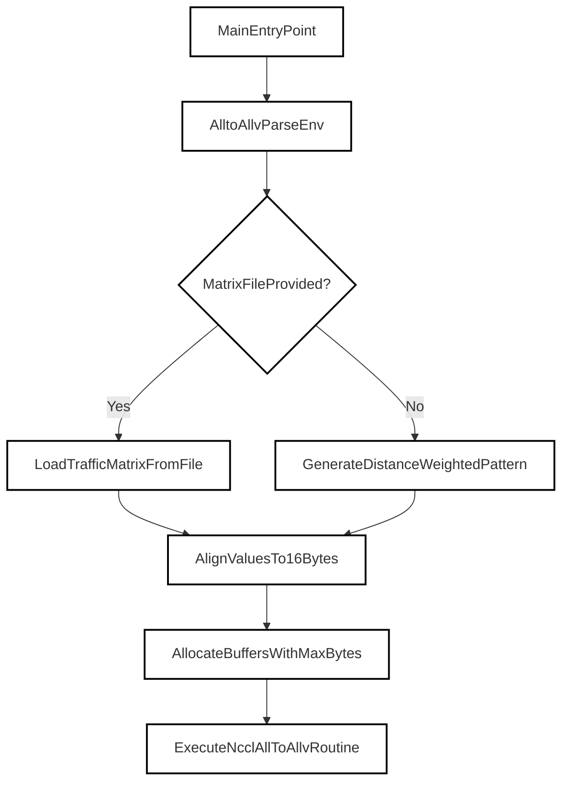

<!-- source: DeepWiki mcp.deepwiki.com · repo NVIDIA/nccl-tests · extra page AllToAllv · fetched 2026-11-11 -->

# AllToAllv

Relevant source files

The following files were used as context for generating this wiki page:

- [src/Makefile](src/Makefile)
- [src/alltoallv.cu](src/alltoallv.cu)

## Purpose and Scope

This page provides a comprehensive technical overview of the `alltoallv_perf` benchmark located in `src/alltoallv.cu`. The AllToAllv benchmark measures performance for irregular all-to-all communication patterns where individual ranks transmit variable amounts of data to different peers. This document details the two operational modes (generated distance-weighted patterns and explicit matrix-file mode), configuration via `NCCL_TESTS_ALLTOALLV_*` environment variables, internal parsing and initialization routines, and bandwidth calculation metrics for imbalanced workloads.

Sources: `src/alltoallv.cu:7-113`

---

## Traffic Pattern Modes

The AllToAllv implementation supports two distinct modes for configuring rank-to-rank communication payloads [src/alltoallv.cu:20-21]`:

### 1. Generated Pattern Mode (Default)
When no traffic matrix file is specified, the test automatically computes a distance-weighted distribution [src/alltoallv.cu:22-28]. Ranks that are further apart in rank-ID space receive proportionally higher volumes of data, simulating skewed inter-node or multi-switch traffic topologies while preserving equal total send/receive volumes per rank.

* **Spread Factor (`NCCL_TESTS_ALLTOALLV_SPREAD`)**: Controls the degree of weight skewing from `0.0` (fully uniform distribution where all peers receive equal bytes) to `1.0` (fully distance-weighted) [src/alltoallv.cu:29-35].
* **Size Sweeps**: The command-line parameters `-b`, `-e`, and `-f` define the sweep bounds for the total send/receive message size per rank [src/alltoallv.cu:44-48].

### 2. Matrix File Mode
When `NCCL_TESTS_ALLTOALLV_MATRIX_FILE` is defined, the test bypasses generated patterns and reads an explicit text file containing whitespace-separated byte counts [src/alltoallv.cu:50-59].

* **Matrix Constraints**: The input must be a square matrix where cell `[i][j]` defines the exact number of bytes transferred from rank `i` to rank `j` [src/alltoallv.cu:56-59]. Dimensions must be greater than or equal to the total number of ranks (`nranks`) [src/alltoallv.cu:66-68]. All values are automatically aligned to 16-byte boundaries [src/alltoallv.cu:69].
* **Scaling (`NCCL_TESTS_ALLTOALLV_MATRIX_SCALE`)**: Multiplies all parsed matrix elements by a scaling factor [src/alltoallv.cu:60-62].
* **Sweep Restrictions**: In matrix mode, sweep bounds (`-b` and `-e`) must be identical since per-peer sizes are strictly derived from the matrix file [src/alltoallv.cu:76-78]. Furthermore, `-e` must be large enough to cover the maximum send/receive volume across all ranks [src/alltoallv.cu:79-82].

Sources: `src/alltoallv.cu:20-82`

---

## Environment Variables Configuration

The AllToAllv benchmark relies on several `NCCL_TESTS_ALLTOALLV_*` environment variables for controlling execution behavior, parsed during initialization via `AlltoAllvParseEnv()` [src/alltoallv.cu:152-164].

| Environment Variable | Description | Default Value | Code Reference |
| :--- | :--- | :--- | :--- |
| `NCCL_TESTS_ALLTOALLV_SPREAD` | Distance-weighted spread factor (range `0.0` to `1.0`) | `1.0` | `[src/alltoallv.cu:157-163]()` |
| `NCCL_TESTS_ALLTOALLV_MATRIX_FILE` | Path to the explicit traffic matrix file | `NULL` (Disabled) | `[src/alltoallv.cu:153-154]()` |
| `NCCL_TESTS_ALLTOALLV_MATRIX_SCALE` | Scale factor applied to all entries in the matrix file | `1.0` | `[src/alltoallv.cu:137]()` |
| `NCCL_TESTS_ALLTOALLV_PRINT_SUMMARY`| Enables detailed per-rank send/recv and bandwidth reporting | `0` (Disabled) | `[src/alltoallv.cu:155-156]()` |

Sources: `src/alltoallv.cu:132-164`

---

## Implementation and Data Flow

The initialization and configuration pipeline bridges command-line arguments, environment variables, and the core NCCL testing engine. 

*Figure 1: Control flow and initialization architecture for AllToAllv traffic patterns.*

Sources: `src/alltoallv.cu:1-164`

---

## Bandwidth Metrics and Summary Reporting

Standard NCCL performance metrics (algorithmic bandwidth and bus bandwidth) for `alltoallv_perf` are calculated using the rank with the maximum transmission volume and the maximum elapsed time across all participating ranks [src/alltoallv.cu:83-88]. This prevents skewing caused by inactive or underutilized ranks in asymmetric topologies.

### Per-Rank Summary Statistics
When `NCCL_TESTS_ALLTOALLV_PRINT_SUMMARY=1` is set, the test generates a comprehensive per-rank output report [src/alltoallv.cu:93-96]:
* Total send bytes (`send_bytes`) [src/alltoallv.cu:95]
* Total receive bytes (`recv_bytes`) [src/alltoallv.cu:95]
* Algorithmic bandwidth (`alg_bw`) [src/alltoallv.cu:95]
* Bus bandwidth (`bus_bw`) [src/alltoallv.cu:95]

Sources: `src/alltoallv.cu:83-97`

---

