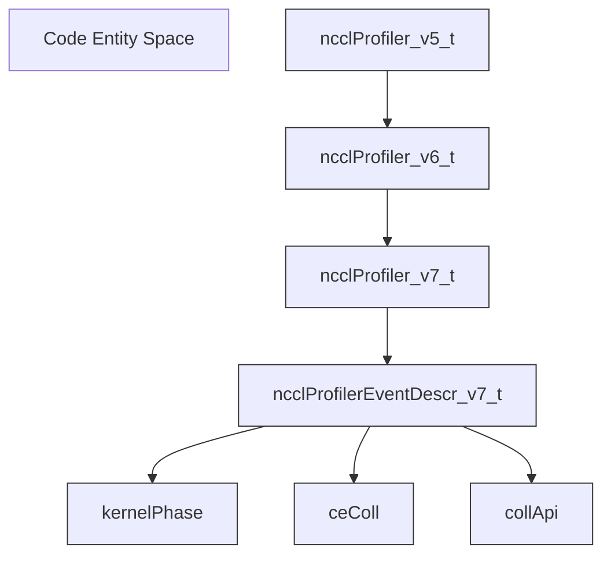
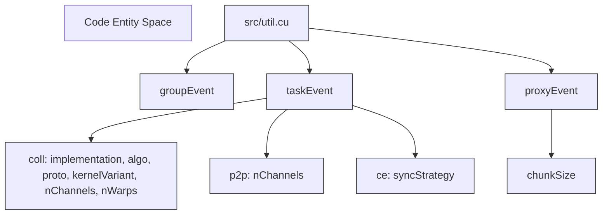

<!-- source: DeepWiki mcp.deepwiki.com · repo NVIDIA/nccl-tests · extra page NCCL Profiler Integration · fetched 2026-11-11 -->

# NCCL Profiler Integration

Relevant source files

The following files were used as context for generating this wiki page:

- [src/nccl_profiler.h](src/nccl_profiler.h)
- [src/profiler_v5.h](src/profiler_v5.h)
- [src/profiler_v6.h](src/profiler_v6.h)
- [src/profiler_v7.h](src/profiler_v7.h)
- [src/util.cu](src/util.cu)

## Purpose and Scope
This page details the integration of the NCCL Profiler API (`ncclProfiler_v5`, `ncclProfiler_v6`, and `ncclProfiler_v7`) within `nccl-tests`. It explains how the suite captures telemetry for collective operations, point-to-point (P2P) communications, proxy operations, and Communication Engine (CE) tasks, and how this runtime telemetry is structured and surfaced in JSON reporting and execution output.

---

## 1. Profiler Version Evolution: v5, v6, and v7 Interfaces
The NCCL profiler interface has evolved through multiple versions to support richer hardware acceleration, Communication Engine (CE) tasks, per-call user tagging, and finer-grained kernel phase tracking. `nccl-tests` incorporates structures supporting these interfaces via `src/nccl_profiler.h`.

### `ncclProfiler_v5_t`
Introduced the core plugin lifecycle and event set architecture, including hooks for initialization, event start/stop, state transitions, and finalization `[src/profiler_v5.h:111-151]`. It defines descriptors for host-side APIs (`collApi`, `p2pApi`, `groupApi`), kernel launches, collective/P2P executions (`coll`, `p2p`), proxy operations (`proxyOp`, `proxyStep`), and network plugins `[src/profiler_v5.h:12-91]`.

### `ncclProfiler_v6_t`
Extends `ncclProfiler_v5_t` by adding support for Communication Engine (CE) asynchronous operations. It introduces `ceColl`, `ceCollSync`, and `ceCollBatch` descriptors into `ncclProfilerEventDescr_v6_t` to monitor CE-driven memory copies and synchronization strategies `[src/profiler_v6.h:14-122]`.

### `ncclProfiler_v7_t`
Extends `ncclProfiler_v6_t` by introducing per-call user profiler tags (`userTag`) across collective and P2P descriptors, as well as a dedicated `kernelPhase` event descriptor for tracking sub-phases (initial synchronization, compute, and final synchronization) in custom device kernels `[src/profiler_v7.h:14-135]`.

*Sources: [src/profiler_v5.h:111-151](), [src/profiler_v6.h:14-145](), [src/profiler_v7.h:14-157]() *

---

## 2. Telemetry Event Types and States
Profiler event activation and state tracking are governed by bitmasks and state enumerations defined in `src/nccl_profiler.h`. 

### Event Activation Masks
Events are filtered and enabled via `ncclProfilerEventState_t` bit flags:
* `ncclProfileGroup` / `ncclProfileGroupApi`: Group and API boundary events `[src/nccl_profiler.h:23-32]()`.
* `ncclProfileColl` / `ncclProfileCollApi`: Host and device collective executions `[src/nccl_profiler.h:25-33]()`.
* `ncclProfileP2p` / `ncclProfileP2pApi`: Point-to-point communication flows `[src/nccl_profiler.h:26-34]()`.
* `ncclProfileProxyOp`, `ncclProfileProxyStep`, `ncclProfileProxyCtrl`: Low-level proxy thread operations, step updates, and control loops `[src/nccl_profiler.h:27-29]()`.
* `ncclProfileCeColl`, `ncclProfileCeSync`, `ncclProfileCeBatch`: Communication Engine collective operations and batch sync tracking `[src/nccl_profiler.h:36-38]()`.
* `ncclProfileKernelPhase`: Kernel barrier and phase sub-events `[src/nccl_profiler.h:39]()`.

### Event States
State transitions track the lifecycle of network and proxy operations, including send/receive posting, FIFO waits, transmissions, and proxy control idle/active transitions `[src/nccl_profiler.h:42-75]()`.

Sources: `[src/nccl_profiler.h:23-75]()`

---

## 3. Telemetry Capture and Internal Data Structures
In `nccl-tests`, output formatting and telemetry structures in `src/util.cu` maintain internal aggregate states for grouping, task profiling, and proxy monitoring.

*Sources: [src/util.cu:59-97]()*

The `taskEvent` structure captures attributes such as:
* Collective implementation, algorithm (`algo`), and protocol (`proto`) `[src/util.cu:70-72]()`.
* Kernel variants, channel counts (`nChannels`), and warp allocations (`nWarps`) `[src/util.cu:73-75]()`.
* Communication Engine (CE) synchronization strategies `[src/util.cu:83-84]()`.

Sources: `[src/util.cu:59-97]()`

---

## 4. Surfacing Tuning Information in Reports
The profiler integration enables `nccl-tests` to embed detailed tuning information into output structures. When reporting performance metrics to stdout or structured JSON reports (`JSON_FILE_VERSION 4` [src/util.cu:99]()), the test framework queries underlying profiler states to output parameters like algorithm selection, protocol type, chunk sizes, and channel concurrency. This allows straggler analysis and spike detection tools (`tools/analyze_perf_json.py`) to correlate hardware performance anomalies directly with specific NCCL kernel variants and proxy step latencies.

Sources: `[src/util.cu:19-100]()`

---

