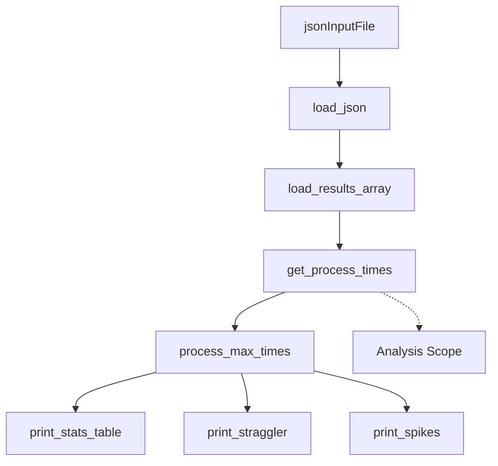
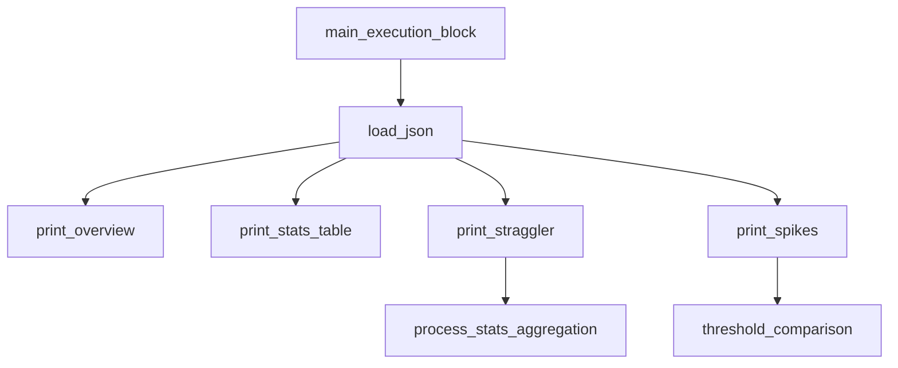

<!-- source: DeepWiki mcp.deepwiki.com · repo NVIDIA/nccl-tests · extra page Performance JSON Analysis Tools · fetched 2026-11-11 -->

# Performance JSON Analysis Tools

<details>
<summary>Relevant source files</summary>

The following files were used as context for generating this wiki page:

- [src/util.h](src/util.h)
- [tools/analyze_perf_json.py](tools/analyze_perf_json.py)

</details>


## Purpose and Scope
This section covers the post-processing and telemetry analysis capabilities provided by `tools/analyze_perf_json.py` in conjunction with the JSON output generation engine defined in `src/util.h`. When running `nccl-tests` with JSON logging enabled (`-J`), the benchmark suite writes structured per-iteration and per-process timing metrics. The `tools/analyze_perf_json.py` script consumes these output files to diagnose performance anomalies, including process stragglers, execution spikes, iteration-0 initialization penalties, and node-level performance disparities.

Sources: `src/util.h`, `tools/analyze_perf_json.py`

---

## JSON Output Generation Infrastructure (`src/util.h`)

The core benchmarking framework coordinates JSON performance output through logging hooks declared in `src/util.h`. These routines record benchmark configurations, environment variables, aggregated performance data, and detailed per-iteration/per-process distributions.

*   `jsonOutputInit(const char *path, int argc, char **argv, char **envp)`: Initializes the JSON output file (handling rank-0 isolation and duplicate file avoidance) [src/util.h:16-25]().
*   `jsonIdentifyWriter(bool is_writer)`: Marks the designated process/thread responsible for writing output [src/util.h:27-28]().
*   `jsonOutputFinalize()`: Closes the top-level JSON object and finalizes the output file stream [src/util.h:30-31]().
*   `computeIterStats(const double* times, int n, struct IterStats* stats)`: Computes statistical metrics (`min`, `max`, `avg`, `p50`, `p95`, `p99`, `stdev`) over an array of execution times [src/util.h:33-38]().
*   `writePerIterReport(...)`: Outputs per-iteration timing structures and multi-process breakdown data into the JSON hierarchy [src/util.h:43]().

Sources: `src/util.h`

---

## Architecture of `tools/analyze_perf_json.py`

The script `tools/analyze_perf_json.py` is designed to parse multi-process and multi-iteration JSON logs [tools/analyze_perf_json.py:7-19](). It extracts raw timing arrays, most notably via the constant `PROCESS_TIMES_KEY = "per_process_max_times_us"`, which stores the maximum execution time per process across local threads and GPUs [tools/analyze_perf_json.py:25-44]().

### Data Flow and Script Architecture


*Sources: `tools/analyze_perf_json.py`*

Sources: `tools/analyze_perf_json.py`

---

## Key Analysis Modes and Functions

`tools/analyze_perf_json.py` provides several targeted analysis flags to inspect execution characteristics across different dimensions:

### 1. Per-Iteration Statistics (`print_stats_table`)
The `print_stats_table` function iterates through benchmark payload sizes, parsing the selected placement category (`in_place_per_iter` or `out_of_place_per_iter`) [tools/analyze_perf_json.py:82-99](). It computes the spike ratio (`max_us / avg_us`) and flags iterations where the coefficient of variation (`cv_pct`) exceeds 5% or the spike ratio exceeds `1.5x` [tools/analyze_perf_json.py:95-96]().

### 2. Straggler Analysis (`print_straggler`)
The `print_straggler` function analyzes process-level execution times (`per_process_max_times_us`) to detect synchronization imbalances or hardware degradation [tools/analyze_perf_json.py:101-139](). For each payload size:
* It computes the average, minimum, maximum, and coefficient of variation (`cv`) for every process index [tools/analyze_perf_json.py:120-124]().
* It identifies the `fastest` and `slowest` processes, reporting the absolute spread and percentage overhead [tools/analyze_perf_json.py:126-134]().
* It highlights the `noisiest` process (highest standard deviation relative to its mean) [tools/analyze_perf_json.py:129]().

### 3. Spike Detection (`print_spikes`)
The `print_spikes` function scans individual iterations against a user-configurable multiplier threshold (default `1.5x`) [tools/analyze_perf_json.py:141-176](). Any iteration where a process execution time exceeds `avg * threshold` is logged with its specific process ID and latency anomaly [tools/analyze_perf_json.py:165-170]().

### Code Entity Execution Flow


*Sources: `tools/analyze_perf_json.py`*

Sources: `tools/analyze_perf_json.py`

---

## Usage Examples

The analysis tool supports command-line arguments to isolate specific diagnostic workflows:

```bash
# Basic inspection of all metrics
python3 tools/analyze_perf_json.py results.json

# Filter analysis to specific payload sizes (in bytes)
python3 tools/analyze_perf_json.py results.json --sizes 8,1048576,34359738368

# Run dedicated straggler detection across processes
python3 tools/analyze_perf_json.py results.json --straggler

# Detect execution spikes with custom sensitivity threshold
python3 tools/analyze_perf_json.py results.json --spikes --threshold 1.8

# Analyze in-place memory placement metrics
python3 tools/analyze_perf_json.py results.json --in-place --spikes

# Execute all available diagnostic analyzers
python3 tools/analyze_perf_json.py results.json --all
```

Sources: `tools/analyze_perf_json.py`

---

