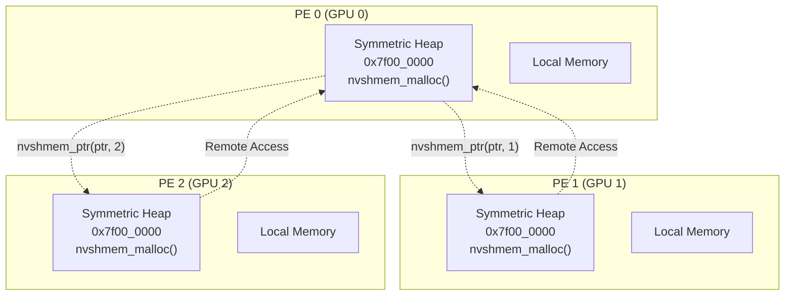
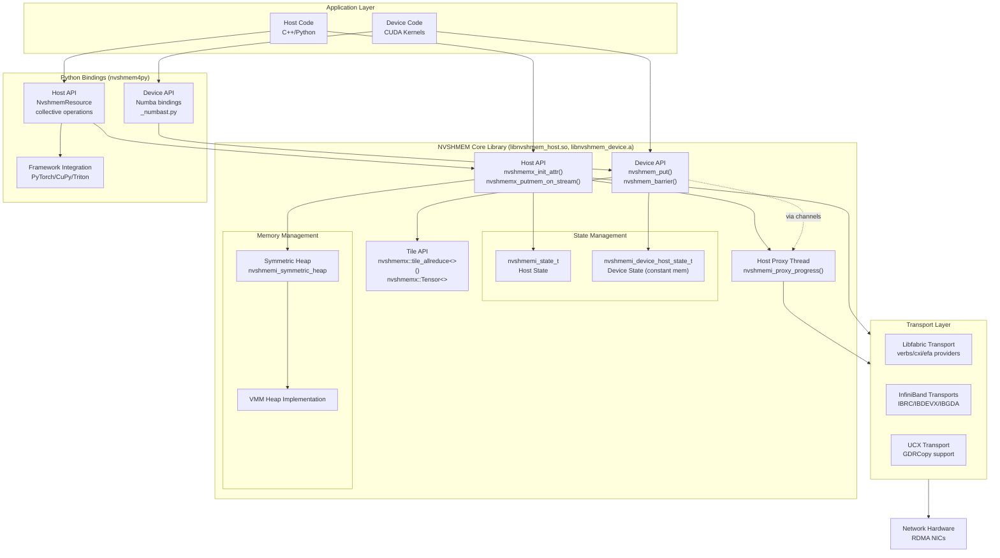
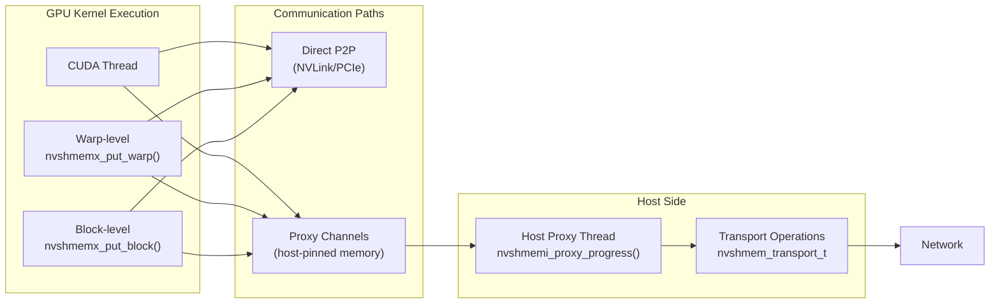
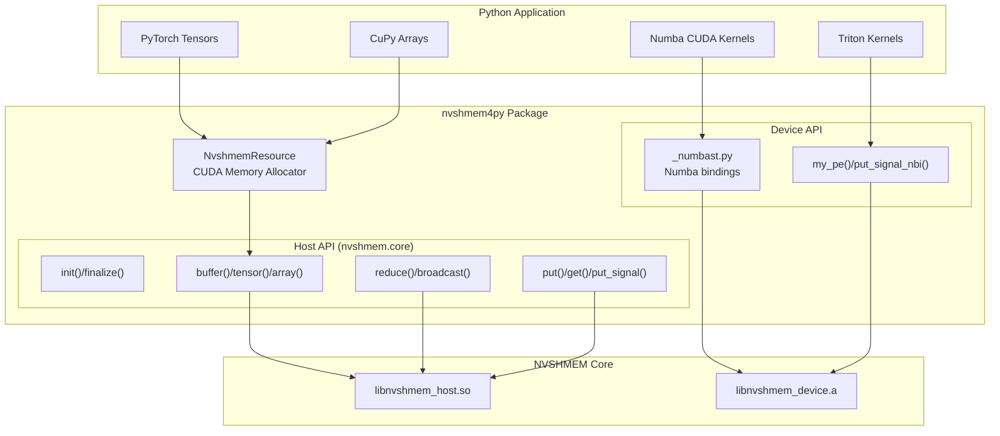
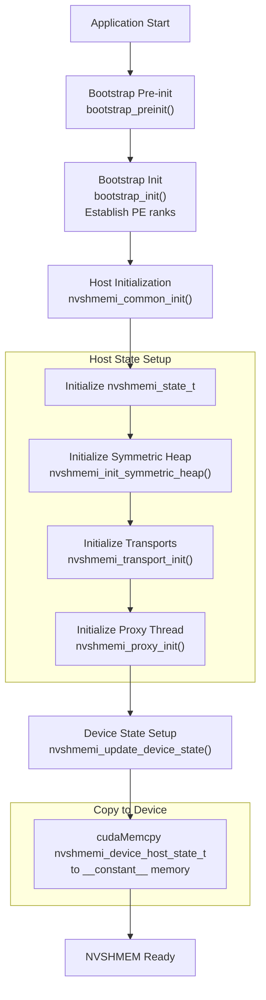

<!-- source: DeepWiki mcp.deepwiki.com · repo NVIDIA/nvshmem · page 1 Overview · fetched 2026-11-11 -->

# Overview

<details>
<summary>Relevant source files</summary>

The following files were used as context for generating this wiki page:

- [CMakeLists.txt](CMakeLists.txt)
- [cmake_config/NVSHMEMEnv.cmake](cmake_config/NVSHMEMEnv.cmake)
- [nvshmem4py/scripts/generate_pyproject_toml.py](nvshmem4py/scripts/generate_pyproject_toml.py)
- [src/CMakeLists.txt](src/CMakeLists.txt)
- [src/host/init/init.cu](src/host/init/init.cu)
- [src/host/mem/mem_heap.cpp](src/host/mem/mem_heap.cpp)
- [src/include/non_abi/device/coll/utils.cuh](src/include/non_abi/device/coll/utils.cuh)

</details>


## Purpose and Scope

This page introduces NVSHMEM and nvshmem4py, explaining their purpose in distributed GPU computing, core programming model, and key capabilities. For detailed information about specific subsystems, see [Architecture](#2), [Build System](#3), [Python API Reference](#4), or [C/C++ API Reference](#5).

**Sources:** [CMakeLists.txt:48-52]()

## What is NVSHMEM?

**NVSHMEM** (NVIDIA Symmetric Hierarchical Memory) is a communication library that implements the OpenSHMEM API for GPU-to-GPU communication in distributed systems. It enables direct communication between GPUs across nodes without requiring explicit host involvement for every operation.

NVSHMEM provides a **Partitioned Global Address Space (PGAS)** programming model where each GPU's local memory is part of a globally addressable symmetric heap. This allows GPUs to directly read from and write to memory on remote GPUs using simple memory access patterns.

**Key characteristics:**
- Version 3.5.1.1 (core library)
- C/C++/CUDA API for device and host code
- Python bindings (nvshmem4py version 0.1.2)
- OpenSHMEM specification compliant
- Optimized for NVIDIA GPU architectures (Volta and newer)

**Sources:** [CMakeLists.txt:48-52](), [src/include/host/nvshmemx_api.h:1-36](), [nvshmem4py/nvshmem/version.py:31-34]()

## Core Programming Model

### Processing Elements (PEs)

In NVSHMEM, each GPU is represented as a **Processing Element (PE)**. PEs are identified by rank numbers from 0 to N-1, where N is the total number of PEs in the job. The core API provides functions to query PE information:

```cpp
int nvshmem_my_pe();     // Returns the calling PE's rank
int nvshmem_n_pes();     // Returns total number of PEs
```

**Sources:** [src/include/device_host/nvshmem_types.h:239-240](), [src/host/init/init.cu:437-440]()

### Symmetric Heap

The **symmetric heap** is a memory region allocated by NVSHMEM that exists at the same virtual address on all PEs. Memory allocated from this heap can be directly accessed by any PE in the system using the same pointer value.



**Diagram: Symmetric Heap Architecture Across PEs**

The heap can be allocated using three strategies:
1. **VMM (Virtual Memory Management)**: Uses `cuMemCreate` API for virtual memory management (preferred)
2. **cudaMalloc**: Traditional CUDA memory allocation
3. **System Memory**: Host-accessible memory for specific use cases

**Sources:** [src/include/internal/host/nvshmem_internal.h:65](), [nvshmem4py/nvshmem/core/nvshmem_types.py:224-276]()

## Architecture Overview



**Diagram: NVSHMEM High-Level Architecture**

**Sources:** [src/include/internal/host/nvshmem_internal.h:91-109](), [src/include/device_host/nvshmem_types.h:452-463](), [src/host/init/init.cu:56-90]()

## Core Capabilities

### 1. Remote Memory Access (RMA)

NVSHMEM provides one-sided communication primitives for reading from and writing to remote PE memory:

- **Put operations**: Write local data to remote PE memory
  - `nvshmem_put()`, `nvshmem_putmem()`, `nvshmemx_putmem_on_stream()`
- **Get operations**: Read data from remote PE memory to local memory
  - `nvshmem_get()`, `nvshmem_getmem()`, `nvshmemx_getmem_on_stream()`
- **Signal operations**: Put with remote notification
  - `nvshmem_put_signal()`, `nvshmemx_putmem_signal_on_stream()`

**Sources:** [src/include/host/nvshmemx_api.h:92-246](), [nvshmem4py/nvshmem/core/rma.py:1-277]()

### 2. Collective Operations

Collective communication primitives that involve all or a subset of PEs:

- **Synchronization**: `nvshmem_barrier()`, `nvshmem_sync()`, `nvshmem_quiet()`
- **Data movement**: `nvshmem_broadcast()`, `nvshmem_fcollect()`, `nvshmem_alltoall()`
- **Reductions**: `nvshmem_reduce()`, `nvshmem_allreduce()` with operations (sum, max, min)

Collectives can be issued from host or device, and support stream-based execution:

**Sources:** [nvshmem4py/nvshmem/core/collective.py:32-373]()

### 3. Device-Initiated Communication

Unlike traditional MPI-style communication that requires CPU coordination, NVSHMEM allows GPU threads to directly initiate communication operations from within CUDA kernels:



**Diagram: Device-Initiated Communication Paths**

**Sources:** [src/include/host/nvshmemx_api.h:277-398](), [src/host/init/init.cu:49](), [src/include/device_host/nvshmem_types.h:184-230]()

### 4. Multi-Transport Support

NVSHMEM supports multiple network transport implementations through a unified interface (`nvshmem_transport_t`):

| Transport | Description | Use Case |
|-----------|-------------|----------|
| **Libfabric** | Supports multiple providers (verbs, CXI, EFA) | Broad hardware compatibility |
| **IBRC** | InfiniBand Reliable Connected | Basic IB support |
| **IBDEVX** | InfiniBand with DevX API extensions | Enhanced IB features |
| **IBGDA** | GPU Direct Aware with DCI/DCT/RC QPs | Optimized IB for GPUs |
| **UCX** | Unified Communication X with GDRCopy | Portability layer |

**Sources:** Diagrams 2 and system architecture overview

### 5. Tile API for Tensor Operations

The **Tile API** (`nvshmemx::tile_*`) provides high-level abstractions for collective operations on tensor sub-regions (tiles). This is particularly useful for distributed deep learning:

```cpp
// Example: Warp-level allreduce on a tensor tile
nvshmemx::Tensor<float> src_tensor(src_ptr, layout);
nvshmemx::Tensor<float> dst_tensor(dst_ptr, layout);

nvshmemx::tile_sum_reduce_warp<
    decltype(src_tensor), 
    decltype(dst_tensor),
    decltype(boundary),
    nvshmemx::tile_coll_algo_t::NVLS_ONE_SHOT_PULL_NBI
>(team, src_tensor, dst_tensor, start_coord, boundary, flag);
```

Supported operations:
- `tile_allreduce()`, `tile_rooted_reduce()`: Reduction operations
- `tile_allgather()`: Gather from all PEs
- `tile_broadcast()`: Broadcast from root
- `tile_put()`, `tile_get()`: Point-to-point transfers

Threadgroup scopes: thread, warp, warpgroup (128 threads), block

**Sources:** [src/include/device/tile/nvshmemx_tile_api.hpp:1-129](), [src/include/device/tile/nvshmemx_tile_api_defines.cuh:1-178](), [examples/gemm_allreduce/allreduce_nvls_warpspecialized.hpp:43-159]()

### 6. Teams

NVSHMEM **teams** are subsets of PEs that can perform collective operations independently. The predefined team `NVSHMEM_TEAM_WORLD` includes all PEs. Custom teams can be created for hierarchical communication patterns.

**Sources:** [src/include/device_host/nvshmem_types.h:239-240](), [src/include/device_host/nvshmem_types.h:312-402]()

## Python Bindings (nvshmem4py)

**nvshmem4py** exposes NVSHMEM functionality to Python applications with integration for popular frameworks:



**Diagram: nvshmem4py Architecture and Framework Integration**

**Key features:**
- **Memory management**: `NvshmemResource` class implements CUDA memory allocator protocol
- **Framework interoperability**: Direct support for PyTorch tensors and CuPy arrays via DLPack
- **Device programming**: Numba bindings for writing NVSHMEM device kernels in Python
- **Stream integration**: Native support for PyTorch and CUDA Python streams

**Example workflow:**
```python
import nvshmem.core
import torch

# Initialize NVSHMEM
nvshmem.core.init(device=dev, uid=uniqueid, rank=rank, nranks=nranks)

# Allocate symmetric tensor
tensor = nvshmem.core.tensor((1024,), dtype=torch.float32)

# Perform collective operation
nvshmem.core.reduce(
    nvshmem.core.Teams.TEAM_WORLD, 
    tensor, tensor, "sum", 
    stream=stream
)

# Free and finalize
nvshmem.core.free_tensor(tensor)
nvshmem.core.finalize()
```

**Sources:** [nvshmem4py/nvshmem/core/nvshmem_types.py:1-536](), [nvshmem4py/examples/torch_triton_interop.py:1-140]()

## Initialization and State Management

NVSHMEM initialization establishes the distributed execution environment:



**Diagram: NVSHMEM Initialization Flow**

**Initialization options:**
1. **With MPI**: `nvshmemx_init_attr()` with `NVSHMEMX_INIT_WITH_MPI_COMM` flag
2. **With UniqueID**: `nvshmemx_init_attr()` with `NVSHMEMX_INIT_WITH_UNIQUEID` flag
3. **With SHMEM**: `NVSHMEMX_INIT_WITH_SHMEM` for interoperability

**Sources:** [src/host/init/init.cu:320-433](), [src/host/init/init.cu:146-197](), [src/include/device_host/nvshmem_types.h:184-230]()

## Use Cases and Applications

NVSHMEM is designed for high-performance GPU computing applications requiring efficient inter-GPU communication:

### Distributed Deep Learning
- **Tensor parallelism**: Split large models across multiple GPUs
- **Data parallelism**: Gradient allreduce operations
- **Pipeline parallelism**: Layer-to-layer communication
- **Example**: GEMM operations with integrated allreduce using Tile API

### Scientific Computing
- **Stencil computations**: Exchange halo regions between neighboring PEs
- **Iterative solvers**: Collective operations in distributed linear algebra
- **Molecular dynamics**: Spatial domain decomposition

### High-Performance Computing
- **GPU clusters**: Efficient communication for multi-node GPU applications
- **Co-design with CUDA**: Direct device-initiated communication without host bottlenecks
- **NVLS acceleration**: NVLink Switch hardware acceleration for collectives

**Sources:** [examples/gemm_allreduce/allreduce_nvls_warpspecialized.hpp:1-164](), [perftest/device/tile/tile_allreduce_latency.cu:1-293]()

## Version Information

**NVSHMEM Core Library:**
- Version: 3.5.1.1
- OpenSHMEM specification: Compliant
- Build identifier defined in: `NVSHMEM_VENDOR_MAJOR_VERSION`, `NVSHMEM_VENDOR_MINOR_VERSION`, `NVSHMEM_VENDOR_PATCH_VERSION`

**nvshmem4py Python Bindings:**
- Version: 0.1.2
- Python support: 3.9 through 3.12
- CUDA support: 11.x, 12.x, 13.x

**Sources:** [CMakeLists.txt:48-52](), [nvshmem4py/nvshmem/version.py:31-34](), [src/host/init/init.cu:78-79]()

## Next Steps

- **For architectural details**: See [Architecture](#2) for in-depth component design
- **For building from source**: See [Build System](#3)
- **For Python development**: See [Python API Reference](#4)
- **For C/C++ development**: See [C/C++ API Reference](#5)
- **For transport details**: See [Transport Implementations](#6)

---

