<!-- source: DeepWiki mcp.deepwiki.com · repo NVIDIA/nvshmem · page 2.1 Core Library Architecture · fetched 2026-11-11 -->

# Core Library Architecture

Relevant source files

The following files were used as context for generating this wiki page:

- [cmake_config/NVSHMEMEnv.cmake](cmake_config/NVSHMEMEnv.cmake)
- [nvshmem4py/scripts/generate_pyproject_toml.py](nvshmem4py/scripts/generate_pyproject_toml.py)
- [src/CMakeLists.txt](src/CMakeLists.txt)
- [src/host/init/init.cu](src/host/init/init.cu)
- [src/host/mem/mem_heap.cpp](src/host/mem/mem_heap.cpp)
- [src/host/team/team_internal.cpp](src/host/team/team_internal.cpp)
- [src/include/non_abi/device/coll/barrier.cuh](src/include/non_abi/device/coll/barrier.cuh)
- [src/include/non_abi/device/coll/utils.cuh](src/include/non_abi/device/coll/utils.cuh)
- [src/include/non_abi/device/team/nvshmemi_team_defines.cuh](src/include/non_abi/device/team/nvshmemi_team_defines.cuh)

## Purpose and Scope

This page describes the core architecture of the NVSHMEM C/C++ library, covering its dual host-device structure, initialization flow, state management, and component organization. For details on specific subsystems, see [Transport Layer](#2.2), [Device Programming Model](#2.3), [Memory Management and Symmetric Heap](#2.4), [Host Proxy Architecture](#2.5), and [Team Management](#2.6). For the Python bindings architecture, see [Python Bindings Architecture](#2.7).

## Library Components

NVSHMEM consists of two primary libraries built from separate source trees:

| Library | Type | Build Location | Source Location | Purpose |
|---------|------|----------------|-----------------|---------|
| `libnvshmem_host.so` | Shared | `src/build/lib/` | `src/host/` | Host-side runtime, initialization, collectives, transport management |
| `libnvshmem_device.a` | Static | `src/build/lib/` | `src/device/` | Device-side functions called from CUDA kernels |
| `libnvshmem_device.bc` | Bitcode (optional) | `src/build/lib/` | `src/device/` | LLVM bitcode for alternative device linking |

The host library (`nvshmem_host`) is built as a shared object containing all runtime logic, while the device library (`nvshmem_device`) is built as a static archive linked into user CUDA applications. The build process is orchestrated through a two-stage CMake configuration where the device library is built as an `ExternalProject`.

**Sources:** [src/CMakeLists.txt:22-45](), [src/CMakeLists.txt:230-247]()

### Host Library Structure

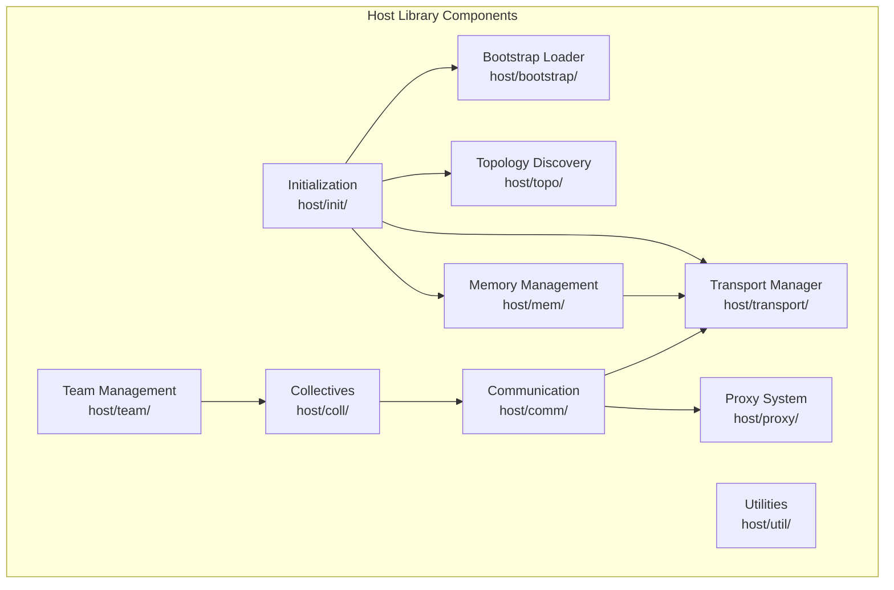

**Sources:** [src/CMakeLists.txt:316-359]()

### Device Library Structure

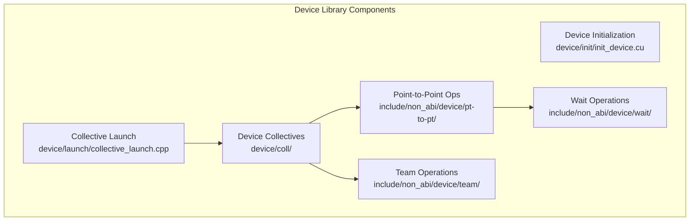

**Sources:** [src/CMakeLists.txt:286-289]()

## State Management Architecture

NVSHMEM maintains state structures on both host and device sides, with explicit synchronization between them.

### Core State Structures

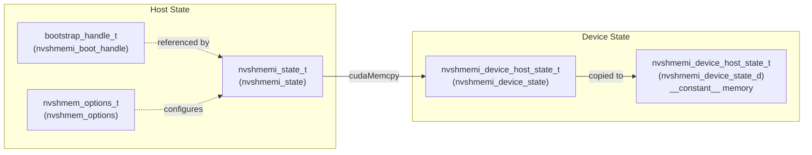

**Sources:** [src/host/init/init.cu:58-90]()

### nvshmemi_state_t Structure

The host-side state structure `nvshmemi_state_t` contains all runtime information:

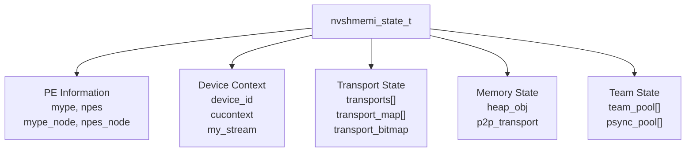

Key fields include:
- **PE identification**: `mype`, `npes`, `mype_node`, `npes_node` - process rank and size information
- **Device context**: `device_id`, `cucontext`, `my_stream` - CUDA device and execution context
- **Transport management**: `transports[]`, `transport_map[]`, `num_initialized_transports`
- **Memory management**: `heap_obj` (pointer to symmetric heap), `p2p_transport`
- **Team management**: Team pool and synchronization arrays

**Sources:** [src/host/init/init.cu:437-446](), [src/host/mem/mem_heap.cpp:74-99]()

### nvshmemi_device_host_state_t Structure

The device-side state structure `nvshmemi_device_host_state_t` is a read-only snapshot copied from the host:

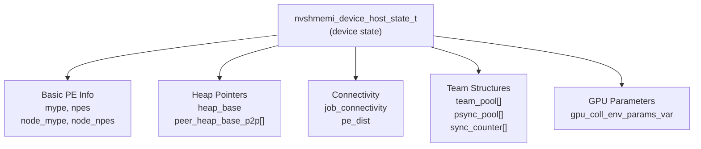

This structure resides in CUDA constant memory (`__constant__`) as `nvshmemi_device_state_d`, accessible from all device code.

**Sources:** [src/host/init/init.cu:49](), [src/host/init/init.cu:90]()

### State Update Mechanism

The function `nvshmemi_update_device_state()` synchronizes host state to device:

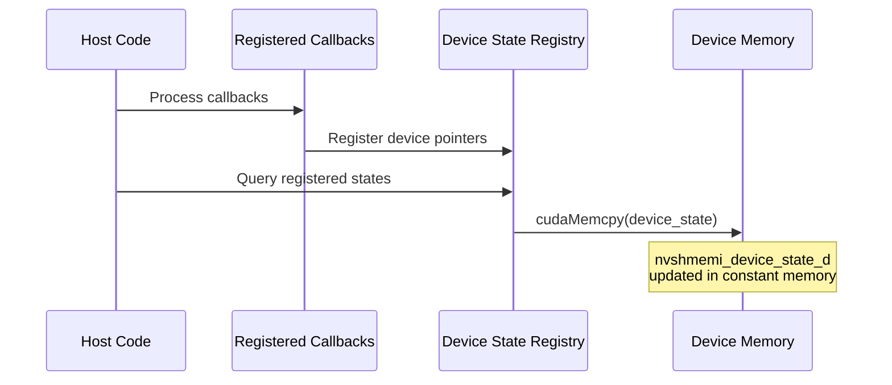

This function is called after any operation that modifies state visible to device code, such as heap allocation, team creation, or transport initialization.

**Sources:** [src/host/init/init.cu:147-199]()

## Initialization Flow

NVSHMEM initialization follows a multi-phase process coordinated by the `nvshmemi_init_thread_` function.

### Initialization Phases

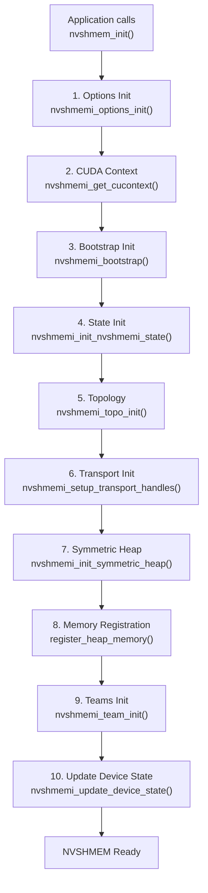

**Sources:** [src/host/init/init.cu:1050-1400]()

### Bootstrap Phase

The bootstrap subsystem establishes initial process coordination:

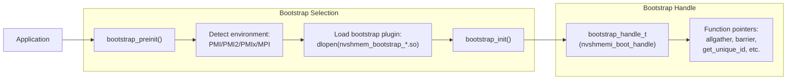

The bootstrap phase populates `nvshmemi_boot_handle` with function pointers for collective operations needed during initialization (allgather, barrier) and provides PE rank/size information.

**Sources:** [src/host/init/init.cu:322-435](), [src/host/bootstrap/bootstrap.cpp]()

### Transport Initialization

Transport plugins are loaded and initialized after topology discovery:

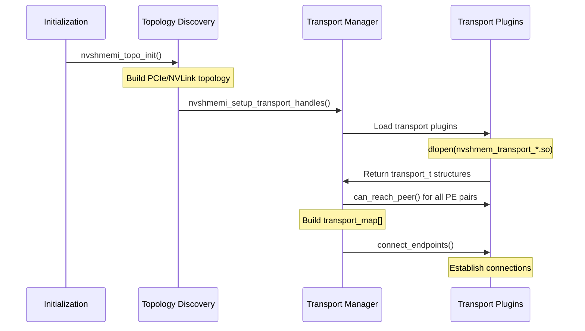

The transport manager builds a `transport_map[]` array indicating which transport(s) can reach each PE pair, enabling optimal path selection at runtime.

**Sources:** [src/host/init/init.cu:900-1000](), [src/host/transport/transport.cpp]()

## Host-Device Communication Model

NVSHMEM employs multiple mechanisms for host-device interaction:

### Device State Access Pattern

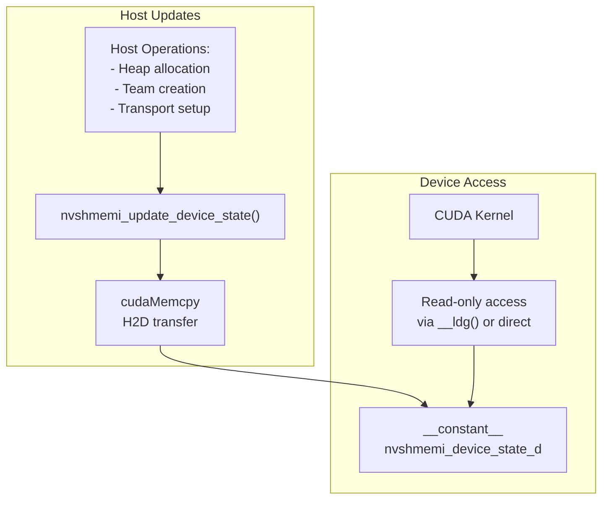

Device code accesses state via the constant memory symbol `nvshmemi_device_state_d`, which provides fast cached access to frequently-used data like PE information, heap base addresses, and team structures.

**Sources:** [src/host/init/init.cu:147-199]()

### Callback Registration

Device libraries register callbacks to receive state updates:

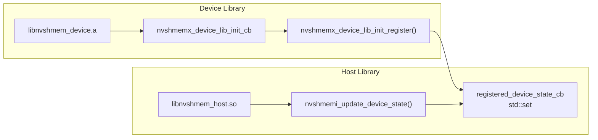

This callback mechanism allows device-side code to obtain pointers to device state structures that the host will update.

**Sources:** [src/host/init/init.cu:116-145](), [src/host/init/init.cu:154-169]()

## Component Dependencies

### Compilation Units Organization

The host library source files are organized by functionality:

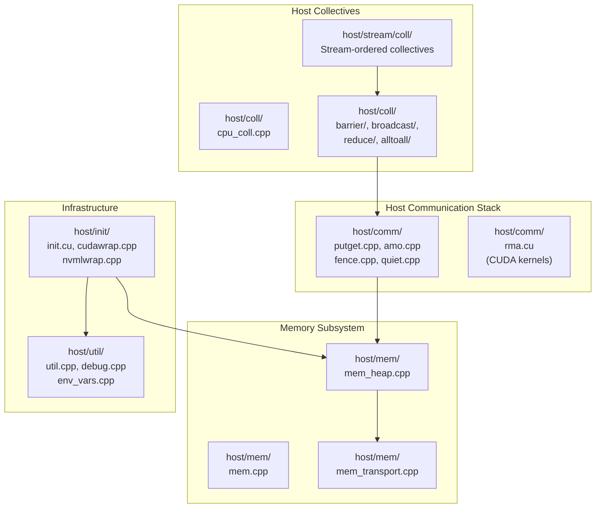

**Sources:** [src/CMakeLists.txt:316-359]()

### Build Targets

Key CMake targets in the build system:

| Target | Type | Purpose |
|--------|------|---------|
| `nvshmem_device_project` | ExternalProject | Builds device library independently |
| `nvshmem_device` | STATIC IMPORTED | Import target for device library |
| `nvshmem_host` | SHARED | Main host library |
| `nvshmem_bootstrap_*` | SHARED (plugins) | Bootstrap implementations |
| `nvshmem_transport_*` | SHARED (plugins) | Transport implementations |
| `nvshmem-info` | EXECUTABLE | Configuration query tool |

**Sources:** [src/CMakeLists.txt:22-45](), [src/CMakeLists.txt:121-227](), [src/CMakeLists.txt:412-561](), [src/CMakeLists.txt:624-630]()

## Configuration and Options

### Build-time Configuration

The build system uses CMake options to enable/disable features:

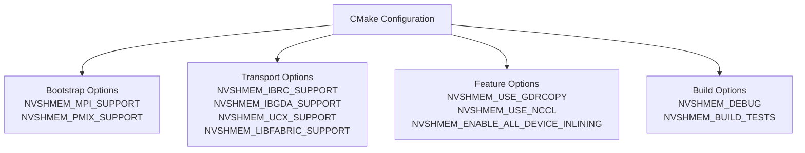

These options are processed by `cmake_config/NVSHMEMEnv.cmake` and generate preprocessor defines in `include/non_abi/nvshmem_build_options.h`.

**Sources:** [cmake_config/NVSHMEMEnv.cmake:36-124](), [src/CMakeLists.txt:250-280]()

### Runtime Configuration

Runtime behavior is controlled by environment variables processed in `nvshmemi_options_init()`:

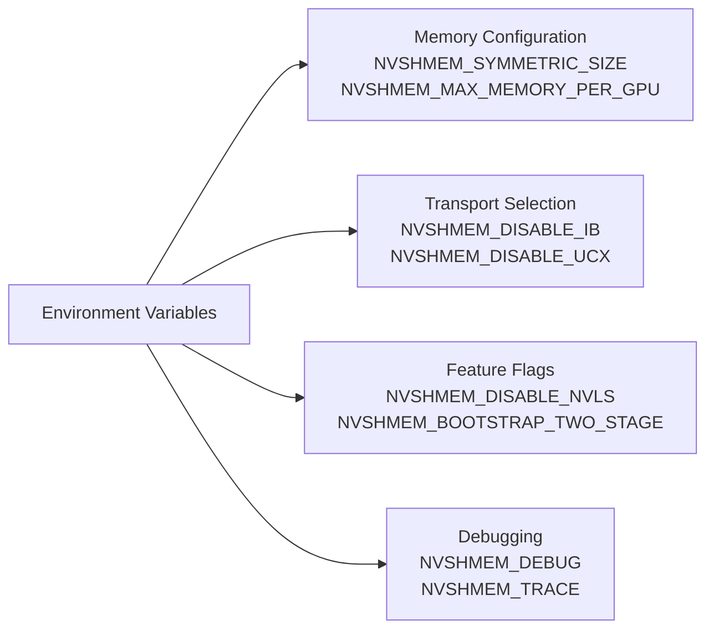

These are parsed and stored in the `nvshmemi_options` global structure.

**Sources:** [src/host/util/env_vars.cpp](), [bootstrap_host_transport/env_defs_internal.h]()

## Symmetry and Collective Semantics

NVSHMEM enforces symmetric operation semantics:

### Symmetric Memory Allocation

All allocations must be symmetric across PEs:

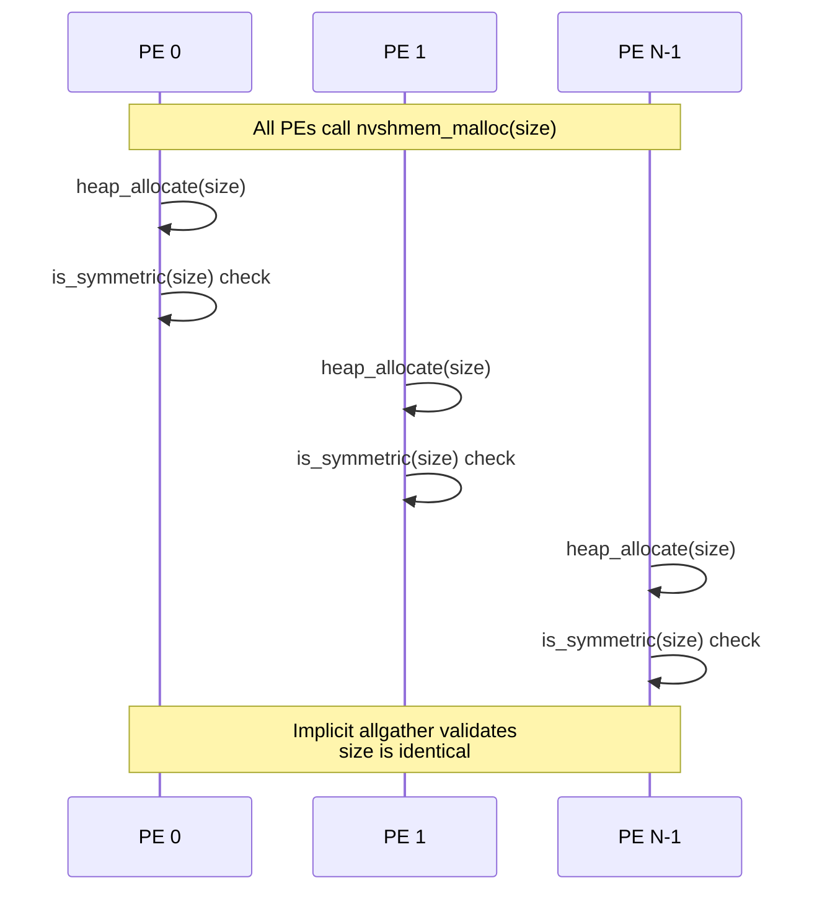

The `is_symmetric()` check performs an allgather to verify all PEs request the same size.

**Sources:** [src/host/mem/mem_heap.cpp:124-148]()

### Team Creation

Team operations require collective participation:

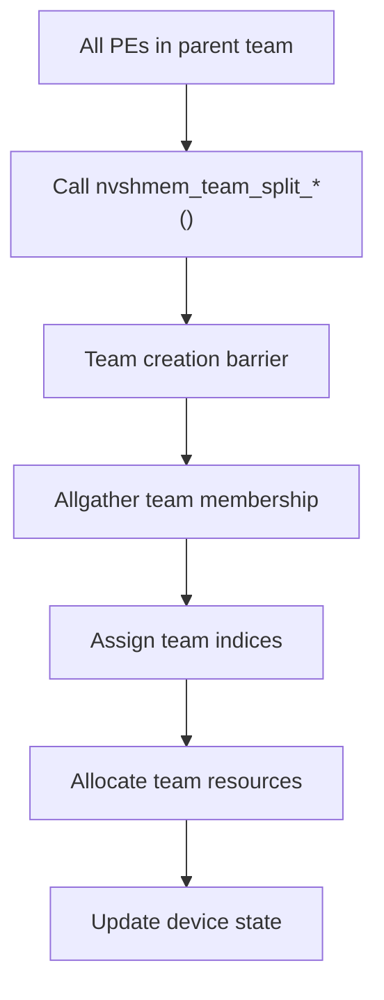

Each PE participates in team creation even if it won't be a member of the new team, ensuring consistent team indices across all PEs.

**Sources:** [src/host/team/team_internal.cpp:574-733]()

## Device State Consistency

### Team State Synchronization

Team structures on device mirror host structures:

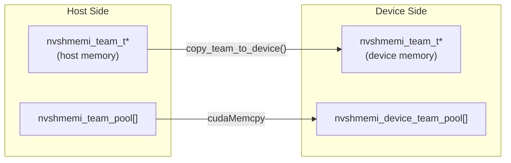

The function `copy_team_to_device()` ensures teams visible on device match host-side definitions.

**Sources:** [src/host/team/team_internal.cpp:249-269](), [src/host/team/team_internal.cpp:271-285]()

### Memory Mapping Updates

Heap memory mappings must be visible to device code:

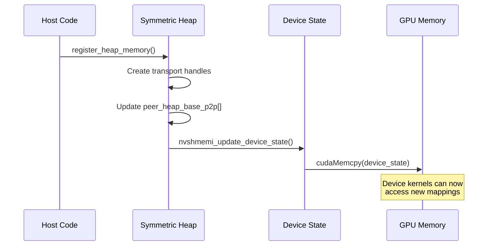

**Sources:** [src/host/mem/mem_heap.cpp:674-684](), [src/host/init/init.cu:147-199]()

## Summary

The NVSHMEM core library architecture implements a split host-device model where:

1. **Host library** (`libnvshmem_host.so`) manages runtime state, orchestrates initialization, and coordinates transport/memory subsystems
2. **Device library** (`libnvshmem_device.a`) provides GPU-callable functions linked into user kernels
3. **State management** maintains synchronized host-device state structures via explicit copy operations
4. **Initialization** follows a phased bootstrap → topology → transport → memory → teams sequence
5. **Symmetry enforcement** ensures consistent state across all PEs through collective validation

This architecture enables efficient device-initiated communication while maintaining compatibility with diverse network transports and GPU topologies. For deeper dives into specific subsystems, see the related architecture pages listed at the top of this document.

**Sources:** [src/CMakeLists.txt:1-900](), [src/host/init/init.cu:1-1500](), [src/host/mem/mem_heap.cpp:1-800](), [src/host/team/team_internal.cpp:1-600]()

---

