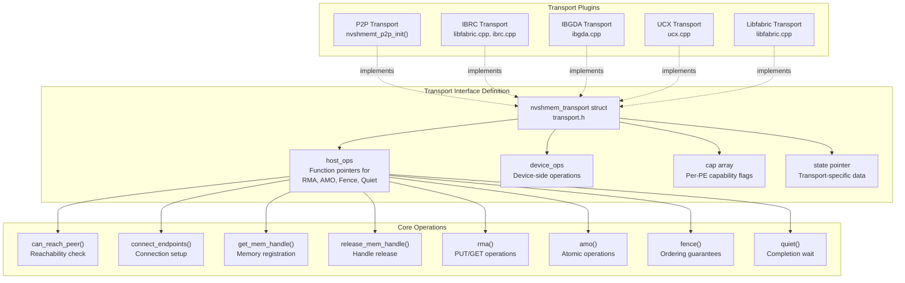
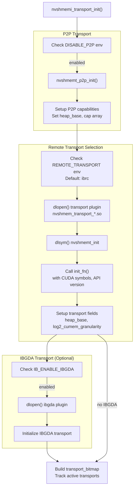
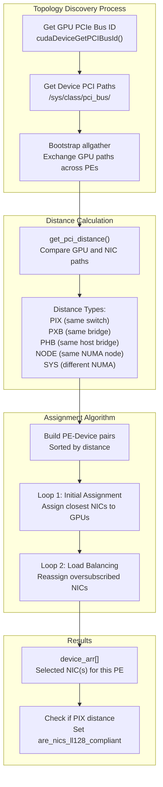
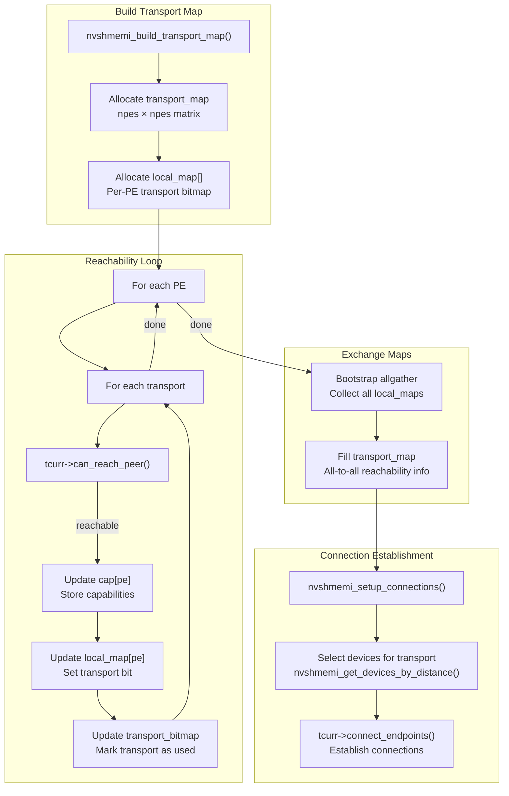
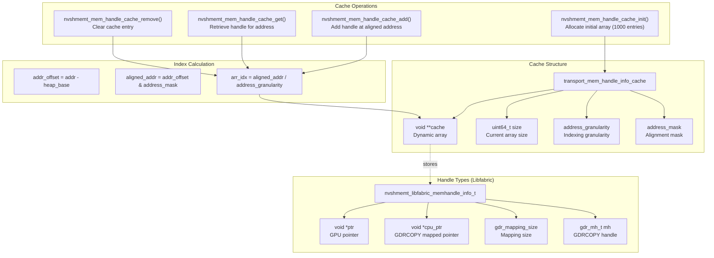
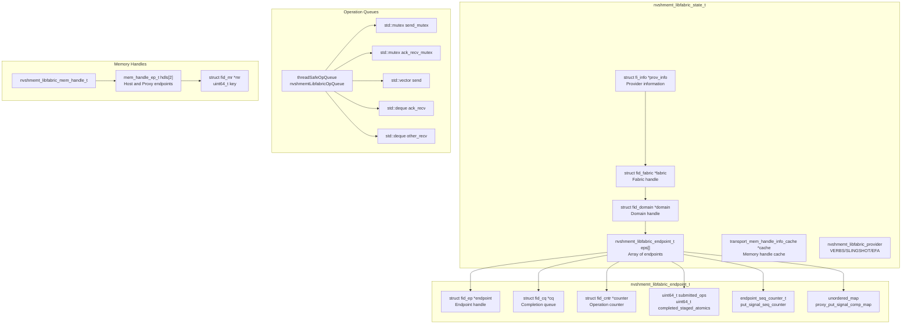
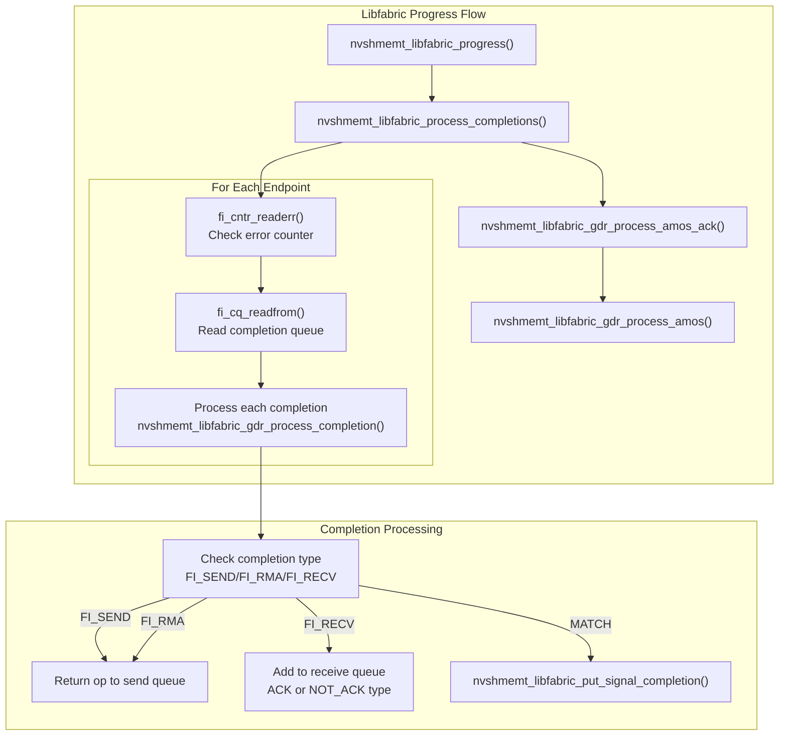

<!-- source: DeepWiki mcp.deepwiki.com · repo NVIDIA/nvshmem · page 2.2 Transport Layer · fetched 2026-11-11 -->

# Transport Layer

<details>
<summary>Relevant source files</summary>

The following files were used as context for generating this wiki page:

- [src/host/mem/mem_transport.cpp](src/host/mem/mem_transport.cpp)
- [src/host/proxy/proxy.cpp](src/host/proxy/proxy.cpp)
- [src/host/topo/topo.cpp](src/host/topo/topo.cpp)
- [src/host/transport/transport.cpp](src/host/transport/transport.cpp)
- [src/include/internal/host/util.h](src/include/internal/host/util.h)
- [src/modules/transport/common/transport_common.cpp](src/modules/transport/common/transport_common.cpp)
- [src/modules/transport/libfabric/libfabric.cpp](src/modules/transport/libfabric/libfabric.cpp)
- [src/modules/transport/libfabric/libfabric.h](src/modules/transport/libfabric/libfabric.h)
- [src/modules/transport/ucx/ucx.cpp](src/modules/transport/ucx/ucx.cpp)
- [test/host/interop/CMakeLists.txt](test/host/interop/CMakeLists.txt)
- [test/unit/mem/heap/internal/host/nvshmemi_mem_transport.hpp](test/unit/mem/heap/internal/host/nvshmemi_mem_transport.hpp)

</details>


## Purpose and Scope

The Transport Layer implements NVSHMEM's pluggable architecture for network communication, providing an abstraction over different interconnect technologies and enabling communication between processing elements (PEs). This page covers the transport interface, transport manager, topology discovery, and memory handle management. For details on individual transport implementations (Libfabric, InfiniBand, UCX), see [Transport Implementations](#5). For the proxy system that enables CPU-mediated device operations, see [Host Proxy Architecture](#2.5).

---

## Transport Interface

### Overview

NVSHMEM defines a common transport interface that all transport plugins must implement. This interface is defined in the `nvshmem_transport` structure, which contains function pointers for all transport operations, capability flags, and state information.



**Sources:** [src/include/internal/host_transport/transport.h](), [src/host/transport/transport.cpp:50-319]()

### Transport Capabilities

Each transport declares its capabilities on a per-PE basis using the `cap` array. Capabilities are represented as bit flags indicating what operations the transport supports for communication with each peer.

| Capability Flag | Description |
|----------------|-------------|
| `NVSHMEM_TRANSPORT_CAP_CPU_WRITE` | CPU can write to remote PE memory |
| `NVSHMEM_TRANSPORT_CAP_CPU_READ` | CPU can read from remote PE memory |
| `NVSHMEM_TRANSPORT_CAP_MAP` | Supports memory mapping (P2P access) |
| `NVSHMEM_TRANSPORT_CAP_GPU_WRITE` | GPU can write to remote PE memory |
| `NVSHMEM_TRANSPORT_CAP_GPU_READ` | GPU can read from remote PE memory |
| `NVSHMEM_TRANSPORT_CAP_GPU_ATOMICS` | GPU can perform atomic operations |

**Sources:** [src/include/internal/host_transport/nvshmemi_transport_defines.h]()

---

## Transport Manager

### Initialization and Loading

The transport manager (`nvshmemi_transport_init`) is responsible for discovering, loading, and initializing available transport plugins. Transports are loaded dynamically as shared libraries.



**Sources:** [src/host/transport/transport.cpp:50-319]()

### Transport Selection

The transport manager selects which transport plugin to load based on the `NVSHMEM_REMOTE_TRANSPORT` environment variable. Supported values include:

- `ibrc` - InfiniBand Reliable Connected (default)
- `ucx` - UCX transport for multi-network support
- `ibdevx` - InfiniBand DEVX API for direct hardware access
- `libfabric` - Libfabric for AWS EFA, HPE Slingshot, etc.

**Code Flow:**
```
nvshmemi_transport_init() [transport.cpp:50]
├─> Check DISABLE_P2P [transport.cpp:70]
├─> nvshmemt_p2p_init() [transport.cpp:74]
├─> Parse REMOTE_TRANSPORT env [transport.cpp:98-168]
├─> dlopen("nvshmem_transport_<name>.so") [transport.cpp:179]
├─> dlsym("nvshmemt_init") [transport.cpp:185]
└─> init_fn(&transport, cuda_syms, version) [transport.cpp:197]
```

**Sources:** [src/host/transport/transport.cpp:50-319]()

---

## Topology Discovery and Device Selection

### NIC-to-GPU Mapping

The topology subsystem determines optimal NIC-to-GPU mappings based on PCIe topology to minimize communication latency. This is critical for achieving good performance.



**Sources:** [src/host/topo/topo.cpp:138-436]()

### PCIe Distance Metrics

The topology discovery uses a hierarchical distance metric to evaluate NIC-GPU affinity:

| Distance | Description | Performance Score |
|----------|-------------|-------------------|
| PIX | Same PCIe switch | 4 (best) |
| PXB | Same PCIe bridge | 4 |
| PHB | Same PCIe host bridge | 3 |
| NODE | Same NUMA node | 2 |
| SYS | Different NUMA node | 1 (worst) |

**Code Detail:**
```
nvshmemi_get_devices_by_distance() [topo.cpp:138]
├─> Gather GPU bus IDs via bootstrap [topo.cpp:225-227]
├─> Get device paths from sysfs [topo.cpp:235-256]
├─> Calculate distances for all PE-NIC pairs [topo.cpp:261-281]
├─> Sort pairs by distance [topo.cpp:285]
├─> Assign NICs (closest first) [topo.cpp:285-326]
└─> Load balance oversubscribed NICs [topo.cpp:329-386]
```

**Sources:** [src/host/topo/topo.cpp:109-436](), [src/host/topo/topo.cpp:41-50]()

---

## Connection Setup

### Transport Map and Reachability

After initialization, NVSHMEM builds a transport map that records which transports can reach each PE. This map is used at runtime to select the appropriate transport for each communication operation.



**Sources:** [src/host/topo/topo.cpp:438-506](), [src/host/transport/transport.cpp:372-443]()

### Connection Setup Flow

The `nvshmemi_setup_connections` function coordinates device selection and endpoint connection for each transport:

```
nvshmemi_setup_connections() [transport.cpp:372]
├─> For each initialized transport [transport.cpp:378]
│   ├─> Skip if not CONNECTED attribute [transport.cpp:383-385]
│   ├─> Calculate max_devices_per_pe [transport.cpp:387-389]
│   ├─> nvshmemi_get_devices_by_distance() [transport.cpp:409-421]
│   │   └─> Returns selected_devices[] array
│   └─> tcurr->connect_endpoints() [transport.cpp:427]
│       └─> Transport-specific connection logic
└─> Done
```

**Sources:** [src/host/transport/transport.cpp:372-443]()

---

## Memory Handle Management

### Memory Handle Cache

To avoid repeated lookups, NVSHMEM maintains a cache mapping symmetric heap addresses to transport-specific memory handles. The cache is indexed by address with granularity matching CUDA's minimum allocation size.



**Sources:** [src/modules/transport/common/transport_common.cpp:15-227]()

### Cache Implementation Details

The memory handle cache is implemented in `transport_common.cpp` with the following key functions:

**Initialization:**
```
nvshmemt_mem_handle_cache_init() [transport_common.cpp:85]
├─> Allocate cache structure [transport_common.cpp:93-94]
├─> Allocate initial array (1000 entries) [transport_common.cpp:102-103]
├─> Set address_granularity from transport [transport_common.cpp:108]
└─> Compute address_mask for alignment [transport_common.cpp:109]
```

**Adding Handles:**
```
nvshmemt_mem_handle_cache_add() [transport_common.cpp:114]
├─> Validate address in heap [transport_common.cpp:120-123]
├─> Calculate array index [transport_common.cpp:125-131]
├─> Resize array if needed (doubles size) [transport_common.cpp:133-147]
└─> Store mem_handle_info at index [transport_common.cpp:149]
```

**Retrieving Handles:**
```
nvshmemt_mem_handle_cache_get() [transport_common.cpp:153]
├─> Validate address in heap [transport_common.cpp:159-162]
├─> Apply address_mask for alignment [transport_common.cpp:165]
├─> Calculate array index [transport_common.cpp:166]
└─> Return cached handle [transport_common.cpp:173]
```

**Sources:** [src/modules/transport/common/transport_common.cpp:85-227]()

### HCA List Parsing

The transport common code includes utilities for parsing hardware adapter (HCA) lists from environment variables:

```
nvshmemt_parse_hca_list() [transport_common.cpp:22]
├─> Parse comma-separated list [transport_common.cpp:34-72]
├─> Extract device name [transport_common.cpp:38-70]
├─> Extract port number (after ':') [transport_common.cpp:37-54]
├─> Extract count (after second ':') [transport_common.cpp:46-54]
└─> Return number of devices found [transport_common.cpp:82]
```

Format: `<name>:<port>:<count>,<name>:<port>:<count>,...`

Example: `mlx5_0:1:2,mlx5_1:1:2` specifies:
- 2 instances of mlx5_0 port 1
- 2 instances of mlx5_1 port 1

**Sources:** [src/modules/transport/common/transport_common.cpp:22-83]()

---

## Transport-Specific Structures

### Libfabric Transport State

The Libfabric transport maintains extensive state for managing endpoints, completion queues, and GDRCOPY integration:



**Sources:** [src/modules/transport/libfabric/libfabric.h:392-456]()

### Endpoint Management

Libfabric transport uses multiple endpoints for different traffic classes:

| Endpoint | Index | Purpose |
|----------|-------|---------|
| Host EP | 0 (`NVSHMEMT_LIBFABRIC_HOST_EP_IDX`) | Host-initiated operations |
| Proxy EP | 1 (`NVSHMEMT_LIBFABRIC_PROXY_EP_IDX`) | Device-initiated operations via proxy |

Each endpoint has:
- **Completion Queue (CQ):** Receives completion events for posted operations
- **Counter:** Tracks submitted operations for quiet/fence
- **Sequence Counter:** Manages put-signal operation sequencing
- **Completion Map:** Tracks in-flight put-signal operations

**Sources:** [src/modules/transport/libfabric/libfabric.h:36-38](), [src/modules/transport/libfabric/libfabric.h:190-199]()

---

## Progress and Completion

### Progress Function

Transports implement a `progress` function that advances asynchronous operations and processes completions. This is called periodically during quiet/fence operations and by the proxy thread.



**Sources:** [src/modules/transport/libfabric/libfabric.cpp:235-255](), [src/modules/transport/libfabric/libfabric.cpp:166-233]()

### Quiet Operation

The `quiet` operation ensures all previously issued operations have completed:

```
nvshmemt_libfabric_quiet() [libfabric.cpp:629]
├─> Select endpoint (host or proxy) [libfabric.cpp:635-639]
├─> Check progress mode [libfabric.cpp:641-647]
│   ├─> Manual progress: Poll until complete [libfabric.cpp:649-660]
│   │   ├─> Read counter: completed = fi_cntr_read() [libfabric.cpp:650]
│   │   ├─> Check: completed + staged_atomics == submitted [libfabric.cpp:652]
│   │   └─> Progress: nvshmemt_libfabric_progress() [libfabric.cpp:655]
│   └─> Auto progress: Wait with timeout [libfabric.cpp:662]
│       └─> fi_cntr_wait(counter, submitted_ops, timeout) [libfabric.cpp:662]
└─> Return status [libfabric.cpp:673]
```

**Sources:** [src/modules/transport/libfabric/libfabric.cpp:629-674]()

---

## Transport Bitmap and Selection

### Runtime Transport Selection

NVSHMEM maintains a `transport_bitmap` that tracks which transports are active and can be used for communication. At runtime, operations select the appropriate transport based on:

1. **Capability requirements** - Does the transport support the needed operation?
2. **Peer reachability** - Can this transport reach the target PE?
3. **Performance characteristics** - What is the latency/bandwidth?

**Code Reference:**
```
State maintains [transport.cpp]:
├─> transport_bitmap [transport.cpp:455]
│   └─> Bit i set if transport i is active
├─> transport_map [topo.cpp:447]
│   └─> Matrix of which transports reach which PEs
└─> transports[] array [transport.cpp:66-68]
    └─> Array of transport pointers
```

**Sources:** [src/host/transport/transport.cpp:50-319](), [src/host/topo/topo.cpp:438-506]()

---

