<!-- source: DeepWiki mcp.deepwiki.com · repo NVIDIA/nvshmem · page 2.5 Host Proxy Architecture · fetched 2026-11-11 -->

# Host Proxy Architecture

<details>
<summary>Relevant source files</summary>

The following files were used as context for generating this wiki page:

- [src/host/proxy/proxy.cpp](src/host/proxy/proxy.cpp)
- [src/host/topo/topo.cpp](src/host/topo/topo.cpp)
- [src/host/transport/transport.cpp](src/host/transport/transport.cpp)
- [src/include/internal/host/util.h](src/include/internal/host/util.h)
- [src/modules/transport/common/transport_common.cpp](src/modules/transport/common/transport_common.cpp)
- [src/modules/transport/libfabric/libfabric.cpp](src/modules/transport/libfabric/libfabric.cpp)
- [src/modules/transport/ucx/ucx.cpp](src/modules/transport/ucx/ucx.cpp)

</details>


## Purpose and Scope

This document describes NVSHMEM's host proxy thread mechanism, which enables GPU-initiated communication operations to be processed on the host CPU. The proxy provides a bridge between device-side communication requests and host-side transport operations, handling complex operations that cannot be efficiently performed directly from the GPU.

For information about the device programming model and how device code initiates these requests, see [Device Programming Model](#2.3). For details about the transport layer that the proxy invokes, see [Transport Layer](#2.2). For memory management aspects, see [Memory Management and Symmetric Heap](#2.4).

## Overview

The host proxy is a dedicated thread that continuously polls communication channels for requests from GPU kernels. When device code needs to perform operations that require host intervention (e.g., complex RMA operations, atomics, or synchronization), it writes requests to shared circular buffers. The proxy thread reads these requests and invokes the appropriate transport-level operations.

**Proxy Architecture**
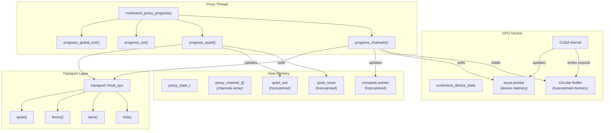

Sources: [src/host/proxy/proxy.cpp:1-1562]()

## Proxy Initialization and Levels

NVSHMEM supports three proxy levels, controlled by `NVSHMEM_DISABLE_LOCAL_ONLY_PROXY`:

| Level | Value | Description | Thread Created | Operations Supported |
|-------|-------|-------------|----------------|---------------------|
| `NVSHMEMI_PROXY_NONE` | 0 | No proxy | No | None (local-only mode) |
| `NVSHMEMI_PROXY_MINIMAL` | 1 | Minimal proxy | Yes | Global exit, timeout detection |
| `NVSHMEMI_PROXY_FULL` | 2 | Full proxy | Yes | All operations (RMA, AMO, quiet, etc.) |

**Initialization Flow**
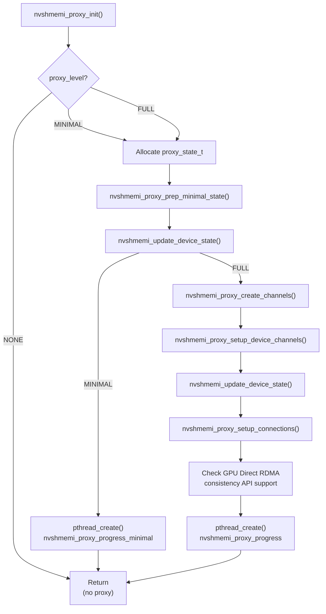

Sources: [src/host/proxy/proxy.cpp:252-379]()

### Proxy State Structure

The `proxy_state_t` structure maintains all proxy thread state:

```c
struct proxy_state_t {
    nvshmemi_state_t *nvshmemi_state;        // Pointer to global NVSHMEM state
    proxy_channel_t *channels;                // Array of communication channels
    int channel_count;                        // Number of channels (CHANNEL_COUNT)
    uint64_t channel_bufsize;                 // Size of each channel buffer
    uint64_t channel_bufsize_log;             // Log2 of channel buffer size
    
    struct nvshmem_transport **transport;     // Transport per PE
    int *transport_id;                        // Transport ID per PE
    uint64_t transport_bitmap;                // Bitmap of active transports
    
    int *global_exit_request_state;           // Global exit status
    int *global_exit_code;                    // Exit code
    nvshmemi_timeout_t *nvshmemi_timeout;     // Timeout tracking
    
    uint64_t quiet_in_progress;               // Quiet operation state
    uint64_t cst_in_progress;                 // Consistency operation state
    uint64_t issued_get;                      // Flag for issued GET operations
    
    cudaStream_t stream;                      // CUDA stream for operations
    cudaEvent_t cuev;                         // CUDA event for consistency
    bool is_consistency_api_supported;        // GPU Direct RDMA flush support
};
```

Sources: [src/host/proxy/proxy_host.h](), [src/host/proxy/proxy.cpp:267-373]()

## Channel Architecture

Communication channels are circular buffers in host-pinned memory that GPU kernels write to and the proxy thread reads from. Each channel supports concurrent operation submission with lock-free synchronization using flags.

**Channel Structure and Pointers**
```mermaid
graph TB
    subgraph ChannelStruct["proxy_channel_t"]
        Buf["buf<br/>(host-pinned circular buffer)"]
        Issue["issue<br/>(device memory, GPU writes)"]
        Complete["complete<br/>(host-pinned, CPU writes)"]
        QuietIssue["quiet_issue<br/>(host-pinned, GPU writes)"]
        QuietAck["quiet_ack<br/>(host-pinned, CPU writes)"]
        CSTIssue["cst_issue<br/>(host-pinned, GPU writes)"]
        CSTAck["cst_ack<br/>(host-pinned, CPU writes)"]
        
        Processed["processed<br/>(CPU counter)"]
        LastSync["last_sync<br/>(CPU counter)"]
        LastQuietIssue["last_quiet_issue<br/>(CPU counter)"]
        LastCSTIssue["last_cst_issue<br/>(CPU counter)"]
    end
    
    subgraph DeviceView["Device View (nvshmemi_device_state)"]
        DBuf["proxy_channels_buf"]
        DIssue["proxy_channels_issue"]
        DComplete["proxy_channels_complete"]
        DQuietIssue["proxy_channels_quiet_issue"]
        DQuietAck["proxy_channels_quiet_ack"]
        DCSTIssue["proxy_channels_cst_issue"]
        DCSTAck["proxy_channels_cst_ack"]
    end
    
    DBuf -.->|"device pointer to"| Buf
    DIssue -.->|"device pointer to"| Issue
    DComplete -.->|"device pointer to"| Complete
    DQuietIssue -.->|"device pointer to"| QuietIssue
    DQuietAck -.->|"device pointer to"| QuietAck
    DCSTIssue -.->|"device pointer to"| CSTIssue
    DCSTAck -.->|"device pointer to"| CSTAck
```

Sources: [src/host/proxy/proxy.cpp:76-145](), [src/host/proxy/proxy.cpp:157-201]()

### Channel Creation

Channels are created during proxy initialization:

1. **Allocate channel structures**: `proxy_channel_t` array of size `CHANNEL_COUNT` (typically 4)
2. **Allocate buffers**: Host-pinned circular buffer of size `(1 << CHANNEL_BUF_SIZE_LOG)` bytes per channel
3. **Allocate synchronization variables**: `issue`, `complete`, `quiet_issue`, `quiet_ack`, `cst_issue`, `cst_ack`
4. **Map to device**: Get device pointers via `cudaHostGetDevicePointer()` and store in `nvshmemi_device_state`

Sources: [src/host/proxy/proxy.cpp:157-201]()

### Channel Protocol

The channel protocol uses a flag-based synchronization mechanism to coordinate between GPU and CPU:

**Flag-Based Synchronization Protocol**
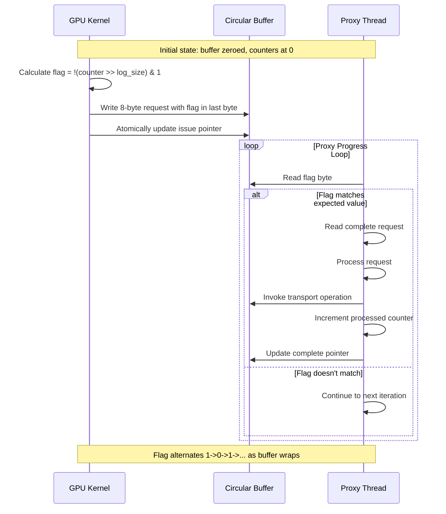

Each 8-byte entry in the circular buffer has:
- **Bytes 0-6**: Request data (operation type, addresses, sizes, etc.)
- **Byte 7 (lowest bit)**: Flag bit that alternates on each wrap of the circular buffer

The proxy busy-waits on the flag byte using volatile loads to detect when the GPU has written a new request.

Sources: [src/host/proxy/proxy.cpp:1097-1124](), [src/host/proxy/proxy.cpp:1240-1344]()

### Buffer Wrapping Macros

The proxy uses helper macros to handle circular buffer addressing:

```c
#define WRAPPED_CHANNEL_BUF(state, ch, counter) \
    ((ch)->buf + ((counter) & ((state)->channel_bufsize - 1)))

#define COUNTER_TO_FLAG(state, counter) \
    (!((counter) >> (state)->channel_bufsize_log) & 1)
```

Sources: [src/host/proxy/proxy.cpp:393-394](), [src/host/proxy/proxy.cpp:471-472]()

## Request Processing

The proxy processes multiple types of requests, each with a specific format in the channel buffer:

**Request Type Processing Flow**
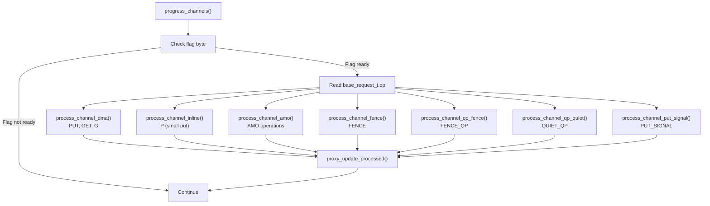

Sources: [src/host/proxy/proxy.cpp:1240-1345]()

### Request Types and Structures

| Request Type | Structure Name | Size (bytes) | Operations |
|--------------|---------------|--------------|------------|
| Base | `base_request_t` | 8 | Common header with op type |
| DMA | `put_dma_request_*` | 32 | PUT, GET, G operations |
| Inline | `put_inline_request_*` | 24/32 | P (small values up to 8 bytes) |
| AMO | `amo_request_*` | 40/48 | Atomic operations |
| Fence | N/A | 8 | FENCE operation |
| QP Fence/Quiet | `qp_sync_*` | Variable | Per-QP synchronization |
| Put-Signal | `put_signal_request_*` | 48 | Combined PUT and signal |

Sources: [src/host/proxy/proxy.cpp:381-458](), [src/host/proxy/proxy.cpp:460-559](), [src/host/proxy/proxy.cpp:561-686]()

### DMA Request Processing

DMA requests handle PUT and GET operations with large data transfers:

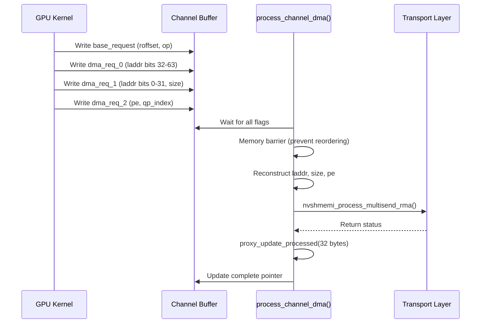

Sources: [src/host/proxy/proxy.cpp:381-458]()

### Inline Request Processing

Inline requests handle small PUT operations (P operations) with values up to 8 bytes:

Key characteristics:
- Value is embedded directly in the request (no DMA transfer needed)
- Host reads value from channel buffer and issues small PUT via transport
- Uses `NVSHMEMI_OP_P` verb with transport's `rma()` function
- Memory barriers ensure value is fully written before proxy reads it

Sources: [src/host/proxy/proxy.cpp:460-559]()

### AMO Request Processing

Atomic operations require special handling, particularly for fetching atomics:

**AMO Request Flow**
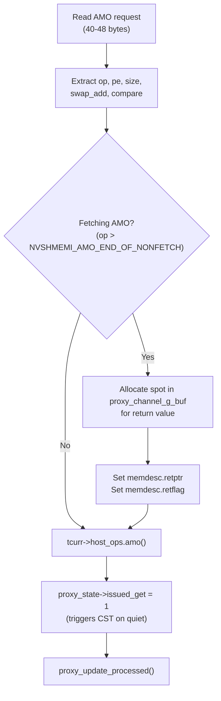

For fetching atomics, the proxy allocates a slot in the global buffer (`proxy_channel_g_buf`) where the transport writes the return value. The device code polls this location with the associated flag.

Sources: [src/host/proxy/proxy.cpp:561-686]()

### Put-Signal Request Processing

Put-signal combines a PUT operation with an atomic signal at the destination:

Features:
- Handles chunked transfers (splits large transfers across multiple memory regions)
- Builds vector of local and remote memory descriptors
- Issues combined `put_signal()` transport operation
- Atomically signals completion at remote PE

Sources: [src/host/proxy/proxy.cpp:1070-1238]()

## Progress Loop

The proxy thread runs a continuous progress loop that drives all communication:

**Main Progress Loop Structure**
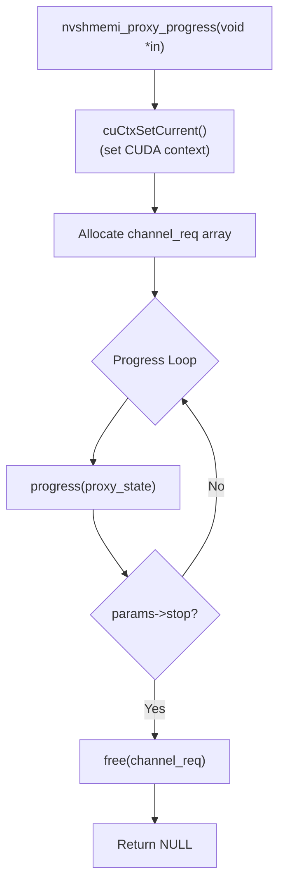

Sources: [src/host/proxy/proxy.cpp:1460-1486]()

### Progress Function Breakdown

The `progress()` function orchestrates multiple progress activities:

```c
void progress(proxy_state_t *proxy_state) {
    progress_global_exit(proxy_state);      // Check for global exit requests
    progress_quiet(proxy_state);            // Progress quiet operations
    progress_cst(proxy_state);              // Progress consistency operations
    #ifdef NVSHMEM_TIMEOUT_DEVICE_POLLING
    progress_timeout_polling(proxy_state);  // Check for device timeouts
    #endif
    progress_channels(proxy_state);         // Process channel requests
    progress_transports(proxy_state);       // Drive transport progress
}
```

Sources: [src/host/proxy/proxy.cpp:1439-1458]()

### Channel Progress

The `progress_channels()` function processes requests from all channels:

**Channel Progress Algorithm**
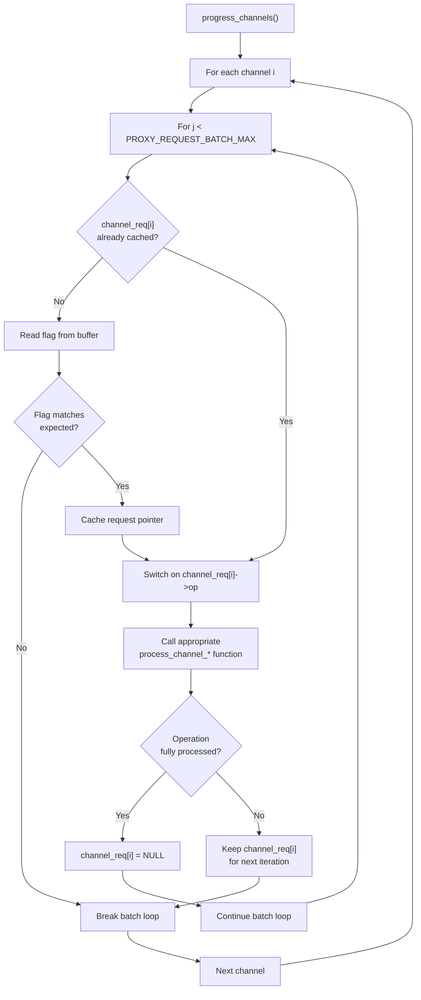

Key optimizations:
- **Request Batching**: Processes up to `PROXY_REQUEST_BATCH_MAX` requests per channel before moving to the next
- **Request Caching**: Keeps partially processed requests in `channel_req[]` array to avoid re-reading headers
- **Early Break**: Stops processing a channel when no new requests are available

Sources: [src/host/proxy/proxy.cpp:1240-1345]()

### Progress Counter Update

The `proxy_update_processed()` function updates the completion counter visible to the device:

```c
inline void proxy_update_processed(proxy_channel_t *ch, int bytes, bool force_update = false) {
    ch->processed += bytes;
    
    // Only update device-visible counter periodically to reduce memory traffic
    if ((ch->processed - ch->last_sync) >= 1024 || force_update) {
        *ch->complete = ch->processed;
        ch->last_sync = ch->processed;
    }
}
```

This provides flow control: the device checks `complete` before submitting new requests to ensure buffer space is available.

Sources: [src/host/proxy/proxy.cpp:147-155]()

## Quiet and Fence Operations

Quiet and fence operations provide ordering and completion guarantees for NVSHMEM operations.

### Quiet Operation State Machine

**Quiet Progress State Machine**
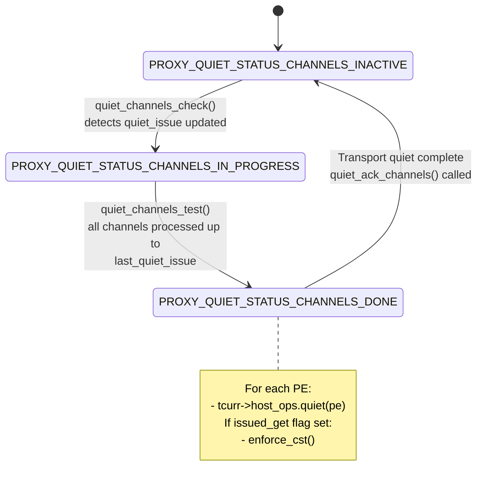

Sources: [src/host/proxy/proxy.cpp:787-836]()

### Quiet Implementation Details

The quiet operation has three phases:

1. **Detection Phase** (`CHANNELS_INACTIVE` → `IN_PROGRESS`):
   - `quiet_channels_check()` polls `quiet_issue` counters from all channels
   - When any channel's `quiet_issue` increases, transition to `IN_PROGRESS`

2. **Channel Drain Phase** (`IN_PROGRESS` → `DONE`):
   - `quiet_channels_test()` checks if all channels have processed up to their `last_quiet_issue` value
   - Once all channels caught up, transition to `DONE`

3. **Transport Quiet Phase** (`DONE` → `INACTIVE`):
   - Issue `transport->host_ops.quiet()` for all connected PEs
   - If any GET operations were issued (`issued_get` flag), call `enforce_cst()` to flush GPU Direct RDMA writes
   - Call `quiet_ack_channels()` to update `quiet_ack` pointers, signaling device that quiet is complete

Sources: [src/host/proxy/proxy.cpp:736-836]()

### Fence Operations

Fence operations order operations to a specific PE:

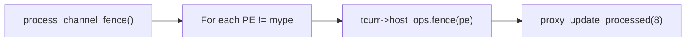

Per-QP fence operations (`process_channel_qp_fence()`) support fencing specific queue pairs:
- Reads variable number of QP indices from channel
- Supports `NVSHMEMX_PE_ALL` to fence all PEs
- Calls `transport->host_ops.fence(pe, qp_index, is_multi)`

Sources: [src/host/proxy/proxy.cpp:883-972]()

## Global Exit and Timeout Handling

The proxy handles two critical failure scenarios: global exit requests and device timeouts.

### Global Exit

Global exit allows any PE to terminate the entire job:

**Global Exit Flow**
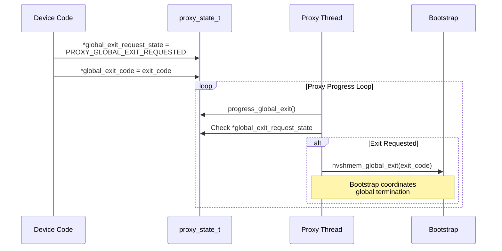

The global exit state is stored in host-pinned memory with device-accessible pointers, allowing device code to trigger exits during wait operations that timeout.

Sources: [src/host/proxy/proxy.cpp:781-785](), [src/host/proxy/proxy.cpp:55-74]()

### Timeout Detection

When `NVSHMEM_TIMEOUT_DEVICE_POLLING` is enabled, the proxy monitors device-side timeouts:

```c
void progress_timeout_polling(proxy_state_t *proxy_state) {
    nvshmemi_timeout_t *timeout = proxy_state->nvshmemi_timeout;
    
    if (timeout->signal) {
        // Device has signaled a timeout
        // Print diagnostic information:
        // - Call site (barrier, wait_until, etc.)
        // - Expected vs actual signal values
        // - Signal address
        exit(-1);
    }
}
```

Device code writes timeout information to the shared `nvshmemi_timeout_t` structure when wait operations exceed configured limits.

Sources: [src/host/proxy/proxy.cpp:1347-1413]()

## Consistency Operations

The proxy handles memory consistency operations to ensure proper ordering of GPU Direct RDMA writes.

### Consistency State Machine

**CST Progress State Machine**
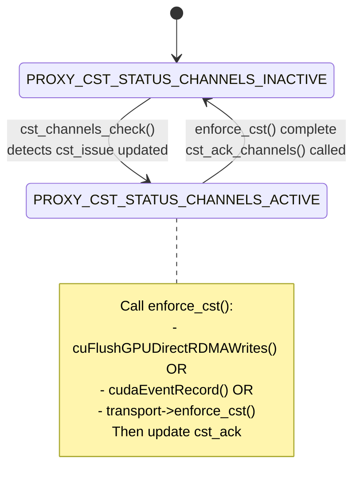

Sources: [src/host/proxy/proxy.cpp:863-881]()

### Consistency Enforcement Methods

The `enforce_cst()` function chooses the appropriate method based on platform and capabilities:

**Consistency Method Selection**
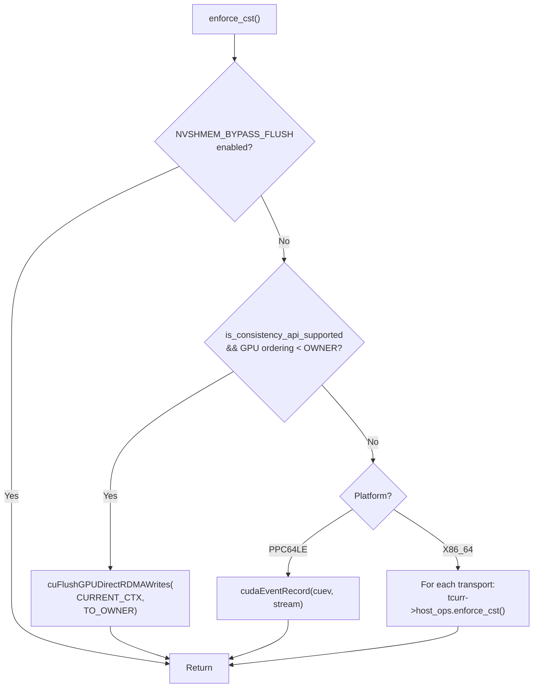

Methods:
1. **GPU Direct RDMA Flush**: `cuFlushGPUDirectRDMAWrites()` - preferred on platforms supporting CUDA 11.3+ consistency API
2. **Event-based**: `cudaEventRecord()` - on POWER platforms without flush API
3. **Transport-specific**: `transport->host_ops.enforce_cst()` - on x86_64, delegates to transport (e.g., UCX performs a dummy GET operation)

Sources: [src/host/proxy/proxy.cpp:688-734]()

### Consistency Trigger Conditions

Consistency operations are triggered in two scenarios:

1. **After Fetching Atomics**: When `issued_get` flag is set and a quiet operation completes
   - Ensures fetching atomic return values are visible on the device
   - Flag is set in `process_channel_amo()` for fetching operations

2. **Explicit CST Request**: When device code requests consistency enforcement
   - Device writes to `cst_issue` counter
   - Proxy detects and processes via `progress_cst()`

Sources: [src/host/proxy/proxy.cpp:681-683](), [src/host/proxy/proxy.cpp:828-830]()

## Transport Integration

The proxy interfaces with the transport layer to execute communication operations.

### Transport Setup

During proxy initialization, transports are selected for each PE:

**Transport Connection Setup**
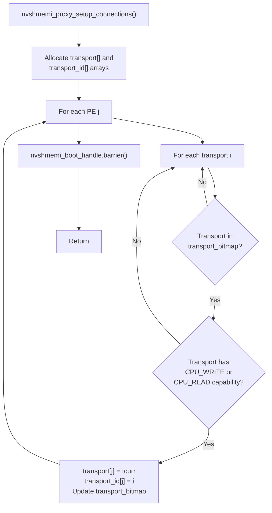

The proxy requires transports with `NVSHMEM_TRANSPORT_CAP_CPU_WRITE` or `NVSHMEM_TRANSPORT_CAP_CPU_READ` capability, as it operates from the host CPU thread.

Sources: [src/host/proxy/proxy.cpp:203-250]()

### Transport Progress

The proxy drives transport progress to ensure completion of outstanding operations:

```c
void progress_transports(proxy_state_t *proxy_state) {
    nvshmemi_state_t *state = proxy_state->nvshmemi_state;
    
    for (int i = 0; i < state->num_initialized_transports; i++) {
        struct nvshmem_transport *tcurr = state->transports[i];
        
        // Skip transports not used by proxy unless it's IBGDA
        if (!((proxy_state->transport_bitmap) & (1 << i)) &&
            (tcurr->type != NVSHMEM_TRANSPORT_LIB_CODE_IBGDA))
            continue;
        
        if (tcurr->host_ops.progress == NULL) continue;
        
        status = tcurr->host_ops.progress(tcurr);
    }
}
```

Transport progress functions handle:
- Polling completion queues (e.g., InfiniBand CQs)
- Processing incoming active messages (e.g., UCX atomics)
- Retiring completed operations

Sources: [src/host/proxy/proxy.cpp:1415-1434]()

### UCX Transport Example

The UCX transport illustrates proxy-transport interaction:

**UCX Progress with Active Messages**
```mermaid
graph TD
    Progress["nvshmemt_ucx_progress()"]
    
    WorkerProgress["ucp_worker_progress()"]
    
    CheckGDR{"use_local_atomics &&<br/>use_gdrcopy?"}
    
    ProcessAMOs["nvshmemt_ucx_process_amos()"]
    
    Done["Return"]
    
    Progress --> WorkerProgress
    WorkerProgress --> CheckGDR
    
    CheckGDR -->|Yes| ProcessAMOs
    CheckGDR -->|No| Done
    
    ProcessAMOs --> Done
    
    note right of ProcessAMOs
        Process pending_recv_headers:
        1. Get mem_handle_info via cache
        2. Call nvshmemt_ucx_handle_amo()
        3. Send response via ucp_am_send_nbx()
    end note
```

When GDRCopy is enabled, UCX uses active messages for atomic operations:
1. Remote PE sends atomic request via `ucp_am_send_nbx(NVSHMEMT_UCX_ATOMIC_SEND)`
2. Callback `nvshmemt_ucx_recv_send_am_data_cb()` queues request in `pending_recv_headers`
3. Proxy's `progress_transports()` calls `nvshmemt_ucx_progress()`
4. `nvshmemt_ucx_process_amos()` processes queued requests:
   - Maps GPU pointer to CPU-accessible pointer using GDRCopy
   - Performs atomic operation on CPU-mapped memory
   - Sends response via `ucp_am_send_nbx(NVSHMEMT_UCX_ATOMIC_RESP)`

Sources: [src/modules/transport/ucx/ucx.cpp:1069-1080](), [src/modules/transport/ucx/ucx.cpp:729-778](), [src/modules/transport/ucx/ucx.cpp:140-191]()

## Memory Barriers and Ordering

The proxy implementation includes explicit memory barriers to ensure correct ordering of operations across CPU, GPU, and network hardware.

### Critical Memory Barriers

**Barrier Placement in Request Processing**
```c
// After reading request flags, before processing request data
#if defined(NVSHMEM_PPC64LE) || defined(NVSHMEM_AARCH64)
    __sync_synchronize();  // Prevents load reordering
#elif defined(NVSHMEM_X86_64)
    asm volatile("" : : : "memory");  // Compiler fence
#endif

// After completing transport operation, before updating complete pointer
#if defined(NVSHMEM_PPC64LE) || defined(NVSHMEM_AARCH64)
    __sync_synchronize();  // Prevents store reordering
#endif
```

These barriers ensure:
1. Request data is fully visible before proxy processes it (prevents reading stale data)
2. Transport operations complete before proxy signals completion to device (prevents premature quiet/fence)

Sources: [src/host/proxy/proxy.cpp:417-422](), [src/host/proxy/proxy.cpp:445-448](), [src/host/proxy/proxy.cpp:823-826]()

### Platform-Specific Considerations

| Platform | Barrier Type | Reason |
|----------|-------------|---------|
| PPC64LE, AARCH64 | `__sync_synchronize()` | Weak memory ordering requires full barriers |
| x86_64 | `asm volatile("" : : : "memory")` | Strong memory ordering, only compiler fence needed |

Sources: [src/host/proxy/proxy.cpp:417-422]()

## Summary of Key Functions

| Function | Purpose | Called From |
|----------|---------|-------------|
| `nvshmemi_proxy_init()` | Initialize proxy thread and channels | Initialization |
| `nvshmemi_proxy_progress()` | Main proxy thread entry point | pthread_create |
| `progress()` | Orchestrate all progress activities | Proxy thread loop |
| `progress_channels()` | Process requests from channels | progress() |
| `progress_quiet()` | Handle quiet operations | progress() |
| `progress_cst()` | Handle consistency operations | progress() |
| `progress_global_exit()` | Check for global exit requests | progress() |
| `progress_transports()` | Drive transport progress | progress() |
| `process_channel_dma()` | Process PUT/GET requests | progress_channels() |
| `process_channel_inline()` | Process small PUT requests | progress_channels() |
| `process_channel_amo()` | Process atomic operations | progress_channels() |
| `process_channel_fence()` | Process fence requests | progress_channels() |
| `process_channel_qp_quiet()` | Process quiet requests | progress_channels() |
| `process_channel_put_signal()` | Process put-signal requests | progress_channels() |
| `enforce_cst()` | Enforce memory consistency | progress_quiet(), progress_cst() |
| `nvshmemi_proxy_finalize()` | Cleanup proxy resources | Finalization |

Sources: [src/host/proxy/proxy.cpp:1-1562]()

---

