<!-- source: DeepWiki mcp.deepwiki.com · repo NVIDIA/nvshmem · page 2.7 Python Bindings Architecture · fetched 2026-11-11 -->

# Python Bindings Architecture

<details>
<summary>Relevant source files</summary>

The following files were used as context for generating this wiki page:

- [nvshmem4py/build_assets/numbast/config_nvshmem.py](nvshmem4py/build_assets/numbast/config_nvshmem.py)
- [nvshmem4py/build_assets/numbast/numbast_entry_point.h](nvshmem4py/build_assets/numbast/numbast_entry_point.h)
- [nvshmem4py/build_assets/numbast/templates/config_nvshmem.yml.j2](nvshmem4py/build_assets/numbast/templates/config_nvshmem.yml.j2)
- [nvshmem4py/cmake/addNumbast.cmake](nvshmem4py/cmake/addNumbast.cmake)
- [nvshmem4py/examples/device_custom_kernel.py](nvshmem4py/examples/device_custom_kernel.py)
- [nvshmem4py/examples/torch_triton_interop.py](nvshmem4py/examples/torch_triton_interop.py)
- [nvshmem4py/nvshmem/core/collective.py](nvshmem4py/nvshmem/core/collective.py)
- [nvshmem4py/nvshmem/core/device/numba/__init__.py](nvshmem4py/nvshmem/core/device/numba/__init__.py)
- [nvshmem4py/nvshmem/core/device/numba/direct.py](nvshmem4py/nvshmem/core/device/numba/direct.py)
- [nvshmem4py/nvshmem/core/nvshmem_types.py](nvshmem4py/nvshmem/core/nvshmem_types.py)
- [nvshmem4py/nvshmem/core/rma.py](nvshmem4py/nvshmem/core/rma.py)

</details>


## Purpose and Scope

This document describes the architecture of **nvshmem4py**, the Python bindings for NVSHMEM. It covers the dual-path design that separates host-initiated operations from device-initiated operations, the memory management system, framework integration patterns, and the code generation pipeline that produces bindings from the C/C++ API.

For information about the C/C++ core library that these bindings wrap, see [Core Library Architecture](#2.1). For details on specific Python APIs, see [Python API Reference](#4). For information on building the Python bindings, see [Python Bindings Build](#3.2).

## Overall Architecture

The Python bindings are organized into two distinct layers that mirror the host/device separation in NVSHMEM's core:

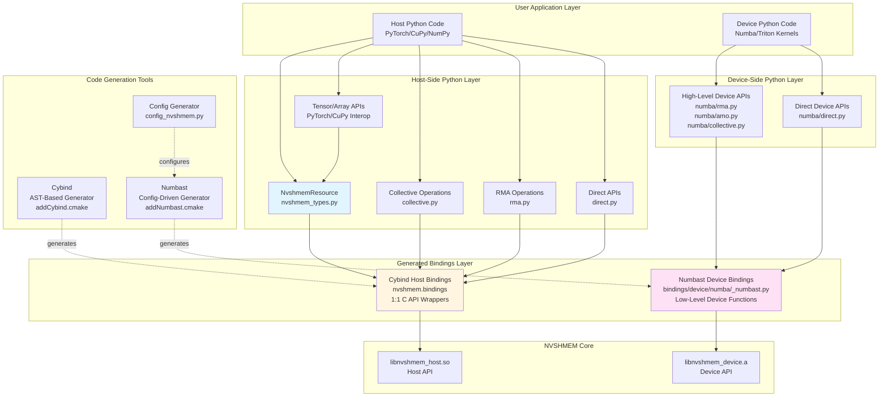

**Key Design Principles:**

1. **Host/Device Separation**: Host-side bindings support stream-based operations initiated from Python, while device-side bindings enable NVSHMEM operations within GPU kernels.

2. **Dual Code Generation**: Two separate tools generate bindings - Cybind for 1:1 host API mapping and Numbast for device API with Numba integration.

3. **Framework Agnostic Core**: The `NvshmemResource` memory allocator provides a framework-neutral base with adapters for PyTorch and CuPy.

4. **Layered Abstraction**: Low-level generated bindings are wrapped by high-level Pythonic APIs that handle type conversions and validation.

**Sources:** [nvshmem4py/nvshmem/core/nvshmem_types.py:1-536](), [nvshmem4py/nvshmem/core/collective.py:1-373](), [nvshmem4py/nvshmem/core/rma.py:1-277](), [nvshmem4py/cmake/addNumbast.cmake:1-184]()

## Host-Side Bindings Architecture

### Memory Management with NvshmemResource

The `NvshmemResource` class is the cornerstone of host-side memory management, implementing the `cuda.core.experimental.MemoryResource` protocol:

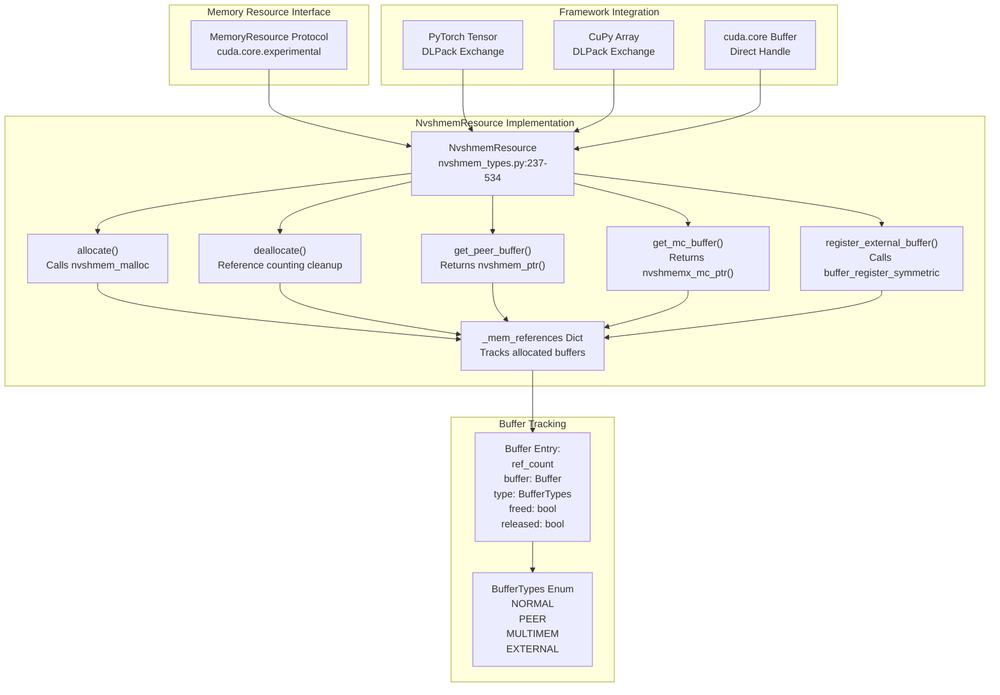

**NvshmemResource Key Features:**

| Feature | Implementation | Lines |
|---------|---------------|-------|
| Symmetric Allocation | `allocate()` wraps `malloc()` from bindings | [237-311]() |
| Reference Counting | `_mem_references` dict tracks buffer lifecycle | [277-310]() |
| Peer Access | `get_peer_buffer()` calls `ptr()` binding | [384-409]() |
| Multicast Buffers | `get_mc_buffer()` calls `mc_ptr()` binding | [412-435]() |
| External Registration | `register_external_buffer()` with `buffer_register_symmetric()` | [445-478]() |
| Automatic Cleanup | `deallocate()` validates freed state, decrements refs | [313-382]() |

The `_mem_references` dictionary structure tracks each buffer:

```python
{
    ptr: {
        "ref_count": int,
        "resource": NvshmemResource,
        "buffer": Buffer,
        "type": BufferTypes,  # NORMAL, PEER, MULTIMEM, EXTERNAL
        "freed": bool,
        "released": bool,
        "except_on_del": bool,
        "child": int  # Optional ptr to peer/mc buffer
    }
}
```

**Sources:** [nvshmem4py/nvshmem/core/nvshmem_types.py:237-534]()

### Framework Interoperability Layer

The host-side bindings provide deep integration with PyTorch and CuPy through buffer exchange patterns:

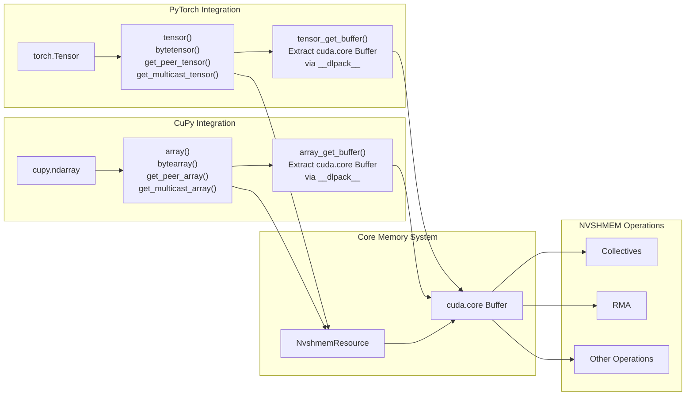

**DLPack Exchange Pattern:**

Both PyTorch and CuPy tensors/arrays are converted to `cuda.core.experimental.Buffer` objects via the `__dlpack__` protocol, enabling zero-copy interoperability:

1. Framework tensor allocated on NVSHMEM symmetric heap via `NvshmemResource`
2. Operations accept framework tensors directly
3. Internal conversion to `Buffer` via `_get_buffers()` helper
4. NVSHMEM operations operate on raw device pointers

**Sources:** [nvshmem4py/nvshmem/core/collective.py:212-247](), [nvshmem4py/nvshmem/core/rma.py:35-74]()

### Cybind-Generated Bindings

Cybind generates 1:1 Python bindings for the NVSHMEM C API. The generation process creates Cython `.pyx` files that wrap C functions directly:

**Generation Process:**

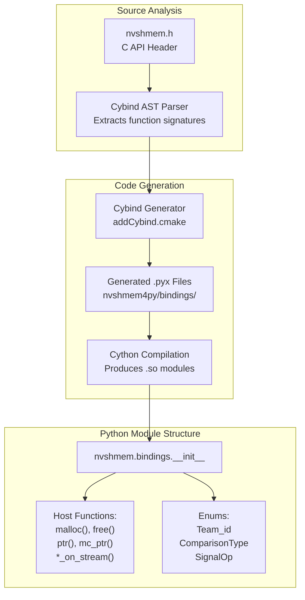

**Key Cybind Bindings:**

| Category | Functions | Usage |
|----------|-----------|-------|
| Memory | `malloc()`, `free()`, `ptr()`, `mc_ptr()` | Symmetric heap allocation, peer access |
| Collectives | `*_reduce_on_stream()`, `*_alltoall_on_stream()`, etc. | Stream-based collective operations |
| RMA | `putmem_on_stream()`, `getmem_on_stream()`, `put_signal_on_stream()` | Remote memory access |
| Synchronization | `barrier_on_stream()`, `quiet_on_stream()`, `signal_wait_until_on_stream()` | Ordering and completion |
| Registration | `buffer_register_symmetric()`, `buffer_unregister_symmetric()` | External buffer registration |
| Teams | `Team_id` enum | TEAM_WORLD, custom teams |

**Sources:** [nvshmem4py/CMakeLists.txt:23-30](), [nvshmem4py/nvshmem/core/nvshmem_types.py:24-24]()

### High-Level Host APIs

High-level wrapper modules provide Pythonic interfaces over the Cybind bindings:

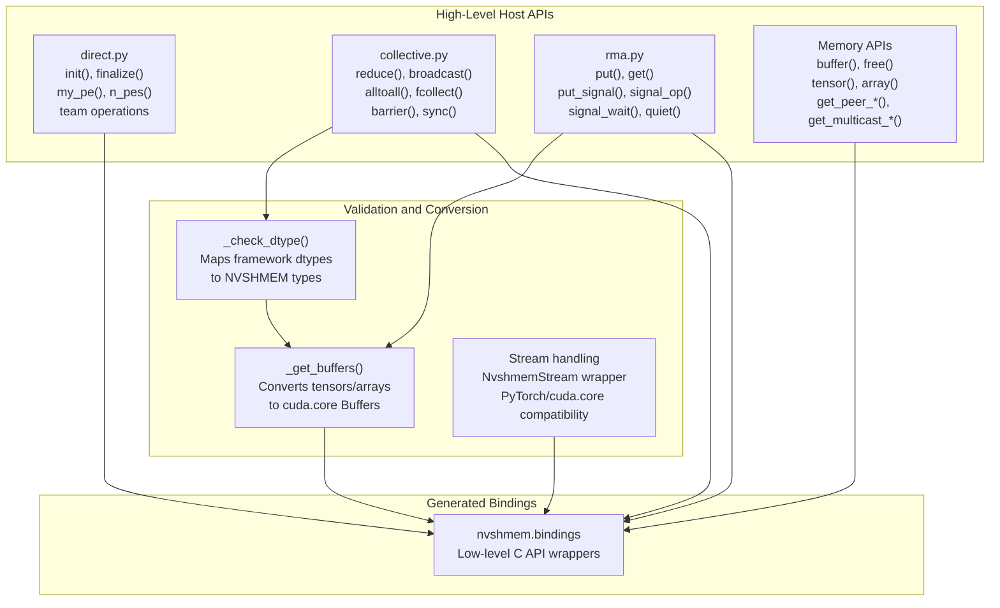

**Collective Operations Example:**

The `collective_on_buffer()` function demonstrates the high-level wrapper pattern:

1. **Validation**: Check initialization state, validate stream, validate buffers
2. **Function Name Construction**: Build function name from dtype, op, and collective type (e.g., `"float_sum_reduce_on_stream"`)
3. **Argument Preparation**: Extract buffer handles, convert stream to raw handle
4. **Binding Invocation**: Call generated Cybind function via `getattr(bindings, func_name)`
5. **Error Handling**: Check return codes, restore device context

**Sources:** [nvshmem4py/nvshmem/core/collective.py:112-210](), [nvshmem4py/nvshmem/core/rma.py:76-136]()

## Device-Side Bindings Architecture

### Numbast-Generated Bindings

Numbast generates low-level device bindings that expose NVSHMEM device functions to Numba's CUDA JIT compiler:

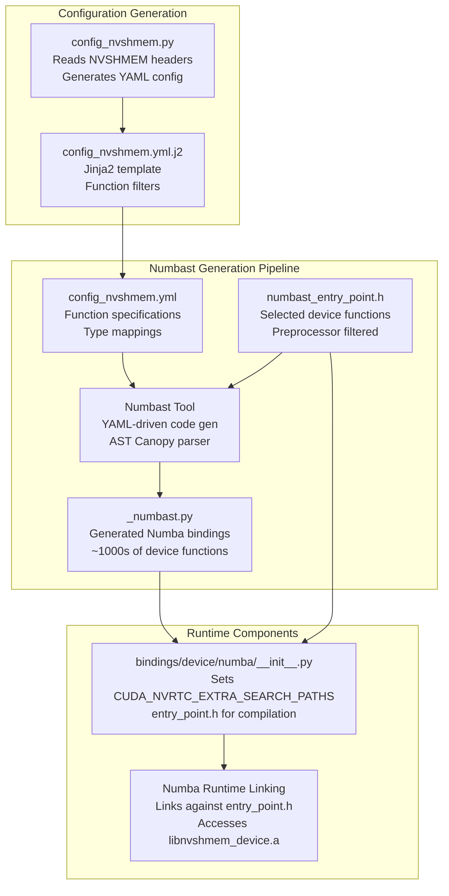

**Numbast Configuration Structure (`config_nvshmem.yml`):**

```yaml
functions:
  - pattern: "nvshmem_.*"
    exclude: ["nvshmemx_.*"]
  - pattern: "nvshmemx_tile_.*"
    
types:
  - source: "nvshmem_team_t"
    target: "int64"
```

**Generated Binding Pattern:**

Each NVSHMEM device function is wrapped as a Numba-callable Python function with:
- Type annotations for Numba type inference
- `@cuda.jit(device=True, link=[...])` decorator for device compilation
- Direct calls to C functions in `entry_point.h`

**Sources:** [nvshmem4py/cmake/addNumbast.cmake:115-133](), [nvshmem4py/nvshmem/bindings/device/numba/__init__.py:1-40]()

### High-Level Device APIs

High-level device bindings provide friendly Python interfaces for common patterns:

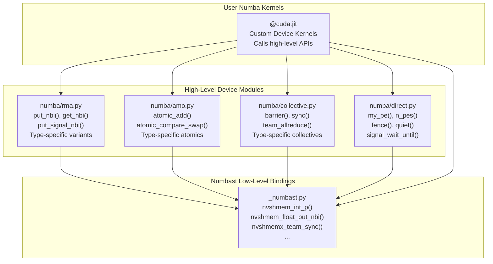

**High-Level Device Binding Generation:**

Scripts generate high-level device bindings from templates:

| Generator Script | Output | Purpose |
|-----------------|--------|---------|
| `generate_rma.py` | `numba/rma.py` | Type-specific put/get variants |
| `generate_amo.py` | `numba/amo.py` | Type-specific atomic operations |
| `generate_coll.py` | `numba/collective.py` | Type-specific collectives |

These scripts programmatically generate functions for each supported type (float, double, int32, etc.).

**Sources:** [nvshmem4py/cmake/addNumbast.cmake:162-179](), [nvshmem4py/nvshmem/core/device/numba/__init__.py:1-27]()

### Numba Integration

The device bindings integrate with Numba's CUDA JIT compilation system:

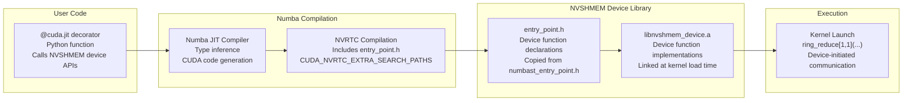

**Key Configuration:**

The `bindings/device/numba/__init__.py` module sets up Numba's include path at import time:

```python
INCLUDE_PATH = find_nvidia_header_directory("nvshmem")
this_folder = os.path.dirname(os.path.abspath(__file__))
cuda.config.CUDA_NVRTC_EXTRA_SEARCH_PATHS = ":".join([INCLUDE_PATH, this_folder])
```

This allows NVRTC to find both `nvshmem.h` and `entry_point.h` during kernel compilation.

**Sources:** [nvshmem4py/nvshmem/bindings/device/numba/__init__.py:11-36](), [nvshmem4py/examples/device_custom_kernel.py:1-98]()

### Triton Kernel Support

NVSHMEM device operations can be invoked from Triton kernels through inline PTX assembly or by using compiled Triton kernels with NVSHMEM:

**Triton Integration Pattern:**

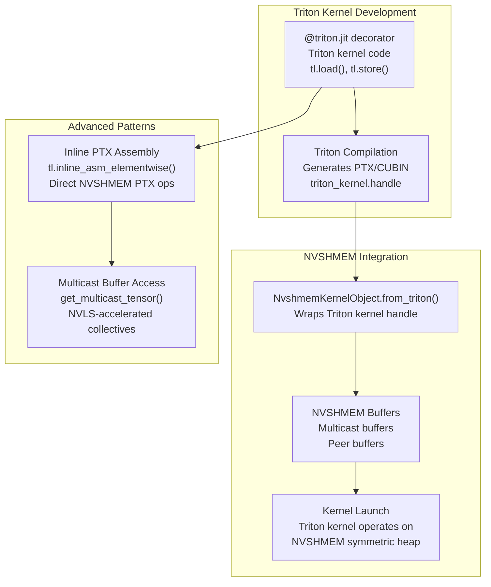

**NvshmemKernelObject Usage:**

The `NvshmemKernelObject` class provides factory methods to create kernel objects from various sources:

```python
# From Triton JIT function
kernel_obj = NvshmemKernelObject.from_triton(triton_kernel)

# From CUBIN bytes
kernel_obj = NvshmemKernelObject.from_obj_bytes(cubin_bytes)

# From cuda.core ObjectCode
kernel_obj = NvshmemKernelObject.from_obj(object_code)
```

**Sources:** [nvshmem4py/nvshmem/core/nvshmem_types.py:117-167](), [nvshmem4py/examples/torch_triton_interop.py:1-140]()

## Code Generation Pipeline

### Build System Overview

The Python bindings build system coordinates multiple code generation stages:

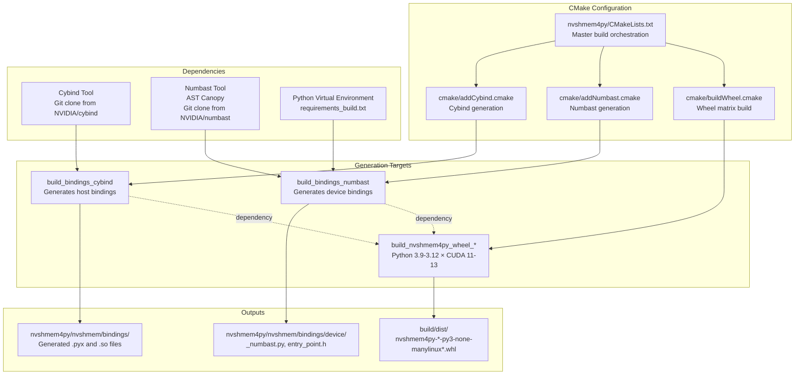

**Build Dependencies:**

All wheel builds depend on bindings being generated first:

```cmake
if(TARGET build_bindings_cybind)
    add_dependencies(${WHEEL_TARGET} build_bindings_cybind)
endif()

if(TARGET build_bindings_numbast AND NVSHMEM_BUILD_PYTHON_DEVICE_LIB)
    add_dependencies(${WHEEL_TARGET} build_bindings_numbast)
endif()
```

**Sources:** [nvshmem4py/CMakeLists.txt:1-100](), [nvshmem4py/cmake/addNumbast.cmake:1-184]()

### Cybind Generation Workflow

Cybind generates host bindings through AST parsing of C headers:

**Cybind Generation Steps:**

1. **Clone Cybind Tool**: Git clone from `github.com/NVIDIA/cybind` at specified tag
2. **Install Dependencies**: Set up Python virtual environment with `requirements_build.txt`
3. **Parse Headers**: Cybind analyzes `nvshmem.h` and extracts function signatures
4. **Generate Cython**: Produces `.pyx` files with 1:1 C function wrappers
5. **Compile Extensions**: Cython compiles `.pyx` to `.so` shared libraries
6. **Copy to Package**: Generated bindings placed in `nvshmem4py/nvshmem/bindings/`

**Key Cybind Outputs:**

| Generated File | Content | Purpose |
|----------------|---------|---------|
| `__init__.pyx` | Import aggregation | Exposes all bindings in `nvshmem.bindings` |
| `memory.pyx` | `malloc()`, `free()`, `ptr()`, `mc_ptr()` | Memory management functions |
| `rma.pyx` | `putmem_on_stream()`, `getmem_on_stream()` | RMA operations |
| `collective.pyx` | `*_reduce_on_stream()`, `barrier_on_stream()` | Collective operations |
| `teams.pyx` | `Team_id` enum | Team constants |

**Sources:** [nvshmem4py/CMakeLists.txt:23-30]()

### Numbast Generation and Configuration

Numbast uses a sophisticated configuration system to generate device bindings:

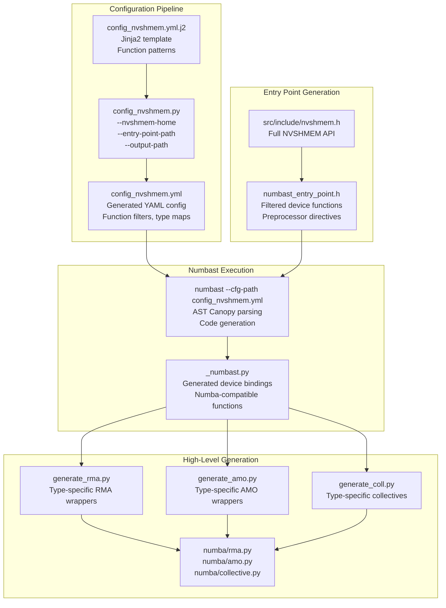

**Numbast Configuration Generation:**

The `config_nvshmem.py` script generates the YAML configuration by:

1. Reading the Jinja2 template at `config_nvshmem.yml.j2`
2. Extracting function patterns and type mappings from NVSHMEM headers
3. Generating function inclusion/exclusion rules
4. Writing the final `config_nvshmem.yml` used by Numbast

**CMake Target Chain:**

```
clean_numbast → 
clone_numbast → 
pip_install_numbast → 
copy_source_numbast → 
generate_numbast_config → 
run_numbast → 
get_numbast_output → 
generate_high_level_bindings → 
get_high_level_bindings
```

**Sources:** [nvshmem4py/cmake/addNumbast.cmake:115-179]()

### Wheel Matrix Build

The build system produces a matrix of wheels for different Python and CUDA versions:

**Wheel Matrix:**

| Python Version | CUDA 11 | CUDA 12 | CUDA 13 |
|----------------|---------|---------|---------|
| 3.9 | ✓ | ✓ | ✓ |
| 3.10 | ✓ | ✓ | ✓ |
| 3.11 | ✓ | ✓ | ✓ |
| 3.12 | ✓ | ✓ | ✓ |

**Wheel Generation Process:**

1. **Find Python Versions**: Script discovers all Python 3.9+ installations
2. **Generate pyproject.toml**: Script creates version-specific `pyproject.toml` with correct dependencies
3. **Build Wheel**: `python -m build` creates wheel for specific Python/CUDA combo
4. **Auditwheel**: Ensures manylinux compatibility
5. **Install to dist/**: Wheels placed in `build/dist/` for distribution

**Per-CUDA Dependencies:**

The `generate_pyproject_toml.py` script reads `requirements_cuda{11,12,13}.txt` and generates appropriate dependency specifications for each CUDA version.

**Sources:** [nvshmem4py/CMakeLists.txt:44-93](), [nvshmem4py/scripts/generate_pyproject_toml.py:1-106]()

## Integration Patterns

### Host-Initiated Stream-Based Operations

The typical pattern for host-initiated NVSHMEM operations:

```python
import nvshmem.core
from cuda.core.experimental import Device

# Initialize
device = Device(0)
nvshmem.core.init(device=device)

# Create stream
stream = device.create_stream()

# Allocate on symmetric heap
src = nvshmem.core.tensor((1024,), dtype=torch.float32)
dst = nvshmem.core.tensor((1024,), dtype=torch.float32)

# Host-initiated collective on stream
nvshmem.core.reduce(nvshmem.core.Teams.TEAM_WORLD, dst, src, "sum", stream=stream)

# Cleanup
nvshmem.core.free_tensor(src)
nvshmem.core.free_tensor(dst)
nvshmem.core.finalize()
```

**Sources:** [nvshmem4py/examples/torch_triton_interop.py:1-140]()

### Device-Initiated Custom Kernels

Pattern for writing custom communication kernels with Numba:

```python
from numba import cuda
from nvshmem.bindings.device.numba import my_pe, n_pes, put_signal_nbi, signal_wait_until

@cuda.jit(lto=True)
def custom_kernel(dst, src, signal):
    mype = my_pe()
    npes = n_pes()
    peer = (mype + 1) % npes
    
    # Device-initiated communication
    if cuda.threadIdx.x == 0:
        put_signal_nbi(dst, src, len(src), signal, 1, SIGNAL_ADD, peer)
        signal_wait_until(signal, CMP_GE, expected_value)
```

**Sources:** [nvshmem4py/examples/device_custom_kernel.py:15-73]()

### Framework Integration with External Registration

For pre-allocated framework tensors not on NVSHMEM symmetric heap:

```python
# Allocate tensor using PyTorch
torch_tensor = torch.zeros((1024,), dtype=torch.float32, device='cuda')

# Register with NVSHMEM
nvshmem_buf = nvshmem.core.register_external_tensor(torch_tensor)

# Use in NVSHMEM operations
nvshmem.core.put(remote_buf, nvshmem_buf, remote_pe=1, stream=stream)

# Unregister when done
nvshmem.core.unregister_external_tensor(nvshmem_buf)
```

The registration creates symmetric mappings across PEs and returns a new buffer handle that must be used for NVSHMEM operations.

**Sources:** [nvshmem4py/nvshmem/core/nvshmem_types.py:445-494]()

---

