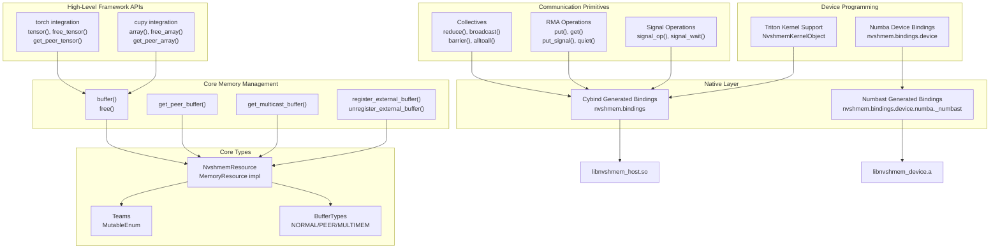
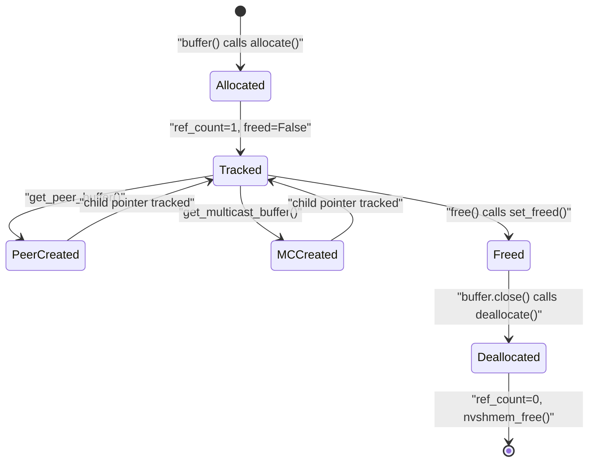
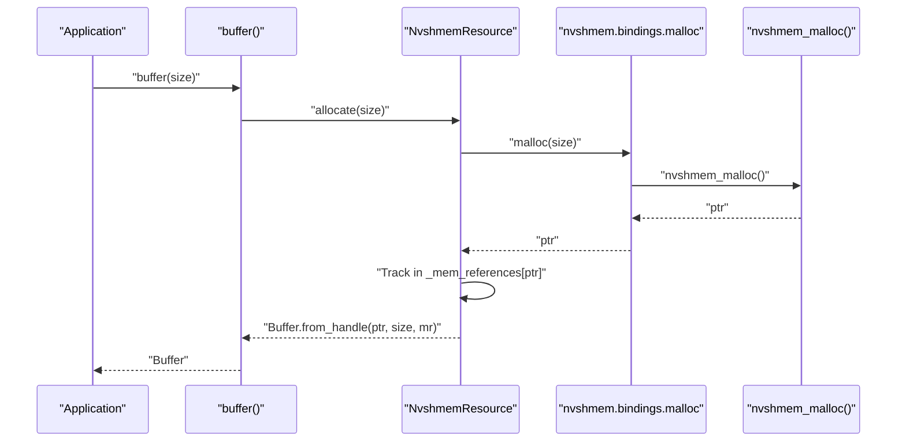
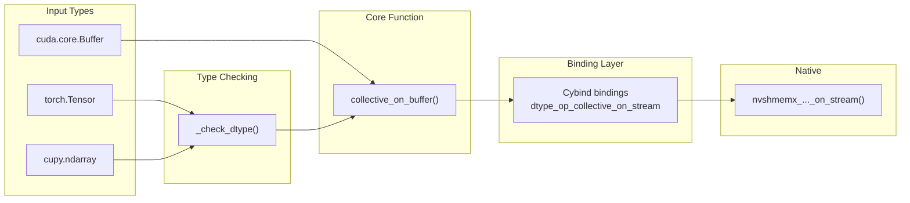
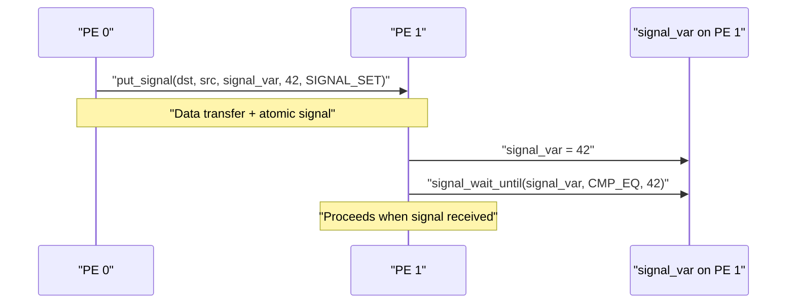
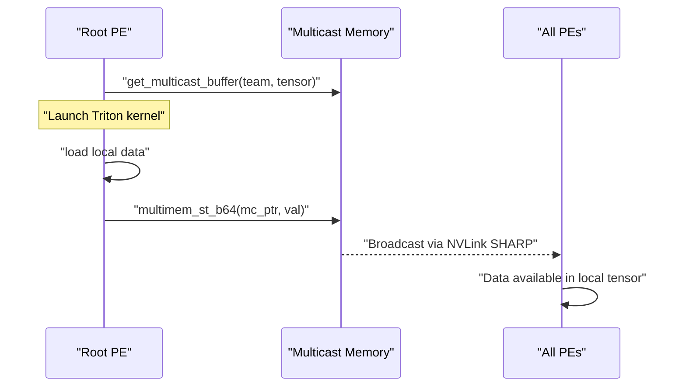

<!-- source: DeepWiki mcp.deepwiki.com · repo NVIDIA/nvshmem · page 4 Python API Reference (nvshmem4py) · fetched 2026-11-11 -->

# Python API Reference (nvshmem4py)

<details>
<summary>Relevant source files</summary>

The following files were used as context for generating this wiki page:

- [nvshmem4py/examples/torch_triton_interop.py](nvshmem4py/examples/torch_triton_interop.py)
- [nvshmem4py/nvshmem/core/collective.py](nvshmem4py/nvshmem/core/collective.py)
- [nvshmem4py/nvshmem/core/nvshmem_types.py](nvshmem4py/nvshmem/core/nvshmem_types.py)
- [nvshmem4py/nvshmem/core/rma.py](nvshmem4py/nvshmem/core/rma.py)

</details>


This page provides a comprehensive reference for the **nvshmem4py** Python API, which exposes NVSHMEM's distributed GPU memory operations to Python applications. The API is designed for seamless integration with PyTorch, CuPy, and Numba, enabling host-initiated collective operations, remote memory access (RMA), and device-side communication from Python.

For information about the underlying C/C++ NVSHMEM library, see [C/C++ API Reference](#5). For details on building nvshmem4py from source, see [Python Bindings Build](#3.2). For architectural details about the Python bindings layer, see [Python Bindings Architecture](#2.7).

## API Architecture Overview

The nvshmem4py API is organized into several layers that provide different levels of abstraction:



Sources: [nvshmem4py/nvshmem/core/nvshmem_types.py](), [nvshmem4py/nvshmem/core/memory.py](), [nvshmem4py/nvshmem/core/collective.py](), [nvshmem4py/nvshmem/core/rma.py]()

## Core Types

### NvshmemResource

`NvshmemResource` is the central memory allocator implementing the `cuda.core.experimental.MemoryResource` interface. It manages NVSHMEM symmetric heap allocations and tracks buffer lifecycles.

**Key Attributes and Methods:**

| Method | Description |
|--------|-------------|
| `allocate(size, stream=None, release=False, except_on_del=True)` | Allocates symmetric memory using `nvshmem_malloc` |
| `deallocate(ptr, size, stream=None)` | Frees symmetric memory (called by `Buffer.close()`) |
| `get_peer_buffer(buffer, pe)` | Returns peer-accessible buffer via `nvshmem_ptr` |
| `get_mc_buffer(team, buffer)` | Returns multicast buffer via `nvshmemx_mc_ptr` |
| `register_external_buffer(buffer, call_register=True)` | Registers externally-allocated memory |
| `unregister_external_buffer(buffer)` | Unregisters external memory |
| `set_freed(buffer)` | Marks buffer as freed for tracking |

**Internal Tracking:**

The class maintains `_mem_references`, a dictionary mapping pointer addresses to metadata:

```python
{
    ptr: {
        "ref_count": int,           # Reference counter
        "resource": NvshmemResource, # Memory resource instance
        "buffer": Buffer,           # cuda.core Buffer object
        "type": BufferTypes,        # NORMAL/PEER/MULTIMEM/EXTERNAL
        "freed": bool,              # Whether explicitly freed
        "released": bool,           # Whether tracking disabled
        "except_on_del": bool       # Raise exception on implicit free
    }
}
```

**Buffer Lifecycle Diagram:**



Sources: [nvshmem4py/nvshmem/core/nvshmem_types.py:237-534]()

### BufferTypes Enum

Distinguishes different buffer allocation types:

```python
class BufferTypes(IntEnum):
    NORMAL = 0      # Standard symmetric heap allocation
    PEER = 1        # Peer-accessible pointer from nvshmem_ptr
    MULTIMEM = 2    # Multicast pointer from nvshmemx_mc_ptr
    EXTERNAL = 3    # Externally-registered buffer
```

Sources: [nvshmem4py/nvshmem/core/nvshmem_types.py:227-231]()

### Teams Enum

`Teams` is a `MutableEnum` derived from the C `nvshmem_team_id_t` enum, allowing dynamic team creation:

**Predefined Teams:**

| Team | Value | Description |
|------|-------|-------------|
| `TEAM_WORLD` | -1 | All PEs in the job |
| `TEAM_NODE` | -2 | All PEs on the same node |
| `TEAM_SHARED` | -3 | PEs with direct memory access |

**Dynamic Team Management:**

```python
# Add custom team
Teams.add("MY_TEAM", team_handle)

# Remove team
Teams.remove("MY_TEAM")

# Remove by value
Teams.remove_by_value(team_handle)
```

Sources: [nvshmem4py/nvshmem/core/nvshmem_types.py:40-115]()

### Version Class

Provides version information:

```python
class Version:
    openshmem_spec_version: str   # OpenSHMEM spec version
    nvshmem4py_version: str       # Python package version
    libnvshmem_version: str       # Native library version
```

Sources: [nvshmem4py/nvshmem/core/nvshmem_types.py:171-183]()

### NvshmemKernelObject

Wrapper for CUDA kernel objects used with device-side bindings:

**Factory Methods:**

| Method | Description |
|--------|-------------|
| `from_handle(handle)` | Create from integer handle |
| `from_obj(obj)` | Create from `cuda.core.experimental.ObjectCode` |
| `from_obj_bytes(obj_bytes)` | Create from compiled CUDA binary |
| `from_triton(triton_kernel)` | Create from Triton JIT kernel |
| `from_cuda_bindings(cuda_kernel)` | Create from `cuda.bindings.driver.CUmodule` |

Sources: [nvshmem4py/nvshmem/core/nvshmem_types.py:117-167]()

### Exception Classes

| Exception | Usage |
|-----------|-------|
| `NvshmemError` | General runtime errors (allocation failures, invalid operations) |
| `NvshmemInvalid` | Invalid arguments or state (uninitialized, wrong buffer type) |
| `NvshmemWarning` | Non-fatal warnings |

Sources: [nvshmem4py/nvshmem/core/nvshmem_types.py:203-223]()

## Memory Management API

### buffer()

Allocates NVSHMEM-backed symmetric memory:

```python
def buffer(size: int, release: bool = False, except_on_del: bool = True) -> Buffer
```

**Parameters:**
- `size`: Size in bytes
- `release`: If `True`, disables internal tracking (user must maintain references)
- `except_on_del`: If `True`, raises exception on implicit deallocation

**Returns:** `cuda.core.experimental._memory.Buffer`

**Collective Semantics:** All PEs must call `buffer()` with the same size.

**Implementation Flow:**



Sources: [nvshmem4py/nvshmem/core/memory.py:54-92]()

### free()

Frees NVSHMEM-allocated buffer:

```python
def free(buffer: Buffer) -> None
```

**Collective Semantics:** All PEs must call `free()` on corresponding buffers.

**Behavior:**
1. Marks buffer as freed via `set_freed()`
2. Calls `buffer.close()`, which invokes `deallocate()`
3. `deallocate()` decrements reference count
4. When `ref_count` reaches 0, calls `nvshmem_free()`

Sources: [nvshmem4py/nvshmem/core/memory.py:94-123]()

### get_peer_buffer()

Returns peer-accessible pointer to remote PE's buffer:

```python
def get_peer_buffer(buffer: Buffer, pe: int) -> Buffer
```

**Equivalent to:** `nvshmem_ptr()` in C API

**Parameters:**
- `buffer`: Local symmetric heap buffer
- `pe`: Target PE rank

**Returns:** `Buffer` pointing to PE `pe`'s copy of the buffer

**Usage Pattern:**
```python
# PE 0 code
local_buf = nvshmem.core.buffer(1024)
peer_buf = nvshmem.core.get_peer_buffer(local_buf, pe=1)
# peer_buf can be used for loads/stores to PE 1's memory
```

**Implementation:** Calls `nvshmem_ptr(buffer.handle, pe)` and wraps result in a `Buffer` with `BufferTypes.PEER`.

Sources: [nvshmem4py/nvshmem/core/memory.py:125-164](), [nvshmem4py/nvshmem/core/nvshmem_types.py:384-409]()

### get_multicast_buffer()

Returns multicast-accessible buffer for hardware-accelerated collectives:

```python
def get_multicast_buffer(team: Teams, buffer: Buffer) -> Buffer
```

**Equivalent to:** `nvshmemx_mc_ptr()` in C API

**Parameters:**
- `team`: NVSHMEM team (e.g., `Teams.TEAM_WORLD`)
- `buffer`: Local symmetric heap buffer

**Returns:** `Buffer` with multicast alias (device-only access)

**Important:** The returned buffer is **NOT** host-accessible. It can only be used in GPU kernels.

**Use Case:** Leverages NVLink SHARP for one-to-many operations.

Sources: [nvshmem4py/nvshmem/core/memory.py:227-272](), [nvshmem4py/nvshmem/core/nvshmem_types.py:412-435]()

### register_external_buffer() / unregister_external_buffer()

Registers non-NVSHMEM memory for use in NVSHMEM operations:

```python
def register_external_buffer(buffer: Buffer) -> Buffer
def unregister_external_buffer(buffer: Buffer) -> None
```

**Collective Semantics:** All PEs must call in concert.

**Returns:** New `Buffer` with symmetric pointer (use this for NVSHMEM ops)

**Example:**
```python
# Allocate memory outside NVSHMEM
external_buf = some_cuda_allocator(size)

# Register with NVSHMEM
nvshmem_buf = nvshmem.core.register_external_buffer(external_buf)

# Use nvshmem_buf in collectives
nvshmem.core.reduce(Teams.TEAM_WORLD, dst, nvshmem_buf, "sum", stream=stream)

# Unregister when done
nvshmem.core.unregister_external_buffer(nvshmem_buf)
```

Sources: [nvshmem4py/nvshmem/core/memory.py:166-225](), [nvshmem4py/nvshmem/core/nvshmem_types.py:445-494]()

## Collective Operations

### Collective API Overview

All collective operations are **stream-based** and operate on PyTorch tensors, CuPy arrays, or raw `Buffer` objects:



Sources: [nvshmem4py/nvshmem/core/collective.py:79-111]()

### reduce()

Performs reduction across team to root PE:

```python
def reduce(team: Teams, dst_array: object, src_array: object, 
           op: str, stream: NvshmemStreamsType = None)
```

**Parameters:**
- `team`: NVSHMEM team
- `dst_array`: Destination (torch.Tensor, cupy.ndarray, or Buffer)
- `src_array`: Source (same type as dst)
- `op`: Reduction operator: `"sum"`, `"max"`, `"min"`
- `stream`: CUDA stream (required)

**Supported dtypes:** `float16`, `bfloat16`, `float32`, `float64`, `int8`, `int16`, `int32`, `int64`, `uint8`

Sources: [nvshmem4py/nvshmem/core/collective.py:311-322]()

### broadcast()

Broadcasts data from root PE to all team members:

```python
def broadcast(team: Teams, dst_array: object, src_array: object, 
              root: int = 0, stream: NvshmemStreamsType = None)
```

**Parameters:**
- `root`: Root PE rank (default: 0)

Sources: [nvshmem4py/nvshmem/core/collective.py:361-372]()

### alltoall()

All-to-all personalized exchange:

```python
def alltoall(team: Teams, dst_array: object, src_array: object, 
             stream: NvshmemStreamsType = None)
```

**Semantics:** Each PE sends `chunk_size = len(src) / n_pes` to every other PE.

Sources: [nvshmem4py/nvshmem/core/collective.py:337-347]()

### fcollect()

Full collect (gather to all):

```python
def fcollect(team: Teams, dst_array: object, src_array: object, 
             stream: NvshmemStreamsType = None)
```

**Semantics:** Concatenates all PEs' `src_array` into each PE's `dst_array`.

Sources: [nvshmem4py/nvshmem/core/collective.py:349-359]()

### barrier() / sync()

Team-wide synchronization:

```python
def barrier(team: Teams, stream: NvshmemStreamsType = None)
def sync(team: Teams, stream: NvshmemStreamsType = None)
```

**Note:** `barrier()` and `sync()` have identical semantics in NVSHMEM.

Sources: [nvshmem4py/nvshmem/core/collective.py:249-279]()

### barrier_all() / sync_all()

Runtime-wide synchronization (supports Multi-Process-per-GPU):

```python
def barrier_all(stream: NvshmemStreamsType = None)
def sync_all(stream: NvshmemStreamsType = None)
```

Sources: [nvshmem4py/nvshmem/core/collective.py:281-309]()

### collective_on_buffer()

Low-level collective interface for advanced users:

```python
def collective_on_buffer(coll: str, team: Teams, dest: Buffer, src: Buffer, 
                        dtype: str = None, op: str = None, root: int = 0, 
                        stream: NvshmemStreamsType = None, 
                        enable_timing: bool = False) -> float
```

**Parameters:**
- `coll`: Collective name (`"reduce"`, `"broadcast"`, `"alltoall"`, `"fcollect"`)
- `dtype`: NVSHMEM dtype string (`"float"`, `"double"`, `"int32"`, etc.)
- `enable_timing`: If True, returns elapsed time in milliseconds

**Function Name Resolution:**

```python
func_name = f"{dtype}_{op}_{coll}_on_stream"
# Example: "float_sum_reduce_on_stream"
```

Sources: [nvshmem4py/nvshmem/core/collective.py:112-210]()

## Remote Memory Access (RMA)

### put()

Host-initiated put operation:

```python
def put(dst: object, src: object, remote_pe: int = -1, 
        stream: NvshmemStreamsType = None)
```

**Parameters:**
- `dst`: Destination buffer (on remote PE)
- `src`: Source buffer (local)
- `remote_pe`: Target PE rank
- `stream`: CUDA stream

**Transfer size:** `min(src.size, dst.size)`

Sources: [nvshmem4py/nvshmem/core/rma.py:241-257]()

### get()

Host-initiated get operation:

```python
def get(dst: object, src: object, remote_pe: int = -1, 
        stream: NvshmemStreamsType = None)
```

**Semantics:** Fetches data from remote PE's `src` to local `dst`.

Sources: [nvshmem4py/nvshmem/core/rma.py:259-275]()

### put_signal()

Put with remote signal atomics:

```python
def put_signal(dst: object, src: object, signal_var: Buffer, 
               signal_val: int, signal_op: SignalOp, 
               remote_pe: int = -1, stream: NvshmemStreamsType = None)
```

**Parameters:**
- `signal_var`: Symmetric `Buffer` >= 8 bytes (holds `uint64_t`)
- `signal_val`: Value to write to signal
- `signal_op`: Operation type (see `SignalOp` enum)

**Use Case:** Non-blocking notification of data availability.



Sources: [nvshmem4py/nvshmem/core/rma.py:137-159]()

### signal_op()

Standalone signaling (no data transfer):

```python
def signal_op(signal_var: Buffer, signal_val: int, signal_op: SignalOp, 
              remote_pe: int = -1, stream: NvshmemStreamsType = None)
```

Sources: [nvshmem4py/nvshmem/core/rma.py:161-187]()

### signal_wait()

Waits for signal condition:

```python
def signal_wait(signal_var: Buffer, signal_val: int, 
                signal_op: ComparisonType, stream: NvshmemStreamsType = None)
```

**Parameters:**
- `signal_op`: `ComparisonType` enum (from `nvshmem.core.direct`)

Sources: [nvshmem4py/nvshmem/core/rma.py:190-213]()

### quiet()

Ensures completion of all issued RMA operations:

```python
def quiet(stream: NvshmemStreamsType = None)
```

**Semantics:** Returns when all prior put/get operations to all PEs have completed locally.

**Note:** Remote completion not guaranteed. Use barriers for global synchronization.

Sources: [nvshmem4py/nvshmem/core/rma.py:216-239]()

## Framework Integration

### PyTorch Integration

#### tensor()

Allocates PyTorch tensor on NVSHMEM symmetric heap:

```python
def tensor(shape: Tuple[int], dtype: torch.dtype = torch.float32, 
           release: bool = False, morder: str = "C", 
           except_on_del: bool = True) -> torch.Tensor
```

**Parameters:**
- `shape`: Tensor dimensions
- `dtype`: PyTorch dtype (float16, float32, int32, etc.)
- `morder`: Memory layout: `"C"` (row-major) or `"F"` (column-major)

**Implementation:**
1. Allocates via `buffer(get_size(shape, dtype))`
2. Wraps in DLPack tensor via `torch.utils.dlpack.from_dlpack()`
3. Views as target dtype and reshapes

Sources: [nvshmem4py/nvshmem/core/interop/torch.py:70-108]()

#### get_peer_tensor()

Returns peer-accessible tensor:

```python
def get_peer_tensor(tensor: torch.Tensor, peer_pe: int) -> torch.Tensor
```

**Returns:** Tensor view on remote PE's memory.

Sources: [nvshmem4py/nvshmem/core/interop/torch.py:137-145]()

#### get_multicast_tensor()

Returns multicast-enabled tensor (device-only):

```python
def get_multicast_tensor(team: Teams, tensor: torch.Tensor) -> torch.Tensor
```

**Warning:** Returned tensor cannot be accessed from host CPU.

Sources: [nvshmem4py/nvshmem/core/interop/torch.py:147-180]()

#### register_external_tensor()

Registers externally-allocated tensor:

```python
def register_external_tensor(tensor: torch.Tensor) -> torch.Tensor
```

Sources: [nvshmem4py/nvshmem/core/interop/torch.py:182-190]()

#### free_tensor()

Frees NVSHMEM tensor:

```python
def free_tensor(tensor: torch.Tensor) -> None
```

Sources: [nvshmem4py/nvshmem/core/interop/torch.py:201-218]()

### CuPy Integration

CuPy integration provides identical API with `array` naming:

| PyTorch API | CuPy API |
|-------------|----------|
| `tensor()` | `array()` |
| `bytetensor()` | `bytearray()` |
| `free_tensor()` | `free_array()` |
| `get_peer_tensor()` | `get_peer_array()` |
| `get_multicast_tensor()` | `get_multicast_array()` |
| `register_external_tensor()` | `register_external_array()` |

**Implementation Note:** Arrays use `cupy.from_dlpack()` for DLPack conversion.

Sources: [nvshmem4py/nvshmem/core/interop/cupy.py:65-214]()

## Device Programming with Triton

### Basic Triton Integration

nvshmem4py tensors can be passed directly to Triton kernels:

```python
import triton
import triton.language as tl
import nvshmem.core

@triton.jit
def my_kernel(x_ptr, n_elements, BLOCK_SIZE: tl.constexpr):
    pid = tl.program_id(axis=0)
    offsets = pid * BLOCK_SIZE + tl.arange(0, BLOCK_SIZE)
    mask = offsets < n_elements
    x = tl.load(x_ptr + offsets, mask=mask)
    # ... computation ...
    tl.store(x_ptr + offsets, result, mask=mask)

# Allocate on symmetric heap
tensor = nvshmem.core.tensor((1024,), dtype=torch.float32)

# Launch Triton kernel
grid = lambda meta: (triton.cdiv(1024, meta['BLOCK_SIZE']),)
my_kernel[grid](tensor, 1024, BLOCK_SIZE=256)
```

Sources: [nvshmem4py/examples/torch_triton_interop.py:63-114]()

### Custom Communication Kernels

For advanced use cases, Triton inline assembly can access NVSHMEM multicast stores:

```python
@triton.jit
def multimem_st_b64(ptr, val):
    """Multicast store of 8-byte value"""
    return tl.inline_asm_elementwise(
        asm="multimem.st.global.b64 [$1], $2;",
        constraints=("=r,l,l"),
        args=[ptr, val],
        dtype=tl.int32,
        is_pure=False,
        pack=1
    )
```

**Broadcast Example:**



Sources: [nvshmem4py/examples/triton_comm_kernels.py:51-109]()

### NvshmemKernelObject with Triton

For device-side NVSHMEM calls from Triton kernels:

```python
# Compile Triton kernel
triton_kernel = my_triton_function.compile()

# Wrap for NVSHMEM device bindings
kernel_obj = nvshmem.core.NvshmemKernelObject.from_triton(triton_kernel)

# Use with device-side NVSHMEM functions (future feature)
```

Sources: [nvshmem4py/nvshmem/core/nvshmem_types.py:154-158]()

## Initialization and Finalization

Initialization API is covered in detail in [Initialization and Finalization](#4.4). Key functions:

- `init()`: Initialize NVSHMEM runtime
- `my_pe()`: Get current PE rank
- `n_pes()`: Get total PE count
- `finalize()`: Shut down NVSHMEM runtime

For complete details, refer to the dedicated subsection in this reference.

## Advanced Topics

### Direct Bindings Access

For maximum control, users can access low-level bindings:

**Cybind-generated host bindings:**
```python
from nvshmem.bindings import malloc, free, ptr, putmem_on_stream
```

**Numbast-generated device bindings (for Numba):**
```python
from nvshmem.bindings.device.numba import _numbast
# Access device-side functions for Numba kernels
```

See [Direct Bindings Access](#4.9) for details.

### Stream Interoperability

nvshmem4py supports multiple stream types via `NvshmemStreamsType`:

```python
# PyTorch stream
torch_stream = torch.cuda.current_stream()

# cuda.core stream
core_stream = device.create_stream()

# Wrapped stream
wrapped_stream = nvshmem.core.NvshmemStream(torch_stream)
```

**Internal Protocol:**

All stream types must implement `__cuda_stream__()` returning `(device_id, stream_handle)` tuple.

Sources: [nvshmem4py/nvshmem/core/nvshmem_types.py:188-197]()

### Error Handling Best Practices

```python
try:
    buf = nvshmem.core.buffer(1024)
    # ... operations ...
    nvshmem.core.free(buf)
except nvshmem.core.NvshmemInvalid as e:
    # Invalid arguments or state
    print(f"Invalid operation: {e.msg}")
except nvshmem.core.NvshmemError as e:
    # Runtime errors
    print(f"Runtime error: {e.msg}")
```

Sources: [nvshmem4py/nvshmem/core/nvshmem_types.py:203-215]()

## Type Mapping Reference

### Python to NVSHMEM Dtype Mapping

The collective operations automatically map framework dtypes to NVSHMEM types:

| PyTorch dtype | CuPy dtype | NVSHMEM dtype |
|---------------|------------|---------------|
| `torch.float16` | `float16` | `half` |
| `torch.bfloat16` | `bfloat16` | `bfloat16` |
| `torch.float32` | `float32` | `float` |
| `torch.float64` | `float64` | `double` |
| `torch.int8` | `int8` | `int8` |
| `torch.int16` | `int16` | `int16` |
| `torch.int32` | `int32` | `int32` |
| `torch.int64` | `int64` | `int64` |
| `torch.uint8` | `uint8` | `uint8` |
| `torch.bool` | `bool` | `uint8` |

Sources: [nvshmem4py/nvshmem/core/collective.py:46-77]()

## Usage Examples

### Complete PyTorch Example

```python
import torch
import nvshmem.core
from cuda.core.experimental import Device

# Initialize
device = Device(0)
device.set_current()
nvshmem.core.init(device=device, initializer_method="mpi")

# Allocate and initialize
tensor = nvshmem.core.tensor((1024,), dtype=torch.float32)
tensor[:] = float(nvshmem.core.my_pe())

# Collective operation
stream = device.create_stream()
result = nvshmem.core.tensor((1024,), dtype=torch.float32)
nvshmem.core.reduce(nvshmem.core.Teams.TEAM_WORLD, result, tensor, "sum", stream)

# Cleanup
nvshmem.core.free_tensor(tensor)
nvshmem.core.free_tensor(result)
nvshmem.core.finalize()
```

### Complete CuPy Example

```python
import cupy
import nvshmem.core
from cuda.core.experimental import Device

# Initialize
device = Device(0)
device.set_current()
nvshmem.core.init(device=device, initializer_method="mpi")

# Allocate
array = nvshmem.core.array((1024,), dtype="float32")
array[:] = float(nvshmem.core.my_pe())

# RMA operation
stream = device.create_stream()
if nvshmem.core.my_pe() == 0:
    remote_array = nvshmem.core.get_peer_array(array, peer_pe=1)
    nvshmem.core.put(remote_array, array, remote_pe=1, stream=stream)

# Cleanup
nvshmem.core.free_array(array)
nvshmem.core.finalize()
```

Sources: [nvshmem4py/examples/torch_triton_interop.py](), [nvshmem4py/examples/triton_comm_kernels.py]()

---

