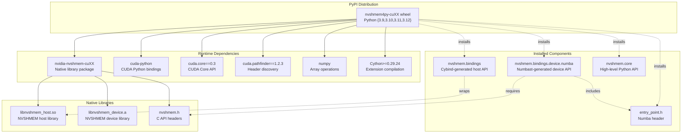
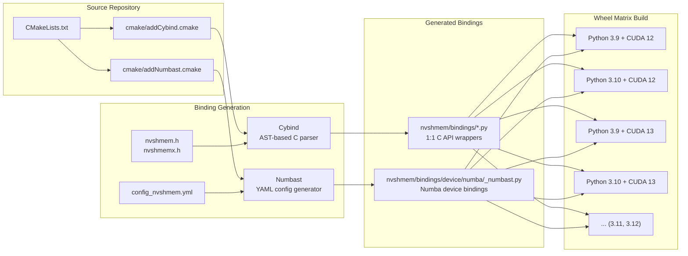
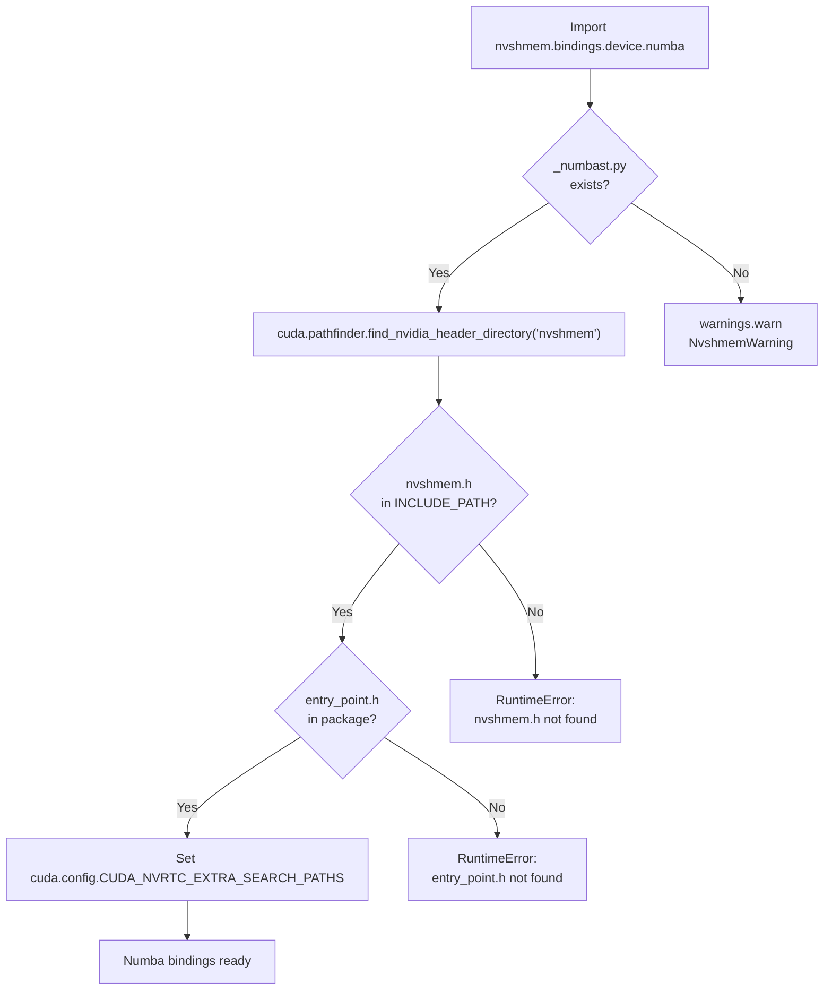

<!-- source: DeepWiki mcp.deepwiki.com · repo NVIDIA/nvshmem · page 4.1 Installation and Dependencies · fetched 2026-11-11 -->

# Installation and Dependencies

<details>
<summary>Relevant source files</summary>

The following files were used as context for generating this wiki page:

- [nvshmem4py/nvshmem/core/__init__.py](nvshmem4py/nvshmem/core/__init__.py)
- [nvshmem4py/nvshmem/core/teams.py](nvshmem4py/nvshmem/core/teams.py)
- [nvshmem4py/requirements_cuda12.txt](nvshmem4py/requirements_cuda12.txt)
- [nvshmem4py/requirements_cuda13.txt](nvshmem4py/requirements_cuda13.txt)
- [nvshmem4py/requirements_optional_cuda12.txt](nvshmem4py/requirements_optional_cuda12.txt)
- [nvshmem4py/requirements_optional_cuda13.txt](nvshmem4py/requirements_optional_cuda13.txt)
- [src/host/team/team.cu](src/host/team/team.cu)

</details>


## Purpose and Scope

This page documents the installation process and dependency requirements for **nvshmem4py**, the Python bindings for NVSHMEM. It covers runtime dependencies, CUDA version compatibility, Python version requirements, and environment setup. For information about building the core C++/CUDA library, see [Core Library Build](#3.1). For building nvshmem4py from source, see [Python Bindings Build](#3.2) and [Building from Source](#8.2).

## Overview

nvshmem4py is distributed as pre-built Python wheels targeting multiple Python and CUDA versions. Each wheel includes:
- Cybind-generated host bindings wrapping the NVSHMEM C API
- Numbast-generated device bindings for Numba CUDA kernels
- Runtime dependencies on the native NVSHMEM library

The installation process automatically handles most dependencies through PyPI, but requires the native NVSHMEM library package (`nvidia-nvshmem-cuXX`) to be available.

## Installation Methods

### Installing from PyPI

nvshmem4py wheels are available for Python 3.9+ and CUDA 11/12/13. Install using pip with the appropriate CUDA version specifier:

```bash
# For CUDA 12.x
pip install nvshmem4py-cu12

# For CUDA 13.x
pip install nvshmem4py-cu13

# For CUDA 11.x
pip install nvshmem4py-cu11
```

The wheel naming convention follows: `nvshmem4py-cu{CUDA_MAJOR_VERSION}`.

### Installation Architecture



Sources: [nvshmem4py/requirements_cuda12.txt:1-9](), [nvshmem4py/requirements_cuda13.txt:1-9](), [nvshmem4py/CMakeLists.txt:65-88]()

## Runtime Dependencies

### Core Dependencies by CUDA Version

The runtime dependency matrix varies by CUDA version:

| Dependency | CUDA 12.x | CUDA 13.x | Purpose |
|------------|-----------|-----------|---------|
| `nvidia-nvshmem-cuXX` | Required | Required | Native NVSHMEM library and headers |
| `cuda-python` | `>=12.0,<=12.9` | `>=13.0,<14.0` | CUDA runtime Python bindings |
| `cuda.core` | `==0.3` | `==0.3` | CUDA Core API for device management |
| `cuda.pathfinder` | `==1.2.3` | `==1.2.3` | Header file discovery utility |
| `numpy` | Latest | Latest | Array operations |
| `Cython` | `>=0.29.24` | `>=0.29.24` | Extension module compilation |

**CUDA 11.x Note**: CUDA 11 wheels have similar dependencies with version constraints adjusted for CUDA 11.x compatibility.

### Python Version Compatibility

nvshmem4py requires Python 3.9 or later. The wheel build matrix supports:
- Python 3.9
- Python 3.10
- Python 3.11
- Python 3.12

This is configured in [nvshmem4py/CMakeLists.txt:44-88]() where the build system discovers available Python versions:

```python
# From scripts/find_python_versions.sh (called by CMake)
# Finds all Python3 versions >= 3.9
```

The `pyproject.toml` specifies: `requires-python = ">=3.9"` [nvshmem4py/scripts/generate_pyproject_toml.py:23]()

## Build-Time Dependencies

For users building from source or developing nvshmem4py, additional dependencies are required:

### Binding Generation Tools

| Tool | Version | Purpose |
|------|---------|---------|
| `networkx` | Latest | Graph analysis for Cybind |
| `pycparser` | Latest | C parsing for Cybind |
| `pybind11` | Latest | Numbast C++ bindings |
| `pyyaml` | Latest | Numbast configuration parsing |
| `click` | Latest | Numbast CLI interface |
| `scikit-build-core` | Latest | Numbast build system |
| `ninja` | Latest | Fast parallel builds |
| `numba-cuda[cu12]` | `==0.20.0` | Numba CUDA support for device bindings |

### Wheel Building Tools

| Tool | Version | Purpose |
|------|---------|---------|
| `setuptools` | `==68` | Python packaging |
| `setuptools_scm` | Latest | Git-based versioning |
| `wheel` | Latest | Wheel format support |
| `auditwheel` | Latest | Wheel repair/validation |
| `patchelf` | Latest | Binary patching |

Sources: [nvshmem4py/requirements_build.txt:1-21]()

### Build System Flow



Sources: [nvshmem4py/CMakeLists.txt:20-93]()

## Optional Dependencies

### Framework Integration

nvshmem4py integrates with deep learning and numerical computing frameworks through optional dependencies:

| Framework | Package | Purpose | Documentation |
|-----------|---------|---------|---------------|
| PyTorch | `torch` | Tensor interoperability | [PyTorch Integration](#4.5.1) |
| CuPy | `cupy-cuda{11x,12x}` | Array interoperability | [CuPy Integration](#4.5.2) |
| SciPy | `scipy>=1.6.0` | Numerical algorithms | General purpose |

These are not included in the base installation but can be installed separately:

```bash
# For PyTorch integration
pip install torch

# For CuPy integration (CUDA 12.x)
pip install cupy-cuda12x
```

### Numba Device Bindings

The Numba device bindings require:
- `numba-cuda[cu12]==0.20.0` (for development, testing)

The bindings are included in all wheel distributions but are only activated if the `_numbast.py` file is present. See [Device Programming with Numba](#4.6) for usage details.

Sources: [nvshmem4py/scripts/generate_pyproject_toml.py:24-28,59-66](), [nvshmem4py/requirements_build.txt:20]()

## Environment Setup and Verification

### Header Path Discovery

nvshmem4py uses `cuda.pathfinder` to locate NVSHMEM headers at runtime. The initialization process in [nvshmem4py/nvshmem/bindings/device/numba/__init__.py:11-36]() performs the following checks:



Sources: [nvshmem4py/nvshmem/bindings/device/numba/__init__.py:1-40]()

### Verification Steps

After installation, verify the environment:

```python
import nvshmem

# Check version
print(nvshmem.__version__)

# Verify host bindings
from nvshmem.bindings import nvshmemx_hostlib_init_attr
print("Host bindings available")

# Verify device bindings (optional)
try:
    from nvshmem.bindings.device.numba import my_pe, n_pes
    print("Device bindings available")
except ImportError:
    print("Device bindings not available (requires nvidia-nvshmem-cuXX)")
```

### Common Installation Issues

| Issue | Cause | Solution |
|-------|-------|----------|
| `RuntimeError: nvshmem.h not found` | Missing `nvidia-nvshmem-cuXX` package | Install matching CUDA version: `pip install nvidia-nvshmem-cu12` |
| `RuntimeError: entry_point.h not found` | Corrupted wheel installation | Reinstall: `pip uninstall nvshmem4py && pip install nvshmem4py-cuXX` |
| `NvshmemWarning: Numba device bindings not enabled` | `_numbast.py` missing from wheel | Reinstall wheel or check CUDA version compatibility |
| Version mismatch errors | CUDA version mismatch between packages | Ensure all packages use same CUDA version (e.g., all `-cu12`) |

### Environment Variables

No environment variables are required for basic installation. For advanced configuration and runtime tuning, see [Configuration and Environment](#7).

Sources: [nvshmem4py/nvshmem/bindings/device/numba/__init__.py:20-39]()

## Wheel Build Matrix

The build system generates wheels for all combinations of:
- **Python versions**: 3.9, 3.10, 3.11, 3.12
- **CUDA versions**: 11, 12, 13

This results in 12 wheel files per release. The CMake configuration automatically discovers available Python versions and builds serially with dependencies:

```
build_nvshmem4py_wheel_cu12_3.9 (depends on: bindings)
├─> build_nvshmem4py_wheel_cu12_3.10 (depends on: previous wheel)
    ├─> build_nvshmem4py_wheel_cu12_3.11
        ├─> build_nvshmem4py_wheel_cu12_3.12
            ├─> build_nvshmem4py_wheel_cu13_3.9
                └─> ... (continues for all combinations)
```

Sources: [nvshmem4py/CMakeLists.txt:60-93]()

## Next Steps

- For initialization and usage, see [Initialization and Finalization](#4.4)
- For memory allocation, see [Core Types and Memory Management](#4.2)
- For device kernel development, see [Device Programming with Numba](#4.6)
- For building from source, see [Python Bindings Build](#3.2)

---

