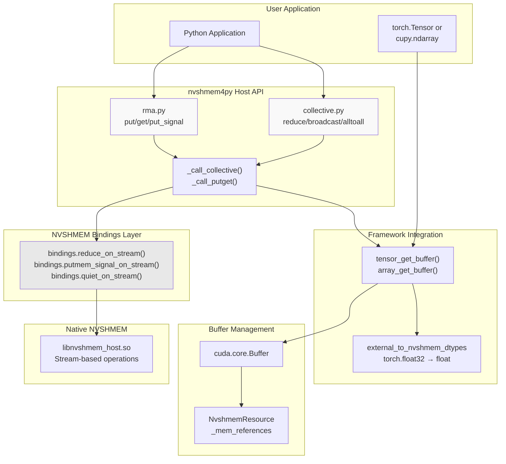
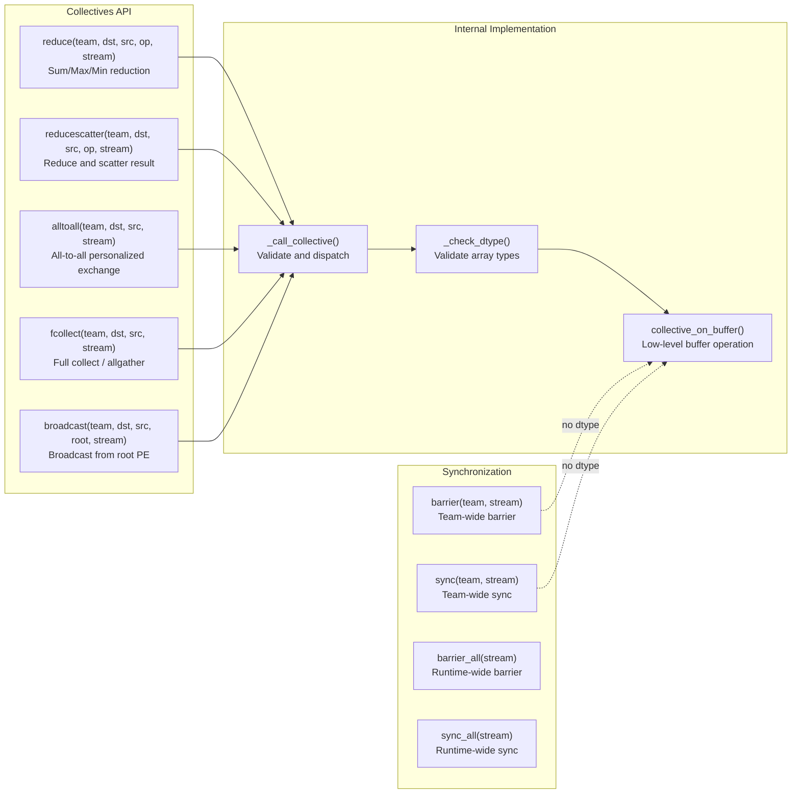
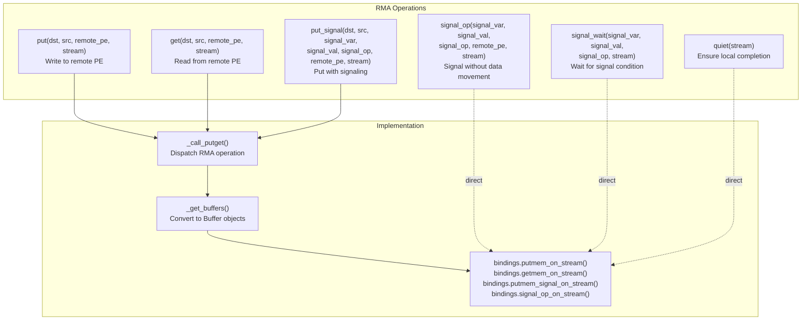
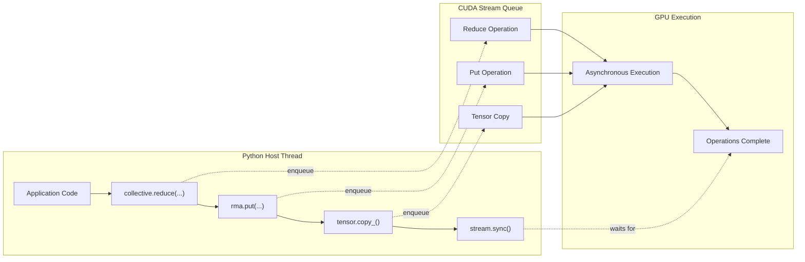
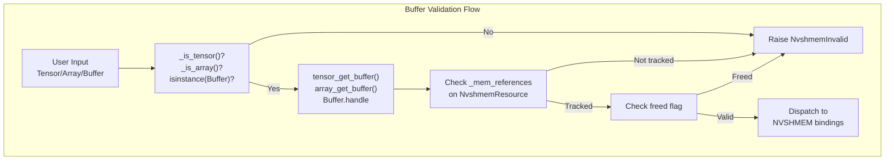

<!-- source: DeepWiki mcp.deepwiki.com · repo NVIDIA/nvshmem · page 4.3 Collective Operations and RMA · fetched 2026-11-11 -->

# Collective Operations and RMA

<details>
<summary>Relevant source files</summary>

The following files were used as context for generating this wiki page:

- [nvshmem4py/examples/torch_triton_interop.py](nvshmem4py/examples/torch_triton_interop.py)
- [nvshmem4py/nvshmem/core/collective.py](nvshmem4py/nvshmem/core/collective.py)
- [nvshmem4py/nvshmem/core/nvshmem_types.py](nvshmem4py/nvshmem/core/nvshmem_types.py)
- [nvshmem4py/nvshmem/core/rma.py](nvshmem4py/nvshmem/core/rma.py)

</details>


This page documents the **host-initiated** collective communication and remote memory access (RMA) operations available in the nvshmem4py Python API. These operations are launched from the host (CPU) and executed asynchronously on CUDA streams.

For **device-initiated** communication from within CUDA kernels, see [Device Programming with Numba](#4.6). For the native C/C++ API, see [Host API](#5.1) and [Device API](#5.2).

All operations documented here operate on:
- PyTorch tensors allocated via `nvshmem.core.tensor()`
- CuPy arrays allocated via `nvshmem.core.array()`  
- Raw `Buffer` objects from `nvshmem.core.buffer()`

**Important**: All operations require explicit stream management. Non-stream variants are not currently supported. Operations are asynchronous and completion must be ensured via stream synchronization or `quiet()`.

Sources: [nvshmem4py/nvshmem/core/collective.py:1-373](), [nvshmem4py/nvshmem/core/rma.py:1-277]()

---

## Communication Architecture Overview



**Host-Initiated Communication Flow**

This diagram shows how Python-level operations flow through the nvshmem4py stack. User-provided tensors or arrays are validated and converted to `Buffer` objects, their dtypes are mapped to NVSHMEM types, and operations are dispatched via Cybind-generated bindings to the native NVSHMEM library.

Sources: [nvshmem4py/nvshmem/core/collective.py:79-111](), [nvshmem4py/nvshmem/core/rma.py:76-136](), [nvshmem4py/nvshmem/core/collective.py:212-248]()

---

## Collective Operations

Collective operations synchronize and exchange data across multiple PEs (Processing Elements) within a **team**. All PEs in a team must participate for the operation to complete.

### Teams

Teams define the scope of collective operations. The `Teams` enum provides access to predefined and user-created teams:

| Team | Description |
|------|-------------|
| `Teams.TEAM_WORLD` | All PEs in the NVSHMEM session |
| `Teams.TEAM_SHARED` | PEs that share memory (e.g., on same node) |
| Custom teams | Created via team management APIs (see [Team Management](#4.8)) |

The `Teams` object is a `MutableEnum` that allows dynamic addition of custom teams at runtime.

Sources: [nvshmem4py/nvshmem/core/nvshmem_types.py:110-115](), [nvshmem4py/nvshmem/core/collective.py:23]()

### Available Collective Operations



**Collective Operations Dispatch Path**

High-level collective functions perform validation and dtype conversion before dispatching to `collective_on_buffer()`. Barrier and sync operations bypass dtype checking since they don't transfer data.

Sources: [nvshmem4py/nvshmem/core/collective.py:32-44](), [nvshmem4py/nvshmem/core/collective.py:311-372]()

### Data Type Mapping

NVSHMEM operations require explicit dtype specification. The Python API automatically maps framework dtypes:

| Framework Type | NVSHMEM Type |
|----------------|--------------|
| `torch.float16` / `cupy.float16` | `half` |
| `torch.bfloat16` / `cupy.bfloat16` | `bfloat16` |
| `torch.float32` / `cupy.float32` | `float` |
| `torch.float64` / `cupy.float64` | `double` |
| `torch.int8` / `cupy.int8` | `int8` |
| `torch.int16` / `cupy.int16` | `int16` |
| `torch.int32` / `cupy.int32` | `int32` |
| `torch.int64` / `cupy.int64` | `int64` |
| `torch.uint8` / `cupy.uint8` | `uint8` |
| `torch.bool` / `cupy.bool` | `uint8` |

This mapping is implemented in `external_to_nvshmem_dtypes` dictionary and used by `_check_dtype()` to validate inputs.

Sources: [nvshmem4py/nvshmem/core/collective.py:46-77](), [nvshmem4py/nvshmem/core/collective.py:212-248]()

### Function Signatures

#### reduce()

```python
def reduce(team: Teams, dst_array: object, src_array: object, 
           op: str, stream: NvshmemStreamsType=None)
```

Performs a reduction across all PEs in the team. Valid operators: `"sum"`, `"max"`, `"min"`.

- **team**: NVSHMEM team handle
- **dst_array**: Destination buffer (receives reduced result on all PEs)
- **src_array**: Source buffer (contributes to reduction)
- **op**: Reduction operator
- **stream**: CUDA stream for asynchronous execution

Sources: [nvshmem4py/nvshmem/core/collective.py:311-322]()

#### reducescatter()

```python
def reducescatter(team: Teams, dst_array: object, src_array: object, 
                  op: str, stream: NvshmemStreamsType=None)
```

Performs reduction and scatters the result, with each PE receiving its portion.

Sources: [nvshmem4py/nvshmem/core/collective.py:324-335]()

#### alltoall()

```python
def alltoall(team: Teams, dst_array: object, src_array: object, 
             stream: NvshmemStreamsType=None)
```

All-to-all personalized communication where each PE sends unique data to every other PE.

Sources: [nvshmem4py/nvshmem/core/collective.py:337-347]()

#### fcollect()

```python
def fcollect(team: Teams, dst_array: object, src_array: object, 
             stream: NvshmemStreamsType=None)
```

Full collect (allgather) operation where each PE gathers data from all other PEs.

Sources: [nvshmem4py/nvshmem/core/collective.py:349-359]()

#### broadcast()

```python
def broadcast(team: Teams, dst_array: object, src_array: object, 
              root: int=0, stream: NvshmemStreamsType=None)
```

Broadcasts data from the root PE to all other PEs in the team.

Sources: [nvshmem4py/nvshmem/core/collective.py:361-372]()

#### barrier() / sync()

```python
def barrier(team: Teams, stream: NvshmemStreamsType=None)
def sync(team: Teams, stream: NvshmemStreamsType=None)
```

Team-wide synchronization. All PEs in the team must reach the barrier/sync point. **Does not support MPG (Multi-Process per GPU) configurations.**

Sources: [nvshmem4py/nvshmem/core/collective.py:249-279]()

#### barrier_all() / sync_all()

```python
def barrier_all(stream: NvshmemStreamsType=None)
def sync_all(stream: NvshmemStreamsType=None)
```

Runtime-wide synchronization across all PEs. **Supports MPG configurations.**

Sources: [nvshmem4py/nvshmem/core/collective.py:281-309]()

### collective_on_buffer() - Low-Level API

```python
def collective_on_buffer(coll: str, team: Teams, dest: Buffer, src: Buffer, 
                         dtype: str=None, op: str=None, root: int=0, 
                         stream: Stream=None, enable_timing: bool=False) -> float
```

Experimental low-level API for performing collectives directly on `Buffer` objects. Useful when working with DLPack-converted memory or custom allocations.

**Parameters:**
- **coll**: Collective type string (`"reduce"`, `"fcollect"`, `"alltoall"`, `"broadcast"`, `"reducescatter"`)
- **team**: NVSHMEM team handle
- **dest**: Destination buffer (must be NVSHMEM-allocated)
- **src**: Source buffer (must be NVSHMEM-allocated)
- **dtype**: NVSHMEM dtype string (e.g., `"float"`, `"int32"`)
- **op**: Reduction operator if applicable
- **root**: Root PE for broadcast operations
- **stream**: CUDA stream
- **enable_timing**: If True, returns execution time in milliseconds

**Returns**: Execution time in ms if `enable_timing=True`, else `0`

**Implementation Details:**

The function constructs the binding function name dynamically:
```python
func_name = f"{dtype}_{op}_{coll}_on_stream"  # e.g., "float_sum_reduce_on_stream"
```

It computes element count based on operation type:
- For `fcollect` and `alltoall`: Uses source buffer size
- For other operations: Uses destination buffer size
- For `alltoall`: Divides by number of PEs

Sources: [nvshmem4py/nvshmem/core/collective.py:112-210]()

---

## RMA (Remote Memory Access) Operations

RMA operations enable direct memory access to remote PE memory. Unlike collectives, RMA operations are **one-sided** - only the initiating PE needs to participate.

### Core RMA Operations



**RMA Operation Dispatch**

RMA operations convert framework objects to buffers, compute safe transfer sizes, and dispatch to NVSHMEM bindings. Signal operations have direct bindings for efficiency.

Sources: [nvshmem4py/nvshmem/core/rma.py:30-136]()

### put()

```python
def put(dst: object, src: object, remote_pe: int=-1, stream: NvshmemStreamsType=None)
```

Writes data from local source buffer to remote destination buffer.

- **dst**: Destination buffer (Buffer, CuPy array, or Torch tensor) on remote PE
- **src**: Source buffer on local PE
- **remote_pe**: Target PE for the write operation
- **stream**: CUDA stream for asynchronous execution

The operation transfers `min(src.size, dst.size)` bytes to prevent buffer overruns.

Sources: [nvshmem4py/nvshmem/core/rma.py:241-257]()

### get()

```python
def get(dst: object, src: object, remote_pe: int=-1, stream: NvshmemStreamsType=None)
```

Reads data from remote source buffer to local destination buffer.

- **dst**: Local destination buffer
- **src**: Source buffer on remote PE
- **remote_pe**: Source PE for the read operation
- **stream**: CUDA stream for asynchronous execution

Sources: [nvshmem4py/nvshmem/core/rma.py:259-275]()

### Signaling Mechanism

NVSHMEM's signaling mechanism enables fine-grained synchronization by allowing RMA operations to atomically update a signal variable upon completion.

#### Signal Operations

| Operation | Purpose |
|-----------|---------|
| `SignalOp.SET` | Set signal to value |
| `SignalOp.ADD` | Add value to signal |
| `SignalOp.OR` | Bitwise OR with value |
| `SignalOp.AND` | Bitwise AND with value |
| `SignalOp.XOR` | Bitwise XOR with value |

#### ComparisonType for Waits

| Type | Meaning |
|------|---------|
| `ComparisonType.EQ` | Equal to |
| `ComparisonType.NE` | Not equal to |
| `ComparisonType.GT` | Greater than |
| `ComparisonType.GE` | Greater than or equal |
| `ComparisonType.LT` | Less than |
| `ComparisonType.LE` | Less than or equal |

Sources: [nvshmem4py/nvshmem/core/rma.py:24]()

### put_signal()

```python
def put_signal(dst: object, src: object, signal_var: Buffer, 
               signal_val: int, signal_op: SignalOp, 
               remote_pe: int=-1, stream: NvshmemStreamsType=None)
```

Performs a put operation and atomically updates a signal variable on the remote PE.

- **signal_var**: Symmetric memory buffer (≥8 bytes) used as signal variable
- **signal_val**: Value used in the signal operation
- **signal_op**: Signal operation type (SET/ADD/OR/AND/XOR)

**Requirements**: The `signal_var` must be:
1. A `Buffer` object allocated by nvshmem4py
2. At least 8 bytes in size (underlying API expects `uint64_t`)
3. Symmetric memory (accessible on all PEs)

Sources: [nvshmem4py/nvshmem/core/rma.py:137-159]()

### signal_op()

```python
def signal_op(signal_var: Buffer, signal_val: int, signal_op: SignalOp, 
              remote_pe: int=-1, stream: NvshmemStreamsType=None)
```

Performs a signal operation without data movement. Equivalent to `put_signal()` with zero-byte transfer.

Sources: [nvshmem4py/nvshmem/core/rma.py:161-187]()

### signal_wait()

```python
def signal_wait(signal_var: Buffer, signal_val: int, 
                signal_op: ComparisonType, stream: NvshmemStreamsType=None)
```

Waits until a local signal variable satisfies the specified condition.

- **signal_op**: Comparison type (EQ/NE/GT/GE/LT/LE)

This operation polls the signal variable until the condition is met. The stream-based variant allows other operations to proceed concurrently.

Sources: [nvshmem4py/nvshmem/core/rma.py:190-213]()

### quiet()

```python
def quiet(stream: NvshmemStreamsType=None)
```

Ensures all previously issued NVSHMEM operations on the stream have completed **locally**. This means:
- Local memory can be safely reused
- Remote operations may still be in flight
- Additional synchronization (e.g., barriers) needed for remote completion guarantees

This is the stream-based equivalent of device-side `nvshmem_quiet()`.

Sources: [nvshmem4py/nvshmem/core/rma.py:216-239]()

---

## Stream-Based Execution Model

All collective and RMA operations in nvshmem4py are **stream-based**, meaning they are enqueued on CUDA streams for asynchronous execution.



**Stream-Based Execution Flow**

Operations are enqueued on streams and execute asynchronously. The host thread continues immediately after launch. Synchronization is required to ensure completion before accessing results.

### Stream Compatibility

The API accepts multiple stream types via the `NvshmemStreamsType` union:

1. **PyTorch streams**: `torch.cuda.Stream`
2. **NVSHMEM wrapper**: `NvshmemStream` (wraps PyTorch streams for CUDA Python compatibility)
3. **CUDA Python streams**: `cuda.core.experimental.Stream`

Example conversions:
```python
# PyTorch stream
pt_stream = torch.cuda.Stream()
nvshmem.core.reduce(..., stream=pt_stream)

# Wrapped stream
wrapped = nvshmem.core.NvshmemStream(pt_stream)
nvshmem.core.reduce(..., stream=wrapped)

# CUDA Python stream
from cuda.core.experimental import Device
dev = Device(0)
cuda_stream = dev.create_stream()
nvshmem.core.reduce(..., stream=cuda_stream)
```

Sources: [nvshmem4py/nvshmem/core/nvshmem_types.py:188-197]()

### Stream Synchronization

**Non-stream variants are not implemented.** All operations require explicit stream management:

```python
# Correct usage
stream = torch.cuda.current_stream()
nvshmem.core.put(dst, src, remote_pe=1, stream=stream)
nvshmem.core.quiet(stream)  # Ensure local completion
stream.synchronize()         # Wait for stream

# Incorrect - will raise NotImplemented
nvshmem.core.put(dst, src, remote_pe=1, stream=None)  # Error!
```

Operations launched on the same stream are guaranteed to execute in order. Cross-stream dependencies require explicit synchronization via events or barriers.

Sources: [nvshmem4py/nvshmem/core/collective.py:138-144](), [nvshmem4py/nvshmem/core/rma.py:108-110]()

---

## Buffer Validation and Tracking

All collective and RMA operations validate that buffers are allocated by nvshmem4py and tracked in the memory resource.



**Buffer Validation Process**

The API ensures buffers are NVSHMEM-allocated and not freed before dispatching operations. This prevents segmentation faults from invalid memory accesses.

### Memory Reference Tracking

The `NvshmemResource` maintains a dictionary of allocated buffers in `_mem_references`:

```python
self._mem_references[ptr] = {
    "ref_count": 1,
    "resource": self,
    "buffer": buffer_object,
    "type": BufferTypes.NORMAL,  # or PEER/MULTIMEM/EXTERNAL
    "freed": False,
    "released": False,
    "except_on_del": True
}
```

Collective and RMA operations verify buffer presence:
```python
if not _mr_references.get(device_id)._mem_references.get(int(buffer.handle)):
    raise NvshmemInvalid("Buffer not allocated by NVSHMEM4Py")
```

Sources: [nvshmem4py/nvshmem/core/nvshmem_types.py:277-309](), [nvshmem4py/nvshmem/core/collective.py:150-153]()

---

## Usage Examples

### Example 1: Collective Reduction

```python
import nvshmem.core
import torch
from cuda.core.experimental import Device

# Initialize NVSHMEM
dev = Device(0)
nvshmem.core.init(device=dev)

# Allocate tensors on symmetric heap
n = 1024
src = nvshmem.core.tensor((n,), dtype=torch.float32)
dst = nvshmem.core.tensor((n,), dtype=torch.float32)

# Each PE initializes with its rank
src[:] = float(nvshmem.core.my_pe())

# Perform sum reduction across all PEs
stream = torch.cuda.current_stream()
nvshmem.core.reduce(
    nvshmem.core.Teams.TEAM_WORLD,
    dst, src, "sum", stream=stream
)

# Synchronize and check result
stream.synchronize()
expected = sum(range(nvshmem.core.n_pes()))
assert torch.allclose(dst, torch.full_like(dst, expected))

# Cleanup
nvshmem.core.free_tensor(src)
nvshmem.core.free_tensor(dst)
nvshmem.core.finalize()
```

Sources: [nvshmem4py/examples/torch_triton_interop.py:94-139]()

### Example 2: RMA with Signaling

```python
import nvshmem.core
import torch
from nvshmem.core import SignalOp, ComparisonType

# Initialize
dev = Device(0)
nvshmem.core.init(device=dev)
stream = torch.cuda.current_stream()

# Allocate buffers
data = nvshmem.core.tensor((1024,), dtype=torch.float32)
signal = nvshmem.core.buffer(8)  # 8 bytes for uint64_t signal

if nvshmem.core.my_pe() == 0:
    # PE 0: Write data and signal to PE 1
    data[:] = 42.0
    nvshmem.core.put_signal(
        dst=data, src=data,
        signal_var=signal, signal_val=1, signal_op=SignalOp.SET,
        remote_pe=1, stream=stream
    )
    nvshmem.core.quiet(stream)  # Ensure completion
    
elif nvshmem.core.my_pe() == 1:
    # PE 1: Wait for signal
    nvshmem.core.signal_wait(
        signal_var=signal,
        signal_val=1,
        signal_op=ComparisonType.EQ,
        stream=stream
    )
    # Data is now ready
    stream.synchronize()
    assert torch.allclose(data, torch.full_like(data, 42.0))

# Cleanup
nvshmem.core.free_tensor(data)
nvshmem.core.free(signal)
nvshmem.core.finalize()
```

### Example 3: Broadcast from Root

```python
import nvshmem.core
import cupy as cp

# Initialize
dev = Device(0)
nvshmem.core.init(device=dev)

# Allocate CuPy arrays
src = nvshmem.core.array((100, 100), dtype=cp.float32)
dst = nvshmem.core.array((100, 100), dtype=cp.float32)

# Root initializes data
if nvshmem.core.my_pe() == 0:
    src[:] = cp.random.rand(100, 100)

# Broadcast from PE 0 to all PEs
stream = cp.cuda.get_current_stream()
wrapped_stream = nvshmem.core.NvshmemStream(stream)
nvshmem.core.broadcast(
    nvshmem.core.Teams.TEAM_WORLD,
    dst, src, root=0, stream=wrapped_stream
)

stream.synchronize()
# All PEs now have the same data in dst

# Cleanup
nvshmem.core.free_array(src)
nvshmem.core.free_array(dst)
nvshmem.core.finalize()
```

---

## Error Handling

All operations raise exceptions for invalid inputs or failures:

| Exception | Condition |
|-----------|-----------|
| `NvshmemInvalid` | Invalid input parameters (wrong types, untracked buffers, unsupported dtypes) |
| `NvshmemError` | Operation execution failure (collective failed, allocation failed) |
| `NotImplemented` | Unsupported feature (non-stream operations) |

Example validation failures:
```python
# Invalid dtype
tensor = torch.zeros(10, dtype=torch.complex64)
nvshmem.core.reduce(..., tensor, ...)  # Raises NvshmemInvalid

# External buffer
tensor = torch.zeros(10).cuda()  # Not NVSHMEM-allocated
nvshmem.core.put(tensor, ...)  # Raises NvshmemInvalid

# Missing stream
nvshmem.core.put(..., stream=None)  # Raises NotImplemented

# Mismatched dtypes
src = nvshmem.core.tensor((10,), dtype=torch.float32)
dst = nvshmem.core.tensor((10,), dtype=torch.int32)
nvshmem.core.reduce(..., dst, src, "sum")  # Raises NvshmemInvalid
```

Sources: [nvshmem4py/nvshmem/core/nvshmem_types.py:203-222](), [nvshmem4py/nvshmem/core/collective.py:104-109](), [nvshmem4py/nvshmem/core/rma.py:103-104]()

---

## Performance Considerations

### Sizing and Element Count

Operations compute element counts based on buffer sizes and dtypes:

```python
# For most collectives: use destination size
size_elem = dest.size // dtype_nbytes(dtype)

# For alltoall: divide by number of PEs
size_elem = dest.size // (n_pes() * dtype_nbytes(dtype))

# For fcollect: use source size
size_elem = src.size // dtype_nbytes(dtype)
```

Ensure buffers are appropriately sized for the operation. Mismatched sizes result in partial transfers (using the minimum size).

Sources: [nvshmem4py/nvshmem/core/collective.py:169-179](), [nvshmem4py/nvshmem/core/rma.py:120]()

### Timing Collectives

The `collective_on_buffer()` function supports optional timing:

```python
time_ms = nvshmem.core.collective_on_buffer(
    coll="reduce",
    team=nvshmem.core.Teams.TEAM_WORLD,
    dest=dst_buf, src=src_buf,
    dtype="float", op="sum",
    stream=stream,
    enable_timing=True
)
print(f"Reduction took {time_ms} ms")
```

Timing uses CUDA events (`dev.create_event({"enable_timing": True})`) to measure execution time accurately.

Sources: [nvshmem4py/nvshmem/core/collective.py:158-201]()

### Safe Size Calculation for RMA

RMA operations compute the safe transfer size as the minimum of source and destination buffer sizes:

```python
safe_size = min(src_buf.size, dst_buf.size)
```

This prevents buffer overruns when sizes don't match exactly. Users should ensure buffers are properly sized for their use case.

Sources: [nvshmem4py/nvshmem/core/rma.py:120]()

---

## Relationship to Device API

The operations documented here are **host-initiated** and launched from Python. For communication initiated from within CUDA kernels:

- Use Numba device bindings (see [Device Programming with Numba](#4.6))
- Use Triton kernel integration (see [Advanced: Custom Communication with Triton](#4.7))
- Use native C++ device API (see [Device API](#5.2))

Host-initiated operations offer:
- Simpler programming model (no kernel writing required)
- Integration with PyTorch/CuPy workflows
- Stream-based asynchronous execution

Device-initiated operations offer:
- Lower latency (no host involvement)
- Fine-grained control (per-thread/warp/block operations)
- Custom communication patterns

Sources: [nvshmem4py/nvshmem/core/collective.py:12-13](), [nvshmem4py/nvshmem/core/rma.py:12-13]()

---

