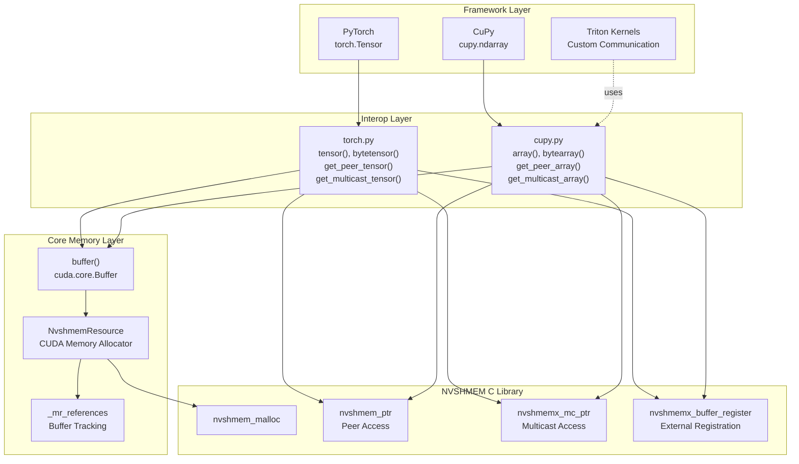
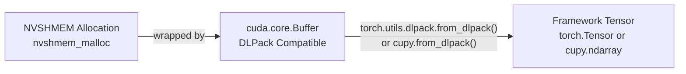
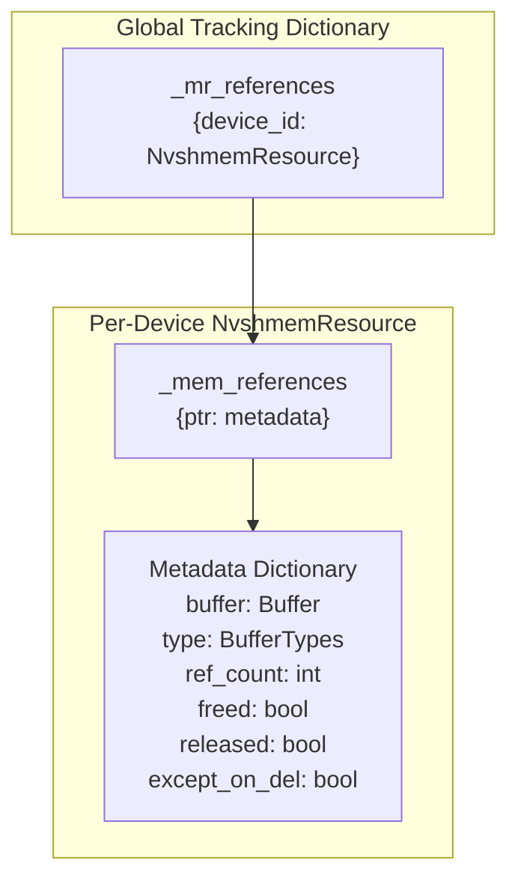
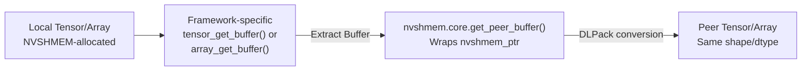
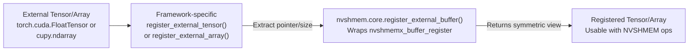

<!-- source: DeepWiki mcp.deepwiki.com · repo NVIDIA/nvshmem · page 4.5 Framework Interoperability · fetched 2026-11-11 -->

# Framework Interoperability

<details>
<summary>Relevant source files</summary>

The following files were used as context for generating this wiki page:

- [nvshmem4py/examples/torch_triton_interop.py](nvshmem4py/examples/torch_triton_interop.py)
- [nvshmem4py/nvshmem/core/collective.py](nvshmem4py/nvshmem/core/collective.py)
- [nvshmem4py/nvshmem/core/nvshmem_types.py](nvshmem4py/nvshmem/core/nvshmem_types.py)
- [nvshmem4py/nvshmem/core/rma.py](nvshmem4py/nvshmem/core/rma.py)

</details>


## Purpose and Scope

This page provides an overview of nvshmem4py's integration with deep learning and numerical computing frameworks, specifically **PyTorch** and **CuPy**. It covers the memory interoperability model, common integration patterns, and how NVSHMEM-allocated memory can be seamlessly used with framework-native tensors and arrays.

For framework-specific APIs and detailed usage examples, see:
- PyTorch integration: [4.5.1](#4.5.1)
- CuPy integration: [4.5.2](#4.5.2)
- Device programming with Numba: [4.6](#4.6)
- Custom communication with Triton: [4.7](#4.7)

For core memory management APIs independent of frameworks, see [4.2](#4.2).

---

## Architecture Overview



**Diagram: Framework Interoperability Architecture**

The framework integration is built on three layers:
1. **Core Memory Layer**: Manages NVSHMEM symmetric heap allocations via `NvshmemResource` and exposes `cuda.core.Buffer` objects
2. **Interop Layer**: Framework-specific modules that convert `Buffer` objects to framework-native types using DLPack
3. **Framework Layer**: User-facing PyTorch tensors and CuPy arrays that wrap NVSHMEM memory

Sources: [nvshmem4py/nvshmem/core/interop/torch.py:1-219](), [nvshmem4py/nvshmem/core/interop/cupy.py:1-214](), [nvshmem4py/nvshmem/core/memory.py:1-274]()

---

## Memory Interoperability Model

### DLPack-Based Zero-Copy Exchange

nvshmem4py leverages the **DLPack** standard for zero-copy tensor exchange between frameworks. The interoperability flow is:



**Diagram: Zero-Copy Memory Exchange via DLPack**

The key insight is that `cuda.core.Buffer` implements the DLPack protocol, allowing framework-specific converters to create views without copying data. This ensures that operations on the framework tensor directly modify the NVSHMEM symmetric heap.

Sources: [nvshmem4py/nvshmem/core/interop/torch.py:99-101](), [nvshmem4py/nvshmem/core/interop/cupy.py:95-98]()

### Buffer Tracking and Lifecycle Management



**Diagram: Internal Buffer Tracking Structure**

Each allocated buffer is tracked in `_mr_references`, a global dictionary mapping device IDs to `NvshmemResource` instances. Each `NvshmemResource` maintains `_mem_references`, which maps buffer pointers to metadata including:
- `buffer`: The `cuda.core.Buffer` object
- `type`: One of `BufferTypes.NORMAL`, `BufferTypes.PEER`, `BufferTypes.MULTICAST`, or `BufferTypes.EXTERNAL`
- `ref_count`: Reference count for the buffer
- `freed`: Whether the buffer has been explicitly freed
- `released`: Whether the buffer is not tracked (user-managed lifecycle)
- `except_on_del`: Whether to raise exception on unexpected deallocation

Sources: [nvshmem4py/nvshmem/core/_internal_tracking.py:18-22](), [nvshmem4py/nvshmem/core/memory.py:28-53]()

---

## Framework Integration Patterns

### Pattern 1: Allocating Framework Tensors on NVSHMEM Memory

Both PyTorch and CuPy provide wrapper functions that allocate NVSHMEM symmetric heap memory and return framework-native tensors:

| Framework | Function | Description |
|-----------|----------|-------------|
| PyTorch | `nvshmem.tensor(shape, dtype)` | Returns `torch.Tensor` with specified shape/dtype |
| PyTorch | `nvshmem.bytetensor(shape, dtype)` | Returns `torch.Tensor` with `torch.uint8` dtype |
| CuPy | `nvshmem.array(shape, dtype)` | Returns `cupy.ndarray` with specified shape/dtype |
| CuPy | `nvshmem.bytearray(shape, dtype)` | Returns `cupy.ndarray` with `cupy.uint8` dtype |

**Implementation**: Each function calls `nvshmem.core.buffer()` to allocate symmetric heap memory, then converts the resulting `Buffer` to the framework type using DLPack.

Sources: [nvshmem4py/nvshmem/core/interop/torch.py:70-108](), [nvshmem4py/nvshmem/core/interop/cupy.py:65-99]()

### Pattern 2: Peer Buffer Views

Both frameworks provide functions to obtain peer-accessible views of NVSHMEM-allocated memory:



**Diagram: Peer Buffer View Creation Flow**

| Framework | Function | C API Equivalent |
|-----------|----------|------------------|
| PyTorch | `nvshmem.get_peer_tensor(tensor, pe)` | `nvshmem_ptr` |
| CuPy | `nvshmem.get_peer_array(array, pe)` | `nvshmem_ptr` |

The peer buffer allows direct local access to a remote PE's symmetric heap memory, enabling efficient fine-grained communication patterns.

Sources: [nvshmem4py/nvshmem/core/interop/torch.py:137-145](), [nvshmem4py/nvshmem/core/interop/cupy.py:131-139](), [nvshmem4py/nvshmem/core/memory.py:125-164]()

### Pattern 3: Multicast Buffer Views

Multicast buffers provide hardware-accelerated one-to-many access for collectives:

| Framework | Function | C API Equivalent |
|-----------|----------|------------------|
| PyTorch | `nvshmem.get_multicast_tensor(team, tensor)` | `nvshmemx_mc_ptr` |
| CuPy | `nvshmem.get_multicast_array(team, array)` | `nvshmemx_mc_ptr` |

**Important Constraints**:
- Multicast buffers can **only be accessed from GPU kernels**, not from host code
- Suitable for use in Triton kernels, Numba kernels, or custom CUDA kernels
- Enable NVLink SHARP features when available

Sources: [nvshmem4py/nvshmem/core/interop/torch.py:147-180](), [nvshmem4py/nvshmem/core/interop/cupy.py:141-175](), [nvshmem4py/nvshmem/core/memory.py:227-272]()

### Pattern 4: External Buffer Registration

For tensors/arrays allocated outside NVSHMEM (e.g., via framework-native allocators), registration makes them usable with NVSHMEM operations:



**Diagram: External Buffer Registration Flow**

| Framework | Register Function | Unregister Function |
|-----------|-------------------|---------------------|
| PyTorch | `nvshmem.register_external_tensor(tensor)` | `nvshmem.unregister_external_tensor(tensor)` |
| CuPy | `nvshmem.register_external_array(array)` | `nvshmem.unregister_external_array(array)` |

**Note**: Registration is a **collective operation**. All PEs must call the registration function simultaneously.

Sources: [nvshmem4py/nvshmem/core/interop/torch.py:182-199](), [nvshmem4py/nvshmem/core/interop/cupy.py:177-194](), [nvshmem4py/nvshmem/core/memory.py:166-225]()

---

## Supported Frameworks

### PyTorch Integration

nvshmem4py provides comprehensive PyTorch integration, enabling distributed training and inference with NVSHMEM communication primitives. Key features:

- **Memory allocation**: `tensor()`, `bytetensor()` create PyTorch tensors on symmetric heap
- **Peer access**: `get_peer_tensor()` for direct remote memory access
- **Multicast views**: `get_multicast_tensor()` for hardware-accelerated collectives
- **External registration**: `register_external_tensor()` for existing PyTorch tensors
- **Lifecycle management**: `free_tensor()` for explicit deallocation

For detailed API documentation and examples, see [4.5.1](#4.5.1).

Sources: [nvshmem4py/nvshmem/core/interop/torch.py:1-219]()

### CuPy Integration

CuPy is a NumPy-compatible array library for GPU computing. nvshmem4py provides similar functionality for CuPy:

- **Memory allocation**: `array()`, `bytearray()` create CuPy arrays on symmetric heap
- **Peer access**: `get_peer_array()` for direct remote memory access
- **Multicast views**: `get_multicast_array()` for hardware-accelerated collectives
- **External registration**: `register_external_array()` for existing CuPy arrays
- **Lifecycle management**: `free_array()` for explicit deallocation

For detailed API documentation and examples, see [4.5.2](#4.5.2).

Sources: [nvshmem4py/nvshmem/core/interop/cupy.py:1-214]()

---

## Usage Examples

### Basic Framework Tensor Allocation

```python
import nvshmem.core as nvshmem
import torch

# Initialize NVSHMEM
nvshmem.init(device=dev, mpi_comm=MPI.COMM_WORLD)

# Allocate PyTorch tensor on NVSHMEM symmetric heap
tensor = nvshmem.tensor((1024, 1024), dtype=torch.float32)

# Use tensor in PyTorch operations
tensor.fill_(nvshmem.my_pe())

# Free when done
nvshmem.free_tensor(tensor)
nvshmem.finalize()
```

### Peer Access Pattern

```python
import nvshmem.core as nvshmem
import cupy as cp

# Allocate CuPy array
local_array = nvshmem.array((1024,), dtype='float32')

# Get peer's array for direct access
peer_pe = (nvshmem.my_pe() + 1) % nvshmem.n_pes()
peer_array = nvshmem.get_peer_array(local_array, peer_pe)

# Read from peer's memory (GPU kernel or CuPy operations)
# Note: This creates a view, no copy is performed
```

### Multicast Buffer for Custom Kernels

```python
import nvshmem.core as nvshmem
import torch
import triton
import triton.language as tl

# Allocate tensor on symmetric heap
tensor = nvshmem.tensor((512,), dtype=torch.float32)

# Get multicast view for use in Triton kernel
mc_tensor = nvshmem.get_multicast_tensor(nvshmem.Teams.TEAM_WORLD, tensor)

# Pass mc_tensor to custom Triton kernel
# (See examples/triton_comm_kernels.py for full example)
```

Sources: [nvshmem4py/examples/triton_comm_kernels.py:111-158]()

---

## Implementation Details

### Helper Functions for Framework Detection

Both interop modules provide internal helper functions to detect framework-specific types without forcing imports:

```python
# In torch.py
def _is_tensor(tensor: Union[Tensor, object]) -> bool:
    if not _torch_enabled:
        return False
    return isinstance(tensor, Tensor)

# In cupy.py
def _is_array(array: Union[ndarray, object]) -> bool:
    if not _cupy_enabled:
        return False
    return isinstance(array, ndarray)
```

These functions are used by collective operations to dispatch to framework-specific handlers without tight coupling.

Sources: [nvshmem4py/nvshmem/core/interop/torch.py:45-53](), [nvshmem4py/nvshmem/core/interop/cupy.py:39-47]()

### Buffer Extraction and Validation

Framework-specific functions extract the underlying `Buffer` from tensors/arrays:

| Framework | Function | Returns |
|-----------|----------|---------|
| PyTorch | `tensor_get_buffer(tensor)` | `(Buffer, size_bytes, dtype_str)` |
| CuPy | `array_get_buffer(array)` | `(Buffer, size_bytes, dtype_str)` |

These functions:
1. Look up the `NvshmemResource` for the tensor's device
2. Retrieve the buffer metadata using the data pointer as key
3. Validate that the tensor is tracked by NVSHMEM
4. Return the `Buffer` object, size, and dtype information

Sources: [nvshmem4py/nvshmem/core/interop/torch.py:55-68](), [nvshmem4py/nvshmem/core/interop/cupy.py:49-62]()

### Memory Order Support

Both frameworks support C-style (row-major) and Fortran-style (column-major) memory layouts:

```python
# C-style (default)
tensor_c = nvshmem.tensor((10, 20), dtype=torch.float32, morder="C")

# Fortran-style (column-major)
tensor_f = nvshmem.tensor((10, 20), dtype=torch.float32, morder="F")
```

For Fortran-style layout, PyTorch uses custom stride computation to achieve column-major ordering:

```python
# Compute Fortran-style (column-major) strides
strides = [1]
for dim in shape[:-1]:
    strides.append(strides[-1] * dim)
view = view.as_strided(size=shape, stride=strides)
```

Sources: [nvshmem4py/nvshmem/core/interop/torch.py:92-107](), [nvshmem4py/nvshmem/core/interop/cupy.py:92-98]()

---

## Common Patterns and Best Practices

### Pattern: Collective Allocation

Since `buffer()` is a collective operation, all framework allocation functions are also collective:

```python
# ALL PEs must call this simultaneously
tensor = nvshmem.tensor((1024,), dtype=torch.float32)

# Failure case: Only some PEs allocate
if nvshmem.my_pe() == 0:
    tensor = nvshmem.tensor((1024,))  # DEADLOCK: Other PEs waiting
```

### Pattern: Explicit Memory Management

Unlike framework-native allocators, NVSHMEM memory requires explicit deallocation:

```python
tensor = nvshmem.tensor((1024,), dtype=torch.float32)

# Do work...

# MUST free before finalize
nvshmem.free_tensor(tensor)
nvshmem.finalize()
```

The `_free_all_buffers()` function attempts cleanup at finalization but logs warnings for leaked allocations.

Sources: [nvshmem4py/nvshmem/core/memory.py:28-53]()

### Pattern: View Safety

When creating views from NVSHMEM-backed tensors, always disable copying:

```python
# PyTorch
base_tensor = nvshmem.tensor((1024,), dtype=torch.float32)
view = base_tensor.view(...)  # Safe: Creates view without copy

# CuPy
base_array = nvshmem.array((1024,), dtype='float32')
view = base_array.view(...)  # Safe with copy=False in from_dlpack
```

Copying would move data off the symmetric heap, breaking NVSHMEM semantics.

Sources: [nvshmem4py/nvshmem/core/interop/torch.py:70-108](), [nvshmem4py/nvshmem/core/interop/cupy.py:65-99]()

---

