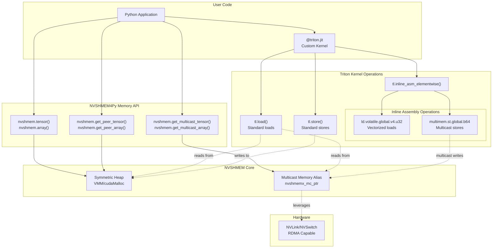
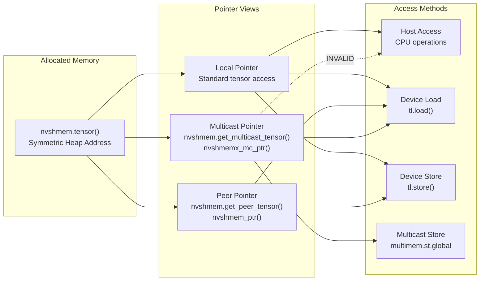
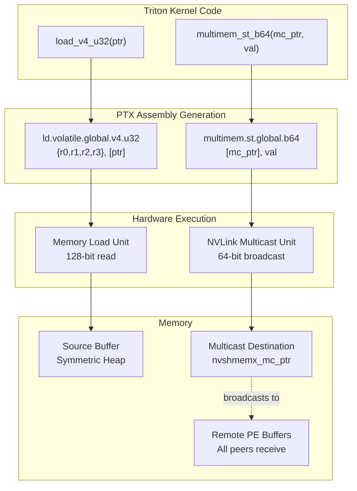
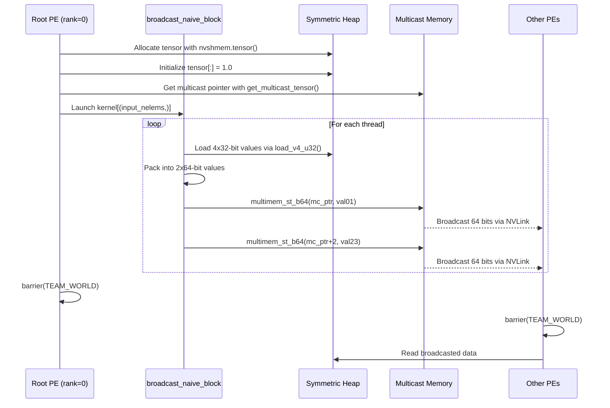
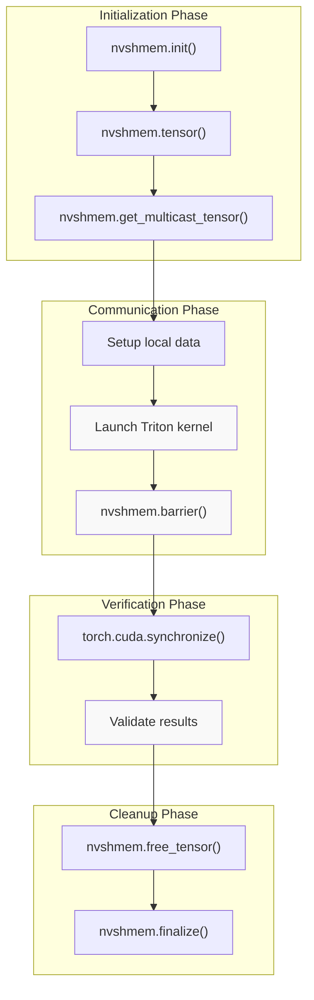

<!-- source: DeepWiki mcp.deepwiki.com · repo NVIDIA/nvshmem · page 4.7 Advanced: Custom Communication with Triton · fetched 2026-11-11 -->

# Advanced: Custom Communication with Triton

<details>
<summary>Relevant source files</summary>

The following files were used as context for generating this wiki page:

- [nvshmem4py/examples/torch_triton_interop.py](nvshmem4py/examples/torch_triton_interop.py)
- [nvshmem4py/nvshmem/core/collective.py](nvshmem4py/nvshmem/core/collective.py)
- [nvshmem4py/nvshmem/core/nvshmem_types.py](nvshmem4py/nvshmem/core/nvshmem_types.py)
- [nvshmem4py/nvshmem/core/rma.py](nvshmem4py/nvshmem/core/rma.py)

</details>


This page documents how to use NVSHMEM with Triton kernels to implement custom communication patterns in Python. Triton enables writing high-performance CUDA kernels with inline assembly for direct RDMA operations on NVSHMEM symmetric heap memory. This approach is particularly useful for implementing specialized collective operations or optimizing communication patterns that are not covered by standard NVSHMEM APIs.

**Scope**: This page covers Triton-specific integration with NVSHMEM, including memory allocation, multicast pointer access, and inline assembly for RDMA operations. For general device programming with Numba, see [Device Programming with Numba](#4.6). For standard collective operations without custom kernels, see [Collective Operations and RMA](#4.3).

## Overview

Triton integration with NVSHMEM enables developers to:

1. **Allocate tensors on the symmetric heap** using `nvshmem.tensor()` or `nvshmem.array()`
2. **Obtain multicast-capable pointers** via `nvshmem.get_multicast_tensor()` for NVLink-based operations
3. **Write custom kernels** with `@triton.jit` decorators that operate directly on symmetric memory
4. **Use inline assembly** for vectorized loads and RDMA multicast stores

This capability is most valuable for:
- Implementing custom collective algorithms tailored to specific workloads
- Optimizing communication patterns using NVLink Switch (NVLS) multicast features
- Achieving ultra-low latency with direct device-to-device communication
- Integrating NVSHMEM with Triton-based deep learning kernels

**Diagram 1: Triton-NVSHMEM Integration Architecture**



Sources: [nvshmem4py/examples/triton_comm_kernels.py:1-159](), [nvshmem4py/nvshmem/core/interop/torch.py:147-180](), [nvshmem4py/nvshmem/core/memory.py:227-273]()

## Memory Management for Triton Kernels

### Allocating Tensors on Symmetric Heap

NVSHMEM tensors and arrays must be allocated using the framework-specific allocation functions to ensure they reside on the symmetric heap and are accessible from all PEs.

**PyTorch Integration:**

```python
import nvshmem.core as nvshmem
import torch

# Allocate a float32 tensor on symmetric heap
tensor = nvshmem.tensor((1024,), dtype=torch.float32)

# Allocate a byte tensor (uint8)
bytetensor = nvshmem.bytetensor((1024,), dtype=torch.float32)
```

**CuPy Integration:**

```python
import nvshmem.core as nvshmem

# Allocate a float32 array on symmetric heap
array = nvshmem.array((1024,), dtype="float32")

# Allocate a byte array
bytearray = nvshmem.bytearray((1024,), dtype="float32")
```

| Function | Framework | Return Type | Description |
|----------|-----------|-------------|-------------|
| `nvshmem.tensor()` | PyTorch | `torch.Tensor` | Allocates typed tensor on symmetric heap |
| `nvshmem.bytetensor()` | PyTorch | `torch.Tensor` (uint8) | Allocates raw byte tensor |
| `nvshmem.array()` | CuPy | `cupy.ndarray` | Allocates typed array on symmetric heap |
| `nvshmem.bytearray()` | CuPy | `cupy.ndarray` (int8) | Allocates raw byte array |

All allocated tensors/arrays must be explicitly freed using `nvshmem.free_tensor()` or `nvshmem.free_array()` before finalization.

Sources: [nvshmem4py/nvshmem/core/interop/torch.py:70-136](), [nvshmem4py/nvshmem/core/interop/cupy.py:65-129]()

### Obtaining Multicast Pointers

For operations that leverage NVLink Switch multicast capabilities, obtain a multicast-capable pointer using `get_multicast_tensor()` or `get_multicast_array()`. This returns a device-only view that maps to `nvshmemx_mc_ptr` in the C API.

```python
# Allocate tensor on symmetric heap
tensor = nvshmem.tensor((1024,), dtype=torch.float32)

# Get multicast pointer for TEAM_WORLD
mc_tensor = nvshmem.get_multicast_tensor(nvshmem.Teams.TEAM_WORLD, tensor)
```

**Important Constraints:**

1. **Device-only access**: Multicast pointers cannot be accessed from the host (CPU). Attempting host access results in undefined behavior.
2. **NVLink domain requirement**: Multicast operations require all PEs to be within the same NVLink domain (typically a single node with NVSwitch).
3. **Team scope**: The multicast pointer is valid only for the specified team.

**Diagram 2: Memory Pointer Types and Access Patterns**



Sources: [nvshmem4py/nvshmem/core/interop/torch.py:147-180](), [nvshmem4py/nvshmem/core/interop/cupy.py:141-175](), [nvshmem4py/nvshmem/core/memory.py:227-273]()

## Writing Custom Communication Kernels

### Triton Kernel Basics

Triton kernels are defined using the `@triton.jit` decorator and can accept pointers to NVSHMEM-allocated memory. The kernel execution model uses program IDs to parallelize work across threads.

```python
import triton
import triton.language as tl

@triton.jit
def communication_kernel(src_ptr, dst_ptr, nbytes, rank):
    """
    Custom communication kernel
    
    Args:
        src_ptr: Pointer to source buffer (local or remote)
        dst_ptr: Pointer to destination buffer (may be multicast)
        nbytes: Number of bytes to process
        rank: Current PE rank
    """
    thread_idx = tl.program_id(axis=0)     # Thread index within grid
    block_dim = tl.num_programs(axis=0)    # Total number of threads
    
    # Compute element indices for this thread
    # ...
```

**Key Triton Functions:**

| Function | Description |
|----------|-------------|
| `tl.program_id(axis)` | Get current thread's program ID |
| `tl.num_programs(axis)` | Get total number of programs in dimension |
| `tl.load(ptr)` | Load from pointer (standard memory operations) |
| `tl.store(ptr, value)` | Store to pointer (standard memory operations) |
| `tl.cast(value, dtype)` | Cast value to target data type |
| `tl.inline_asm_elementwise(...)` | Inline PTX assembly for custom operations |

Sources: [nvshmem4py/examples/triton_comm_kernels.py:68-109]()

### Inline Assembly for RDMA Operations

For maximum performance, use `tl.inline_asm_elementwise()` to embed PTX assembly directly in Triton kernels. This is essential for vectorized loads and multicast stores.

#### Vectorized Load Example

```python
@triton.jit
def load_v4_u32(ptr):
    """
    Perform a vectorized load of 4x32-bit unsigned integers.
    
    Loads 128 bits (16 bytes) in a single operation.
    """
    return tl.inline_asm_elementwise(
        asm="""
        ld.volatile.global.v4.u32 {$0,$1,$2,$3}, [$4];
        """,
        constraints=("=r,=r,=r,=r,l"),
        args=[ptr],
        dtype=(tl.int32, tl.int32, tl.int32, tl.int32),
        is_pure=False,
        pack=1
    )
```

**PTX Instruction Breakdown:**
- `ld.volatile.global.v4.u32`: Load 4 unsigned 32-bit integers with volatile semantics
- `{$0,$1,$2,$3}`: Output registers for the 4 loaded values
- `[$4]`: Input pointer (memory address)
- Constraints: `=r` (output register), `l` (64-bit address register)

#### Multicast Store Example

```python
@triton.jit
def multimem_st_b64(ptr, val0):
    """
    Perform a multicast store of a 64-bit value.
    
    Broadcasts val0 to all PEs in the multicast group via NVLink.
    """
    return tl.inline_asm_elementwise(
        asm="""
        multimem.st.global.b64 [$1], $2;
        mov.u32 $0, 0;
        """,
        constraints=("=r,l,l"),
        args=[ptr, val0],
        dtype=tl.int32,
        is_pure=False,
        pack=1
    )
```

**PTX Instruction Breakdown:**
- `multimem.st.global.b64`: Multicast store of 64 bits to all peers
- `[$1]`: Destination pointer (must be multicast address from `nvshmemx_mc_ptr`)
- `$2`: 64-bit value to broadcast
- `mov.u32 $0, 0`: Return dummy value (required by inline_asm_elementwise)

**Diagram 3: Inline Assembly Data Flow**



Sources: [nvshmem4py/examples/triton_comm_kernels.py:35-66]()

### Complete Example: Broadcast Operation

The following example demonstrates a complete broadcast implementation using Triton with NVSHMEM. The root PE loads data and multicasts it to all other PEs using vectorized operations.

**Diagram 4: Broadcast Kernel Implementation Flow**



**Kernel Implementation:**

The complete kernel from [nvshmem4py/examples/triton_comm_kernels.py:68-109]() performs the following:

1. **Thread assignment**: Each thread processes a subset of 16-byte chunks (4 floats)
2. **Vectorized load**: Use `load_v4_u32()` to read 4 consecutive 32-bit values
3. **Value packing**: Combine pairs of 32-bit values into 64-bit values for multicast
4. **Multicast store**: Use `multimem_st_b64()` twice to broadcast all 4 values

```python
@triton.jit
def broadcast_naive_block(src_ptr, nbytes, rank, root_rank, remote_mc_ptr):
    """
    Broadcast from root PE using multicast stores.
    
    Only root PE executes; others passively receive via remote_mc_ptr.
    """
    remote_mc_ptr = tl.cast(remote_mc_ptr, tl.pointer_type(tl.float32))
    
    if rank == root_rank:
        thread_idx = tl.program_id(axis=0)
        block_dim = tl.num_programs(axis=0)
        src_ptr = tl.cast(src_ptr, tl.pointer_type(tl.float32))
        
        num_int4 = nbytes // 16  # Number of 16-byte chunks
        
        for n in range(thread_idx, num_int4, block_dim):
            # Load 4 floats (16 bytes)
            val0, val1, val2, val3 = load_v4_u32(src_ptr + 4 * n)
            
            # Pack into 64-bit values
            val01 = (tl.cast(val1, tl.uint64) << 32) | tl.cast(val0, tl.uint64)
            val23 = (tl.cast(val3, tl.uint64) << 32) | tl.cast(val2, tl.uint64)
            
            # Multicast store (broadcasts to all PEs)
            base_offset = 4 * n
            multimem_st_b64(remote_mc_ptr + base_offset, val01)
            multimem_st_b64(remote_mc_ptr + base_offset + 2, val23)
```

**Host-side Setup and Launch:**

```python
import nvshmem.core as nvshmem
from mpi4py import MPI
from cuda.core.experimental import Device, system

# Initialize NVSHMEM
local_rank = MPI.COMM_WORLD.Get_rank() % system.num_devices
dev = Device(local_rank)
dev.set_current()
nvshmem.init(device=dev, mpi_comm=MPI.COMM_WORLD, initializer_method="mpi")

# Allocate symmetric tensor
input_nelems = 512
tensor = nvshmem.tensor((input_nelems,), dtype=torch.float32)

if nvshmem.my_pe() == 0:
    tensor[:] = 1.0  # Root PE initializes data

# Get multicast pointer (device-only)
remote_mc_tensor = nvshmem.get_multicast_tensor(nvshmem.Teams.TEAM_WORLD, tensor)

# Launch kernel with grid of input_nelems threads
buf_sz = tensor.numel() * tensor.element_size()
broadcast_naive_block[(input_nelems,)](
    tensor, buf_sz, nvshmem.my_pe(), 0, remote_mc_tensor
)

# Synchronize
stream = dev.create_stream()
nvshmem.barrier(nvshmem.Teams.TEAM_WORLD, stream=stream)
torch.cuda.synchronize()

# Cleanup
nvshmem.free_tensor(tensor)
nvshmem.finalize()
```

Sources: [nvshmem4py/examples/triton_comm_kernels.py:111-159]()

## Optimization Techniques

### Vectorization Strategy

Maximize memory bandwidth by using vectorized loads and stores:

| Operation | PTX Instruction | Bytes Transferred | Recommended Use |
|-----------|----------------|-------------------|-----------------|
| Scalar load | `ld.global.u32` | 4 | Small data, irregular access |
| Vector load (v2) | `ld.global.v2.u32` | 8 | Moderate vectorization |
| Vector load (v4) | `ld.global.v4.u32` | 16 | Maximum vectorization for 128-bit alignment |
| Multicast store | `multimem.st.global.b64` | 8 (broadcast) | NVLink-connected peers |

**Best Practice**: Use v4 loads (128-bit) when data is aligned and combine with multicast stores for optimal NVLink utilization.

### Thread-to-Work Mapping

Balance work across threads to maximize GPU occupancy:

```python
@triton.jit
def optimized_kernel(ptr, total_elements):
    thread_idx = tl.program_id(axis=0)
    block_dim = tl.num_programs(axis=0)
    
    # Strided access: each thread handles elements thread_idx, thread_idx+block_dim, ...
    for idx in range(thread_idx, total_elements, block_dim):
        # Process element at idx
        pass
```

**Grid Size Selection:**
- Small grids (< 256 threads): Good for small messages with low latency requirements
- Medium grids (256-1024 threads): Balance latency and bandwidth
- Large grids (> 1024 threads): Maximize bandwidth for large transfers

### Memory Alignment

Ensure pointers are aligned to 16-byte boundaries for vectorized operations:

```python
# Allocate with proper alignment
tensor = nvshmem.tensor((1024,), dtype=torch.float32)  # Naturally aligned

# Verify alignment if using offsets
assert (int(tensor.data_ptr()) % 16) == 0, "Misaligned pointer"
```

Sources: [nvshmem4py/examples/triton_comm_kernels.py:35-109]()

## Limitations and Considerations

### Platform Requirements

| Requirement | Description | Impact |
|-------------|-------------|--------|
| **NVLink domain** | All PEs must be within same NVLink fabric | Multicast operations fail across nodes |
| **Compute capability** | SM 7.0+ required for RDMA features | Older GPUs not supported |
| **SHARP support** | NVSwitch required for hardware multicast | Software fallback may be slower |
| **Memory model** | VMM heap preferred over cudaMalloc | Better performance for RDMA operations |

### Safety Constraints

1. **Multicast pointers are device-only**: Never dereference `mc_ptr` from host code. This will cause segmentation faults or undefined behavior.

2. **Synchronization required**: Always use `nvshmem.barrier()` or `nvshmem.quiet()` after custom communication to ensure completion.

3. **Alignment requirements**: Vectorized operations require proper alignment. Misaligned accesses may cause errors or performance degradation.

4. **Team consistency**: Multicast pointers must use the same team across all participating PEs.

### Error Handling

Triton kernels do not have explicit error handling. Verify correctness through:

1. **Host-side validation**: Check results after synchronization
2. **Debug prints**: Use conditional printf in Triton (limited support)
3. **Compute-sanitizer**: Run with CUDA compute-sanitizer for memory errors
4. **Incremental testing**: Test with small data sizes first

**Diagram 5: Safe Communication Pattern**



Sources: [nvshmem4py/examples/triton_comm_kernels.py:111-159](), [nvshmem4py/nvshmem/core/memory.py:227-273]()

### Performance Considerations

**Expected Performance Characteristics:**

- **Latency**: Custom Triton kernels achieve 1-3 μs latency for small messages with multicast
- **Bandwidth**: NVLink bandwidth (600 GB/s on A100, 900 GB/s on H100) for local multicast
- **Scalability**: Linear scaling within single node; across-node requires different approach

**When to Use Triton vs. Standard APIs:**

| Use Case | Recommendation | Reason |
|----------|---------------|--------|
| Standard collectives (allreduce, broadcast) | Use [Tile API](#2.6) or [Collective Operations](#4.3) | Optimized implementations |
| Custom collectives (ring, butterfly) | Use Triton with inline assembly | Full control over communication pattern |
| Point-to-point transfers | Use [RMA operations](#4.3) | Simpler and sufficient for most cases |
| Fused computation-communication | Use Triton | Overlap kernel computation with RDMA |
| Debugging/prototyping | Avoid Triton initially | Use high-level APIs first |

Sources: [nvshmem4py/examples/triton_comm_kernels.py:1-159](), [nvshmem4py/nvshmem/core/interop/torch.py:147-180]()

## Related Pages

- [Device Programming with Numba](#4.6): Alternative device programming with Numba
- [Collective Operations and RMA](#4.3): Standard NVSHMEM collectives and RMA operations
- [PyTorch Integration](#4.5.1): PyTorch-specific memory management APIs
- [CuPy Integration](#4.5.2): CuPy-specific memory management APIs
- [Tile API for Tensor Operations](#2.6): High-level collective operations on tensor tiles
- [Team Management](#4.8): Working with NVSHMEM teams for scoped operations

---

