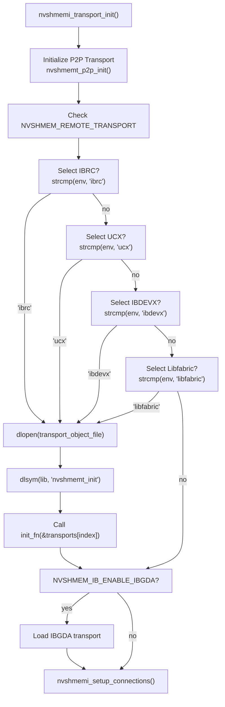
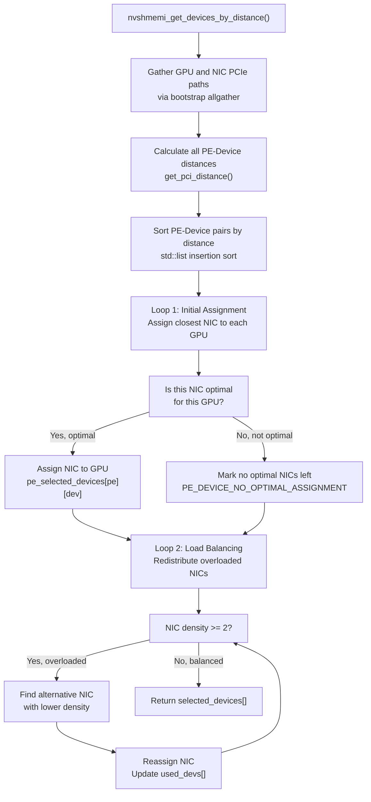
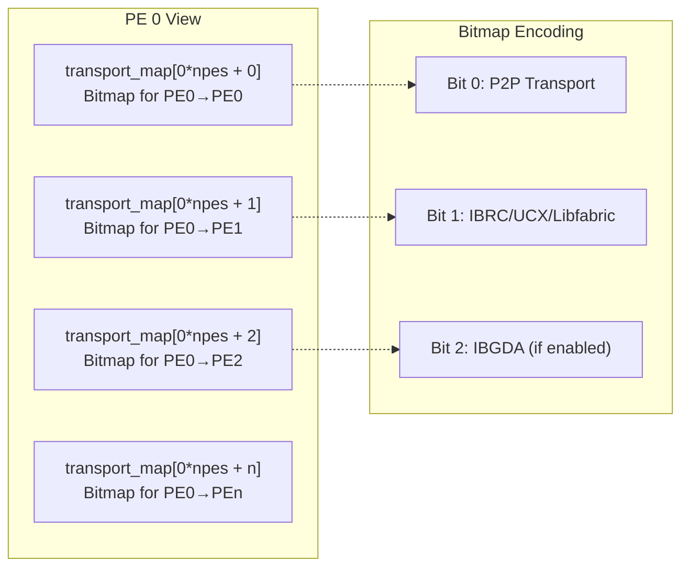
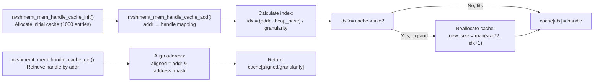

<!-- source: DeepWiki mcp.deepwiki.com · repo NVIDIA/nvshmem · page 5 Transport Implementations · fetched 2026-11-11 -->

# Transport Implementations

<details>
<summary>Relevant source files</summary>

The following files were used as context for generating this wiki page:

- [src/host/topo/topo.cpp](src/host/topo/topo.cpp)
- [src/host/transport/transport.cpp](src/host/transport/transport.cpp)
- [src/modules/transport/common/transport_common.cpp](src/modules/transport/common/transport_common.cpp)

</details>


## Purpose and Scope

This page provides an overview of NVSHMEM's transport layer architecture and the common infrastructure shared by all transport implementations. The transport layer is responsible for abstracting different network interconnects (InfiniBand, Ethernet, NVLink, etc.) behind a unified interface, enabling NVSHMEM to operate across diverse hardware configurations.

For detailed documentation of specific transport implementations, see:
- [Transport Interface and Common Code](#5.1) for the `nvshmem_transport` interface definition and shared utilities
- [Libfabric Transport](#5.2) for EFA and Slingshot fabric support
- [InfiniBand Transports](#5.3) for IBRC, IBDEVX, and IBGDA implementations
- [UCX Transport](#5.4) for multi-network UCX-based communication

For information about transport API integration from user code, see [Host API](#6.1) and [Device API](#6.2).

**Sources:** [src/host/transport/transport.cpp:1-457](), [src/modules/transport/common/transport_common.cpp:1-273]()

## Transport Plugin Architecture

NVSHMEM implements a **plugin-based transport architecture** where each transport is a dynamically loaded shared library that implements the `nvshmem_transport` interface. This design allows NVSHMEM to support multiple network fabrics without requiring all dependencies at build time.

### Transport Types

NVSHMEM supports six transport implementations:

| Transport | Type | Use Case | Library Name |
|-----------|------|----------|--------------|
| P2P | Built-in | Intra-node GPU-to-GPU via NVLink/PCIe | Statically linked |
| IBRC | Plugin | InfiniBand Reliable Connected QPs | `nvshmem_transport_ibrc.so` |
| IBDEVX | Plugin | InfiniBand via DEVX API | `nvshmem_transport_ibdevx.so` |
| IBGDA | Plugin | GPU Direct Async over InfiniBand | `nvshmem_transport_ibgda.so` |
| UCX | Plugin | Unified Communication X | `nvshmem_transport_ucx.so` |
| Libfabric | Plugin | EFA, Slingshot, and other OFI fabrics | `nvshmem_transport_libfabric.so` |

### Dynamic Loading Process



**Transport Initialization Flow**

The transport manager initializes transports in the following order:

1. **P2P Transport** (if not disabled): Always initialized first for intra-node communication
2. **Remote Transport**: One of IBRC/UCX/IBDEVX/Libfabric selected via `NVSHMEM_REMOTE_TRANSPORT`
3. **IBGDA Transport** (optional): Loaded if `NVSHMEM_IB_ENABLE_IBGDA=1` for GPU-initiated operations

**Sources:** [src/host/transport/transport.cpp:50-319]()

### Interface Versioning

Each transport plugin must implement a versioned interface. The version is checked at load time to ensure compatibility:

```c
// From transport.cpp:197-200
status = init_fn(&transports[index], nvshmemi_cuda_syms, NVSHMEM_TRANSPORT_INTERFACE_VERSION);
assert(NVSHMEM_TRANSPORT_MAJOR_MINOR_VERSION(transports[index]->api_version) <=
       NVSHMEM_TRANSPORT_MAJOR_MINOR_VERSION(NVSHMEM_TRANSPORT_INTERFACE_VERSION));
```

The transport plugin's `nvshmemt_init` function populates the `nvshmem_transport` structure with function pointers and capabilities. The plugin's major version must match the runtime's interface version.

**Sources:** [src/host/transport/transport.cpp:185-228]()

## Transport Manager Data Structures

### Transport State Array

The transport manager maintains an array of `nvshmem_transport_t` pointers in `nvshmemi_state_t`:

```c
// From transport.cpp:64-68
if (!state->transports)
    state->transports =
        (nvshmem_transport_t *)calloc(NVSHMEM_TRANSPORT_COUNT, sizeof(nvshmem_transport_t));
transports = (nvshmem_transport_t *)state->transports;
```

Each initialized transport is assigned an index that serves as its transport ID. The maximum number of transports is defined as `NVSHMEM_TRANSPORT_COUNT = 6` [src/host/transport/transport.cpp:30]().

### Transport Bitmap

A bitmap tracks which transports are active and can reach specific PEs:

```c
// From topo.cpp:456-493
state->transport_bitmap = 0;
for (int i = 0; i < state->npes; i++) {
    for (int j = 0; j < state->num_initialized_transports; j++) {
        // ...
        if (reach) {
            int m = 1 << j;
            local_map[i] |= m;
            if ((state->transport_bitmap & m) == 0) {
                state->transport_bitmap |= m;
            }
        }
    }
}
```

The transport bitmap indicates which transport indices are in use, allowing efficient checks for transport availability.

**Sources:** [src/host/transport/transport.cpp:64-68](), [src/host/topo/topo.cpp:456-493]()

## Topology Discovery and Device Mapping

### PCIe Distance Calculation

NVSHMEM determines optimal GPU-to-NIC mappings by calculating PCIe path distances. The system classifies paths into five categories based on shared PCIe hierarchy:

```c
// From topo.cpp:41-50
enum pci_distance {
    PATH_PIX = 0,   // Same PCIe switch
    PATH_PXB = 1,   // Same PCIe bridge
    PATH_PHB = 2,   // Same PCIe host bridge
    PATH_NODE = 3,  // Same NUMA node
    PATH_SYS = 4    // Different NUMA nodes
};
static const int pci_distance_perf[PATH_COUNT] = {4, 4, 3, 2, 1};
```

The `get_pci_distance()` function compares device paths in `/sys/class/pci_bus/` to determine the deepest common ancestor in the PCIe topology:

```c
// From topo.cpp:109-130
static enum pci_distance get_pci_distance(char *cuda_path, char *mlx_path) {
    int score = 0;
    int depth = 0;
    int same = 1;
    for (i = 0; i < strlen(cuda_path); i++) {
        if (cuda_path[i] != mlx_path[i]) same = 0;
        if (cuda_path[i] == '/') {
            depth++;
            if (same == 1) score++;
        }
    }
    // Return distance based on score
}
```

**Device-to-NIC Mapping Algorithm**



**Topology Discovery Algorithm**

The algorithm operates in two phases:

**Phase 1: Initial Assignment** [src/host/topo/topo.cpp:284-326]()
- Iterate through PE-device pairs sorted by PCIe distance (closest first)
- Assign the closest available NIC to each GPU
- Mark GPUs as having "no optimal assignments" when all remaining NICs are suboptimal
- Track NIC usage in `used_devs[]` array

**Phase 2: Load Balancing** [src/host/topo/topo.cpp:328-375]()
- For each GPU with an overloaded NIC (density >= 2):
  - Search for an alternative NIC with lower density
  - Reassign if the alternative is equally optimal and reduces load by at least 2
- Maintains optimal PCIe paths while distributing load

**Sources:** [src/host/topo/topo.cpp:41-50](), [src/host/topo/topo.cpp:109-130](), [src/host/topo/topo.cpp:138-436]()

### Low-Latency Compliance

The topology system checks if all assigned NICs meet low-latency requirements:

```c
// From topo.cpp:394-400
if (pci_distance_perf[pe_device_distance[mype_array_index]] < pci_distance_perf[PATH_PIX]) {
    nvshmemi_state->are_nics_ll128_compliant = false;
    INFO(NVSHMEM_TOPO,
         "Our PE is connected to a NIC with pci distance %s."
         "this will provide less than optimal performance.\n",
         pci_distance_string[pe_device_distance[mype_array_index]]);
}
```

NICs that are not in `PATH_PIX` or `PATH_PXB` category are flagged as non-compliant, which may disable certain optimizations that require low-latency interconnects.

**Sources:** [src/host/topo/topo.cpp:394-400]()

## Transport Reachability Matrix

### Capability Determination

Each transport implements a `can_reach_peer` function that determines whether it can communicate with a given PE. The transport manager calls this for all PE-transport pairs:

```c
// From topo.cpp:457-484
for (int i = 0; i < state->npes; i++) {
    int reach_any = 0;
    for (int j = 0; j < state->num_initialized_transports; j++) {
        int reach = 0;
        status = state->transports[j]->host_ops.can_reach_peer(&reach, &state->pe_info[i],
                                                               state->transports[j]);
        state->transports[j]->cap[i] = reach;
        reach_any |= reach;
        
        if (reach) {
            int m = 1 << j;
            local_map[i] |= m;
            if ((state->transport_bitmap & m) == 0) {
                state->transport_bitmap |= m;
            }
        }
    }
    
    if ((!reach_any) && (!nvshmemi_options.BYPASS_ACCESSIBILITY_CHECK)) {
        // Error: PE not reachable by any transport
    }
}
```

### Global Reachability Matrix

The local reachability bitmap is exchanged across all PEs via bootstrap allgather:

```c
// From topo.cpp:495-498
status = nvshmemi_boot_handle.allgather((void *)local_map, (void *)state->transport_map,
                                        sizeof(int) * state->npes, &nvshmemi_boot_handle);
```

The resulting `transport_map` is a flattened 2D array of size `npes × npes`, where `transport_map[i * npes + j]` contains a bitmap indicating which transports PE `i` can use to reach PE `j`.

**Transport Map Structure**



**Sources:** [src/host/topo/topo.cpp:438-506]()

## Connection Establishment

### Endpoint Connection Flow

After topology discovery and reachability matrix construction, the transport manager establishes connections for each transport that requires them:

```c
// From transport.cpp:372-456
int nvshmemi_setup_connections(nvshmemi_state_t *state) {
    nvshmem_transport_t *transports = (nvshmem_transport_t *)state->transports;
    
    for (int i = 0; i < state->num_initialized_transports; i++) {
        if (!((state->transport_bitmap) & (1 << i))) continue;
        tcurr = transports[i];
        
        if (!(tcurr->attr & NVSHMEM_TRANSPORT_ATTR_CONNECTED)) {
            continue;  // Skip connectionless transports
        }
        
        // Determine device selection
        int max_devices_per_pe = tcurr->n_devices / state->npes_node;
        int selected_devices[max_devices_per_pe];
        
        if (nvshmemi_options.ENABLE_NIC_PE_MAPPING) {
            selected_devices[0] = state->mype_node % tcurr->n_devices;
        } else {
            nvshmemi_get_devices_by_distance(selected_devices, max_devices_per_pe, tcurr);
        }
        
        current_status = tcurr->host_ops.connect_endpoints(tcurr, selected_devices, 
                                                          found_devices, NULL, 0);
    }
}
```

### Device Selection Strategies

NVSHMEM provides two device selection strategies:

| Strategy | Environment Variable | Behavior |
|----------|---------------------|----------|
| **PCIe-based** | `NVSHMEM_ENABLE_NIC_PE_MAPPING=0` (default) | Use topology-aware mapping from `nvshmemi_get_devices_by_distance()` |
| **Round-robin** | `NVSHMEM_ENABLE_NIC_PE_MAPPING=1` | Simple modulo mapping: `device_id = mype_node % n_devices` |

The PCIe-based strategy is recommended for optimal performance, as it considers actual hardware topology rather than assuming uniform connectivity.

**Sources:** [src/host/transport/transport.cpp:372-456]()

### Transport Finalization

During shutdown, the transport manager iterates through all initialized transports and calls their finalization routines:

```c
// From transport.cpp:321-345, 347-370
int nvshmemi_transport_finalize_one(nvshmemi_state_t *state, int transport_id) {
    nvshmem_transport_t transport = state->transports[transport_id];
    if (transport->is_successfully_initialized) {
        if (transport->type == NVSHMEM_TRANSPORT_LIB_CODE_IBGDA) {
            nvshmemi_device_state.ibgda_is_initialized = false;
        }
        if (transport->cache_handle) {
            nvshmemi_transport_buffer_unregister_all(transport);
            nvshmemi_local_mem_cache_fini(transport->cache_handle);
        }
        status = transport->host_ops.finalize(transport);
    }
    nvshmemi_state->transport_bitmap &= ~(1 << transport_id);
    state->transports[transport_id] = NULL;
}
```

Each transport is responsible for cleaning up its resources (queue pairs, memory registrations, etc.) in its `finalize` callback.

**Sources:** [src/host/transport/transport.cpp:321-370]()

## Common Transport Utilities

### Memory Handle Cache

All transports that perform RDMA operations maintain a memory handle cache for O(1) lookup of remote memory handles. The cache structure is defined in `transport_common.cpp`:

```c
// From transport_common.cpp:15-20
struct transport_mem_handle_info_cache {
    void **cache;
    uint64_t size;
    uint64_t address_granularity;
    uintptr_t address_mask;
};
```

**Cache Operations**



**Cache Initialization and Growth**

The cache is initialized with 1000 entries [src/modules/transport/common/transport_common.cpp:102]() and grows dynamically by doubling when a higher index is needed [src/modules/transport/common/transport_common.cpp:133-146]().

The `address_granularity` is set to `2^log2_cumem_granularity` where the granularity comes from the CUDA Virtual Memory Manager's allocation granularity [src/modules/transport/common/transport_common.cpp:108-109]().

**Cache Lookup**

Lookups handle unaligned addresses by masking to the nearest aligned boundary:

```c
// From transport_common.cpp:154-174
void *nvshmemt_mem_handle_cache_get(nvshmem_transport_t t,
                                    struct transport_mem_handle_info_cache *cache, void *addr) {
    uintptr_t addr_offset = (uintptr_t)((char *)addr - (char *)t->heap_base);
    uintptr_t aligned_addr = addr_offset & cache->address_mask;
    uint64_t arr_idx = (uint64_t)aligned_addr / cache->address_granularity;
    
    if (arr_idx >= cache->size) {
        return NULL;  // Not registered
    }
    return cache->cache[arr_idx];
}
```

**Sources:** [src/modules/transport/common/transport_common.cpp:15-227]()

### HCA List Parsing

The `nvshmemt_parse_hca_list()` function parses user-specified HCA (Host Channel Adapter) names from environment variables like `NVSHMEM_HCA_LIST`:

**Format:** `dev_name[:port][:count][,dev_name[:port][:count]]...`

**Examples:**
- `mlx5_0` - Use device mlx5_0, any port
- `mlx5_0:1` - Use device mlx5_0, port 1
- `mlx5_0:1:2,mlx5_1:1:2` - Use two devices with counts

The parser handles three segments per device:
1. Device name (required)
2. Port number (optional, default: -1 for any port)
3. Count (optional, default: 1)

```c
// From transport_common.cpp:22-83
int nvshmemt_parse_hca_list(const char *string, struct nvshmemt_hca_info *hca_list, 
                            int max_count, int log_level) {
    // State machine parser
    // Segments separated by ':'
    // Devices separated by ','
    // segment_counter tracks: 0=name, 1=port, 2=count
}
```

The function returns the number of devices parsed and populates the `hca_list` array with `nvshmemt_hca_info` structures.

**Sources:** [src/modules/transport/common/transport_common.cpp:22-83]()

### Put-Signal Implementation

The `nvshmemt_put_signal()` function provides a common implementation of the put-signal operation for transports that don't have native hardware support:

```c
// From transport_common.cpp:229-256
int nvshmemt_put_signal(struct nvshmem_transport *tcurr, int pe, rma_verb_t write_verb,
                        std::vector<rma_memdesc_t> &write_remote,
                        std::vector<rma_memdesc_t> &write_local,
                        std::vector<rma_bytesdesc_t> &write_bytesdesc, amo_verb_t sig_verb,
                        amo_memdesc_t *sig_target, amo_bytesdesc_t sig_bytesdesc, int is_proxy) {
    // 1. Issue all RMA writes
    for (size_t i = 0; i < write_remote.size(); i++) {
        tcurr->host_ops.rma(tcurr, pe, write_verb, &write_remote[i], &write_local[i],
                           write_bytesdesc[i], is_proxy);
    }
    
    // 2. Fence to ensure writes complete
    if (tcurr->host_ops.fence) 
        tcurr->host_ops.fence(tcurr, pe, NVSHMEMX_QP_DEFAULT, 0);
    
    // 3. Signal operation (atomic)
    tcurr->host_ops.amo(tcurr, pe, NULL, sig_verb, sig_target, sig_bytesdesc, is_proxy);
}
```

This implementation ensures ordering by inserting a fence between the data writes and the signal atomic, guaranteeing that all data is visible before the signal is updated.

**Sources:** [src/modules/transport/common/transport_common.cpp:229-256]()

### External Global Memory Check

The `check_egm()` function determines if an address belongs to External Global Memory (EGM), which may require special handling by transports:

```c
// From transport_common.cpp:258-272
bool check_egm(void *addr, std::unordered_map<void *, size_t> *egm_map) {
    if (egm_map == NULL) return false;
    
    // Exact match
    if (egm_map->count(addr)) return true;
    
    // Range check - addr within any registered EGM region
    for (auto iter = egm_map->begin(); iter != egm_map->end(); ++iter) {
        if ((addr >= iter->first) && 
            ((char *)addr < ((char *)iter->first + iter->second))) {
            return true;
        }
    }
    return false;
}
```

This is used by transports to apply EGM-specific registration or access patterns when needed.

**Sources:** [src/modules/transport/common/transport_common.cpp:258-272]()

## Transport Interface Overview

The transport interface is defined by the `nvshmem_transport` structure, which contains:

### Core Fields

| Field | Type | Purpose |
|-------|------|---------|
| `api_version` | `uint64_t` | Interface version for compatibility checking |
| `type` | `int` | Transport type code (P2P, IBRC, UCX, etc.) |
| `attr` | `uint32_t` | Attribute flags (CONNECTED, NO_ENDPOINTS, etc.) |
| `cap` | `int*` | Per-PE capability bitmap |
| `n_devices` | `int` | Number of physical devices (NICs) |
| `device_pci_paths` | `char**` | PCIe sysfs paths for topology discovery |
| `heap_base` | `void*` | Symmetric heap base pointer |
| `max_op_len` | `size_t` | Maximum single operation size |

### Function Pointers

The `host_ops` structure contains function pointers for all transport operations:

```c
struct nvshmem_transport {
    // ... fields ...
    struct {
        int (*can_reach_peer)(int *reach, nvshmem_transport_pe_info_t *peer_info, 
                             nvshmem_transport_t t);
        int (*connect_endpoints)(nvshmem_transport_t t, int *selected_devices, 
                                int num_devices, int *ep_order, int num_eps);
        int (*get_mem_handle)(nvshmem_mem_handle_t *mem_handle, void *buf, size_t length, 
                             nvshmem_transport_t t, bool local);
        int (*release_mem_handle)(nvshmem_mem_handle_t *mem_handle, nvshmem_transport_t t);
        int (*rma)(nvshmem_transport_t t, int pe, rma_verb_t verb, 
                  rma_memdesc_t *remote, rma_memdesc_t *local, 
                  rma_bytesdesc_t bytesdesc, int is_proxy);
        int (*amo)(nvshmem_transport_t t, int pe, void *retval, amo_verb_t verb, 
                  amo_memdesc_t *remote, amo_bytesdesc_t bytesdesc, int is_proxy);
        int (*fence)(nvshmem_transport_t t, int pe, int qp_idx, int is_proxy);
        int (*quiet)(nvshmem_transport_t t, int pe, int is_proxy);
        int (*finalize)(nvshmem_transport_t t);
        // ... other operations ...
    } host_ops;
    // ...
};
```

For detailed documentation of the interface, see [Transport Interface](#5.1).

**Sources:** [src/host/transport/transport.cpp:50-319](), [src/modules/transport/common/transport_common.cpp:1-273]()

---

