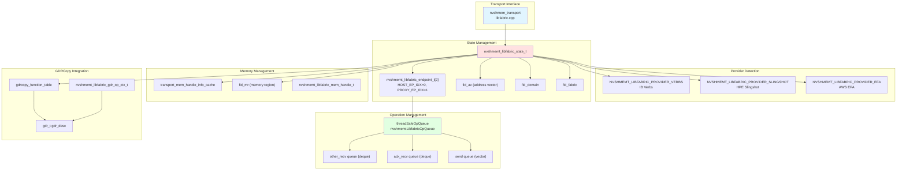
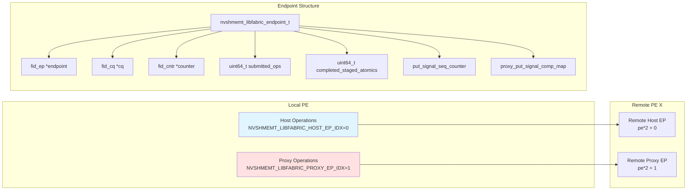
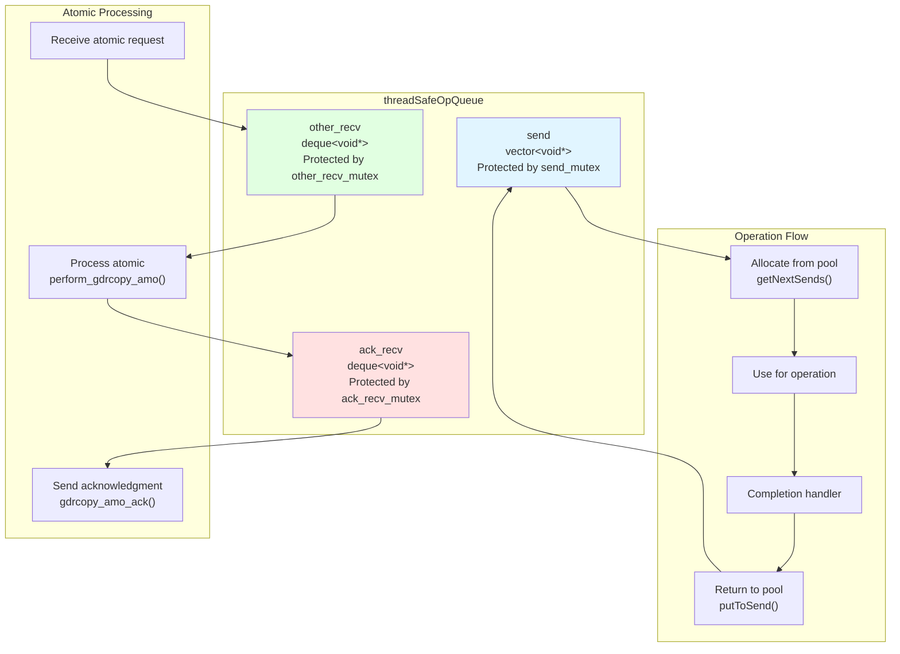
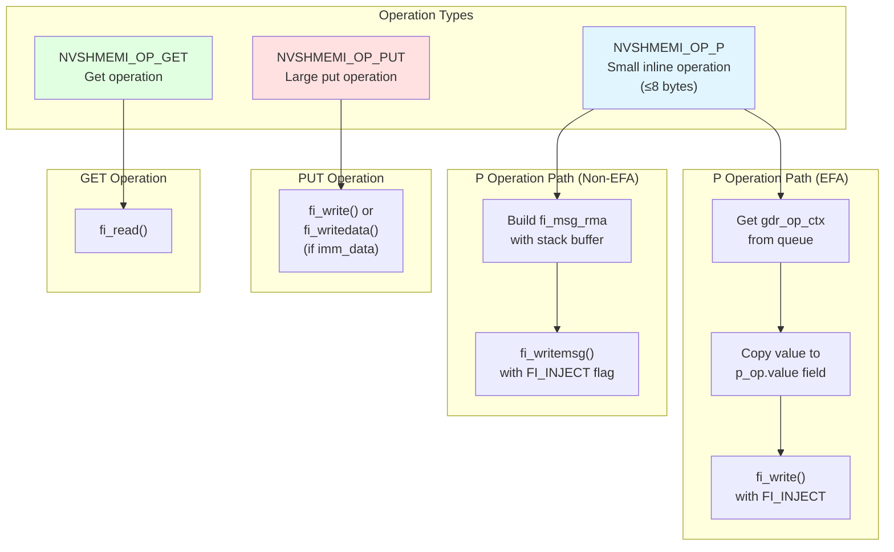
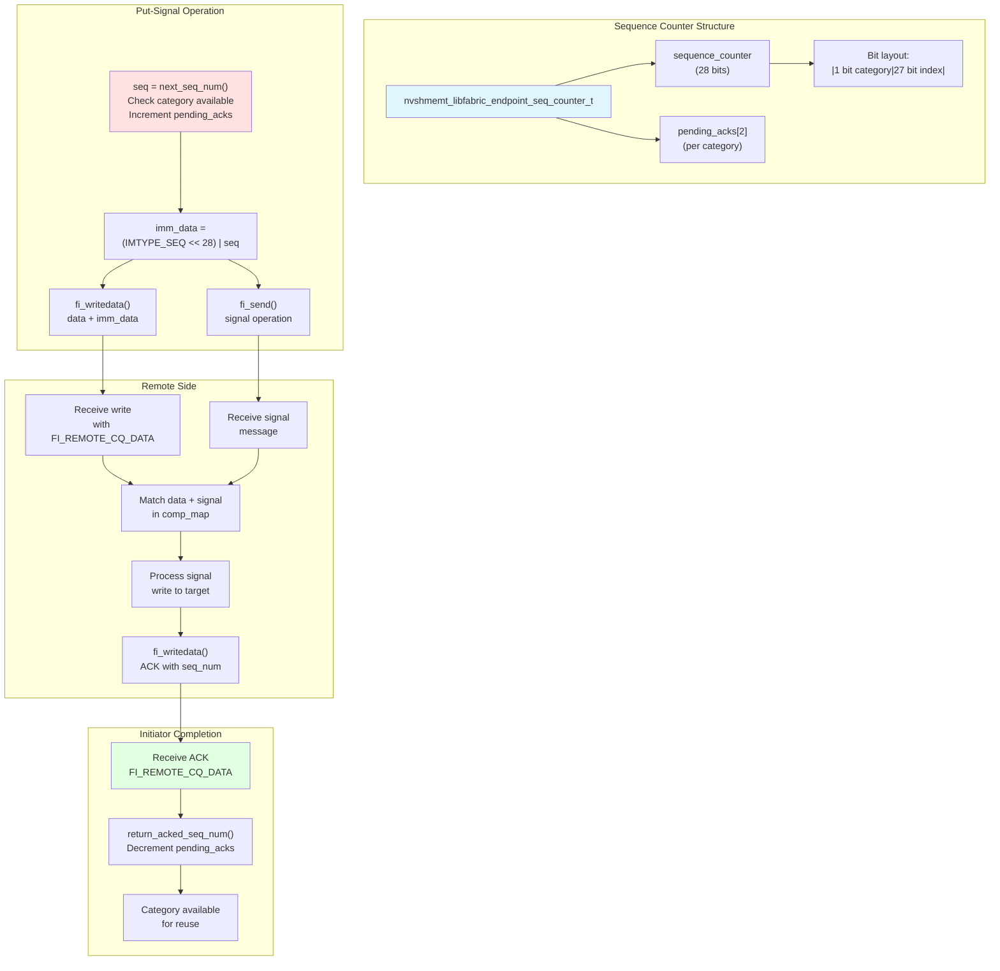
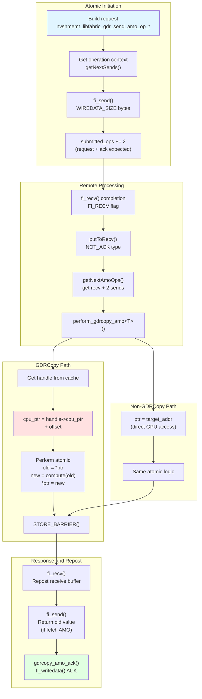
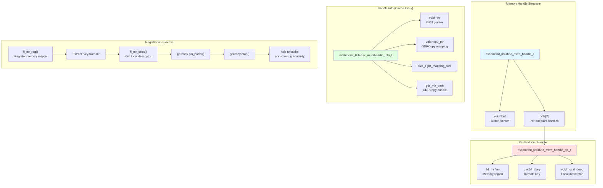
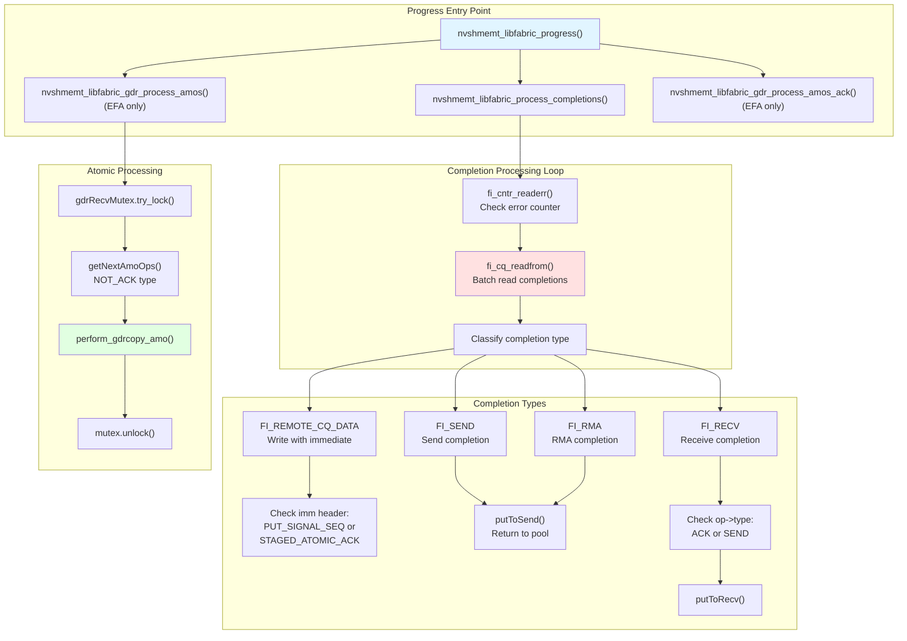
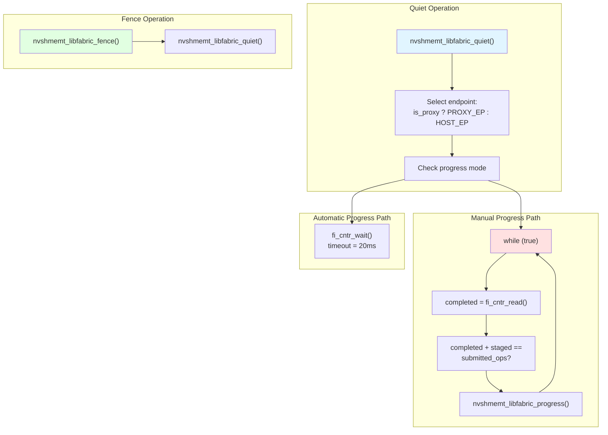

<!-- source: DeepWiki mcp.deepwiki.com · repo NVIDIA/nvshmem · page 5.2 Libfabric Transport · fetched 2026-11-11 -->

# Libfabric Transport

Relevant source files

The following files were used as context for generating this wiki page:

- [src/host/mem/mem_transport.cpp](src/host/mem/mem_transport.cpp)
- [src/host/proxy/proxy.cpp](src/host/proxy/proxy.cpp)
- [src/include/internal/host/util.h](src/include/internal/host/util.h)
- [src/modules/transport/libfabric/libfabric.cpp](src/modules/transport/libfabric/libfabric.cpp)
- [src/modules/transport/libfabric/libfabric.h](src/modules/transport/libfabric/libfabric.h)
- [src/modules/transport/ucx/ucx.cpp](src/modules/transport/ucx/ucx.cpp)
- [test/host/interop/CMakeLists.txt](test/host/interop/CMakeLists.txt)
- [test/unit/mem/heap/internal/host/nvshmemi_mem_transport.hpp](test/unit/mem/heap/internal/host/nvshmemi_mem_transport.hpp)

## Purpose and Scope

This document describes the Libfabric transport implementation in NVSHMEM, which provides network communication support for cloud and HPC fabric interconnects including AWS Elastic Fabric Adapter (EFA) and HPE/Cray Slingshot. The Libfabric transport is one of six transport implementations in NVSHMEM's pluggable architecture.

For general transport architecture and the common interface, see [Transport Interface and Common Code](#5.1). For InfiniBand-specific transports (IBRC, IBGDA, IBDEVX), see [InfiniBand Transports](#5.3). For UCX transport, see [UCX Transport](#5.4).

**Sources:** [src/modules/transport/libfabric/libfabric.cpp:1-100](), [src/modules/transport/libfabric/libfabric.h:1-60]()

---

## Architecture Overview

The Libfabric transport implements NVSHMEM's `nvshmem_transport` interface using the OpenFabrics Interfaces (OFI) Libfabric API. It supports multiple fabric providers and integrates with GDRCopy for CPU-side access to GPU memory when available.

**Sources:** [src/modules/transport/libfabric/libfabric.h:392-418](), [src/modules/transport/libfabric/libfabric.h:253-390](), [src/modules/transport/libfabric/libfabric.cpp:48-56]()

---

## Provider Support and Detection

The Libfabric transport supports three provider types, with provider-specific optimizations activated based on runtime detection:

| Provider | Enum Value | Description | Key Features |
|----------|-----------|-------------|--------------|
| EFA | `NVSHMEMT_LIBFABRIC_PROVIDER_EFA` | AWS Elastic Fabric Adapter | Selective completions, staged atomics, put-signal with sequence numbers |
| Slingshot | `NVSHMEMT_LIBFABRIC_PROVIDER_SLINGSHOT` | HPE/Cray Slingshot | Native Libfabric atomics |
| Verbs | `NVSHMEMT_LIBFABRIC_PROVIDER_VERBS` | InfiniBand Verbs provider | Fallback support |

Provider detection occurs during initialization by examining `fi_info->fabric_attr->prov_name`. For EFA, special handling is enabled including:
- Operation context tracking via `nvshmemt_libfabric_gdr_op_ctx_t`
- Write-with-immediate data for put-signal operations
- Staged atomic processing via active messages

**Sources:** [src/modules/transport/libfabric/libfabric.h:236-240](), [src/modules/transport/libfabric/libfabric.cpp:206-217](), [src/modules/transport/libfabric/libfabric.cpp:719-734]()

---

## Endpoint Management

The Libfabric transport creates two endpoints per PE to separate host-initiated and proxy-initiated operations:

Each endpoint contains:
- **endpoint**: Libfabric endpoint for sending/receiving operations
- **cq**: Completion queue for tracking operation completions
- **counter**: Counter for fast completion checking
- **submitted_ops**: Total operations submitted on this endpoint
- **completed_staged_atomics**: Count of completed atomic operations (EFA only)
- **put_signal_seq_counter**: Sequence number allocator for put-signal operations
- **proxy_put_signal_comp_map**: Hash map tracking partial put-signal completions

**Sources:** [src/modules/transport/libfabric/libfabric.h:190-199](), [src/modules/transport/libfabric/libfabric.h:35-38](), [src/modules/transport/libfabric/libfabric.cpp:716-717]()

---

## Operation Queue Management

For EFA provider, the transport uses a thread-safe operation queue (`threadSafeOpQueue`) to manage operation contexts between completion processing and operation execution:

The queue provides thread-safe methods:
- **getNextSends(elems, num)**: Retrieve operation contexts for new operations (returns `-EAGAIN` if insufficient buffers)
- **putToSend(elem)**: Return completed operation context to send pool
- **putToRecv(elem, type)**: Queue received operation for processing
- **getNextAmoOps(send_elems, recv_elem, type)**: Atomically get receive and required send contexts for atomic processing

**Sources:** [src/modules/transport/libfabric/libfabric.h:253-390](), [src/modules/transport/libfabric/libfabric.cpp:69](), [src/modules/transport/libfabric/libfabric.cpp:720-728]()

---

## RMA Operations

The Libfabric transport implements remote memory access via `nvshmemt_libfabric_rma()` and `nvshmemt_libfabric_rma_impl()`:

**Key implementation details:**

**P Operations (inline)**: For operations ≤8 bytes, the value is sent inline to avoid DMA overhead. On EFA, the value is copied to the operation context's `p_op.value` field and sent with a completion context. On non-EFA providers, `fi_writemsg()` with `FI_INJECT` flag copies data internally, so no context is needed.

**PUT Operations**: Use `fi_write()` for standard writes or `fi_writedata()` when immediate data is required (for put-signal operations). The operation context is passed for EFA to track completion.

**GET Operations**: Use `fi_read()` to fetch remote data into local buffer.

All operations use registered memory descriptors (`local_mr_desc`) obtained from the memory handle's `nvshmemt_libfabric_mem_handle_ep_t` structure. Target endpoint index is computed as `pe * 2 + ep_idx` where `ep_idx` is 0 for host operations and 1 for proxy operations.

**Sources:** [src/modules/transport/libfabric/libfabric.cpp:688-823](), [src/modules/transport/libfabric/libfabric.cpp:739-777](), [src/modules/transport/libfabric/libfabric.cpp:778-794]()

---

## Put-Signal with Sequence Numbers

The Libfabric transport implements put-signal operations using write-with-immediate data on EFA, with a sophisticated sequence number mechanism to handle acknowledgments:

**Sequence Number Allocation**: The sequence counter provides a 28-bit sequence space divided into 2 categories (1 bit) of 2^27 indices each. This allows up to 2^27 outstanding operations per category. The allocator checks if a category is available before issuing a new sequence number.

**Immediate Data Format**: The upper 4 bits encode the message type (`NVSHMEMT_LIBFABRIC_IMM_PUT_SIGNAL_SEQ = 0`) and the lower 28 bits contain the sequence number. This format is used for both data writes and acknowledgments, with different type values distinguishing them.

**Completion Matching**: The remote side maintains a hash map (`proxy_put_signal_comp_map`) keyed by `(src_addr << 32 | sequence_count)`. Each entry tracks the number of expected completions (data writes + signal message). When all expected completions arrive, the signal operation is executed and an acknowledgment is sent.

**Acknowledgment Protocol**: After processing the signal, the remote side sends a write-with-immediate containing `(NVSHMEMT_LIBFABRIC_IMM_STAGED_ATOMIC_ACK << 28 | seq_num)`. The initiator decrements `pending_acks` for the sequence's category, allowing the category to be reused once all outstanding operations complete.

**Sources:** [src/modules/transport/libfabric/libfabric.h:86-177](), [src/modules/transport/libfabric/libfabric.cpp:571-627](), [src/modules/transport/libfabric/libfabric.cpp:97-111](), [src/modules/transport/libfabric/libfabric.cpp:102-111]()

---

## Atomic Operations with GDRCopy

For EFA provider, atomic operations are implemented using active messaging with optional GDRCopy integration for direct CPU access to GPU memory:

**Wire Format**: The atomic request is packed into `nvshmemt_libfabric_gdr_send_amo_op_t` containing:
- `op`: Atomic operation type (`nvshmemi_amo_t`)
- `target_addr`: Remote GPU memory address
- `ret_addr`: Return value destination (for fetch operations)
- `swap_add`: Operand value
- `comp`: Compare value (for compare-swap)
- `size`: Element size (2, 4, or 8 bytes)
- `src_pe`: Source PE for acknowledgment routing

**GDRCopy Integration**: When `use_gdrcopy` is enabled and the target buffer is pinned, the transport:
1. Retrieves `nvshmemt_libfabric_memhandle_info_t` from cache using `target_addr`
2. Computes CPU-accessible pointer: `cpu_ptr + (target_addr - base_ptr)`
3. Performs atomic operation directly from CPU using volatile loads/stores
4. Issues `STORE_BARRIER()` to ensure visibility

**Operation Processing**: The `perform_gdrcopy_amo<T>()` template function handles all atomic types (ADD, OR, AND, XOR, SWAP, COMPARE_SWAP, FETCH) for 16-bit, 32-bit, and 64-bit operands. After computing the new value, it:
1. Writes new value to target
2. Reposts receive buffer via `fi_recv()`
3. Sends return value via `fi_send()` if fetch operation
4. Sends acknowledgment via `gdrcopy_amo_ack()` with sequence number

**Sources:** [src/modules/transport/libfabric/libfabric.cpp:831-883](), [src/modules/transport/libfabric/libfabric.cpp:316-429](), [src/modules/transport/libfabric/libfabric.cpp:431-454](), [src/modules/transport/libfabric/libfabric.cpp:289-314]()

---

## Memory Handle Management

Memory registration and handle management follows the common transport pattern with Libfabric-specific extensions:

**Registration Process**: Memory registration occurs in `nvshmemt_libfabric_get_mem_handle()`:
1. Call `fi_mr_reg()` with `FI_SEND | FI_RECV | FI_READ | FI_WRITE | FI_REMOTE_READ | FI_REMOTE_WRITE` flags
2. Extract remote key and local descriptor for each endpoint (host and proxy)
3. If GDRCopy is enabled:
   - Pin GPU buffer via `gdrcopy_ftable.pin_buffer()`
   - Map to CPU address space via `gdrcopy_ftable.map()`
   - Compute offset-adjusted CPU pointer: `cpu_ptr_base + (buf - va)`
4. Add handle info to cache at `cumem_granularity` intervals

**Cache Lookup**: During operations, `nvshmemt_mem_handle_cache_get()` retrieves the handle info using the GPU pointer. The cache is keyed at granularity boundaries to support efficient lookups for arbitrary addresses within registered regions.

**Deregistration**: `nvshmemt_libfabric_release_mem_handle()` performs:
1. GDRCopy cleanup: `gdr_unmap()` then `gdr_unpin_buffer()`
2. Libfabric cleanup: `fi_close()` on memory region
3. Cache removal at all granularity-aligned addresses in the region
4. Free handle info structure

**Sources:** [src/modules/transport/libfabric/libfabric.h:420-439](), [src/modules/transport/libfabric/libfabric.cpp:1150-1263](), [src/modules/transport/libfabric/libfabric.cpp:1265-1318]()

---

## Progress and Completion Processing

The Libfabric transport requires manual progress to drive operation completions and process incoming requests:

**Completion Queue Polling**: Each endpoint's completion queue is polled via `fi_cq_readfrom()` with batch size `MAX_COMPLETIONS_PER_CQ_POLL = 300`. The function returns source addresses for each completion, which are used for matching acknowledgments and responses.

**Error Handling**: Before processing completions, `fi_cntr_readerr()` checks the error counter. If errors are present, `fi_cq_readerr()` retrieves detailed error information including provider errno and supplemental error data.

**Completion Classification**:
- **FI_REMOTE_CQ_DATA**: Write-with-immediate data. Header in immediate data determines if it's a put-signal operation or atomic acknowledgment
- **FI_SEND/FI_RMA**: Operation completion. Context is returned to send pool via `putToSend()`
- **FI_RECV**: Incoming atomic request. Context is queued for processing based on type (ACK vs regular operation)

**Atomic Processing**: On EFA, atomic operations are processed separately in `nvshmemt_libfabric_gdr_process_amos()` with `gdrRecvMutex` protection to prevent concurrent GDRCopy access. The function uses `try_lock()` to avoid blocking progress on lock contention.

**Retry Mechanism**: The `try_again()` helper function handles `-FI_EAGAIN` errors by calling progress functions up to `NVSHMEMT_LIBFABRIC_MAX_RETRIES = 2^20` times. It supports two modes: completions-only (calls `process_completions()`) or full progress (calls `progress()` including atomic processing).

**Sources:** [src/modules/transport/libfabric/libfabric.cpp:235-255](), [src/modules/transport/libfabric/libfabric.cpp:166-233](), [src/modules/transport/libfabric/libfabric.cpp:257-287](), [src/modules/transport/libfabric/libfabric.cpp:510-547]()

---

## Quiet and Fence Operations

Synchronization operations ensure completion of all outstanding operations on an endpoint:

**Progress Mode Detection**: The transport checks three conditions to determine if manual progress is required:
1. `prov_info->domain_attr->control_progress == FI_PROGRESS_MANUAL`
2. `prov_info->domain_attr->data_progress == FI_PROGRESS_MANUAL`
3. `use_staged_atomics == true` (EFA provider)
4. `use_gdrcopy == true` (if enabled)

If any condition is true, manual progress is required.

**Manual Progress**: Reads the completion counter and compares against `submitted_ops`. For EFA, also adds `completed_staged_atomics` to account for operations that complete outside the normal counter mechanism. Calls `nvshmemt_libfabric_progress()` repeatedly until all operations complete.

**Automatic Progress**: Uses `fi_cntr_wait()` with 20ms timeout, relying on provider's internal progress thread.

**Fence**: Implemented as an alias to quiet, as Libfabric operations are inherently ordered within an endpoint.

**Sources:** [src/modules/transport/libfabric/libfabric.cpp:629-674](), [src/modules/transport/libfabric/libfabric.cpp:676-681]()

---

## Initialization and Finalization

Transport lifecycle management follows the common transport pattern with Libfabric-specific setup:

| Phase | Key Operations | Functions |
|-------|---------------|-----------|
| **Provider Discovery** | Query available providers via `fi_getinfo()`, select based on capabilities and user preferences | `nvshmemt_libfabric_init()` |
| **Fabric Setup** | Create fabric (`fi_fabric()`), domain (`fi_domain()`), address vectors | Connection setup |
| **Endpoint Creation** | Create 2 endpoints per PE, allocate completion queues and counters | Endpoint initialization |
| **GDRCopy Setup** | Load GDRCopy library via `dlopen()`, initialize with `gdr_open()` | Conditional initialization |
| **Buffer Pools** | Allocate send/receive buffer pools for EFA staged operations | Memory allocation |
| **Memory Registration** | Register buffer pools with Libfabric, setup memory region for operations | MR setup |
| **Cache Initialization** | Initialize memory handle cache with cumem granularity | Cache setup |

**Provider Selection**: The transport queries Libfabric with hints for required capabilities (`FI_MSG`, `FI_RMA`, `FI_ATOMIC`). It checks for CUDA support via `FI_OPT_CUDA_API_PERMITTED` option. Provider names are matched against known types (EFA, Slingshot, Verbs) to enable specific optimizations.

**GDRCopy Integration**: If `NVSHMEM_USE_GDRCOPY` is enabled, the transport attempts to load `libgdrapi.so` and initialize the GDRCopy handle. If successful, `use_gdrcopy` is set to true for CPU-side atomic operations.

**Buffer Pool Sizing**: For EFA provider:
- Send buffers: Sized based on `num_sends` parameter
- Receive buffers: Sized based on `num_recvs` parameter  
- Pre-posted receives for incoming atomic operations

**Finalization**: During shutdown:
1. Drain outstanding operations via quiet
2. Close endpoints via `ucp_ep_close_nb()`
3. Destroy address vectors
4. Close domain and fabric handles
5. Release GDRCopy resources if initialized
6. Free buffer pools and cache structures

**Sources:** [src/modules/transport/libfabric/libfabric.cpp:1476-1780](), [src/modules/transport/libfabric/libfabric.cpp:48-56](), [src/modules/transport/libfabric/libfabric.cpp:1320-1474]()

---

