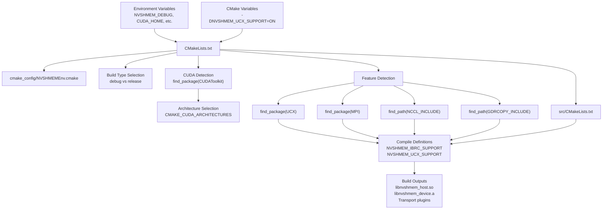
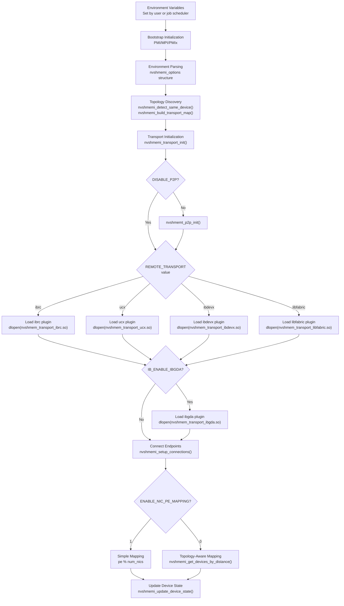
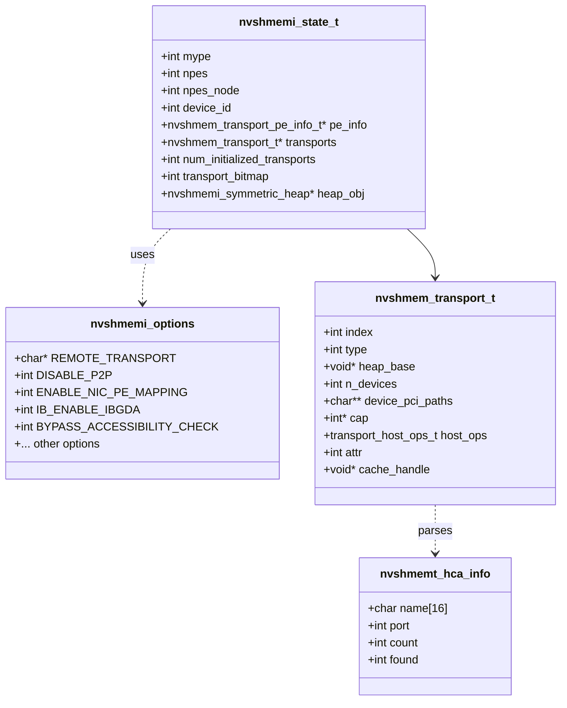

<!-- source: DeepWiki mcp.deepwiki.com · repo NVIDIA/nvshmem · page 7 Configuration and Environment · fetched 2026-11-11 -->

# Configuration and Environment

<details>
<summary>Relevant source files</summary>

The following files were used as context for generating this wiki page:

- [CMakeLists.txt](CMakeLists.txt)
- [src/host/topo/topo.cpp](src/host/topo/topo.cpp)
- [src/host/transport/transport.cpp](src/host/transport/transport.cpp)
- [src/modules/transport/common/transport_common.cpp](src/modules/transport/common/transport_common.cpp)

</details>


## Purpose and Scope

This page documents the configuration options and environment variables that control NVSHMEM's behavior at both build time and runtime. Build-time configuration is managed through CMake variables, while runtime behavior is controlled through environment variables that are parsed during initialization. For information about the transport layer architecture and how transports are selected, see [Transport Layer](#2.2). For details on the build system itself, see [Build System](#3).

## Build-Time Configuration

### CMake Variables

NVSHMEM's build system exposes several CMake variables that control which features are compiled and how the library is built. These variables are typically set via the command line (`-D` flag) or through environment variables that CMake automatically discovers.

#### Core Build Variables

| Variable | Default | Description |
|----------|---------|-------------|
| `CMAKE_BUILD_TYPE` | `release` | Build type: `debug`, `release`, `MinSizeRel`, or `RelWithDebInfo` |
| `NVSHMEM_DEBUG` | (unset) | If set, forces build type to `debug` |
| `CMAKE_CUDA_ARCHITECTURES` | Version-dependent | Target GPU architectures (e.g., `70;80;90`) |
| `NVSHMEM_PREFIX` | (varies) | Installation prefix for NVSHMEM |
| `CUDA_HOME` | (auto-detected) | Path to CUDA toolkit installation |

The build type selection follows this logic in [CMakeLists.txt:10-24]():

```
if (NVSHMEM_DEBUG)
    set(CMAKE_BUILD_TYPE "debug" CACHE STRING "Choose the type of build." FORCE)
endif()

if(NOT CMAKE_BUILD_TYPE AND NOT CMAKE_CONFIGURATION_TYPES)
    set(CMAKE_BUILD_TYPE "release" CACHE STRING "Choose the type of build." FORCE)
endif()
```

#### CUDA Architecture Selection

NVSHMEM automatically selects appropriate CUDA architectures based on the detected CUDA Toolkit version. The architecture selection logic in [CMakeLists.txt:66-82]() sets defaults:

| CUDA Version | Default Architectures |
|--------------|----------------------|
| < 11.0 | `70` |
| 11.0 - 11.7 | `70-real;80` |
| 11.8 - 12.7 | `70-real;80-real;89-real;90` |
| 13.x | `75-real;80-real;89-real;90-real;100-real;120` |
| ≥ 12.8 | `70-real;80-real;89-real;90-real;100-real;120` |

Users can override this by setting `CMAKE_CUDA_ARCHITECTURES` or the `CUDA_ARCHITECTURES` environment variable before running CMake.

#### Feature Flags

| Variable | Default | Description |
|----------|---------|-------------|
| `NVSHMEM_UCX_SUPPORT` | (unset) | Enable UCX transport |
| `NVSHMEM_MPI_SUPPORT` | (unset) | Enable MPI bootstrap |
| `NVSHMEM_USE_NCCL` | (unset) | Enable NCCL integration for collectives |
| `NVSHMEM_USE_GDRCOPY` | (unset) | Enable GDRCopy for CPU-side GPU memory access |
| `NVSHMEM_SHMEM_SUPPORT` | (unset) | Enable OpenSHMEM bootstrap |
| `NVSHMEM_BUILD_PYTHON_LIB` | ON | Build nvshmem4py Python bindings |
| `NVSHMEM_BUILD_BITCODE_LIBRARY` | (unset) | Build LLVM bitcode library |

When feature flags are enabled, CMake searches for the corresponding dependencies. For example, UCX support requires finding the UCX package [CMakeLists.txt:90-92]():

```
if(NVSHMEM_UCX_SUPPORT)
    find_package(UCX PATHS ${UCX_HOME} REQUIRED)
endif()
```

**Sources:** [CMakeLists.txt:1-189]()

### Build-Time Configuration Flow



**Sources:** [CMakeLists.txt:1-189]()

## Runtime Environment Variables

NVSHMEM reads environment variables during initialization to control runtime behavior. These variables are processed by the bootstrap layer and stored in the `nvshmemi_options` structure, which is referenced throughout the codebase.

### Core Runtime Configuration

#### `NVSHMEM_REMOTE_TRANSPORT`

Controls which remote transport plugin is loaded. Valid values:

- `ibrc` - InfiniBand Reliable Connected transport
- `ucx` - UCX transport (requires UCX support at build time)
- `ibdevx` - InfiniBand DEVX transport
- `libfabric` - Libfabric transport (for EFA, Slingshot, etc.)

The transport selection logic in [src/host/transport/transport.cpp:98-229]() uses string comparison to determine which transport plugin to load:

```
transport_skipped = strncasecmp(nvshmemi_options.REMOTE_TRANSPORT, IB_TRANSPORT_STRING,
                                TRANSPORT_STRING_MAX_LENGTH);
```

If the specified transport is not available (not built or fails to initialize), NVSHMEM falls back to other available transports or fails initialization if no transports are available.

#### `NVSHMEM_DISABLE_P2P`

When set to `1`, disables the P2P (peer-to-peer) transport that enables direct GPU-to-GPU memory access via NVLink, PCIe, or NVSwitch. The P2P transport is checked in [src/host/transport/transport.cpp:70-95]():

```
if (!nvshmemi_options.DISABLE_P2P) {
    status = nvshmemt_p2p_init(&transports[index]);
    // ... initialization logic
} else {
    WARN("P2P access was disabled in the environment");
}
```

Disabling P2P forces all communication to go through remote transports, which may be necessary for debugging or when P2P connectivity is unreliable.

#### `NVSHMEM_BYPASS_ACCESSIBILITY_CHECK`

When set to `1`, allows NVSHMEM to continue initialization even if some PEs cannot reach each other through any transport. By default, NVSHMEM requires full connectivity and exits if any PE pair is unreachable [src/host/topo/topo.cpp:486-491]():

```
if ((!reach_any) && (!nvshmemi_options.BYPASS_ACCESSIBILITY_CHECK)) {
    status = NVSHMEMX_ERROR_NOT_SUPPORTED;
    fprintf(stderr, "%s:%d: [GPU %d] Peer GPU %d is not accessible, exiting ... \n",
            __FILE__, __LINE__, state->mype, i);
    goto out;
}
```

**Caution:** This option should only be used for debugging purposes, as communication with unreachable PEs will fail at runtime.

**Sources:** [src/host/transport/transport.cpp:50-319](), [src/host/topo/topo.cpp:438-506]()

### Transport-Specific Configuration

#### InfiniBand Configuration

**`NVSHMEM_IB_ENABLE_IBGDA`**

Enables the IBGDA (GPU Direct Async) transport, which allows GPU threads to directly post RDMA operations to InfiniBand NICs. This is checked in [src/host/transport/transport.cpp:231-291]():

```
if (nvshmemi_options.IB_ENABLE_IBGDA) {
    // Load and initialize IBGDA transport plugin
}
```

**HCA Selection Environment Variables**

NVSHMEM supports environment variables for specifying which InfiniBand HCAs (Host Channel Adapters) to use. The format is parsed by `nvshmemt_parse_hca_list()` in [src/modules/transport/common/transport_common.cpp:22-83]():

Format: `HCA_NAME[:PORT][:COUNT][,HCA_NAME[:PORT][:COUNT]]...`

Example: `mlx5_0:1,mlx5_1:1` specifies two HCAs, each using port 1.

The parser extracts HCA names, port numbers, and usage counts, storing them in the `nvshmemt_hca_info` structure.

#### Topology and Device Mapping

**`NVSHMEM_ENABLE_NIC_PE_MAPPING`**

Controls how NICs are assigned to PEs within a node:

- `0` (default): Use PCIe topology-aware mapping via `nvshmemi_get_devices_by_distance()`
- `1`: Simple round-robin mapping: PE i uses NIC `i % num_nics`

The logic in [src/host/transport/transport.cpp:404-421]():

```
if (tcurr->n_devices <= 1) {
    selected_devices[0] = tcurr->n_devices - 1;
} else if (nvshmemi_options.ENABLE_NIC_PE_MAPPING) {
    selected_devices[0] = nvshmemi_state->mype_node % tcurr->n_devices;
} else {
    nvshmemi_get_devices_by_distance(selected_devices, max_devices_per_pe, tcurr);
}
```

The topology-aware algorithm in [src/host/topo/topo.cpp:138-436]() considers:
- PCIe path distance between GPU and NIC (PIX, PXB, PHB, NODE, SYS)
- Load balancing across NICs
- NUMA node affinity

**Sources:** [src/modules/transport/common/transport_common.cpp:22-83](), [src/host/transport/transport.cpp:372-456](), [src/host/topo/topo.cpp:138-436]()

### Debugging and Logging Configuration

While not explicitly shown in the provided files, NVSHMEM uses logging levels controlled by the `NVSHMEM_DEBUG` environment variable at runtime (distinct from the build-time CMake variable). Different subsystems have logging levels:

- `NVSHMEM_INIT` - Initialization messages
- `NVSHMEM_TOPO` - Topology discovery messages
- `NVSHMEM_TRANSPORT` - Transport-level messages
- `NVSHMEM_COLL` - Collective operation messages

These are referenced in macros like `INFO(NVSHMEM_INIT, ...)` throughout the codebase.

**Sources:** [src/host/topo/topo.cpp:275-277](), [src/host/transport/transport.cpp:101-102]()

## Configuration Processing Architecture

### Initialization-Time Configuration Flow



**Sources:** [src/host/transport/transport.cpp:50-456](), [src/host/topo/topo.cpp:438-573]()

### Configuration Data Structures



**Sources:** [src/host/transport/transport.cpp:50-69](), [src/modules/transport/common/transport_common.cpp:15-20]()

## Transport Selection and Configuration

### Transport Priority and Fallback

NVSHMEM attempts to initialize transports in this order:

1. **P2P Transport** (if not disabled) - Always attempted first for intra-node communication
2. **Remote Transport** (specified by `NVSHMEM_REMOTE_TRANSPORT`) - One of: ibrc, ucx, ibdevx, libfabric
3. **IBGDA Transport** (if enabled) - GPU Direct Async for device-initiated operations

If a transport fails to initialize, NVSHMEM logs a warning and continues. If no transports successfully initialize, initialization fails [src/host/transport/transport.cpp:293-296]():

```
if (index == 0) {
    NVSHMEMI_ERROR_PRINT("Unable to initialize any transports. returning error.");
    status = NVSHMEMX_ERROR_INTERNAL;
}
```

### Transport Capability Bitmap

Each PE builds a transport bitmap indicating which transports are available. The bitmap is computed during topology discovery in [src/host/topo/topo.cpp:455-493]():

```
for (int j = 0; j < state->num_initialized_transports; j++) {
    status = state->transports[j]->host_ops.can_reach_peer(&reach, &state->pe_info[i],
                                                           state->transports[j]);
    if (reach) {
        int m = 1 << j;
        local_map[i] |= m;
        if ((state->transport_bitmap & m) == 0) {
            state->transport_bitmap |= m;
        }
    }
}
```

Each bit in the bitmap represents a transport:
- Bit 0: Transport 0 (typically P2P)
- Bit 1: Transport 1 (typically remote transport)
- Bit 2: Transport 2 (typically IBGDA)

This bitmap is used at runtime to select the appropriate transport for each communication operation based on peer reachability.

**Sources:** [src/host/topo/topo.cpp:438-506](), [src/host/transport/transport.cpp:50-319]()

### PCIe Topology-Aware Device Selection

When `NVSHMEM_ENABLE_NIC_PE_MAPPING=0`, NVSHMEM uses PCIe topology information to optimally pair GPUs with NICs. The algorithm in [src/host/topo/topo.cpp:259-401]() computes PCIe distances:

| Distance Type | Description | Performance |
|--------------|-------------|-------------|
| `PATH_PIX` | Same PCIe switch | Highest (4) |
| `PATH_PXB` | PCIe switch to PCIe bridge | High (4) |
| `PATH_PHB` | Same PCIe host bridge | Medium (3) |
| `PATH_NODE` | Same NUMA node, different PCIe tree | Low (2) |
| `PATH_SYS` | Different NUMA nodes | Lowest (1) |

The algorithm performs two passes:

1. **Initial Assignment** - Assign each GPU to its closest available NIC(s)
2. **Load Balancing** - Redistribute assignments to balance load across NICs while maintaining optimal distances

If a GPU is assigned to a NIC with distance worse than `PATH_PIX`, NVSHMEM sets `nvshmemi_state->are_nics_ll128_compliant = false` to disable certain low-latency optimizations.

**Sources:** [src/host/topo/topo.cpp:109-436]()

## Environment Variable Reference Table

### Complete Environment Variable List

| Variable | Type | Default | Description | Code Reference |
|----------|------|---------|-------------|----------------|
| `NVSHMEM_REMOTE_TRANSPORT` | string | `ibrc` | Remote transport selection: `ibrc`, `ucx`, `ibdevx`, `libfabric` | [transport.cpp:98-229]() |
| `NVSHMEM_DISABLE_P2P` | bool | 0 | Disable P2P transport | [transport.cpp:70]() |
| `NVSHMEM_IB_ENABLE_IBGDA` | bool | 0 | Enable IBGDA transport | [transport.cpp:231]() |
| `NVSHMEM_ENABLE_NIC_PE_MAPPING` | bool | 0 | Use simple PE→NIC mapping | [transport.cpp:404]() |
| `NVSHMEM_BYPASS_ACCESSIBILITY_CHECK` | bool | 0 | Allow incomplete connectivity | [topo.cpp:486]() |
| `NVSHMEM_DEBUG` | int | - | Runtime logging level | (various) |
| `CUDA_HOME` | path | (auto) | CUDA toolkit installation path | [CMakeLists.txt:30]() |

### Transport-Specific Environment Variables

These variables are parsed by individual transport plugins and are not directly visible in the provided code files, but their existence is implied by the HCA parsing functionality:

| Variable (Example) | Description |
|-------------------|-------------|
| `NVSHMEM_HCA_LIST` | Comma-separated list of HCAs to use |
| `NVSHMEM_IB_*` | Various InfiniBand-specific settings |
| `NVSHMEM_UCX_*` | UCX transport configuration |
| `NVSHMEM_LIBFABRIC_*` | Libfabric transport configuration |

**Sources:** [src/modules/transport/common/transport_common.cpp:22-83](), [src/host/transport/transport.cpp:50-319](), [src/host/topo/topo.cpp:438-573](), [CMakeLists.txt:1-189]()

---

