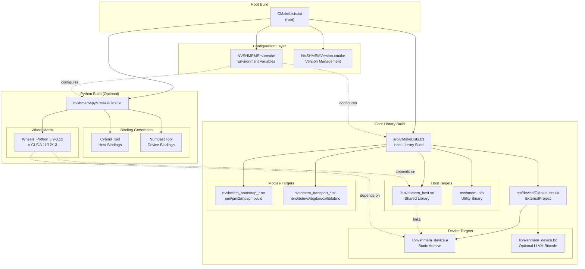
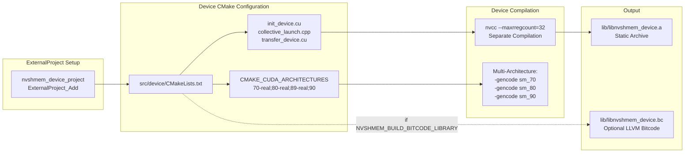
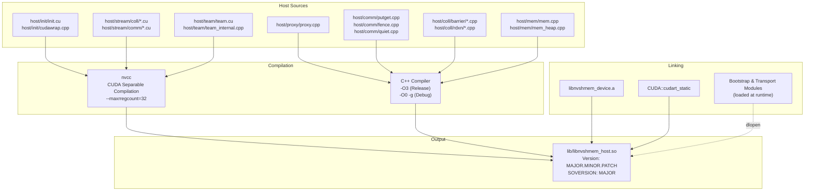
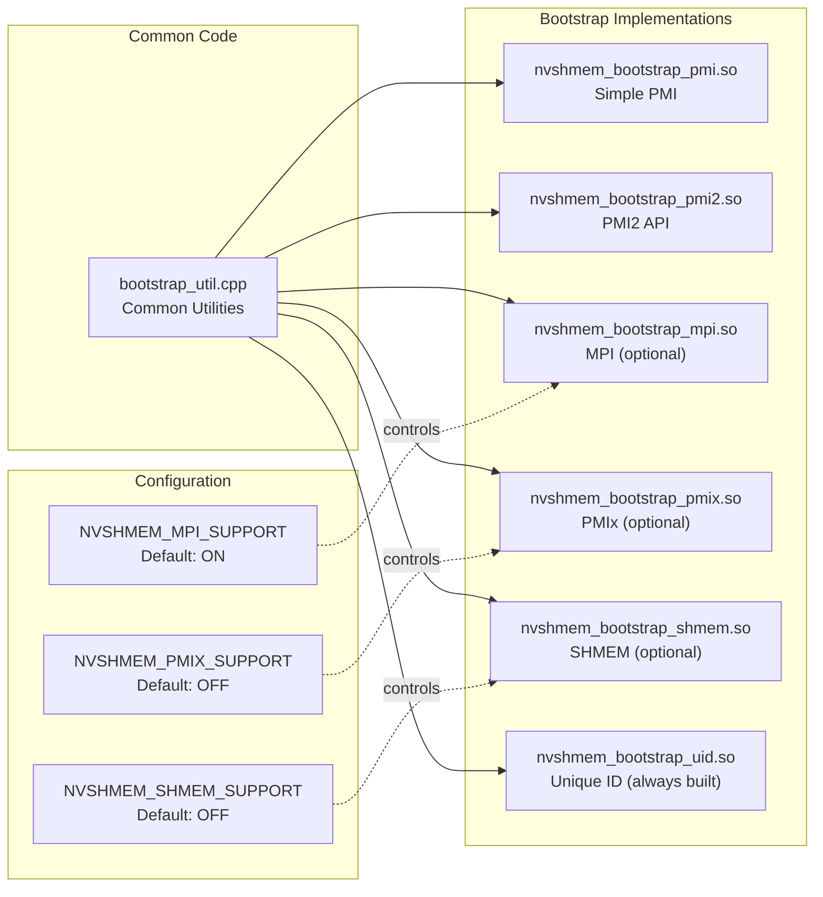
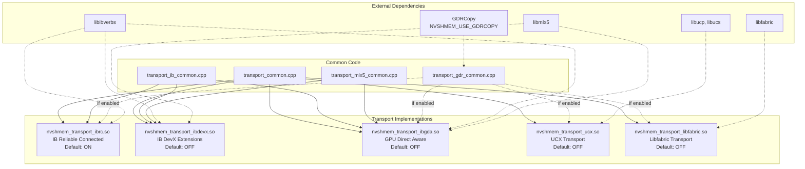
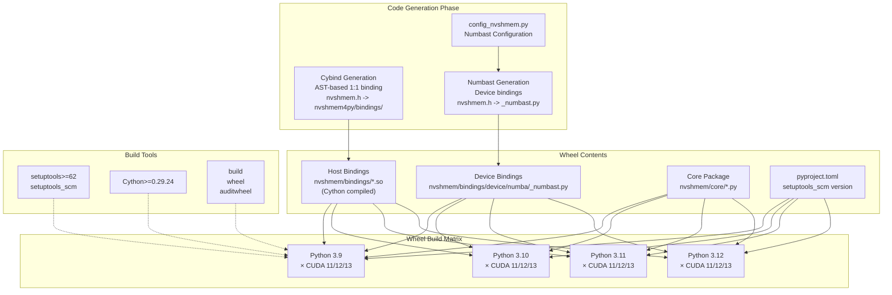

<!-- source: DeepWiki mcp.deepwiki.com · repo NVIDIA/nvshmem · page 8.2 Building from Source · fetched 2026-11-11 -->

# Building from Source

<details>
<summary>Relevant source files</summary>

The following files were used as context for generating this wiki page:

- [CMakeLists.txt](CMakeLists.txt)
- [cmake_config/NVSHMEMEnv.cmake](cmake_config/NVSHMEMEnv.cmake)
- [nvshmem4py/cmake/addNumbast.cmake](nvshmem4py/cmake/addNumbast.cmake)
- [nvshmem4py/examples/device_custom_kernel.py](nvshmem4py/examples/device_custom_kernel.py)
- [nvshmem4py/nvshmem/core/device/numba/__init__.py](nvshmem4py/nvshmem/core/device/numba/__init__.py)
- [nvshmem4py/nvshmem/core/device/numba/direct.py](nvshmem4py/nvshmem/core/device/numba/direct.py)
- [nvshmem4py/scripts/generate_pyproject_toml.py](nvshmem4py/scripts/generate_pyproject_toml.py)
- [src/CMakeLists.txt](src/CMakeLists.txt)

</details>


This page provides detailed instructions for building NVSHMEM and nvshmem4py from source code. It covers prerequisites, CMake configuration options, the build process for both the core C++/CUDA library and Python bindings, and troubleshooting common issues.

For information about the overall project structure, see [Project Structure](#8.1). For details on extending NVSHMEM with custom transports, see [Implementing Custom Transports](#8.3). For Python binding development workflows, see [Python Binding Development](#8.4).

## Prerequisites

### System Requirements

**Required Dependencies:**
- **CMake** ≥ 3.19
- **CUDA Toolkit** ≥ 11.0 (path specified via `CUDA_HOME` environment variable)
- **C++ Compiler** with C++11 support (C++17 for CUDA 13+)
- **GCC/Clang** compatible with CUDA toolkit version

**Optional Dependencies (enabled by default):**
- **MPI** implementation (OpenMPI, MPICH, etc.) for MPI bootstrap
- **InfiniBand Verbs** libraries for IBRC transport
- **GDRCopy** for GPU Direct RDMA optimizations

**Optional Dependencies (disabled by default):**
- **UCX** for UCX transport
- **Libfabric** for Libfabric transport (Verbs, CXI, EFA providers)
- **PMIx** for PMIx bootstrap
- **NCCL** for NCCL-dependent functionality
- **CUTLASS** for tensor core examples
- **Clang/LLVM** for bitcode library generation

**Python Build Requirements (if building nvshmem4py):**
- **Python** ≥ 3.9
- **pip** packages listed in `nvshmem4py/requirements_build.txt`

Sources: [cmake_config/NVSHMEMEnv.cmake:92-103]()

### Environment Setup

Set environment variables to specify dependency locations:

```bash
export CUDA_HOME=/usr/local/cuda
export MPI_HOME=/usr/local/ompi
export UCX_HOME=/usr/local/ucx
export LIBFABRIC_HOME=/usr/local/libfabric
export GDRCOPY_HOME=/usr/local/gdrdrv
export NCCL_HOME=/usr/local/nccl
export PMIX_HOME=/usr
export NVSHMEM_PREFIX=/usr/local/nvshmem
```

Sources: [cmake_config/NVSHMEMEnv.cmake:92-102]()

## Quick Start

### Basic Build (Core Library Only)

```bash
# Clone repository
git clone https://github.com/NVIDIA/nvshmem.git
cd nvshmem

# Create build directory
mkdir build && cd build

# Configure with CMake
cmake ..

# Build
make -j$(nproc)

# Install
sudo make install
```

### Build with Python Bindings

```bash
# Install Python build dependencies
pip install -r nvshmem4py/requirements_build.txt

# Configure with Python support
cmake -DNVSHMEM_BUILD_PYTHON_LIB=ON ..

# Build core library and Python wheels
make -j$(nproc)
```

Sources: [src/CMakeLists.txt:1-50](), [nvshmem4py/CMakeLists.txt:1-100]()

## Build System Architecture

The NVSHMEM build system orchestrates compilation of multiple components with complex dependencies:



**Key Build Phases:**

1. **Configuration**: `NVSHMEMEnv.cmake` reads environment variables and sets CMake options
2. **Device Library**: Built as `ExternalProject` with separate CMake configuration
3. **Host Library**: Builds shared library linking device static archive
4. **Bootstrap/Transport Modules**: Built as separate shared libraries (plugins)
5. **Python Bindings**: Code generation followed by wheel builds for multiple Python/CUDA versions

Sources: [src/CMakeLists.txt:1-50](), [cmake_config/NVSHMEMEnv.cmake:1-177](), [nvshmem4py/CMakeLists.txt:1-100]()

## Core Library Build Process

### Device Library Build

The device library is compiled as a separate CMake `ExternalProject` to enable distinct compilation settings:



**Device Library Configuration:**

The device library uses an external project pattern to enable independent configuration:

```cmake
# From src/CMakeLists.txt:22-41
ExternalProject_Add(nvshmem_device_project
    SOURCE_DIR ${CMAKE_CURRENT_SOURCE_DIR}/device
    BINARY_DIR ${CMAKE_CURRENT_BINARY_DIR}/device
    CMAKE_ARGS -DCMAKE_BUILD_TYPE=${CMAKE_BUILD_TYPE}
               -DNVSHMEM_PREFIX=${NVSHMEM_PREFIX}
               -DNVSHMEM_DEBUG=${NVSHMEM_DEBUG}
               -DCMAKE_CUDA_ARCHITECTURES=${CMAKE_CUDA_ARCHITECTURES}
    BUILD_ALWAYS TRUE
    BUILD_BYPRODUCTS ${CMAKE_CURRENT_BINARY_DIR}/lib/libnvshmem_device.a
)
```

**GPU Architecture Selection:**

The build system automatically selects GPU architectures based on CUDA version:

| CUDA Version | Default Architectures |
|--------------|----------------------|
| 11.0 - 11.7  | 70-real, 80 |
| 11.8 - 12.7  | 70-real, 80-real, 89-real, 90 |
| 13.0+        | 75-real, 80-real, 89-real, 90-real, 100-real, 120 |

Override with: `cmake -DCMAKE_CUDA_ARCHITECTURES="70;80;90" ..`

Sources: [src/CMakeLists.txt:22-41](), [src/device/CMakeLists.txt:47-63]()

### LLVM Bitcode Library (Optional)

For advanced use cases requiring LLVM IR, enable bitcode library generation:

```bash
cmake -DNVSHMEM_BUILD_BITCODE_LIBRARY=ON \
      -DNVSHMEM_CLANG_DIR=/usr/local/llvm \
      ..
```

The bitcode library is generated using Clang:

```cmake
# From src/CMakeLists.txt:79-90
add_custom_command(OUTPUT ${CMAKE_CURRENT_BINARY_DIR}/lib/libnvshmem_device.bc
    COMMAND clang -c -emit-llvm -O1 -std=${BITCODE_CXX_STD} -x cuda 
            --cuda-path=${CUDA_HOME} --cuda-device-only
            --cuda-gpu-arch=${BITCODE_LIB_ARCH}
            -I ${CMAKE_CURRENT_SOURCE_DIR}/include
            ${CMAKE_CURRENT_SOURCE_DIR}/device/init/init_device.cu
            -o libnvshmem_device.bc.unoptimized
    COMMAND opt --passes='internalize,inline,globaldce'
            -internalize-public-api-list='nvshmem_*,nvshmemx_*,...'
            libnvshmem_device.bc.unoptimized -o libnvshmem_device.bc
)
```

Sources: [src/CMakeLists.txt:60-101]()

### Host Library Build

The host library links against the device static archive and implements host-side initialization, transport management, and proxy thread:



Sources: [src/CMakeLists.txt:230-398](), [src/CMakeLists.txt:615-619]()

### Bootstrap Module Build

Bootstrap modules are built as separate shared libraries with plugin interface:



**Build Control:**

| Bootstrap | CMake Option | Default | Dependency |
|-----------|-------------|---------|------------|
| PMI | Always built | - | Built-in |
| PMI2 | Always built | - | Built-in |
| MPI | `NVSHMEM_MPI_SUPPORT` | ON | MPI library |
| PMIx | `NVSHMEM_PMIX_SUPPORT` | OFF | PMIx library |
| SHMEM | `NVSHMEM_SHMEM_SUPPORT` | OFF | SHMEM library |
| UID | Always built | - | Built-in |

Disable MPI bootstrap: `cmake -DNVSHMEM_MPI_SUPPORT=OFF ..`

Sources: [src/CMakeLists.txt:120-228](), [cmake_config/NVSHMEMEnv.cmake:40-64]()

### Transport Module Build

Transport modules implement the `nvshmem_transport_t` interface as plugins:



**Transport Configuration:**

| Transport | CMake Option | Default | Dependencies |
|-----------|-------------|---------|--------------|
| IBRC | `NVSHMEM_IBRC_SUPPORT` | ON | libibverbs |
| IBDEVX | `NVSHMEM_IBDEVX_SUPPORT` | OFF | libibverbs, libmlx5 |
| IBGDA | `NVSHMEM_IBGDA_SUPPORT` | OFF | libibverbs, libmlx5 |
| UCX | `NVSHMEM_UCX_SUPPORT` | OFF | UCX libraries |
| Libfabric | `NVSHMEM_LIBFABRIC_SUPPORT` | OFF | libfabric |

**Enable Multiple Transports:**

```bash
cmake -DNVSHMEM_IBRC_SUPPORT=ON \
      -DNVSHMEM_IBGDA_SUPPORT=ON \
      -DNVSHMEM_UCX_SUPPORT=ON \
      -DNVSHMEM_LIBFABRIC_SUPPORT=ON \
      -DUCX_HOME=/usr/local/ucx \
      -DLIBFABRIC_HOME=/usr/local/libfabric \
      ..
```

**GDRCopy Integration:**

GDRCopy support is enabled by default and adds optimized atomic operation paths:

```bash
# Disable GDRCopy
cmake -DNVSHMEM_USE_GDRCOPY=OFF ..

# Or specify custom location
cmake -DGDRCOPY_HOME=/opt/gdrcopy ..
```

Sources: [src/CMakeLists.txt:399-570](), [cmake_config/NVSHMEMEnv.cmake:42-72]()

## Python Bindings Build Process

The Python bindings build involves code generation followed by wheel compilation for multiple Python and CUDA versions:



### Binding Generation

**Cybind - Host Bindings:**

Cybind generates 1:1 Python wrappers for NVSHMEM C API functions:

```cmake
# From nvshmem4py/CMakeLists.txt:23-30
if(EXISTS "${CMAKE_SOURCE_DIR}/nvshmem4py/cmake/addCybind.cmake")
    AddCybind(
        GIT_TAG "main"
        KNOWN_DEST "${CMAKE_SOURCE_DIR}/src/nvshmem4py/bindings/"
    )
endif()
```

The generated bindings are Cython modules that wrap the C API.

**Numbast - Device Bindings:**

Numbast generates Numba-compatible device function bindings:

```cmake
# From nvshmem4py/CMakeLists.txt:36-41
if(EXISTS "${CMAKE_SOURCE_DIR}/nvshmem4py/cmake/addNumbast.cmake" 
   AND NVSHMEM_BUILD_PYTHON_DEVICE_LIB 
   AND NOT EXISTS "${CMAKE_SOURCE_DIR}/nvshmem4py/nvshmem/bindings/device/numba/_numbast.py")
    AddNumbast(GIT_TAG "v0.5.2")
endif()
```

The output is `_numbast.py` containing device function declarations.

Sources: [nvshmem4py/CMakeLists.txt:23-41]()

### Wheel Build Matrix

The build system creates wheels for all combinations of Python and CUDA versions:

```bash
# Python versions detected
execute_process(
    COMMAND bash -c "${CMAKE_CURRENT_SOURCE_DIR}/scripts/find_python_versions.sh"
    OUTPUT_VARIABLE PYTHON_VERSION_LINES
)

# Build for CUDA 11, 12, 13
foreach(CUDA_VER IN LISTS "11" "12" "13")
    BuildWheel(${WHEEL_TARGET} ${PY_VER} ${PY_EXEC} ${CUDA_VER})
endforeach()
```

**Wheel Naming Convention:**

```
nvshmem4py-{version}+cu{cuda_ver}-cp{py_ver}-cp{py_ver}-linux_x86_64.whl
```

Examples:
- `nvshmem4py-0.1.2+cu12-cp310-cp310-linux_x86_64.whl`
- `nvshmem4py-0.1.2+cu13-cp311-cp311-linux_x86_64.whl`

**Dependencies per CUDA Version:**

Dependencies are specified in `requirements_cuda{VER}.txt` and injected into `pyproject.toml`:

```python
# From nvshmem4py/scripts/generate_pyproject_toml.py:77-96
def update_pyproject(cuda_ver, nvshmem4py_path):
    req_file = f"{nvshmem4py_path}/requirements_cuda{cuda_ver}.txt"
    with open(req_file) as f:
        deps = [line.strip() for line in f if line.strip()]
    
    dep_block = "dependencies = [\n"
    for dep in deps:
        dep_block += f'    "{dep}",\n'
    dep_block = dep_block.rstrip(",\n") + "\n]\n"
```

Sources: [nvshmem4py/CMakeLists.txt:44-93](), [nvshmem4py/scripts/generate_pyproject_toml.py:77-106]()

### Building Python Bindings

**Full Build (all wheels):**

```bash
# Install build dependencies
pip install -r nvshmem4py/requirements_build.txt

# Configure and build
cmake -DNVSHMEM_BUILD_PYTHON_LIB=ON \
      -DNVSHMEM_BUILD_PYTHON_DEVICE_LIB=ON \
      ..
      
make build_nvshmem4py_wheels
```

**Selective Build (single wheel):**

```bash
# Build for specific Python/CUDA version
make build_nvshmem4py_wheel_cu12_3.10
```

**Output Location:**

Wheels are generated in `build/dist/`:

```
build/dist/
├── nvshmem4py-0.1.2+cu11-cp39-cp39-linux_x86_64.whl
├── nvshmem4py-0.1.2+cu12-cp310-cp310-linux_x86_64.whl
├── nvshmem4py-0.1.2+cu13-cp311-cp311-linux_x86_64.whl
└── ...
```

Sources: [nvshmem4py/CMakeLists.txt:90-99](), [cmake_config/NVSHMEMEnv.cmake:54-55]()

## Configuration Options Reference

### Comprehensive Options Table

The build system provides extensive configuration through environment variables and CMake options:

| Category | Option | Default | Description |
|----------|--------|---------|-------------|
| **Bootstrap** ||||
| | `NVSHMEM_MPI_SUPPORT` | ON | Enable MPI bootstrap |
| | `NVSHMEM_DEFAULT_PMI2` | OFF | Set PMI2 as default bootstrap |
| | `NVSHMEM_DEFAULT_PMIX` | OFF | Set PMIx as default bootstrap |
| | `NVSHMEM_PMIX_SUPPORT` | OFF | Enable PMIx bootstrap |
| | `NVSHMEM_SHMEM_SUPPORT` | OFF | Enable SHMEM bootstrap |
| **Transport** ||||
| | `NVSHMEM_IBRC_SUPPORT` | ON | Enable IBRC transport |
| | `NVSHMEM_IBDEVX_SUPPORT` | OFF | Enable IBDEVX transport |
| | `NVSHMEM_IBGDA_SUPPORT` | OFF | Enable IBGDA transport |
| | `NVSHMEM_UCX_SUPPORT` | OFF | Enable UCX transport |
| | `NVSHMEM_LIBFABRIC_SUPPORT` | OFF | Enable Libfabric transport |
| | `NVSHMEM_DEFAULT_UCX` | OFF | Set UCX as default transport |
| **Functionality** ||||
| | `NVSHMEM_USE_GDRCOPY` | ON | Enable GDRCopy optimizations |
| | `NVSHMEM_USE_MLX5DV` | ON | Enable DirectNIC feature |
| | `NVSHMEM_USE_NCCL` | OFF | Enable NCCL-dependent code |
| | `NVSHMEM_USE_DLMALLOC` | OFF | Use dlmalloc for heap |
| | `NVSHMEM_NVTX` | ON | Enable NVTX profiling support |
| | `NVSHMEM_ENABLE_ALL_DEVICE_INLINING` | OFF | Inline all device code |
| | `NVSHMEM_GPU_COLL_USE_LDST` | OFF | Use Load/Store in collectives |
| | `NVSHMEM_TIMEOUT_DEVICE_POLLING` | OFF | Enable polling timeouts |
| **Build** ||||
| | `NVSHMEM_BUILD_TESTS` | ON | Build test suite |
| | `NVSHMEM_BUILD_EXAMPLES` | ON | Build examples |
| | `NVSHMEM_BUILD_WITH_CUTLASS` | OFF | Build CUTLASS examples |
| | `NVSHMEM_BUILD_PYTHON_LIB` | ON | Build Python wheels |
| | `NVSHMEM_BUILD_PYTHON_DEVICE_LIB` | ON | Build device bindings |
| | `NVSHMEM_BUILD_BITCODE_LIBRARY` | OFF* | Build LLVM bitcode library |
| | `NVSHMEM_DEBUG` | OFF | Debug build (-O0 -g -G) |
| | `NVSHMEM_DEVEL` | OFF | Development mode (warnings) |
| | `NVSHMEM_VERBOSE` | OFF | Verbose PTX compilation |
| | `NVSHMEM_TRACE` | OFF | Enable trace events |
| **Paths** ||||
| | `CUDA_HOME` | /usr/local/cuda | CUDA installation |
| | `MPI_HOME` | /usr/local/ompi | MPI installation |
| | `UCX_HOME` | /usr/local/ucx | UCX installation |
| | `LIBFABRIC_HOME` | /usr/local/libfabric | Libfabric installation |
| | `GDRCOPY_HOME` | /usr/local/gdrdrv | GDRCopy installation |
| | `NCCL_HOME` | /usr/local/nccl | NCCL installation |
| | `PMIX_HOME` | /usr | PMIx installation |
| | `CUTLASS_HOME` | (empty) | CUTLASS directory |
| | `NVSHMEM_PREFIX` | /usr/local/nvshmem | Install directory |
| | `NVSHMEM_CLANG_DIR` | (empty) | Clang for bitcode |

*Automatically ON when `NVSHMEM_BUILD_PACKAGES=ON`

Sources: [cmake_config/NVSHMEMEnv.cmake:36-177]()

### Configuration via Environment Variables

All options can be set via environment variables (recommended) or CMake arguments:

**Method 1: Environment Variables (Persistent)**

```bash
export NVSHMEM_IBGDA_SUPPORT=ON
export NVSHMEM_UCX_SUPPORT=ON
export UCX_HOME=/opt/ucx
export NVSHMEM_USE_GDRCOPY=OFF
export NVSHMEM_DEBUG=ON

cmake ..
```

**Method 2: CMake Arguments (Per-Build)**

```bash
cmake -DNVSHMEM_IBGDA_SUPPORT=ON \
      -DNVSHMEM_UCX_SUPPORT=ON \
      -DUCX_HOME=/opt/ucx \
      -DNVSHMEM_USE_GDRCOPY=OFF \
      -DNVSHMEM_DEBUG=ON \
      ..
```

Sources: [cmake_config/NVSHMEMEnv.cmake:9-34]()

## Optional Dependency Configuration

### MPI Support

**Purpose:** Enables MPI bootstrap for launching NVSHMEM applications in MPI environments.

```bash
# Enable (default)
cmake -DNVSHMEM_MPI_SUPPORT=ON -DMPI_HOME=/opt/openmpi ..

# Disable
cmake -DNVSHMEM_MPI_SUPPORT=OFF ..
```

**Detection Logic:**

CMake uses `find_package(MPI)` to locate MPI installation. Set `MPI_HOME` to help discovery.

Sources: [src/CMakeLists.txt:170-184](), [cmake_config/NVSHMEMEnv.cmake:40]()

### UCX Transport

**Purpose:** Enables UCX transport for high-performance networking with UCX library.

```bash
# Prerequisites
export UCX_HOME=/usr/local/ucx

# Enable UCX transport
cmake -DNVSHMEM_UCX_SUPPORT=ON \
      -DUCX_HOME=${UCX_HOME} \
      ..
```

**UCX Libraries Required:**
- `libucp` (Unified Communication Protocol)
- `libucs` (Unified Communication Services)

**Optional GDRCopy Integration:**

```bash
cmake -DNVSHMEM_UCX_SUPPORT=ON \
      -DNVSHMEM_USE_GDRCOPY=ON \
      -DGDRCOPY_HOME=/opt/gdrcopy \
      ..
```

Sources: [src/CMakeLists.txt:412-434](), [cmake_config/NVSHMEMEnv.cmake:72]()

### GDRCopy (GPU Direct RDMA Copy)

**Purpose:** Optimizes small atomic operations by copying GPU memory through BAR1 aperture.

```bash
# Enable (default)
cmake -DNVSHMEM_USE_GDRCOPY=ON \
      -DGDRCOPY_HOME=/usr/local/gdrdrv \
      ..

# Affects transports: IBRC, IBGDA, UCX, Libfabric
```

**Files Added When Enabled:**

For each transport supporting GDRCopy, `transport_gdr_common.cpp` is compiled:

```cmake
# From src/CMakeLists.txt:427-432
if(NVSHMEM_USE_GDRCOPY)
    target_include_directories(nvshmem_transport_ucx PRIVATE ${GDRCOPY_INCLUDE})
    target_sources(nvshmem_transport_ucx PRIVATE
                   modules/transport/common/transport_gdr_common.cpp
    )
endif()
```

Sources: [src/CMakeLists.txt:427-432](), [src/CMakeLists.txt:452-457](), [src/CMakeLists.txt:519-524](), [src/CMakeLists.txt:554-559]()

### NCCL Integration

**Purpose:** Enables NCCL-dependent functionality in NVSHMEM.

```bash
cmake -DNVSHMEM_USE_NCCL=ON \
      -DNCCL_HOME=/usr/local/nccl \
      ..
```

**Impact:**

Includes NCCL headers in both host and device libraries:

```cmake
# From src/CMakeLists.txt:573-575
if(NVSHMEM_USE_NCCL)
  target_include_directories(nvshmem_host PRIVATE ${NCCL_INCLUDE})
endif()
```

Sources: [src/CMakeLists.txt:573-575](), [src/device/CMakeLists.txt:191-193](), [cmake_config/NVSHMEMEnv.cmake:76]()

### CUTLASS Support

**Purpose:** Enables CUTLASS tensor core examples and CUTLASS datatype support.

```bash
# Prerequisites
export CUTLASS_HOME=/path/to/cutlass

cmake -DNVSHMEM_BUILD_WITH_CUTLASS=ON \
      -DCUTLASS_HOME=${CUTLASS_HOME} \
      ..
```

**Requirements:**
- C++17 standard (automatically enabled)
- CUTLASS header-only library

**Impact:**

```cmake
# From src/CMakeLists.txt:373-390
if (NVSHMEM_BUILD_WITH_CUTLASS)
    target_compile_definitions(nvshmem_host PUBLIC CUTLASS_ENABLED)
    target_compile_definitions(nvshmem_device INTERFACE CUTLASS_ENABLED)
    
    set(CUTLASS_INCLUDE_DIR "${CUTLASS_HOME}/include")
    target_include_directories(nvshmem_host PUBLIC ${CUTLASS_INCLUDE_DIR})
endif()
```

Sources: [src/CMakeLists.txt:373-390](), [src/CMakeLists.txt:54-58](), [src/device/CMakeLists.txt:75-78](), [src/device/CMakeLists.txt:101-115]()

### Libfabric Transport

**Purpose:** Enables Libfabric transport supporting verbs, CXI (Slingshot), and EFA providers.

```bash
export LIBFABRIC_HOME=/usr/local/libfabric

cmake -DNVSHMEM_LIBFABRIC_SUPPORT=ON \
      -DLIBFABRIC_HOME=${LIBFABRIC_HOME} \
      ..
```

**Library Required:**

The build system locates `libfabric.so`:

```cmake
# From src/CMakeLists.txt:538
find_library(FABRIC_lib NAMES fabric 
             HINTS "${LIBFABRIC_HOME}/lib" "${LIBFABRIC_HOME}/lib64")
```

Sources: [src/CMakeLists.txt:537-561](), [cmake_config/NVSHMEMEnv.cmake:71]()

### InfiniBand Transports

**IBRC (Basic InfiniBand):**

```bash
# Enabled by default
cmake -DNVSHMEM_IBRC_SUPPORT=ON ..
```

Requires: `libibverbs`

**IBDEVX (DevX Extensions):**

```bash
cmake -DNVSHMEM_IBDEVX_SUPPORT=ON ..
```

Requires: `libibverbs`, `libmlx5`

**IBGDA (GPU Direct Aware):**

```bash
cmake -DNVSHMEM_IBGDA_SUPPORT=ON ..
```

Requires: `libibverbs`, `libmlx5`

**Capability Detection:**

The build system checks for advanced IB features:

```cmake
# From src/CMakeLists.txt:404-408
check_source_compiles(C
  "#include <infiniband/verbs.h>
  int main(void) { int x = IBV_ACCESS_RELAXED_ORDERING; return 1; }"
  HAVE_IBV_ACCESS_RELAXED_ORDERING
)
```

```cmake
# From src/CMakeLists.txt:492-501
check_source_compiles(C
  "#include <infiniband/mlx5dv.h>
  int main(void) { int x = MLX5DV_UAR_ALLOC_TYPE_NC_DEDICATED; return 1; }"
  HAVE_MLX5DV_UAR_ALLOC_TYPE_NC_DEDICATED
)
```

Sources: [src/CMakeLists.txt:404-408](), [src/CMakeLists.txt:436-462](), [src/CMakeLists.txt:464-489](), [src/CMakeLists.txt:491-535]()

## Advanced Build Topics

### Debug and Development Builds

**Debug Build:**

```bash
cmake -DCMAKE_BUILD_TYPE=Debug \
      -DNVSHMEM_DEBUG=ON \
      ..
```

Effects:
- `-O0 -g` for host code
- `-O0 -g -G` for device code (enables CUDA debugging)
- Defines `_NVSHMEM_DEBUG` and `NVSHMEM_IBGDA_DEBUG`

**Development Build:**

```bash
cmake -DNVSHMEM_DEVEL=ON ..
```

Effects:
- Enables `-Werror` (warnings as errors)
- Enables comprehensive warning flags (`-Wall`, `-Wextra`)
- For CUDA: `-Werror all-warnings`

Sources: [src/CMakeLists.txt:249-280](), [src/device/CMakeLists.txt:131-162]()

### C++ Standard Selection

The build system automatically selects C++ standard based on CUDA version:

| CUDA Version | C++ Standard | Rationale |
|--------------|--------------|-----------|
| < 13 | C++11 | CUDA compatibility |
| ≥ 13 | C++17 | CUDA compatibility + features |
| Any (with CUTLASS) | C++17 | CUTLASS requirement |

Override explicitly:

```bash
cmake -DCMAKE_CXX_STANDARD=17 \
      -DCMAKE_CUDA_STANDARD=17 \
      ..
```

Sources: [src/CMakeLists.txt:48-58](), [src/device/CMakeLists.txt:69-78]()

### Register Count Control

Device code compilation limits register usage for better occupancy:

```cmake
# From src/CMakeLists.txt:617
set_source_files_properties(${NVSHMEM_HOST_SOURCES} ${NVSHMEM_DEVICE_SOURCES} 
                            PROPERTIES COMPILE_OPTIONS 
                            $<$<COMPILE_LANGUAGE:CUDA>:--maxrregcount=32>)
```

This ensures device kernels use at most 32 registers per thread.

Sources: [src/CMakeLists.txt:617](), [src/device/CMakeLists.txt:197]()

### Compiler Thread Control

For faster CUDA compilation on multi-core systems:

```cmake
# From src/CMakeLists.txt:6
check_compiler_flag(CUDA -t4 NVCC_THREADS)
```

If supported, `-t4` flag enables 4 parallel compilation threads in NVCC.

Sources: [src/CMakeLists.txt:6](), [src/CMakeLists.txt:264]()

### Custom CUDA Architectures

Specify exact GPU architectures to target:

```bash
cmake -DCMAKE_CUDA_ARCHITECTURES="70;80;90" ..
```

Or with real/virtual PTX:

```bash
cmake -DCMAKE_CUDA_ARCHITECTURES="70-real;80-real;90" ..
```

The `-real` suffix generates only binary code (SASS), omitting PTX. Omitting it generates both.

Sources: [src/CMakeLists.txt:16-20](), [src/device/CMakeLists.txt:47-63]()

### Inlining Control

**Full Device Inlining:**

```bash
cmake -DNVSHMEM_ENABLE_ALL_DEVICE_INLINING=ON ..
```

Effect: All device code is included as inline functions in headers, eliminating device library linking.

Trade-off:
- ✓ Potential performance improvements
- ✗ Longer application compile times
- ✗ Larger compiled code size

**Implementation:**

```cmake
# From src/CMakeLists.txt:603-608
if(NOT NVSHMEM_ENABLE_ALL_DEVICE_INLINING)
set(NVSHMEM_DEVICE_SOURCES
    ${NVSHMEM_DEVICE_SOURCES}
    device/comm/transfer_device.cu
)
endif()
```

Sources: [src/CMakeLists.txt:598-612](), [src/device/CMakeLists.txt:176-184]()

## Installation

### Standard Installation

```bash
# Build
cmake -DCMAKE_INSTALL_PREFIX=/usr/local/nvshmem ..
make -j$(nproc)

# Install (may require sudo)
make install
```

**Installed Components:**

```
/usr/local/nvshmem/
├── bin/
│   ├── nvshmem-info              # Info utility
│   └── nvshmrun (optional)       # Hydra launcher
├── include/
│   ├── nvshmem.h                 # Main C header
│   ├── nvshmemx.h                # Extensions
│   ├── nvshmem_host.h            # Host-only API
│   ├── device/                   # Device headers
│   ├── host/                     # Host headers
│   └── non_abi/                  # Internal headers
├── lib/
│   ├── libnvshmem_host.so        # Host library
│   ├── libnvshmem_device.a       # Device static library
│   ├── libnvshmem_device.bc      # Optional bitcode
│   ├── nvshmem_bootstrap_*.so    # Bootstrap plugins
│   ├── nvshmem_transport_*.so    # Transport plugins
│   └── cmake/nvshmem/            # CMake config files
└── share/
    └── src/                      # Plugin development kits
        ├── bootstrap-plugins/
        └── transport-plugins/
```

Sources: [src/CMakeLists.txt:833-932]()

### CMake Integration

Applications can find installed NVSHMEM using CMake:

```cmake
find_package(NVSHMEM REQUIRED)

add_executable(myapp main.cu)
target_link_libraries(myapp PRIVATE nvshmem::nvshmem_host nvshmem::nvshmem_device)
```

The installed CMake files provide:
- `NVSHMEMConfig.cmake` - Package configuration
- `NVSHMEMVersion.cmake` - Version information
- `NVSHMEMTargets.cmake` - Target definitions
- `NVSHMEMDeviceTargets.cmake` - Device library target

Sources: [src/CMakeLists.txt:834-882]()

### Python Wheel Installation

After building Python wheels:

```bash
# Install specific wheel
pip install build/dist/nvshmem4py-0.1.2+cu12-cp310-cp310-linux_x86_64.whl

# Or install all built wheels
pip install build/dist/nvshmem4py-*.whl
```

**Runtime Dependencies:**

Python wheels require corresponding NVSHMEM native package:

```bash
# For CUDA 12 wheel
conda install nvidia-nvshmem-cu12

# Or set LD_LIBRARY_PATH
export LD_LIBRARY_PATH=/usr/local/nvshmem/lib:$LD_LIBRARY_PATH
```

Sources: [nvshmem4py/CMakeLists.txt:96-99]()

## Troubleshooting

### Common Build Issues

**Issue: CMake cannot find CUDA**

```
CMake Error: Could not find CUDAToolkit
```

**Solution:**

```bash
export CUDA_HOME=/usr/local/cuda
cmake -DCUDA_HOME=/usr/local/cuda ..
```

**Issue: MPI not found**

```
CMake Error: Could not find MPI
```

**Solutions:**

```bash
# Option 1: Disable MPI
cmake -DNVSHMEM_MPI_SUPPORT=OFF ..

# Option 2: Specify MPI location
cmake -DMPI_HOME=/opt/openmpi ..

# Option 3: Set MPI compiler wrappers
export CC=mpicc
export CXX=mpicxx
cmake ..
```

**Issue: Transport library not found**

```
CMake Error: Could not find libfabric
```

**Solution:**

```bash
# Either disable the transport
cmake -DNVSHMEM_LIBFABRIC_SUPPORT=OFF ..

# Or provide the path
cmake -DLIBFABRIC_HOME=/usr/local/libfabric ..
```

**Issue: Python binding generation fails**

```
Error: Cybind not found
```

**Solution:**

Cybind and Numbast are cloned during build. Ensure internet connectivity or disable Python build:

```bash
cmake -DNVSHMEM_BUILD_PYTHON_LIB=OFF ..
```

**Issue: Multiple Python versions conflict**

The build system finds all Python ≥3.9 and builds wheels for each. To limit:

```bash
# Manually specify Python executable
cmake -DPython3_EXECUTABLE=/usr/bin/python3.10 ..
```

**Issue: Insufficient GPU architectures**

```
Error: No CUDA architectures specified
```

**Solution:**

```bash
cmake -DCMAKE_CUDA_ARCHITECTURES="80;90" ..
```

**Issue: Numba device bindings not available**

```python
Warning: Numba device bindings are not enabled
```

This warning appears when importing `nvshmem.bindings.device.numba` if device bindings weren't built.

**Solution:**

```bash
# Rebuild with device bindings enabled
cmake -DNVSHMEM_BUILD_PYTHON_DEVICE_LIB=ON ..
make
```

Sources: [nvshmem4py/nvshmem/bindings/device/numba/__init__.py:37-39]()

### Verification

**Check NVSHMEM Build Configuration:**

```bash
/usr/local/nvshmem/bin/nvshmem-info
```

Output includes:
- NVSHMEM version
- Build configuration options
- Available transports
- Available bootstraps
- CUDA version used

**Verify Python Installation:**

```python
import nvshmem
print(nvshmem.__version__)
print(nvshmem.bindings)  # Should show available bindings

# Check device bindings
from nvshmem.bindings.device import numba
```

**Test Build:**

```bash
# Build and run examples
cd build
make -j$(nproc)

# Run a test (requires MPI)
mpirun -np 2 ./bin/examples/initialize
```

Sources: [src/CMakeLists.txt:623-630]()

### Performance Optimization Flags

For production builds with maximum performance:

```bash
cmake -DCMAKE_BUILD_TYPE=Release \
      -DNVSHMEM_DEBUG=OFF \
      -DNVSHMEM_DEVEL=OFF \
      -DNVSHMEM_VERBOSE=OFF \
      -DNVSHMEM_TRACE=OFF \
      -DNVSHMEM_USE_GDRCOPY=ON \
      -DNVSHMEM_ENABLE_ALL_DEVICE_INLINING=OFF \
      ..
```

Sources: [cmake_config/NVSHMEMEnv.cmake:82-86]()

---

This comprehensive guide covers the complete build process for NVSHMEM from source. For contributing changes to the build system, see [Contributing Guidelines](#8.5). For details on the generated project structure, see [Project Structure](#8.1).

---

