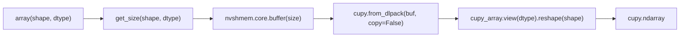
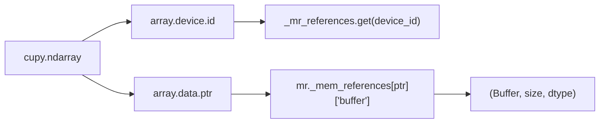
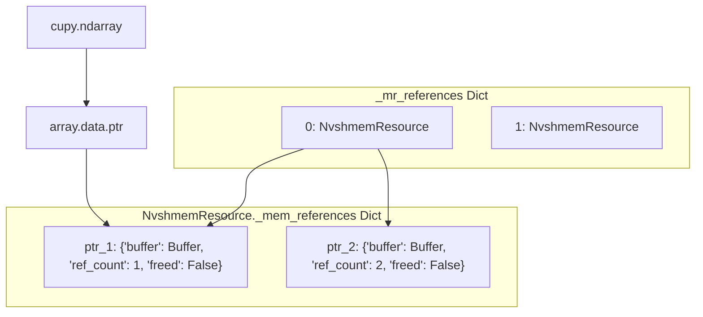
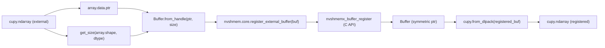
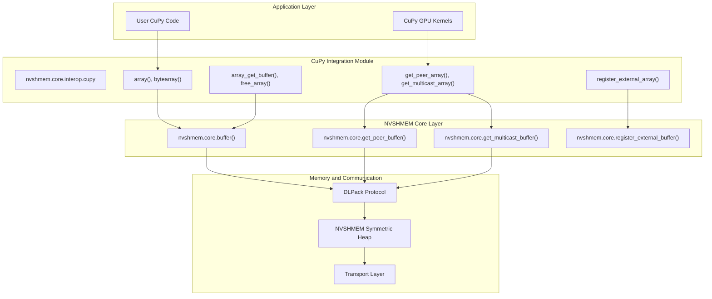

<!-- source: DeepWiki mcp.deepwiki.com · repo NVIDIA/nvshmem · extra page CuPy Integration · fetched 2026-11-11 -->

# CuPy Integration

<details>
<summary>Relevant source files</summary>

The following files were used as context for generating this wiki page:

- [nvshmem4py/examples/torch_triton_interop.py](nvshmem4py/examples/torch_triton_interop.py)
- [nvshmem4py/nvshmem/core/collective.py](nvshmem4py/nvshmem/core/collective.py)
- [nvshmem4py/nvshmem/core/nvshmem_types.py](nvshmem4py/nvshmem/core/nvshmem_types.py)
- [nvshmem4py/nvshmem/core/rma.py](nvshmem4py/nvshmem/core/rma.py)

</details>


This page documents the CuPy-specific API in `nvshmem.core.interop.cupy` for allocating and managing `cupy.ndarray` objects backed by NVSHMEM symmetric heap memory. These functions enable zero-copy integration between CuPy arrays and NVSHMEM communication operations.

For PyTorch integration, see page 4.5.1. For general framework concepts, see page 4.5.

## Overview

The CuPy integration module provides functions to create `cupy.ndarray` objects allocated on NVSHMEM's symmetric heap. This enables direct participation in NVSHMEM RMA, atomic, and collective operations without memory copies. The integration uses DLPack protocol for zero-copy wrapping between NVSHMEM buffers and CuPy arrays.

**Module Location**: `nvshmem4py/nvshmem/core/interop/cupy.py`

**Public API** (`__all__` exports):
- `array()` - Create typed CuPy array
- `bytearray()` - Create raw byte array
- `free_array()` - Free NVSHMEM-backed array
- `array_get_buffer()` - Extract buffer from array
- `get_peer_array()` - Get peer PE array view
- `get_multicast_array()` - Get multicast-optimized view
- `register_external_array()` - Register external array
- `unregister_external_array()` - Unregister external array

Sources: [nvshmem4py/nvshmem/core/interop/cupy.py:1-25]()

## Array Creation API

### `array()`

Creates a CuPy array view on NVSHMEM-allocated symmetric heap memory.

**Signature**:
```python
def array(shape: Tuple[int], dtype: str="float32", release=False, 
          morder="C", except_on_del=True) -> ndarray
```

**Parameters**:
| Parameter | Type | Default | Description |
|-----------|------|---------|-------------|
| `shape` | `Tuple[int]` | Required | Shape of array (e.g., `(1024,)` or `(32, 64)`) |
| `dtype` | `str`, `np.dtype`, or `cupy.dtype` | `"float32"` | Data type of array elements |
| `release` | `bool` | `False` | If `True`, do not track buffer internally (user manages refs) |
| `morder` | `str` | `"C"` | Memory order: `"C"` (row-major) or `"F"` (column-major) |
| `except_on_del` | `bool` | `True` | If `True`, raise exception on improper deallocation |

**Returns**: `cupy.ndarray` backed by NVSHMEM symmetric heap

**Implementation Flow**:


**Important**: Call `.view()` with `copy=False` to avoid copying data off symmetric heap.

Sources: [nvshmem4py/nvshmem/core/interop/cupy.py:65-99]()

### `bytearray()`

Creates a raw byte array (dtype `int8`) from NVSHMEM memory. Uses `shape` and `dtype` to determine allocation size but does not cast or reshape.

**Signature**:
```python
def bytearray(shape: Tuple[int], dtype: str="float32", release=False, 
              device_id: int=None, morder="C", except_on_del=True) -> ndarray
```

**Returns**: `cupy.ndarray` with dtype `cupy.uint8`

**Implementation**: Internally calls `array(shape, dtype="int8", ...)` after computing size.

Sources: [nvshmem4py/nvshmem/core/interop/cupy.py:101-129]()

### Usage Example: Array Creation

```python
import cupy as cp
import nvshmem.core as nvshmem

# Initialize NVSHMEM
nvshmem.init()

# Create float32 array
arr = nvshmem.array((1024, 1024), dtype="float32")
arr[:] = nvshmem.my_pe()  # Initialize with PE ID

# Create raw byte buffer
raw = nvshmem.bytearray((2048,), dtype="float64")

# Cleanup
nvshmem.free_array(arr)
nvshmem.free_array(raw)
nvshmem.finalize()
```

## Memory Management API

### `array_get_buffer()`

Extracts the underlying NVSHMEM buffer from a CuPy array allocated with `nvshmem.array()` or `nvshmem.bytearray()`.

**Signature**:
```python
def array_get_buffer(array: ndarray) -> Tuple[Buffer, int, str]
```

**Returns**: `(Buffer, size_bytes, dtype_str)`

**Implementation Details**:


**Raises**:
- `NvshmemInvalid` if array not tracked by NVSHMEM or device has no allocations

Sources: [nvshmem4py/nvshmem/core/interop/cupy.py:49-62]()

### `free_array()`

Frees an NVSHMEM-backed CuPy array. This is a collective operation - all PEs must call it in concert.

**Signature**:
```python
def free_array(array: ndarray) -> None
```

**Implementation**:
1. Calls `array_get_buffer(array)` to extract buffer
2. Calls `nvshmem.core.free(buf)` to deallocate

**Important**: This is a collective operation. All participating PEs must call `free_array()` synchronously.

Sources: [nvshmem4py/nvshmem/core/interop/cupy.py:196-213]()

### Memory Tracking Architecture



Sources: [nvshmem4py/nvshmem/core/_internal_tracking.py:19-22](), [nvshmem4py/nvshmem/core/interop/cupy.py:55-61]()

## Remote Access API

### `get_peer_array()`

Returns a CuPy array view of memory on a remote PE. Python wrapper for `nvshmem_ptr()`.

**Signature**:
```python
def get_peer_array(array: ndarray, peer_pe: int=None) -> ndarray
```

**Parameters**:
| Parameter | Type | Description |
|-----------|------|-------------|
| `array` | `cupy.ndarray` | Local NVSHMEM-backed array |
| `peer_pe` | `int` | Target PE rank (if `None`, implementation-defined behavior) |

**Returns**: `cupy.ndarray` view of remote PE's memory

**Implementation Flow**:


**Use Case**: Efficient fine-grained remote reads/writes when communication pattern doesn't match standard RMA operations.

Sources: [nvshmem4py/nvshmem/core/interop/cupy.py:131-139](), [nvshmem4py/nvshmem/core/memory.py:125-164]()

### `get_multicast_array()`

Returns a multicast-optimized memory view backed by `nvshmemx_mc_ptr()`. Enables NVLink SHARP hardware acceleration.

**Signature**:
```python
def get_multicast_array(team: Teams, array: ndarray) -> ndarray
```

**Parameters**:
| Parameter | Type | Description |
|-----------|------|-------------|
| `team` | `Teams` | NVSHMEM team for multicast (typically `Teams.TEAM_WORLD` or `Teams.TEAM_NODE`) |
| `array` | `cupy.ndarray` | NVSHMEM-backed array |

**Returns**: `cupy.ndarray` with multicast memory alias

**Critical Constraints**:
- **Device-only**: Cannot be accessed from host CPU
- **GPU kernels only**: Valid only in CUDA/Numba/Triton kernels
- Host-side access is undefined behavior

**Implementation**:


Sources: [nvshmem4py/nvshmem/core/interop/cupy.py:141-175](), [nvshmem4py/nvshmem/core/memory.py:227-272]()

### Usage Example: Peer and Multicast Access

```python
import cupy as cp
import nvshmem.core as nvshmem

nvshmem.init()
mype = nvshmem.my_pe()
npes = nvshmem.n_pes()

# Create local array
local = nvshmem.array((1024,), dtype="float32")
local[:] = mype * 10.0

# Get peer array (access neighbor's memory)
if npes > 1:
    neighbor_pe = (mype + 1) % npes
    peer_array = nvshmem.get_peer_array(local, neighbor_pe)
    # Can now read/write peer_array to access neighbor's memory

# Get multicast view (for use in custom kernels)
mc_array = nvshmem.get_multicast_array(nvshmem.Teams.TEAM_WORLD, local)
# mc_array can only be used in GPU kernels, not on host

nvshmem.free_array(local)
nvshmem.finalize()
```

## External Buffer Registration API

### `register_external_array()`

Registers a CuPy array allocated outside NVSHMEM (e.g., via `cupy.zeros()`) for use in NVSHMEM operations. This is a collective operation.

**Signature**:
```python
def register_external_array(array: ndarray) -> ndarray
```

**Parameters**:
| Parameter | Type | Description |
|-----------|------|-------------|
| `array` | `cupy.ndarray` | Externally allocated CuPy array (e.g., from `cupy.zeros()`) |

**Returns**: New `cupy.ndarray` wrapping the registered symmetric pointer

**Important**: 
- Users must use the **returned array** for NVSHMEM operations, not the original
- This is a **collective operation** - all PEs must call it synchronously

**Implementation**:


Sources: [nvshmem4py/nvshmem/core/interop/cupy.py:177-185](), [nvshmem4py/nvshmem/core/memory.py:166-197]()

### `unregister_external_array()`

Unregisters an externally allocated array from NVSHMEM. This is a collective operation.

**Signature**:
```python
def unregister_external_array(array: ndarray) -> None
```

**Parameters**:
| Parameter | Type | Description |
|-----------|------|-------------|
| `array` | `cupy.ndarray` | Array returned by `register_external_array()` |

**Important**: Pass the array **returned by** `register_external_array()`, not the original external array.

Sources: [nvshmem4py/nvshmem/core/interop/cupy.py:187-194](), [nvshmem4py/nvshmem/core/memory.py:199-225]()

### Usage Example: External Buffer Registration

```python
import cupy as cp
import nvshmem.core as nvshmem

nvshmem.init()

# Allocate array with CuPy (not NVSHMEM)
external_array = cp.zeros((512, 512), dtype=cp.float32)

# Register with NVSHMEM (collective)
registered_array = nvshmem.register_external_array(external_array)

# Use registered_array for NVSHMEM operations
nvshmem.barrier_all()
# ... perform NVSHMEM operations with registered_array ...

# Unregister when done (collective)
nvshmem.unregister_external_array(registered_array)

# external_array can now be freed normally
del external_array

nvshmem.finalize()
```

## Integration Architecture

### CuPy-NVSHMEM Integration Stack



### Key Integration Components

| Component | File Location | Purpose |
|-----------|---------------|---------|
| `_cupy_enabled` | [nvshmem4py/nvshmem/core/interop/cupy.py:29-34]() | Runtime CuPy availability check |
| `_is_array()` | [nvshmem4py/nvshmem/core/interop/cupy.py:39-47]() | CuPy array type detection |
| `_mr_references` | [nvshmem4py/nvshmem/core/interop/cupy.py:17]() | Memory resource tracking |
| `__all__` exports | [nvshmem4py/nvshmem/core/interop/cupy.py:25]() | Public API surface |

Sources: [nvshmem4py/nvshmem/core/interop/cupy.py:1-214]()

## Usage Considerations

### Memory Order and Views
- Arrays support both C-style (`"C"`) and Fortran-style (`"F"`) memory ordering
- `.view()` operations should use `copy=False` to maintain symmetric heap allocation
- Buffer tracking ensures proper memory lifecycle management

### Error Handling
- `ModuleNotFoundError` raised when CuPy not available
- `NvshmemInvalid` for invalid memory operations or untracked buffers
- Automatic fallback when CuPy disabled (`_cupy_enabled = False`)

Sources: [nvshmem4py/nvshmem/core/interop/cupy.py:88-93](), [nvshmem4py/nvshmem/core/interop/cupy.py:55-61]()

---

