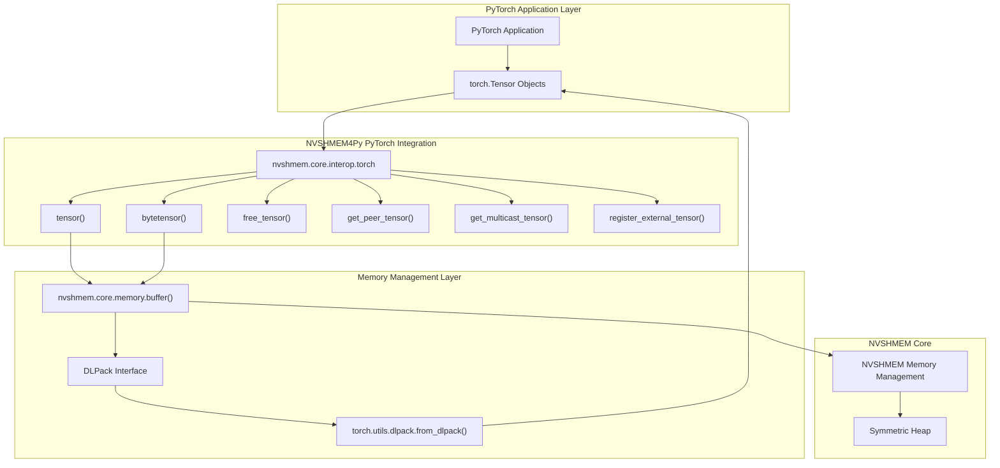
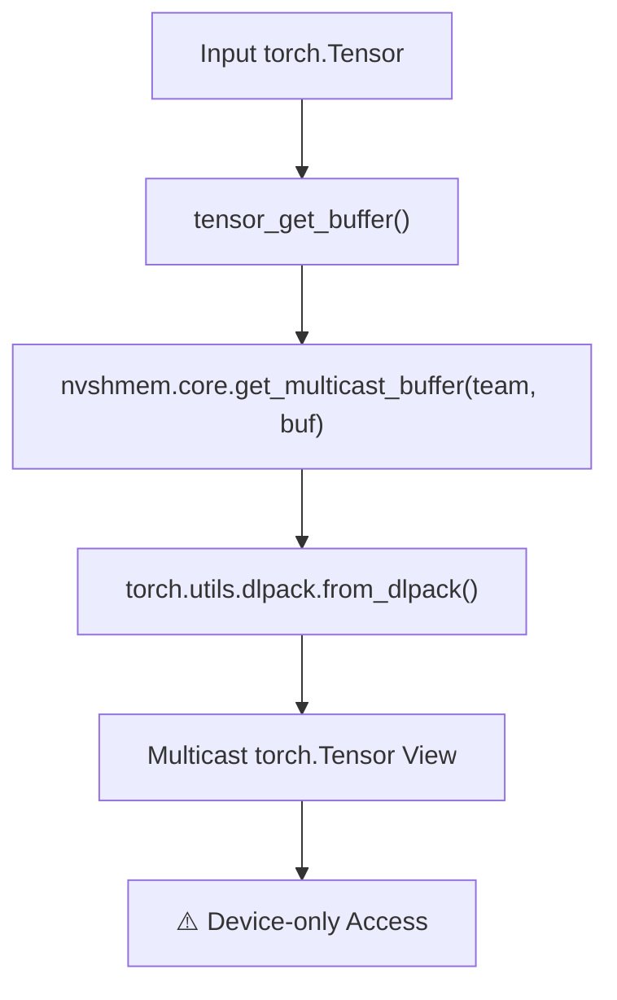
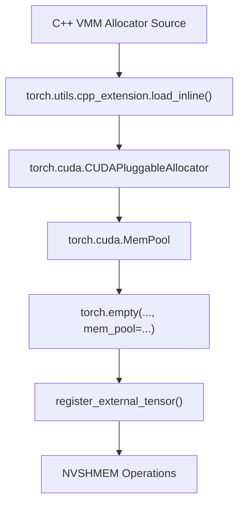
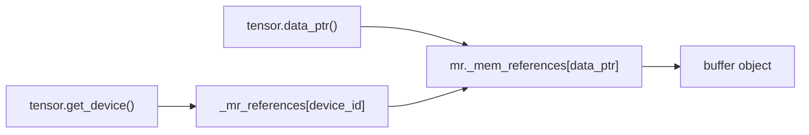
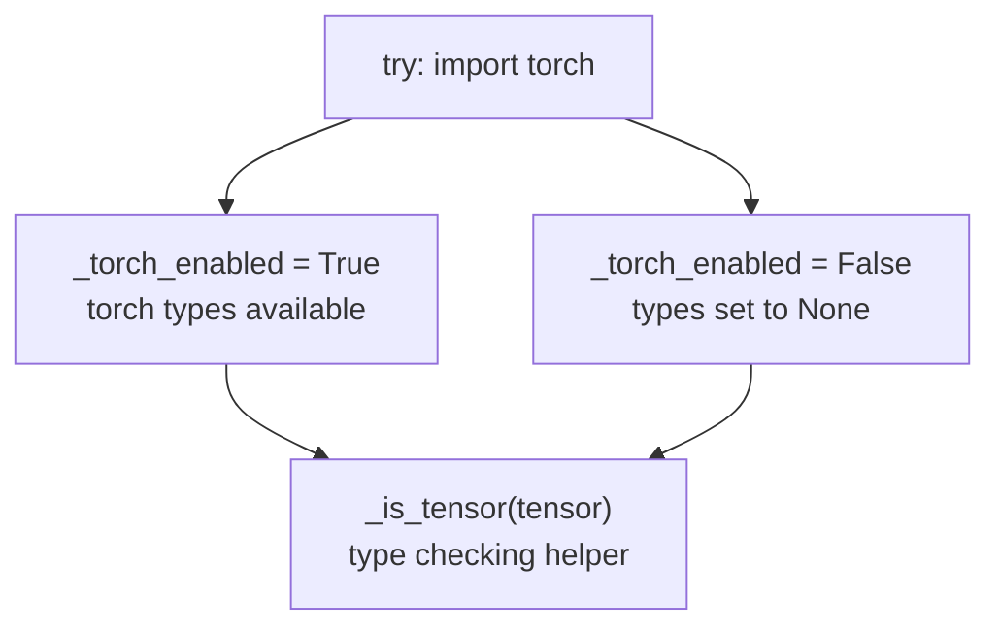

<!-- source: DeepWiki mcp.deepwiki.com · repo NVIDIA/nvshmem · extra page PyTorch Integration · fetched 2026-11-11 -->

# PyTorch Integration

<details>
<summary>Relevant source files</summary>

The following files were used as context for generating this wiki page:

- [nvshmem4py/examples/torch_triton_interop.py](nvshmem4py/examples/torch_triton_interop.py)
- [nvshmem4py/nvshmem/core/collective.py](nvshmem4py/nvshmem/core/collective.py)
- [nvshmem4py/nvshmem/core/nvshmem_types.py](nvshmem4py/nvshmem/core/nvshmem_types.py)
- [nvshmem4py/nvshmem/core/rma.py](nvshmem4py/nvshmem/core/rma.py)

</details>


This page provides a complete guide to using NVSHMEM with PyTorch tensors through the `nvshmem.core.interop.torch` module. It covers tensor creation, memory management, advanced features like peer access and multicast operations, and integration with PyTorch's memory management system.

For information about CuPy integration, see [CuPy Integration](#4.5.2). For general framework interoperability concepts, see [Framework Interoperability](#4.5).

## Overview

The PyTorch integration enables seamless use of NVSHMEM-allocated memory as PyTorch tensors, allowing distributed GPU computations to leverage NVSHMEM's efficient communication primitives while maintaining full compatibility with PyTorch's ecosystem.

### Integration Architecture



Sources: [nvshmem4py/nvshmem/core/interop/torch.py:1-219]()

## Tensor Creation and Management

### Basic Tensor Creation

The primary functions for creating PyTorch tensors backed by NVSHMEM memory are `tensor()` and `bytetensor()`:

#### Tensor Creation Flow


Sources: [nvshmem4py/nvshmem/core/interop/torch.py:70-108]()

### API Reference

| Function | Purpose | Return Type | Key Parameters |
|----------|---------|-------------|----------------|
| `tensor(shape, dtype, release, morder, except_on_del)` | Create typed tensor with specific shape and dtype | `torch.Tensor` | `shape`: tuple, `dtype`: torch.dtype (default: `torch.float32`), `release`: bool, `morder`: str (`"C"` or `"F"`) |
| `bytetensor(shape, dtype, release, morder, except_on_del)` | Create raw byte tensor (always `uint8` dtype) | `torch.Tensor` | Same as `tensor()`, but output is always `uint8` |
| `free_tensor(tensor)` | Free NVSHMEM-backed tensor memory | None | `tensor`: torch.Tensor |

#### tensor() Implementation

The `tensor()` function at [nvshmem4py/nvshmem/core/interop/torch.py:70-108]() performs:

1. Calculates buffer size via `get_size(shape, dtype)` at [nvshmem4py/nvshmem/core/interop/torch.py:99]()
2. Allocates NVSHMEM memory via `buffer()` at [nvshmem4py/nvshmem/core/interop/torch.py:99]()
3. Converts to PyTorch via `torch.utils.dlpack.from_dlpack()` at [nvshmem4py/nvshmem/core/interop/torch.py:100]()
4. Creates typed view with `.view(dtype).view(shape)` at [nvshmem4py/nvshmem/core/interop/torch.py:101]()
5. Applies custom strides for Fortran layout if `morder='F'` at [nvshmem4py/nvshmem/core/interop/torch.py:102-107]()

#### bytetensor() Implementation

The `bytetensor()` function at [nvshmem4py/nvshmem/core/interop/torch.py:110-135]() wraps `tensor()` with forced `dtype=uint8` at [nvshmem4py/nvshmem/core/interop/torch.py:135](), creating raw byte tensors useful for low-level memory operations.

Sources: [nvshmem4py/nvshmem/core/interop/torch.py:70-135]()

### Memory Layout Options

Both tensor creation functions support memory layout control via `morder`:

| Layout | Description | Use Case |
|--------|-------------|----------|
| `"C"` (default) | Row-major (C-style) | Standard PyTorch layout |
| `"F"` | Column-major (Fortran-style) | Interoperability with Fortran/MATLAB code |

For Fortran layout, custom strides are computed at [nvshmem4py/nvshmem/core/interop/torch.py:103-107]() to achieve column-major ordering via `tensor.as_strided()`.

Sources: [nvshmem4py/nvshmem/core/interop/torch.py:92-108]()

## Advanced Features

### Peer Tensor Access

The `get_peer_tensor(tensor, peer_pe)` function at [nvshmem4py/nvshmem/core/interop/torch.py:137-145]() provides access to remote PE memory through PyTorch tensor views, wrapping the `nvshmem_ptr` functionality:

#### Peer Access Flow


Sources: [nvshmem4py/nvshmem/core/interop/torch.py:137-145]()

**Implementation Steps:**
1. Extracts underlying NVSHMEM buffer via `tensor_get_buffer()` at [nvshmem4py/nvshmem/core/interop/torch.py:143]()
2. Gets peer buffer via `nvshmem.core.get_peer_buffer(buf, peer_pe)` at [nvshmem4py/nvshmem/core/interop/torch.py:144]()
3. Creates tensor view preserving original dtype and shape via `.view(tensor.dtype).view(tensor.shape)` at [nvshmem4py/nvshmem/core/interop/torch.py:145]()

**Use Case:** Efficient sequential reads/writes to remote PE memory when access pattern doesn't match standard RMA operations.

Sources: [nvshmem4py/nvshmem/core/interop/torch.py:137-145]()

### Multicast Tensor Support

The `get_multicast_tensor(team, tensor)` function at [nvshmem4py/nvshmem/core/interop/torch.py:147-180]() creates tensor views optimized for NVSwitch-based collective operations via `nvshmemx_mc_ptr`:

#### Multicast Tensor Creation



Sources: [nvshmem4py/nvshmem/core/interop/torch.py:147-180]()

**Important Restrictions:**
- Multicast tensors can **only** be accessed from GPU kernels at [nvshmem4py/nvshmem/core/interop/torch.py:158-159]()
- Host access results in undefined behavior
- See [nvshmem4py/examples/triton_comm_kernels.py:139]() for example usage in Triton kernels

**Use Case:** Leveraging NVLink SHARP for hardware-accelerated multicast operations.

Sources: [nvshmem4py/nvshmem/core/interop/torch.py:147-180](), [nvshmem4py/examples/triton_comm_kernels.py:1-159]()

### External Tensor Registration

For tensors allocated outside NVSHMEM (e.g., via standard `torch.empty()`), registration functions enable NVSHMEM operations:

| Function | Signature | Purpose | Collective Operation |
|----------|-----------|---------|---------------------|
| `register_external_tensor(tensor)` | Returns `torch.Tensor` | Register external tensor with NVSHMEM | Yes - all PEs must call |
| `unregister_external_tensor(tensor)` | Returns `None` | Unregister external tensor | Yes - all PEs must call |

#### Registration Process

The `register_external_tensor()` function at [nvshmem4py/nvshmem/core/interop/torch.py:182-190]():

1. Creates `Buffer.from_handle()` from `tensor.data_ptr()` at [nvshmem4py/nvshmem/core/interop/torch.py:188]()
2. Registers via `nvshmem.core.register_external_buffer()` at [nvshmem4py/nvshmem/core/interop/torch.py:189]()
3. Returns new tensor view with symmetric pointer at [nvshmem4py/nvshmem/core/interop/torch.py:190]()

**Important:** The returned tensor (not the original) must be passed to NVSHMEM operations.

The `unregister_external_tensor()` function at [nvshmem4py/nvshmem/core/interop/torch.py:192-199]() reverses this process, calling `nvshmem.core.unregister_external_buffer()` at [nvshmem4py/nvshmem/core/interop/torch.py:199]().

Sources: [nvshmem4py/nvshmem/core/interop/torch.py:182-199]()

## Usage Examples

### Basic Tensor Allocation and Communication

```python
import torch
import nvshmem.core as nvshmem

# Initialize NVSHMEM
nvshmem.init()

# Allocate NVSHMEM-backed tensor
tensor = nvshmem.tensor((1024,), dtype=torch.float32)

# Use in NVSHMEM operations
nvshmem.barrier_all()

# Free when done
nvshmem.free_tensor(tensor)
nvshmem.finalize()
```

Sources: [nvshmem4py/nvshmem/core/interop/torch.py:70-108](), [nvshmem4py/nvshmem/core/interop/torch.py:201-218]()

### Peer Tensor Access Example

```python
# Allocate tensor on local PE
local_tensor = nvshmem.tensor((128,), dtype=torch.float32)
local_tensor[:] = float(nvshmem.my_pe())

# Access remote PE's tensor directly
peer_pe = (nvshmem.my_pe() + 1) % nvshmem.n_pes()
peer_tensor = nvshmem.get_peer_tensor(local_tensor, peer_pe)

# Read from peer (loads from remote PE memory)
peer_values = peer_tensor[:]
```

Sources: [nvshmem4py/nvshmem/core/interop/torch.py:137-145]()

### Multicast Tensor for Custom Kernels

The [nvshmem4py/examples/triton_comm_kernels.py]() example demonstrates multicast tensor usage in Triton kernels:

```python
# Allocate tensor and obtain multicast view
tensor = nvshmem.tensor((512,), dtype=torch.float32)
remote_mc_tensor = nvshmem.get_multicast_tensor(
    nvshmem.Teams.TEAM_WORLD, 
    tensor
)

# Use in device kernel (Triton, CUDA, etc.)
# multicast stores via remote_mc_tensor reach all PEs
broadcast_kernel[(nblocks,)](
    tensor, 
    remote_mc_tensor,
    ...
)
```

Sources: [nvshmem4py/examples/triton_comm_kernels.py:130-140](), [nvshmem4py/nvshmem/core/interop/torch.py:147-180]()

### External Tensor Registration

```python
# Allocate tensor with standard PyTorch
external_tensor = torch.empty((256,), dtype=torch.float32, device='cuda')

# Register with NVSHMEM (collective operation)
registered_tensor = nvshmem.register_external_tensor(external_tensor)

# Use registered tensor in NVSHMEM operations
nvshmem.barrier_all()

# Unregister when done (collective operation)
nvshmem.unregister_external_tensor(registered_tensor)
```

Sources: [nvshmem4py/nvshmem/core/interop/torch.py:182-199]()

### Memory Pool Integration

The [nvshmem4py/examples/torch_mempool.py]() example demonstrates advanced integration using PyTorch's `CUDAPluggableAllocator`:

#### Memory Pool Architecture



Sources: [nvshmem4py/examples/torch_mempool.py:1-157]()

The example includes:
- Custom C++ allocator using CUDA VMM APIs (`CUmemCreate`, `CUmemMap`) at [nvshmem4py/examples/torch_mempool.py:51-120]()
- PyTorch memory pool creation via `torch.cuda.MemPool()` at [nvshmem4py/examples/torch_mempool.py:135]()
- Tensor registration via `nvshmem.core.register_external_tensor()` at [nvshmem4py/examples/torch_mempool.py:142]()
- NVSHMEM collective operations on registered tensors at [nvshmem4py/examples/torch_mempool.py:147-152]()

Sources: [nvshmem4py/examples/torch_mempool.py:1-157]()

## Internal Implementation Details

### Buffer Tracking System

The integration maintains references between PyTorch tensors and NVSHMEM buffers using the internal tracking system defined in [nvshmem4py/nvshmem/core/_internal_tracking.py:22]():

#### Buffer Lookup Architecture



Sources: [nvshmem4py/nvshmem/core/interop/torch.py:55-68](), [nvshmem4py/nvshmem/core/_internal_tracking.py:19-22]()

The `tensor_get_buffer()` function at [nvshmem4py/nvshmem/core/interop/torch.py:55-68]():
1. Retrieves memory resource for device via `_mr_references.get(tensor.get_device())` at [nvshmem4py/nvshmem/core/interop/torch.py:61]()
2. Looks up buffer using `tensor.data_ptr()` in `mr._mem_references` at [nvshmem4py/nvshmem/core/interop/torch.py:65]()
3. Returns tuple of `(buffer, size, dtype)` where size is computed via `torch.numel() * tensor.element_size()` at [nvshmem4py/nvshmem/core/interop/torch.py:68]()

**Error Handling:**
- Raises `NvshmemInvalid` if device has no NVSHMEM allocations at [nvshmem4py/nvshmem/core/interop/torch.py:64]()
- Raises `NvshmemInvalid` if tensor is not tracked by NVSHMEM at [nvshmem4py/nvshmem/core/interop/torch.py:67]()

Sources: [nvshmem4py/nvshmem/core/interop/torch.py:55-68]()

### PyTorch Availability Handling

The module gracefully handles PyTorch availability through conditional imports at [nvshmem4py/nvshmem/core/interop/torch.py:30-43]():

#### Import Handling Flow



Sources: [nvshmem4py/nvshmem/core/interop/torch.py:30-53]()

The `_torch_enabled` flag at [nvshmem4py/nvshmem/core/interop/torch.py:36]() controls function availability:
- When `True`: All functions operate normally
- When `False`: Functions return early without error at [nvshmem4py/nvshmem/core/interop/torch.py:91-92](), [nvshmem4py/nvshmem/core/interop/torch.py:131-132](), etc.

The `_is_tensor()` helper at [nvshmem4py/nvshmem/core/interop/torch.py:45-53]() provides type checking for collective operations in other modules, avoiding PyTorch import logic duplication.

Sources: [nvshmem4py/nvshmem/core/interop/torch.py:30-53]()

## Best Practices

### Memory Management
- Always call [`free_tensor()`](nvshmem4py/nvshmem/core/interop/torch.py:201-218) for NVSHMEM-allocated tensors
- Use `release=True` parameter when manual reference management is required
- Unregister external tensors before deletion via [`unregister_external_tensor()`](nvshmem4py/nvshmem/core/interop/torch.py:192-199)

### Performance Considerations
- Use multicast tensors for collective operations when NVSwitch is available
- Consider custom memory allocators for advanced distributed training scenarios
- Leverage peer tensor access for direct remote memory operations

### Error Handling
- Check [`_torch_enabled`](nvshmem4py/nvshmem/core/interop/torch.py:36) before using PyTorch integration functions
- Handle [`NvshmemInvalid`](nvshmem4py/nvshmem/core/interop/torch.py:64) exceptions for invalid tensor operations
- Verify tensor tracking via [`tensor_get_buffer()`](nvshmem4py/nvshmem/core/interop/torch.py:55) before NVSHMEM operations

Sources: [nvshmem4py/nvshmem/core/interop/torch.py:1-219](), [nvshmem4py/examples/torch_mempool.py:1-157]()

---

