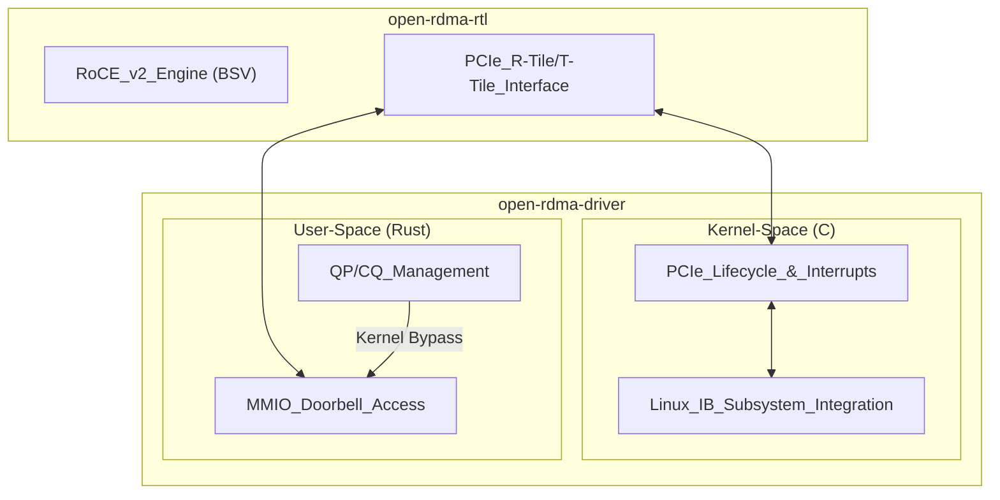
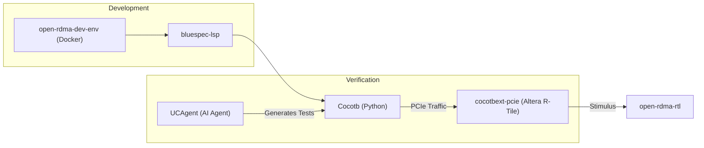

<!-- source: DeepWiki mcp.deepwiki.com · repo open-rdma/open-rdma · page 1 Open-RDMA Project Overview · fetched 2026-11-11 -->

# Open-RDMA Project Overview

Relevant source files

The following files were used as context for generating this wiki page:

- [README.md](README.md)
- [README_CN.md](README_CN.md)

The **Open-RDMA** project is a full-stack, open-source high-performance RDMA (Remote Direct Memory Access) implementation. It encompasses everything from hardware RTL design to Linux kernel and user-space drivers, specifically optimized for the demanding communication requirements of AI infrastructure.

The project is a collaborative effort initiated by **Pazhou Laboratory (Huangpu)** and **DatenLord** to provide a transparent, customizable, and vendor-neutral alternative to closed-source commercial RDMA solutions [README.md:21-23]().

## Project Motivation and Goals

Open-RDMA was created to address the "black box" nature of existing commercial RDMA NICs, which often act as bottlenecks in AI system global optimization due to legacy compatibility burdens and slow iteration cycles [README.md:21-21](). The mission is to "Break the Black Box" by providing a complete technology stack that researchers and engineers can modify and optimize for specific AI workloads.

For details, see [Project Motivation and Goals](#1.1).

**Sources:**
* [README.md:19-31]()
* [README_CN.md:19-31]()

## Project Highlights and Tech Stack

The project distinguishes itself through six key pillars:
1.  **Fully Open Source**: Transparent code from RTL to drivers [README.md:76-78]().
2.  **High Performance**: RoCE v2 inspired, Ethernet-based design with hardware-software co-optimization [README.md:82-84]().
3.  **Deeply Customizable**: FPGA-based to avoid vendor lock-in [README.md:90-92]().
4.  **AI-First**: Integration of AI-assisted development and verification tools [README.md:96-98]().
5.  **Research-Friendly**: A platform for testing novel congestion control and protocols [README.md:105-107]().
6.  **Beginner-Friendly**: Extensive guides and open materials [README.md:111-113]().

### Technology Stack
The project leverages a diverse set of languages to optimize each layer of the stack:
*   **Hardware RTL**: Bluespec SystemVerilog (BSV) [README.md:124-124]().
*   **Kernel Driver**: C [README.md:125-125]().
*   **User Driver**: Rust [README.md:126-126]().
*   **GPU Kernels**: CUDA (for communication-computation fusion) [README.md:127-127]().
*   **Verification/Inference**: Python [README.md:128-128]().

For details, see [Project Highlights and Tech Stack](#1.2).

**Sources:**
* [README.md:70-130]()
* [README_CN.md:69-129]()

## Sub-Repository Matrix

Open-RDMA is organized into several specialized repositories that form the complete ecosystem.

### Core Repositories
| Repository | Role | Primary Languages |
| :--- | :--- | :--- |
| `open-rdma-rtl` | Hardware logic for RoCE v2 protocol engine | BSV |
| `open-rdma-driver` | Dual-mode driver (Kernel-space & User-space) | C, Rust |

### Tooling and Verification
*   `open-rdma-dev-env`: Docker-based environment for simulation and debugging [README.md:157-163]().
*   `bluespec-lsp`: Language Server Protocol for BSV development [README.md:168-174]().
*   `UCAgent (Fork)`: AI Agent-driven RTL verification using Cocotb [README.md:177-182]().
*   `cocotbext-pcie (Fork)`: PCIe simulation models with Altera R-Tile support [README.md:185-191]().

**Sources:**
* [README.md:133-193]()
* [README_CN.md:132-193]()

## System Conceptual Mapping

The following diagrams illustrate how the conceptual components of the RDMA stack map to specific code entities and repositories within the Open-RDMA project.

### Hardware-Software Boundary
This diagram shows the relationship between the RTL modules, the PCIe interface, and the driver components.

**Sources:**
* [README.md:135-154]()
* [README_CN.md:134-153]()

### Verification and Environment Flow
This diagram maps the development and testing tools to the verification pipeline.

**Sources:**
* [README.md:157-191]()
* [README.md:212-242]()

---

