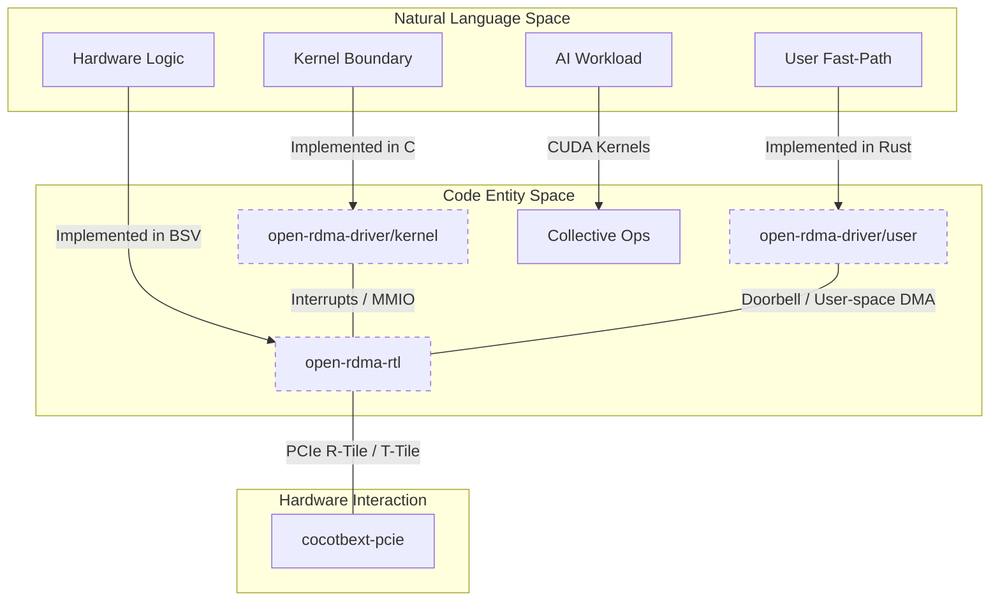
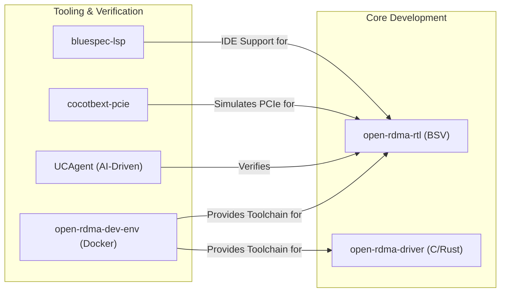

<!-- source: DeepWiki mcp.deepwiki.com · repo open-rdma/open-rdma · page 1.1 Project Motivation and Goals · fetched 2026-11-11 -->

# Project Motivation and Goals

Relevant source files

The following files were used as context for generating this wiki page:

- [README.md](README.md)
- [README_CN.md](README_CN.md)

The **Open-RDMA** project is a full-stack, open-source initiative designed to provide a high-performance Remote Direct Memory Access (RDMA) hardware and software implementation [README.md:3-5](). Developed as a collaborative effort between **Pazhou Laboratory (Huangpu)** and **DatenLord**, the project aims to address the critical infrastructure bottlenecks in modern AI large model training and inference [README.md:21-23]().

## The Problem: Closed-Source Black Boxes

Modern AI infrastructure relies heavily on RDMA for high-speed, low-latency communication between compute nodes. However, the existing ecosystem faces three primary challenges:

1.  **Legacy Constraints**: Commercial RDMA solutions, often based on protocols developed decades ago, carry significant architectural debt that hinders rapid iteration for AI-specific workloads [README.md:21]().
2.  **Vendor Lock-in**: Closed-source hardware creates a "black box" effect. Researchers and engineers cannot inspect, modify, or optimize the underlying RTL or driver logic to suit specific cluster requirements [README.md:21]().
3.  **Optimization Bottlenecks**: As hardware-software co-optimization becomes vital for AI performance, the inability to modify the RDMA stack prevents deep integration with GPU kernels and communication frameworks like NCCL [README.md:21]().

**Sources:** [README.md:19-27](), [README_CN.md:19-27]()

## The "Break the Black Box" Philosophy

Open-RDMA adopts a "Break the Black Box" philosophy, ensuring transparency from the gate level to the application layer. The project is structured to lower the technical barrier for specialized networking and cultivate a new generation of RDMA experts [README.md:23-27]().

### Target Audience
The project is designed to be accessible to three core technical groups:
*   **Hardware Engineers**: Focusing on FPGA/ASIC design using Bluespec SystemVerilog (BSV) [README.md:25,124]().
*   **Software Engineers**: Working on Linux kernel drivers (C), user-space drivers (Rust), and communication protocols [README.md:25,125-126]().
*   **Algorithm/AI Researchers**: Optimizing GPU kernels (CUDA) and testing new congestion control or communication-computation fusion (通算融合) strategies [README.md:25,127-128]().

**Sources:** [README.md:23-27](), [README_CN.md:23-27]()

## Strategic Goals

The Open-RDMA project is driven by four primary strategic objectives:

| Goal | Description |
| :--- | :--- |
| **AI-First Infrastructure** | Tailoring the RDMA stack specifically for AI collective communication (All-Reduce, All-to-All) and GPU-to-GPU transfers [README.md:96-97](). |
| **Full-Stack Transparency** | Providing a complete open-source path: `open-rdma-rtl` -> `open-rdma-driver` (Kernel/User) -> `AI Frameworks` [README.md:76-77](). |
| **Academic & Research Friendly** | Enabling researchers to implement and test experimental protocols (e.g., new congestion control) on real FPGA hardware without proprietary restrictions [README.md:105-106](). |
| **High Performance** | Utilizing RoCE v2 as a foundation, optimized via hardware-software co-design for ultra-low latency [README.md:82-83](). |

**Sources:** [README.md:70-116](), [README_CN.md:69-115]()

## System Conceptual Flow

The following diagram illustrates how the Open-RDMA philosophy translates into the physical and logical components of the codebase.

### Logic to Code Entity Mapping: Data Path
This diagram bridges the conceptual "Break the Black Box" goal to the specific sub-repositories and languages used in the project.

**Sources:** [README.md:120-130](), [README.md:133-193](), [README_CN.md:185-191]()

### Project Matrix and Integration
The project is divided into specialized repositories to allow independent iteration while maintaining a unified full-stack environment via `open-rdma-dev-env`.

**Sources:** [README.md:133-193](), [README_CN.md:132-193]()

## Technical Implementation Summary

Open-RDMA leverages a modern tech stack to ensure both safety and performance:
*   **Hardware**: Uses **Bluespec SystemVerilog (BSV)** for high-level synthesis, providing stronger type safety and modularity than traditional Verilog [README.md:124]().
*   **Kernel Driver**: Written in **C** to integrate with the standard Linux InfiniBand (IB) core subsystem [README.md:125,152]().
*   **User Driver**: Written in **Rust** to provide a memory-safe, high-performance interface for application-level RDMA operations (Queue Pair management, Memory Registration) [README.md:126,152]().
*   **Verification**: Utilizes **Python** with **Cocotb** for RTL simulation, supplemented by **UCAgent** (an AI-agent driven verification framework) to automate complex state machine testing [README.md:128,177-182]().

**Sources:** [README.md:120-130](), [README.md:133-193](), [README_CN.md:119-129]()

---

