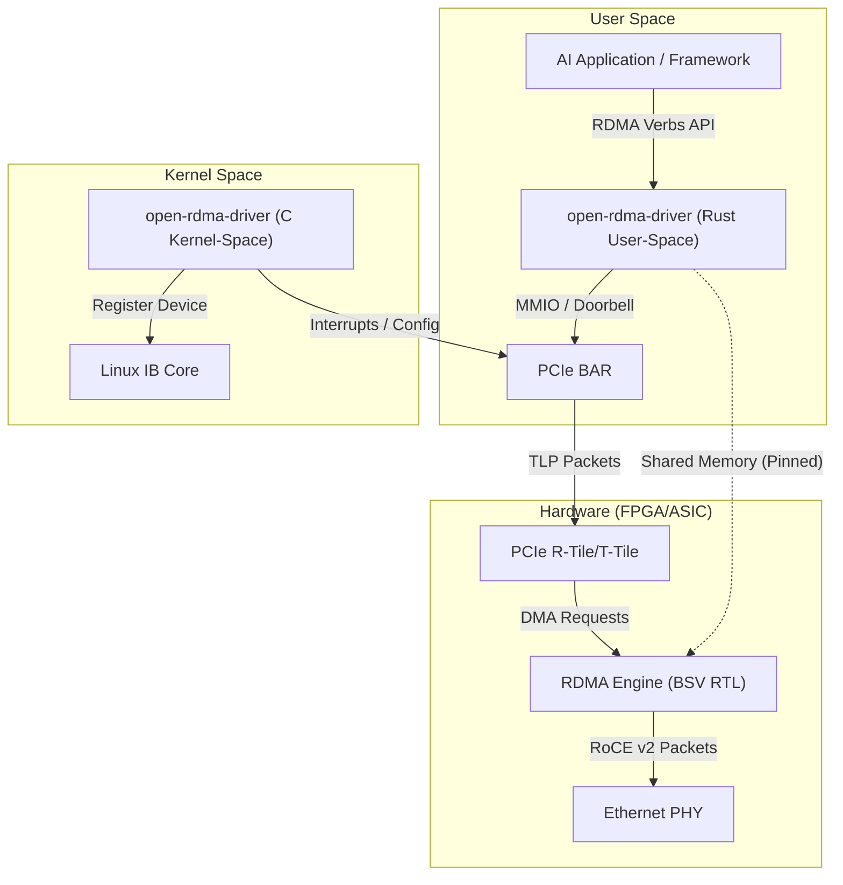
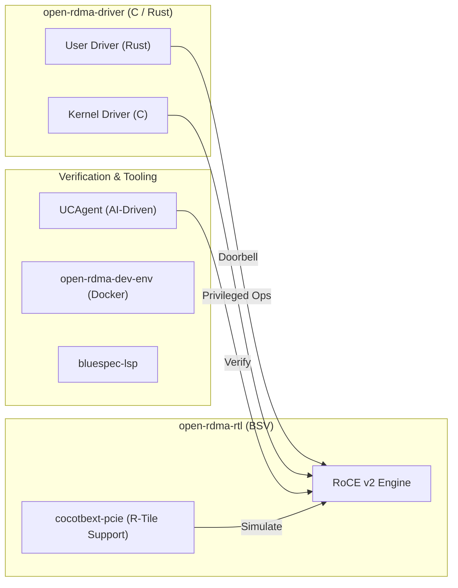

<!-- source: DeepWiki mcp.deepwiki.com · repo open-rdma/open-rdma · page 2 System Architecture · fetched 2026-11-11 -->

# System Architecture

Relevant source files

The following files were used as context for generating this wiki page:

- [README.md](README.md)
- [README_CN.md](README_CN.md)

The Open-RDMA system is a full-stack, high-performance RDMA implementation designed to bridge the gap between open-source AI software ecosystems and closed-source networking hardware. The architecture follows a hardware-software co-design philosophy, spanning from Bluespec SystemVerilog (BSV) RTL to high-performance Rust and C drivers, optimized specifically for AI infrastructure workloads [README.md:3-5, 21-23]().

### High-Level Architectural Layers

The system is partitioned into three primary layers that interact to provide a complete RoCE v2 (RDMA over Converged Ethernet) solution:

1.  **Hardware RTL Layer**: Implements the RoCE v2 protocol engine, packet processing, and DMA engines in hardware for low-latency execution [README.md:82-84, 139-143]().
2.  **Driver Layer**: A dual-component software stack consisting of a kernel-space driver for management and a user-space driver for high-performance data paths [README.md:148-152]().
3.  **AI-Infra & Tooling Layer**: Includes CUDA integration for communication-computation fusion and a verification suite powered by AI agents [README.md:96-98, 177-181]().

### System Communication Pipeline

The following diagram illustrates the flow of control and data from the user application through the software stack to the physical hardware.

**Open-RDMA Full-Stack Data and Control Path**

Sources: [README.md:120-130](), [README.md:139-152](), [README_CN.md:185-191]()

---

### Hardware RTL Layer (open-rdma-rtl)
The hardware layer is the core of the project, implemented in **Bluespec SystemVerilog (BSV)**. It handles the complex state machines required for the RoCE v2 protocol, including packet encapsulation/decapsulation and congestion control. The design targets high-performance FPGA and ASIC platforms, utilizing modern PCIe interfaces such as Intel R-Tile and T-Tile.

For details, see [Hardware RTL Layer (open-rdma-rtl)](#2.1).

Sources: [README.md:124, 139-143](), [README_CN.md:185-191]()

### Driver Layer (open-rdma-driver)
Open-RDMA employs a split-driver architecture to balance security and performance:
*   **Kernel-Space (C)**: Manages privileged operations, including PCIe device discovery, interrupt handling, and integration with the standard Linux InfiniBand (IB) subsystem.
*   **User-Space (Rust)**: Implements the "fast path" using memory-safe Rust. It manages Queue Pairs (QP) and Completion Queues (CQ) and performs kernel-bypass operations via MMIO doorbells to achieve ultra-low latency.

For details, see [Driver Layer (open-rdma-driver)](#2.2).

Sources: [README.md:125-126, 148-152]()

### AI-Infra Optimization and CUDA Integration
A key differentiator of Open-RDMA is its **AI-First** design. The architecture is co-optimized for collective communication patterns (e.g., All-Reduce) common in large model training. This includes "communication-computation fusion" (通算融合), where RDMA operations are integrated directly with GPU kernels using CUDA to minimize synchronization overhead between the NIC and GPU.

For details, see [AI-Infra Optimization and CUDA Integration](#2.3).

Sources: [README.md:96-98, 127](), [README_CN.md:126]()

---

### Code Entity Mapping

This diagram maps the high-level architectural components to their respective sub-repositories and primary implementation languages.

**Architectural Component to Code Repository Mapping**

Sources: [README.md:133-181](), [README_CN.md:167-191]()

---

