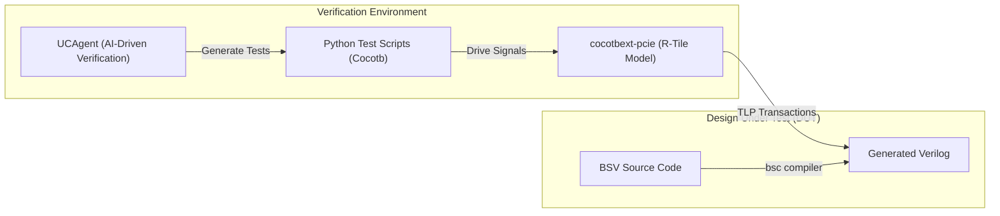

<!-- source: DeepWiki mcp.deepwiki.com · repo open-rdma/open-rdma · page 2.1 Hardware RTL Layer (open-rdma-rtl) · fetched 2026-11-11 -->

# Hardware RTL Layer (open-rdma-rtl)

Relevant source files

The following files were used as context for generating this wiki page:

- [README.md](README.md)
- [README_CN.md](README_CN.md)

The Hardware RTL layer is the core protocol engine of the Open-RDMA project. It implements the **RoCE v2** (RDMA over Converged Ethernet) protocol using **Bluespec SystemVerilog (BSV)**, providing a high-performance, low-latency data path for AI infrastructure. This layer handles the complex state machines required for RDMA operations, including packet encapsulation, congestion control, and direct memory access (DMA) via PCIe.

## Core Architecture and Data Flow

The `open-rdma-rtl` sub-repository serves as the hardware implementation of the RDMA stack. It is designed to be target-agnostic, supporting both **FPGA** (e.g., Altera/Intel Stratix 10 or Agilex) and **ASIC** deployments [README.md:13-13](). The architecture is centered around a hardware-software co-design approach to minimize CPU overhead and latency [README.md:82-83]().

### Hardware-Software Interaction Pipeline

The following diagram illustrates the relationship between the hardware entities and the software drivers.

**Diagram: Hardware-Software Entity Mapping**

```mermaid
graph TD
    subgraph "Software Space (open-rdma-driver)"
        UserApp["User Application"]
        RustDriver["User-Space Driver (Rust)"]
        KernelDriver["Kernel Driver (C)"]
        Doorbell["MMIO Doorbell Register"]
    end

    subgraph "Hardware Space (open-rdma-rtl)"
        PCIe_IP["PCIe R-Tile/T-Tile Interface"]
        DMA_Engine["DMA Engine"]
        RoCE_Engine["RoCE v2 Protocol Engine"]
        CongestionCtrl["Congestion Control Logic"]
        MAC_IP["Ethernet MAC/PHY"]
    end

    UserApp --> RustDriver
    RustDriver -- "Write Doorbell" --> Doorbell
    Doorbell -- "Trigger" --> RoCE_Engine
    RoCE_Engine -- "Fetch WQE" --> DMA_Engine
    DMA_Engine -- "PCIe Read/Write" --> PCIe_IP
    RoCE_Engine -- "Encapsulate/Decapsulate" --> MAC_IP
    RoCE_Engine <--> CongestionCtrl
```

**Sources:** [README.md:120-130](), [README.md:139-152]()

## Key Hardware Components

### 1. RoCE v2 Protocol Engine
The engine implements the RoCE v2 specification, which utilizes UDP/IP encapsulation over Ethernet. This allows RDMA traffic to be routed across standard L3 networks.
*   **Encapsulation:** Hardware automatically appends the BTH (Base Transport Header), UDP, IP, and Ethernet headers to outbound RDMA payloads.
*   **Decapsulation:** Incoming packets are validated, headers are stripped, and payloads are placed directly into the target memory location defined by the Remote Key (R_Key) and Virtual Address.
*   **Implementation Language:** The engine is written in **Bluespec SystemVerilog (BSV)**, which provides high-level hardware abstractions while maintaining cycle-accurate control [README.md:124-124]().

### 2. PCIe Interface (R-Tile/T-Tile)
The RTL layer integrates with high-speed PCIe IP cores. A specific focus is placed on Altera R-Tile support, which is critical for modern FPGA-based AI accelerators [README_CN.md:185-190]().
*   **Role:** Handles TLP (Transaction Layer Packet) generation and processing for DMA operations.
*   **Integration:** The project uses a specialized fork of `cocotbext-pcie` to simulate and verify these PCIe behaviors [README.md:185-189]().

### 3. DMA and Memory Management
The hardware manages the data path between the network and host memory without CPU intervention.
*   **Queue Pair (QP) Management:** The RTL tracks the state of Send Queues (SQ) and Receive Queues (RQ).
*   **Completion Queues (CQ):** Upon completion of a work request, the hardware generates a Completion Queue Entry (CQE) and can trigger interrupts via the PCIe MSI-X mechanism.

## Data Path Functionality

| Function | Description | Implementation Detail |
| :--- | :--- | :--- |
| **Packet Encapsulation** | Adding RoCE v2 / UDP / IP / ETH headers. | Hardware state machines in BSV. |
| **Congestion Control** | Managing flow control to prevent packet loss. | Customizable logic for research [README.md:105-106](). |
| **DMA Engine** | Direct data transfer to/from host memory. | PCIe R-Tile/T-Tile TLP generation. |
| **Doorbell Handling** | Responding to software-initiated work requests. | MMIO register mapping. |

**Sources:** [README.md:82-83](), [README.md:105-106](), [README_CN.md:189-190]()

## Verification and Simulation

Verification of the RTL is conducted using a Python-based framework, bridging the gap between hardware description and modern software testing practices.

**Diagram: RTL Verification Workflow**

*   **Cocotb:** Used for writing test benches in Python, facilitating easier integration with complex data models [README.md:180-181]().
*   **UCAgent:** An AI-agent driven framework (forked from BOSC) that automates the generation of verification scenarios for the RDMA protocol [README.md:177-181]().
*   **Bluespec LSP:** A Language Server Protocol implementation for BSV is provided to enhance the developer experience during RTL coding [README.md:168-172]().

**Sources:** [README.md:168-172](), [README.md:177-181](), [README.md:185-189]()

---

