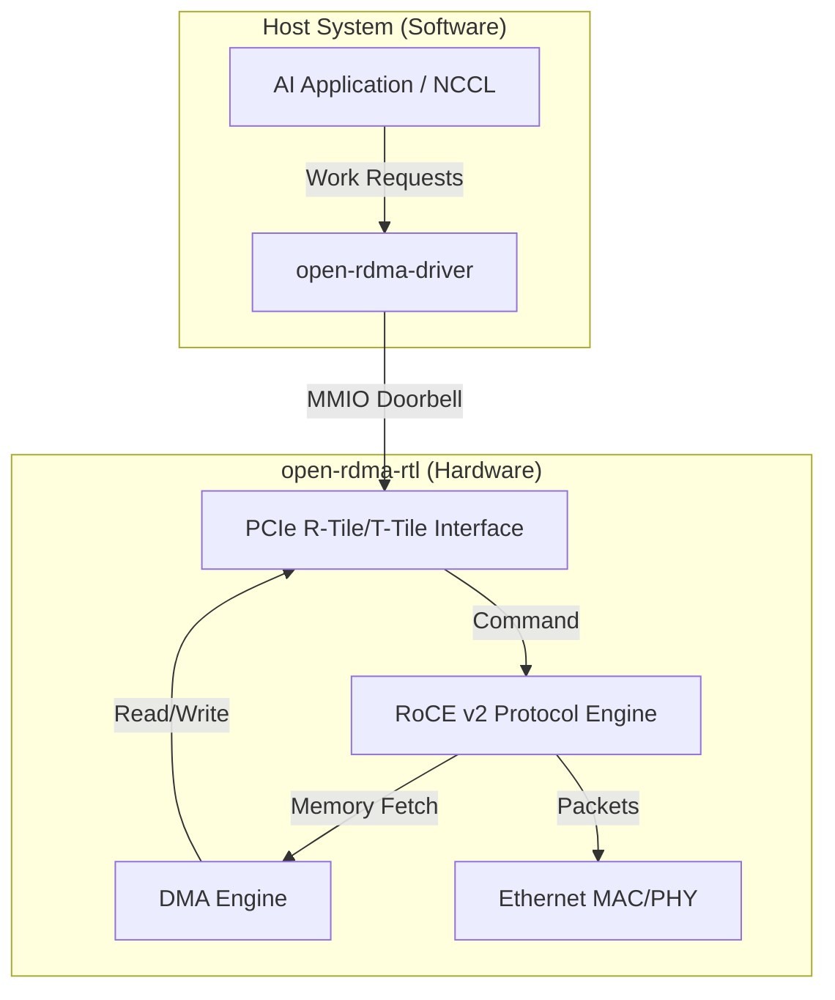
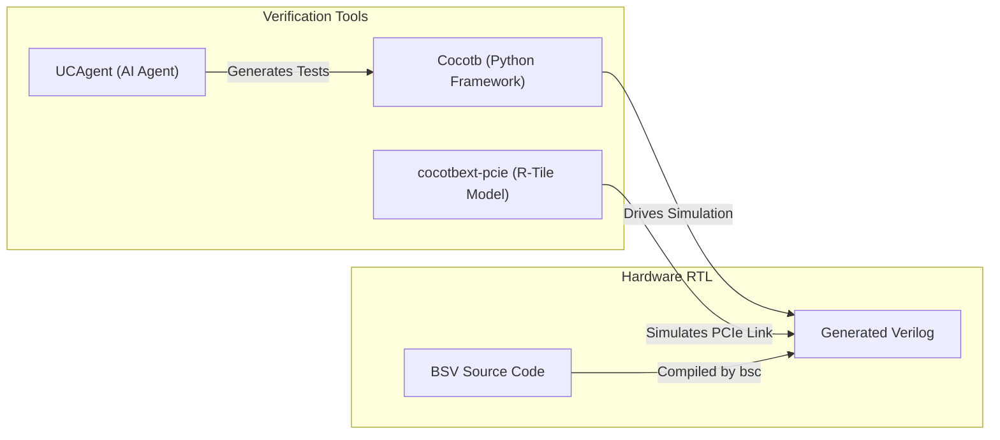

<!-- source: DeepWiki mcp.deepwiki.com · repo open-rdma/open-rdma · page 3.1 open-rdma-rtl — Hardware RTL Repository · fetched 2026-11-11 -->

# open-rdma-rtl — Hardware RTL Repository

Relevant source files

The following files were used as context for generating this wiki page:

- [README.md](README.md)
- [README_CN.md](README_CN.md)

The `open-rdma-rtl` repository contains the core hardware logic for the Open-RDMA project. It implements a high-performance RoCE v2 (RDMA over Converged Ethernet) protocol engine designed to support AI infrastructure requirements such as ultra-low latency and massive data throughput [README.md:3-5, 82-84]().

## Core Purpose and Language
The hardware layer is implemented using **Bluespec SystemVerilog (BSV)**, a high-level hardware description language that facilitates complex state machine design and formal verification [README.md:124](). This repository serves as the foundation for the full-stack RDMA implementation, bridging the gap between physical network interfaces and software drivers.

Key responsibilities include:
*   **Protocol Implementation:** Hardware-level RoCE v2 packet encapsulation and decapsulation.
*   **Data Path Management:** Managing DMA transfers between host memory and the network.
*   **Hardware-Software Interface:** Providing MMIO (Memory-Mapped I/O) doorbells for driver-initiated operations.
*   **Target Flexibility:** Designed to target both **FPGA** (Field-Programmable Gate Arrays) and **ASIC** (Application-Specific Integrated Circuits) platforms [README.md:13, 25]().

**Sources:**
* [README.md:3-5]()
* [README.md:13]()
* [README.md:25]()
* [README.md:82-84]()
* [README.md:124]()

## Hardware Architecture and Data Flow
The RTL is designed to integrate with high-speed PCIe interfaces, specifically supporting **Altera R-Tile/T-Tile** configurations through custom extensions [README_CN.md:185-190]().

### Data Path Interaction
The following diagram illustrates the relationship between the RTL modules and the external system components.

**Hardware-System Integration Map**

**Sources:**
* [README.md:27]()
* [README.md:82-84]()
* [README_CN.md:185-190]()

## Protocol Support: RoCE v2
The implementation focuses on **RoCE v2**, which utilizes UDP/IP encapsulation over Ethernet. This allows the hardware to operate in standard data center environments while providing the zero-copy and kernel-bypass benefits of RDMA [README.md:82-84]().

### Key Functional Blocks
| Block | Description | Code Implementation Language |
| :--- | :--- | :--- |
| **RoCE Engine** | Handles InfiniBand transport layer over UDP. | BSV |
| **DMA Controller** | Manages data movement between FPGA local memory and Host RAM. | BSV |
| **PCIe Interface** | Provides the physical and data link layer connectivity to the host. | BSV / Altera IP |
| **Congestion Control** | (Customizable) Logic to handle network congestion (e.g., DCQCN). | BSV |

**Sources:**
* [README.md:82-84]()
* [README.md:105-107]()
* [README.md:124]()

## Navigation and Contribution
The repository is structured to support both academic research and industrial optimization.

### Codebase Navigation
*   **BSV Source Files:** Contain the logic for state machines, arbiters, and protocol headers.
*   **Verification:** Uses **Cocotb** (Python-based) for RTL simulation, allowing engineers to write testbenches in Python while simulating the BSV logic [README.md:177-182]().
*   **Tooling:** Development is supported by `bluespec-lsp` for code navigation and `UCAgent` for AI-driven verification [README.md:168-172, 177-182]().

### Hardware Development Flow
1.  **Environment Setup:** Use the `open-rdma-dev-env` Docker image which contains the Bluespec compiler and simulation tools [README.md:212-222]().
2.  **Compilation:** BSV code is compiled into Verilog using the `bsc` compiler.
3.  **Simulation:** The generated Verilog is tested using Cocotb and `cocotbext-pcie` for host-side modeling [README_CN.md:185-190]().
4.  **Deployment:** The RTL is synthesized for target FPGA platforms (e.g., Intel Stratix 10 or Agilex).

**RTL Verification and Simulation Entity Map**

**Sources:**
* [README.md:157-161]()
* [README.md:168-172]()
* [README.md:177-182]()
* [README_CN.md:185-190]()
* [README.md:212-222]()

---

