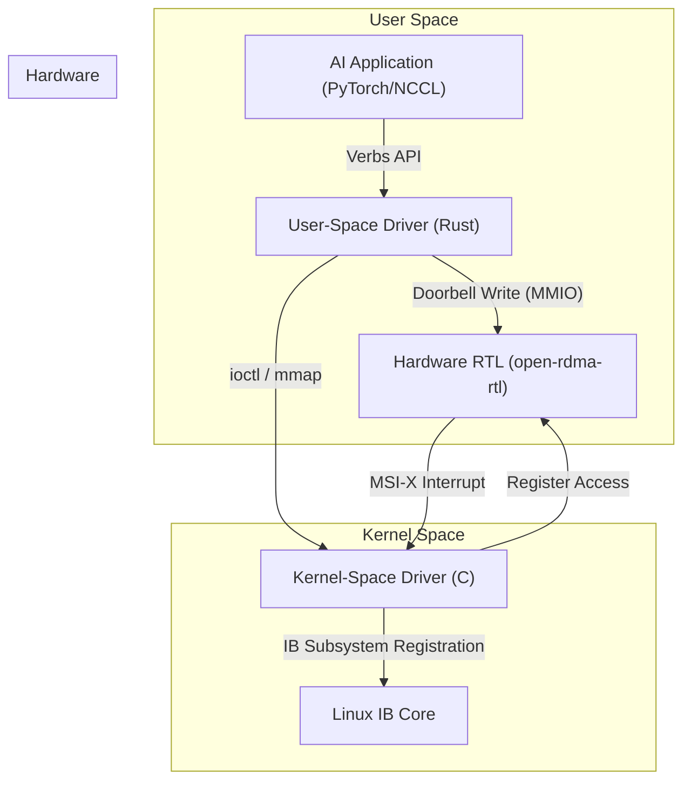
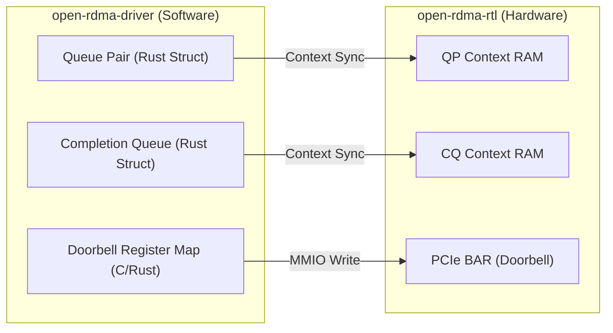

<!-- source: DeepWiki mcp.deepwiki.com · repo open-rdma/open-rdma · page 3.2 open-rdma-driver — Driver Repository · fetched 2026-11-11 -->

# open-rdma-driver — Driver Repository

Relevant source files

The following files were used as context for generating this wiki page:

- [README.md](README.md)
- [README_CN.md](README_CN.md)

The `open-rdma-driver` repository provides the essential software bridge between the Linux operating system and the Open-RDMA hardware RTL. It implements a dual-component architecture consisting of a **Kernel-Space Driver** written in C and a **User-Space Driver** written in Rust [README.md:125-126](). This split design ensures system security and stability through kernel-mediated privileged operations while enabling high-performance, low-latency data transfers via user-space kernel bypass [README.md:152]().

### Repository Structure and Components

The repository is organized to support the lifecycle of RDMA operations, from PCIe device discovery to high-level AI framework integration.

| Component | Language | Primary Responsibility | Key Interactions |
| :--- | :--- | :--- | :--- |
| **Kernel Driver** | C | PCIe probing, Interrupt handling, Memory pinning, IB subsystem integration | Linux IB Core, Hardware MMIO |
| **User Driver** | Rust | Queue Pair (QP) management, Completion Queue (CQ) polling, Doorbell registers | User applications (NCCL, PyTorch), Kernel Driver (via `ioctl`/`mmap`) |

**Sources:** [README.md:125-126](), [README.md:152]()

---

### Driver Architecture and Data Flow

The architecture follows the standard InfiniBand (IB) verbs model. The kernel driver handles the "Control Path" (privileged setup), while the user-space driver manages the "Data Path" (fast-path operations).

#### System Architecture Diagram: Driver Layer
This diagram illustrates how the `open-rdma-driver` components bridge the gap between user applications and the hardware RTL.

**Sources:** [README.md:125-126](), [README.md:152](), [README.md:76-77]()

---

### Kernel-Space Driver (C)

The kernel component is responsible for the foundational management of the RDMA hardware. It integrates with the Linux kernel's `ib_core` to expose the device as a standard RDMA interface.

*   **PCIe Lifecycle:** Implements `probe` and `remove` functions to handle device discovery and teardown on the PCIe bus.
*   **Memory Management:** Performs memory pinning and translation, ensuring that physical memory addresses are correctly mapped for DMA operations by the hardware.
*   **Interrupt Handling:** Manages MSI-X vectors to process hardware events (e.g., completion notifications or error states) and relay them to the upper layers.
*   **Security Boundary:** Validates user-space requests to prevent unauthorized access to system memory or other hardware resources.

**Sources:** [README.md:125](), [README.md:152]()

---

### User-Space Driver (Rust)

The user-space component is implemented in Rust to leverage memory safety while providing the performance necessary for AI workloads.

*   **Kernel Bypass:** Once the kernel driver sets up the memory regions and queues, the user-space driver communicates directly with the hardware via MMIO "doorbells."
*   **Resource Management:** Handles the creation and management of Queue Pairs (QP), Completion Queues (CQ), and Protection Domains (PD).
*   **AI Optimization:** Designed to integrate with AI infrastructure (e.g., NCCL) to support collective communication patterns like All-Reduce and All-to-All [README.md:96-97]().

#### Entity Mapping: Software to Hardware
This diagram maps software entities within the driver to their corresponding hardware representations in the `open-rdma-rtl`.

**Sources:** [README.md:125-126](), [README.md:152]()

---

### Development and Contribution Workflow

The `open-rdma-driver` repository serves as the central hub for project progress tracking and community engagement.

#### Weekly Report Cadence
The project maintains a strict transparency policy through weekly reports published within the driver repository's documentation folder. These reports detail:
*   Feature implementation progress.
*   Bug fixes and performance optimizations.
*   Community contributions and upcoming milestones.

Example recent reports include:
*   Weekly Report #18 (2026-05-07) [README.md:59]()
*   Weekly Report #14 (2026-04-09) [README.md:60]()
*   Weekly Report #13 (2026-04-02) [README.md:61]()

#### Contribution Process
Contributors are encouraged to follow the workflow below:
1.  **Environment Setup:** Use the `open-rdma/dev-env:latest` Docker image to ensure all C and Rust toolchains are correctly configured [README.md:218]().
2.  **Issue Tracking:** Bug reports and feature requests are managed via GitHub Issues [README.md:251-252]().
3.  **Pull Requests:** Code changes should be submitted via PRs, adhering to the project's coding standards for both C (Kernel) and Rust (User) [README.md:254]().
4.  **Discussion:** Technical questions and architectural proposals are hosted in GitHub Discussions [README.md:262]().

**Sources:** [README.md:58-62](), [README.md:212-222](), [README.md:247-262]()

---

