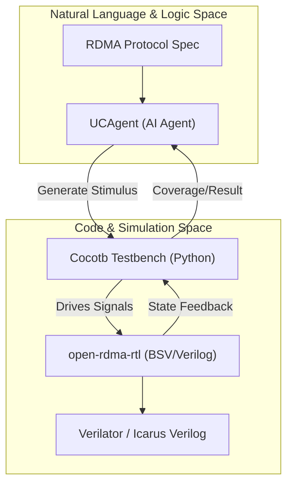
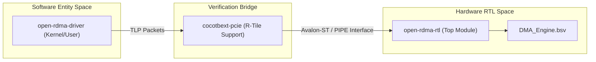

<!-- source: DeepWiki mcp.deepwiki.com · repo open-rdma/open-rdma · page 3.3 Tooling and Verification Repositories · fetched 2026-11-11 -->

# Tooling and Verification Repositories

Relevant source files

The following files were used as context for generating this wiki page:

- [README.md](README.md)
- [README_CN.md](README_CN.md)

The Open-RDMA ecosystem relies on four specialized sub-repositories to facilitate hardware development, automate verification, and provide a stable environment for cross-stack engineering. These tools bridge the gap between high-level AI frameworks and low-level hardware RTL, ensuring that the project remains accessible to researchers and developers.

## 1. Development Environment (open-rdma-dev-env)

Setting up a full-stack RDMA development environment—encompassing hardware simulation, kernel driver debugging, and user-space application development—is complex. The `open-rdma-dev-env` repository provides a Docker-based solution to standardize this process [README.md:157-163]().

### Implementation and Usage
The environment is packaged as a Docker image (`open-rdma/dev-env:latest`) containing all necessary toolchains [README.md:218]():
*   **Bluespec Compiler:** For compiling BSV RTL.
*   **Rust Toolchain:** For building the user-space driver.
*   **C/C++ Compiler:** For the Linux kernel driver.
*   **Python & Cocotb:** For RTL verification.

**Sources:** [README.md:157-163](), [README.md:218-222](), [README_CN.md:156-162]()

---

## 2. Bluespec Language Server Protocol (bluespec-lsp)

To provide a modern development experience for hardware engineers, the project includes `bluespec-lsp`. This repository implements the Language Server Protocol for Bluespec SystemVerilog (BSV), the primary hardware description language used in `open-rdma-rtl` [README.md:168-174]().

### Key Features
*   **Code Intelligence:** Provides features like go-to-definition, syntax highlighting, and real-time error reporting for BSV files.
*   **IDE Integration:** Allows hardware developers to use VS Code or other LSP-compatible editors with the same fluidity as software developers [README_CN.md:167-173]().

**Sources:** [README.md:168-174](), [README_CN.md:167-173]()

---

## 3. AI-Driven Verification (UCAgent Fork)

Open-RDMA utilizes a fork of `UCAgent`, originally developed by the Beijing Institute of Open Source Chip (BOSC). This tool uses AI agents to drive RTL verification, which is critical for managing the complex state machines of the RDMA protocol [README.md:177-182]().

### Integration with Cocotb
The Open-RDMA fork specifically adds support for the `Cocotb` testing environment [README_CN.md:175-182](). This allows the AI agents to interact directly with the Python-based test benches used to verify the `open-rdma-rtl` modules.

### Verification Flow
The following diagram illustrates how `UCAgent` integrates with the simulation pipeline to verify hardware entities.

**Diagram: AI-Agent Driven Verification Flow**

**Sources:** [README.md:177-182](), [README_CN.md:175-182]()

---

## 4. PCIe Behavioral Modeling (cocotbext-pcie Fork)

The `cocotbext-pcie` repository is a fork of the standard Cocotb PCIe extension. It provides behavioral models for PCIe simulation, which are essential for testing the hardware-to-software communication path without physical FPGA hardware [README.md:185-191]().

### Altera R-Tile Support
A major contribution of the Open-RDMA fork is the implementation of support for **Altera R-Tile** [README_CN.md:185-192](). This allows the simulation environment to accurately model the PCIe hard IP blocks found on modern Intel/Altera FPGAs, which the `open-rdma-rtl` targets.

### PCIe Simulation Architecture
The diagram below shows how `cocotbext-pcie` bridges the software driver logic and the hardware RTL during simulation.

**Diagram: PCIe Behavioral Simulation Mapping**

**Sources:** [README.md:185-191](), [README_CN.md:185-192]()

---

## Summary of Tooling Repositories

| Repository | Role | Key Technology |
| :--- | :--- | :--- |
| `open-rdma-dev-env` | Standardized dev environment | Docker, Linux |
| `bluespec-lsp` | BSV development intelligence | LSP, Haskell/Rust |
| `UCAgent` | AI-driven test generation | AI Agents, Cocotb |
| `cocotbext-pcie` | PCIe simulation models | Python, Altera R-Tile |

**Sources:** [README.md:133-193](), [README_CN.md:132-193]()

---

