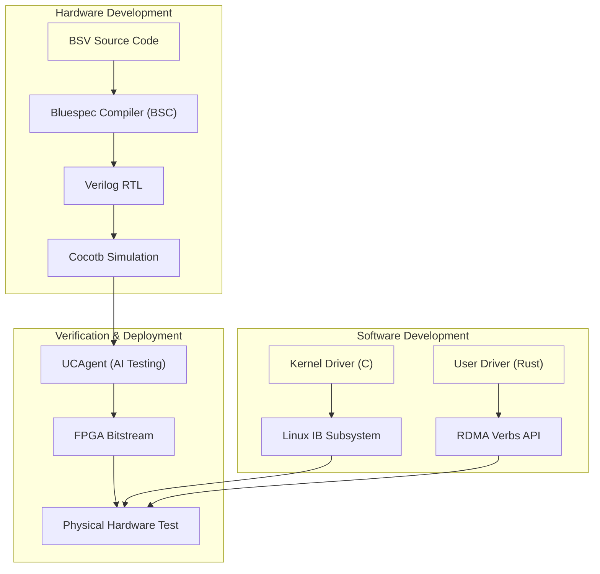

<!-- source: DeepWiki mcp.deepwiki.com · repo open-rdma/open-rdma · page 4 Development Environment and Getting Started · fetched 2026-11-11 -->

# Development Environment and Getting Started

<details>
<summary>Relevant source files</summary>

The following files were used as context for generating this wiki page:

- [README.md](README.md)
- [README_CN.md](README_CN.md)

</details>


This page provides a practical guide for new contributors and users to set up their development environment and understand the end-to-end workflow of the Open-RDMA project. The project leverages a complex stack involving hardware description languages (BSV), low-level drivers (C/Rust), and AI-driven verification tools. To simplify this, we provide both a containerized "one-click" environment and manual setup paths.

### Overview of the Development Lifecycle

The development process for Open-RDMA spans from RTL design in Bluespec SystemVerilog to software driver validation and hardware-in-the-loop testing.

#### Development Workflow Pipeline
The following diagram maps the logical stages of development to the specific code repositories and entities involved.


**Sources:** [README.md:133-163](), [README.md:177-191]()

---

### Docker Development Environment (open-rdma-dev-env)

Setting up an environment that includes the Bluespec compiler, Rust toolchains, PCIe behavioral models, and Python verification dependencies is a non-trivial task [README.md:157-161](). To lower the barrier to entry, the project provides a pre-configured Docker image.

*   **Pre-installed Tools**: Includes `bsc` (Bluespec compiler), Rust toolchain, Python with `cocotb`, and specialized forks like `cocotbext-pcie` for Altera R-Tile support [README_CN.md:185-189]().
*   **Quick Start**: You can launch the environment immediately using:
    ```bash
    docker run -it open-rdma/dev-env:latest
    ```
    Alternatively, use `docker-compose up -d` within the root directory [README_CN.md:216-222]().

For a step-by-step guide on configuring volumes and using the pre-installed toolchains, see **[Docker Development Environment (open-rdma-dev-env)](#4.1)**.

**Sources:** [README.md:157-163](), [README_CN.md:212-222]()

---

### Build, Test, and Simulation Workflow

For users who prefer a manual setup or need to customize their toolchain, the project follows a standard `make`-based workflow.

| Step | Command | Description |
| :--- | :--- | :--- |
| 1. Clone | `git clone ...` | Fetch the main repository and submodules [README_CN.md:228-230](). |
| 2. Deps | `make deps` | Install system-level dependencies and toolchains [README_CN.md:232-233](). |
| 3. Build | `make build` | Compile the BSV hardware code and software drivers [README_CN.md:235-236](). |
| 4. Test | `make test` | Run the RTL simulation suite and unit tests [README_CN.md:238-239](). |

#### Simulation Environment
The simulation workflow is heavily reliant on `cocotb`, which allows hardware modules to be tested using Python. This is bridged to PCIe behavioral models via the `cocotbext-pcie` fork [README_CN.md:185-189]().

For detailed instructions on running specific test cases and deploying to physical FPGA hardware, see **[Build, Test, and Simulation Workflow](#4.2)**.

**Sources:** [README_CN.md:225-242](), [README.md:185-191]()

---

### Contributing to Open-RDMA

Open-RDMA is a community-driven project that welcomes contributions from hardware engineers, driver developers, and AI researchers [README.md:23-25]().

#### Community and Communication
*   **Weekly Reports**: The project maintains a high-transparency development cadence with weekly reports published in the `open-rdma-driver` repository [README.md:59-61]().
*   **Discussions**: Technical questions and design proposals should be directed to [GitHub Discussions](https://github.com/open-rdma/open-rdma/discussions) [README_CN.md:262]().
*   **Reporting Issues**: Use the provided templates for [Bug Reports](https://github.com/open-rdma/open-rdma/issues/new?template=bug_report.md) or [Feature Requests](https://github.com/open-rdma/open-rdma/issues/new?template=feature_request.md) [README_CN.md:251-252]().

For more information on coding standards and the PR submission process, see **[Contributing to Open-RDMA](#4.3)**.

#### Entity Mapping: From Concepts to Repositories
The following diagram illustrates how different technical domains map to specific repositories within the project matrix.

```mermaid
graph LR
    subgraph "Logic & RTL"
        "open-rdma-rtl"["open-rdma-rtl (BSV)"]
        "bluespec-lsp"["bluespec-lsp (IDE Support)"]
    end

    subgraph "Driver & Host"
        "open-rdma-driver-kernel"["open-rdma-driver (C/Kernel)"]
        "open-rdma-driver-user"["open-rdma-driver (Rust/User)"]
    end

    subgraph "Verification"
        "UCAgent"["UCAgent (AI Agent)"]
        "cocotbext-pcie"["cocotbext-pcie (Simulation)"]
    end

    "open-rdma-dev-env"["open-rdma-dev-env (Docker)"] -- "Encompasses" --> "Logic & RTL"
    "open-rdma-dev-env" -- "Encompasses" --> "Driver & Host"
    "open-rdma-dev-env" -- "Encompasses" --> "Verification"

    style "open-rdma-dev-env" stroke-dasharray: 5 5
```
**Sources:** [README.md:133-191]()

**Sources:** [README.md:23-30](), [README.md:52-63](), [README_CN.md:247-264]()

---

