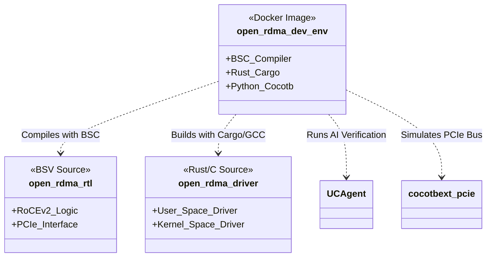

<!-- source: DeepWiki mcp.deepwiki.com · repo open-rdma/open-rdma · page 4.1 Docker Development Environment (open-rdma-dev-env) · fetched 2026-11-11 -->

# Docker Development Environment (open-rdma-dev-env)

<details>
<summary>Relevant source files</summary>

The following files were used as context for generating this wiki page:

- [README.md](README.md)
- [README_CN.md](README_CN.md)

</details>


The `open-rdma-dev-env` provides a containerized, out-of-the-box development environment designed to lower the barrier to entry for RDMA hardware and software development [README.md:157-163](). By encapsulating the complex toolchains required for Bluespec SystemVerilog (BSV) compilation, Rust-based driver development, and Cocotb-based RTL verification, the environment ensures a consistent workspace across different host systems [README.md:21-27]().

## Environment Deployment

The development environment is distributed as a Docker image (`open-rdma/dev-env:latest`) containing all necessary dependencies for the Open-RDMA tech stack [README.md:212-218]().

### Quick Start with Docker

Users can initiate the environment using standard Docker commands or via `docker-compose` for managed service orchestration [README.md:216-222]().

| Method | Command | Description |
| :--- | :--- | :--- |
| **Interactive** | `docker run -it open-rdma/dev-env:latest` | Starts an interactive shell with all tools pre-loaded. |
| **Compose** | `docker-compose up -d` | Runs the environment in the background as defined in the project's compose file. |

**Sources:** [README.md:216-222]()

### Development Lifecycle Data Flow

The following diagram illustrates how the Docker environment bridges the gap between the various sub-repositories and the local developer machine.

**Development Environment Integration Map**
```mermaid
graph TD
    subgraph "Host Machine"
        [LocalSource] --> |"Mounted Volume"| D_CONT["Docker Container (open-rdma/dev-env)"]
    end

    subgraph "Docker Container Toolchains"
        D_CONT --> BSV_C["Bluespec Compiler (BSC)"]
        D_CONT --> RUST_TC["Rust Toolchain (Cargo)"]
        D_CONT --> PY_V["Python (Cocotb/Verification)"]
        D_CONT --> GCC["C Compiler (Kernel Headers)"]
    end

    subgraph "Code Entities"
        BSV_C --> RTL["open-rdma-rtl"]
        RUST_TC --> U_DRIVER["open-rdma-driver (User-space)"]
        GCC --> K_DRIVER["open-rdma-driver (Kernel-space)"]
        PY_V --> SIM["Cocotb Simulation / UCAgent"]
    end

    RTL -.-> |"Simulated Hardware"| SIM
    U_DRIVER -.-> |"IOCTL / MMIO"| K_DRIVER
```
**Sources:** [README.md:120-130](), [README.md:139-163]()

## Pre-installed Toolchains and Dependencies

The image is specifically configured to support the multi-language nature of the Open-RDMA project [README.md:120-130]().

### 1. Hardware RTL Toolchain
*   **Bluespec Compiler (BSC):** Used for compiling the high-level Bluespec SystemVerilog code found in `open-rdma-rtl` [README.md:124-124](), [README.md:139-143]().
*   **Verilator / Icarus Verilog:** Simulation backends for executing the generated Verilog from BSV.
*   **bluespec-lsp:** Pre-configured Language Server Protocol for BSV to support IDE features like autocompletion and jump-to-definition [README.md:168-173]().

### 2. Software Driver Toolchain
*   **Rust Toolchain (Cargo/rustc):** Essential for building the high-performance user-space driver components [README.md:126-126](), [README.md:152-154]().
*   **C Build Tools (GCC/Make):** Required for the Linux kernel-space driver component [README.md:125-125]().
*   **Kernel Headers:** Necessary headers for compiling out-of-tree kernel modules.

### 3. Verification and Simulation Framework
*   **Python 3:** The primary language for the verification suite [README.md:128-128]().
*   **Cocotb:** The coroutine-based hardware verification framework used to test RTL modules [README.md:180-182]().
*   **UCAgent (Fork):** Integration with the AI-driven RTL verification framework for automated test bench generation [README.md:177-182]().
*   **cocotbext-pcie (Fork):** Specialized models for PCIe R-Tile simulation, enabling hardware-accurate bus modeling in software [README.md:185-190]().

**Sources:** [README.md:120-130](), [README.md:133-193]()

## Relationship Between Tools and Codebase

The environment maps specific toolchains to the functional layers of the Open-RDMA architecture.

**Toolchain-to-Code Entity Mapping**

**Sources:** [README.md:133-193]()

## Manual Setup and Build Workflow

While the Docker environment is recommended, the project supports manual dependency installation and building via a unified `Makefile` [README.md:227-240]().

1.  **Dependency Resolution:** `make deps` installs the necessary system-level libraries and toolchains on a clean host [README.md:233-233]().
2.  **Compilation:** `make build` triggers the concurrent compilation of the BSV RTL and the driver source code [README.md:236-236]().
3.  **Verification:** `make test` executes the Cocotb-based simulation suite to verify the hardware logic against protocol specifications [README.md:239-239]().

**Sources:** [README.md:227-240]()

---

