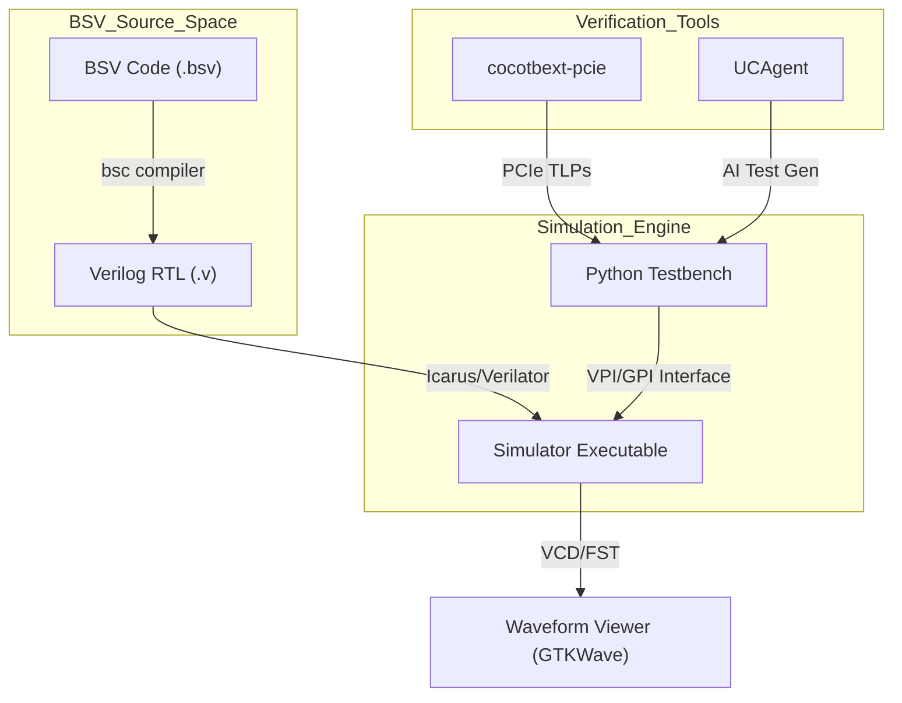
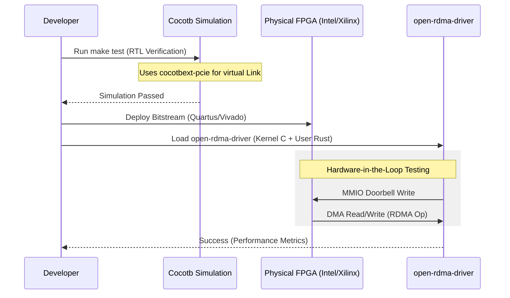

<!-- source: DeepWiki mcp.deepwiki.com · repo open-rdma/open-rdma · page 4.2 Build, Test, and Simulation Workflow · fetched 2026-11-11 -->

# Build, Test, and Simulation Workflow

Relevant source files

The following files were used as context for generating this wiki page:

- [README.md](README.md)
- [README_CN.md](README_CN.md)

This page details the end-to-end lifecycle of the Open-RDMA project, spanning from initial environment setup and manual builds to advanced RTL simulation using Cocotb and hardware-in-the-loop deployment on physical FPGAs.

## Manual Build Workflow

The Open-RDMA project provides a standardized manual build sequence for developers who prefer working outside the pre-configured Docker environment or need to integrate the project into custom CI/CD pipelines.

### Standard Build Sequence
The build process follows a four-step sequence defined in the project's root automation:

1.  **Clone**: Retrieve the repository and its submodules.
2.  **Dependencies**: Install necessary toolchains (Bluespec, Rust, C compilers).
3.  **Build**: Compile the RTL modules and software drivers.
4.  **Test**: Execute unit tests and simulation suites.

| Step | Command | Description |
| :--- | :--- | :--- |
| **Clone** | `git clone https://github.com/open-rdma/open-rdma.git` | Downloads the core orchestration repository [README_CN.md:229-230](). |
| **Deps** | `make deps` | Installs system-level dependencies required for compilation [README_CN.md:233-234](). |
| **Build** | `make build` | Compiles Bluespec SystemVerilog into Verilog and builds the C/Rust driver components [README_CN.md:235-237](). |
| **Test** | `make test` | Triggers the automated test suite for both hardware and software layers [README_CN.md:238-240](). |

**Sources:** [README_CN.md:228-241]()

## RTL Simulation Pipeline

The Open-RDMA project utilizes **Cocotb**, a Python-based verification framework, to simulate hardware modules written in Bluespec SystemVerilog (BSV). This allows developers to write hardware test benches in Python, leveraging high-level libraries for protocol verification.

### Simulation Data Flow
The pipeline bridges the gap between BSV hardware definitions and Python verification logic.

**Figure 1: RTL Simulation Architecture**

**Sources:** [README.md:177-190](), [README_CN.md:180-192]()

### Key Verification Components
*   **cocotbext-pcie (Fork)**: A specialized extension providing behavioral models for PCIe. Open-RDMA's fork specifically adds support for **Altera R-Tile**, enabling simulation of high-performance PCIe Gen5 interfaces used in modern FPGAs [README.md:185-190]().
*   **UCAgent (Fork)**: An AI-driven verification agent originally from the Beijing Institute of Open Source Chip (BOSC). It automates the generation of test cases for complex RDMA state machines and integrates directly with the Cocotb environment [README.md:177-182]().

## Hardware-in-the-Loop (HIL) Testing

The workflow transitions from pure software simulation to physical hardware deployment using a unified testing strategy.

### From Simulation to Physical Deployment
The project supports a "Simulation-First" approach where the same driver code and test logic are applied to both the simulated RTL and the physical FPGA bitstream.

**Figure 2: Hardware-in-the-Loop Workflow**

**Sources:** [README.md:27-28](), [README.md:151-153](), [README_CN.md:90-91]()

### Tooling Integration
The transition between these phases is facilitated by the following repository matrix:
*   **open-rdma-rtl**: Provides the BSV source that is synthesized for the FPGA or compiled for simulation [README.md:139-143]().
*   **open-rdma-driver**: Contains the dual-stack driver (C for kernel, Rust for user-space) that interacts with the hardware via PCIe [README.md:148-153]().
*   **open-rdma-dev-env**: Ensures the toolchain (e.g., `bsc` for BSV, `rustc` for drivers, and `python` for Cocotb) is consistent across all stages [README.md:157-161]().

**Sources:** [README.md:133-163](), [README_CN.md:132-162]()

---

