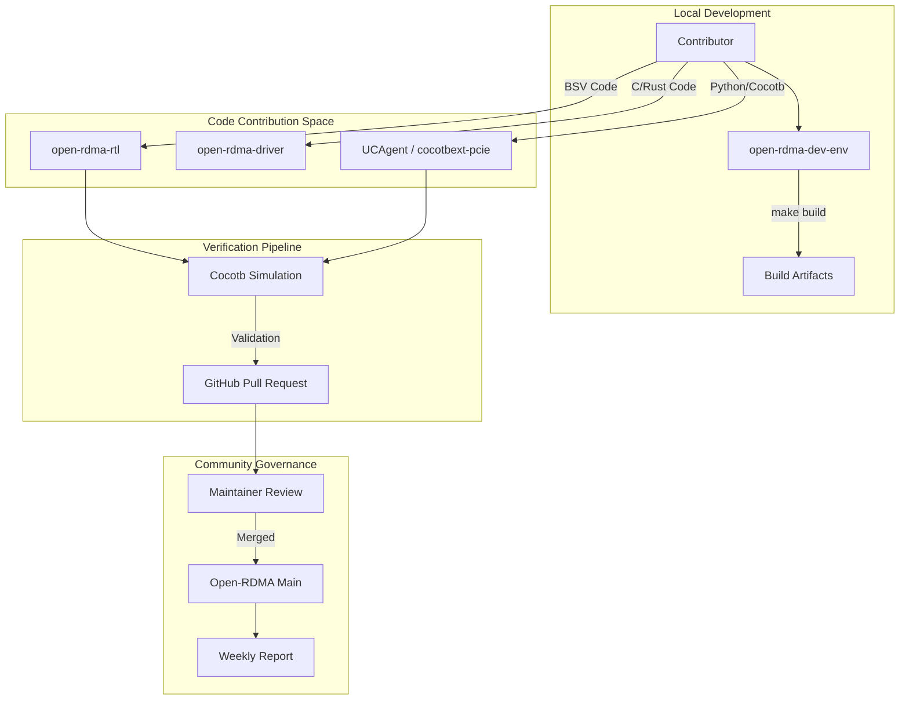
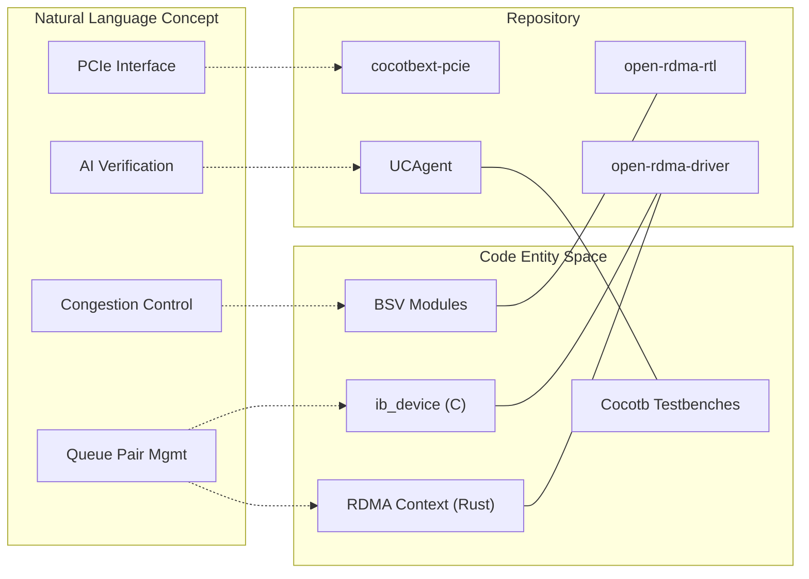

<!-- source: DeepWiki mcp.deepwiki.com · repo open-rdma/open-rdma · page 4.3 Contributing to Open-RDMA · fetched 2026-11-11 -->

# Contributing to Open-RDMA

Relevant source files

The following files were used as context for generating this wiki page:

- [README.md](README.md)
- [README_CN.md](README_CN.md)

The Open-RDMA project is a full-stack, open-source initiative aimed at breaking the "black box" of commercial RDMA solutions by providing transparent RTL, drivers, and AI-optimized communication stacks [README.md:3-7](). As a collaborative effort between Pazhou Laboratory and DatenLord, the project relies on community contributions to iterate quickly and adapt to evolving AI infrastructure requirements [README.md:21-23]().

## Contribution Channels

Contributors can engage with the project through several GitHub-native mechanisms:

*   **Bug Reports:** Technical issues or unexpected behaviors should be reported using the provided bug report template [README.md:251]().
*   **Feature Requests:** Proposals for new functionality, such as novel congestion control algorithms or support for new FPGA targets, can be submitted via the feature request template [README.md:252]().
*   **Pull Requests (PR):** Code contributions are welcomed across all sub-repositories, including hardware RTL, kernel drivers, and user-space libraries [README.md:254-256]().
*   **GitHub Discussions:** General questions, architectural debates, and troubleshooting should be directed to the project's Discussion forum [README.md:262]().

### Weekly Reporting Cadence
The project maintains high transparency through a weekly reporting cycle. These reports summarize progress across the `open-rdma-driver` and `open-rdma-rtl` repositories, documenting milestones like Star count growth and technical updates [README.md:58-61](). Contributors are encouraged to review these reports to stay aligned with the project's current development focus.

**Sources:**
* [README.md:3-7]()
* [README.md:21-23]()
* [README.md:58-61]()
* [README.md:251-262]()

---

## Sub-Repository Contribution Matrix

The project is modularized into specialized repositories. Contributors should target their PRs based on the technical domain:

| Domain | Repository | Primary Languages |
| :--- | :--- | :--- |
| Hardware Logic | `open-rdma-rtl` | Bluespec SystemVerilog (BSV) |
| Kernel Operations | `open-rdma-driver` (Kernel) | C |
| User-Space Path | `open-rdma-driver` (User) | Rust |
| AI Integration | `open-rdma` | CUDA, Python |
| Verification | `UCAgent`, `cocotbext-pcie` | Python (Cocotb) |

### Development Workflow Diagram
This diagram illustrates the flow from a contributor's local environment through the specialized sub-repositories to the final integrated system.

**Contributor Integration Flow**

**Sources:**
* [README.md:120-130]()
* [README.md:133-193]()
* [README.md:212-242]()

---

## Technical Standards and Tooling

To maintain high performance and safety, specific languages and tools are mandated for different layers of the stack [README.md:120-130]():

1.  **Hardware (RTL):** Uses **Bluespec SystemVerilog (BSV)**. Contributors are encouraged to use `bluespec-lsp` for an enhanced development experience [README.md:168-172]().
2.  **Kernel Driver:** Implemented in **C** to interface with the Linux InfiniBand subsystem [README.md:125](), [README.md:152]().
3.  **User-Space Driver:** Implemented in **Rust** to provide memory-safe, high-performance access to MMIO and doorbells [README.md:126]().
4.  **Verification:** Employs **Cocotb** (Python) for hardware-in-the-loop simulation. Contributions to verification should leverage `UCAgent` for AI-driven test generation and `cocotbext-pcie` for PCIe R-Tile modeling [README.md:176-191]().

### Hardware-Software Interaction Mapping
The following diagram maps natural language components to the specific code entities and repositories where contribution takes place.

**System Component to Code Entity Mapping**

**Sources:**
* [README.md:120-130]()
* [README.md:139-153]()
* [README.md:176-191]()

---

## Getting Started for Contributors

New contributors should follow the standard onboarding path to ensure their environment matches the project's CI/CD pipeline:

1.  **Environment Setup:** Pull the pre-configured Docker image `open-rdma/dev-env:latest` [README.md:218](). This image contains the Bluespec compiler, Rust toolchain, and Python verification dependencies.
2.  **Dependency Installation:** Run `make deps` within the cloned `open-rdma` repository to fetch sub-repository dependencies [README.md:233]().
3.  **Local Validation:** Execute `make build` and `make test` to verify the environment before making changes [README.md:236-239]().
4.  **Licensing:** All contributions must adhere to the **Apache 2.0 License** [README.md:268]().

**Sources:**
* [README.md:212-242]()
* [README.md:268]()

---

