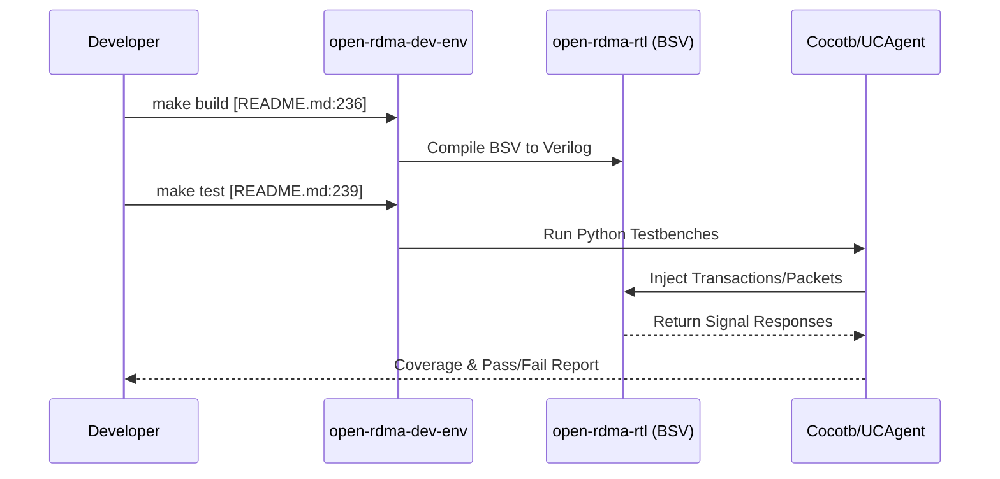

<!-- source: DeepWiki mcp.deepwiki.com · repo open-rdma/open-rdma · page 5 Verification and Testing Framework · fetched 2026-11-11 -->

# Verification and Testing Framework

<details>
<summary>Relevant source files</summary>

The following files were used as context for generating this wiki page:

- [README.md](README.md)
- [README_CN.md](README_CN.md)

</details>


The Open-RDMA project employs a multi-layered verification strategy designed to ensure the reliability of the high-performance RoCE v2 protocol engine and its associated software stack. Given the complexity of RDMA state machines and the asynchronous nature of network events, the framework combines traditional simulation with AI-driven test generation.

### Verification Strategy Overview

The framework spans from low-level hardware RTL verification to full-stack driver testing. The strategy focuses on:
*   **Hardware Correctness:** Using Python-based testbenches to verify Bluespec SystemVerilog (BSV) modules.
*   **Protocol Compliance:** Validating RoCE v2 packet formats and state transitions.
*   **System Integration:** Simulating PCIe interactions and memory-mapped I/O (MMIO) operations.
*   **Automation:** Leveraging AI agents to explore complex corner cases in the hardware logic.

### Framework Components

The following diagram illustrates the relationship between the verification tools and the core codebase entities:

**Verification Architecture: Code to Test Mapping**

```mermaid
graph TD
    subgraph "Verification Tools"
        ["Cocotb_Python_Scripts"] -- "Drives" --> ["BSV_DUT"]
        ["UCAgent_AI"] -- "Generates" --> ["Cocotb_Python_Scripts"]
        ["cocotbext_pcie"] -- "Models" --> ["Altera_R_Tile"]
    end

    subgraph "open-rdma-rtl (Hardware)"
        ["BSV_DUT"] -- "Implements" --> ["RoCE_v2_Engine"]
        ["Altera_R_Tile"] -- "Interface" --> ["PCIe_Transaction_Layer"]
    end

    subgraph "open-rdma-driver (Software)"
        ["User_Space_Driver_Rust"] -- "Issues" --> ["Doorbell_MMIO"]
        ["Kernel_Space_Driver_C"] -- "Manages" --> ["DMA_Buffers"]
    end

    ["Cocotb_Python_Scripts"] -.-> ["Doorbell_MMIO"]
    ["Cocotb_Python_Scripts"] -.-> ["DMA_Buffers"]
```
Sources: [README.md:124-128](), [README.md:177-189](), [README_CN.md:176-192]()

---

### 5.1 Cocotb-Based RTL Verification

The primary verification method for the hardware RTL is based on **Cocotb**, a coroutine-based framework that allows writing testbenches in Python. This approach bridges the gap between high-level protocol modeling and low-level signal transitions in the BSV-generated Verilog.

Key features include:
*   **PCIe Modeling:** Integration with a specialized fork of `cocotbext-pcie` that supports Altera R-Tile behavioral models, enabling realistic simulation of host-to-device communication [README.md:185-189]().
*   **Protocol Verification:** Python scripts simulate RDMA verbs and packet injection to verify the RoCE v2 engine logic [README.md:82-84]().

For details on testbench structure and PCIe simulation, see [Cocotb-Based RTL Verification](#5.1).

**Sources:** [README.md:185-189](), [README_CN.md:185-192]()

---

### 5.2 UCAgent — AI-Driven RTL Verification

To address the state-space explosion inherent in RDMA protocol verification, Open-RDMA utilizes **UCAgent**, an AI-driven framework originally developed by the Beijing Institute of Open Source Chip (BOSC).

Open-RDMA has extended UCAgent to:
*   **Automate Test Generation:** Use AI agents to generate Cocotb-compatible test cases [README.md:177-181]().
*   **Enhance Coverage:** Target complex asynchronous events and congestion control scenarios that are difficult to reach with manual testing [README.md:96-98]().
*   **Cocotb Integration:** Provide a seamless path from AI-generated scenarios to RTL simulation execution [README_CN.md:176-182]().

For details on the AI agent architecture and its integration with the BSV workflow, see [UCAgent — AI-Driven RTL Verification](#5.2).

**Sources:** [README.md:177-181](), [README_CN.md:176-182]()

---

### Verification Workflow

The verification process is integrated into the standard development lifecycle, ensuring that any changes to the RTL or drivers are validated before deployment on physical FPGA hardware.

**Verification Lifecycle**


Sources: [README.md:212-240](), [README_CN.md:210-242]()

| Verification Layer | Tooling | Focus Area |
| :--- | :--- | :--- |
| **RTL Unit Testing** | Cocotb | Individual BSV modules (Queues, Arbiters) |
| **Protocol Logic** | UCAgent + Cocotb | RoCE v2 State Machine, Packet Header parsing |
| **PCIe Interface** | cocotbext-pcie | Altera R-Tile TLP/DLLP handling [README.md:189]() |
| **Driver/Software** | Linux IB Subsystem | Verbs API compliance, Memory Registration |

**Sources:** [README.md:139-163](), [README.md:177-189](), [README.md:232-240]()

---

