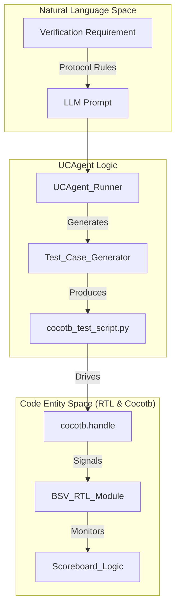
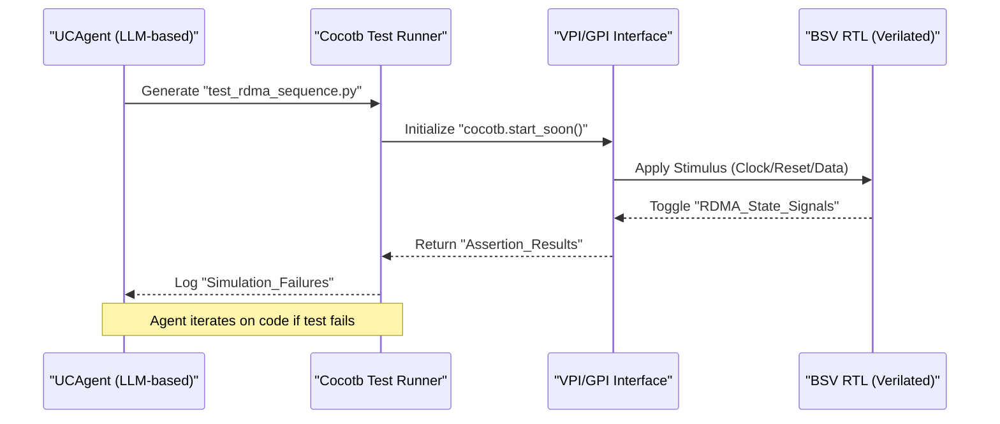
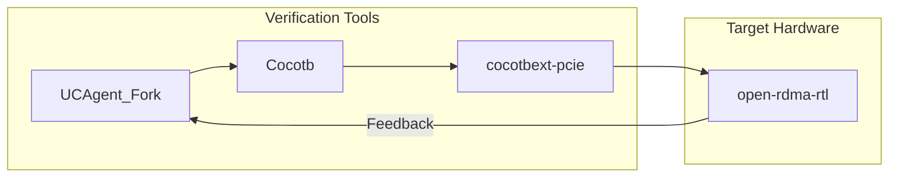

<!-- source: DeepWiki mcp.deepwiki.com · repo open-rdma/open-rdma · page 5.2 UCAgent — AI-Driven RTL Verification · fetched 2026-11-11 -->

# UCAgent — AI-Driven RTL Verification

Relevant source files

The following files were used as context for generating this wiki page:

- [README.md](README.md)
- [README_CN.md](README_CN.md)

The UCAgent component in the Open-RDMA ecosystem represents an AI-first approach to hardware verification. Originally developed by the Beijing Institute of Open Source Chip (BOSC), Open-RDMA maintains a specialized fork of UCAgent to automate the generation, execution, and debugging of test benches for complex RDMA RTL modules. By leveraging Large Language Models (LLMs) as agents, UCAgent addresses the high state-space complexity inherent in RDMA protocol state machines and asynchronous event handling.

### Origin and Integration
UCAgent was integrated into the Open-RDMA project to lower the technical barrier for verifying high-performance networking hardware [README.md:96-98](). While the original tool focused on traditional Verilog environments, the Open-RDMA fork introduces critical support for the **Cocotb** (Coroutine-based Co-simulation Testbench) framework [README_CN.md:176-182](). This integration allows AI agents to interact with Bluespec SystemVerilog (BSV) modules via Python-based verification environments.

**Sources:** [README.md:177-182](), [README_CN.md:176-182]()

---

### AI-Driven Verification Workflow
UCAgent operates as an autonomous agent that bridges the gap between natural language specifications (e.g., RoCE v2 protocol requirements) and executable Python verification code.

#### Natural Language to Code Entity Mapping
The following diagram illustrates how UCAgent translates high-level verification requirements into specific code entities within the Open-RDMA verification stack.

**UCAgent Verification Translation Path**

**Sources:** [README.md:96-98](), [README_CN.md:176-182]()

---

### Cocotb Integration and RDMA Complexity
RDMA verification is uniquely challenging due to:
1.  **Complex State Machines:** Managing Queue Pair (QP) states (Reset, RTR, RTS).
2.  **Asynchronous Events:** Handling out-of-order packets and retransmission timers.
3.  **PCIe Interactions:** Coordinating with DMA engines and doorbell registers.

UCAgent addresses these by generating Cocotb drivers that utilize the `cocotbext-pcie` fork to simulate Altera R-Tile behaviors [README_CN.md:185-190]().

#### Data Flow: Agent-to-Simulator
The data flow below describes how UCAgent orchestrates the simulation environment using the tools pre-installed in the `open-rdma/dev-env` [README.md:157-163]().

**UCAgent Execution Data Flow**

**Sources:** [README.md:128-130](), [README.md:177-182](), [README_CN.md:157-163]()

---

### Key Capabilities in Open-RDMA

| Feature | Implementation Detail |
| :--- | :--- |
| **Automated Test Generation** | Generates Python scripts that use `cocotb` to drive BSV interfaces. |
| **Protocol Awareness** | Uses AI to interpret RoCE v2 packet formats and expected responses. |
| **Failure Analysis** | Analyzes simulation logs to suggest RTL fixes or test bench adjustments. |
| **Integration with Dev-Env** | Runs within the standard Docker environment (`open-rdma/dev-env`) using `make test` [README_CN.md:216-222](). |

### Role in the Tech Stack
UCAgent sits at the intersection of the hardware and software layers, ensuring that the `open-rdma-rtl` implementation matches the requirements expected by the `open-rdma-driver` [README.md:139-154]().

**UCAgent Positioning**

**Sources:** [README.md:177-190](), [README_CN.md:176-192]()

---

