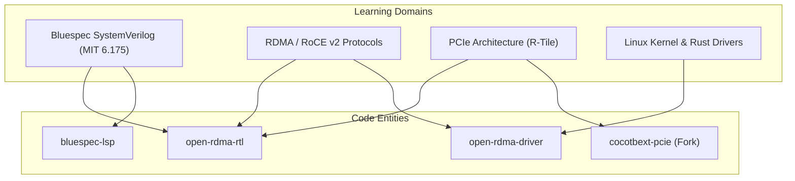
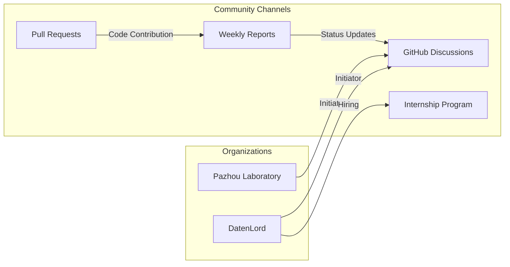

<!-- source: DeepWiki mcp.deepwiki.com · repo open-rdma/open-rdma · page 6 Learning Resources and Community · fetched 2026-11-11 -->

# Learning Resources and Community

Relevant source files

The following files were used as context for generating this wiki page:

- [README.md](README.md)
- [README_CN.md](README_CN.md)

The Open-RDMA project is designed not only as a high-performance technology stack but also as an educational platform for researchers, students, and practitioners [README.md:9-10](). This page provides an overview of the learning materials available for the project's core technologies, information on the collaborating organizations, and ways to engage with the community.

## 6.1 Learning Resources by Domain

Open-RDMA leverages a diverse technology stack including Bluespec SystemVerilog (BSV), RDMA protocols, and PCIe architecture [README.md:120-130](). To help contributors navigate these complex domains, we have curated a list of resources ranging from university courses to technical tutorials.

For a comprehensive list of categorized links, see **[Learning Resources by Domain](#6.1)**.

### Technology-to-Code Mapping
The following diagram illustrates how the core learning domains map to specific components within the Open-RDMA repository matrix.

**Domain-to-Repository Mapping**

**Sources:** [README.md:133-192](), [README_CN.md:196-207]()

## 6.2 License and Governance

Open-RDMA is a collaborative effort initiated by **Pazhou Laboratory (Huangpu)** and **DatenLord** [README.md:23-24](). The project aims to break the "black box" of proprietary RDMA solutions by providing a fully transparent, full-stack implementation [README.md:27-28]().

The project is released under the **Apache 2.0 License** [README.md:11](), promoting open academic research and industrial customization without vendor lock-in [README.md:90-108]().

For details on organizational roles and licensing clarifications, see **[License and Governance](#6.2)**.

### Organization and Contribution Structure
The following diagram shows the relationship between the governing organizations and the contribution channels.

**Governance and Community Interaction**

**Sources:** [README.md:23-43](), [README.md:52-66](), [README.md:247-268]()

## Community Engagement

### Weekly Reports
The project maintains a high level of transparency through weekly status updates. These reports track progress across the hardware and software layers, particularly within the `open-rdma-driver` repository [README.md:58-62]().
*   **Source:** `open-rdma-driver/docs/zh-CN/records/weekly-report/` [README.md:59-61]()

### Internships and Careers
DatenLord actively recruits interns interested in AI infrastructure, GPU kernel optimization, and RTL verification [README.md:39-43]().
*   **Contact:** `info(at)datenlord.com` [README.md:41]()

### Getting Involved
We welcome all forms of contribution, from bug reports to new feature proposals [README.md:249-254]().
*   **Discussions:** [GitHub Discussions](../../discussions) [README.md:262]()
*   **Guidelines:** Refer to the `CONTRIBUTING.md` file in the root directory [README.md:256]().

**Sources:** [README.md:39-66](), [README.md:247-262]()

---

