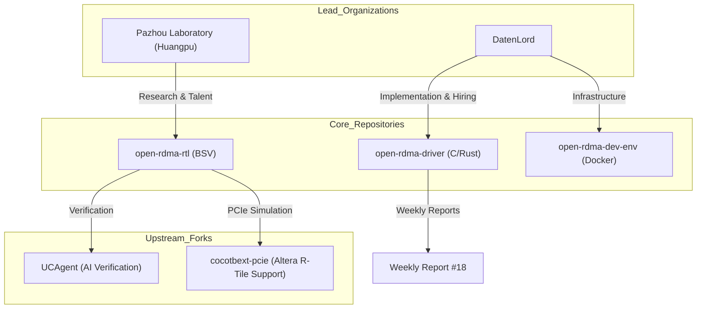
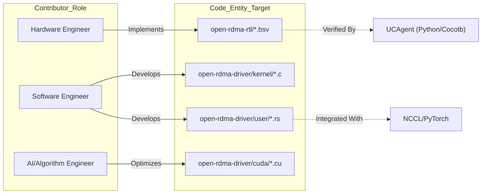

<!-- source: DeepWiki mcp.deepwiki.com · repo open-rdma/open-rdma · page 6.2 License and Governance · fetched 2026-11-11 -->

# License and Governance

Relevant source files

The following files were used as context for generating this wiki page:

- [LICENSE](LICENSE)
- [README.md](README.md)

This page documents the legal framework and organizational structure of the Open-RDMA project. It clarifies the licensing situation between the repository's metadata and its legal files, identifies the lead organizations, and outlines the project's collaborative governance model.

## 1. Licensing Framework

The Open-RDMA project aims to provide a fully transparent, open-source stack for AI infrastructure [README.md:76-78](). While the primary repository contains a `LICENSE` file referencing the **GNU General Public License v2.0 (GPLv2)** [LICENSE:1-2](), the project's public-facing documentation and repository badges specify the **Apache License 2.0** [README.md:11]().

### 1.1 License Clarification
The project adopts a permissive approach for its ecosystem to encourage industrial adoption and deep customization without vendor lock-in [README.md:90-91]().

| Component | Stated License (Badge) | File License (Header/Root) |
| :--- | :--- | :--- |
| **Open-RDMA (Root)** | Apache 2.0 | GPLv2 |
| **open-rdma-rtl** | Apache 2.0 | TBD |
| **open-rdma-driver** | Apache 2.0 | TBD |

### 1.2 Open-Source Philosophy: "Break the Black Box"
The licensing choice supports the "Break the Black Box" philosophy, which seeks to resolve the contradiction between closed-source commercial RDMA NICs and the open-source AI software ecosystem [README.md:21-27](). By providing a complete stack—from Bluespec SystemVerilog RTL to Rust user-space drivers—the project enables:
*   **Academic Research:** Quick customization of experimental platforms for congestion control [README.md:105-107]().
*   **Hardware-Software Co-optimization:** Global optimization of AI systems by removing networking bottlenecks [README.md:21-23]().

**Sources:**
* [README.md:11-14]()
* [README.md:21-27]()
* [README.md:76-78]()
* [README.md:90-91]()
* [README.md:105-107]()
* [LICENSE:1-5]()

---

## 2. Project Governance and Organizations

Open-RDMA is a collaborative initiative co-founded by research and industrial partners to bridge the gap between academic theory and production-grade AI infrastructure.

### 2.1 Lead Organizations
*   **Pazhou Laboratory (Huangpu):** Focuses on academic research, talent cultivation, and the theoretical foundations of high-performance networking [README.md:23]().
*   **DatenLord:** An industrial partner specializing in high-performance storage and networking, responsible for driving the technical implementation and community engagement [README.md:23]().

### 2.2 Governance Model
The project operates under an open-source community model where development is decentralized across specialized sub-repositories [README.md:133-135]().

#### Organization to Code Entity Mapping
The following diagram illustrates how the lead organizations interact with the specific codebases and infrastructure components.

**Project Stakeholder and Entity Map**

**Sources:**
* [README.md:23-25]()
* [README.md:39-43]()
* [README.md:58-62]()
* [README.md:133-181]()

---

## 3. Community Engagement and Contributions

Open-RDMA maintains a high cadence of transparency through public reporting and active recruitment of technical talent.

### 3.1 Weekly Reporting
The project tracks progress through weekly reports hosted within the `open-rdma-driver` repository [README.md:59-61](). These reports document:
*   RTL feature implementation progress.
*   Driver stability updates.
*   Integration status with AI frameworks.

### 3.2 Contribution Workflow
The project encourages contributions across three distinct domains [README.md:25-27]():
1.  **Hardware (FPGA/ASIC):** RTL design in Bluespec SystemVerilog.
2.  **Software (IT):** Driver development in C and Rust.
3.  **Algorithms (AI):** GPU Kernel optimization and communication protocols.

**Natural Language to Code Contribution Map**

### 3.3 Talent Acquisition
The project actively hires interns for roles in AI-Infra, specifically targeting GPU kernel optimization, inference framework optimization, and RTL verification [README.md:39-43](). Resumes are directed to `info(at)datenlord.com`.

**Sources:**
* [README.md:25-27]()
* [README.md:39-43]()
* [README.md:52-62]()
* [README.md:124-128]()

---

