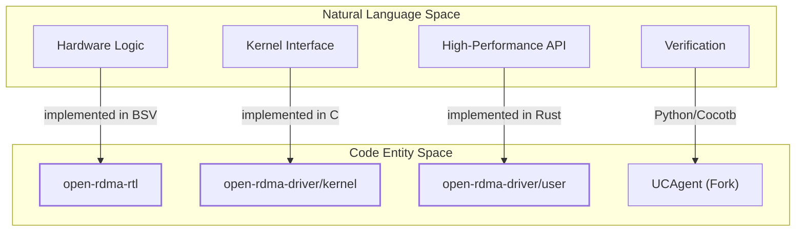
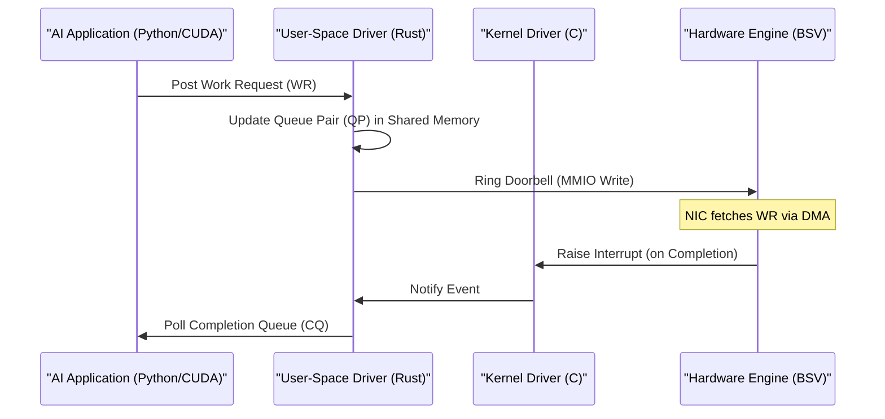

<!-- source: DeepWiki mcp.deepwiki.com · repo open-rdma/open-rdma · page 7 Glossary · fetched 2026-11-11 -->

# Glossary

Relevant source files

The following files were used as context for generating this wiki page:

- [LICENSE](LICENSE)
- [README.md](README.md)
- [README_CN.md](README_CN.md)

This glossary defines technical terms, acronyms, and domain-specific concepts used throughout the Open-RDMA codebase. It serves as a reference for onboarding engineers to understand the relationship between RDMA protocols, hardware RTL modules, and driver implementations.

---

## Domain Concepts and Acronyms

| Term | Definition | Code Pointers |
|:---|:---|:---|
| **BSV** | **Bluespec SystemVerilog**. A high-level functional hardware description language used for the Open-RDMA RTL. | [README.md:124-124]() |
| **CQ** | **Completion Queue**. A queue where the RDMA engine places Completion Queue Entries (CQEs) to notify the software that a Work Request has finished. | [README.md:152-152]() |
| **Doorbell** | A mechanism where software writes to a specific MMIO register on the NIC to notify the hardware that new Work Requests are available in a QP. | [README.md:152-152]() |
| **Kernel Bypass** | A technique where user-space applications communicate directly with the RDMA hardware, skipping the OS kernel's networking stack to reduce latency. | [README.md:82-83]() |
| **QP** | **Queue Pair**. The fundamental unit of RDMA communication, consisting of a Send Queue and a Receive Queue. | [README.md:152-152]() |
| **RoCE v2** | **RDMA over Converged Ethernet version 2**. A protocol that allows RDMA to operate over Ethernet networks using UDP/IP encapsulation. | [README.md:82-83]() |
| **RTL** | **Register Transfer Level**. The hardware design layer, implemented in Open-RDMA using BSV. | [README.md:76-77]() |
| **UCAgent** | An AI-driven verification framework used to generate and execute test benches for the RDMA state machines. | [README.md:177-180]() |

**Sources:** [README.md:76-180]()

---

## System Entities Mapping

The following diagram maps high-level system concepts to specific repositories and implementation languages within the Open-RDMA ecosystem.

### Logic to Implementation Mapping

**Sources:** [README.md:120-130](), [README.md:135-193]()

---

## Technical Definitions

### 1. Hardware RTL Layer (`open-rdma-rtl`)
The hardware layer implements the RoCE v2 protocol logic. It handles packet encapsulation, DMA transfers, and congestion control.

*   **Implementation Language**: Bluespec SystemVerilog (BSV).
*   **Target Hardware**: FPGA (Altera/Intel, Xilinx) and ASIC.
*   **PCIe Interface**: Uses `cocotbext-pcie` for simulation, with specific support for Altera R-Tile.

**Sources:** [README.md:139-143](), [README.md:185-190]()

### 2. Driver Layer (`open-rdma-driver`)
The driver is split into two distinct components to balance security and performance.

*   **Kernel-Space Driver (C)**: Handles PCIe device discovery, interrupt service routines (ISR), and memory pinning via the Linux InfiniBand subsystem.
*   **User-Space Driver (Rust)**: Provides the `verbs` interface for applications, manages user-level QPs/CQs, and performs direct MMIO for "doorbell" rings.

**Sources:** [README.md:125-126](), [README.md:148-152]()

### 3. AI-Infra and GPU Integration
Open-RDMA is "AI-First," meaning the data path is optimized for GPU-to-GPU communication.

*   **CUDA Integration**: Used for GPU kernel communication-computation fusion (通算融合).
*   **Collective Communication**: Optimized for patterns like All-Reduce and All-to-All used in large model training.

**Sources:** [README.md:96-97](), [README.md:127-128](), [README_CN.md:126-126]()

---

## Data Flow: Software to Hardware

This diagram illustrates how a software-initiated RDMA request flows through the different code entities defined in the glossary.

### RDMA Work Request Path

**Sources:** [README.md:82-83](), [README.md:120-130](), [README.md:152-152]()

---

## Development and Verification Tools

*   **open-rdma-dev-env**: A Docker-based environment containing the `bluespec` compiler, `rustc`, `cocotb`, and `python` dependencies. [README.md:212-222]()
*   **bluespec-lsp**: A Language Server Protocol implementation that provides code navigation and diagnostics for BSV files. [README.md:168-172]()
*   **cocotbext-pcie**: A library for simulating PCIe traffic in Python, extended by Open-RDMA to support Altera R-Tile models. [README.md:185-190]()

**Sources:** [README.md:157-191]()