# Page: Open-RDMA Project Overview

# Open-RDMA Project Overview

<details>
<summary>Relevant source files</summary>

The following files were used as context for generating this wiki page:

- [README.md](README.md)
- [README_CN.md](README_CN.md)

</details>


The **Open-RDMA** project is a full-stack, open-source high-performance RDMA (Remote Direct Memory Access) implementation. It encompasses everything from hardware RTL design to Linux kernel and user-space drivers, specifically optimized for the demanding communication requirements of AI infrastructure.

The project is a collaborative effort initiated by **Pazhou Laboratory (Huangpu)** and **DatenLord** to provide a transparent, customizable, and vendor-neutral alternative to closed-source commercial RDMA solutions [README.md:21-23]().

## Project Motivation and Goals

Open-RDMA was created to address the "black box" nature of existing commercial RDMA NICs, which often act as bottlenecks in AI system global optimization due to legacy compatibility burdens and slow iteration cycles [README.md:21-21](). The mission is to "Break the Black Box" by providing a complete technology stack that researchers and engineers can modify and optimize for specific AI workloads.

For details, see [Project Motivation and Goals](#1.1).

**Sources:**
* [README.md:19-31]()
* [README_CN.md:19-31]()

## Project Highlights and Tech Stack

The project distinguishes itself through six key pillars:
1.  **Fully Open Source**: Transparent code from RTL to drivers [README.md:76-78]().
2.  **High Performance**: RoCE v2 inspired, Ethernet-based design with hardware-software co-optimization [README.md:82-84]().
3.  **Deeply Customizable**: FPGA-based to avoid vendor lock-in [README.md:90-92]().
4.  **AI-First**: Integration of AI-assisted development and verification tools [README.md:96-98]().
5.  **Research-Friendly**: A platform for testing novel congestion control and protocols [README.md:105-107]().
6.  **Beginner-Friendly**: Extensive guides and open materials [README.md:111-113]().

### Technology Stack
The project leverages a diverse set of languages to optimize each layer of the stack:
*   **Hardware RTL**: Bluespec SystemVerilog (BSV) [README.md:124-124]().
*   **Kernel Driver**: C [README.md:125-125]().
*   **User Driver**: Rust [README.md:126-126]().
*   **GPU Kernels**: CUDA (for communication-computation fusion) [README.md:127-127]().
*   **Verification/Inference**: Python [README.md:128-128]().

For details, see [Project Highlights and Tech Stack](#1.2).

**Sources:**
* [README.md:70-130]()
* [README_CN.md:69-129]()

## Sub-Repository Matrix

Open-RDMA is organized into several specialized repositories that form the complete ecosystem.

### Core Repositories
| Repository | Role | Primary Languages |
| :--- | :--- | :--- |
| `open-rdma-rtl` | Hardware logic for RoCE v2 protocol engine | BSV |
| `open-rdma-driver` | Dual-mode driver (Kernel-space & User-space) | C, Rust |

### Tooling and Verification
*   `open-rdma-dev-env`: Docker-based environment for simulation and debugging [README.md:157-163]().
*   `bluespec-lsp`: Language Server Protocol for BSV development [README.md:168-174]().
*   `UCAgent (Fork)`: AI Agent-driven RTL verification using Cocotb [README.md:177-182]().
*   `cocotbext-pcie (Fork)`: PCIe simulation models with Altera R-Tile support [README.md:185-191]().

**Sources:**
* [README.md:133-193]()
* [README_CN.md:132-193]()

## System Conceptual Mapping

The following diagrams illustrate how the conceptual components of the RDMA stack map to specific code entities and repositories within the Open-RDMA project.

### Hardware-Software Boundary
This diagram shows the relationship between the RTL modules, the PCIe interface, and the driver components.

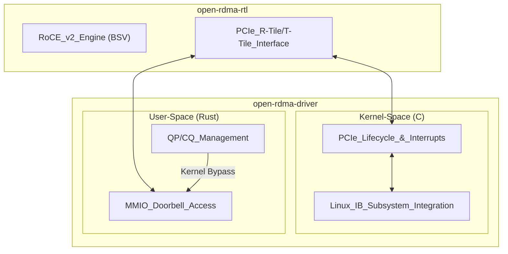
**Sources:**
* [README.md:135-154]()
* [README_CN.md:134-153]()

### Verification and Environment Flow
This diagram maps the development and testing tools to the verification pipeline.

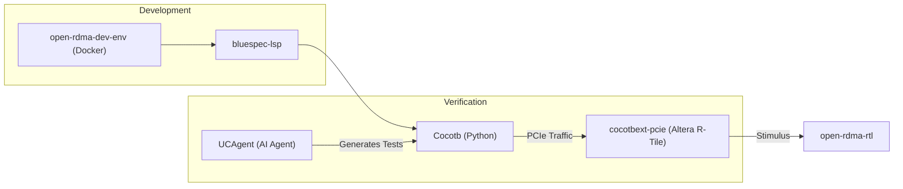
**Sources:**
* [README.md:157-191]()
* [README.md:212-242]()

---

# Page: Project Motivation and Goals

# Project Motivation and Goals

<details>
<summary>Relevant source files</summary>

The following files were used as context for generating this wiki page:

- [README.md](README.md)
- [README_CN.md](README_CN.md)

</details>


The **Open-RDMA** project is a full-stack, open-source initiative designed to provide a high-performance Remote Direct Memory Access (RDMA) hardware and software implementation [README.md:3-5](). Developed as a collaborative effort between **Pazhou Laboratory (Huangpu)** and **DatenLord**, the project aims to address the critical infrastructure bottlenecks in modern AI large model training and inference [README.md:21-23]().

## The Problem: Closed-Source Black Boxes

Modern AI infrastructure relies heavily on RDMA for high-speed, low-latency communication between compute nodes. However, the existing ecosystem faces three primary challenges:

1.  **Legacy Constraints**: Commercial RDMA solutions, often based on protocols developed decades ago, carry significant architectural debt that hinders rapid iteration for AI-specific workloads [README.md:21]().
2.  **Vendor Lock-in**: Closed-source hardware creates a "black box" effect. Researchers and engineers cannot inspect, modify, or optimize the underlying RTL or driver logic to suit specific cluster requirements [README.md:21]().
3.  **Optimization Bottlenecks**: As hardware-software co-optimization becomes vital for AI performance, the inability to modify the RDMA stack prevents deep integration with GPU kernels and communication frameworks like NCCL [README.md:21]().

**Sources:** [README.md:19-27](), [README_CN.md:19-27]()

## The "Break the Black Box" Philosophy

Open-RDMA adopts a "Break the Black Box" philosophy, ensuring transparency from the gate level to the application layer. The project is structured to lower the technical barrier for specialized networking and cultivate a new generation of RDMA experts [README.md:23-27]().

### Target Audience
The project is designed to be accessible to three core technical groups:
*   **Hardware Engineers**: Focusing on FPGA/ASIC design using Bluespec SystemVerilog (BSV) [README.md:25,124]().
*   **Software Engineers**: Working on Linux kernel drivers (C), user-space drivers (Rust), and communication protocols [README.md:25,125-126]().
*   **Algorithm/AI Researchers**: Optimizing GPU kernels (CUDA) and testing new congestion control or communication-computation fusion (通算融合) strategies [README.md:25,127-128]().

**Sources:** [README.md:23-27](), [README_CN.md:23-27]()

## Strategic Goals

The Open-RDMA project is driven by four primary strategic objectives:

| Goal | Description |
| :--- | :--- |
| **AI-First Infrastructure** | Tailoring the RDMA stack specifically for AI collective communication (All-Reduce, All-to-All) and GPU-to-GPU transfers [README.md:96-97](). |
| **Full-Stack Transparency** | Providing a complete open-source path: `open-rdma-rtl` -> `open-rdma-driver` (Kernel/User) -> `AI Frameworks` [README.md:76-77](). |
| **Academic & Research Friendly** | Enabling researchers to implement and test experimental protocols (e.g., new congestion control) on real FPGA hardware without proprietary restrictions [README.md:105-106](). |
| **High Performance** | Utilizing RoCE v2 as a foundation, optimized via hardware-software co-design for ultra-low latency [README.md:82-83](). |

**Sources:** [README.md:70-116](), [README_CN.md:69-115]()

## System Conceptual Flow

The following diagram illustrates how the Open-RDMA philosophy translates into the physical and logical components of the codebase.

### Logic to Code Entity Mapping: Data Path
This diagram bridges the conceptual "Break the Black Box" goal to the specific sub-repositories and languages used in the project.

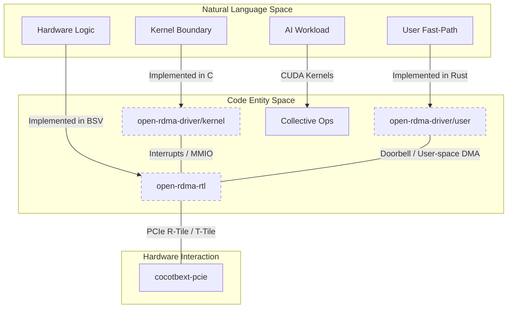
**Sources:** [README.md:120-130](), [README.md:133-193](), [README_CN.md:185-191]()

### Project Matrix and Integration
The project is divided into specialized repositories to allow independent iteration while maintaining a unified full-stack environment via `open-rdma-dev-env`.

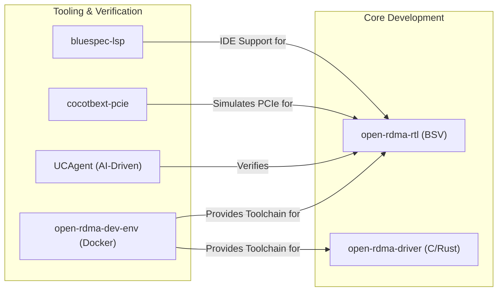
**Sources:** [README.md:133-193](), [README_CN.md:132-193]()

## Technical Implementation Summary

Open-RDMA leverages a modern tech stack to ensure both safety and performance:
*   **Hardware**: Uses **Bluespec SystemVerilog (BSV)** for high-level synthesis, providing stronger type safety and modularity than traditional Verilog [README.md:124]().
*   **Kernel Driver**: Written in **C** to integrate with the standard Linux InfiniBand (IB) core subsystem [README.md:125,152]().
*   **User Driver**: Written in **Rust** to provide a memory-safe, high-performance interface for application-level RDMA operations (Queue Pair management, Memory Registration) [README.md:126,152]().
*   **Verification**: Utilizes **Python** with **Cocotb** for RTL simulation, supplemented by **UCAgent** (an AI-agent driven verification framework) to automate complex state machine testing [README.md:128,177-182]().

**Sources:** [README.md:120-130](), [README.md:133-193](), [README_CN.md:119-129]()

---

# Page: Project Highlights and Tech Stack

# Project Highlights and Tech Stack

<details>
<summary>Relevant source files</summary>

The following files were used as context for generating this wiki page:

- [README.md](README.md)
- [README_CN.md](README_CN.md)

</details>


This page provides a detailed technical breakdown of the Open-RDMA project's core value propositions and its multi-language technology stack. Open-RDMA is engineered to provide a transparent, high-performance alternative to closed-source commercial RDMA solutions, specifically optimized for the rigorous demands of AI infrastructure.

## Project Highlights

The Open-RDMA architecture is built upon six foundational pillars that distinguish it from legacy networking solutions.

### 1. Fully Open Source
Open-RDMA eliminates the "black box" nature of commercial NICs by providing transparency across the entire stack. This includes the hardware RTL design, the Linux kernel-space drivers, and the high-performance user-space drivers [README.md:76-78]().

### 2. High Performance
The system implements the RoCE v2 protocol over Ethernet. Performance is achieved through hardware-software co-design, ensuring that the RTL engine handles packet encapsulation, decapsulation, and DMA operations with ultra-low latency [README.md:82-84]().

### 3. Deeply Customizable
Unlike vendor-locked ASICs, Open-RDMA is FPGA-based. This allows developers to modify the hardware logic for specific AI cluster requirements, such as optimizing for GPU-to-GPU communication or implementing custom flow control [README.md:90-92]().

### 4. AI-First
AI is integrated into both the product and the development lifecycle. The project uses AI-driven verification tools (UCAgent) and optimizes for AI collective communication patterns like All-Reduce and All-to-All [README.md:96-98]().

### 5. Research-Friendly
The modularity of the project allows researchers to swap out components—such as congestion control algorithms or protocol state machines—to test novel networking theories in a real-world environment [README.md:105-107]().

### 6. Beginner-Friendly
The project lowers the entry barrier to RDMA technology by providing comprehensive documentation, introductory guides, and a pre-configured Docker development environment [README.md:111-114]().

**Sources:** [README.md:71-116](), [README_CN.md:69-115]()

---

## Technology Stack

Open-RDMA utilizes a diverse set of programming languages and frameworks, each selected for its specific strengths in the hardware-software pipeline.

### Language and Role Mapping

| Technology | Layer | Primary Role | Key Components |
| :--- | :--- | :--- | :--- |
| **Bluespec SystemVerilog** | Hardware RTL | High-level hardware description | Protocol Engine, DMA Controller, PCIe Interface |
| **C** | Kernel Driver | Privileged system integration | PCIe lifecycle, IRQ handling, IB subsystem |
| **Rust** | User Driver | High-performance data path | Queue Pair (QP) management, Doorbell MMIO |
| **CUDA** | GPU Kernel | Compute-Comm Fusion | Collective communication operators |
| **Python** | Verification | Simulation & AI Agents | Cocotb testbenches, UCAgent integration |

**Sources:** [README.md:120-130](), [README_CN.md:119-129]()

### Hardware-Software Data Flow

The following diagram illustrates how these technologies interact across the system boundary to facilitate RDMA operations.

**Diagram: Tech Stack Data Path Integration**
```mermaid
graph TD
    subgraph "User Space (Rust/Python)"
        "User_App"["User Application"] -- "verbs_api" --> "Rust_Driver"["open-rdma-driver (Rust)"]
        "Rust_Driver" -- "MMIO_Doorbell" --> "PCIe_Bar"["PCIe BAR Space"]
        "Python_Cocotb"["Cocotb Verification (Python)"] -- "Sim_Drive" --> "BSV_RTL"
    end

    subgraph "Kernel Space (C)"
        "C_Driver"["open-rdma-driver (C)"] -- "IB_Core_Attach" --> "Linux_IB_Subsystem"["Linux IB Core"]
        "C_Driver" -- "PCIe_Config" --> "PCIe_Hard_IP"["PCIe Hard IP"]
    end

    subgraph "Hardware RTL (Bluespec SystemVerilog)"
        "BSV_RTL"["open-rdma-rtl (BSV)"] -- "DMA_Req" --> "PCIe_Hard_IP"
        "BSV_RTL" -- "RoCE_Pkt" --> "Ethernet_MAC"["Ethernet MAC"]
    end

    "PCIe_Bar" -.-> "PCIe_Hard_IP"
```
**Sources:** [README.md:133-154](), [README_CN.md:132-153]()

---

## Component Details

### Bluespec SystemVerilog (BSV) - Hardware RTL
Open-RDMA uses BSV for its hardware implementation. BSV provides a higher level of abstraction than Verilog, using guarded atomic actions to manage complex state transitions in the RDMA protocol [README.md:139-143]().
* **Repository:** `open-rdma-rtl` [README.md:139]()
* **Target:** FPGA (Altera/Intel R-Tile/T-Tile) and ASIC.

### C & Rust - Dual Driver Architecture
The driver is split into two distinct parts to balance safety, performance, and kernel integration [README.md:148-152]().
* **Kernel-Space (C):** Manages low-level PCIe device discovery, interrupt service routines (ISRs), and registers the device with the Linux InfiniBand core [README.md:152]().
* **User-Space (Rust):** Provides a memory-safe interface for applications to perform kernel-bypass operations. It manages Queue Pairs (QP) and Completion Queues (CQ) using high-performance Rust abstractions [README.md:126]().

### Python - Verification and Inference
Python serves as the primary language for verification.
* **Cocotb:** Used for writing RTL testbenches in Python [README_CN.md:180]().
* **UCAgent:** An AI agent-driven framework that automates the generation of test cases for the complex RDMA state machines [README.md:177-181]().

### CUDA - AI Optimization
For AI workloads, Open-RDMA focuses on "Communication-Computation Fusion" (通算融合). CUDA kernels are used to implement optimized collective communication operators that interact directly with the RDMA stack to reduce GPU-to-NIC latency [README.md:127]().

**Diagram: Code Entity to System Role Mapping**
```mermaid
graph LR
    subgraph "open-rdma-rtl (BSV)"
        "BSV_RTL"["Hardware Logic"]
    end

    subgraph "open-rdma-driver"
        "C_Kernel"["kernel/ (C)"]
        "Rust_User"["user/ (Rust)"]
    end

    subgraph "Tooling & Verification"
        "Cocotb_Py"["tests/ (Python)"]
        "UCAgent_Fork"["UCAgent (AI Agent)"]
        "PCIE_Model"["cocotbext-pcie (Altera R-Tile)"]
    end

    "BSV_RTL" -- "Hardware-Software Interface" --> "C_Kernel"
    "C_Kernel" -- "mmap/ioctl" --> "Rust_User"
    "Cocotb_Py" -- "Verify" --> "BSV_RTL"
    "UCAgent_Fork" -- "Auto-Test" --> "Cocotb_Py"
    "PCIE_Model" -- "PCIe Simulation" --> "BSV_RTL"
```
**Sources:** [README.md:133-191](), [README_CN.md:132-192]()

---

# Page: System Architecture

# System Architecture

<details>
<summary>Relevant source files</summary>

The following files were used as context for generating this wiki page:

- [README.md](README.md)
- [README_CN.md](README_CN.md)

</details>


The Open-RDMA system is a full-stack, high-performance RDMA implementation designed to bridge the gap between open-source AI software ecosystems and closed-source networking hardware. The architecture follows a hardware-software co-design philosophy, spanning from Bluespec SystemVerilog (BSV) RTL to high-performance Rust and C drivers, optimized specifically for AI infrastructure workloads [README.md:3-5, 21-23]().

### High-Level Architectural Layers

The system is partitioned into three primary layers that interact to provide a complete RoCE v2 (RDMA over Converged Ethernet) solution:

1.  **Hardware RTL Layer**: Implements the RoCE v2 protocol engine, packet processing, and DMA engines in hardware for low-latency execution [README.md:82-84, 139-143]().
2.  **Driver Layer**: A dual-component software stack consisting of a kernel-space driver for management and a user-space driver for high-performance data paths [README.md:148-152]().
3.  **AI-Infra & Tooling Layer**: Includes CUDA integration for communication-computation fusion and a verification suite powered by AI agents [README.md:96-98, 177-181]().

### System Communication Pipeline

The following diagram illustrates the flow of control and data from the user application through the software stack to the physical hardware.

**Open-RDMA Full-Stack Data and Control Path**
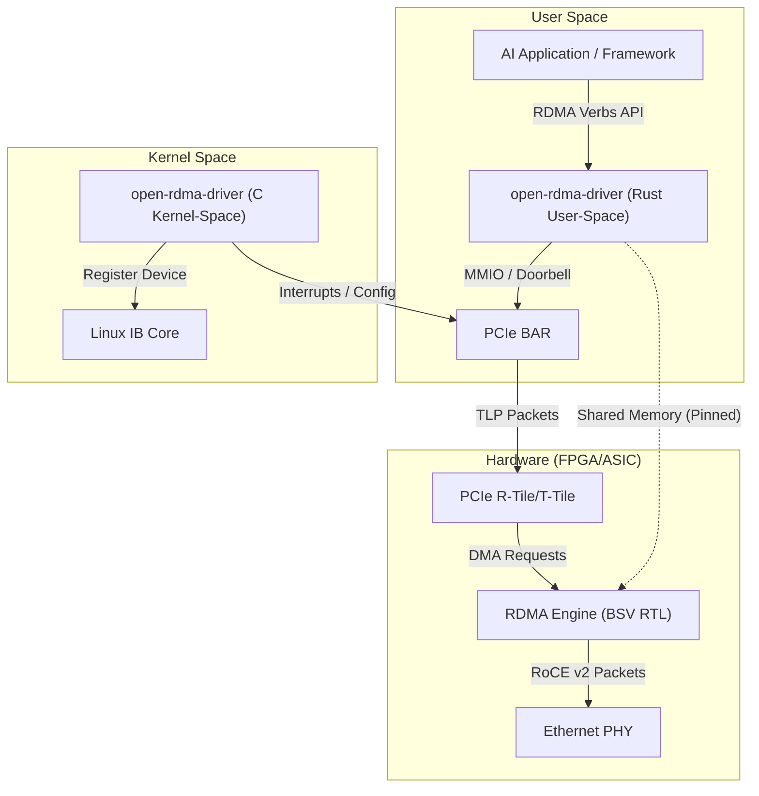
Sources: [README.md:120-130](), [README.md:139-152](), [README_CN.md:185-191]()

---

### Hardware RTL Layer (open-rdma-rtl)
The hardware layer is the core of the project, implemented in **Bluespec SystemVerilog (BSV)**. It handles the complex state machines required for the RoCE v2 protocol, including packet encapsulation/decapsulation and congestion control. The design targets high-performance FPGA and ASIC platforms, utilizing modern PCIe interfaces such as Intel R-Tile and T-Tile.

For details, see [Hardware RTL Layer (open-rdma-rtl)](#2.1).

Sources: [README.md:124, 139-143](), [README_CN.md:185-191]()

### Driver Layer (open-rdma-driver)
Open-RDMA employs a split-driver architecture to balance security and performance:
*   **Kernel-Space (C)**: Manages privileged operations, including PCIe device discovery, interrupt handling, and integration with the standard Linux InfiniBand (IB) subsystem.
*   **User-Space (Rust)**: Implements the "fast path" using memory-safe Rust. It manages Queue Pairs (QP) and Completion Queues (CQ) and performs kernel-bypass operations via MMIO doorbells to achieve ultra-low latency.

For details, see [Driver Layer (open-rdma-driver)](#2.2).

Sources: [README.md:125-126, 148-152]()

### AI-Infra Optimization and CUDA Integration
A key differentiator of Open-RDMA is its **AI-First** design. The architecture is co-optimized for collective communication patterns (e.g., All-Reduce) common in large model training. This includes "communication-computation fusion" (通算融合), where RDMA operations are integrated directly with GPU kernels using CUDA to minimize synchronization overhead between the NIC and GPU.

For details, see [AI-Infra Optimization and CUDA Integration](#2.3).

Sources: [README.md:96-98, 127](), [README_CN.md:126]()

---

### Code Entity Mapping

This diagram maps the high-level architectural components to their respective sub-repositories and primary implementation languages.

**Architectural Component to Code Repository Mapping**
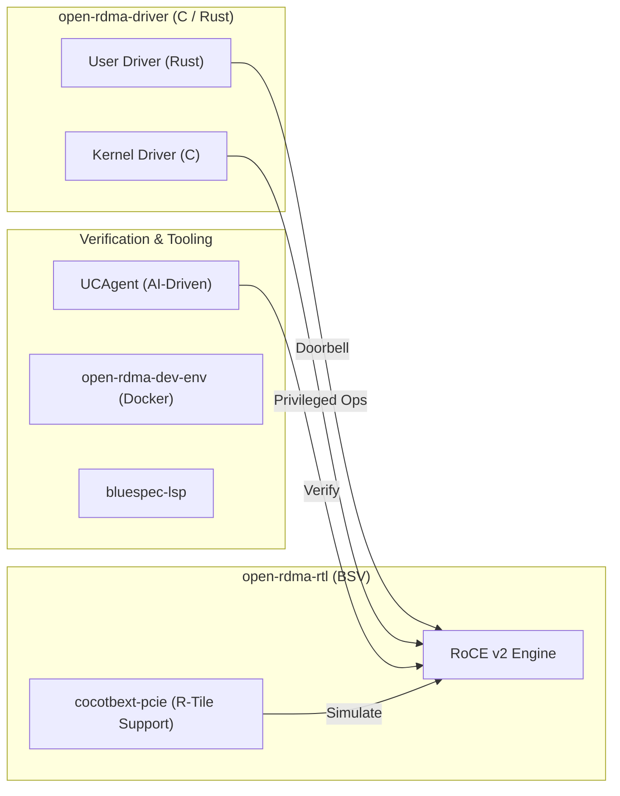
Sources: [README.md:133-181](), [README_CN.md:167-191]()

---

# Page: Hardware RTL Layer (open-rdma-rtl)

# Hardware RTL Layer (open-rdma-rtl)

<details>
<summary>Relevant source files</summary>

The following files were used as context for generating this wiki page:

- [README.md](README.md)
- [README_CN.md](README_CN.md)

</details>


The Hardware RTL layer is the core protocol engine of the Open-RDMA project. It implements the **RoCE v2** (RDMA over Converged Ethernet) protocol using **Bluespec SystemVerilog (BSV)**, providing a high-performance, low-latency data path for AI infrastructure. This layer handles the complex state machines required for RDMA operations, including packet encapsulation, congestion control, and direct memory access (DMA) via PCIe.

## Core Architecture and Data Flow

The `open-rdma-rtl` sub-repository serves as the hardware implementation of the RDMA stack. It is designed to be target-agnostic, supporting both **FPGA** (e.g., Altera/Intel Stratix 10 or Agilex) and **ASIC** deployments [README.md:13-13](). The architecture is centered around a hardware-software co-design approach to minimize CPU overhead and latency [README.md:82-83]().

### Hardware-Software Interaction Pipeline

The following diagram illustrates the relationship between the hardware entities and the software drivers.

**Diagram: Hardware-Software Entity Mapping**
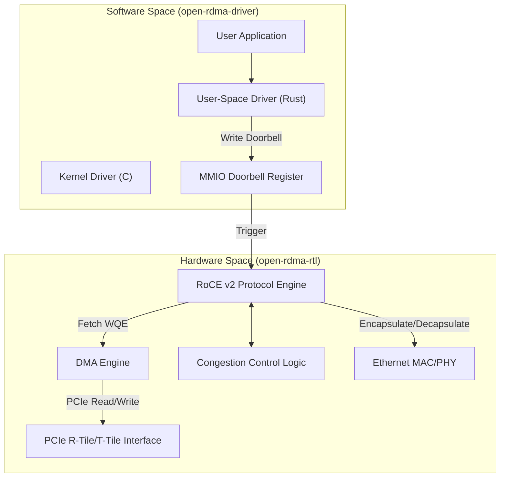
**Sources:** [README.md:120-130](), [README.md:139-152]()

## Key Hardware Components

### 1. RoCE v2 Protocol Engine
The engine implements the RoCE v2 specification, which utilizes UDP/IP encapsulation over Ethernet. This allows RDMA traffic to be routed across standard L3 networks.
*   **Encapsulation:** Hardware automatically appends the BTH (Base Transport Header), UDP, IP, and Ethernet headers to outbound RDMA payloads.
*   **Decapsulation:** Incoming packets are validated, headers are stripped, and payloads are placed directly into the target memory location defined by the Remote Key (R_Key) and Virtual Address.
*   **Implementation Language:** The engine is written in **Bluespec SystemVerilog (BSV)**, which provides high-level hardware abstractions while maintaining cycle-accurate control [README.md:124-124]().

### 2. PCIe Interface (R-Tile/T-Tile)
The RTL layer integrates with high-speed PCIe IP cores. A specific focus is placed on Altera R-Tile support, which is critical for modern FPGA-based AI accelerators [README_CN.md:185-190]().
*   **Role:** Handles TLP (Transaction Layer Packet) generation and processing for DMA operations.
*   **Integration:** The project uses a specialized fork of `cocotbext-pcie` to simulate and verify these PCIe behaviors [README.md:185-189]().

### 3. DMA and Memory Management
The hardware manages the data path between the network and host memory without CPU intervention.
*   **Queue Pair (QP) Management:** The RTL tracks the state of Send Queues (SQ) and Receive Queues (RQ).
*   **Completion Queues (CQ):** Upon completion of a work request, the hardware generates a Completion Queue Entry (CQE) and can trigger interrupts via the PCIe MSI-X mechanism.

## Data Path Functionality

| Function | Description | Implementation Detail |
| :--- | :--- | :--- |
| **Packet Encapsulation** | Adding RoCE v2 / UDP / IP / ETH headers. | Hardware state machines in BSV. |
| **Congestion Control** | Managing flow control to prevent packet loss. | Customizable logic for research [README.md:105-106](). |
| **DMA Engine** | Direct data transfer to/from host memory. | PCIe R-Tile/T-Tile TLP generation. |
| **Doorbell Handling** | Responding to software-initiated work requests. | MMIO register mapping. |

**Sources:** [README.md:82-83](), [README.md:105-106](), [README_CN.md:189-190]()

## Verification and Simulation

Verification of the RTL is conducted using a Python-based framework, bridging the gap between hardware description and modern software testing practices.

**Diagram: RTL Verification Workflow**
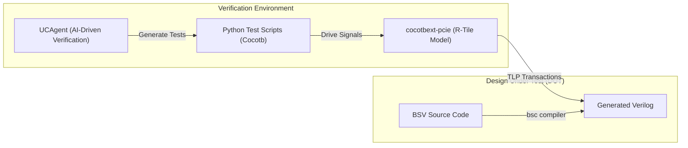

*   **Cocotb:** Used for writing test benches in Python, facilitating easier integration with complex data models [README.md:180-181]().
*   **UCAgent:** An AI-agent driven framework (forked from BOSC) that automates the generation of verification scenarios for the RDMA protocol [README.md:177-181]().
*   **Bluespec LSP:** A Language Server Protocol implementation for BSV is provided to enhance the developer experience during RTL coding [README.md:168-172]().

**Sources:** [README.md:168-172](), [README.md:177-181](), [README.md:185-189]()

---

# Page: Driver Layer (open-rdma-driver)

# Driver Layer (open-rdma-driver)

<details>
<summary>Relevant source files</summary>

The following files were used as context for generating this wiki page:

- [README.md](README.md)
- [README_CN.md](README_CN.md)

</details>


The Driver Layer of the Open-RDMA project provides the essential communication bridge between the hardware RTL (running on FPGA or ASIC) and high-level AI applications. To achieve both strict security and ultra-high performance, the architecture is split into a **Linux Kernel-Space Driver** and a **User-Space Driver**.

This dual-component design ensures that privileged hardware setup and memory pinning are handled by the kernel, while performance-critical data-path operations bypass the kernel entirely to minimize latency.

### Dual-Component Architecture Overview

The driver layer is organized into two distinct environments, each utilizing a programming language suited for its specific constraints:

1.  **Kernel-Space (C):** Integrated with the Linux InfiniBand (IB) core subsystem. It manages the PCIe device lifecycle, handles interrupts, and performs privileged operations like memory pinning.
2.  **User-Space (Rust):** A high-performance library that manages Queue Pairs (QP) and Completion Queues (CQ). It utilizes Memory-Mapped I/O (MMIO) to ring doorbells directly on the hardware, enabling kernel-bypass.

#### Driver Component Interaction

The following diagram illustrates how the two components coordinate to manage the RDMA hardware:

**Driver Component Hierarchy**
```mermaid
graph TD
    subgraph "User Space (Rust)"
        [User_App] --> [User_Driver_Rust]
        [User_Driver_Rust] -- "Doorbell (MMIO)" --> [RDMA_Hardware]
        [User_Driver_Rust] -- "ibv_cmd" --> [Kernel_Driver_C]
    end

    subgraph "Kernel Space (C)"
        [Kernel_Driver_C] -- "PCIe Config / Interrupts" --> [RDMA_Hardware]
        [Kernel_Driver_C] -- "Register" --> [Linux_IB_Core]
    end

    subgraph "Hardware Layer"
        [RDMA_Hardware]
    end
```
**Sources:** [README.md:125-126](), [README.md:148-152]()

---

### Kernel-Space Driver (C)

The kernel-space driver is the primary entry point for the operating system to recognize the RDMA hardware. Written in C, it interfaces directly with the Linux kernel's `ib_core` subsystem.

Its responsibilities include:
*   **PCIe Initialization:** Discovering the device on the bus and mapping its configuration space.
*   **Resource Allocation:** Managing hardware resources that require root privileges.
*   **Memory Pinning:** Ensuring that buffers used for RDMA are locked in physical RAM so the hardware DMA engine can access them safely.
*   **Interrupt Handling:** Processing hardware events and notifying the user-space driver or application.

For a deep dive into the kernel implementation and IB subsystem integration, see **[Kernel-Space Driver (C)](#2.2.1)**.

**Sources:** [README.md:125-125](), [README.md:152-152]()

---

### User-Space Driver (Rust)

The user-space driver is implemented in Rust to leverage its memory safety guarantees without sacrificing performance. This component is responsible for the "fast path" of RDMA operations.

Key features include:
*   **Kernel Bypass:** By mapping hardware registers (doorbells) into the user-space process memory, the driver allows applications to submit work requests directly to the hardware.
*   **Queue Management:** Managing the logic for Work Queues (Send/Receive) and Completion Queues.
*   **AI Integration:** Providing optimized paths for collective communication patterns (e.g., All-Reduce) used in AI training frameworks like PyTorch.

For details on the Rust implementation and high-performance queue management, see **[User-Space Driver (Rust)](#2.2.2)**.

**Sources:** [README.md:126-126](), [README.md:152-152]()

---

### Rationale for the Split Design

The decision to split the driver into C/Kernel and Rust/User components is driven by three primary factors:

| Factor | Description | Code Implementation |
| :--- | :--- | :--- |
| **Security** | Privileged tasks (memory pinning, hardware reset) are isolated in the kernel to prevent user applications from crashing the system. | Kernel Driver (C) |
| **Performance** | Data-path operations (posting WQEs, polling CQs) bypass the kernel to avoid the overhead of context switches and system calls. | User Driver (Rust) |
| **Safety** | Complex queue logic and state machines are implemented in Rust to prevent common memory errors (use-after-free, buffer overflows). | User Driver (Rust) |

**Code Entity Mapping**
```mermaid
graph LR
    subgraph "open-rdma-driver Repository"
        [C_Source] --> [Kernel_Module]
        [Rust_Source] --> [User_Library]
    end

    [Kernel_Module] -- "implements" --> [Privileged_Ops]
    [User_Library] -- "implements" --> [Data_Path_Ops]

    [Privileged_Ops] --- [ib_device_alloc]
    [Privileged_Ops] --- [pci_register_driver]
    [Data_Path_Ops] --- [post_send]
    [Data_Path_Ops] --- [poll_cq]
```
**Sources:** [README.md:27-27](), [README.md:82-83](), [README.md:148-152]()

---

# Page: Kernel-Space Driver (C)

# Kernel-Space Driver (C)

<details>
<summary>Relevant source files</summary>

The following files were used as context for generating this wiki page:

- [README.md](README.md)
- [README_CN.md](README_CN.md)

</details>


The Open-RDMA kernel-space driver is a C-based component residing within the `open-rdma-driver` repository. It serves as the foundational interface between the Linux kernel's InfiniBand (IB) core subsystem and the underlying hardware RTL. Its primary responsibilities include PCIe device lifecycle management, interrupt handling, memory pinning for DMA operations, and establishing the security boundaries required for high-performance kernel-bypass RDMA.

## PCIe Device Lifecycle Management

The driver implements a standard Linux PCIe driver model to manage the Open-RDMA hardware. It handles the discovery, initialization, and removal of the PCIe endpoint device.

### Device Initialization Flow
When the Linux kernel detects an Open-RDMA PCIe device, the driver's probe function is triggered. This sequence initializes the hardware state and registers the device with the InfiniBand core.

| Step | Function/Entity | Description |
| :--- | :--- | :--- |
| 1 | `pci_driver.probe` | Entry point for PCIe device discovery. |
| 2 | `pci_enable_device` | Enables the PCIe device and assigns resources. |
| 3 | `pci_request_regions` | Reserves PCIe I/O and memory regions for MMIO. |
| 4 | `ioremap` | Maps the hardware BAR (Base Address Register) into kernel virtual memory. |
| 5 | `ib_register_device` | Registers the Open-RDMA device as a valid InfiniBand device in `/sys/class/infiniband`. |

**Sources:** [README.md:125-125](), [README.md:148-154]()

## Integration with Linux IB Core Subsystem

The kernel driver acts as a "provider" within the Linux InfiniBand stack. It implements the standard `ib_device` interface, allowing user-space libraries (like the Rust-based user-space driver) and kernel consumers to interact with the hardware using standard Verbs APIs.

### IB Core Interface Mapping

The driver translates generic IB commands into hardware-specific register writes or command queue entries.

**Driver to IB Subsystem Interaction**
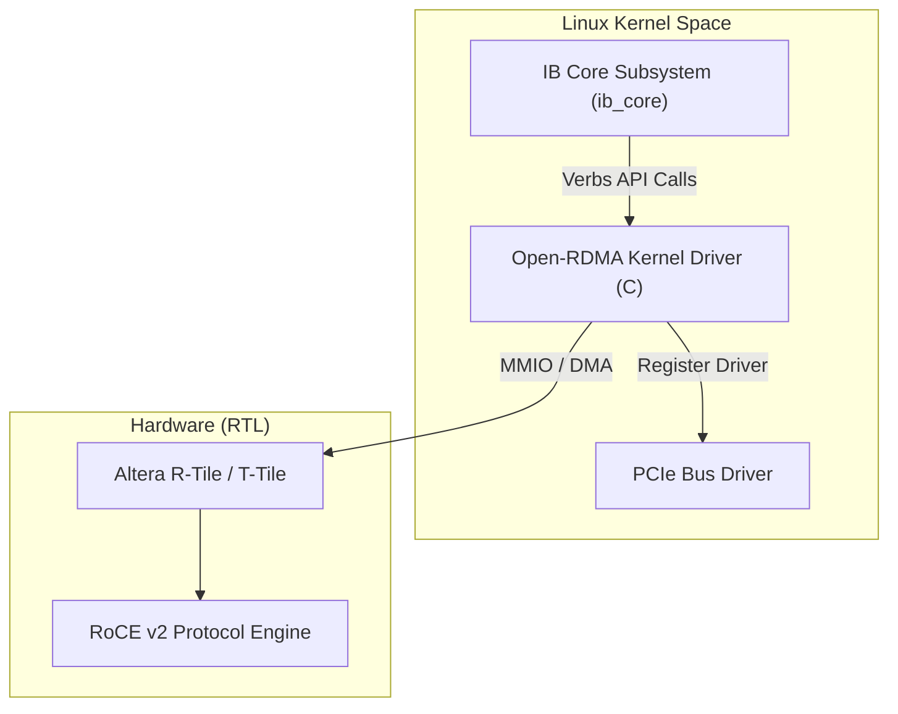
**Sources:** [README.md:82-84](), [README.md:185-191]()

## Memory Pinning and Security Boundary

RDMA requires that memory used for data transfer is "pinned" (locked in physical RAM) to prevent the kernel from swapping it out during DMA operations. The kernel driver enforces security by validating memory regions (MR) before they are accessed by the hardware.

*   **Memory Registration:** The driver handles `ib_reg_mr` calls, interacting with the Memory Management Unit (MMU) to pin pages and return a Steering Tag (STag) or L_Key to the user-space.
*   **DMA Mapping:** It ensures that user-space virtual addresses are correctly translated to physical addresses for the hardware's DMA engine.
*   **Security Boundary:** By managing the page tables and memory permissions in kernel space, the driver prevents a malicious user-space process from accessing memory belonging to other processes or the kernel itself.

**Sources:** [README.md:21-23](), [README.md:76-78]()

## Interrupt Handling and Event Management

The driver manages asynchronous events from the hardware, such as Completion Queue (CQ) notifications and hardware errors, using MSI-X (Message Signaled Interrupts).

### Interrupt Service Routine (ISR) Implementation
1.  **Interrupt Trigger:** The hardware RTL signals an interrupt via the PCIe bus.
2.  **Hard IRQ:** The driver's top-half ISR acknowledges the interrupt to the hardware.
3.  **Tasklet/Threaded IRQ:** The driver schedules a bottom-half to process the event, such as waking up a process waiting on a Completion Queue.

**Sources:** [README.md:120-130](), [README.md:185-191]()

## Code Entity Mapping

The following diagram bridges the conceptual driver components to the specific technical stacks and sub-repositories used in the Open-RDMA project.

**System Architecture to Code Entities**
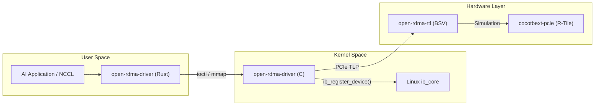
**Sources:** [README.md:120-130](), [README.md:139-154](), [README.md:185-191]()

## Summary of Responsibilities

| Component | Responsibility | Implementation Language |
| :--- | :--- | :--- |
| **Control Path** | Device initialization, Memory registration, QP/CQ creation | C |
| **Resource Management** | BAR mapping, Interrupt allocation (MSI-X), DMA mapping | C |
| **Integration** | Linux InfiniBand Core Subsystem provider | C |
| **Verification** | Cocotb-based PCIe behavioral simulation | Python / C |

**Sources:** [README.md:76-78](), [README.md:120-130](), [README.md:152-152]()

---

# Page: User-Space Driver (Rust)

# User-Space Driver (Rust)

<details>
<summary>Relevant source files</summary>

The following files were used as context for generating this wiki page:

- [README.md](README.md)
- [README_CN.md](README_CN.md)

</details>


The user-space driver component of Open-RDMA is a high-performance, memory-safe implementation written in Rust. It is designed to facilitate kernel-bypass operations, allowing applications to interact directly with the RDMA hardware for data-path operations while relying on the kernel driver only for privileged resource allocation and security boundary enforcement.

## Architectural Overview

The user-space driver operates within the `open-rdma-driver` repository, providing the "fast-path" for RDMA operations [README.md:148-154](). By utilizing Rust, the driver ensures memory safety and concurrency without the overhead of a garbage collector, which is critical for maintaining the ultra-low latency required by AI infrastructure [README.md:82-85, 126]().

### Core Responsibilities
*   **Queue Pair (QP) Management**: Handling the submission of Work Requests (WR) to Send Queues and Receive Queues.
*   **Completion Queue (CQ) Management**: Polling for Completion Queue Entries (CQE) to notify applications of finished tasks.
*   **Memory Registration (MR)**: Interacting with the kernel to pin memory and provide the hardware with physical addresses.
*   **MMIO & Doorbell Access**: Writing to hardware registers via memory-mapped I/O to trigger hardware processing without kernel intervention.
*   **Integration**: Providing bindings and interfaces for AI frameworks like PyTorch and NCCL to leverage RDMA performance [README.md:96-99]().

## Data Flow and Kernel Bypass

The primary goal of the Rust driver is to enable **kernel-bypass**. In a traditional network stack, every packet requires a context switch to the kernel. In Open-RDMA, the user-space driver writes directly to the NIC's "Doorbell" registers.

### Doorbell Mechanism Logic
1.  **Preparation**: The application uses the Rust driver to post a Work Request (WR) into a circular buffer (the Queue Pair) in user-allocated memory.
2.  **Doorbell Ring**: The driver performs an MMIO write to a specific offset in the PCIe BAR (Base Address Register) space.
3.  **Hardware Pickup**: The hardware RTL [open-rdma-rtl]() detects the MMIO write, fetches the WR via DMA, and processes the RoCE v2 packet.

### User-Space to Hardware Interaction

The following diagram illustrates the relationship between the Rust driver entities and the hardware components.

**Diagram: User-Space Driver Entity Mapping**
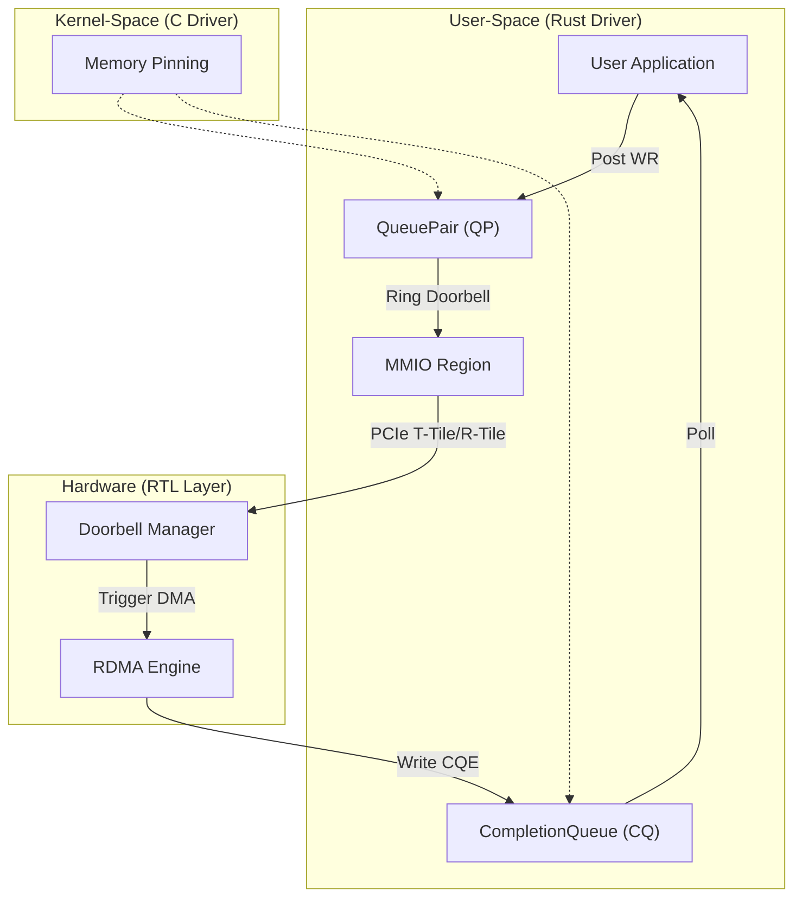
Sources: [README.md:76-85](), [README.md:124-126]()

## Memory Management and Registration

RDMA requires that memory used for data transfers be "pinned" (locked in physical RAM) to prevent the OS from swapping it out during a DMA operation. 

*   **Memory Registration (MR)**: The Rust driver coordinates with the C kernel driver to pin specific virtual memory ranges.
*   **Virtual to Physical Mapping**: Once pinned, the hardware is provided with a translation table or physical addresses to perform zero-copy transfers.

## Integration with AI Frameworks

The Rust driver is specifically optimized for AI-Infra workloads, such as large model training involving collective communication patterns (All-Reduce, All-to-All) [README.md:21-23, 90-93]().

| Framework | Integration Method | Purpose |
| :--- | :--- | :--- |
| **PyTorch** | Custom C++/Rust Extensions | Offloading tensor transfers to RDMA hardware. |
| **NCCL** | Transport Plugin | Replacing standard TCP/IP or proprietary RDMA with Open-RDMA. |
| **CUDA** | Communication-Computation Fusion | Coordinating GPU memory triggers with RDMA doorbells [README.md:126-127](). |

## Code Structure and Implementation

The user-space driver logic is housed within the `open-rdma-driver` repository [README.md:148-154](). 

**Diagram: Software Stack and Code Entities**
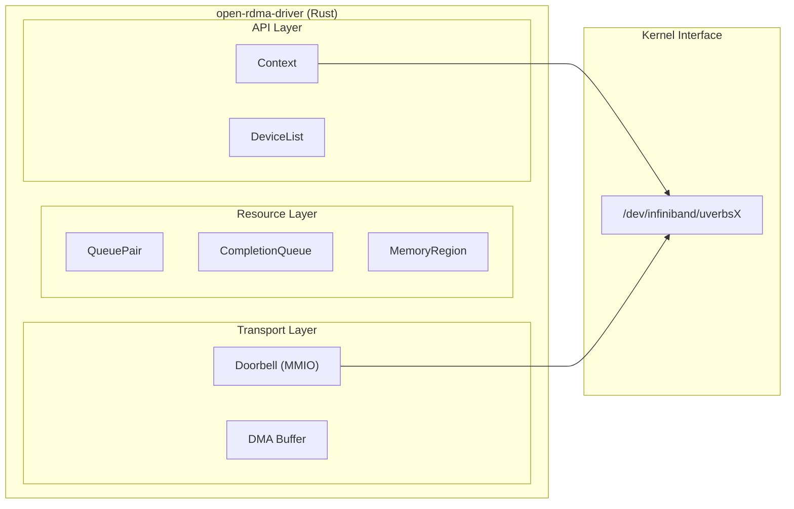
Sources: [README.md:125-126](), [README.md:148-152]()

### Key Implementation Details
*   **Safety**: Uses Rust's `unsafe` blocks sparingly for MMIO and DMA pointer arithmetic, wrapping them in safe abstractions for the end-user.
*   **Performance**: Utilizes lock-free structures for the command and completion queues where possible to minimize contention in multi-threaded AI applications.
*   **Zero-Copy**: The driver ensures that data path operations involve no CPU-based copying of buffers, passing only descriptors to the hardware.

Sources:
* [README.md:76-85]()
* [README.md:124-130]()
* [README.md:148-154]()
* [README_CN.md:123-127]()

---

# Page: AI-Infra Optimization and CUDA Integration

# AI-Infra Optimization and CUDA Integration

<details>
<summary>Relevant source files</summary>

The following files were used as context for generating this wiki page:

- [README.md](README.md)
- [README_CN.md](README_CN.md)

</details>


The Open-RDMA project is designed with an "AI-First" philosophy, specifically targeting the bottlenecks inherent in large-scale model training and inference clusters [README.md:96-98](). Unlike traditional commercial RDMA solutions constrained by legacy compatibility, Open-RDMA focuses on the co-optimization of hardware RTL, drivers, and GPU kernels to facilitate efficient collective communication and "Communication-Computation Fusion" (通算融合) [README.md:21-23]().

## AI-First Design Goals

The core motivation for the Open-RDMA project is the inadequacy of "black-box" commercial RDMA NICs for modern AI workloads [README.md:21-23](). To address this, the system implements optimizations for:

1.  **Collective Communication Patterns**: Optimizing for high-bandwidth, low-latency execution of `All-Reduce`, `All-to-All`, and `Reduce-Scatter` patterns common in distributed training.
2.  **Communication-Computation Fusion**: Utilizing CUDA operators to merge networking tasks with GPU compute tasks, reducing the overhead of context switching between the GPU and the NIC [README_CN.md:126-127]().
3.  **GPU-to-GPU Direct Path**: Designing the RTL and driver stack to support peer-to-peer (P2P) transfers over PCIe, bypassing the CPU and host memory for AI-heavy traffic [README.md:82-84]().

### Sources:
- [README.md:21-23]()
- [README.md:96-98]()
- [README_CN.md:126-127]()

## Communication-Computation Fusion via CUDA Integration

Open-RDMA integrates CUDA kernels directly into the communication pipeline. This allows the system to treat RDMA operations as first-class citizens within the GPU execution stream.

### Data Flow: GPU-Centric Communication

In a typical AI training scenario, the GPU generates gradients that must be synchronized across the cluster. Open-RDMA optimizes this path by allowing the user-space driver (implemented in Rust) to coordinate with CUDA kernels for memory registration and data movement.

Title: CUDA and Driver Integration Flow
```mermaid
graph TD
    subgraph "GPU Space"
        "CUDA_Kernel"["CUDA Compute Kernel"]
        "GPU_Buffer"["GPU Memory Buffer"]
    end

    subgraph "User Space (Rust Driver)"
        "RDMA_User_Driver"["open-rdma-driver (User-space)"]
        "Doorbell_Reg"["MMIO Doorbell Register"]
    end

    subgraph "Hardware RTL (BSV)"
        "PCIe_RTile"["PCIe R-Tile Interface"]
        "RoCE_Engine"["RoCE v2 Protocol Engine"]
    end

    "CUDA_Kernel" -- "Produces Data" --> "GPU_Buffer"
    "RDMA_User_Driver" -- "Register GPU Memory" --> "GPU_Buffer"
    "RDMA_User_Driver" -- "Ring Doorbell" --> "Doorbell_Reg"
    "Doorbell_Reg" -- "Trigger DMA" --> "PCIe_RTile"
    "PCIe_RTile" -- "Fetch from GPU" --> "GPU_Buffer"
    "PCIe_RTile" --> "RoCE_Engine"
    "RoCE_Engine" -- "Network Packet" --> "Ethernet"
```

### Sources:
- [README.md:124-128]()
- [README.md:151-153]()
- [README_CN.md:188-190]()

## Hardware-Software Co-Design for AI Clusters

The RTL is implemented in Bluespec SystemVerilog (BSV), which provides the flexibility needed to customize congestion control and packet handling for specific AI cluster topologies [README.md:105-107]().

### Key Components in AI Optimization

| Component | Code Entity / Technology | Role in AI Infrastructure |
| :--- | :--- | :--- |
| **Protocol Engine** | `open-rdma-rtl` (BSV) | Implements RoCE v2 with custom extensions for AI traffic [README.md:139-143](). |
| **PCIe Interface** | `cocotbext-pcie` (Altera R-Tile) | Supports high-bandwidth P2P transfers between NIC and GPU [README_CN.md:188-190](). |
| **Fast-Path Driver** | `open-rdma-driver` (Rust) | Provides kernel-bypass for low-latency doorbell ringing [README.md:151-153](). |
| **Compute Fusion** | `CUDA` Kernels | Executes "Communication-Computation Fusion" operators [README_CN.md:126-127](). |

### Mapping System Concepts to Code Entities

The following diagram bridges the high-level AI-Infra concepts to the specific repositories and technologies used in the Open-RDMA codebase.

Title: AI-Infra System Mapping
```mermaid
graph LR
    subgraph "AI Framework Layer"
        "PyTorch_NCCL"["PyTorch / NCCL"]
    end

    subgraph "Software Driver Layer (open-rdma-driver)"
        "Rust_User_Driver"["Rust User-space Driver"]
        "C_Kernel_Driver"["C Kernel-space Driver"]
    end

    subgraph "Hardware RTL Layer (open-rdma-rtl)"
        "BSV_RoCE_v2"["BSV RoCE v2 Logic"]
        "PCIe_Endpoint"["PCIe R-Tile / T-Tile"]
    end

    subgraph "Verification & AI Tools"
        "UCAgent"["UCAgent (AI-Driven Verification)"]
        "Cocotb"["Cocotb-based Python Tests"]
    end

    "PyTorch_NCCL" <--> "Rust_User_Driver"
    "Rust_User_Driver" <--> "C_Kernel_Driver"
    "Rust_User_Driver" -- "MMIO/DMA" --> "PCIe_Endpoint"
    "PCIe_Endpoint" <--> "BSV_RoCE_v2"
    "UCAgent" -- "Generates Tests" --> "Cocotb"
    "Cocotb" -- "Verifies" --> "BSV_RoCE_v2"
```

### Sources:
- [README.md:124-128]()
- [README.md:139-163]()
- [README_CN.md:176-191]()

## Workload Optimization for Large Models

Large model training involves massive `All-Reduce` operations. Open-RDMA optimizes this by:

1.  **Custom Congestion Control**: Researchers can use the BSV-based RTL to implement and test novel congestion control algorithms that prevent "incast" congestion during synchronized collective operations [README.md:105-107]().
2.  **AI-Driven Verification**: The `UCAgent` tool uses AI agents to automate the verification of complex RDMA state machines, ensuring that the hardware can handle the asynchronous and high-concurrency nature of AI workloads [README_CN.md:176-181]().
3.  **End-to-End Transparency**: By breaking the "black box" of commercial NICs, developers can profile the entire path from the GPU kernel to the physical wire, identifying and eliminating micro-bottlenecks [README.md:27-28]().

### Sources:
- [README.md:27-28]()
- [README.md:105-107]()
- [README_CN.md:176-181]()

---

# Page: Sub-Repository Project Matrix

# Sub-Repository Project Matrix

<details>
<summary>Relevant source files</summary>

The following files were used as context for generating this wiki page:

- [README.md](README.md)
- [README_CN.md](README_CN.md)

</details>


The Open-RDMA project is organized as a modular ecosystem comprising six distinct sub-repositories. This matrix ensures that hardware design, software drivers, and verification tooling can evolve independently while maintaining a unified full-stack architecture for AI-optimized RDMA networking [README.md:133-135]().

## Core Repositories

The core of the project consists of the hardware RTL and the software driver stack. These repositories define the primary data path and control plane of the RDMA implementation.

| Repository | Primary Language | Role |
| :--- | :--- | :--- |
| **open-rdma-rtl** | Bluespec SystemVerilog | RoCE v2 Protocol Engine, DMA, and PCIe Interface [README.md:124, 139-143]() |
| **open-rdma-driver** | C (Kernel) / Rust (User) | Kernel-bypass data path, QP/CQ management, and IB subsystem integration [README.md:125-126, 148-152]() |

### [open-rdma-rtl — Hardware RTL Repository](#3.1)
This repository contains the hardware description logic for the RDMA NIC. It implements the RoCE v2 protocol over Ethernet and handles high-speed data movement between the network and host memory.
*   **Target:** FPGA (Altera R-Tile/T-Tile) and ASIC [README.md:13, 91]().
*   **Key Technology:** Bluespec SystemVerilog (BSV) for high-level hardware synthesis [README.md:124]().
*   **For details, see [open-rdma-rtl — Hardware RTL Repository](#3.1).**

### [open-rdma-driver — Driver Repository](#3.2)
The driver repository provides the software interface required to interact with the hardware. It is split into a C-based Linux kernel driver for hardware lifecycle management and a Rust-based user-space driver for high-performance, kernel-bypass operations [README.md:152]().
*   **Key Technology:** C for kernel stability, Rust for memory-safe user-space performance [README.md:125-126]().
*   **For details, see [open-rdma-driver — Driver Repository](#3.2).**

---

## Tooling and Verification Repositories

Open-RDMA relies on a suite of specialized tools to maintain a "beginner-friendly" and "AI-first" development workflow [README.md:96-97, 111-112]().

### [Tooling and Verification Repositories](#3.3)
This group includes environment setup, IDE support, and advanced simulation models:
*   **open-rdma-dev-env:** A Docker-based environment providing pre-installed toolchains (Bluespec, Rust, Python, Cocotb) to eliminate setup friction [README.md:157-161, 212-222]().
*   **bluespec-lsp:** A Language Server Protocol implementation for BSV to improve the developer experience in modern IDEs [README.md:168-172]().
*   **UCAgent (Fork):** An AI-agent-driven verification framework that automates test bench generation using LLMs [README.md:177-181]().
*   **cocotbext-pcie (Fork):** PCIe behavioral models used in simulation, specifically extended by the project to support Altera R-Tile [README.md:185-189]().

**For details, see [Tooling and Verification Repositories](#3.3).**

---

## System Integration Diagram

The following diagram illustrates how these sub-repositories map to the system layers and their respective code entities.

### Repository-to-Layer Mapping
```mermaid
graph TD
    subgraph "User Space"
        [User_App] --> [open-rdma-driver/user-space]
        [open-rdma-driver/user-space] -- "Rust / IB Verbs" --> [RDMA_Hardware]
    end

    subgraph "Kernel Space"
        [open-rdma-driver/kernel-space] -- "C / PCIe Ops" --> [RDMA_Hardware]
    end

    subgraph "Hardware (open-rdma-rtl)"
        [RDMA_Hardware] -- "BSV / RoCE v2" --> [Network]
    end

    subgraph "Verification & Tooling"
        [UCAgent] -. "Generates" .-> [Cocotb_Tests]
        [cocotbext-pcie] -. "Simulates" .-> [PCIe_R-Tile]
        [open-rdma-dev-env] -- "Packages" --> [All_Tools]
    end
```
**Sources:** [README.md:76-78, 120-130, 133-193]()

### Code Entity Interaction
This diagram bridges the conceptual sub-repositories to specific implementation languages and roles defined in the codebase.

```mermaid
graph LR
    subgraph "open-rdma-driver"
        [kernel_c_driver] -- "Interrupts/MMIO" --> [Hardware_Registers]
        [user_rust_driver] -- "Doorbell/DMA" --> [Hardware_Data_Path]
    end

    subgraph "open-rdma-rtl"
        [BSV_RoCE_Engine] -- "AXI/PCIe" --> [Hardware_Registers]
        [BSV_RoCE_Engine] -- "MAC/PHY" --> [Ethernet]
    end

    subgraph "Verification"
        [Python_Cocotb] -- "Simulates" --> [BSV_RoCE_Engine]
        [AI_UCAgent] -- "Orchestrates" --> [Python_Cocotb]
    end
```
**Sources:** [README.md:83, 124-128, 177-189]()

---

## Project Matrix Summary

| Sub-Repository | Role in Ecosystem | Primary Technology |
| :--- | :--- | :--- |
| `open-rdma-rtl` | Hardware logic and protocol implementation | Bluespec SystemVerilog |
| `open-rdma-driver` | Software interface (Kernel & User space) | C, Rust |
| `open-rdma-dev-env` | Containerized development environment | Docker, Shell |
| `bluespec-lsp` | IDE support for hardware development | Rust (LSP) |
| `UCAgent` | AI-assisted RTL verification | Python, LLM Agents |
| `cocotbext-pcie` | PCIe simulation infrastructure | Python, Cocotb |

**Sources:** [README.md:133-193]()

---

# Page: open-rdma-rtl — Hardware RTL Repository

# open-rdma-rtl — Hardware RTL Repository

<details>
<summary>Relevant source files</summary>

The following files were used as context for generating this wiki page:

- [README.md](README.md)
- [README_CN.md](README_CN.md)

</details>


The `open-rdma-rtl` repository contains the core hardware logic for the Open-RDMA project. It implements a high-performance RoCE v2 (RDMA over Converged Ethernet) protocol engine designed to support AI infrastructure requirements such as ultra-low latency and massive data throughput [README.md:3-5, 82-84]().

## Core Purpose and Language
The hardware layer is implemented using **Bluespec SystemVerilog (BSV)**, a high-level hardware description language that facilitates complex state machine design and formal verification [README.md:124](). This repository serves as the foundation for the full-stack RDMA implementation, bridging the gap between physical network interfaces and software drivers.

Key responsibilities include:
*   **Protocol Implementation:** Hardware-level RoCE v2 packet encapsulation and decapsulation.
*   **Data Path Management:** Managing DMA transfers between host memory and the network.
*   **Hardware-Software Interface:** Providing MMIO (Memory-Mapped I/O) doorbells for driver-initiated operations.
*   **Target Flexibility:** Designed to target both **FPGA** (Field-Programmable Gate Arrays) and **ASIC** (Application-Specific Integrated Circuits) platforms [README.md:13, 25]().

**Sources:**
* [README.md:3-5]()
* [README.md:13]()
* [README.md:25]()
* [README.md:82-84]()
* [README.md:124]()

## Hardware Architecture and Data Flow
The RTL is designed to integrate with high-speed PCIe interfaces, specifically supporting **Altera R-Tile/T-Tile** configurations through custom extensions [README_CN.md:185-190]().

### Data Path Interaction
The following diagram illustrates the relationship between the RTL modules and the external system components.

**Hardware-System Integration Map**
```mermaid
graph TD
    subgraph "Host System (Software)"
        DRV["open-rdma-driver"]
        APP["AI Application / NCCL"]
    end

    subgraph "open-rdma-rtl (Hardware)"
        PCIe["PCIe R-Tile/T-Tile Interface"]
        DMA["DMA Engine"]
        ROCE["RoCE v2 Protocol Engine"]
        ETH["Ethernet MAC/PHY"]
    end

    APP -- "Work Requests" --> DRV
    DRV -- "MMIO Doorbell" --> PCIe
    PCIe -- "Command" --> ROCE
    ROCE -- "Memory Fetch" --> DMA
    DMA -- "Read/Write" --> PCIe
    ROCE -- "Packets" --> ETH
```
**Sources:**
* [README.md:27]()
* [README.md:82-84]()
* [README_CN.md:185-190]()

## Protocol Support: RoCE v2
The implementation focuses on **RoCE v2**, which utilizes UDP/IP encapsulation over Ethernet. This allows the hardware to operate in standard data center environments while providing the zero-copy and kernel-bypass benefits of RDMA [README.md:82-84]().

### Key Functional Blocks
| Block | Description | Code Implementation Language |
| :--- | :--- | :--- |
| **RoCE Engine** | Handles InfiniBand transport layer over UDP. | BSV |
| **DMA Controller** | Manages data movement between FPGA local memory and Host RAM. | BSV |
| **PCIe Interface** | Provides the physical and data link layer connectivity to the host. | BSV / Altera IP |
| **Congestion Control** | (Customizable) Logic to handle network congestion (e.g., DCQCN). | BSV |

**Sources:**
* [README.md:82-84]()
* [README.md:105-107]()
* [README.md:124]()

## Navigation and Contribution
The repository is structured to support both academic research and industrial optimization.

### Codebase Navigation
*   **BSV Source Files:** Contain the logic for state machines, arbiters, and protocol headers.
*   **Verification:** Uses **Cocotb** (Python-based) for RTL simulation, allowing engineers to write testbenches in Python while simulating the BSV logic [README.md:177-182]().
*   **Tooling:** Development is supported by `bluespec-lsp` for code navigation and `UCAgent` for AI-driven verification [README.md:168-172, 177-182]().

### Hardware Development Flow
1.  **Environment Setup:** Use the `open-rdma-dev-env` Docker image which contains the Bluespec compiler and simulation tools [README.md:212-222]().
2.  **Compilation:** BSV code is compiled into Verilog using the `bsc` compiler.
3.  **Simulation:** The generated Verilog is tested using Cocotb and `cocotbext-pcie` for host-side modeling [README_CN.md:185-190]().
4.  **Deployment:** The RTL is synthesized for target FPGA platforms (e.g., Intel Stratix 10 or Agilex).

**RTL Verification and Simulation Entity Map**
```mermaid
graph LR
    subgraph "Verification Tools"
        UCA["UCAgent (AI Agent)"]
        CTB["Cocotb (Python Framework)"]
        PCIE_MOD["cocotbext-pcie (R-Tile Model)"]
    end

    subgraph "Hardware RTL"
        BSV_SRC["BSV Source Code"]
        V_GEN["Generated Verilog"]
    end

    UCA -- "Generates Tests" --> CTB
    CTB -- "Drives Simulation" --> V_GEN
    PCIE_MOD -- "Simulates PCIe Link" --> V_GEN
    BSV_SRC -- "Compiled by bsc" --> V_GEN
```
**Sources:**
* [README.md:157-161]()
* [README.md:168-172]()
* [README.md:177-182]()
* [README_CN.md:185-190]()
* [README.md:212-222]()

---

# Page: open-rdma-driver — Driver Repository

# open-rdma-driver — Driver Repository

<details>
<summary>Relevant source files</summary>

The following files were used as context for generating this wiki page:

- [README.md](README.md)
- [README_CN.md](README_CN.md)

</details>


The `open-rdma-driver` repository provides the essential software bridge between the Linux operating system and the Open-RDMA hardware RTL. It implements a dual-component architecture consisting of a **Kernel-Space Driver** written in C and a **User-Space Driver** written in Rust [README.md:125-126](). This split design ensures system security and stability through kernel-mediated privileged operations while enabling high-performance, low-latency data transfers via user-space kernel bypass [README.md:152]().

### Repository Structure and Components

The repository is organized to support the lifecycle of RDMA operations, from PCIe device discovery to high-level AI framework integration.

| Component | Language | Primary Responsibility | Key Interactions |
| :--- | :--- | :--- | :--- |
| **Kernel Driver** | C | PCIe probing, Interrupt handling, Memory pinning, IB subsystem integration | Linux IB Core, Hardware MMIO |
| **User Driver** | Rust | Queue Pair (QP) management, Completion Queue (CQ) polling, Doorbell registers | User applications (NCCL, PyTorch), Kernel Driver (via `ioctl`/`mmap`) |

**Sources:** [README.md:125-126](), [README.md:152]()

---

### Driver Architecture and Data Flow

The architecture follows the standard InfiniBand (IB) verbs model. The kernel driver handles the "Control Path" (privileged setup), while the user-space driver manages the "Data Path" (fast-path operations).

#### System Architecture Diagram: Driver Layer
This diagram illustrates how the `open-rdma-driver` components bridge the gap between user applications and the hardware RTL.

```mermaid
graph TD
    subgraph "User Space"
        A["AI Application (PyTorch/NCCL)"] -- "Verbs API" --> B["User-Space Driver (Rust)"]
        B -- "Doorbell Write (MMIO)" --> H["Hardware RTL (open-rdma-rtl)"]
    end

    subgraph "Kernel Space"
        B -- "ioctl / mmap" --> C["Kernel-Space Driver (C)"]
        C -- "Register Access" --> H
        C -- "IB Subsystem Registration" --> D["Linux IB Core"]
        H -- "MSI-X Interrupt" --> C
    end

    subgraph "Hardware"
        H
    end
```
**Sources:** [README.md:125-126](), [README.md:152](), [README.md:76-77]()

---

### Kernel-Space Driver (C)

The kernel component is responsible for the foundational management of the RDMA hardware. It integrates with the Linux kernel's `ib_core` to expose the device as a standard RDMA interface.

*   **PCIe Lifecycle:** Implements `probe` and `remove` functions to handle device discovery and teardown on the PCIe bus.
*   **Memory Management:** Performs memory pinning and translation, ensuring that physical memory addresses are correctly mapped for DMA operations by the hardware.
*   **Interrupt Handling:** Manages MSI-X vectors to process hardware events (e.g., completion notifications or error states) and relay them to the upper layers.
*   **Security Boundary:** Validates user-space requests to prevent unauthorized access to system memory or other hardware resources.

**Sources:** [README.md:125](), [README.md:152]()

---

### User-Space Driver (Rust)

The user-space component is implemented in Rust to leverage memory safety while providing the performance necessary for AI workloads.

*   **Kernel Bypass:** Once the kernel driver sets up the memory regions and queues, the user-space driver communicates directly with the hardware via MMIO "doorbells."
*   **Resource Management:** Handles the creation and management of Queue Pairs (QP), Completion Queues (CQ), and Protection Domains (PD).
*   **AI Optimization:** Designed to integrate with AI infrastructure (e.g., NCCL) to support collective communication patterns like All-Reduce and All-to-All [README.md:96-97]().

#### Entity Mapping: Software to Hardware
This diagram maps software entities within the driver to their corresponding hardware representations in the `open-rdma-rtl`.

```mermaid
graph LR
    subgraph "open-rdma-driver (Software)"
        U_QP["Queue Pair (Rust Struct)"]
        U_CQ["Completion Queue (Rust Struct)"]
        K_DB["Doorbell Register Map (C/Rust)"]
    end

    subgraph "open-rdma-rtl (Hardware)"
        H_QP_STATE["QP Context RAM"]
        H_CQ_STATE["CQ Context RAM"]
        H_DB_BAR["PCIe BAR (Doorbell)"]
    end

    U_QP -- "Context Sync" --> H_QP_STATE
    U_CQ -- "Context Sync" --> H_CQ_STATE
    K_DB -- "MMIO Write" --> H_DB_BAR
```
**Sources:** [README.md:125-126](), [README.md:152]()

---

### Development and Contribution Workflow

The `open-rdma-driver` repository serves as the central hub for project progress tracking and community engagement.

#### Weekly Report Cadence
The project maintains a strict transparency policy through weekly reports published within the driver repository's documentation folder. These reports detail:
*   Feature implementation progress.
*   Bug fixes and performance optimizations.
*   Community contributions and upcoming milestones.

Example recent reports include:
*   Weekly Report #18 (2026-05-07) [README.md:59]()
*   Weekly Report #14 (2026-04-09) [README.md:60]()
*   Weekly Report #13 (2026-04-02) [README.md:61]()

#### Contribution Process
Contributors are encouraged to follow the workflow below:
1.  **Environment Setup:** Use the `open-rdma/dev-env:latest` Docker image to ensure all C and Rust toolchains are correctly configured [README.md:218]().
2.  **Issue Tracking:** Bug reports and feature requests are managed via GitHub Issues [README.md:251-252]().
3.  **Pull Requests:** Code changes should be submitted via PRs, adhering to the project's coding standards for both C (Kernel) and Rust (User) [README.md:254]().
4.  **Discussion:** Technical questions and architectural proposals are hosted in GitHub Discussions [README.md:262]().

**Sources:** [README.md:58-62](), [README.md:212-222](), [README.md:247-262]()

---

# Page: Tooling and Verification Repositories

# Tooling and Verification Repositories

<details>
<summary>Relevant source files</summary>

The following files were used as context for generating this wiki page:

- [README.md](README.md)
- [README_CN.md](README_CN.md)

</details>


The Open-RDMA ecosystem relies on four specialized sub-repositories to facilitate hardware development, automate verification, and provide a stable environment for cross-stack engineering. These tools bridge the gap between high-level AI frameworks and low-level hardware RTL, ensuring that the project remains accessible to researchers and developers.

## 1. Development Environment (open-rdma-dev-env)

Setting up a full-stack RDMA development environment—encompassing hardware simulation, kernel driver debugging, and user-space application development—is complex. The `open-rdma-dev-env` repository provides a Docker-based solution to standardize this process [README.md:157-163]().

### Implementation and Usage
The environment is packaged as a Docker image (`open-rdma/dev-env:latest`) containing all necessary toolchains [README.md:218]():
*   **Bluespec Compiler:** For compiling BSV RTL.
*   **Rust Toolchain:** For building the user-space driver.
*   **C/C++ Compiler:** For the Linux kernel driver.
*   **Python & Cocotb:** For RTL verification.

**Sources:** [README.md:157-163](), [README.md:218-222](), [README_CN.md:156-162]()

---

## 2. Bluespec Language Server Protocol (bluespec-lsp)

To provide a modern development experience for hardware engineers, the project includes `bluespec-lsp`. This repository implements the Language Server Protocol for Bluespec SystemVerilog (BSV), the primary hardware description language used in `open-rdma-rtl` [README.md:168-174]().

### Key Features
*   **Code Intelligence:** Provides features like go-to-definition, syntax highlighting, and real-time error reporting for BSV files.
*   **IDE Integration:** Allows hardware developers to use VS Code or other LSP-compatible editors with the same fluidity as software developers [README_CN.md:167-173]().

**Sources:** [README.md:168-174](), [README_CN.md:167-173]()

---

## 3. AI-Driven Verification (UCAgent Fork)

Open-RDMA utilizes a fork of `UCAgent`, originally developed by the Beijing Institute of Open Source Chip (BOSC). This tool uses AI agents to drive RTL verification, which is critical for managing the complex state machines of the RDMA protocol [README.md:177-182]().

### Integration with Cocotb
The Open-RDMA fork specifically adds support for the `Cocotb` testing environment [README_CN.md:175-182](). This allows the AI agents to interact directly with the Python-based test benches used to verify the `open-rdma-rtl` modules.

### Verification Flow
The following diagram illustrates how `UCAgent` integrates with the simulation pipeline to verify hardware entities.

**Diagram: AI-Agent Driven Verification Flow**
```mermaid
graph TD
    subgraph "Natural Language & Logic Space"
        Spec["RDMA Protocol Spec"]
        Agent["UCAgent (AI Agent)"]
    end

    subgraph "Code & Simulation Space"
        Cocotb["Cocotb Testbench (Python)"]
        DUT["open-rdma-rtl (BSV/Verilog)"]
        Simulator["Verilator / Icarus Verilog"]
    end

    Spec --> Agent
    Agent -- "Generate Stimulus" --> Cocotb
    Cocotb -- "Drives Signals" --> DUT
    DUT -- "State Feedback" --> Cocotb
    Cocotb -- "Coverage/Result" --> Agent
    DUT --> Simulator
```

**Sources:** [README.md:177-182](), [README_CN.md:175-182]()

---

## 4. PCIe Behavioral Modeling (cocotbext-pcie Fork)

The `cocotbext-pcie` repository is a fork of the standard Cocotb PCIe extension. It provides behavioral models for PCIe simulation, which are essential for testing the hardware-to-software communication path without physical FPGA hardware [README.md:185-191]().

### Altera R-Tile Support
A major contribution of the Open-RDMA fork is the implementation of support for **Altera R-Tile** [README_CN.md:185-192](). This allows the simulation environment to accurately model the PCIe hard IP blocks found on modern Intel/Altera FPGAs, which the `open-rdma-rtl` targets.

### PCIe Simulation Architecture
The diagram below shows how `cocotbext-pcie` bridges the software driver logic and the hardware RTL during simulation.

**Diagram: PCIe Behavioral Simulation Mapping**
```mermaid
graph LR
    subgraph "Software Entity Space"
        Driver["open-rdma-driver (Kernel/User)"]
    end

    subgraph "Verification Bridge"
        PCIE_Model["cocotbext-pcie (R-Tile Support)"]
    end

    subgraph "Hardware RTL Space"
        Top["open-rdma-rtl (Top Module)"]
        DMA["DMA_Engine.bsv"]
    end

    Driver -- "TLP Packets" --> PCIE_Model
    PCIE_Model -- "Avalon-ST / PIPE Interface" --> Top
    Top --> DMA
```

**Sources:** [README.md:185-191](), [README_CN.md:185-192]()

---

## Summary of Tooling Repositories

| Repository | Role | Key Technology |
| :--- | :--- | :--- |
| `open-rdma-dev-env` | Standardized dev environment | Docker, Linux |
| `bluespec-lsp` | BSV development intelligence | LSP, Haskell/Rust |
| `UCAgent` | AI-driven test generation | AI Agents, Cocotb |
| `cocotbext-pcie` | PCIe simulation models | Python, Altera R-Tile |

**Sources:** [README.md:133-193](), [README_CN.md:132-193]()

---

# Page: Development Environment and Getting Started

# Development Environment and Getting Started

<details>
<summary>Relevant source files</summary>

The following files were used as context for generating this wiki page:

- [README.md](README.md)
- [README_CN.md](README_CN.md)

</details>


This page provides a practical guide for new contributors and users to set up their development environment and understand the end-to-end workflow of the Open-RDMA project. The project leverages a complex stack involving hardware description languages (BSV), low-level drivers (C/Rust), and AI-driven verification tools. To simplify this, we provide both a containerized "one-click" environment and manual setup paths.

### Overview of the Development Lifecycle

The development process for Open-RDMA spans from RTL design in Bluespec SystemVerilog to software driver validation and hardware-in-the-loop testing.

#### Development Workflow Pipeline
The following diagram maps the logical stages of development to the specific code repositories and entities involved.

```mermaid
graph TD
    subgraph "Hardware Development"
        A["BSV Source Code"] --> B["Bluespec Compiler (BSC)"]
        B --> C["Verilog RTL"]
        C --> D["Cocotb Simulation"]
    end

    subgraph "Software Development"
        E["Kernel Driver (C)"] --> G["Linux IB Subsystem"]
        F["User Driver (Rust)"] --> H["RDMA Verbs API"]
    end

    subgraph "Verification & Deployment"
        D --> I["UCAgent (AI Testing)"]
        I --> J["FPGA Bitstream"]
        J --> K["Physical Hardware Test"]
        G --> K
        H --> K
    end

    style A fill:none
    style E fill:none
    style F fill:none
```
**Sources:** [README.md:133-163](), [README.md:177-191]()

---

### Docker Development Environment (open-rdma-dev-env)

Setting up an environment that includes the Bluespec compiler, Rust toolchains, PCIe behavioral models, and Python verification dependencies is a non-trivial task [README.md:157-161](). To lower the barrier to entry, the project provides a pre-configured Docker image.

*   **Pre-installed Tools**: Includes `bsc` (Bluespec compiler), Rust toolchain, Python with `cocotb`, and specialized forks like `cocotbext-pcie` for Altera R-Tile support [README_CN.md:185-189]().
*   **Quick Start**: You can launch the environment immediately using:
    ```bash
    docker run -it open-rdma/dev-env:latest
    ```
    Alternatively, use `docker-compose up -d` within the root directory [README_CN.md:216-222]().

For a step-by-step guide on configuring volumes and using the pre-installed toolchains, see **[Docker Development Environment (open-rdma-dev-env)](#4.1)**.

**Sources:** [README.md:157-163](), [README_CN.md:212-222]()

---

### Build, Test, and Simulation Workflow

For users who prefer a manual setup or need to customize their toolchain, the project follows a standard `make`-based workflow.

| Step | Command | Description |
| :--- | :--- | :--- |
| 1. Clone | `git clone ...` | Fetch the main repository and submodules [README_CN.md:228-230](). |
| 2. Deps | `make deps` | Install system-level dependencies and toolchains [README_CN.md:232-233](). |
| 3. Build | `make build` | Compile the BSV hardware code and software drivers [README_CN.md:235-236](). |
| 4. Test | `make test` | Run the RTL simulation suite and unit tests [README_CN.md:238-239](). |

#### Simulation Environment
The simulation workflow is heavily reliant on `cocotb`, which allows hardware modules to be tested using Python. This is bridged to PCIe behavioral models via the `cocotbext-pcie` fork [README_CN.md:185-189]().

For detailed instructions on running specific test cases and deploying to physical FPGA hardware, see **[Build, Test, and Simulation Workflow](#4.2)**.

**Sources:** [README_CN.md:225-242](), [README.md:185-191]()

---

### Contributing to Open-RDMA

Open-RDMA is a community-driven project that welcomes contributions from hardware engineers, driver developers, and AI researchers [README.md:23-25]().

#### Community and Communication
*   **Weekly Reports**: The project maintains a high-transparency development cadence with weekly reports published in the `open-rdma-driver` repository [README.md:59-61]().
*   **Discussions**: Technical questions and design proposals should be directed to [GitHub Discussions](https://github.com/open-rdma/open-rdma/discussions) [README_CN.md:262]().
*   **Reporting Issues**: Use the provided templates for [Bug Reports](https://github.com/open-rdma/open-rdma/issues/new?template=bug_report.md) or [Feature Requests](https://github.com/open-rdma/open-rdma/issues/new?template=feature_request.md) [README_CN.md:251-252]().

For more information on coding standards and the PR submission process, see **[Contributing to Open-RDMA](#4.3)**.

#### Entity Mapping: From Concepts to Repositories
The following diagram illustrates how different technical domains map to specific repositories within the project matrix.

```mermaid
graph LR
    subgraph "Logic & RTL"
        "open-rdma-rtl"["open-rdma-rtl (BSV)"]
        "bluespec-lsp"["bluespec-lsp (IDE Support)"]
    end

    subgraph "Driver & Host"
        "open-rdma-driver-kernel"["open-rdma-driver (C/Kernel)"]
        "open-rdma-driver-user"["open-rdma-driver (Rust/User)"]
    end

    subgraph "Verification"
        "UCAgent"["UCAgent (AI Agent)"]
        "cocotbext-pcie"["cocotbext-pcie (Simulation)"]
    end

    "open-rdma-dev-env"["open-rdma-dev-env (Docker)"] -- "Encompasses" --> "Logic & RTL"
    "open-rdma-dev-env" -- "Encompasses" --> "Driver & Host"
    "open-rdma-dev-env" -- "Encompasses" --> "Verification"

    style "open-rdma-dev-env" stroke-dasharray: 5 5
```
**Sources:** [README.md:133-191]()

**Sources:** [README.md:23-30](), [README.md:52-63](), [README_CN.md:247-264]()

---

# Page: Docker Development Environment (open-rdma-dev-env)

# Docker Development Environment (open-rdma-dev-env)

<details>
<summary>Relevant source files</summary>

The following files were used as context for generating this wiki page:

- [README.md](README.md)
- [README_CN.md](README_CN.md)

</details>


The `open-rdma-dev-env` provides a containerized, out-of-the-box development environment designed to lower the barrier to entry for RDMA hardware and software development [README.md:157-163](). By encapsulating the complex toolchains required for Bluespec SystemVerilog (BSV) compilation, Rust-based driver development, and Cocotb-based RTL verification, the environment ensures a consistent workspace across different host systems [README.md:21-27]().

## Environment Deployment

The development environment is distributed as a Docker image (`open-rdma/dev-env:latest`) containing all necessary dependencies for the Open-RDMA tech stack [README.md:212-218]().

### Quick Start with Docker

Users can initiate the environment using standard Docker commands or via `docker-compose` for managed service orchestration [README.md:216-222]().

| Method | Command | Description |
| :--- | :--- | :--- |
| **Interactive** | `docker run -it open-rdma/dev-env:latest` | Starts an interactive shell with all tools pre-loaded. |
| **Compose** | `docker-compose up -d` | Runs the environment in the background as defined in the project's compose file. |

**Sources:** [README.md:216-222]()

### Development Lifecycle Data Flow

The following diagram illustrates how the Docker environment bridges the gap between the various sub-repositories and the local developer machine.

**Development Environment Integration Map**
```mermaid
graph TD
    subgraph "Host Machine"
        [LocalSource] --> |"Mounted Volume"| D_CONT["Docker Container (open-rdma/dev-env)"]
    end

    subgraph "Docker Container Toolchains"
        D_CONT --> BSV_C["Bluespec Compiler (BSC)"]
        D_CONT --> RUST_TC["Rust Toolchain (Cargo)"]
        D_CONT --> PY_V["Python (Cocotb/Verification)"]
        D_CONT --> GCC["C Compiler (Kernel Headers)"]
    end

    subgraph "Code Entities"
        BSV_C --> RTL["open-rdma-rtl"]
        RUST_TC --> U_DRIVER["open-rdma-driver (User-space)"]
        GCC --> K_DRIVER["open-rdma-driver (Kernel-space)"]
        PY_V --> SIM["Cocotb Simulation / UCAgent"]
    end

    RTL -.-> |"Simulated Hardware"| SIM
    U_DRIVER -.-> |"IOCTL / MMIO"| K_DRIVER
```
**Sources:** [README.md:120-130](), [README.md:139-163]()

## Pre-installed Toolchains and Dependencies

The image is specifically configured to support the multi-language nature of the Open-RDMA project [README.md:120-130]().

### 1. Hardware RTL Toolchain
*   **Bluespec Compiler (BSC):** Used for compiling the high-level Bluespec SystemVerilog code found in `open-rdma-rtl` [README.md:124-124](), [README.md:139-143]().
*   **Verilator / Icarus Verilog:** Simulation backends for executing the generated Verilog from BSV.
*   **bluespec-lsp:** Pre-configured Language Server Protocol for BSV to support IDE features like autocompletion and jump-to-definition [README.md:168-173]().

### 2. Software Driver Toolchain
*   **Rust Toolchain (Cargo/rustc):** Essential for building the high-performance user-space driver components [README.md:126-126](), [README.md:152-154]().
*   **C Build Tools (GCC/Make):** Required for the Linux kernel-space driver component [README.md:125-125]().
*   **Kernel Headers:** Necessary headers for compiling out-of-tree kernel modules.

### 3. Verification and Simulation Framework
*   **Python 3:** The primary language for the verification suite [README.md:128-128]().
*   **Cocotb:** The coroutine-based hardware verification framework used to test RTL modules [README.md:180-182]().
*   **UCAgent (Fork):** Integration with the AI-driven RTL verification framework for automated test bench generation [README.md:177-182]().
*   **cocotbext-pcie (Fork):** Specialized models for PCIe R-Tile simulation, enabling hardware-accurate bus modeling in software [README.md:185-190]().

**Sources:** [README.md:120-130](), [README.md:133-193]()

## Relationship Between Tools and Codebase

The environment maps specific toolchains to the functional layers of the Open-RDMA architecture.

**Toolchain-to-Code Entity Mapping**
```mermaid
classDiagram
    class open_rdma_rtl {
        <<BSV Source>>
        +RoCEv2_Logic
        +PCIe_Interface
    }
    class open_rdma_driver {
        <<Rust/C Source>>
        +User_Space_Driver
        +Kernel_Space_Driver
    }
    class open_rdma_dev_env {
        <<Docker Image>>
        +BSC_Compiler
        +Rust_Cargo
        +Python_Cocotb
    }

    open_rdma_dev_env ..> open_rdma_rtl : Compiles with BSC
    open_rdma_dev_env ..> open_rdma_driver : Builds with Cargo/GCC
    open_rdma_dev_env ..> UCAgent : Runs AI Verification
    open_rdma_dev_env ..> cocotbext_pcie : Simulates PCIe Bus
```
**Sources:** [README.md:133-193]()

## Manual Setup and Build Workflow

While the Docker environment is recommended, the project supports manual dependency installation and building via a unified `Makefile` [README.md:227-240]().

1.  **Dependency Resolution:** `make deps` installs the necessary system-level libraries and toolchains on a clean host [README.md:233-233]().
2.  **Compilation:** `make build` triggers the concurrent compilation of the BSV RTL and the driver source code [README.md:236-236]().
3.  **Verification:** `make test` executes the Cocotb-based simulation suite to verify the hardware logic against protocol specifications [README.md:239-239]().

**Sources:** [README.md:227-240]()

---

# Page: Build, Test, and Simulation Workflow

# Build, Test, and Simulation Workflow

<details>
<summary>Relevant source files</summary>

The following files were used as context for generating this wiki page:

- [README.md](README.md)
- [README_CN.md](README_CN.md)

</details>


This page details the end-to-end lifecycle of the Open-RDMA project, spanning from initial environment setup and manual builds to advanced RTL simulation using Cocotb and hardware-in-the-loop deployment on physical FPGAs.

## Manual Build Workflow

The Open-RDMA project provides a standardized manual build sequence for developers who prefer working outside the pre-configured Docker environment or need to integrate the project into custom CI/CD pipelines.

### Standard Build Sequence
The build process follows a four-step sequence defined in the project's root automation:

1.  **Clone**: Retrieve the repository and its submodules.
2.  **Dependencies**: Install necessary toolchains (Bluespec, Rust, C compilers).
3.  **Build**: Compile the RTL modules and software drivers.
4.  **Test**: Execute unit tests and simulation suites.

| Step | Command | Description |
| :--- | :--- | :--- |
| **Clone** | `git clone https://github.com/open-rdma/open-rdma.git` | Downloads the core orchestration repository [README_CN.md:229-230](). |
| **Deps** | `make deps` | Installs system-level dependencies required for compilation [README_CN.md:233-234](). |
| **Build** | `make build` | Compiles Bluespec SystemVerilog into Verilog and builds the C/Rust driver components [README_CN.md:235-237](). |
| **Test** | `make test` | Triggers the automated test suite for both hardware and software layers [README_CN.md:238-240](). |

**Sources:** [README_CN.md:228-241]()

## RTL Simulation Pipeline

The Open-RDMA project utilizes **Cocotb**, a Python-based verification framework, to simulate hardware modules written in Bluespec SystemVerilog (BSV). This allows developers to write hardware test benches in Python, leveraging high-level libraries for protocol verification.

### Simulation Data Flow
The pipeline bridges the gap between BSV hardware definitions and Python verification logic.

**Figure 1: RTL Simulation Architecture**
```mermaid
graph TD
    subgraph "BSV_Source_Space"
        A["BSV Code (.bsv)"] -- "bsc compiler" --> B["Verilog RTL (.v)"]
    end

    subgraph "Simulation_Engine"
        B -- "Icarus/Verilator" --> C["Simulator Executable"]
        D["Python Testbench"] -- "VPI/GPI Interface" --> C
    end

    subgraph "Verification_Tools"
        E["cocotbext-pcie"] -- "PCIe TLPs" --> D
        F["UCAgent"] -- "AI Test Gen" --> D
    end

    C -- "VCD/FST" --> G["Waveform Viewer (GTKWave)"]
```
**Sources:** [README.md:177-190](), [README_CN.md:180-192]()

### Key Verification Components
*   **cocotbext-pcie (Fork)**: A specialized extension providing behavioral models for PCIe. Open-RDMA's fork specifically adds support for **Altera R-Tile**, enabling simulation of high-performance PCIe Gen5 interfaces used in modern FPGAs [README.md:185-190]().
*   **UCAgent (Fork)**: An AI-driven verification agent originally from the Beijing Institute of Open Source Chip (BOSC). It automates the generation of test cases for complex RDMA state machines and integrates directly with the Cocotb environment [README.md:177-182]().

## Hardware-in-the-Loop (HIL) Testing

The workflow transitions from pure software simulation to physical hardware deployment using a unified testing strategy.

### From Simulation to Physical Deployment
The project supports a "Simulation-First" approach where the same driver code and test logic are applied to both the simulated RTL and the physical FPGA bitstream.

**Figure 2: Hardware-in-the-Loop Workflow**
```mermaid
sequenceDiagram
    participant Dev as Developer
    participant Sim as Cocotb Simulation
    participant FPGA as Physical FPGA (Intel/Xilinx)
    participant Driver as open-rdma-driver

    Dev->>Sim: Run make test (RTL Verification)
    Note over Sim: Uses cocotbext-pcie for virtual Link
    Sim-->>Dev: Simulation Passed
    
    Dev->>FPGA: Deploy Bitstream (Quartus/Vivado)
    Dev->>Driver: Load open-rdma-driver (Kernel C + User Rust)
    
    rect rgb(240, 240, 240)
        Note over Driver, FPGA: Hardware-in-the-Loop Testing
        Driver->>FPGA: MMIO Doorbell Write
        FPGA->>Driver: DMA Read/Write (RDMA Op)
    end
    
    Driver-->>Dev: Success (Performance Metrics)
```
**Sources:** [README.md:27-28](), [README.md:151-153](), [README_CN.md:90-91]()

### Tooling Integration
The transition between these phases is facilitated by the following repository matrix:
*   **open-rdma-rtl**: Provides the BSV source that is synthesized for the FPGA or compiled for simulation [README.md:139-143]().
*   **open-rdma-driver**: Contains the dual-stack driver (C for kernel, Rust for user-space) that interacts with the hardware via PCIe [README.md:148-153]().
*   **open-rdma-dev-env**: Ensures the toolchain (e.g., `bsc` for BSV, `rustc` for drivers, and `python` for Cocotb) is consistent across all stages [README.md:157-161]().

**Sources:** [README.md:133-163](), [README_CN.md:132-162]()

---

# Page: Contributing to Open-RDMA

# Contributing to Open-RDMA

<details>
<summary>Relevant source files</summary>

The following files were used as context for generating this wiki page:

- [README.md](README.md)
- [README_CN.md](README_CN.md)

</details>


The Open-RDMA project is a full-stack, open-source initiative aimed at breaking the "black box" of commercial RDMA solutions by providing transparent RTL, drivers, and AI-optimized communication stacks [README.md:3-7](). As a collaborative effort between Pazhou Laboratory and DatenLord, the project relies on community contributions to iterate quickly and adapt to evolving AI infrastructure requirements [README.md:21-23]().

## Contribution Channels

Contributors can engage with the project through several GitHub-native mechanisms:

*   **Bug Reports:** Technical issues or unexpected behaviors should be reported using the provided bug report template [README.md:251]().
*   **Feature Requests:** Proposals for new functionality, such as novel congestion control algorithms or support for new FPGA targets, can be submitted via the feature request template [README.md:252]().
*   **Pull Requests (PR):** Code contributions are welcomed across all sub-repositories, including hardware RTL, kernel drivers, and user-space libraries [README.md:254-256]().
*   **GitHub Discussions:** General questions, architectural debates, and troubleshooting should be directed to the project's Discussion forum [README.md:262]().

### Weekly Reporting Cadence
The project maintains high transparency through a weekly reporting cycle. These reports summarize progress across the `open-rdma-driver` and `open-rdma-rtl` repositories, documenting milestones like Star count growth and technical updates [README.md:58-61](). Contributors are encouraged to review these reports to stay aligned with the project's current development focus.

**Sources:**
* [README.md:3-7]()
* [README.md:21-23]()
* [README.md:58-61]()
* [README.md:251-262]()

---

## Sub-Repository Contribution Matrix

The project is modularized into specialized repositories. Contributors should target their PRs based on the technical domain:

| Domain | Repository | Primary Languages |
| :--- | :--- | :--- |
| Hardware Logic | `open-rdma-rtl` | Bluespec SystemVerilog (BSV) |
| Kernel Operations | `open-rdma-driver` (Kernel) | C |
| User-Space Path | `open-rdma-driver` (User) | Rust |
| AI Integration | `open-rdma` | CUDA, Python |
| Verification | `UCAgent`, `cocotbext-pcie` | Python (Cocotb) |

### Development Workflow Diagram
This diagram illustrates the flow from a contributor's local environment through the specialized sub-repositories to the final integrated system.

**Contributor Integration Flow**
```mermaid
graph TD
    subgraph "Local Development"
        DEV["Contributor"] --> ENV["open-rdma-dev-env"]
        ENV -->|"make build"| BIN["Build Artifacts"]
    end

    subgraph "Code Contribution Space"
        DEV -->|"BSV Code"| RTL["open-rdma-rtl"]
        DEV -->|"C/Rust Code"| DRV["open-rdma-driver"]
        DEV -->|"Python/Cocotb"| VER["UCAgent / cocotbext-pcie"]
    end

    subgraph "Verification Pipeline"
        RTL --> SIM["Cocotb Simulation"]
        VER --> SIM
        SIM -->|"Validation"| PR["GitHub Pull Request"]
    end

    subgraph "Community Governance"
        PR --> REV["Maintainer Review"]
        REV -->|"Merged"| REPO["Open-RDMA Main"]
        REPO --> WREP["Weekly Report"]
    end
```
**Sources:**
* [README.md:120-130]()
* [README.md:133-193]()
* [README.md:212-242]()

---

## Technical Standards and Tooling

To maintain high performance and safety, specific languages and tools are mandated for different layers of the stack [README.md:120-130]():

1.  **Hardware (RTL):** Uses **Bluespec SystemVerilog (BSV)**. Contributors are encouraged to use `bluespec-lsp` for an enhanced development experience [README.md:168-172]().
2.  **Kernel Driver:** Implemented in **C** to interface with the Linux InfiniBand subsystem [README.md:125](), [README.md:152]().
3.  **User-Space Driver:** Implemented in **Rust** to provide memory-safe, high-performance access to MMIO and doorbells [README.md:126]().
4.  **Verification:** Employs **Cocotb** (Python) for hardware-in-the-loop simulation. Contributions to verification should leverage `UCAgent` for AI-driven test generation and `cocotbext-pcie` for PCIe R-Tile modeling [README.md:176-191]().

### Hardware-Software Interaction Mapping
The following diagram maps natural language components to the specific code entities and repositories where contribution takes place.

**System Component to Code Entity Mapping**
```mermaid
graph LR
    subgraph "Natural Language Concept"
        CC["Congestion Control"]
        QP["Queue Pair Mgmt"]
        PCI["PCIe Interface"]
        VFY["AI Verification"]
    end

    subgraph "Code Entity Space"
        BSV_MOD["BSV Modules"]
        K_DRV["ib_device (C)"]
        U_DRV["RDMA Context (Rust)"]
        COCO["Cocotb Testbenches"]
    end

    subgraph "Repository"
        R1["open-rdma-rtl"]
        R2["open-rdma-driver"]
        R3["cocotbext-pcie"]
        R4["UCAgent"]
    end

    CC -.-> BSV_MOD
    BSV_MOD --- R1
    
    QP -.-> K_DRV
    QP -.-> U_DRV
    K_DRV --- R2
    U_DRV --- R2
    
    PCI -.-> R3
    VFY -.-> R4
    R4 --- COCO
```

**Sources:**
* [README.md:120-130]()
* [README.md:139-153]()
* [README.md:176-191]()

---

## Getting Started for Contributors

New contributors should follow the standard onboarding path to ensure their environment matches the project's CI/CD pipeline:

1.  **Environment Setup:** Pull the pre-configured Docker image `open-rdma/dev-env:latest` [README.md:218](). This image contains the Bluespec compiler, Rust toolchain, and Python verification dependencies.
2.  **Dependency Installation:** Run `make deps` within the cloned `open-rdma` repository to fetch sub-repository dependencies [README.md:233]().
3.  **Local Validation:** Execute `make build` and `make test` to verify the environment before making changes [README.md:236-239]().
4.  **Licensing:** All contributions must adhere to the **Apache 2.0 License** [README.md:268]().

**Sources:**
* [README.md:212-242]()
* [README.md:268]()

---

# Page: Verification and Testing Framework

# Verification and Testing Framework

<details>
<summary>Relevant source files</summary>

The following files were used as context for generating this wiki page:

- [README.md](README.md)
- [README_CN.md](README_CN.md)

</details>


The Open-RDMA project employs a multi-layered verification strategy designed to ensure the reliability of the high-performance RoCE v2 protocol engine and its associated software stack. Given the complexity of RDMA state machines and the asynchronous nature of network events, the framework combines traditional simulation with AI-driven test generation.

### Verification Strategy Overview

The framework spans from low-level hardware RTL verification to full-stack driver testing. The strategy focuses on:
*   **Hardware Correctness:** Using Python-based testbenches to verify Bluespec SystemVerilog (BSV) modules.
*   **Protocol Compliance:** Validating RoCE v2 packet formats and state transitions.
*   **System Integration:** Simulating PCIe interactions and memory-mapped I/O (MMIO) operations.
*   **Automation:** Leveraging AI agents to explore complex corner cases in the hardware logic.

### Framework Components

The following diagram illustrates the relationship between the verification tools and the core codebase entities:

**Verification Architecture: Code to Test Mapping**

```mermaid
graph TD
    subgraph "Verification Tools"
        ["Cocotb_Python_Scripts"] -- "Drives" --> ["BSV_DUT"]
        ["UCAgent_AI"] -- "Generates" --> ["Cocotb_Python_Scripts"]
        ["cocotbext_pcie"] -- "Models" --> ["Altera_R_Tile"]
    end

    subgraph "open-rdma-rtl (Hardware)"
        ["BSV_DUT"] -- "Implements" --> ["RoCE_v2_Engine"]
        ["Altera_R_Tile"] -- "Interface" --> ["PCIe_Transaction_Layer"]
    end

    subgraph "open-rdma-driver (Software)"
        ["User_Space_Driver_Rust"] -- "Issues" --> ["Doorbell_MMIO"]
        ["Kernel_Space_Driver_C"] -- "Manages" --> ["DMA_Buffers"]
    end

    ["Cocotb_Python_Scripts"] -.-> ["Doorbell_MMIO"]
    ["Cocotb_Python_Scripts"] -.-> ["DMA_Buffers"]
```
Sources: [README.md:124-128](), [README.md:177-189](), [README_CN.md:176-192]()

---

### 5.1 Cocotb-Based RTL Verification

The primary verification method for the hardware RTL is based on **Cocotb**, a coroutine-based framework that allows writing testbenches in Python. This approach bridges the gap between high-level protocol modeling and low-level signal transitions in the BSV-generated Verilog.

Key features include:
*   **PCIe Modeling:** Integration with a specialized fork of `cocotbext-pcie` that supports Altera R-Tile behavioral models, enabling realistic simulation of host-to-device communication [README.md:185-189]().
*   **Protocol Verification:** Python scripts simulate RDMA verbs and packet injection to verify the RoCE v2 engine logic [README.md:82-84]().

For details on testbench structure and PCIe simulation, see [Cocotb-Based RTL Verification](#5.1).

**Sources:** [README.md:185-189](), [README_CN.md:185-192]()

---

### 5.2 UCAgent — AI-Driven RTL Verification

To address the state-space explosion inherent in RDMA protocol verification, Open-RDMA utilizes **UCAgent**, an AI-driven framework originally developed by the Beijing Institute of Open Source Chip (BOSC).

Open-RDMA has extended UCAgent to:
*   **Automate Test Generation:** Use AI agents to generate Cocotb-compatible test cases [README.md:177-181]().
*   **Enhance Coverage:** Target complex asynchronous events and congestion control scenarios that are difficult to reach with manual testing [README.md:96-98]().
*   **Cocotb Integration:** Provide a seamless path from AI-generated scenarios to RTL simulation execution [README_CN.md:176-182]().

For details on the AI agent architecture and its integration with the BSV workflow, see [UCAgent — AI-Driven RTL Verification](#5.2).

**Sources:** [README.md:177-181](), [README_CN.md:176-182]()

---

### Verification Workflow

The verification process is integrated into the standard development lifecycle, ensuring that any changes to the RTL or drivers are validated before deployment on physical FPGA hardware.

**Verification Lifecycle**

```mermaid
sequenceDiagram
    participant Dev as Developer
    participant Env as open-rdma-dev-env
    participant RTL as open-rdma-rtl (BSV)
    participant Sim as Cocotb/UCAgent

    Dev->>Env: make build [README.md:236]
    Env->>RTL: Compile BSV to Verilog
    Dev->>Env: make test [README.md:239]
    Env->>Sim: Run Python Testbenches
    Sim->>RTL: Inject Transactions/Packets
    RTL-->>Sim: Return Signal Responses
    Sim-->>Dev: Coverage & Pass/Fail Report
```
Sources: [README.md:212-240](), [README_CN.md:210-242]()

| Verification Layer | Tooling | Focus Area |
| :--- | :--- | :--- |
| **RTL Unit Testing** | Cocotb | Individual BSV modules (Queues, Arbiters) |
| **Protocol Logic** | UCAgent + Cocotb | RoCE v2 State Machine, Packet Header parsing |
| **PCIe Interface** | cocotbext-pcie | Altera R-Tile TLP/DLLP handling [README.md:189]() |
| **Driver/Software** | Linux IB Subsystem | Verbs API compliance, Memory Registration |

**Sources:** [README.md:139-163](), [README.md:177-189](), [README.md:232-240]()

---

# Page: Cocotb-Based RTL Verification

# Cocotb-Based RTL Verification

<details>
<summary>Relevant source files</summary>

The following files were used as context for generating this wiki page:

- [README.md](README.md)
- [README_CN.md](README_CN.md)

</details>


The Open-RDMA project utilizes **Cocotb**, a Python-based hardware verification framework, to validate its RoCE v2 protocol engine and PCIe interface modules. By using Python for testbench construction, the project enables rapid iteration and complex behavioral modeling that is difficult to achieve in traditional Verilog or SystemVerilog testbenches.

## Overview of the Cocotb Framework

Cocotb (Coroutines for Cosimulation) allows the Open-RDMA team to write test stimuli and checkers in Python, which interact with the RTL running in a simulator (such as Icarus Verilog or Verilator) via the VPI/GPI interface [README.md:128-128](). This approach is particularly beneficial for the RDMA stack, where complex packet processing and memory management logic require sophisticated verification environments.

### Key Benefits in Open-RDMA:
*   **Python Integration:** Leverages Python's extensive library ecosystem for packet generation (e.g., Scapy) and data analysis [README.md:128-128]().
*   **Asynchronous Testing:** Uses Python coroutines to handle concurrent hardware events, such as simultaneous PCIe DMA requests and network packet arrivals.
*   **Unified Environment:** The `open-rdma-dev-env` provides a pre-configured Docker container with all necessary Python dependencies and RTL simulators [README.md:157-163]().

Sources: [README.md:128-128](), [README.md:157-163]()

## Test Bench Structure and Data Flow

The verification environment bridges the gap between high-level Python test scripts and the Bluespec SystemVerilog (BSV) generated RTL. The following diagram illustrates the interaction between the Cocotb test components and the hardware modules.

### Verification Data Flow
"
graph TD
    subgraph "Python Test Environment"
        "TestScript[test_rdma_write.py]" --> "CocotbRunner[cocotb.runner]"
        "CocotbRunner" --> "PCIeModel[cocotbext-pcie]"
        "CocotbRunner" --> "NetworkModel[Scapy/Ethernet]"
    end

    subgraph "Simulation Boundary (VPI/GPI)"
        "PCIeModel" <==> "DUT_Wrapper[RTL Wrapper]"
        "NetworkModel" <==> "DUT_Wrapper"
    end

    subgraph "Hardware RTL (open-rdma-rtl)"
        "DUT_Wrapper" --> "PCIe_Interface[PCIe R-Tile/T-Tile]"
        "PCIe_Interface" --> "RoCE_Engine[RoCE v2 Protocol Engine]"
        "RoCE_Engine" --> "DMA_Engine[DMA Controller]"
    end
"
Sources: [README.md:139-143](), [README.md:185-189](), [README_CN.md:185-189]()

## PCIe Behavioral Modeling with cocotbext-pcie

A critical component of the Open-RDMA verification suite is the fork of `cocotbext-pcie`. This extension provides behavioral models for PCIe components, including Root Complexes and Endpoints, which are essential for testing the RDMA NIC's interaction with host memory.

### Altera R-Tile Support
The Open-RDMA project specifically extended `cocotbext-pcie` to support the **Altera R-Tile** interface [README.md:185-189](). This allows the simulation to accurately reflect the signaling and protocol requirements of Intel/Altera FPGA PCIe hard IP, ensuring that the BSV modules targeting these FPGAs are verified against realistic timing and interface constraints.

### Key Functions of the PCIe Model:
1.  **Memory Access Simulation:** Simulates host memory reads/writes initiated by the RDMA NIC's DMA engine.
2.  **Configuration Space:** Models PCIe configuration registers and BAR (Base Address Register) mapping.
3.  **Interrupt Handling:** Validates the MSI/MSI-X interrupt signaling from the hardware to the simulated driver.

Sources: [README.md:185-189](), [README_CN.md:185-189]()

## Integration with BSV Hardware Modules

The hardware implementation in `open-rdma-rtl` is written in **Bluespec SystemVerilog (BSV)** [README.md:124-124](). For Cocotb verification, the BSV code is compiled into Verilog.

### Code-to-Verification Mapping
"
graph LR
    subgraph "Code Entities"
        "BSV_Source[open-rdma-rtl/*.bsv]" -- "bsc compiler" --> "Verilog_Target[open-rdma-rtl/build/*.v]"
        "Python_Test[tests/test_pcie.py]" -- "defines" --> "Cocotb_Test[cocotb.test]"
    end

    subgraph "Verification Bridge"
        "Cocotb_Test" -- "drives" --> "DUT_Signals[DUT.pcie_rx_n / DUT.pcie_rx_p]"
        "DUT_Signals" -- "monitors" --> "Verilog_Target"
    end
"
Sources: [README.md:124-124](), [README.md:139-143](), [README.md:185-189]()

## Execution Workflow

The verification process is integrated into the project's standard build system. Users can trigger the Cocotb-based tests using the provided `Makefile` targets.

1.  **Environment Setup:** The `make deps` command ensures that the `cocotb` and `cocotbext-pcie` Python packages are installed within the development environment [README_CN.md:232-233]().
2.  **Compilation:** The BSV source is compiled into a simulation-ready Verilog netlist.
3.  **Test Execution:** Running `make test` invokes the Cocotb runner, which starts the RTL simulator and executes the Python test cases [README_CN.md:239-239]().

| Component | Role | Source Repository |
| :--- | :--- | :--- |
| **Cocotb** | Test runner and coroutine engine | Upstream / Python |
| **cocotbext-pcie** | PCIe R-Tile behavioral model | [open-rdma/cocotbext-pcie]() |
| **UCAgent** | AI-driven test case generation | [open-rdma/UCAgent]() |
| **open-rdma-rtl** | The hardware modules under test | [open-rdma/open-rdma-rtl]() |

Sources: [README.md:177-189](), [README_CN.md:232-239]()

---

# Page: UCAgent — AI-Driven RTL Verification

# UCAgent — AI-Driven RTL Verification

<details>
<summary>Relevant source files</summary>

The following files were used as context for generating this wiki page:

- [README.md](README.md)
- [README_CN.md](README_CN.md)

</details>


The UCAgent component in the Open-RDMA ecosystem represents an AI-first approach to hardware verification. Originally developed by the Beijing Institute of Open Source Chip (BOSC), Open-RDMA maintains a specialized fork of UCAgent to automate the generation, execution, and debugging of test benches for complex RDMA RTL modules. By leveraging Large Language Models (LLMs) as agents, UCAgent addresses the high state-space complexity inherent in RDMA protocol state machines and asynchronous event handling.

### Origin and Integration
UCAgent was integrated into the Open-RDMA project to lower the technical barrier for verifying high-performance networking hardware [README.md:96-98](). While the original tool focused on traditional Verilog environments, the Open-RDMA fork introduces critical support for the **Cocotb** (Coroutine-based Co-simulation Testbench) framework [README_CN.md:176-182](). This integration allows AI agents to interact with Bluespec SystemVerilog (BSV) modules via Python-based verification environments.

**Sources:** [README.md:177-182](), [README_CN.md:176-182]()

---

### AI-Driven Verification Workflow
UCAgent operates as an autonomous agent that bridges the gap between natural language specifications (e.g., RoCE v2 protocol requirements) and executable Python verification code.

#### Natural Language to Code Entity Mapping
The following diagram illustrates how UCAgent translates high-level verification requirements into specific code entities within the Open-RDMA verification stack.

**UCAgent Verification Translation Path**
```mermaid
graph TD
    subgraph "Natural Language Space"
        A["Verification Requirement"] -- "Protocol Rules" --> B["LLM Prompt"]
    end

    subgraph "UCAgent Logic"
        C["UCAgent_Runner"] -- "Generates" --> D["Test_Case_Generator"]
        D -- "Produces" --> E["cocotb_test_script.py"]
    end

    subgraph "Code Entity Space (RTL & Cocotb)"
        E -- "Drives" --> F["cocotb.handle"]
        F -- "Signals" --> G["BSV_RTL_Module"]
        G -- "Monitors" --> H["Scoreboard_Logic"]
    end

    B --> C
```
**Sources:** [README.md:96-98](), [README_CN.md:176-182]()

---

### Cocotb Integration and RDMA Complexity
RDMA verification is uniquely challenging due to:
1.  **Complex State Machines:** Managing Queue Pair (QP) states (Reset, RTR, RTS).
2.  **Asynchronous Events:** Handling out-of-order packets and retransmission timers.
3.  **PCIe Interactions:** Coordinating with DMA engines and doorbell registers.

UCAgent addresses these by generating Cocotb drivers that utilize the `cocotbext-pcie` fork to simulate Altera R-Tile behaviors [README_CN.md:185-190]().

#### Data Flow: Agent-to-Simulator
The data flow below describes how UCAgent orchestrates the simulation environment using the tools pre-installed in the `open-rdma/dev-env` [README.md:157-163]().

**UCAgent Execution Data Flow**
```mermaid
sequenceDiagram
    participant Agent as "UCAgent (LLM-based)"
    participant PyTest as "Cocotb Test Runner"
    participant VPI as "VPI/GPI Interface"
    participant RTL as "BSV RTL (Verilated)"

    Agent->>PyTest: Generate "test_rdma_sequence.py"
    PyTest->>VPI: Initialize "cocotb.start_soon()"
    VPI->>RTL: Apply Stimulus (Clock/Reset/Data)
    RTL-->>VPI: Toggle "RDMA_State_Signals"
    VPI-->>PyTest: Return "Assertion_Results"
    PyTest-->>Agent: Log "Simulation_Failures"
    Note over Agent, PyTest: Agent iterates on code if test fails
```
**Sources:** [README.md:128-130](), [README.md:177-182](), [README_CN.md:157-163]()

---

### Key Capabilities in Open-RDMA

| Feature | Implementation Detail |
| :--- | :--- |
| **Automated Test Generation** | Generates Python scripts that use `cocotb` to drive BSV interfaces. |
| **Protocol Awareness** | Uses AI to interpret RoCE v2 packet formats and expected responses. |
| **Failure Analysis** | Analyzes simulation logs to suggest RTL fixes or test bench adjustments. |
| **Integration with Dev-Env** | Runs within the standard Docker environment (`open-rdma/dev-env`) using `make test` [README_CN.md:216-222](). |

### Role in the Tech Stack
UCAgent sits at the intersection of the hardware and software layers, ensuring that the `open-rdma-rtl` implementation matches the requirements expected by the `open-rdma-driver` [README.md:139-154]().

**UCAgent Positioning**
```mermaid
graph LR
    subgraph "Verification Tools"
        U["UCAgent_Fork"]
        C["Cocotb"]
        P["cocotbext-pcie"]
    end

    subgraph "Target Hardware"
        R["open-rdma-rtl"]
    end

    U --> C
    C --> P
    P --> R
    R -- "Feedback" --> U
```
**Sources:** [README.md:177-190](), [README_CN.md:176-192]()

---

# Page: Learning Resources and Community

# Learning Resources and Community

<details>
<summary>Relevant source files</summary>

The following files were used as context for generating this wiki page:

- [README.md](README.md)
- [README_CN.md](README_CN.md)

</details>


The Open-RDMA project is designed not only as a high-performance technology stack but also as an educational platform for researchers, students, and practitioners [README.md:9-10](). This page provides an overview of the learning materials available for the project's core technologies, information on the collaborating organizations, and ways to engage with the community.

## 6.1 Learning Resources by Domain

Open-RDMA leverages a diverse technology stack including Bluespec SystemVerilog (BSV), RDMA protocols, and PCIe architecture [README.md:120-130](). To help contributors navigate these complex domains, we have curated a list of resources ranging from university courses to technical tutorials.

For a comprehensive list of categorized links, see **[Learning Resources by Domain](#6.1)**.

### Technology-to-Code Mapping
The following diagram illustrates how the core learning domains map to specific components within the Open-RDMA repository matrix.

**Domain-to-Repository Mapping**
```mermaid
graph TD
    subgraph "Learning Domains"
        BSV["Bluespec SystemVerilog (MIT 6.175)"]
        RDMA["RDMA / RoCE v2 Protocols"]
        PCIe["PCIe Architecture (R-Tile)"]
        DRV["Linux Kernel & Rust Drivers"]
    end

    subgraph "Code Entities"
        RTL_REPO["open-rdma-rtl"]
        DRV_REPO["open-rdma-driver"]
        LSP["bluespec-lsp"]
        PCIE_EXT["cocotbext-pcie (Fork)"]
    end

    BSV --> RTL_REPO
    BSV --> LSP
    RDMA --> RTL_REPO
    RDMA --> DRV_REPO
    PCIe --> RTL_REPO
    PCIe --> PCIE_EXT
    DRV --> DRV_REPO
```
**Sources:** [README.md:133-192](), [README_CN.md:196-207]()

## 6.2 License and Governance

Open-RDMA is a collaborative effort initiated by **Pazhou Laboratory (Huangpu)** and **DatenLord** [README.md:23-24](). The project aims to break the "black box" of proprietary RDMA solutions by providing a fully transparent, full-stack implementation [README.md:27-28]().

The project is released under the **Apache 2.0 License** [README.md:11](), promoting open academic research and industrial customization without vendor lock-in [README.md:90-108]().

For details on organizational roles and licensing clarifications, see **[License and Governance](#6.2)**.

### Organization and Contribution Structure
The following diagram shows the relationship between the governing organizations and the contribution channels.

**Governance and Community Interaction**
```mermaid
graph LR
    subgraph "Organizations"
        PAZHOU["Pazhou Laboratory"]
        DATEN["DatenLord"]
    end

    subgraph "Community Channels"
        DISC["GitHub Discussions"]
        PR["Pull Requests"]
        REPORTS["Weekly Reports"]
        INTERN["Internship Program"]
    end

    PAZHOU --> |Initiator| DISC
    DATEN --> |Initiator| DISC
    DATEN --> |Hiring| INTERN
    REPORTS --> |Status Updates| DISC
    PR --> |Code Contribution| REPORTS
```
**Sources:** [README.md:23-43](), [README.md:52-66](), [README.md:247-268]()

## Community Engagement

### Weekly Reports
The project maintains a high level of transparency through weekly status updates. These reports track progress across the hardware and software layers, particularly within the `open-rdma-driver` repository [README.md:58-62]().
*   **Source:** `open-rdma-driver/docs/zh-CN/records/weekly-report/` [README.md:59-61]()

### Internships and Careers
DatenLord actively recruits interns interested in AI infrastructure, GPU kernel optimization, and RTL verification [README.md:39-43]().
*   **Contact:** `info(at)datenlord.com` [README.md:41]()

### Getting Involved
We welcome all forms of contribution, from bug reports to new feature proposals [README.md:249-254]().
*   **Discussions:** [GitHub Discussions](../../discussions) [README.md:262]()
*   **Guidelines:** Refer to the `CONTRIBUTING.md` file in the root directory [README.md:256]().

**Sources:** [README.md:39-66](), [README.md:247-262]()

---

# Page: Learning Resources by Domain

# Learning Resources by Domain

<details>
<summary>Relevant source files</summary>

The following files were used as context for generating this wiki page:

- [README.md](README.md)
- [README_CN.md](README_CN.md)

</details>


The Open-RDMA project is a multi-disciplinary endeavor spanning hardware design, kernel-space systems programming, and high-performance user-space networking. This page provides a curated list of learning resources to help contributors master the technology domains required to develop and maintain the `open-rdma` ecosystem.

## 1. Bluespec SystemVerilog (BSV)

The hardware RTL layer of Open-RDMA is implemented in Bluespec SystemVerilog (BSV) [README.md:124-124](). BSV uses a high-level Guarded Atomic Action (Rule-based) semantics which differs significantly from traditional Verilog/SystemVerilog.

### Core Courses
*   **MIT 6.004 (Computation Structures):** Provides the foundational knowledge of computer architecture and digital logic design.
    *   [MIT 6.004 Course Site](https://www.youtube.com/watch?v=n-YWa8hTdH8) [README_CN.md:199-199]()
*   **MIT 6.175 (Constructive Computer Architecture):** The definitive course for learning BSV. It covers pipelining, caches, and complex processors using BSV.
    *   [MIT 6.175 Course Materials](https://csg.csail.mit.edu/6.175) [README_CN.md:200-200]()
*   **MIT Open Course Study Guide (Chinese):** A guided approach to the MIT curriculum.
    *   [Bilibili Study Guide](https://www.bilibili.com/video/BV1u8411i7Qw) [README_CN.md:198-198]()

### Tooling for BSV
To support development, the project provides and utilizes specialized tooling:
*   **`bluespec-lsp`**: A Language Server Protocol implementation for BSV to provide IDE-like features (syntax highlighting, jump-to-definition) [README.md:168-172]().
*   **`open-rdma-dev-env`**: A Docker-based environment containing the `bsc` compiler and necessary libraries [README.md:157-161]().

**Sources:** [README.md:124-124](), [README.md:168-172](), [README_CN.md:198-200]()

---

## 2. RDMA Fundamentals

RDMA (Remote Direct Memory Access) is the core protocol of this project, specifically focusing on RoCE v2 (RDMA over Converged Ethernet) [README.md:82-83]().

### Resources
*   **RDMA Miscellaneous Talk (RDMA 杂谈):** A comprehensive Chinese column covering RDMA basics, verbs, and protocol details.
    *   [Zhihu Column](https://zhuanlan.zhihu.com/p/164908617) [README_CN.md:202-202]()
*   **RoCE v2 Protocol:** Understanding the encapsulation of InfiniBand transport over UDP/IP. The hardware implementation in `open-rdma-rtl` is inspired by this protocol [README.md:83-83]().

### Code Mapping: RDMA Verbs to Implementation
The following diagram illustrates how high-level RDMA concepts translate to entities in the `open-rdma-driver` repository.

**RDMA Software-Hardware Entity Mapping**
```mermaid
graph TD
    subgraph "User-Space (Rust)"
        A["RDMA_Verbs_API"] --> B["open-rdma-driver/user/src/qp.rs"]
        A --> C["open-rdma-driver/user/src/cq.rs"]
    end

    subgraph "Kernel-Space (C)"
        D["IB_Core_Subsystem"] --> E["open-rdma-driver/kernel/rdma_adapter.c"]
        E --> F["PCIe_Interrupt_Handler"]
    end

    subgraph "Hardware (BSV)"
        G["open-rdma-rtl/src/RoCE_Engine.bsv"]
        H["open-rdma-rtl/src/DMA_Engine.bsv"]
    end

    B -- "Doorbell MMIO" --> G
    C -- "DMA Read" --> H
    F -- "Event Notification" --> C
```

**Sources:** [README.md:82-83](), [README.md:152-152](), [README_CN.md:202-202]()

---

## 3. PCIe Architecture

Since the RDMA NIC is a PCIe device, understanding the PCIe protocol is critical for both driver development and RTL design, particularly for the Altera R-Tile/T-Tile interfaces.

### Resources
*   **Practical PCIe Tutorial:** A beginner-friendly guide to PCIe internals.
    *   [PCIe for Total Beginners](https://ctf.re/windows/kernel/pcie/tutorial/2023/02/14/pcie-part-1/) [README_CN.md:204-205]()
*   **10,000 Hours of PCIe (Chinese):** A deep-dive resource for mastering the PCIe stack.
    *   [Zhihu: Learning PCIe](https://www.zhihu.com/tardis/zm/art/447134701) [README_CN.md:206-206]()

### PCIe Simulation in Open-RDMA
The project uses a fork of `cocotbext-pcie` to simulate the PCIe interface.
*   **`cocotbext-pcie (Fork)`**: Provides behavioral models for PCIe, with added support for Altera R-Tile, used in RTL verification [README.md:185-189]().

**PCIe Data Flow and Code Entities**
```mermaid
sequenceDiagram
    participant Host as "Host Memory"
    participant Driver as "open-rdma-driver (Kernel)"
    participant Sim as "cocotbext-pcie (Simulation Model)"
    participant RTL as "open-rdma-rtl (Hardware)"

    Driver->>Sim: "Write Doorbell (MMIO)"
    Sim->>RTL: "TLP (Transaction Layer Packet)"
    RTL->>Sim: "DMA Read Request"
    Sim->>Host: "Fetch Data"
    Host-->>Sim: "Completion with Data"
    Sim-->>RTL: "Data Payload"
```

**Sources:** [README.md:185-189](), [README_CN.md:204-206]()

---

## 4. AI-First Development & Verification

Open-RDMA integrates AI technologies not just as a workload, but as part of the development and verification process.

### AI Verification Resources
*   **UCAgent (Fork):** An AI Agent-driven RTL verification framework. It automates test bench generation and integrates with the Cocotb environment used in Open-RDMA [README.md:177-181]().
*   **Cocotb:** The Python-based verification framework used for hardware testing [README.md:128-128]().

### Tech Stack Summary
| Domain | Language/Tool | Role in Open-RDMA |
| :--- | :--- | :--- |
| **Hardware** | Bluespec SystemVerilog [README.md:124]() | RoCE v2 Protocol Engine & DMA |
| **Kernel Driver** | C [README.md:125]() | PCIe lifecycle & IB subsystem integration |
| **User Driver** | Rust [README.md:126]() | Memory-safe QP/CQ management |
| **AI Operators** | CUDA [README.md:127]() | Communication-computation fusion |
| **Verification** | Python/Cocotb [README.md:128]() | RTL simulation & AI Agent testing |

**Sources:** [README.md:124-128](), [README.md:177-181]()

---

# Page: License and Governance

# License and Governance

<details>
<summary>Relevant source files</summary>

The following files were used as context for generating this wiki page:

- [LICENSE](LICENSE)
- [README.md](README.md)

</details>


This page documents the legal framework and organizational structure of the Open-RDMA project. It clarifies the licensing situation between the repository's metadata and its legal files, identifies the lead organizations, and outlines the project's collaborative governance model.

## 1. Licensing Framework

The Open-RDMA project aims to provide a fully transparent, open-source stack for AI infrastructure [README.md:76-78](). While the primary repository contains a `LICENSE` file referencing the **GNU General Public License v2.0 (GPLv2)** [LICENSE:1-2](), the project's public-facing documentation and repository badges specify the **Apache License 2.0** [README.md:11]().

### 1.1 License Clarification
The project adopts a permissive approach for its ecosystem to encourage industrial adoption and deep customization without vendor lock-in [README.md:90-91]().

| Component | Stated License (Badge) | File License (Header/Root) |
| :--- | :--- | :--- |
| **Open-RDMA (Root)** | Apache 2.0 | GPLv2 |
| **open-rdma-rtl** | Apache 2.0 | TBD |
| **open-rdma-driver** | Apache 2.0 | TBD |

### 1.2 Open-Source Philosophy: "Break the Black Box"
The licensing choice supports the "Break the Black Box" philosophy, which seeks to resolve the contradiction between closed-source commercial RDMA NICs and the open-source AI software ecosystem [README.md:21-27](). By providing a complete stack—from Bluespec SystemVerilog RTL to Rust user-space drivers—the project enables:
*   **Academic Research:** Quick customization of experimental platforms for congestion control [README.md:105-107]().
*   **Hardware-Software Co-optimization:** Global optimization of AI systems by removing networking bottlenecks [README.md:21-23]().

**Sources:**
* [README.md:11-14]()
* [README.md:21-27]()
* [README.md:76-78]()
* [README.md:90-91]()
* [README.md:105-107]()
* [LICENSE:1-5]()

---

## 2. Project Governance and Organizations

Open-RDMA is a collaborative initiative co-founded by research and industrial partners to bridge the gap between academic theory and production-grade AI infrastructure.

### 2.1 Lead Organizations
*   **Pazhou Laboratory (Huangpu):** Focuses on academic research, talent cultivation, and the theoretical foundations of high-performance networking [README.md:23]().
*   **DatenLord:** An industrial partner specializing in high-performance storage and networking, responsible for driving the technical implementation and community engagement [README.md:23]().

### 2.2 Governance Model
The project operates under an open-source community model where development is decentralized across specialized sub-repositories [README.md:133-135]().

#### Organization to Code Entity Mapping
The following diagram illustrates how the lead organizations interact with the specific codebases and infrastructure components.

**Project Stakeholder and Entity Map**
```mermaid
graph TD
    subgraph "Lead_Organizations"
        Pazhou["Pazhou Laboratory (Huangpu)"]
        DL["DatenLord"]
    end

    subgraph "Core_Repositories"
        RTL["open-rdma-rtl (BSV)"]
        Driver["open-rdma-driver (C/Rust)"]
        Env["open-rdma-dev-env (Docker)"]
    end

    subgraph "Upstream_Forks"
        UC["UCAgent (AI Verification)"]
        PCIE["cocotbext-pcie (Altera R-Tile Support)"]
    end

    Pazhou -->|Research & Talent| RTL
    DL -->|Implementation & Hiring| Driver
    DL -->|Infrastructure| Env
    Driver -->|Weekly Reports| GitHub_Issues["Weekly Report #18"]
    RTL -->|Verification| UC
    RTL -->|PCIe Simulation| PCIE
```

**Sources:**
* [README.md:23-25]()
* [README.md:39-43]()
* [README.md:58-62]()
* [README.md:133-181]()

---

## 3. Community Engagement and Contributions

Open-RDMA maintains a high cadence of transparency through public reporting and active recruitment of technical talent.

### 3.1 Weekly Reporting
The project tracks progress through weekly reports hosted within the `open-rdma-driver` repository [README.md:59-61](). These reports document:
*   RTL feature implementation progress.
*   Driver stability updates.
*   Integration status with AI frameworks.

### 3.2 Contribution Workflow
The project encourages contributions across three distinct domains [README.md:25-27]():
1.  **Hardware (FPGA/ASIC):** RTL design in Bluespec SystemVerilog.
2.  **Software (IT):** Driver development in C and Rust.
3.  **Algorithms (AI):** GPU Kernel optimization and communication protocols.

**Natural Language to Code Contribution Map**
```mermaid
graph LR
    subgraph "Contributor_Role"
        HW["Hardware Engineer"]
        SW["Software Engineer"]
        AI["AI/Algorithm Engineer"]
    end

    subgraph "Code_Entity_Target"
        BSV_Code["open-rdma-rtl/*.bsv"]
        Kernel_C["open-rdma-driver/kernel/*.c"]
        User_Rust["open-rdma-driver/user/*.rs"]
        CUDA_Kernels["open-rdma-driver/cuda/*.cu"]
    end

    HW -->|Implements| BSV_Code
    SW -->|Develops| Kernel_C
    SW -->|Develops| User_Rust
    AI -->|Optimizes| CUDA_Kernels
    
    BSV_Code -.->|Verified By| UCAgent["UCAgent (Python/Cocotb)"]
    User_Rust -.->|Integrated With| NCCL["NCCL/PyTorch"]
```

### 3.3 Talent Acquisition
The project actively hires interns for roles in AI-Infra, specifically targeting GPU kernel optimization, inference framework optimization, and RTL verification [README.md:39-43](). Resumes are directed to `info(at)datenlord.com`.

**Sources:**
* [README.md:25-27]()
* [README.md:39-43]()
* [README.md:52-62]()
* [README.md:124-128]()

---

# Page: Glossary

# Glossary

<details>
<summary>Relevant source files</summary>

The following files were used as context for generating this wiki page:

- [LICENSE](LICENSE)
- [README.md](README.md)
- [README_CN.md](README_CN.md)

</details>


This glossary defines technical terms, acronyms, and domain-specific concepts used throughout the Open-RDMA codebase. It serves as a reference for onboarding engineers to understand the relationship between RDMA protocols, hardware RTL modules, and driver implementations.

---

## Domain Concepts and Acronyms

| Term | Definition | Code Pointers |
|:---|:---|:---|
| **BSV** | **Bluespec SystemVerilog**. A high-level functional hardware description language used for the Open-RDMA RTL. | [README.md:124-124]() |
| **CQ** | **Completion Queue**. A queue where the RDMA engine places Completion Queue Entries (CQEs) to notify the software that a Work Request has finished. | [README.md:152-152]() |
| **Doorbell** | A mechanism where software writes to a specific MMIO register on the NIC to notify the hardware that new Work Requests are available in a QP. | [README.md:152-152]() |
| **Kernel Bypass** | A technique where user-space applications communicate directly with the RDMA hardware, skipping the OS kernel's networking stack to reduce latency. | [README.md:82-83]() |
| **QP** | **Queue Pair**. The fundamental unit of RDMA communication, consisting of a Send Queue and a Receive Queue. | [README.md:152-152]() |
| **RoCE v2** | **RDMA over Converged Ethernet version 2**. A protocol that allows RDMA to operate over Ethernet networks using UDP/IP encapsulation. | [README.md:82-83]() |
| **RTL** | **Register Transfer Level**. The hardware design layer, implemented in Open-RDMA using BSV. | [README.md:76-77]() |
| **UCAgent** | An AI-driven verification framework used to generate and execute test benches for the RDMA state machines. | [README.md:177-180]() |

**Sources:** [README.md:76-180]()

---

## System Entities Mapping

The following diagram maps high-level system concepts to specific repositories and implementation languages within the Open-RDMA ecosystem.

### Logic to Implementation Mapping
```mermaid
graph TD
    subgraph "Natural Language Space"
        A["Hardware Logic"]
        B["Kernel Interface"]
        C["High-Performance API"]
        D["Verification"]
    end

    subgraph "Code Entity Space"
        A -->|"implemented in BSV"| RTL["open-rdma-rtl"]
        B -->|"implemented in C"| KDRV["open-rdma-driver/kernel"]
        C -->|"implemented in Rust"| UDRV["open-rdma-driver/user"]
        D -->|"Python/Cocotb"| UCA["UCAgent (Fork)"]
    end

    style RTL stroke-width:2px
    style KDRV stroke-width:2px
    style UDRV stroke-width:2px
```
**Sources:** [README.md:120-130](), [README.md:135-193]()

---

## Technical Definitions

### 1. Hardware RTL Layer (`open-rdma-rtl`)
The hardware layer implements the RoCE v2 protocol logic. It handles packet encapsulation, DMA transfers, and congestion control.

*   **Implementation Language**: Bluespec SystemVerilog (BSV).
*   **Target Hardware**: FPGA (Altera/Intel, Xilinx) and ASIC.
*   **PCIe Interface**: Uses `cocotbext-pcie` for simulation, with specific support for Altera R-Tile.

**Sources:** [README.md:139-143](), [README.md:185-190]()

### 2. Driver Layer (`open-rdma-driver`)
The driver is split into two distinct components to balance security and performance.

*   **Kernel-Space Driver (C)**: Handles PCIe device discovery, interrupt service routines (ISR), and memory pinning via the Linux InfiniBand subsystem.
*   **User-Space Driver (Rust)**: Provides the `verbs` interface for applications, manages user-level QPs/CQs, and performs direct MMIO for "doorbell" rings.

**Sources:** [README.md:125-126](), [README.md:148-152]()

### 3. AI-Infra and GPU Integration
Open-RDMA is "AI-First," meaning the data path is optimized for GPU-to-GPU communication.

*   **CUDA Integration**: Used for GPU kernel communication-computation fusion (通算融合).
*   **Collective Communication**: Optimized for patterns like All-Reduce and All-to-All used in large model training.

**Sources:** [README.md:96-97](), [README.md:127-128](), [README_CN.md:126-126]()

---

## Data Flow: Software to Hardware

This diagram illustrates how a software-initiated RDMA request flows through the different code entities defined in the glossary.

### RDMA Work Request Path
```mermaid
sequenceDiagram
    participant App as "AI Application (Python/CUDA)"
    participant UDRV as "User-Space Driver (Rust)"
    participant KDRV as "Kernel Driver (C)"
    participant RTL as "Hardware Engine (BSV)"

    App->>UDRV: Post Work Request (WR)
    UDRV->>UDRV: Update Queue Pair (QP) in Shared Memory
    UDRV->>RTL: Ring Doorbell (MMIO Write)
    Note over RTL: NIC fetches WR via DMA
    RTL->>KDRV: Raise Interrupt (on Completion)
    KDRV->>UDRV: Notify Event
    UDRV->>App: Poll Completion Queue (CQ)
```
**Sources:** [README.md:82-83](), [README.md:120-130](), [README.md:152-152]()

---

## Development and Verification Tools

*   **open-rdma-dev-env**: A Docker-based environment containing the `bluespec` compiler, `rustc`, `cocotb`, and `python` dependencies. [README.md:212-222]()
*   **bluespec-lsp**: A Language Server Protocol implementation that provides code navigation and diagnostics for BSV files. [README.md:168-172]()
*   **cocotbext-pcie**: A library for simulating PCIe traffic in Python, extended by Open-RDMA to support Altera R-Tile models. [README.md:185-190]()

**Sources:** [README.md:157-191]()