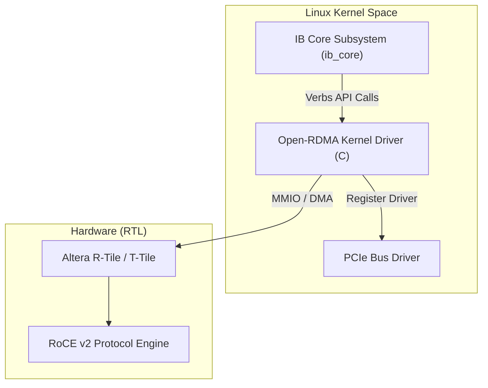
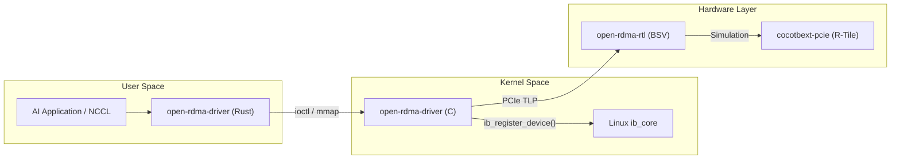

<!-- source: DeepWiki mcp.deepwiki.com · repo open-rdma/open-rdma · extra page Kernel-Space Driver (C) · fetched 2026-11-11 -->

# Kernel-Space Driver (C)

Relevant source files

The following files were used as context for generating this wiki page:

- [README.md](README.md)
- [README_CN.md](README_CN.md)

The Open-RDMA kernel-space driver is a C-based component residing within the `open-rdma-driver` repository. It serves as the foundational interface between the Linux kernel's InfiniBand (IB) core subsystem and the underlying hardware RTL. Its primary responsibilities include PCIe device lifecycle management, interrupt handling, memory pinning for DMA operations, and establishing the security boundaries required for high-performance kernel-bypass RDMA.

## PCIe Device Lifecycle Management

The driver implements a standard Linux PCIe driver model to manage the Open-RDMA hardware. It handles the discovery, initialization, and removal of the PCIe endpoint device.

### Device Initialization Flow
When the Linux kernel detects an Open-RDMA PCIe device, the driver's probe function is triggered. This sequence initializes the hardware state and registers the device with the InfiniBand core.

| Step | Function/Entity | Description |
| :--- | :--- | :--- |
| 1 | `pci_driver.probe` | Entry point for PCIe device discovery. |
| 2 | `pci_enable_device` | Enables the PCIe device and assigns resources. |
| 3 | `pci_request_regions` | Reserves PCIe I/O and memory regions for MMIO. |
| 4 | `ioremap` | Maps the hardware BAR (Base Address Register) into kernel virtual memory. |
| 5 | `ib_register_device` | Registers the Open-RDMA device as a valid InfiniBand device in `/sys/class/infiniband`. |

**Sources:** [README.md:125-125](), [README.md:148-154]()

## Integration with Linux IB Core Subsystem

The kernel driver acts as a "provider" within the Linux InfiniBand stack. It implements the standard `ib_device` interface, allowing user-space libraries (like the Rust-based user-space driver) and kernel consumers to interact with the hardware using standard Verbs APIs.

### IB Core Interface Mapping

The driver translates generic IB commands into hardware-specific register writes or command queue entries.

**Driver to IB Subsystem Interaction**

**Sources:** [README.md:82-84](), [README.md:185-191]()

## Memory Pinning and Security Boundary

RDMA requires that memory used for data transfer is "pinned" (locked in physical RAM) to prevent the kernel from swapping it out during DMA operations. The kernel driver enforces security by validating memory regions (MR) before they are accessed by the hardware.

*   **Memory Registration:** The driver handles `ib_reg_mr` calls, interacting with the Memory Management Unit (MMU) to pin pages and return a Steering Tag (STag) or L_Key to the user-space.
*   **DMA Mapping:** It ensures that user-space virtual addresses are correctly translated to physical addresses for the hardware's DMA engine.
*   **Security Boundary:** By managing the page tables and memory permissions in kernel space, the driver prevents a malicious user-space process from accessing memory belonging to other processes or the kernel itself.

**Sources:** [README.md:21-23](), [README.md:76-78]()

## Interrupt Handling and Event Management

The driver manages asynchronous events from the hardware, such as Completion Queue (CQ) notifications and hardware errors, using MSI-X (Message Signaled Interrupts).

### Interrupt Service Routine (ISR) Implementation
1.  **Interrupt Trigger:** The hardware RTL signals an interrupt via the PCIe bus.
2.  **Hard IRQ:** The driver's top-half ISR acknowledges the interrupt to the hardware.
3.  **Tasklet/Threaded IRQ:** The driver schedules a bottom-half to process the event, such as waking up a process waiting on a Completion Queue.

**Sources:** [README.md:120-130](), [README.md:185-191]()

## Code Entity Mapping

The following diagram bridges the conceptual driver components to the specific technical stacks and sub-repositories used in the Open-RDMA project.

**System Architecture to Code Entities**

**Sources:** [README.md:120-130](), [README.md:139-154](), [README.md:185-191]()

## Summary of Responsibilities

| Component | Responsibility | Implementation Language |
| :--- | :--- | :--- |
| **Control Path** | Device initialization, Memory registration, QP/CQ creation | C |
| **Resource Management** | BAR mapping, Interrupt allocation (MSI-X), DMA mapping | C |
| **Integration** | Linux InfiniBand Core Subsystem provider | C |
| **Verification** | Cocotb-based PCIe behavioral simulation | Python / C |

**Sources:** [README.md:76-78](), [README.md:120-130](), [README.md:152-152]()

---

