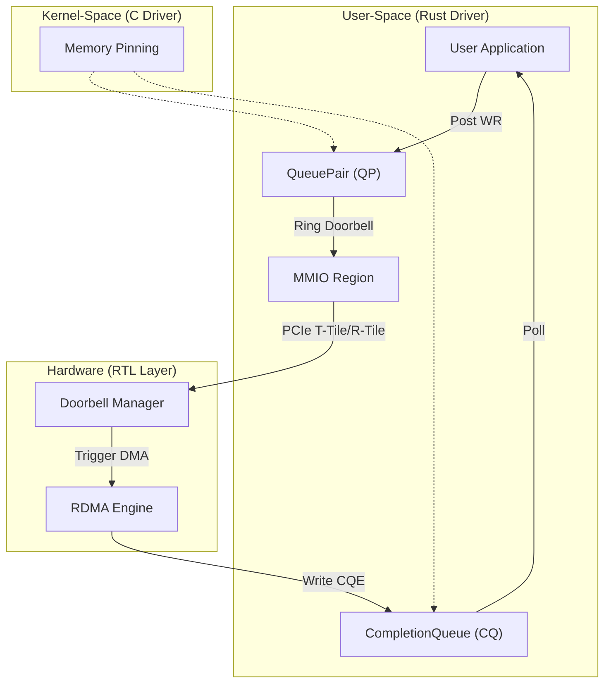
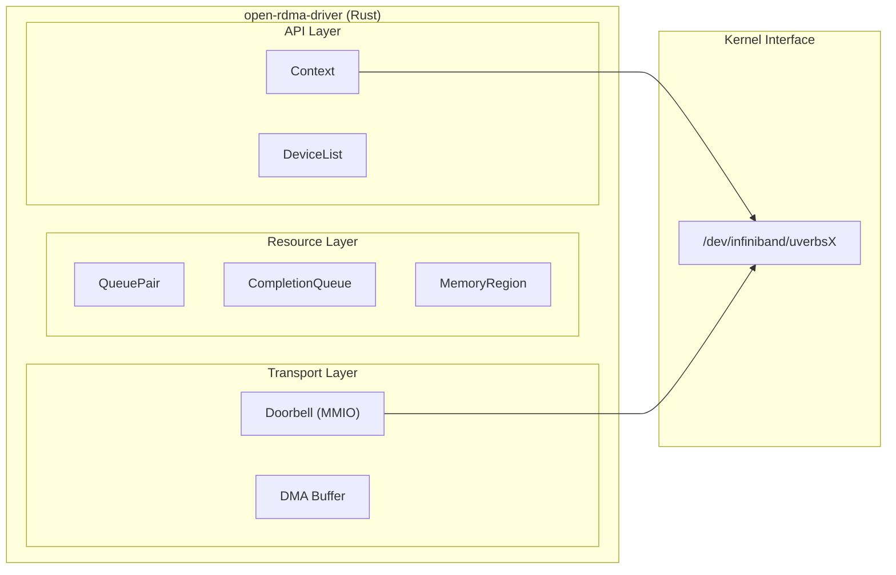

<!-- source: DeepWiki mcp.deepwiki.com · repo open-rdma/open-rdma · extra page User-Space Driver (Rust) · fetched 2026-11-11 -->

# User-Space Driver (Rust)

Relevant source files

The following files were used as context for generating this wiki page:

- [README.md](README.md)
- [README_CN.md](README_CN.md)

The user-space driver component of Open-RDMA is a high-performance, memory-safe implementation written in Rust. It is designed to facilitate kernel-bypass operations, allowing applications to interact directly with the RDMA hardware for data-path operations while relying on the kernel driver only for privileged resource allocation and security boundary enforcement.

## Architectural Overview

The user-space driver operates within the `open-rdma-driver` repository, providing the "fast-path" for RDMA operations [README.md:148-154](). By utilizing Rust, the driver ensures memory safety and concurrency without the overhead of a garbage collector, which is critical for maintaining the ultra-low latency required by AI infrastructure [README.md:82-85, 126]().

### Core Responsibilities
*   **Queue Pair (QP) Management**: Handling the submission of Work Requests (WR) to Send Queues and Receive Queues.
*   **Completion Queue (CQ) Management**: Polling for Completion Queue Entries (CQE) to notify applications of finished tasks.
*   **Memory Registration (MR)**: Interacting with the kernel to pin memory and provide the hardware with physical addresses.
*   **MMIO & Doorbell Access**: Writing to hardware registers via memory-mapped I/O to trigger hardware processing without kernel intervention.
*   **Integration**: Providing bindings and interfaces for AI frameworks like PyTorch and NCCL to leverage RDMA performance [README.md:96-99]().

## Data Flow and Kernel Bypass

The primary goal of the Rust driver is to enable **kernel-bypass**. In a traditional network stack, every packet requires a context switch to the kernel. In Open-RDMA, the user-space driver writes directly to the NIC's "Doorbell" registers.

### Doorbell Mechanism Logic
1.  **Preparation**: The application uses the Rust driver to post a Work Request (WR) into a circular buffer (the Queue Pair) in user-allocated memory.
2.  **Doorbell Ring**: The driver performs an MMIO write to a specific offset in the PCIe BAR (Base Address Register) space.
3.  **Hardware Pickup**: The hardware RTL [open-rdma-rtl]() detects the MMIO write, fetches the WR via DMA, and processes the RoCE v2 packet.

### User-Space to Hardware Interaction

The following diagram illustrates the relationship between the Rust driver entities and the hardware components.

**Diagram: User-Space Driver Entity Mapping**

Sources: [README.md:76-85](), [README.md:124-126]()

## Memory Management and Registration

RDMA requires that memory used for data transfers be "pinned" (locked in physical RAM) to prevent the OS from swapping it out during a DMA operation. 

*   **Memory Registration (MR)**: The Rust driver coordinates with the C kernel driver to pin specific virtual memory ranges.
*   **Virtual to Physical Mapping**: Once pinned, the hardware is provided with a translation table or physical addresses to perform zero-copy transfers.

## Integration with AI Frameworks

The Rust driver is specifically optimized for AI-Infra workloads, such as large model training involving collective communication patterns (All-Reduce, All-to-All) [README.md:21-23, 90-93]().

| Framework | Integration Method | Purpose |
| :--- | :--- | :--- |
| **PyTorch** | Custom C++/Rust Extensions | Offloading tensor transfers to RDMA hardware. |
| **NCCL** | Transport Plugin | Replacing standard TCP/IP or proprietary RDMA with Open-RDMA. |
| **CUDA** | Communication-Computation Fusion | Coordinating GPU memory triggers with RDMA doorbells [README.md:126-127](). |

## Code Structure and Implementation

The user-space driver logic is housed within the `open-rdma-driver` repository [README.md:148-154](). 

**Diagram: Software Stack and Code Entities**

Sources: [README.md:125-126](), [README.md:148-152]()

### Key Implementation Details
*   **Safety**: Uses Rust's `unsafe` blocks sparingly for MMIO and DMA pointer arithmetic, wrapping them in safe abstractions for the end-user.
*   **Performance**: Utilizes lock-free structures for the command and completion queues where possible to minimize contention in multi-threaded AI applications.
*   **Zero-Copy**: The driver ensures that data path operations involve no CPU-based copying of buffers, passing only descriptors to the hardware.

Sources:
* [README.md:76-85]()
* [README.md:124-130]()
* [README.md:148-154]()
* [README_CN.md:123-127]()

---

