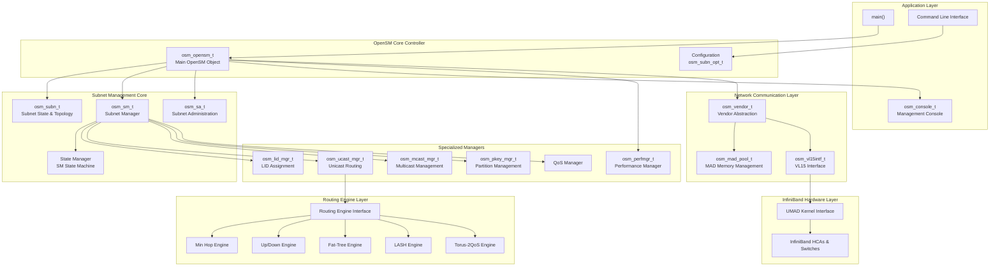
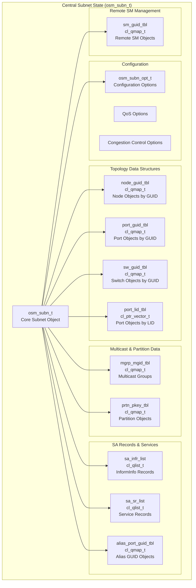
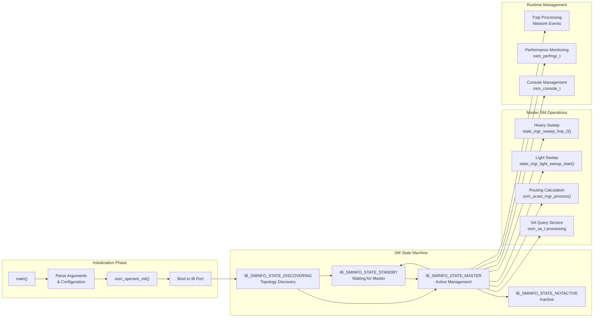
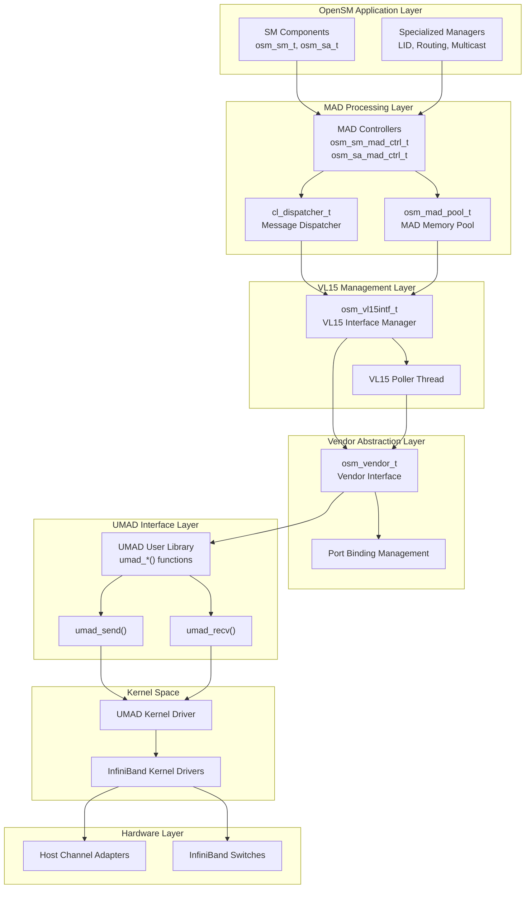

<!-- source: DeepWiki mcp.deepwiki.com · repo linux-rdma/opensm · page 1 OpenSM Overview · fetched 2026-11-11 -->

# OpenSM Overview

Relevant source files

The following files were used as context for generating this wiki page:

- [include/iba/ib_types.h](include/iba/ib_types.h)
- [include/opensm/osm_base.h](include/opensm/osm_base.h)
- [include/opensm/osm_helper.h](include/opensm/osm_helper.h)
- [include/opensm/osm_opensm.h](include/opensm/osm_opensm.h)
- [include/opensm/osm_subnet.h](include/opensm/osm_subnet.h)
- [man/opensm.8.in](man/opensm.8.in)
- [opensm/main.c](opensm/main.c)
- [opensm/osm_console.c](opensm/osm_console.c)
- [opensm/osm_opensm.c](opensm/osm_opensm.c)
- [opensm/osm_sa_class_port_info.c](opensm/osm_sa_class_port_info.c)
- [opensm/osm_state_mgr.c](opensm/osm_state_mgr.c)
- [opensm/osm_subnet.c](opensm/osm_subnet.c)

## Purpose and Scope

OpenSM is an InfiniBand compliant Subnet Manager (SM) and Subnet Administration (SA) implementation that runs on top of OpenIB. This document provides an architectural overview of the OpenSM codebase, including its core components, data structures, and system interactions.

OpenSM serves as the central control entity for InfiniBand fabrics, responsible for subnet initialization, topology discovery, routing configuration, and ongoing fabric management. At least one SM instance must be running per InfiniBand subnet to initialize and manage the hardware.

For detailed information about specific subsystems, see:
- Core architecture and initialization: [Core Architecture](#2)
- Network discovery and topology management: [Network Discovery and Topology](#3) 
- Routing algorithms and forwarding tables: [Routing Management](#4)
- Client query handling: [Subnet Administration (SA)](#5)
- Configuration and deployment: [Configuration and Deployment](#8)

## OpenSM System Architecture

OpenSM follows a modular architecture centered around the main `osm_opensm_t` controller object, which coordinates specialized management components and routing engines.

Sources: [opensm/main.c:1-700](), [include/opensm/osm_opensm.h:246-280](), [opensm/osm_opensm.c:1-300]()

## Core Data Structures and State Management

The `osm_subn_t` structure serves as the central repository for all subnet state information, containing topology maps, configuration options, and runtime data.

Sources: [include/opensm/osm_subnet.h:1100-1400](), [opensm/osm_subnet.c:1-500]()

## Initialization and Runtime Flow

OpenSM follows a structured initialization and operational flow, transitioning through well-defined SM states during subnet discovery and configuration.

Sources: [opensm/main.c:600-1000](), [opensm/osm_state_mgr.c:82-300](), [opensm/osm_opensm.c:400-800]()

## InfiniBand Communication Stack

OpenSM communicates with the InfiniBand fabric through a layered communication stack that abstracts hardware-specific details while providing MAD (Management Datagram) processing capabilities.

Sources: [include/opensm/osm_opensm.h:300-350](), [opensm/osm_vl15intf.c:1-200](), [vendor/osm_vendor_ibumad.c:1-300]()

## Routing Engine Architecture

OpenSM supports multiple routing algorithms through a pluggable routing engine interface, allowing selection of different routing strategies based on fabric topology and requirements.

```mermaid
graph TB
    subgraph "Routing Engine Interface"
        RE_IF["osm_routing_engine_t<br/>Common Interface"]
        RE_SETUP["setup() callback"]
        RE_BUILD["ucast_build_fwd_tables()"]
        RE_MATRICES["build_lid_matrices()"]
        RE_DESTROY["destroy() callback"]
    end
    
    subgraph "Built-in Routing Engines"
        MINHOP_RE["Min Hop Routing<br/>osm_ucast_minhop_setup()"]
        UPDN_RE["Up/Down Routing<br/>osm_ucast_updn_setup()"]
        FTREE_RE["Fat-Tree Routing<br/>osm_ucast_ftree_setup()"]
        LASH_RE["LASH Routing<br/>osm_ucast_lash_setup()"]
        TORUS_RE["Torus-2QoS Routing<br/>osm_ucast_torus2QoS_setup()"]
        FILE_RE["File-based Routing<br/>osm_ucast_file_setup()"]
        NUE_RE["Nue Routing<br/>osm_ucast_nue_setup()"]
        SSSP_RE["SSSP Routing<br/>osm_ucast_sssp_setup()"]
    end
    
    subgraph "External Routing Support"
        EXT_IF["external_routing_engine_module_t"]
        EXT_REG["osm_register_external_routing_engine()"]
    end
    
    subgraph "Routing Manager"
        UCAST_MGR["osm_ucast_mgr_t<br/>Unicast Manager"]
        ROUTE_CALC["Route Calculation Logic"]
        LFT_BUILD["Linear Forwarding Table Build"]
    end
    
    RE_IF --> RE_SETUP
    RE_IF --> RE_BUILD
    RE_IF --> RE_MATRICES
    RE_IF --> RE_DESTROY
    
    RE_IF --> MINHOP_RE
    RE_IF --> UPDN_RE
    RE_IF --> FTREE_RE
    RE_IF --> LASH_RE
    RE_IF --> TORUS_RE
    RE_IF --> FILE_RE
    RE_IF --> NUE_RE
    RE_IF --> SSSP_RE
    
    EXT_IF --> EXT_REG
    EXT_REG --> RE_IF
    
    UCAST_MGR --> ROUTE_CALC
    ROUTE_CALC --> RE_IF
    ROUTE_CALC --> LFT_BUILD
```

Sources: [include/opensm/osm_opensm.h:120-180](), [opensm/osm_opensm.c:72-200](), [opensm/osm_ucast_mgr.c:1-500]()

## Management and Configuration Interface

OpenSM provides multiple interfaces for configuration and runtime management, including configuration files, command-line options, and an interactive console.

| Interface Type | Component | Configuration Scope | Runtime Control |
|---|---|---|---|
| Command Line | `main.c` argument parsing | Initial configuration | Limited |
| Configuration File | `osm_subn_opt_t` loading | Complete configuration | Config reload |
| Interactive Console | `osm_console_t` | Runtime parameters | Full management |
| Performance Manager | `osm_perfmgr_t` | Performance monitoring | Statistics & control |
| Event Plugins | `osm_event_plugin_t` | Event handling | Custom extensions |

**Key Configuration Components:**

- **`osm_subn_opt_t`**: Central configuration structure containing all tunable parameters
- **`osm_console_t`**: Interactive management console with telnet/local access
- **`osm_perfmgr_t`**: Performance monitoring and statistics collection
- **Event Plugin Interface**: Extensibility for custom management logic

Sources: [opensm/main.c:129-600](), [include/opensm/osm_subnet.h:248-392](), [opensm/osm_console.c:60-150](), [opensm/osm_perfmgr.c:1-200]()

---

