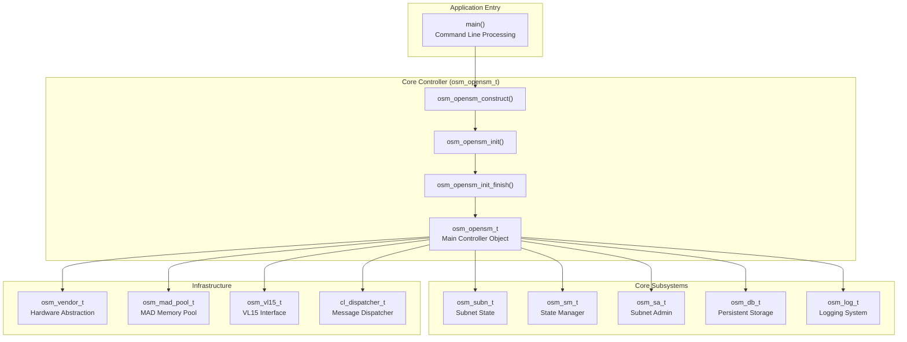
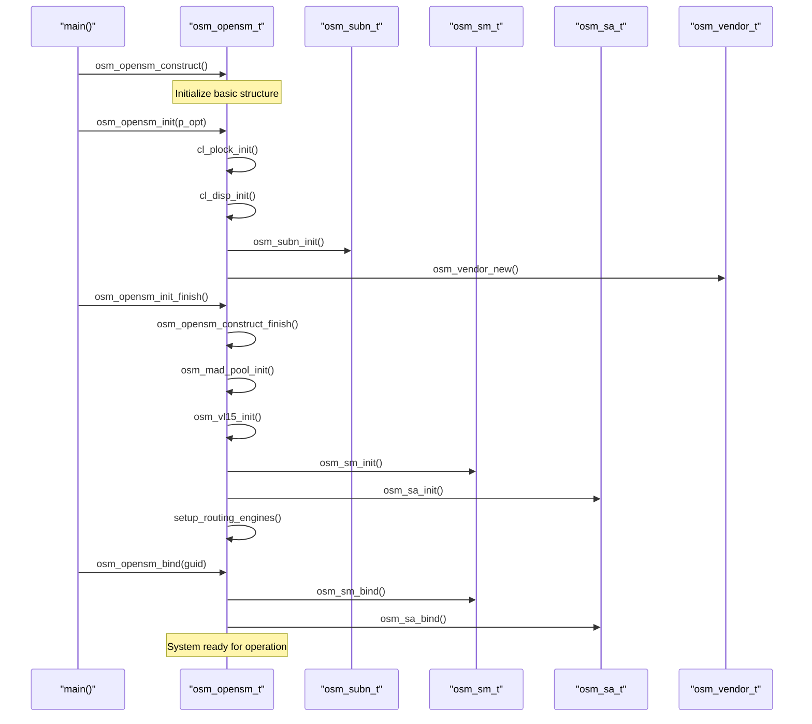
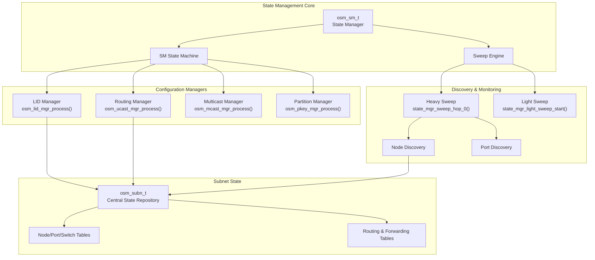
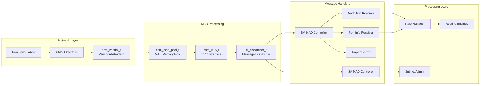
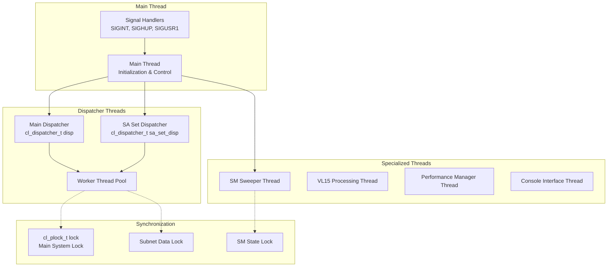

<!-- source: DeepWiki mcp.deepwiki.com · repo linux-rdma/opensm · page 2 Core Architecture · fetched 2026-11-11 -->

# Core Architecture

Relevant source files

The following files were used as context for generating this wiki page:

- [include/opensm/osm_opensm.h](include/opensm/osm_opensm.h)
- [include/opensm/osm_subnet.h](include/opensm/osm_subnet.h)
- [man/opensm.8.in](man/opensm.8.in)
- [opensm/main.c](opensm/main.c)
- [opensm/osm_opensm.c](opensm/osm_opensm.c)
- [opensm/osm_state_mgr.c](opensm/osm_state_mgr.c)
- [opensm/osm_subnet.c](opensm/osm_subnet.c)

This document describes the fundamental architecture of OpenSM, focusing on the main system components, their relationships, and the initialization flow. It covers the central data structures, the main controller object, and how the various subsystems integrate together.

For information about specific subnet management functions, see [State Management](#2.2). For details about network discovery processes, see [Network Discovery and Topology](#3). For routing-specific architecture, see [Routing Management](#4).

## Overview

OpenSM's core architecture is built around a central controller object (`osm_opensm_t`) that coordinates multiple specialized subsystems. The architecture follows a layered approach with clear separation between the main controller, subnet state management, specialized managers, and the underlying network communication layer.

## Main Controller Architecture

**OpenSM Main Controller Structure**

The `osm_opensm_t` structure serves as the central coordination point for all OpenSM functionality. It contains all major subsystems and provides the top-level interface for system operations.

Sources: [include/opensm/osm_opensm.h:246-274](), [opensm/osm_opensm.c:566-574](), [opensm/main.c:1-50]()

## Central Data Structures

```mermaid
graph TB
    subgraph "osm_opensm_t - Main Controller"
        OSM_VERSION["const char *osm_version"]
        SUBN_OBJ["osm_subn_t subn"]
        SM_OBJ["osm_sm_t sm"]
        SA_OBJ["osm_sa_t sa"]
        DB_OBJ["osm_db_t db"]
        VENDOR_PTR["osm_vendor_t *p_vendor"]
        LOG_OBJ["osm_log_t log"]
        LOCK["cl_plock_t lock"]
        ROUTING["routing_engine_list"]
    end
    
    subgraph "osm_subn_t - Subnet State"
        OSM_PTR["struct osm_opensm *p_osm"]
        SW_TBL["cl_qmap_t sw_guid_tbl"]
        NODE_TBL["cl_qmap_t node_guid_tbl"]
        PORT_TBL["cl_qmap_t port_guid_tbl"]
        ALIAS_TBL["cl_qmap_t alias_port_guid_tbl"]
        PRTN_TBL["cl_qmap_t prtn_pkey_tbl"]
        SM_TBL["cl_qmap_t sm_guid_tbl"]
        PORT_LID_TBL["cl_ptr_vector_t port_lid_tbl"]
        OPTIONS["osm_subn_opt_t opt"]
    end
    
    subgraph "osm_subn_opt_t - Configuration"
        GUID["ib_net64_t guid"]
        SUBNET_PREFIX["ib_net64_t subnet_prefix"]
        SM_KEY["ib_net64_t sm_key"]
        SWEEP_INTERVAL["uint32_t sweep_interval"]
        ROUTING_ENGINE["char *routing_engine_names"]
        LOG_FILE["char *log_file"]
        PRIORITY["uint8_t sm_priority"]
        LMC["uint8_t lmc"]
    end
    
    SUBN_OBJ --> SW_TBL
    SUBN_OBJ --> NODE_TBL
    SUBN_OBJ --> PORT_TBL
    SUBN_OBJ --> OPTIONS
    OPTIONS --> GUID
    OPTIONS --> ROUTING_ENGINE
    OSM_PTR --> OSM_VERSION
```

**Core Data Structure Relationships**

The architecture centers around three main data structures that hold the complete system state and configuration.

Sources: [include/opensm/osm_opensm.h:246-274](), [include/opensm/osm_subnet.h:777-814](), [include/opensm/osm_subnet.h:248-392]()

## Initialization Flow

**OpenSM Initialization Sequence**

The initialization process follows a carefully orchestrated sequence to ensure all dependencies are satisfied before the system becomes operational.

Sources: [opensm/main.c:441-486](), [opensm/osm_opensm.c:724-806](), [opensm/osm_opensm.c:808-870]()

## State Management Architecture

The state management system coordinates subnet discovery, configuration, and monitoring through a centralized state machine and specialized managers.

**State Management System Architecture**

The state management system orchestrates all subnet management activities through a coordinated set of specialized managers that operate on the central subnet state.

Sources: [opensm/osm_state_mgr.c:82-95](), [opensm/osm_state_mgr.c:210-270](), [opensm/osm_state_mgr.c:790-862]()

## Message Processing Architecture

OpenSM uses a sophisticated message processing system to handle InfiniBand Management Datagrams (MADs) and coordinate responses across multiple subsystems.

**Message Processing Flow**

The message processing architecture provides a scalable framework for handling high-volume MAD traffic while maintaining proper sequencing and state consistency.

Sources: [opensm/osm_opensm.c:817-827](), [include/opensm/osm_opensm.h:258-266](), [opensm/osm_state_mgr.c:162-204]()

## Configuration System

The configuration system manages both runtime options and persistent state across OpenSM restarts.

| Component | Purpose | Key Data Structures |
|-----------|---------|-------------------|
| **Command Line Parsing** | Process startup arguments | `main()` argument processing |
| **Configuration Options** | Store runtime settings | `osm_subn_opt_t` |
| **Persistent Database** | Store state across restarts | `osm_db_t`, guid2lid, neighbors |
| **Option Validation** | Validate and apply settings | Option parsing functions |

**Configuration Management Components**

The configuration system ensures consistent settings across restarts and provides validation for all user-configurable parameters.

Sources: [opensm/main.c:129-439](), [include/opensm/osm_subnet.h:248-392](), [opensm/osm_subnet.c:762-928]()

## Threading and Concurrency Model

OpenSM employs a sophisticated threading model to handle concurrent operations while maintaining data consistency.

**OpenSM Threading Architecture**

The threading model provides scalable processing while maintaining strict consistency through carefully designed locking strategies.

Sources: [opensm/main.c:96-127](), [opensm/osm_opensm.c:764-787](), [include/opensm/osm_opensm.h:266]()

This core architecture provides the foundation for all OpenSM operations, ensuring reliable subnet management through well-defined component boundaries and clear data flow patterns.

---

