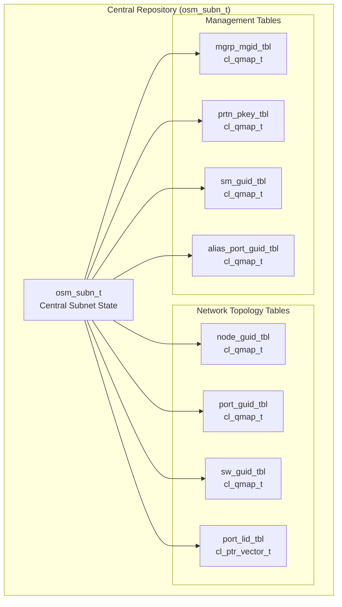
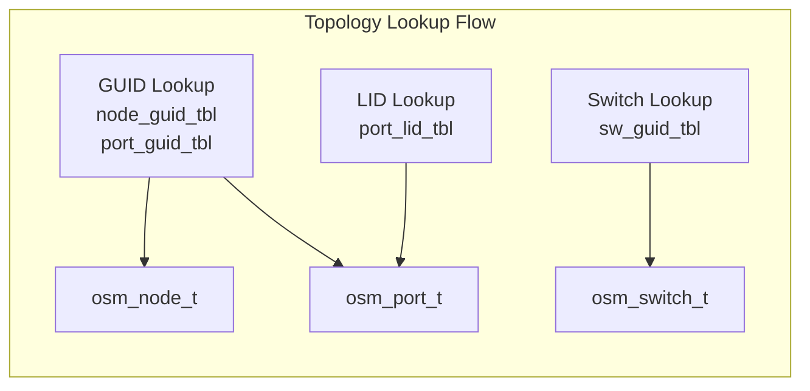
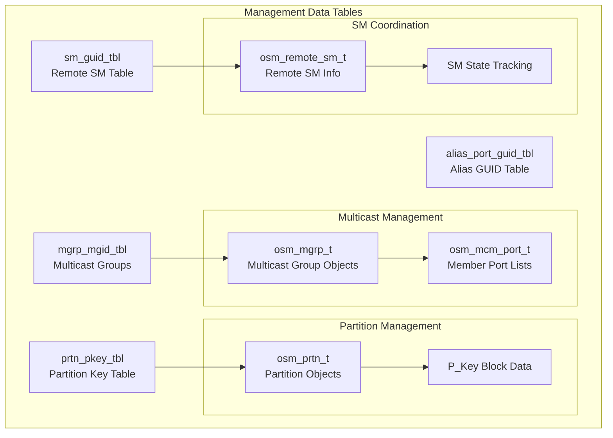
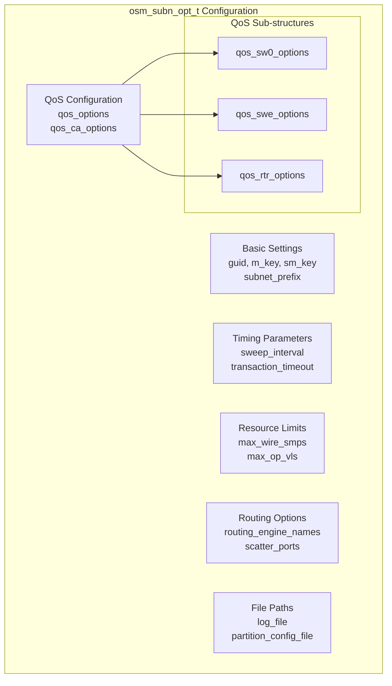
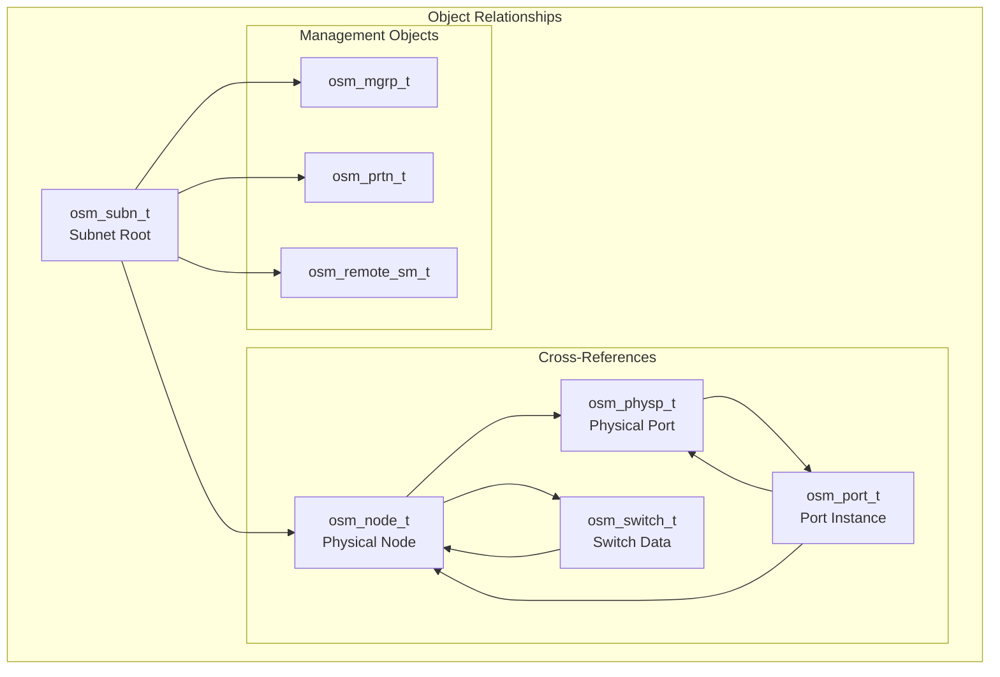

<!-- source: DeepWiki mcp.deepwiki.com · repo linux-rdma/opensm · page 2.1 Central Data Structures · fetched 2026-11-11 -->

# Central Data Structures

Relevant source files

The following files were used as context for generating this wiki page:

- [include/iba/ib_types.h](include/iba/ib_types.h)
- [include/opensm/osm_base.h](include/opensm/osm_base.h)
- [include/opensm/osm_helper.h](include/opensm/osm_helper.h)
- [include/opensm/osm_subnet.h](include/opensm/osm_subnet.h)
- [opensm/osm_console.c](opensm/osm_console.c)
- [opensm/osm_sa_class_port_info.c](opensm/osm_sa_class_port_info.c)
- [opensm/osm_state_mgr.c](opensm/osm_state_mgr.c)
- [opensm/osm_subnet.c](opensm/osm_subnet.c)

This document describes the central data structures that represent the InfiniBand subnet state within OpenSM. These structures form the core repository of topology information, configuration settings, and runtime state that drives subnet management decisions. For information about how these structures are populated during subnet discovery, see [Network Discovery and Topology](#3). For details on how routing algorithms use these structures, see [Routing Management](#4).

## Central Subnet Repository

The `osm_subn_t` structure serves as the primary data repository for all subnet information in OpenSM. This structure acts as the central hub containing hash tables for all network objects and their relationships.

The `osm_subn_t` structure contains multiple hash tables implemented using the CompLib `cl_qmap_t` data structure, which provides O(log n) lookup performance. Each table is keyed by a specific identifier type (GUID, LID, etc.) and stores pointers to the corresponding network objects.

Sources: [include/opensm/osm_subnet.h:700-1000](), [opensm/osm_subnet.c:1-100]()

## Network Topology Maps

The core topology information is stored in four primary hash tables within `osm_subn_t`:

| Table Name | Key Type | Value Type | Purpose |
|------------|----------|------------|---------|
| `node_guid_tbl` | `ib_net64_t` (Node GUID) | `osm_node_t*` | All nodes in fabric |
| `port_guid_tbl` | `ib_net64_t` (Port GUID) | `osm_port_t*` | All ports in fabric |
| `sw_guid_tbl` | `ib_net64_t` (Switch GUID) | `osm_switch_t*` | Switch-specific data |
| `port_lid_tbl` | `uint16_t` (LID) | `osm_port_t*` | LID to port mapping |

The `port_lid_tbl` uses a `cl_ptr_vector_t` instead of a `cl_qmap_t` because LID values are sequential integers, allowing for direct array indexing for O(1) lookup performance.

Sources: [include/opensm/osm_subnet.h:700-800](), [opensm/osm_subnet.c:275-300]()

## Management Data Structures

OpenSM maintains several additional hash tables for management functions:

The `alias_port_guid_tbl` handles alias GUID assignments for ports that support multiple GUIDs, which is common in modern InfiniBand HCAs that expose multiple virtual ports per physical port.

Sources: [include/opensm/osm_subnet.h:800-900](), [opensm/osm_state_mgr.c:350-400]()

## Configuration Structure

The `osm_subn_opt_t` structure contains all configuration parameters for OpenSM operation:

Key configuration categories include:

- **Network Identity**: `guid`, `m_key`, `sm_key`, `subnet_prefix`
- **Sweep Control**: `sweep_interval`, `max_wire_smps`, `transaction_timeout`
- **Routing Parameters**: `routing_engine_names`, `scatter_ports`, `use_ucast_cache`
- **QoS Settings**: Separate `osm_qos_options_t` structures for different device types

Sources: [include/opensm/osm_subnet.h:248-392](), [opensm/osm_subnet.c:762-928]()

## Data Structure Relationships

The central data structures maintain referential relationships that enable efficient traversal and lookup:

**Key Relationships:**
- Each `osm_node_t` contains an array of `osm_physp_t` structures representing its physical ports
- Each `osm_port_t` references a specific `osm_physp_t` and maintains back-references to its parent node
- Switch nodes have an associated `osm_switch_t` structure containing forwarding tables and switch-specific data
- The `osm_subn_t` root maintains hash tables for fast lookup while objects maintain cross-references for traversal

This design enables both efficient lookups (via hash tables) and efficient traversal (via object references) depending on the access pattern required.

Sources: [include/opensm/osm_subnet.h:700-1000](), [opensm/osm_subnet.c:1-300](), [opensm/osm_state_mgr.c:1-200]()

---

